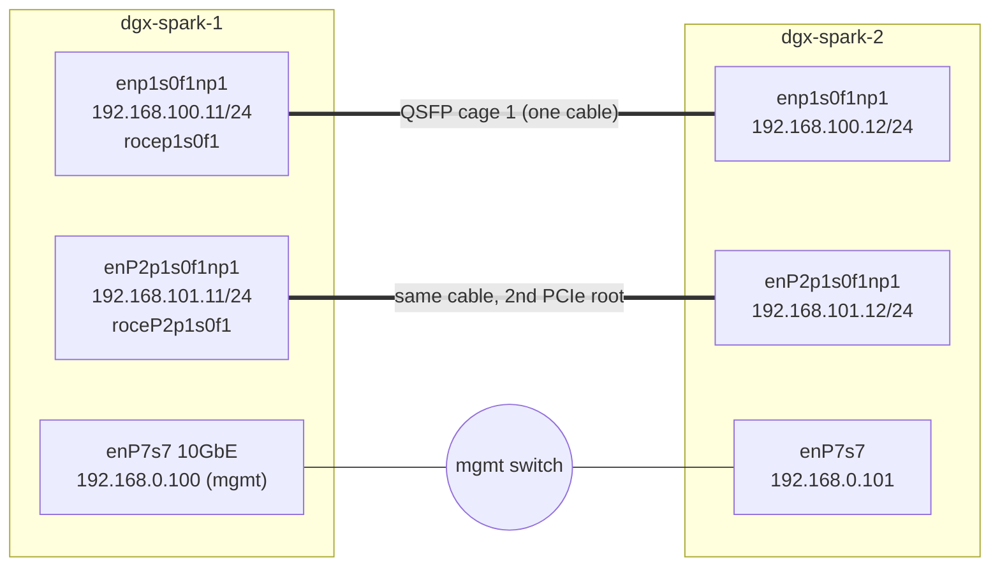

# Chapter 13 · ConnectX-7 Fabric & OpenSM: RDMA over Converged Ethernet, Topologies & Verification (with the InfiniBand Mapping)

> **01-Ansible · Part III — Fabric & storage · Chapter 13 of 30** · ← [Chapter 12 · GPU telemetry & alerting](12-gpu-telemetry-and-alerting.md) · [All chapters](00-ansible-step-by-step-guide.md) · [Chapter 14 · RoCEv2, QoS & NCCL](14-rocev2-qos-and-nccl.md) →

| | |
|---|---|
| **You will build** | Addressed, verified CX-7 links between Sparks (`13.1-fabric.yml`), RDMA bandwidth and latency measurements (`13.2-rdma-perftest.yml`), and the mental model to carry this to InfiniBand clusters |
| **Hardware** | 2× DGX Spark + 1 QSFP cable (direct-attach copper for 200G, or an AOC). 3–4 Sparks need a ring or a switch (§2.3) |
| **Time** | 90 min |
| **Risk** | Medium. Network reconfiguration, but only on CX-7 interfaces; management stays on `enP7s7` |

---

## 1. The hardware, precisely

Each Spark has a **ConnectX-7** with **two QSFP cages**, up to 200 Gb/s. Two things confuse everyone the first time:

1. **Each physical cage appears as two netdevs and two RDMA devices**, because the NIC is attached through two PCIe roots:

   | Cage | netdev (root 1) | RDMA dev | netdev (root 2) | RDMA dev |
   |---|---|---|---|---|
   | Port 0 | `enp1s0f0np0` | `rocep1s0f0` | `enP2p1s0f0np0` | `roceP2p1s0f0` |
   | Port 1 | `enp1s0f1np1` | `rocep1s0f1` | `enP2p1s0f1np1` | `roceP2p1s0f1` |

   NVIDIA's guidance is that **one cable can deliver full bandwidth**, but **both logical interfaces of that cage need IP addresses** to get it (and with two cables, all four).

2. **It runs Ethernet, and RDMA is RoCE.** The RDMA device names (`roce…`) say so. There's no InfiniBand subnet manager here. NCCL, NFS/RDMA and perftest all use the RDMA verbs API over RoCEv2 (RDMA in UDP/IP).

## 2. Architecture

### 2.1 HLD: two Sparks, one cable



One **subnet per logical link** (`.100.x` and `.101.x`), so the kernel routes each pair over its own netdev and there's no ambiguity about which interface answers ARP.

### 2.2 LLD

| Setting | Value | Where |
|---|---|---|
| Netplan file | `/etc/netplan/40-cx7.yaml`, mode `0600`, `renderer: networkd` | `cx7_fabric` template |
| Addressing | host_vars `cx7_interfaces[]` | `inventory/host_vars/spark-0N.yml` |
| MTU | 9000 (both ends must match) | host_vars |
| `optional: true` | Boot doesn't wait for an unplugged cable | template |
| Link verification | operstate `up`, speed `200000`, MTU, `ibv_devinfo` `PORT_ACTIVE` | role asserts |
| Reachability | `ping -M do -s 8972` (DF set, jumbo) to each same-subnet peer | role |
| Published facts | `cx7_fabric_primary_if`, `_primary_ip`, `_hca_list`, `_roce_gid_index` | consumed by NCCL, vLLM, Kubernetes (Multus NADs), NFS |

### 2.3 Scaling past two Sparks (NVIDIA-documented topologies)

| Sparks | Topology | Addressing pattern | Notes |
|---|---|---|---|
| 2 | Direct cable | /24 per logical link (this lab) | Simplest |
| 3 | **Ring**: each Spark uses both cages, one to each neighbour | One subnet per link (point-to-point) | NCCL settings for rings: `NCCL_IB_SUBNET_AWARE_ROUTING=1`, `NCCL_NET_PLUGIN=none` |
| 4+ | **Switch** (QSFP56/QSFP56-DD, 200G ports) | One L2 bridge on the switch, one subnet, DHCP from the switch or static | Force 200G on switch ports if autonegotiation lands at 100G; use the same cage on every Spark |

To model a ring in this lab, give each host **two** `cx7_interfaces` groups on different cages with per-link subnets. The role's peer computation (same /24 → peer) already handles it.

---

## 3. Hands-on

### 3.1 Cable and discover

#### What this lab does (command `ibdev2netdev`)

- **Read-only:** lists which RDMA device belongs to which CX-7 netdev, and whether its link is up. Nothing is configured.
- **Why first:** the names it prints are the names `cx7_interfaces` in `inventory/host_vars/dgx-spark-1.yml` must use. If they differ, `13.1 Fabric` stops at its first assert.
- **One Spark:** this step works without a second Spark or a cable. It is the main CX-7 check you can do alone.

#### What to look for

1. **The device names:** four lines, one per logical port, matching the table in §1: `rocep1s0f0`, `rocep1s0f1`, `roceP2p1s0f0`, `roceP2p1s0f1`, each `==>` its `enp…`/`enP2p…` netdev.
2. **The link state:** `(Up)` on both logical interfaces of the cabled cage (cage 1 in this lab). Without a cable every line shows `(Down)`, which is expected with one Spark.
3. **Driver and RDMA links**, with the commands below:
   ```bash
   # ▶ dgx-spark-1 (ssh dgx-spark-1)
   rdma link show                                       # four links; state ACTIVE when cabled, DOWN without a cable
   ethtool -i enp1s0f1np1 | grep -E '^driver|firmware'  # driver: mlx5_core, plus the CX-7 firmware version
   ibv_devinfo -d rocep1s0f1 | grep -E 'state|link_layer'   # link_layer: Ethernet (RoCE, not InfiniBand)
   ```
   Note the firmware version: Chapter 28 compares it across nodes.

**If something's off:** no `roce…` devices at all → the RDMA stack is not loaded (`lsmod | grep mlx5_ib`). `(Down)` with a cable in → reseat it, use the same cage on both Sparks, reboot both. More in §5.

#### Run it

```bash
# ▶ MacBook · any folder
ssh dgxadmin@192.168.0.100 ibdev2netdev
# rocep1s0f1 port 1 ==> enp1s0f1np1 (Up)
# roceP2p1s0f1 port 1 ==> enP2p1s0f1np1 (Up)
```

Use the **same cage number** on both Sparks. It keeps the config symmetric, and NVIDIA's NCCL guides recommend it. If nothing shows `Up`, reseat the cable and reboot both.

### 3.2 Configure and verify the fabric

#### What this lab does (template `13.1 Fabric`)

- **Pre-flight:** runs `ibdev2netdev` and checks that every interface in the host's `cx7_interfaces` exists. On dgx-spark-1 that is `enp1s0f1np1` → `192.168.100.11/24` and `enP2p1s0f1np1` → `192.168.101.11/24`, both MTU 9000 (dgx-spark-2 gets `.12`).
- **Netplan:** writes `/etc/netplan/40-cx7.yaml` (mode `0600`), validates it with `netplan generate`, and runs `netplan apply` only when the file changed. The management NIC `enP7s7` is not in this file and is never touched.
- **Runtime drift:** compares the live MTU of each port with the desired one and re-applies netplan if someone changed it by hand.
- **Verification:** reads link state, speed, MTU and RDMA port state; finds the RoCE v2 IPv4 GID index; sends jumbo pings with the don't-fragment bit to every peer in the same /24.
- **Output for later chapters:** publishes `cx7_fabric_primary_if`, `cx7_fabric_hca_list` and `cx7_fabric_roce_gid_index`, and prints them as the NCCL environment.

#### What to look for

1. **Semaphore run:** `failed=0`. A first run shows `changed` on *Render netplan for CX-7* and *Apply netplan*; a re-run shows `changed=0`.
2. **The *Assert link health* task** prints one `OK` line per interface. Healthy values:

   | Field | Healthy value |
   |---|---|
   | `speed` | `200000` |
   | `mtu` | `9000` |
   | `oper` | `up` |
   | `rdma_state` | `PORT_ACTIVE` |

3. **The jumbo ping task** shows `ok` for each peer address, one per subnet: `192.168.100.12` and `192.168.101.12`.
4. **The NCCL environment** at the end: `NCCL_SOCKET_IFNAME=enp1s0f1np1`, `NCCL_IB_HCA=rocep1s0f1,roceP2p1s0f1` and `NCCL_IB_GID_INDEX=` a number (`3` in the example below). The GID task is allowed to fail without failing the play, so check by eye: an empty value means no RoCE v2 IPv4 GID was found.
5. **On the Spark:**
   ```bash
   # ▶ dgx-spark-1 (ssh dgx-spark-1)
   ip -br addr show | grep -E 'enp1s0f1np1|enP2p1s0f1np1'   # 192.168.100.11/24 and 192.168.101.11/24; UP when cabled
   cat /sys/class/net/enp1s0f1np1/mtu                         # 9000
   sudo ls -l /etc/netplan/40-cx7.yaml                         # -rw------- root root
   ```

**With only one Spark:** dgx-spark-1's host_vars already list its two CX-7 interfaces, so this play does *not* skip itself. It writes the netplan file and addresses the ports, finds no peers (no pings), and then fails at *Assert link health*: without a cable the ports report `speed: -1`, `oper: down` and a `rdma_state` other than `PORT_ACTIVE`. *Wait for CX-7 links to come up* first spends about 30 s per interface retrying. To exercise the role anyway, add the extra variable `cx7_fabric_strict: false`: the assert then prints `unhealthy` lines instead of failing, and you can still check item 5 (addresses, MTU 9000, file mode). The GID index may stay empty while the ports have no link. The same applies to the `site` template, which includes this playbook.

**If something's off:** `… not found. ibdev2netdev shows: …` → fix the names in host_vars. Speed `100000` → the cable or a switch port negotiated 100G. Plain ping works but the jumbo ping fails → MTU mismatch. More in §5.

```yaml
# lab/roles/cx7_fabric/tasks/main.yml
---
# Everything lives in fabric.yml. We use a conditional include instead of
# `meta: end_host`: end_host would end the host for the WHOLE play, silently
# skipping any roles that follow this one (e.g. in 26.1-drift-check.yml).
- name: Configure and verify CX-7 fabric
  ansible.builtin.include_tasks: fabric.yml
  when: cx7_fabric_interfaces | length > 0
```

```yaml
# lab/roles/cx7_fabric/tasks/fabric.yml
---
# ---------------------------------------------------------------- pre-flight
- name: Discover RDMA <-> netdev mapping
  ansible.builtin.command: ibdev2netdev
  register: cx7_fabric_ibdev
  changed_when: false
  check_mode: false        # read-only probe: must also run under --check (drift detection)

# "rocep1s0f1 port 1 ==> enp1s0f1np1 (Up)"  ->  {"enp1s0f1np1": {"rdma_dev": "rocep1s0f1", "state": "Up"}}
- name: Parse ibdev2netdev into a dict keyed by netdev
  ansible.builtin.set_fact:
    cx7_fabric_map: >-
      
      
        
        
          
        
      
      {{ m }}

- name: Assert every configured interface exists
  ansible.builtin.assert:
    that: item.name in cx7_fabric_map
    fail_msg: >-
      {{ item.name }} not found. ibdev2netdev shows: {{ cx7_fabric_map.keys() | list }}.
      Fix host_vars/{{ inventory_hostname }}.yml cx7_interfaces.
    quiet: true
  loop: "{{ cx7_fabric_interfaces }}"
  loop_control:
    label: "{{ item.name }}"

# ---------------------------------------------------------------- configure
- name: Render netplan for CX-7
  ansible.builtin.template:
    src: 40-cx7.yaml.j2
    dest: "{{ cx7_fabric_netplan_file }}"
    owner: root
    group: root
    mode: "0600"            # netplan warns on world-readable files
  register: cx7_fabric_netplan

- name: Validate netplan syntax before applying  # noqa: no-handler (must run before apply, in order)
  ansible.builtin.command: netplan generate
  changed_when: false
  check_mode: false        # read-only probe: must also run under --check (drift detection)
  when: cx7_fabric_netplan is changed

- name: Apply netplan  # noqa: no-handler (later verify tasks need the links up in this run)
  ansible.builtin.command: netplan apply
  changed_when: true
  when: cx7_fabric_netplan is changed

- name: Wait for CX-7 links to come up
  ansible.builtin.command: "cat /sys/class/net/{{ item.name }}/operstate"
  register: cx7_fabric_oper
  until: cx7_fabric_oper.stdout == 'up'
  retries: 15
  delay: 2
  changed_when: false
  check_mode: false        # read-only probe: must also run under --check (drift detection)
  failed_when: false
  loop: "{{ cx7_fabric_interfaces }}"
  loop_control:
    label: "{{ item.name }}"

# ---------------------------------------------------------------- runtime reconciliation
# The netplan FILE can be perfect while the RUNNING state is not (someone ran
# `ip link set ... mtu 1500`). Compare live MTU with desired and re-apply.
- name: Read live MTU per interface
  ansible.builtin.command: "cat /sys/class/net/{{ item.name }}/mtu"
  register: cx7_fabric_live_mtu
  changed_when: false
  check_mode: false        # read-only probe: must also run under --check (drift detection)
  loop: "{{ cx7_fabric_interfaces }}"
  loop_control:
    label: "{{ item.name }}"

- name: Interfaces whose runtime MTU differs from desired
  ansible.builtin.set_fact:
    cx7_fabric_runtime_drift: >-
      
      
        
          
        
      
      {{ bad }}

- name: Re-apply netplan to fix runtime drift
  ansible.builtin.command: netplan apply
  changed_when: true
  when:
    - cx7_fabric_runtime_drift | length > 0
    - not ansible_check_mode

- name: Report runtime drift in check mode
  ansible.builtin.debug:
    msg: "Runtime MTU drift on {{ cx7_fabric_runtime_drift }} — netplan apply would fix it"
  changed_when: true
  when:
    - cx7_fabric_runtime_drift | length > 0
    - ansible_check_mode

# ---------------------------------------------------------------- verify
- name: Read link speed / MTU / RDMA port state
  ansible.builtin.shell: |
    set -o pipefail
    printf '{"speed":%s,"mtu":%s,"oper":"%s","rdma_state":"%s"}' \
      "$(cat /sys/class/net/{{ item.name }}/speed 2>/dev/null || echo -1)" \
      "$(cat /sys/class/net/{{ item.name }}/mtu)" \
      "$(cat /sys/class/net/{{ item.name }}/operstate)" \
      "$(ibv_devinfo -d {{ item.rdma_dev }} 2>/dev/null | awk '/state:/{print $2; exit}')"
  args:
    executable: /bin/bash
  register: cx7_fabric_link
  changed_when: false
  check_mode: false        # read-only probe: must also run under --check (drift detection)
  loop: "{{ cx7_fabric_interfaces }}"
  loop_control:
    label: "{{ item.name }}"

- name: Build link report
  ansible.builtin.set_fact:
    cx7_fabric_report: >-
      {{ cx7_fabric_report | default({}) | combine({item.item.name: (item.stdout | from_json)}) }}
  loop: "{{ cx7_fabric_link.results }}"
  loop_control:
    label: "{{ item.item.name }}"

- name: Assert link health
  ansible.builtin.assert:
    that:
      - cx7_fabric_report[item.name].oper == 'up'
      - cx7_fabric_report[item.name].speed | int == cx7_fabric_expected_speed_mbps
      - cx7_fabric_report[item.name].mtu | int == item.mtu | default(9000) | int
      - cx7_fabric_report[item.name].rdma_state == 'PORT_ACTIVE'
    fail_msg: "{{ item.name }} unhealthy: {{ cx7_fabric_report[item.name] }}"
    success_msg: "{{ item.name }} OK: {{ cx7_fabric_report[item.name] }}"
  register: cx7_fabric_assert
  failed_when: cx7_fabric_strict | bool and cx7_fabric_assert.failed | default(false)
  loop: "{{ cx7_fabric_interfaces }}"
  loop_control:
    label: "{{ item.name }}"

- name: Discover RoCEv2 IPv4 GID index (value for NCCL_IB_GID_INDEX)
  ansible.builtin.shell: |
    set -o pipefail
    d=/sys/class/infiniband/{{ item.rdma_dev }}/ports/1
    for t in "$d"/gid_attrs/types/*; do
      idx=$(basename "$t")
      type=$(cat "$t" 2>/dev/null) || continue
      gid=$(cat "$d/gids/$idx")
      # RoCE v2 + IPv4-mapped GID (0000:...:ffff:c0a8:640b)
      if [ "$type" = "RoCE v2" ] && [[ "$gid" == 0000:0000:0000:0000:0000:ffff:* ]]; then
        echo "$idx"; exit 0
      fi
    done
    exit 1
  args:
    executable: /bin/bash
  register: cx7_fabric_gid
  changed_when: false
  check_mode: false        # read-only probe: must also run under --check (drift detection)
  failed_when: false
  loop: "{{ cx7_fabric_interfaces }}"
  loop_control:
    label: "{{ item.rdma_dev }}"

- name: Publish fabric facts for later roles (NCCL, Slurm, Kubernetes, vLLM)
  ansible.builtin.set_fact:
    cx7_fabric_primary_if: "{{ cx7_fabric_interfaces[0].name }}"
    cx7_fabric_primary_ip: "{{ cx7_fabric_interfaces[0].address.split('/')[0] }}"
    cx7_fabric_hca_list: "{{ cx7_fabric_interfaces | map(attribute='rdma_dev') | join(',') }}"
    cx7_fabric_roce_gid_index: "{{ cx7_fabric_gid_index or (cx7_fabric_gid.results[0].stdout | default('', true)) }}"

# Build [peer_ip, my_interface] pairs for peers that share a /24 with one of my ports.
- name: Compute fabric peers
  ansible.builtin.set_fact:
    cx7_fabric_peer_pairs: >-
      
      
        
          
            
              
            
          
        
      
      {{ pairs }}

- name: Jumbo-frame reachability to peers (DF bit set, MTU-28 byte payload)
  ansible.builtin.command: >-
    ping -c 3 -W 1 -M do -s {{ item.mtu | int - 28 }} -I {{ item.dev }} {{ item.ip }}
  loop: "{{ cx7_fabric_peer_pairs }}"
  loop_control:
    label: "{{ item.dev }} -> {{ item.peer }} ({{ item.ip }})"
  changed_when: false
  check_mode: false        # read-only probe: must also run under --check (drift detection)
  when: cx7_fabric_verify_peers | bool
```

#### Run it

**Semaphore UI:** run the template **`13.1 Fabric`**. Break-glass from the MacBook:

```bash
# ▶ MacBook · technical-depth (repo root)
cd "01-Ansible/lab"
```

```bash
# ▶ MacBook · 01-Ansible/lab (venv active)
ansible-playbook playbooks/13.1-fabric.yml -K
```

Expected tail:

```
TASK [cx7_fabric : Assert link health]
ok: [dgx-spark-1] => (item=enp1s0f1np1) => msg: 'enp1s0f1np1 OK: {''speed'': 200000, ''mtu'': 9000, ''oper'': ''up'', ''rdma_state'': ''PORT_ACTIVE''}'
TASK [cx7_fabric : Jumbo-frame reachability to peers (DF bit set, MTU-28 byte payload)]
ok: [dgx-spark-1] => (item=enp1s0f1np1 -> dgx-spark-2 (192.168.100.12))
TASK [Print NCCL environment derived from the fabric]
  - export NCCL_SOCKET_IFNAME=enp1s0f1np1
  - export NCCL_IB_HCA=rocep1s0f1,roceP2p1s0f1
  - export NCCL_IB_GID_INDEX=3
```

### 3.3 Measure RDMA

#### What this lab does (template `13.2 RDMA perftest`)

- **Needs two Sparks:** with fewer than two hosts in the `spark` group the play ends at its first task (*Needs two Sparks*). Nothing runs and nothing changes.
- **Fabric check first:** includes the `cx7_fabric` role in a relaxed mode (no peer pings, no hard fail), only to find the port's RDMA device and GID index.
- **Bandwidth:** starts an `ib_write_bw` server on the second Spark in the background, then runs the client on the first: 4 queue pairs, 1 MiB messages, 10 seconds, over one logical port (`perftest_port_idx`, default 0 = `rocep1s0f1`).
- **Latency:** the same pattern with `ib_write_lat`.
- **Read-only:** the perftest tasks change nothing on either Spark; the tools (`perftest`) come from the baseline packages.

#### What to look for

1. **Semaphore run:** `failed=0`, `changed=0` (the fabric was already converged by `13.1 Fabric`).
2. **The *Report* task** on dgx-spark-1:

   | Field | Healthy value |
   |---|---|
   | `device` | `rocep1s0f1 (GID idx …)` for idx 0, `roceP2p1s0f1 (GID idx …)` for idx 1; the index is the one `13.1 Fabric` printed (3 in this chapter's examples) |
   | `bw_gbps` | a number. One logical port alone typically shows about half the cage's 200 Gb/s (the playbook's own note) |
   | `lat_typical_usec` | a few microseconds; record it as your baseline |

   `n/a` means the output could not be parsed: re-run with `-v` and read the client's raw output.
3. **Queue pairs matter:** the run with `-e perftest_qps=1` should show a clearly lower `bw_gbps` than the default `-q 4`.
4. **The whole cage:** the playbook tests one logical port at a time. To see the full link, run the manual commands below on both logical ports at the same time (two terminals).

**With only one Spark:** the template ends immediately with `failed=0` and no numbers, which is correct. There is nothing to measure without a peer. What you can still check on dgx-spark-1 is the input perftest would use: `show_gids | grep -E 'rocep1s0f1|v2'` lists the RoCE v2 GIDs (an IPv4-mapped GID appears once `13.1 Fabric` has addressed the port), and `ibv_devinfo -d rocep1s0f1` shows the device and its port state.

**If something's off:** `Couldn't connect` → wrong GID index (use the RoCE v2 IPv4 one from `show_gids`). About half the expected rate → one logical port or `-q 1`. Low numbers on a good link → MTU not 9000 on both ends. More in §5.

```yaml
# lab/playbooks/13.2-rdma-perftest.yml
---
# RDMA verbs bandwidth/latency between two Sparks over CX-7 (RoCEv2).
# Server side runs on the 2nd Spark (async), client on the 1st.
#   ansible-playbook playbooks/13.2-rdma-perftest.yml -K [-e perftest_port_idx=1] [-e perftest_qps=4]
- name: RDMA perftest (ib_write_bw / ib_write_lat)
  hosts: spark
  become: true
  gather_facts: false
  vars:
    perftest_port_idx: 0            # which entry of cx7_interfaces to test
    perftest_qps: 4                 # queue pairs; >1 needed to fill 200G
    perftest_msg: 1048576
    perftest_seconds: 10
    perftest_server: "{{ groups['spark'][1] | default(None) }}"
    perftest_client: "{{ groups['spark'][0] }}"
  tasks:
    - name: Needs two Sparks
      ansible.builtin.meta: end_play
      when: groups['spark'] | length < 2

    - name: Select port + GID index
      ansible.builtin.include_role:
        name: cx7_fabric
        tasks_from: main.yml
      vars:
        cx7_fabric_verify_peers: false
        cx7_fabric_strict: false

    - name: Facts for this port
      ansible.builtin.set_fact:
        perftest_dev: "{{ cx7_interfaces[perftest_port_idx | int].rdma_dev }}"
        perftest_ip: "{{ cx7_interfaces[perftest_port_idx | int].address.split('/')[0] }}"
        perftest_gid: "{{ cx7_fabric_gid.results[perftest_port_idx | int].stdout | default('3', true) }}"

    - name: Start ib_write_bw server (async, one-shot)
      ansible.builtin.command: >-
        timeout 60 ib_write_bw -d {{ perftest_dev }} -x {{ perftest_gid }} -q {{ perftest_qps }}
        -s {{ perftest_msg }} -D {{ perftest_seconds }} --report_gbits -F
      async: 90
      poll: 0
      register: perftest_srv
      changed_when: false
      when: inventory_hostname == perftest_server

    - name: Give the server a moment
      ansible.builtin.pause:
        seconds: 3

    - name: Run ib_write_bw client
      ansible.builtin.command: >-
        ib_write_bw -d {{ perftest_dev }} -x {{ perftest_gid }} -q {{ perftest_qps }}
        -s {{ perftest_msg }} -D {{ perftest_seconds }} --report_gbits -F
        {{ hostvars[perftest_server].perftest_ip }}
      register: perftest_bw
      changed_when: false
      when: inventory_hostname == perftest_client

    - name: Start ib_write_lat server
      ansible.builtin.command: >-
        timeout 60 ib_write_lat -d {{ perftest_dev }} -x {{ perftest_gid }} -F
      async: 90
      poll: 0
      changed_when: false
      when: inventory_hostname == perftest_server

    - name: Pause
      ansible.builtin.pause:
        seconds: 3

    - name: Run ib_write_lat client
      ansible.builtin.command: >-
        ib_write_lat -d {{ perftest_dev }} -x {{ perftest_gid }} -F {{ hostvars[perftest_server].perftest_ip }}
      register: perftest_lat
      changed_when: false
      when: inventory_hostname == perftest_client

    - name: Parse results
      ansible.builtin.set_fact:
        perftest_result:
          device: "{{ perftest_dev }} (GID idx {{ perftest_gid }})"
          bw_gbps: >-
            {{ (perftest_bw.stdout_lines | select('match', '^\s*\d+\s+\d+') | last | default('')).split()[3] | default('n/a') }}
          lat_typical_usec: >-
            {{ (perftest_lat.stdout_lines | select('match', '^\s*\d+\s+\d+') | last | default('')).split()[4] | default('n/a') }}
      when: inventory_hostname == perftest_client

    - name: Report
      ansible.builtin.debug:
        msg:
          - "{{ perftest_result }}"
          - >-
            Each QSFP cage is split across two PCIe roots (two netdevs). One netdev alone typically
            shows about half the cage rate; run idx 0 and 1 together to see the full link.
          - "Low numbers? Check MTU (9000 both ends), -q (QPs), link speed (ethtool), and that GID index is RoCE v2."
      when: inventory_hostname == perftest_client
```

#### Run it

**Semaphore UI:** run the template **`13.2 RDMA perftest`** (extra variables `perftest_port_idx: 1` or `perftest_qps: 1` for the variants). Break-glass from the MacBook:

```bash
# ▶ MacBook · 01-Ansible/lab (venv active)
ansible-playbook playbooks/13.2-rdma-perftest.yml -K                       # port idx 0
ansible-playbook playbooks/13.2-rdma-perftest.yml -K -e perftest_port_idx=1
ansible-playbook playbooks/13.2-rdma-perftest.yml -K -e perftest_qps=1     # see why QPs matter
```

Manual equivalents, for when you're debugging by hand:

```bash
# ▶ dgx-spark-2 (ssh dgx-spark-2)
# server
ib_write_bw -d rocep1s0f1 -x 3 -q 4 -D 10 --report_gbits -F
```

```bash
# ▶ dgx-spark-1 (ssh dgx-spark-1)
# client
ib_write_bw -d rocep1s0f1 -x 3 -q 4 -D 10 --report_gbits -F 192.168.100.12
show_gids | grep -E 'rocep1s0f1|v2'          # which index is RoCE v2 + IPv4
```

---

## 4. Carrying it to InfiniBand clusters: the concept map

| Concept | On DGX Spark (RoCE) | On an InfiniBand cluster |
|---|---|---|
| Link layer | Ethernet | InfiniBand |
| Who assigns addresses/routes | You (netplan / DHCP) | **Subnet Manager** (OpenSM or UFM) assigns LIDs and computes routes (fat-tree/ftree, up-down) |
| Addressing | IP → GID (RoCEv2 IPv4-mapped GID; pick the index) | LID (+ GID for routing across subnets) |
| Isolation | VLAN / subnet | P_Key partitions (configured on the SM) |
| IP over the fabric | Native IP | IPoIB (`ib0`, datagram vs connected mode) |
| Congestion / loss | ECN/DCQCN; PFC on switches (Chapter 14) | Credit-based link-level flow control (lossless by design) |
| Health tools | `ibv_devinfo`, `ethtool -S`, `rdma link` | `ibstat`, `iblinkinfo`, `ibdiagnet`, `perfquery` |
| Ansible's job | netplan, MTU, verify, publish NCCL env | Install DOCA-OFED, configure the SM(s) (HA priority), P_Keys, IPoIB, verify `ibdiagnet` |

What stays the same, and what this chapter trains: **inventory-driven addressing, pre-flight existence checks, link assertions, peer reachability, and publishing derived facts for NCCL.**

---

## 5. Troubleshooting & diagnostics

| Symptom | Diagnose | Fix |
|---|---|---|
| `ibdev2netdev` shows everything `Down` | Cable seated? Same cage on both ends? | Reseat; try the other cage; reboot both (NVIDIA's documented first step) |
| Role asserts: `configured interface not found` | Names in host_vars vs `ibdev2netdev` | Fix host_vars; names differ between cages |
| Speed `100000` instead of `200000` | `ethtool enp1s0f1np1 \| grep -E 'Speed\|Link'` | Cable rated for 100G; or a switch port autonegotiating: force 200G on the switch |
| `ping -M do -s 8972` fails, plain ping works | MTU mismatch somewhere | Both ends 9000 (`ip link show`); on a switch, the port MTU must be ≥ 9000 plus headers |
| Ping works on `.100`, not on `.101` | Second logical interface not addressed on one side | Both netdevs per cage need IPs; re-run `13.1-fabric.yml` |
| `PORT_ACTIVE` but perftest `Couldn't connect` | Wrong GID index (a RoCE v1 or link-local GID) | `show_gids`; use the RoCE v2 IPv4 index; pass `-x` |
| perftest reports roughly half the expected rate | Only one logical interface, or `-q 1` | Test both netdevs concurrently; raise `-q` to 4–8 |
| Random loss under load (switch topology) | `ethtool -S enp1s0f1np1 \| grep -E 'discard\|pause\|ecn'` | Congestion: Chapter 14 (ECN/PFC) |
| Netplan apply cut the mgmt link | You put the mgmt NIC in `40-cx7.yaml` | Never. Mgmt lives in `30-mgmt.yaml` (Chapter 03) |

Fast triage bundle:

```bash
# ▶ dgx-spark-1 (ssh dgx-spark-1)
ibdev2netdev; rdma link show
for d in rocep1s0f1 roceP2p1s0f1; do ibv_devinfo -d $d | grep -E 'state|active_mtu|link_layer'; done
ethtool enp1s0f1np1 | grep -E 'Speed|Duplex|Link detected'
ethtool -S enp1s0f1np1 | grep -Ei 'err|drop|discard' | grep -v ': 0$'
ip -s link show enp1s0f1np1
```

## 6. Validation

- [ ] `13.1-fabric.yml`: all asserts pass and jumbo pings succeed on both subnets.
- [ ] `13.2-rdma-perftest.yml` results recorded for idx 0, idx 1 and `-q 1` vs `-q 4`.
- [ ] You can explain why the Spark needs no subnet manager, and what OpenSM would do on an IB cluster.
