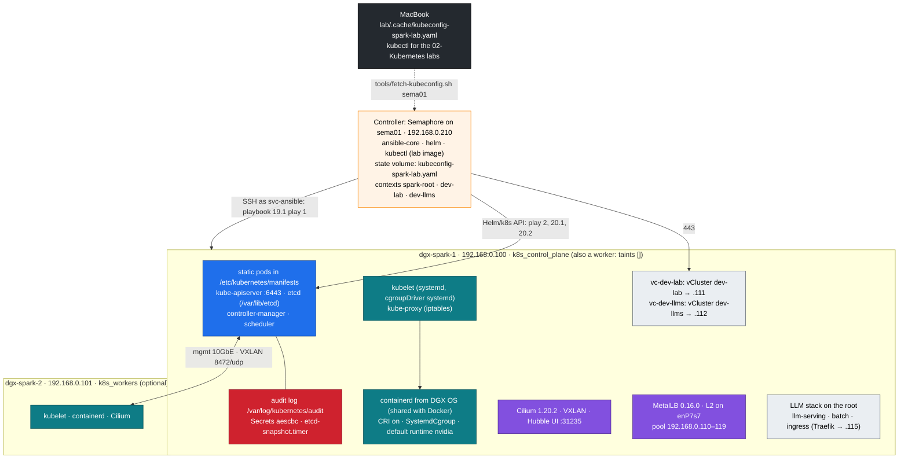

# Chapter 19 · Kubernetes: kubeadm Root Cluster & vClusters: Cilium, MetalLB and Two vClusters on DGX Spark (and When Kubespray)

> **01-Ansible · Part IV — Secrets & platforms · Chapter 19 of 30** · ← [Chapter 18 · Vault AppRole, secrets & SSH certificates](18-vault-approle-secrets-and-ssh-certificates.md) · [All chapters](00-ansible-step-by-step-guide.md) · [Chapter 20 · NVIDIA GPU Operator & time-slicing](20-nvidia-gpu-operator-and-time-slicing.md) →
>
> Deep dive on what you build here: [02-Kubernetes Chapter 01 · Kubernetes core architecture](../02-Kubernetes/01-kubernetes-core-architecture.md) · [02-Kubernetes Chapter 04 · Nested clusters with vCluster](../02-Kubernetes/04-nested-clusters-with-vcluster.md)

| | |
|---|---|
| **You will build** | The lab's **root** Kubernetes cluster, `spark-root`: kubeadm v1.36.5 on dgx-spark-1, which is control plane *and* worker. It gets containerd with the NVIDIA runtime as default, an audit log, encrypted Secrets and etcd snapshots on a timer, Cilium as the CNI and MetalLB for LoadBalancer IPs. Then the root gets the namespaces and budgets for the LLM stack, which runs directly on it, and two small vClusters, `dev-lab` and `dev-llms`, go inside it. One kubeconfig with three contexts lands on sema01's state volume, from where `tools/fetch-kubeconfig.sh` copies it to your MacBook. Built with the Semaphore templates `19.1 Kubernetes`, `20.1 GPU Operator` and `20.2 vClusters` |
| **Hardware** | 1 DGX Spark (dgx-spark-2 optional: it joins as a worker) |
| **Time** | 60 min (about 20 of it image pulls) |
| **Risk** | Medium. Rewrites `/etc/containerd/config.toml` (the DGX OS original is kept as `.dgxos-orig`) and turns swap off. `playbooks/19.2-reset-kubernetes.yml` removes all of it again (§8) |
| **Clusters** | `spark-root` (everything in §3–§4.4, and the LLM namespaces in §3.4), `dev-lab` and `dev-llms` (§4.5) |
| **Lab files** | [`roles/kubeadm_cluster`](lab/roles/kubeadm_cluster), [`roles/cilium`](lab/roles/cilium), [`roles/metallb`](lab/roles/metallb), [`roles/vclusters`](lab/roles/vclusters), [`playbooks/19.1-kubernetes.yml`](lab/playbooks/19.1-kubernetes.yml), [`20.2-vclusters.yml`](lab/playbooks/20.2-vclusters.yml), [`19.2-reset-kubernetes.yml`](lab/playbooks/19.2-reset-kubernetes.yml), [`inventory/hosts.yml`](lab/inventory/hosts.yml) |

---

## 1. Why kubeadm in our own roles (and when Kubespray)

A datacenter GPU cluster is almost always "upstream Kubernetes bootstrapped by kubeadm": static-pod control plane, stacked or external etcd, the distro's containerd, a CNI you choose. The lab builds exactly that, so the paths, certificates, upgrade commands and failure modes you meet on the Spark are the ones you will meet on a DGX cluster.

| | kubeadm via the lab's own roles (this chapter) | Kubespray (kubeadm-based) |
|---|---|---|
| What it is | 5 task files and 6 templates around `kubeadm init` / `join` | A large Ansible project: 100+ roles, every CNI, every OS, HA, add-ons |
| Readable in one sitting | ✅ every line is shown below | No. You configure it through group_vars rather than read it |
| Fits a 1–2 node lab on 128 GB of unified memory | ✅ nothing you didn't ask for | Works, but installs and checks far more than one Spark needs |
| Teaching value | You see each kubeadm phase, the containerd edits, the kubeconfig merge | Hides them (that is its job) |
| HA control plane | `controlPlaneEndpoint` is already set; add control planes by hand (02-Kubernetes Chapter 01 §8.2) | Built in: `kube_control_plane` × 3, `etcd` group |
| When you move to a DGX fleet | Keep it as the reference for *what* must happen on a node | **The scale-out path**, alongside NVIDIA Base Command Manager, which deploys Kubernetes on DGX clusters itself |

The inventory model carries over. Kubespray's groups are `kube_control_plane`, `kube_node` and `etcd`; this lab's are `k8s_control_plane` and `k8s_workers` (etcd is stacked on the control plane). Mapping one onto the other is a `children:` block in the inventory (Chapter 06).

> An earlier version of this lab ran k3s. The role refuses to install next to it (ports 6443/10250 and the iptables chains would clash), and `19.2-reset-kubernetes.yml -e reset_remove_k3s=true` removes it (§8).

## 2. Architecture

### 2.1 HLD



Two networks, two jobs. The **pod network** (Cilium VXLAN) and the API run on the 10GbE management LAN, because `node-ip` is the mgmt address. **Bulk GPU traffic** (NCCL, RDMA) does not go through the pod network at all. It uses the 200G CX-7 fabric through a second pod interface from Multus (Chapter 21). The old lab tunnelled pod traffic over the CX-7 instead. That was faster for TCP, but it still couldn't carry RDMA, and it tied the cluster's health to a cable.

### 2.2 Play order

```yaml
# lab/playbooks/19.1-kubernetes.yml
---
# Root Kubernetes cluster (Chapter 19): kubeadm on every node (control plane
# first, then workers), then the pod network and LoadBalancer IPs.
#
#   ansible-playbook playbooks/19.1-kubernetes.yml
#   ansible-playbook playbooks/20.1-gpu-operator.yml
#   ansible-playbook playbooks/20.2-vclusters.yml
#
# Start over at any time with playbooks/19.2-reset-kubernetes.yml — on a lab box
# a clean rebuild is a normal part of learning, not a failure.
- name: Short-lived SSH certificate from vault01 (Semaphore runs only)
  ansible.builtin.import_playbook: 00-vault-cert.yml

- name: Kubeadm (control plane first, then workers)
  hosts: k8s_control_plane:k8s_workers
  become: true
  order: sorted
  serial: "{{ groups['k8s_control_plane'] | length }}"   # control plane must finish before workers join
  roles:
    - role: kubeadm_cluster

- name: Pod network (Cilium) and LoadBalancer IPs (MetalLB)
  hosts: localhost
  connection: local
  gather_facts: false
  roles:
    - role: cilium
    - role: metallb
```

| Stage | Runs on | Talks to | Result |
|---|---|---|---|
| `19.1` play 0 · `00-vault-cert.yml` | controller (`localhost`) | vault01 | 15-minute SSH certificate for `svc-ansible` (Semaphore runs only) |
| `19.1` play 1 · `kubeadm_cluster` | each Spark over SSH, `become` | the host | containerd ready, packages held, `kubeadm init` (dgx-spark-1) / `kubeadm join` (dgx-spark-2), context `spark-root` written to the controller's state folder |
| `19.1` play 2 · `cilium`, `metallb` | controller (`localhost`) | root API with context `spark-root` | nodes `Ready`, CoreDNS running, LoadBalancer IPs available |
| `20.1` · `gpu_operator` | controller | root API | 15 GPU time-slices per node (Chapter 20) |
| `20.2` · `vclusters` | controller | root API, then each vCluster API | storage, root budgets (vClusters and LLM namespaces), `dev-lab` and `dev-llms`, contexts merged |

"Controller" is the Semaphore container on sema01: templates `19.1 Kubernetes`, `20.1 GPU Operator`, `20.2 vClusters`, each with CLI args `--limit dgx-spark-1,localhost` while there's one Spark (Chapter 04 §8). That's why the lab image has `kubectl`, `helm` and the `kubernetes.core` collection ([`lab/semaphore/Dockerfile`](lab/semaphore/Dockerfile)). The same playbooks run from your MacBook as break-glass; the state folder is then `lab/.cache`.

`serial` equal to the number of control planes (1) plus `order: sorted` makes dgx-spark-1 a batch of its own. dgx-spark-2 starts only after `kubeadm init` has finished. The ordering comes from the names: if you add a worker whose name sorts before the control plane's, list the groups explicitly or give the control plane its own play.

#### File-by-file flow

What runs, in order, when you start `19.1 Kubernetes`. Ansible reads `ansible.cfg` first (`roles_path = ./roles`, `inventory = ./inventory`), then the inventory and its `group_vars` (`lab_cache_dir`, the state folder that holds the kubeconfig). Each role loads its own `defaults/main.yml` before its tasks. Handlers run when notified, at the end of each task file's `flush_handlers` or at the end of the play.

```mermaid
flowchart TD
  CFG["ansible.cfg · inventory/hosts.yml<br/>group_vars/all.yml (lab_cache_dir) · group_vars/spark.yml"] --> P0
  subgraph P0["Play 0 · 00-vault-cert.yml · localhost"]
    V1["Semaphore only: AppRole login to vault01<br/>→ 15-min SSH certificate (+ kv/spark-lab/* when enabled)"]
  end
  P0 --> P1
  subgraph P1["Play 1 · roles/kubeadm_cluster · dgx-spark-1 (serial: control plane first)"]
    direction TB
    D1["defaults/main.yml"] --> M1["tasks/main.yml<br/>set kubeadm_cluster_role"]
    M1 --> T1["prereqs.yml<br/>no k3s · nvidia-container-runtime present · swap off<br/>/etc/modules-load.d/kubernetes.conf · sysctls"]
    T1 --> T2["containerd.yml<br/>CRI on · SystemdCgroup · nvidia runtime default · /etc/crictl.yaml"]
    T2 -.->|notify| H1["handlers/main.yml<br/>Restart containerd"]
    T2 --> T3["packages.yml<br/>pkgs.k8s.io repo · kubelet/kubeadm/kubectl pinned + held"]
    T3 --> CP{"control plane?"}
    CP -->|yes| T4["control_plane.yml"]
    CP -->|"no (dgx-spark-2)"| T5["workers.yml<br/>token + CA hash from dgx-spark-1<br/>templates/kubeadm-join.yaml.j2 → kubeadm join"]
    T4 --> T4a["files/audit-policy.yaml<br/>templates/encryption-config.yaml.j2 (first run)<br/>templates/kubeadm-init.yaml.j2 → kubeadm init"]
    T4a --> T4b["admin.conf → ~dgxadmin/.kube/config<br/>fetch to controller → merge as context spark-root<br/>into lab_cache_dir/kubeconfig-spark-lab.yaml"]
    T4b --> T4c["etcdctl download<br/>templates/etcd-snapshot.sh.j2 · .service.j2 · .timer.j2"]
    T4c -.->|notify| H2["handlers/main.yml<br/>Reload systemd"]
    T4c --> REG["tasks/main.yml (last task)<br/>node registered with the API server"]
    T5 --> REG
  end
  P1 --> P2
  subgraph P2["Play 2 · localhost (controller) · talks to the root API with the merged kubeconfig"]
    C1["roles/cilium<br/>defaults/main.yml (chart version, Hubble UI NodePort 31235)<br/>tasks/main.yml: Helm repo → helm install cilium<br/>→ wait nodes Ready → CoreDNS rolled out"]
    C1 --> M2["roles/metallb<br/>defaults/main.yml (pool 192.168.0.110-119)<br/>tasks/main.yml: namespace (privileged PSA) → Helm repo<br/>→ helm install metallb → IPAddressPool + L2Advertisement"]
  end
  M2 --> DONE["Root cluster up: context spark-root, nodes Ready,<br/>LoadBalancer IPs available → next: 20.1 GPU Operator"]
  classDef opt fill:#fff3e6,stroke:#fb8500,color:#000
  class V1,T5 opt
```



Orange boxes run only in some cases: play 0 only under Semaphore, `workers.yml` only on a worker (dgx-spark-2). With one Spark, dgx-spark-1 takes the `control_plane.yml` branch and play 1 runs once.

### 2.3 Inventory

```yaml
# lab/inventory/hosts.yml (excerpt)
    k8s_control_plane:
      hosts:
        dgx-spark-1:
    k8s_workers:
      hosts:
        dgx-spark-2:
```

Single Spark: remove dgx-spark-2 from `spark` and `k8s_workers`. The cluster is complete with one node, because the control plane carries no taint.

### 2.4 LLD: the kubeadm config

kubeadm reads one file, once, at `kubeadm init`. The role renders it to `/etc/kubernetes/kubeadm-config.yaml`. 02-Kubernetes [Chapter 01](../02-Kubernetes/01-kubernetes-core-architecture.md) walks through the running result; here is what Ansible decides:

```yaml
# lab/roles/kubeadm_cluster/templates/kubeadm-init.yaml.j2 (abridged)
apiVersion: kubeadm.k8s.io/v1beta4
kind: InitConfiguration
localAPIEndpoint:
  advertiseAddress: {{ kubeadm_cluster_node_ip }}
nodeRegistration:
  criSocket: unix:///run/containerd/containerd.sock
  taints: []                                 # no control-plane NoSchedule taint
  kubeletExtraArgs:
    - { name: node-ip, value: "{{ kubeadm_cluster_node_ip }}" }
    - { name: node-labels, value: "{{ kubeadm_cluster_node_labels | join(',') }}" }
---
apiVersion: kubeadm.k8s.io/v1beta4
kind: ClusterConfiguration
clusterName: {{ kubeadm_cluster_name }}               # spark-root
kubernetesVersion: v{{ kubeadm_cluster_version }}     # v1.36.5
controlPlaneEndpoint: "{{ kubeadm_cluster_api_endpoint }}"   # 192.168.0.100:6443
networking:
  podSubnet: 10.42.0.0/16
  serviceSubnet: 10.43.0.0/16                         # → cluster DNS 10.43.0.10
apiServer:
  extraArgs:                                          # + extraVolumes mounting the three host dirs
    - { name: audit-policy-file, value: /etc/kubernetes/audit/audit-policy.yaml }
    - { name: audit-log-path, value: /var/log/kubernetes/audit/audit.log }
    - { name: encryption-provider-config, value: /etc/kubernetes/encryption/config.yaml }
controllerManager: { extraArgs: [{ name: bind-address, value: 0.0.0.0 }] }   # :10257 for Prometheus
scheduler:         { extraArgs: [{ name: bind-address, value: 0.0.0.0 }] }   # :10259
etcd:
  local:
    dataDir: /var/lib/etcd
    extraArgs: [{ name: listen-metrics-urls, value: "http://0.0.0.0:2381" }]
---
apiVersion: kubelet.config.k8s.io/v1beta1
kind: KubeletConfiguration
cgroupDriver: systemd
maxPods: 200
systemReserved: { cpu: "2", memory: "6Gi" }     # 6 Gi: DGX OS runs headless (Chapter 04 §6.3)
kubeReserved:   { cpu: "1", memory: "2Gi" }
evictionHard: { memory.available: "4Gi", nodefs.available: "10%", nodefs.inodesFree: "5%", imagefs.available: "15%" }
---
apiVersion: kubeproxy.config.k8s.io/v1alpha1
kind: KubeProxyConfiguration
mode: iptables
```

| Setting | Value | Reason |
|---|---|---|
| `taints: []` | no taint | dgx-spark-1 is the only node. Without this, nothing but DaemonSets could run on it |
| `controlPlaneEndpoint` | `192.168.0.100:6443` | A stable endpoint, so dgx-spark-2 (or more control planes later) can join. Change it to a VIP *before* `init` if you plan HA; it is baked into every certificate and kubeconfig |
| Pod / Service CIDR | `10.42.0.0/16` / `10.43.0.0/16` | Kept from the earlier lab, so every address in the course stays valid |
| `systemReserved` + `kubeReserved` + `evictionHard` | 3 CPU (system 2 + kube 1), 12 GiB (system 6 + kube 2 + eviction 4) | Unified memory: pods, their GPU allocations and DGX OS share ~121.7 GiB. Without a reserve, a big model can starve sshd and the DGX Dashboard. `systemReserved` memory is 6 Gi because DGX OS runs headless: `04.3 Baseline` turns off the GNOME desktop (Chapter 04 §6.3), so the OS needs less. Allocatable ends up 17 CPU / ≈109.7 GiB |
| `evictionHard` lists all four signals | — | Setting the map **replaces** kubelet's defaults; a signal you omit is no longer enforced |
| `maxPods: 200` | — | The LLM stack, two vClusters and the platform add-ons on one node pass the default 110 quickly: every tenant pod is a real pod here |
| `bind-address: 0.0.0.0`, etcd metrics `:2381` | — | kube-prometheus-stack scrapes them from the pod network |
| kube-proxy `mode: iptables` | Cilium with `kubeProxyReplacement=false` | 02-Kubernetes Chapter 09 reads the `KUBE-SVC-*` chains. Cilium's kube-proxy replacement (eBPF) is the faster alternative; turn it on only together with removing kube-proxy |
| node labels | `spark.lab/gpu=gb10`, `spark.lab/node-index` | Lab-owned selectors: they exist before the GPU Operator, and GFD never rewrites them (it owns `nvidia.com/gpu.product`) |

### 2.5 LLD: one kubeconfig, three contexts

```text
<state folder>/kubeconfig-spark-lab.yaml                 (mode 0600)
  sema01: /opt/spark-lab/cache  (= /var/lib/spark-lab/cache in the container, SPARK_LAB_CACHE)
  MacBook: 01-Ansible/lab/.cache  (git-ignored; filled by tools/fetch-kubeconfig.sh sema01)
  context spark-root → cluster spark-root https://192.168.0.100:6443   user spark-root-admin   (kubeadm_cluster role)
  context dev-lab    → cluster dev-lab    https://192.168.0.111:443    user dev-lab            (vclusters role)
  context dev-llms   → cluster dev-llms   https://192.168.0.112:443    user dev-llms           (vclusters role)
<state folder>/kubeconfig-dev-lab.yaml, kubeconfig-dev-llms.yaml   standalone copies, one per vCluster
```

The lab writes the file on the **controller**. Semaphore's checkout of the repository is temporary, so `lab_cache_dir` points at the state volume (Chapter 04 §4), and the next template run finds the contexts there. The 02-Kubernetes labs run `kubectl` on your MacBook, so after `05` and `06b` copy it over:

```bash
# ▶ MacBook · 01-Ansible/lab (venv active)
tools/fetch-kubeconfig.sh sema01        # ssh to sema01, docker compose exec … cat, checks for the spark-root context, writes .cache/ (0600)
```

Both roles **merge** rather than overwrite: each one reads the file, drops only the entries it owns (by name) and appends its own. Re-running 19.1 after 20.2 keeps the vCluster contexts; re-running 20.2 keeps `spark-root`. Every command in this course names its context (`kubectl --context spark-root …`, `helm --kube-context dev-llms …`). With three clusters in one file, a bare `kubectl` is a guess.

---

## 3. The roles

### 3.1 `kubeadm_cluster`: one task file per concern

```yaml
# lab/roles/kubeadm_cluster/tasks/main.yml
- name: Determine this node's Kubernetes role
  ansible.builtin.set_fact:
    kubeadm_cluster_role: >-
      {{ 'control_plane' if inventory_hostname in groups[kubeadm_cluster_control_plane_group] else 'worker' }}
- { name: Host prerequisites (no k3s, swap off, kernel modules, sysctls), ansible.builtin.import_tasks: prereqs.yml }
- { name: Containerd with CRI, systemd cgroups and the NVIDIA runtime, ansible.builtin.import_tasks: containerd.yml }
- { name: Kubernetes packages from pkgs.k8s.io (held), ansible.builtin.import_tasks: packages.yml }
- name: Control plane (kubeadm init, audit, encryption, etcd snapshots)
  ansible.builtin.include_tasks: control_plane.yml
  when: kubeadm_cluster_role == 'control_plane'
- name: Workers (kubeadm join)
  ansible.builtin.include_tasks: workers.yml
  when: kubeadm_cluster_role == 'worker'
- name: Every node is registered with the API server (Ready comes after the CNI)
  # kubectl get node <me> -o name, delegated to the control plane, retried 30 × 5 s
```

| File | Does | Idempotence key |
|---|---|---|
| `prereqs.yml` | Fails if `/usr/local/bin/k3s` exists; checks `/usr/bin/nvidia-container-runtime`; `swapoff -a` and comments swap out of `/etc/fstab`; loads `overlay`, `br_netfilter` (persisted in `/etc/modules-load.d/kubernetes.conf`); sets `bridge-nf-call-iptables`, `bridge-nf-call-ip6tables`, `ip_forward` in `/etc/sysctl.d/90-kubernetes.conf` | All declarative modules |
| `containerd.yml` | Makes DGX OS's containerd usable by kubelet (below) | Regenerates only when CRI is disabled or `SystemdCgroup` is missing |
| `packages.yml` | pkgs.k8s.io key + repo **per minor** (`/etc/apt/keyrings/kubernetes-v1.36.asc`), installs `kubelet`, `kubeadm`, `kubectl` `=1.36.5-1.1`, then **holds** them | Exact version pin + `dpkg_selections` |
| `control_plane.yml` | Audit policy, encryption key, kubeadm config, image pre-pull, `kubeadm init`, admin kubeconfig on the Spark (context renamed to `spark-root`), context merge on the controller (state folder), etcdctl/etcdutl, snapshot timer | `kubeadm init` only if `/etc/kubernetes/admin.conf` is absent |
| `workers.yml` | 30-minute bootstrap token + CA hash from the control plane, `JoinConfiguration`, `kubeadm join`, removes the join file | Only if `/etc/kubernetes/kubelet.conf` is absent |

#### containerd: the part that differs from a stock Ubuntu box

DGX OS ships Docker's `containerd.io`, and its stock `config.toml` **disables the CRI plugin** because Docker doesn't need it. kubelet talks to containerd only through CRI, so the role converges three things:

```yaml
# lab/roles/kubeadm_cluster/tasks/containerd.yml (core)
- name: Decide whether the config needs regenerating
  ansible.builtin.set_fact:
    kubeadm_cluster_ctd_regen: >-
      {{ kubeadm_cluster_ctd_raw.content is not defined
         or ('SystemdCgroup' not in (kubeadm_cluster_ctd_raw.content | b64decode))
         or ((kubeadm_cluster_ctd_raw.content | b64decode) is search('disabled_plugins\s*=\s*\[[^\]]*"cri"')) }}
# → back up to config.toml.dgxos-orig (once), then: containerd config default > config.toml

- name: Use the systemd cgroup driver (must match kubelet's cgroupDriver)
  ansible.builtin.replace:
    path: "{{ kubeadm_cluster_containerd_config }}"
    regexp: 'SystemdCgroup\s*=\s*false'
    replace: "SystemdCgroup = true"
  notify: Restart containerd

- name: Register the NVIDIA runtime (nvidia-ctk edits config.toml in place)
  ansible.builtin.command: >-
    nvidia-ctk runtime configure --runtime=containerd
    --config={{ kubeadm_cluster_containerd_config }}
    {{ '--set-as-default' if kubeadm_cluster_default_runtime_nvidia | bool else '' }}
  when: >-
    kubeadm_cluster_ctd_has_nvidia.rc != 0 or
    (kubeadm_cluster_default_runtime_nvidia | bool and kubeadm_cluster_ctd_nvidia.rc != 0)
  notify: Restart containerd

- name: Apply containerd changes before kubelet starts
  ansible.builtin.meta: flush_handlers
# → /etc/crictl.yaml pointing at /run/containerd/containerd.sock
```

| Setting | Why |
|---|---|
| CRI enabled (full default config) | Otherwise `kubeadm init` preflight fails: `container runtime is not running` |
| `SystemdCgroup = true` | kubelet uses `cgroupDriver: systemd`. A mismatch gives pods that start and then get killed, or a kubelet that never settles |
| default runtime `nvidia` | GPU pods work with the device plugin without `runtimeClassName`. For strict multi-tenancy set `kubeadm_cluster_default_runtime_nvidia: false` and use the `nvidia` RuntimeClass instead |
| `/etc/crictl.yaml` | `sudo crictl ps` works without flags (the 02 lab scripts rely on it) |

Docker keeps working. It uses containerd's `moby` namespace, kubelet uses `k8s.io`: one daemon, two tenants, `sudo ctr namespaces ls` shows both.

The two `grep` probes carry `check_mode: false`. They are read-only, so they also run under `--check`, and the drift report in Chapter 26 can tell "runtime missing" from "not checked".

#### Control plane: what Ansible owns around `kubeadm init`

| Item | Path | Note |
|---|---|---|
| Audit policy | `/etc/kubernetes/audit/audit-policy.yaml` ([`files/audit-policy.yaml`](lab/roles/kubeadm_cluster/files/audit-policy.yaml)) | Secrets/ConfigMaps at Metadata only; node and kube-system reads dropped; **full RequestResponse for writes in `vc-dev-lab`, `vc-dev-llms`, `llm-serving`, `batch`, `gpu-operator`, `platform-tools`**. An identical copy is kept at `02-Kubernetes/lab/kubeadm/audit-policy.yaml` (the 02 lab tests diff them) |
| Audit log | `/var/log/kubernetes/audit/audit.log` | 7 days, 5 × 100 MB |
| Encryption config | `/etc/kubernetes/encryption/config.yaml` (0600) | `aescbc` key `key1` from `openssl rand -base64 32`, written **only if the file doesn't exist**, under `no_log`. Re-running never rotates the key by accident |
| kubeadm config | `/etc/kubernetes/kubeadm-config.yaml` | If it changes on an existing cluster, the role doesn't re-init. It prints the `kubeadm init phase control-plane all` command to apply it |
| etcd tools | `/usr/local/bin/etcdctl`, `etcdutl` | Version read from the image tag in `/etc/kubernetes/manifests/etcd.yaml`, arm64 release downloaded only when it differs |
| Snapshots | `/usr/local/sbin/etcd-snapshot` → `/var/lib/etcd-snapshots`, `etcd-snapshot.timer` | Every 6 h (`*-*-* 00/6:00:00`), newest 20 kept |

```bash
# lab/roles/kubeadm_cluster/templates/etcd-snapshot.sh.j2 (rendered)
ETCDCTL_API=3 etcdctl \
  --endpoints=https://127.0.0.1:2379 \
  --cacert=/etc/kubernetes/pki/etcd/ca.crt \
  --cert=/etc/kubernetes/pki/etcd/healthcheck-client.crt \
  --key=/etc/kubernetes/pki/etcd/healthcheck-client.key \
  snapshot save "$dir/$name"
etcdutl snapshot status "$dir/$name" -w table
```

> **Back up the encryption key with the snapshots.** An etcd snapshot without `/etc/kubernetes/encryption/config.yaml` restores every Secret as unreadable ciphertext. Store the key in Vault (Chapter 18). The etcd snapshot does **not** contain the vClusters' state: each keeps its own SQLite database on a PVC (02-Kubernetes Chapter 04 §6.7).

#### Workers: join without a long-lived secret

```yaml
# lab/roles/kubeadm_cluster/templates/kubeadm-join.yaml.j2
apiVersion: kubeadm.k8s.io/v1beta4
kind: JoinConfiguration
discovery:
  bootstrapToken:
    apiServerEndpoint: "{{ kubeadm_cluster_api_endpoint }}"
    token: "{{ kubeadm_cluster_token.stdout }}"           # kubeadm token create --ttl 30m (delegated, no_log)
    caCertHashes:
      - "sha256:{{ kubeadm_cluster_ca_hash.stdout }}"     # pins the API server the worker trusts
```

The token exists for 30 minutes, the rendered file is deleted after `kubeadm join`, and the CA hash means a worker can't be tricked into joining an impostor API server.

### 3.2 `cilium`: CNI only

```yaml
# lab/roles/cilium/defaults/main.yml (values)
cilium_chart_version: "1.20.2"
cilium_values:
  kubeProxyReplacement: "false"
  k8sServiceHost: "{{ cilium_api_host }}"     # 192.168.0.100: Cilium starts before any Service works
  k8sServicePort: 6443
  routingMode: tunnel
  tunnelProtocol: vxlan
  ipam: { mode: kubernetes }                  # per-node /24 from 10.42.0.0/16 (controller-manager)
  cni: { exclusive: false }                   # leave room for Multus (Chapter 21)
  operator: { replicas: 1 }
  hubble:
    relay: { enabled: true }
    ui: { enabled: true, service: { type: NodePort, nodePort: 31235 } }
```

The task list is three steps: `helm upgrade --install` with `wait`; wait until **every** node reports `Ready` (that is when the CNI config exists); wait until the `coredns` Deployment has all replicas ready. Before Cilium, kubeadm's CoreDNS pods stay `Pending`, because there is no pod network yet.

`cni.exclusive=false` is the one setting with a consequence elsewhere. By default Cilium renames every other CNI config in `/etc/cni/net.d` so nothing else can take over. Multus must be allowed to write `00-multus.conf` in front of `05-cilium.conflist`.

### 3.3 `metallb`: LoadBalancer IPs on the mgmt LAN

kubeadm has no built-in load balancer: a `type: LoadBalancer` Service stays `<pending>` forever. The role creates `metallb-system` with privileged PSA (the speaker uses hostNetwork and raw sockets for ARP), installs chart 0.16.0 with `frrk8s.enabled: false` and `speaker.ignoreExcludeLB: true`, then applies the pool. (kubeadm labels control-plane nodes `node.kubernetes.io/exclude-from-external-load-balancers`, and MetalLB's speaker skips such nodes. On a single Spark the control plane is the only node, so without this setting no LoadBalancer IP is ever announced and clients get `Host is unreachable`.) (Chart 0.16 turns on the FRR-K8s BGP backend by default, and its bundled values break that subchart's templates with `nil pointer evaluating … serviceMonitor`. The lab only needs Layer 2, which the native speaker does.) That last step is retried until MetalLB's webhook accepts it, instead of sleeping:

```yaml
# lab/roles/metallb/tasks/main.yml (CRs)
- apiVersion: metallb.io/v1beta1
  kind: IPAddressPool
  metadata: { name: lab-pool, namespace: metallb-system }
  spec: { addresses: [192.168.0.110-192.168.0.119] }
- apiVersion: metallb.io/v1beta1
  kind: L2Advertisement
  metadata: { name: lab-pool-l2, namespace: metallb-system }
  spec: { ipAddressPools: [lab-pool], interfaces: [enP7s7] }
```

| IP | Service |
|---|---|
| `192.168.0.111` | `dev-lab` vCluster API |
| `192.168.0.112` | `dev-llms` vCluster API |
| `192.168.0.115` | Traefik on the root, namespace `ingress`: the LLM gateway (installed by the 02 lab) |

Reserve `.110–.119` in your router's DHCP settings. In L2 mode the node answers ARP for the Service IP, so no router configuration is needed. The trade-off is that all traffic for one IP enters through one node.

### 3.4 `vclusters`: LLM budgets on the root, two clusters inside it (playbook 20.2)

The vCluster definitions are **not** duplicated in Ansible. The role applies the files of the 02-Kubernetes lab, so the Ansible path and the lab scripts can't drift apart:

```yaml
# lab/roles/vclusters/defaults/main.yml (excerpt)
vclusters_lab_dir: "{{ playbook_dir }}/../../../02-Kubernetes/lab"
vclusters_chart_version: "0.37.1"            # standard Kubernetes distro (vCluster ≥ 0.33 has no K3s)
vclusters_root_manifests:                    # kustomize directories under manifests/
  - root/00-platform                         # platform namespaces, PriorityClasses (no default class on the root)
  - root/05-vclusters                        # vc-* namespaces, LimitRanges, budgets, Cilium policies
  - root-llms/00-platform                    # LLM namespaces on the root: llm-serving, batch, ingress
  - root-llms/10-tenancy                     # their ResourceQuotas and LimitRanges
vclusters_list:
  - { name: dev-lab, namespace: vc-dev-lab }   # vCluster #1 — 2 CPU · 4 Gi · 2 GPU slices
  - { name: dev-llms, namespace: vc-dev-llms } # vCluster #2 — 2 CPU · 4 Gi · 2 GPU slices (LLM sandbox)
```

| Step | What | Why first |
|---|---|---|
| 1 | local-path-provisioner v0.0.31, volumes under `/data/k8s`, StorageClasses `local-nvme`, `local-nvme-retain`, `local-path` as default | Each vCluster keeps its SQLite database on a `local-nvme` PVC |
| 2 | Root kustomize directories above, rendered with the `kubernetes.core.kustomize` lookup and applied server-side (field manager `ansible-vclusters`): the same directories `scripts/apply-lab.sh` applies | Namespaces `vc-*`, `llm-serving`, `batch`, `ingress`, PriorityClass `spark-platform` (the root has no default PriorityClass; 02-Kubernetes Chapter 07 §3.1), the **budgets** (`vcluster-budget` on each `vc-*`, `serving-budget`, `batch-budget`, with LimitRanges) and the Cilium `vcluster-boundary` policies must exist before any vCluster or model pod |
| 3 | `helm upgrade --install` chart `loft/vcluster` with [`vclusters/dev-lab.yaml`](../02-Kubernetes/lab/vclusters/dev-lab.yaml), [`dev-llms.yaml`](../02-Kubernetes/lab/vclusters/dev-llms.yaml) | API exposed as LoadBalancer `.111` / `.112` |
| 4 | Read Secret `vc-<name>` (written by `exportKubeConfig`), write `.cache/kubeconfig-<name>.yaml`, merge contexts `dev-lab`, `dev-llms` | §2.5 |
| 5 | `k8s_info` on Namespace `default` **through each new context** | Proves the MetalLB IP, the certificate SAN and the credentials together |

Budgets, sync rules and naming are taught in 02-Kubernetes [Chapter 04](../02-Kubernetes/04-nested-clusters-with-vcluster.md). The numbers to keep in mind here, starting from the 17 CPU, ~109.7 GiB and 15 GPU slices left after the kubelet reservations (§2.4: 3 CPU, 12 GiB including the 4 GiB eviction threshold):

| | CPU (req) | memory | GPU slices | enforced by |
|---|---|---|---|---|
| vCluster `dev-lab` | 2 | 4 Gi | 2 | root ResourceQuota `vcluster-budget` in `vc-dev-lab` |
| vCluster `dev-llms` | 2 | 4 Gi | 2 | root ResourceQuota `vcluster-budget` in `vc-dev-llms` |
| **root keeps** | 13 | ~101.7 GiB | 11 | |
| ↳ platform (Cilium, MetalLB, GPU Operator, Prometheus, Traefik, Kueue, KEDA, platform-tools) | 3 | ~11.7 GiB | 2 | what is left over |
| ↳ `llm-serving` | 8 | up to 90 Gi | 6 | ResourceQuota `serving-budget` |
| ↳ `batch` | 2 | up to 12 Gi | 3 | ResourceQuota `batch-budget` (= Kueue ClusterQueue `spark-cq`) |

CPU and slices are split exactly; memory is not. `llm-serving` and `batch` share one ~90 GiB pool: serving may use all of it while nothing trains, and a training job takes up to 12 Gi of the same pool. What keeps the two from overcommitting unified memory is the scheduler: every GPU container in the LLM stack sets memory request = limit, so a pod that doesn't fit stays `Pending` instead of squeezing a running model. Memory is never overcommitted (on unified memory it is GPU memory too); CPU may burst into idle cores.

**Why the LLMs run on the root, and why two small vClusters remain.** The models are the Spark's main job. On the root they get all of the GPU memory headroom, keep their real pod names in real namespaces (no syncer translation) and sit under one layer of quota instead of a vCluster quota inside a root quota. The two vClusters are kept small and identical: `dev-lab` for tenancy and syncer drills, `dev-llms` as an LLM sandbox with its own API server, where you try a manifest, the mock LLM or a tiny model before it goes to the root. The trade-off: whoever administers the root also operates the LLM stack, and the stack is isolated by namespaces (quotas, LimitRanges, NetworkPolicy, admission policies, PSA, PriorityClasses), not by a separate API server. The role applies only the LLM namespaces and budgets; the stack itself (Traefik, Kueue, KEDA, the model servers) comes from the 02 lab's `scripts/install-addons.sh` and `scripts/apply-lab.sh`.

> **Built the earlier `llms` vCluster?** Remove it and its namespace, then build the current layout: `helm --kube-context spark-root uninstall llms -n vc-llms`, `kubectl --context spark-root delete ns vc-llms`, then the template `20.2 vClusters` (or `02-Kubernetes/lab/scripts/install-addons.sh vclusters`), then `install-addons.sh traefik`, `install-addons.sh kueue` and `install-addons.sh keda` on the root, one at a time, and finally `scripts/apply-lab.sh`. Fetch the kubeconfig again; the stale `llms` context can be deleted with `kubectl config delete-context llms`.

### 3.5 Things worth noticing

- **Probe, then act.** Every irreversible step (`kubeadm init`, `join`, the encryption key, the containerd regeneration) is guarded by a `stat` or a content check. A second run of `19.1-kubernetes.yml` changes nothing.
- **kubeadm doesn't reconcile.** Ansible can re-render the config, but only `kubeadm init phase …` or `kubeadm upgrade` apply it to a running control plane. The role says so instead of pretending.
- **Secrets never touch the log or the controller's disk longer than needed.** Join token and encryption key are `no_log`. `admin.conf` is fetched to `*.admin-raw`, merged under `no_log`, then deleted.
- **Holds protect the version.** A routine `apt upgrade` can't move kubelet. Upgrades go through `kubeadm upgrade` (§4.6), the same idea as the NVIDIA package holds in `spark_baseline`.

---

## 4. Hands-on

### 4.1 Build the root cluster

#### What this lab does (template `19.1 Kubernetes`)

- **Host prep on dgx-spark-1:** turns swap off (also in `/etc/fstab`), loads `overlay` and `br_netfilter`, and sets the three sysctls kubeadm needs. It stops right away if an old k3s is still installed.
- **containerd:** if CRI is disabled (the stock DGX OS config), it saves `/etc/containerd/config.toml` as `config.toml.dgxos-orig` and writes containerd's full default config. Then it sets `SystemdCgroup = true` and makes `nvidia` the default runtime. Docker keeps working on the same containerd.
- **Packages:** `kubelet`, `kubeadm`, `kubectl` at `1.36.5-1.1` from pkgs.k8s.io, then held so `apt upgrade` can't move them.
- **Control plane:** audit policy, Secret encryption key (written once, never rotated by a re-run), `/etc/kubernetes/kubeadm-config.yaml`, image pre-pull, `kubeadm init`, `etcdctl`/`etcdutl`, and `etcd-snapshot.timer` (every 6 h). The API listens on `192.168.0.100:6443`.
- **Play 2, on the controller:** Cilium 1.20.2 (VXLAN pod network, Hubble UI on NodePort 31235) and MetalLB 0.16.0 with the pool `192.168.0.110–119` on `enP7s7`.
- **Kubeconfig:** context `spark-root` is merged into `kubeconfig-spark-lab.yaml` on sema01's state volume (other contexts are kept), and written to `~dgxadmin/.kube/config` on the Spark.
- **First run:** pulls the control-plane, Cilium and MetalLB images, so it takes several minutes.

#### What to look for

1. **Semaphore run:** `failed=0` on `dgx-spark-1` and `localhost`. On a first run expect `changed` on the containerd config, the packages, `Kubeadm init` and the two Helm installs. On a re-run `Pre-pull` and `Kubeadm init` are `skipping` and the Helm installs `ok`. A few bookkeeping tasks still show `changed` on every run (re-holding the three packages, fetching and then deleting the raw `admin.conf` copy); that is normal.
2. **The "Report CRI status" task** prints `CRI reachable`. On the very first run it prints `not checked yet (crictl not installed yet)`, because `packages.yml` installs `crictl` (package `cri-tools`) after this check. The probe is allowed to fail, so on a re-run check by eye that it says `reachable`.
3. **The node**, with the first commands under "Run it":

   | Line/Field | Healthy value |
   |---|---|
   | `get nodes` | `dgx-spark-1` `Ready`, ROLES `control-plane`, VERSION `v1.36.5`, ARCH `arm64` |
   | `Taints` | `<none>` |
   | `Allocatable` | `cpu: 17`, memory about 109.7 GiB (printed in Ki, about 115 000 000Ki). No `nvidia.com/gpu` yet: it appears after `20.1 GPU Operator`, as `15` |
   | kube-system pods | the four static pods (`kube-apiserver-dgx-spark-1`, `etcd-dgx-spark-1`, …), `coredns` ×2, `kube-proxy`, `cilium`, `cilium-operator`, `hubble-relay`, `hubble-ui`, all `Running` |

4. **On the Spark** (second block): four files in `/etc/kubernetes/manifests`; `SystemdCgroup = true` and `default_runtime_name = "nvidia"` in `config.toml`; namespaces `k8s.io` and `moby` from `ctr`; `kubeadm`, `kubectl`, `kubelet` on hold.

**If something's off:** "k3s is still installed" → run `19.2 Reset Kubernetes` with `reset_remove_k3s: true` (§8). `kubeadm init` preflight says `container runtime is not running` → CRI is still disabled in `config.toml`. Node `NotReady` → Cilium isn't ready yet (`cilium-dbg status`, §4.3). More in §6.

#### Run it

**Semaphore UI:** run the template **`19.1 Kubernetes`** (break-glass, on the MacBook in `01-Ansible/lab`: `ansible-playbook playbooks/19.1-kubernetes.yml -l dgx-spark-1,localhost -K`). The task log ends with `failed=0` on `dgx-spark-1` and `localhost`. Then, on the MacBook:

```bash
# ▶ MacBook · technical-depth (repo root)
cd "01-Ansible/lab"
tools/fetch-kubeconfig.sh sema01
export KUBECONFIG=$PWD/.cache/kubeconfig-spark-lab.yaml
kubectl --context spark-root get nodes -o wide -L kubernetes.io/arch
kubectl --context spark-root -n kube-system get pods -o wide
kubectl --context spark-root describe node dgx-spark-1 | grep -E '^Taints|^Allocatable' -A6
```

Expected: `dgx-spark-1` `Ready` with role `control-plane`, `ARCH` column `arm64`, `Taints: <none>`. In kube-system: the four static-pod mirrors (`kube-apiserver-dgx-spark-1`, `etcd-dgx-spark-1`, …), `coredns` ×2, `kube-proxy`, `cilium`, `cilium-operator`, `hubble-relay`, `hubble-ui`. Allocatable reads `cpu: 17` and memory about 109.7 GiB (printed in Ki).

On the Spark itself:

```bash
# ▶ MacBook · any folder
ssh dgxadmin@192.168.0.100
```

```bash
# ▶ dgx-spark-1 (ssh dgx-spark-1)
ls /etc/kubernetes/manifests                       # etcd.yaml kube-apiserver.yaml kube-controller-manager.yaml kube-scheduler.yaml
sudo crictl ps --name kube-apiserver               # CRI view, through /etc/crictl.yaml
sudo ctr namespaces ls                             # k8s.io (kubelet) and moby (Docker): one containerd
grep -nE 'SystemdCgroup|default_runtime_name' /etc/containerd/config.toml
apt-mark showhold | grep -E 'kube'                 # kubeadm kubectl kubelet
```

### 4.2 A GPU pod *before* any device plugin

#### What this lab does (one `kubectl run` from the MacBook)

- **One throwaway pod:** `smi` in the root's `default` namespace, image `nvcr.io/nvidia/cuda:13.0.1-base-ubuntu24.04`, with `NVIDIA_VISIBLE_DEVICES=all`. It runs `nvidia-smi -L` and is deleted when it exits (`--rm`).
- **No GPU resource:** the pod asks for no `nvidia.com/gpu`. It sees the GPU only because containerd's default runtime is `nvidia` (§3.1).
- **Nothing else changes** on the cluster or the Spark.

#### What to look for

1. **Command output:** `GPU 0: NVIDIA GB10 (UUID: GPU-…)`, then `pod "smi" deleted`.
2. **The scheduler didn't count it.** Before Chapter 20, `kubectl --context spark-root describe node dgx-spark-1 | grep 'nvidia.com/gpu:'` prints nothing: there is no GPU resource to schedule or to charge to a quota. After `20.1 GPU Operator` it shows `15`.

**If something's off:** an error from the runtime or `No devices were found` means `nvidia` is not containerd's default runtime: check `grep default_runtime_name /etc/containerd/config.toml` on the Spark and re-run `19.1 Kubernetes`. The first run waits for the image pull. More in §6.

#### Run it

With `nvidia` as containerd's default runtime, a pod can see the GPU even before the GPU Operator exists. That shows what the operator adds (scheduling and accounting):

```bash
# ▶ MacBook · any folder
kubectl --context spark-root run smi --rm -it --restart=Never \
  --image=nvcr.io/nvidia/cuda:13.0.1-base-ubuntu24.04 \
  --env NVIDIA_VISIBLE_DEVICES=all -- nvidia-smi -L
```

It prints the GB10, but Kubernetes has no idea a GPU was used: no `nvidia.com/gpu` resource, so no scheduling guarantees. Chapter 20 fixes that. Tenants can't take this shortcut: inside the vClusters, the 02 lab's CEL policy `spark-no-nvidia-env-bypass` rejects pods that set `NVIDIA_VISIBLE_DEVICES`.

### 4.3 Pod network and LoadBalancer IPs

#### What this lab does (`kubectl` checks from the MacBook)

- **Read-only checks:** Cilium's status and mode, the VXLAN device and the CNI config on the Spark, and MetalLB's pool. Nothing is reconfigured.
- **MetalLB test:** creates a Deployment `lb-demo` (`nginx:1.27-alpine`) and a `LoadBalancer` Service in `default`, curls it, then deletes both.
- **Two Sparks only:** two `nicolaka/netshoot:v0.13` pods, `a` on dgx-spark-1 and `b` on dgx-spark-2, and a 10-second `iperf3` between them. With one Spark, skip that block. Delete the pods afterwards: `kubectl --context spark-root delete pod a b`.

#### What to look for

1. **Cilium and the pod network:**

   | Line/Field | Healthy value |
   |---|---|
   | `cilium-dbg status --brief` | `OK` |
   | `KubeProxyReplacement` | `False` |
   | Routing / IPAM | tunnel `vxlan` / `kubernetes` |
   | `cilium_vxlan` link | `vxlan … dstport 8472` |
   | `/etc/cni/net.d` | `05-cilium.conflist` (plus `00-multus.conf` once Chapter 21 has run) |
   | MetalLB objects | IPAddressPool `lab-pool` (`192.168.0.110-192.168.0.119`), L2Advertisement `lab-pool-l2` |

2. **`lb-demo`:** EXTERNAL-IP is an address from `192.168.0.110–119` that no other Service holds (`.111`/`.112` belong to the vClusters, `.115` to Traefik). `curl -sI` prints `HTTP/1.1 200 OK`. In `arp -a` that IP resolves to the MAC address of dgx-spark-1's `enP7s7`.
3. **Hubble UI** opens at http://192.168.0.100:31235.
4. **iperf3 (two Sparks):** a little under 10 Gb/s, because the pod network runs VXLAN over the mgmt link.

**If something's off:** EXTERNAL-IP stays `<pending>` → the pool is missing (MetalLB's webhook wasn't ready when play 2 ran: re-run `19.1 Kubernetes`) or exhausted. An IP is assigned but `curl`/`ping` from another machine says `Host is unreachable` → MetalLB isn't answering ARP: check `kubectl --context spark-root -n metallb-system logs ds/metallb-speaker | grep -i exclude` and that the L2Advertisement interface exists on the Spark (`ip -br link`). `cilium-dbg status` not `OK` → `kubectl --context spark-root -n kube-system logs ds/cilium`. More in §6.

#### Run it

```bash
# ▶ MacBook · any folder
kubectl --context spark-root -n kube-system exec ds/cilium -- cilium-dbg status --brief    # OK
kubectl --context spark-root -n kube-system exec ds/cilium -- cilium-dbg status | grep -E 'KubeProxyReplacement|Routing|IPAM'
kubectl --context spark-root -n metallb-system get ipaddresspool,l2advertisement
```

```bash
# ▶ dgx-spark-1 (ssh dgx-spark-1)
ip -d link show cilium_vxlan | grep -o "vxlan.*dstport [0-9]*"   # vxlan external … dstport 8472
sudo ls -l /etc/cni/net.d                                        # 05-cilium.conflist (the folder is root-only, 0700)
```

Expected: `KubeProxyReplacement: False`, tunnel `vxlan`, IPAM `kubernetes`; `/etc/cni/net.d` has `05-cilium.conflist`. Hubble UI is at `http://192.168.0.100:31235`.

Try MetalLB with a throwaway Service:

```bash
# ▶ MacBook · any folder
kubectl --context spark-root create deploy lb-demo --image=nginx:1.27-alpine
kubectl --context spark-root expose deploy lb-demo --port 80 --type LoadBalancer
kubectl --context spark-root get svc lb-demo -w                # EXTERNAL-IP from 192.168.0.110–119
curl -sI http://$(kubectl --context spark-root get svc lb-demo -o jsonpath='{.status.loadBalancer.ingress[0].ip}') | head -1
arp -a | grep 192.168.0.11                                     # the IP resolves to dgx-spark-1's enP7s7 MAC (macOS: arp; Linux: ip neigh)
kubectl --context spark-root delete svc,deploy lb-demo
```

With two Sparks, measure the pod network between nodes (`nodeName` pins each pod):

```bash
# ▶ MacBook · any folder
kubectl --context spark-root run a --image=nicolaka/netshoot:v0.13 --overrides='{"spec":{"nodeName":"dgx-spark-1"}}' -- sleep 1d
kubectl --context spark-root run b --image=nicolaka/netshoot:v0.13 --overrides='{"spec":{"nodeName":"dgx-spark-2"}}' -- sleep 1d
B=$(kubectl --context spark-root get pod b -o jsonpath='{.status.podIP}')
kubectl --context spark-root exec b -- iperf3 -s -D; kubectl --context spark-root exec a -- iperf3 -c "$B" -P 4 -t 10
```

Expect a little under 10 Gb/s: VXLAN over the mgmt link. That is by design. The 200G fabric is reached through Multus in Chapter 21.

### 4.4 Prove audit, encryption and snapshots

#### What this lab does (`kubectl` on the MacBook, then commands on dgx-spark-1)

- **Creates one Secret:** `enc-demo` in the root's `default` namespace. It stays until you delete it (`kubectl --context spark-root -n default delete secret enc-demo`).
- **Reads it straight from etcd** with `etcdctl`, bypassing the API server, to see how it is stored on disk.
- **Reads the audit log** `/var/log/kubernetes/audit/audit.log` for the record of that create.
- **Takes one extra etcd snapshot** named `drill-1` in `/var/lib/etcd-snapshots`. The script keeps the newest 20 snapshots, so the oldest may be removed.

#### What to look for

| Line/Field | Healthy value |
|---|---|
| `hexdump` of the etcd value | `k8s:enc:aescbc:v1:key1:` near the start, and no readable `k=v` |
| audit record (`jq`) | `"verb": "create"`, `"level": "Metadata"`, `user` the admin client from the kubeconfig (`kubernetes-admin`) |
| `systemctl list-timers etcd-snapshot.timer` | one timer, NEXT within the next 6 hours |
| `sudo etcd-snapshot drill-1` | an `etcdutl` status table, then `saved /var/lib/etcd-snapshots/etcd-dgx-spark-1-<date>-<time>-drill-1.db` |

**If something's off:** plain text instead of `k8s:enc:aescbc…` → check `/etc/kubernetes/encryption/config.yaml` exists and that the kube-apiserver manifest has `--encryption-provider-config`. `etcdctl: command not found` → the etcd tools task of `19.1 Kubernetes` didn't run; re-run the template. No audit line → `sudo ls -l /var/log/kubernetes/audit`. More in §6.

#### Run it

```bash
# ▶ MacBook · any folder
kubectl --context spark-root -n default create secret generic enc-demo --from-literal=k=v
ssh dgxadmin@192.168.0.100
```

```bash
# ▶ dgx-spark-1 (ssh dgx-spark-1)
sudo etcdctl --endpoints=https://127.0.0.1:2379 --cacert=/etc/kubernetes/pki/etcd/ca.crt \
  --cert=/etc/kubernetes/pki/etcd/healthcheck-client.crt --key=/etc/kubernetes/pki/etcd/healthcheck-client.key \
  get /registry/secrets/default/enc-demo | hexdump -C | head -5      # … k8s:enc:aescbc:v1:key1: …
sudo grep '"enc-demo"' /var/log/kubernetes/audit/audit.log | tail -1 | jq '{verb, user: .user.username, level}'
systemctl list-timers etcd-snapshot.timer
sudo etcd-snapshot drill-1 && ls -lh /var/lib/etcd-snapshots
```

The audit record for the Secret is at `Metadata` level (no payload), as the policy says. 02-Kubernetes Chapter 03 §5 Task 1 does the same proof in more depth; 02-Kubernetes Chapter 02 rehearses a restore from these snapshots.

### 4.5 Add the vClusters and use three contexts

#### What this lab does (templates `20.1 GPU Operator` and `20.2 vClusters`)

- **`20.1 GPU Operator`:** time-slices the GB10 into 15 `nvidia.com/gpu` on the root, the slices the budgets below hand out. Chapter 20 §4.1 explains that run.
- **Storage (`20.2`):** installs local-path-provisioner v0.0.31 with volumes under `/data/k8s` on the Spark, and the StorageClasses `local-nvme`, `local-nvme-retain` and `local-path` (the default).
- **Root namespaces and budgets (`20.2`):** applies four directories of the 02-Kubernetes lab (`manifests/root/00-platform`, `root/05-vclusters`, `root-llms/00-platform`, `root-llms/10-tenancy`): namespaces `vc-dev-lab`, `vc-dev-llms`, `llm-serving`, `batch`, `ingress`, their ResourceQuotas and LimitRanges, the PriorityClasses and the Cilium `vcluster-boundary` policies.
- **Two vClusters (`20.2`):** Helm chart `loft/vcluster` 0.37.1, `dev-lab` in `vc-dev-lab` with its API on `https://192.168.0.111:443`, `dev-llms` in `vc-dev-llms` on `https://192.168.0.112:443`. Each keeps its own database on a `local-nvme` volume.
- **Kubeconfig (`20.2`):** writes `kubeconfig-dev-lab.yaml` and `kubeconfig-dev-llms.yaml` and merges the contexts `dev-lab` and `dev-llms` into `kubeconfig-spark-lab.yaml` on sema01's state volume. `spark-root` is kept.
- **Not installed here:** the LLM stack itself (Traefik on `.115`, Kueue, KEDA, the model servers). It comes from the 02 lab's `scripts/install-addons.sh` and `scripts/apply-lab.sh`.

#### What to look for

1. **Semaphore runs:** `failed=0` on `localhost` for both templates. In `20.2`, the task "Each vCluster API answers through its LoadBalancer IP" is `ok` for `context dev-lab` and `context dev-llms`. That one task proves the MetalLB IP, the certificate and the credentials together. A re-run creates no new vCluster and keeps all three contexts.
2. **Contexts on the MacBook** (after the fetch under "Run it"): `kubectl config get-contexts` lists `spark-root`, `dev-lab`, `dev-llms`. `kubectl --context dev-lab get nodes` shows the real `dgx-spark-1`.
3. **The budgets.** Show them in one table:
   ```bash
   # ▶ MacBook · 01-Ansible/lab (venv active)
   kubectl --context spark-root get resourcequota -A \
     -o custom-columns=NS:.metadata.namespace,NAME:.metadata.name,CPU:.spec.hard.requests\\.cpu,MEM:.spec.hard.requests\\.memory,GPU:.spec.hard.requests\\.nvidia\\.com/gpu
   kubectl --context spark-root describe node dgx-spark-1 | grep -A6 '^Allocatable'
   ```

   | Line/Field | Healthy value |
   |---|---|
   | `vc-dev-lab` · `vcluster-budget` | CPU `2`, MEM `4Gi`, GPU `2` |
   | `vc-dev-llms` · `vcluster-budget` | CPU `2`, MEM `4Gi`, GPU `2` |
   | `llm-serving` · `serving-budget` | CPU `8`, MEM `90Gi`, GPU `6` |
   | `batch` · `batch-budget` | CPU `2`, MEM `12Gi`, GPU `3` (the same numbers as Kueue's ClusterQueue `spark-cq`) |
   | node `Allocatable` | `cpu: 17`, memory about 109.7 GiB, `nvidia.com/gpu: 15` |

   What's left for the root platform is 3 CPU, about 11.7 GiB and 2 slices; no quota shows it. If the training window is on (02-Kubernetes `lab/manifests/root-llms/training-window`), `serving-budget` reads 2 CPU · 10Gi and `batch-budget` 8 CPU · 80Gi; slices don't change.
4. **Services:** `vc-dev-lab/dev-lab` and `vc-dev-llms/dev-llms` are `LoadBalancer` with EXTERNAL-IP `192.168.0.111` and `192.168.0.112`.
5. **The synced pod** (`web`): `Running` on dgx-spark-1 inside `dev-lab`, and on the root as `web-x-default-x-dev-lab` in `vc-dev-lab`, with `requests`/`limits` you didn't write (from the LimitRange `vcluster-defaults`: 50m CPU and 128Mi requested, 256Mi memory limit).

**If something's off:** `Could not find … kubeconfig-spark-lab.yaml` → `19.1 Kubernetes` never ran from Semaphore, so the state volume has no kubeconfig. `context "dev-lab" does not exist` on the MacBook → fetch the kubeconfig again. A vCluster context times out or gives `x509` → its Service didn't get `.111`/`.112` (`kubectl --context spark-root -n vc-dev-llms get svc dev-llms`). More in §6.

#### Run it

**Semaphore UI:** run the templates **`20.1 GPU Operator`** (Chapter 20: the GPU slices the budgets refer to) and **`20.2 vClusters`**, then fetch the kubeconfig again on the MacBook, because 20.2 added two contexts on sema01:

```bash
# ▶ MacBook · 01-Ansible/lab (venv active)
tools/fetch-kubeconfig.sh sema01                     # now spark-root, dev-lab, dev-llms
kubectl config get-contexts                          # KUBECONFIG is set above: spark-root (current), dev-lab, dev-llms
kubectl --context spark-root get ns | grep -E '^vc-|^llm-serving|^batch|^ingress'
kubectl --context spark-root -n vc-dev-llms get svc dev-llms   # TYPE LoadBalancer, EXTERNAL-IP 192.168.0.112
kubectl --context spark-root get resourcequota -A | grep -E 'budget'   # vcluster-budget ×2, serving-budget, batch-budget
kubectl --context dev-lab get nodes                   # the real dgx-spark-1, synced from the root
```

Follow one pod down into the root:

```bash
# ▶ MacBook · any folder
kubectl --context dev-lab run web --image=nginx:1.27-alpine
kubectl --context dev-lab get pod web -o wide                           # Running on dgx-spark-1
kubectl --context spark-root -n vc-dev-lab get pods | grep web          # web-x-default-x-dev-lab
kubectl --context spark-root -n vc-dev-lab get pod web-x-default-x-dev-lab \
  -o jsonpath='{.metadata.annotations.vcluster\.loft\.sh/object-name}{"  "}{.spec.containers[0].resources}{"\n"}'
kubectl --context dev-lab delete pod web
```

The host copy carries `requests` and `limits` that you never wrote. They come from the root LimitRange `vcluster-defaults` in `vc-dev-lab`, which exists because the root quota caps memory and would otherwise reject the pod. The tenant's cluster has its own API server, but the scheduler, kubelet, containerd and Cilium that ran `web` are the root's, built by this step. The rest of the 02 lab (tenants, the LLM stack on the root, Traefik on `.115`) goes on with `scripts/install-addons.sh` and `scripts/apply-lab.sh`; see 02-Kubernetes [Chapter 05](../02-Kubernetes/05-dgx-spark-datacenter-simulation-lab.md).

### 4.6 Upgrade the root

#### What this lab does (`kubeadm upgrade` on dgx-spark-1, then template `19.1 Kubernetes`)

- **Control plane first:** on the Spark, `kubeadm` alone is moved to the new patch release, and `kubeadm upgrade apply v1.36.X` replaces the four static pods one by one.
- **Drain:** `kubectl drain dgx-spark-1` evicts every pod that isn't a DaemonSet. With one node that stops the LLM stack and both vClusters' workloads until the uncordon.
- **Then the kubelet:** the template, with the extra variable `kubeadm_cluster_version=1.36.X`, installs the matching `kubelet` and `kubectl` and holds all three packages again. A kubelet restart and an uncordon finish it.
- **New minor only** (1.36 → 1.37): adds the pkgs.k8s.io repository for that minor before anything else.

#### What to look for

1. **`kubeadm upgrade plan`** lists the target version, and **`upgrade apply`** ends with a `SUCCESS!` line naming `v1.36.X`.
2. **The dry run** (`--check --diff`) shows only `kubelet` and `kubectl` moving to `1.36.X-1.1`. The real run ends with `failed=0`. The notice "kubeadm-config.yaml changed but the cluster already exists" is expected, because the version inside that file changed and `kubeadm upgrade apply` already moved the control plane.
3. **After the uncordon:**

   | Line/Field | Healthy value |
   |---|---|
   | `kubectl --context spark-root get nodes` | `Ready`, VERSION `v1.36.X`, no `SchedulingDisabled` |
   | `ssh dgxadmin@192.168.0.100 apt-mark showhold` | `kubeadm`, `kubectl`, `kubelet` still held |
   | pods in `llm-serving`, `vc-dev-lab`, `vc-dev-llms` | back to `Running` |

**If something's off:** the kubelet was upgraded before the API server → you ran the template first; finish `kubeadm upgrade apply` and restart the kubelet. `drain` hangs on a PodDisruptionBudget → read the eviction message and scale that workload down. More in §6 and 02-Kubernetes Chapter 01 §8.1.

#### Run it

kubeadm upgrades go one minor at a time: control plane first, then kubelets. The full procedure is in 02-Kubernetes Chapter 01 §8.1. The `ssh` and `kubectl` steps below run from your MacBook (as `dgxadmin`, with the fetched kubeconfig); the converge step is the `19.1 Kubernetes` template. What matters for Ansible is **order**. Don't bump `kubeadm_cluster_version` and re-run `19.1-kubernetes.yml` first. `packages.yml` would install the new **kubelet** on a control plane that still runs the old API server, and a kubelet newer than its API server is outside Kubernetes' version-skew policy.

```bash
# ▶ MacBook · any folder
# Patch release inside v1.36 (same pkgs.k8s.io repo):
ssh dgxadmin@192.168.0.100
```

```bash
# ▶ dgx-spark-1 (ssh dgx-spark-1)
sudo apt-mark unhold kubeadm && sudo apt-get install -y kubeadm=1.36.X-1.1 && sudo apt-mark hold kubeadm
sudo kubeadm upgrade plan
sudo kubeadm upgrade apply v1.36.X            # static pods one by one; extraArgs come from ConfigMap kube-system/kubeadm-config
exit
```

```bash
# ▶ MacBook · any folder
kubectl --context spark-root drain dgx-spark-1 --ignore-daemonsets --delete-emptydir-data   # one node: evicts everything, vClusters included
```

**Semaphore UI:** template **19.1 Kubernetes** with extra variable `kubeadm_cluster_version=1.36.X`, first as a dry run (`--check --diff`), then for real. Break-glass equivalent:

```bash
# ▶ MacBook · 01-Ansible/lab (venv active)
ansible-playbook playbooks/19.1-kubernetes.yml -l dgx-spark-1,localhost -K -e kubeadm_cluster_version=1.36.X --check --diff   # shows kubelet/kubectl moving
ansible-playbook playbooks/19.1-kubernetes.yml -l dgx-spark-1,localhost -K -e kubeadm_cluster_version=1.36.X                  # converges + re-holds
```

Then, either way:

```bash
# ▶ MacBook · any folder
ssh dgxadmin@192.168.0.100 'sudo systemctl daemon-reload && sudo systemctl restart kubelet'
kubectl --context spark-root uncordon dgx-spark-1
```

For a **new minor** (1.36 → 1.37) the packages live in a new repo. Add it before step 1, with the role's own module arguments:

```bash
# ▶ MacBook · 01-Ansible/lab (venv active)
ansible k8s_control_plane:k8s_workers -b -m ansible.builtin.get_url \
  -a "url=https://pkgs.k8s.io/core:/stable:/v1.37/deb/Release.key dest=/etc/apt/keyrings/kubernetes-v1.37.asc mode=0644"
ansible k8s_control_plane:k8s_workers -b -m ansible.builtin.apt_repository \
  -a "repo='deb [signed-by=/etc/apt/keyrings/kubernetes-v1.37.asc] https://pkgs.k8s.io/core:/stable:/v1.37/deb/ /' filename=kubernetes"
```

Then set `kubeadm_cluster_version` in `roles/kubeadm_cluster/defaults/main.yml` (and `KUBERNETES_VERSION` in `02-Kubernetes/lab/versions.env`) so a rebuild lands on the same version. On that run the role also prints its "kubeadm-config.yaml changed but the cluster already exists" notice: expected, because `kubeadm upgrade apply` already moved the control plane. Before a minor upgrade, check that vCluster 0.37 supports the new host version. With dgx-spark-2: upgrade the control plane, then drain dgx-spark-2, `sudo kubeadm upgrade node` on it, and converge its packages with `-l dgx-spark-2`.

---

## 5. Integrations

| Related chapter | Depends on |
|---|---|
| GPU Operator (Chapter 20) | containerd's default runtime `nvidia` (set here with `nvidia-ctk`); the operator's driver, toolkit and CDI stay disabled |
| Multus/RDMA (Chapter 21) | Cilium `cni.exclusive=false`; standard kubeadm CNI paths `/etc/cni/net.d`, `/opt/cni/bin` |
| AWX (Chapters 23, 24) | runs on `spark-root` in namespace `awx`; its PVC uses the default StorageClass `local-path` from playbook 20.2 |
| NFS models (Chapter 15) | `hostPath: /mnt/models` or `csi-driver-nfs` |
| Vault (vault01, Chapter 18) | the place for a copy of the Secret-encryption key (e.g. under `kv/spark-lab/`); pods get secrets via Vault Agent Injector or External Secrets pointed at vault01 |
| Semaphore (sema01, Chapter 04) | runs 19.1 / 19.2 / 20.1 / 20.2 as templates; keeps the kubeconfig and kubeadm join material on its state volume; `tools/fetch-kubeconfig.sh` copies the kubeconfig to the MacBook |
| Drift detection (Chapter 26) | `19.1-kubernetes.yml --check` runs the read-only probes (`check_mode: false`) and reports containerd or package drift |
| Drain & remediation (Chapter 29) | single node: draining dgx-spark-1 stops the models and both vClusters' workloads too |
| 02-Kubernetes lab | `scripts/install-addons.sh` (metrics-server, kube-prometheus-stack) and `scripts/apply-lab.sh root|dev-lab|dev-llms` build on this cluster and the merged kubeconfig |

## 6. Troubleshooting & diagnostics

| Symptom | Diagnose | Fix |
|---|---|---|
| Role stops: "k3s is still installed" | `ls /usr/local/bin/k3s*` | Back up anything you need, then run the template `19.2 Reset Kubernetes` with extra variables `reset_confirm: RESET`, `reset_remove_k3s: true` |
| `Could not find … kubeconfig-spark-lab.yaml` in 20.1 / 20.2 | the state is not on the volume (`SPARK_LAB_CACHE` unset) or 19.1 never ran from Semaphore | Chapter 04 §4 Verify; run `19.1 Kubernetes` from Semaphore |
| MacBook `kubectl`: `context "dev-lab" does not exist` | the MacBook copy is older than the last 20.2 run | `tools/fetch-kubeconfig.sh sema01` |
| `kubeadm init` preflight: `container runtime is not running` | `sudo crictl info`; `grep disabled_plugins /etc/containerd/config.toml` | CRI still disabled (stock DGX OS config). Re-run the play; restore `config.toml.dgxos-orig` only if you go back to Docker-only |
| preflight: `swap is enabled` / `bridge-nf-call-iptables does not exist` | `swapon --show`; `lsmod \| grep br_netfilter` | Prereqs didn't run or were undone (a zram swap unit?). Re-run; disable the unit |
| kubelet crash-loops **before** `init` | `journalctl -u kubelet -n 50` | Normal: kubelet waits for `/var/lib/kubelet/config.yaml`, which `kubeadm init` writes |
| Pods start, then restart at random; kubelet logs cgroup errors | `grep SystemdCgroup /etc/containerd/config.toml` | Must be `true` (kubelet uses systemd). Fix, `systemctl restart containerd kubelet` |
| Node `NotReady`, `NetworkPluginNotReady` | `sudo ls /etc/cni/net.d`; `kubectl --context spark-root -n kube-system get pods -l k8s-app=cilium` | Cilium not installed or not ready (play 2 of 05). `cilium-dbg status` in the agent pod |
| CoreDNS `Pending` | `kubectl --context spark-root -n kube-system describe pod -l k8s-app=kube-dns` | No CNI yet, or the node is tainted. `taints: []` only applies at `init`; remove a taint added later with `kubectl --context spark-root taint node dgx-spark-1 node-role.kubernetes.io/control-plane-` |
| Worker join fails (token rejected, or `couldn't validate the identity of the API Server`) | `journalctl -u kubelet` on the worker; `controlPlaneEndpoint` in the config | Token expired (30 min) or the CA/endpoint changed since. Re-run 19.1: each run on an unjoined worker creates a fresh token and hash |
| LoadBalancer Service stays `<pending>` | `kubectl --context spark-root -n metallb-system get ipaddresspool`; quota `services.loadbalancers` in `vc-*` | Pool missing (play 2 failed on the webhook: re-run), pool exhausted, or the vCluster's root quota is spent |
| vCluster context: `x509: certificate is valid for …` or timeout | `kubectl --context spark-root -n vc-dev-llms get svc dev-llms` | MetalLB IP differs from `exportKubeConfig.server` / `proxy.extraSANs` in the values file |
| GPU pod: `failed to create shim … nvidia-container-runtime: not found` | `which nvidia-container-runtime` | Run Chapter 11 first, then re-run 19.1 (it re-registers the runtime) |
| Pods evicted with `MemoryPressure` while a model loads | `kubectl --context spark-root describe node dgx-spark-1 \| grep -A5 Conditions`; `free -g` | Working as designed (eviction below 4 GiB). Reduce model or batch size, stop idle pods, tune the reserve |
| `ImagePullBackOff`: `no match for platform` | `kubectl --context <ctx> describe pod` | amd64-only image; find an arm64 build (Chapter 11 §3.4) |

## 7. Validation

- [ ] `kubectl --context spark-root get nodes`: every node `Ready`, arm64; dgx-spark-1 `Taints: <none>`.
- [ ] `/etc/containerd/config.toml` has CRI enabled, `SystemdCgroup = true`, default runtime `nvidia`; `sudo crictl ps` works.
- [ ] kubelet, kubeadm, kubectl held at 1.36.5.
- [ ] A Secret reads `k8s:enc:aescbc:v1:key1:` in etcd; the audit log records its creation; `etcd-snapshot.timer` is active and `/var/lib/etcd-snapshots` has a snapshot.
- [ ] Cilium status OK with `KubeProxyReplacement: False`; a LoadBalancer Service gets an IP from `.110–.119`.
- [ ] `kubectl config get-contexts` shows `spark-root`, `dev-lab`, `dev-llms`, and each answers.
- [ ] On the root, `llm-serving` and `batch` exist with `serving-budget` (8 CPU · 90 Gi · 6 slices) and `batch-budget` (2 CPU · 12 Gi · 3 slices); each `vc-*` has `vcluster-budget` 2 CPU · 4 Gi · 2 slices.
- [ ] Re-running `19.1-kubernetes.yml` and `20.2-vclusters.yml` reports no `kubeadm init`/`join` and leaves all three contexts in place.

## 8. Reset and rebuild

#### What this lab does (template `19.2 Reset Kubernetes`)

- **Asks first:** the play stops unless `reset_confirm` is `RESET` (an extra variable on the template, a prompt on the command line).
- **Removes the cluster from the Spark:** `kubeadm reset --force` (static pods, `/etc/kubernetes`, `/var/lib/etcd`), then the CNI config, Cilium's state and network interfaces, and every `KUBE-*` / `CILIUM*` iptables rule. Both vClusters and all workloads go with it.
- **Restarts** containerd and Docker, and deletes `kubeconfig-*.yaml` in the controller's state folder.
- **Optional:** `reset_remove_k3s: true` uninstalls an old k3s; `reset_wipe_data: true` deletes `/data/k8s` (all PV data, including the vClusters' databases).
- **Left alone:** the held Kubernetes packages, the kubelet-ready `/etc/containerd/config.toml`, Docker's iptables rules, the driver and toolkit, Slurm, NFS, and everything on sema01 and vault01.

#### What to look for

1. **Semaphore run:** `failed=0`, with `changed` on `Kubeadm reset` and the cleanup tasks. A run without `reset_confirm` stops at "Confirmation" with `Aborted — nothing was changed.`
2. **On the Spark**, after the reset:
   ```bash
   # ▶ dgx-spark-1 (ssh dgx-spark-1)
   sudo iptables-save | grep -c 'KUBE-\|CILIUM'      # 0
   ip link show cilium_vxlan                         # Device "cilium_vxlan" does not exist.
   sudo ls /etc/cni/net.d                            # No such file or directory
   apt-mark showhold | grep kube                     # kubeadm kubectl kubelet (still held)
   docker ps                                         # Docker still answers
   ```
3. **The rebuild** (`19.1` → `20.1` → `20.2`) ends like §4.1 and §4.5. Fetch the kubeconfig again: the old one on the MacBook points at certificates that no longer exist.

**If something's off:** the new cluster's networking misbehaves → a cleanup step was skipped; run the reset again before rebuilding. Secrets unreadable after restoring an old etcd snapshot → the reset deleted `/etc/kubernetes/encryption`; restore the key you saved (§3.1). More in §6.

#### Run it

The Spark is a lab: breaking the cluster, wiping it and rebuilding it in under an hour is part of learning, not a failure. [`19.2-reset-kubernetes.yml`](lab/playbooks/19.2-reset-kubernetes.yml) asks you to type `RESET`. A Semaphore task can't answer a prompt, so the template `19.2 Reset Kubernetes` sets the extra variable `reset_confirm: RESET` instead (Chapter 04 §8.3: keep it in a project only you can open, never schedule it). Then:

| Step | Removes | Leaves alone |
|---|---|---|
| `-e reset_remove_k3s=true` only | `k3s-uninstall.sh` / `k3s-agent-uninstall.sh` (the earlier lab) | — |
| `kubeadm reset --force` | static pods, `/etc/kubernetes`, `/var/lib/etcd` | packages (still held) |
| File cleanup | `/etc/cni/net.d`, `/var/lib/cni`, Cilium state in `/var/run/cilium` and `/sys/fs/bpf/cilium`, `kubeadm-config.yaml`, `~/.kube` | `/etc/containerd/config.toml` (stays kubelet-ready) |
| Links and iptables | `cilium_host`, `cilium_net`, `cilium_vxlan`; every `KUBE-*` / `CILIUM*` rule, by filtering `iptables-save` | **Docker's** iptables rules |
| `-e reset_wipe_data=true` only | `/data/k8s` (PV data, including the vClusters' SQLite volumes) | — |
| Restarts | containerd and Docker (drops stale sandboxes) | Driver, toolkit, Slurm, NFS |
| Controller | `kubeconfig-*.yaml` in the state folder | the rest of the state folder; Semaphore, vault01 and the task history (they're outside the Spark) |

**Semaphore UI:** `19.2 Reset Kubernetes` → `19.1 Kubernetes` → `20.1 GPU Operator` → `20.2 vClusters`, then `tools/fetch-kubeconfig.sh sema01` on the MacBook. Break-glass equivalent:

```bash
# ▶ MacBook · technical-depth (repo root)
cd "01-Ansible/lab"
ansible-playbook playbooks/19.2-reset-kubernetes.yml -l dgx-spark-1,localhost -K   # type RESET
ansible-playbook playbooks/19.1-kubernetes.yml -l dgx-spark-1,localhost -K
ansible-playbook playbooks/20.1-gpu-operator.yml
ansible-playbook playbooks/20.2-vclusters.yml
```

`kubeadm reset` on its own leaves the CNI config, Cilium's interfaces and BPF state and the iptables chains behind. A half-cleaned host is the most common cause of "the new cluster's networking is weird", which is why the playbook does the rest. The note on the encryption key in §3.1 applies here too: the reset deletes `/etc/kubernetes/encryption`, so an old etcd snapshot is only restorable with the key you saved.
