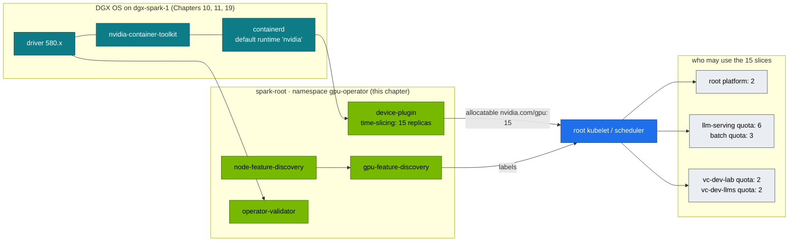
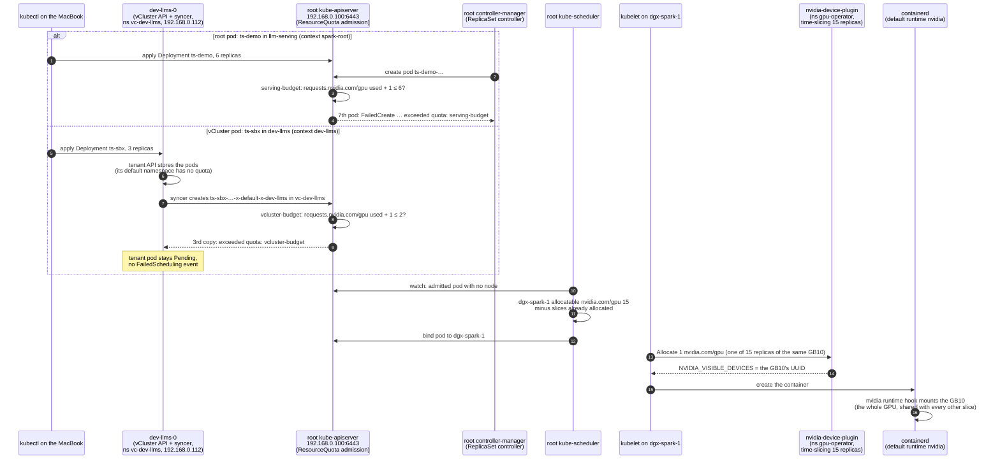

# Chapter 20 · NVIDIA GPU Operator & Time-Slicing: Host-Driver Mode, 15 Slices, Budgets per vCluster, Validation & Secrets for Pods

> **01-Ansible · Part IV — Secrets & platforms · Chapter 20 of 30** · ← [Chapter 19 · Kubernetes: kubeadm root cluster & vClusters](19-kubernetes-kubeadm-root-cluster-and-vclusters.md) · [All chapters](00-ansible-step-by-step-guide.md) · [Chapter 21 · Multus & secondary RDMA networks](21-multus-and-secondary-rdma-networks.md) →
>
> Deep dive: [02-Kubernetes Chapter 17 · NVIDIA GPU Operator & Network Operator](../02-Kubernetes/17-nvidia-gpu-operator-and-network-operator.md)

| | |
|---|---|
| **You will build** | The GPU Operator v26.7.1 deployed by Ansible with Helm in **host-driver mode** (DGX OS owns the driver and toolkit; the operator's driver, toolkit and CDI are off), NFD/GFD labels, the GB10 time-sliced into **15** `nvidia.com/gpu`, an automated validator gate and a GPU smoke pod. Then you watch the 15 slices split between the root (platform 2, `llm-serving` 6, `batch` 3) and the two vClusters (2 each) |
| **Hardware** | The root cluster from Chapter 19 (Semaphore template `19.1 Kubernetes`); §4.2 also needs the vClusters (`20.2 vClusters`). The operator itself is the template `20.1 GPU Operator` |
| **Time** | 45 min |
| **Risk** | Low. `atomic: true` rolls back a failed Helm upgrade |
| **Clusters** | `spark-root` (the operator, §4.1; `llm-serving`, §4.2), `dev-llms` and `dev-lab` (§4.2) |
| **Lab files** | [`roles/gpu_operator`](lab/roles/gpu_operator), [`playbooks/20.1-gpu-operator.yml`](lab/playbooks/20.1-gpu-operator.yml), 02-Kubernetes [`manifests/root/05-vclusters/quotas.yaml`](../02-Kubernetes/lab/manifests/root/05-vclusters/quotas.yaml), [`manifests/root-llms/10-tenancy/quotas.yaml`](../02-Kubernetes/lab/manifests/root-llms/10-tenancy/quotas.yaml) |

---

## 1. What the operator does, and what we switch off

| Operator component | Default job | On DGX Spark |
|---|---|---|
| `driver` DaemonSet | Builds and loads the NVIDIA driver in a container | **Disabled.** DGX OS ships and updates the driver; two owners would fight |
| `toolkit` DaemonSet | Installs nvidia-container-toolkit and edits the containerd config | **Disabled.** The host toolkit exists, and Chapter 19's `kubeadm_cluster` role already registered `nvidia` as containerd's default runtime with `nvidia-ctk` |
| CDI | On by default since operator v25.10: GPUs injected as CDI devices | **Disabled.** This lab injects GPUs through the `nvidia` runtime that DGX OS's toolkit configured. Mixing both paths makes "who gave this container the GPU?" hard to answer |
| `devicePlugin` | Advertises `nvidia.com/gpu` to kubelet | **On**, with a time-slicing config |
| `gfd` + `nfd` | Labels nodes (`nvidia.com/gpu.product`, `.memory`, `.compute.major/minor`, …) | On |
| `dcgmExporter` | Metrics | Off by default (`gpu_operator_dcgm_exporter`); Chapter 12's host collector covers the GB10 |
| `migManager` | MIG partitioning | **Off.** GB10 has no MIG |
| `validator` | Proves driver + toolkit + CUDA workloads function | On, and our Ansible gate waits for it |



The operator runs **only on the root**. The vClusters have no device plugin, no NFD and no GPU Operator of their own. They see the root's node, with its labels and its 15 allocatable slices, because they sync nodes from the host. Their pods are scheduled by the root's scheduler, and the root's device plugin hands out the slices.

## 2. Time-slicing on a UMA GPU: what you get and what you don't

| | Time-slicing (this lab) | MIG (not on GB10) | MPS |
|---|---|---|---|
| Isolation of compute | None (context switching) | Hardware | Partial |
| Isolation of memory | **None.** All pods share the unified pool with the OS | Hardware | Limit per client (`CUDA_MPS_PINNED_DEVICE_MEM_LIMIT`) |
| Fault isolation | None: one bad kernel/Xid can affect all | Yes | No |
| Good for | Dev notebooks, small inference services, CI jobs | — | Many small inference processes |

`failRequestsGreaterThanOne: true` makes a pod asking for `nvidia.com/gpu: 2` fail rather than silently receive two slices of the same GPU.

### 2.1 Why 15, and how they are split

A slice is a **ticket to the scheduler**, not a fraction of the GPU. The number only decides how many GPU pods may run at once. The lab picks 15 so that every layer has a budget you can exhaust in an exercise:

| Owner | Slices | Enforced by |
|---|---|---|
| root `llm-serving` (the model servers) | 6 | ResourceQuota `serving-budget` in `llm-serving` (`requests.nvidia.com/gpu: "6"`) |
| root `batch` (training) | 3 | ResourceQuota `batch-budget` in `batch` (`"3"`, same as Kueue's ClusterQueue `spark-cq`) |
| vCluster `dev-lab` | 2 | root ResourceQuota `vcluster-budget` in `vc-dev-lab` (`"2"`) |
| vCluster `dev-llms` (LLM sandbox) | 2 | root ResourceQuota `vcluster-budget` in `vc-dev-llms` (`"2"`) |
| root platform (`platform-tools`: GPU probes, the 02-Kubernetes Chapter 14 §5.5 UMA experiment, the preemption demo's 2 filler replicas; `default` smoke tests) | 2 | what is left: 15 − 6 − 3 − 2 − 2 |

The quotas live in the 02-Kubernetes lab ([`root/05-vclusters/quotas.yaml`](../02-Kubernetes/lab/manifests/root/05-vclusters/quotas.yaml) and [`root-llms/10-tenancy/quotas.yaml`](../02-Kubernetes/lab/manifests/root-llms/10-tenancy/quotas.yaml)), and its `tests/budget_check.py` checks that they add up to `gpu_operator_timeslice_replicas`. Change the replica count here and you must change the quotas there, or one side lies.

### 2.2 One slice request, step by step

A pod that asks for `nvidia.com/gpu: 1` meets a quota first and the scheduler second. Where the quota sits depends on which API server created the pod. §4.2 runs both paths: `ts-demo` on the root, `ts-sbx` in `dev-llms`.



- **Steps 1–4 are the root path.** The 7th `ts-demo` pod never exists: the quota refusal lands on the ReplicaSet as `FailedCreate` (§4.2, `describe rs -l app=ts-demo`).
- **Steps 5–9 are the vCluster path.** The tenant API server accepts all three pods; the root refuses the 3rd host copy at steps 8–9. That's why the Pending pod in `dev-llms` has the syncer's quota error and no scheduler event (§4.2, `describe pod` in `dev-llms`).
- **Step 11 is where the 15 counts.** The device plugin advertises 15 because of `time-slicing-config`; `kubectl --context spark-root describe node dgx-spark-1 | sed -n '/Allocated resources/,/Events/p'` shows how many are taken (§6, `Insufficient nvidia.com/gpu`).
- **Steps 13–16 give no isolation.** Every slice gets the same GPU; memory and compute are shared. On the Spark, `nvidia-smi` lists one process per `ts-demo` pod on one GB10 (§4.2).

---

## 3. The role

```yaml
# lab/roles/gpu_operator/defaults/main.yml
---
gpu_operator_chart_version: v26.7.1        # pin; check `helm search repo nvidia/gpu-operator -l`
gpu_operator_namespace: gpu-operator
gpu_operator_kubeconfig: "{{ lab_cache_dir | default(playbook_dir ~ '/../.cache') }}/kubeconfig-{{ lab_name | default('spark-lab') }}.yaml"
gpu_operator_context: spark-root

# DGX OS already provides the driver and container toolkit — the operator must
# NOT try to install them (it would fight DGX OS updates). The kubeadm_cluster
# role registered the NVIDIA runtime in containerd with nvidia-ctk.
gpu_operator_values:
  driver:
    enabled: false
  toolkit:
    enabled: false
  operator:
    defaultRuntime: containerd
  # CDI is on by default since operator v25.10; this lab injects GPUs through
  # the nvidia runtime that DGX OS's toolkit configured, so keep it off.
  cdi:
    enabled: false
  devicePlugin:
    config:
      name: time-slicing-config
      default: any
  dcgmExporter:
    enabled: "{{ gpu_operator_dcgm_exporter | default(false) }}"
  migManager:
    enabled: false        # GB10 has no MIG
  nfd:
    enabled: true

# Time-slicing: advertise N logical GPUs per physical GB10 (no memory isolation!).
# 15 slices: vCluster dev-lab 2, vCluster dev-llms 2, and the root 11 (platform 2,
# llm-serving 6, batch 3). Quotas in "02-Kubernetes/lab/manifests/root/05-vclusters"
# and "02-Kubernetes/lab/manifests/root-llms/10-tenancy".
gpu_operator_timeslice_replicas: 15
```

```yaml
# lab/roles/gpu_operator/tasks/main.yml
---
# Runs on the control node (localhost) against the root cluster's API server.
- name: Add NVIDIA Helm repo
  kubernetes.core.helm_repository:
    name: nvidia
    repo_url: https://helm.ngc.nvidia.com/nvidia

- name: Create namespace (privileged PSA — operator pods need host access)
  kubernetes.core.k8s:
    kubeconfig: "{{ gpu_operator_kubeconfig }}"
    context: "{{ gpu_operator_context }}"
    definition:
      apiVersion: v1
      kind: Namespace
      metadata:
        name: "{{ gpu_operator_namespace }}"
        labels:
          pod-security.kubernetes.io/enforce: privileged

- name: Time-slicing ConfigMap
  kubernetes.core.k8s:
    kubeconfig: "{{ gpu_operator_kubeconfig }}"
    context: "{{ gpu_operator_context }}"
    definition:
      apiVersion: v1
      kind: ConfigMap
      metadata:
        name: time-slicing-config
        namespace: "{{ gpu_operator_namespace }}"
      data:
        any: |-
          version: v1
          flags:
            migStrategy: none
          sharing:
            timeSlicing:
              renameByDefault: false
              failRequestsGreaterThanOne: true
              resources:
                - name: nvidia.com/gpu
                  replicas: {{ gpu_operator_timeslice_replicas }}

- name: Install / upgrade GPU Operator
  kubernetes.core.helm:
    kubeconfig: "{{ gpu_operator_kubeconfig }}"
    context: "{{ gpu_operator_context }}"
    name: gpu-operator
    chart_ref: nvidia/gpu-operator
    chart_version: "{{ gpu_operator_chart_version }}"
    release_namespace: "{{ gpu_operator_namespace }}"
    values: "{{ gpu_operator_values }}"
    wait: true
    wait_timeout: 15m
    atomic: true            # roll back automatically if pods never go Ready

- name: Wait for validator to succeed
  kubernetes.core.k8s_info:
    kubeconfig: "{{ gpu_operator_kubeconfig }}"
    context: "{{ gpu_operator_context }}"
    kind: Pod
    namespace: "{{ gpu_operator_namespace }}"
    label_selectors: [app=nvidia-operator-validator]
  register: gpu_operator_validator
  until: >-
    gpu_operator_validator.resources | length > 0 and
    gpu_operator_validator.resources | map(attribute='status.phase') | unique == ['Running']
  retries: 40
  delay: 15

- name: Read allocatable GPUs per node
  kubernetes.core.k8s_info:
    kubeconfig: "{{ gpu_operator_kubeconfig }}"
    context: "{{ gpu_operator_context }}"
    kind: Node
  register: gpu_operator_nodes

- name: Assert every node advertises time-sliced GPUs
  ansible.builtin.assert:
    that: (item.status.allocatable['nvidia.com/gpu'] | default('0') | int) == gpu_operator_timeslice_replicas
    fail_msg: "{{ item.metadata.name }} allocatable nvidia.com/gpu={{ item.status.allocatable['nvidia.com/gpu'] | default('0') }}"
    success_msg: "{{ item.metadata.name }} advertises {{ gpu_operator_timeslice_replicas }} GPU slices"
  loop: "{{ gpu_operator_nodes.resources }}"
  loop_control:
    label: "{{ item.metadata.name }}"
```

The playbook adds one post-task: a `cuda-smoke` pod in the root's `default` namespace that runs `nvidia-smi -L` with `nvidia.com/gpu: 1` and image `nvcr.io/nvidia/cuda:13.0.1-base-ubuntu24.04`. It is informational (`failed_when: false`); the validator gate is the real check.

Key automation moves:

- **Every call names the cluster.** `kubeconfig` *and* `context: spark-root`. The lab kubeconfig also holds `dev-lab` and `dev-llms`, and the operator must never land inside a vCluster.
- **`atomic: true` + `wait: true`.** A broken values change rolls back instead of leaving half a DaemonSet set.
- **Validator gate.** The play doesn't finish until `nvidia-operator-validator` pods are Running, so "Helm said deployed" isn't mistaken for "GPUs work".
- **Allocatable assertion.** Every node must advertise exactly `gpu_operator_timeslice_replicas` (15) GPUs, which catches the time-slicing ConfigMap not being picked up. With dgx-spark-2 joined, each node advertises 15, the scheduler has 30, and the namespace and vCluster budgets stay as they are until you raise them.

---

## 4. Hands-on

### 4.1 The operator on the root

#### What this lab does (template `20.1 GPU Operator`)

- **Where:** runs on the controller against the root's API only, always with context `spark-root`. It opens no SSH session and changes nothing on the Spark's host: driver, toolkit and containerd stay as DGX OS and Chapter 19 left them.
- **Namespace and config:** creates `gpu-operator` (privileged PSA) and the ConfigMap `time-slicing-config`: 15 replicas of `nvidia.com/gpu`, and a request for more than 1 is refused.
- **Helm release:** chart `nvidia/gpu-operator` v26.7.1 with the driver, toolkit, CDI and MIG manager **off** (DCGM exporter off by default). Device plugin, NFD, GFD and the validator run. `atomic: true` rolls a failed install back; the wait is up to 15 min.
- **Gates:** waits until the `nvidia-operator-validator` pods are `Running`, then asserts that every node advertises exactly 15 GPUs.
- **Smoke pod:** `cuda-smoke` in the root's `default` namespace runs `nvidia-smi -L` with 1 slice. It stays behind as a `Completed` pod.
- **First run:** pulls the operator's images, so expect several minutes.

#### What to look for

1. **Semaphore run:** `failed=0`. The task "Assert every node advertises time-sliced GPUs" prints `dgx-spark-1 advertises 15 GPU slices`. On a re-run the Helm release and the ConfigMap stay as they are.
2. **The smoke pod is only informational** (`failed_when: false`), so check it by eye: `kubectl --context spark-root logs cuda-smoke` prints `GPU 0: NVIDIA GB10 (UUID: GPU-…)`. A re-run doesn't start it again; delete the pod first (`kubectl --context spark-root delete pod cuda-smoke`) to repeat the test.
3. **The node and the release**, with the commands under "Run it":

   | Line/Field | Healthy value |
   |---|---|
   | `.status.allocatable["nvidia.com/gpu"]` | `"15"` |
   | `nvidia.com/gpu.replicas` | `"15"` |
   | `nvidia.com/gpu.sharing-strategy` | present (time-slicing) |
   | `nvidia.com/gpu.product` | ends in `-SHARED` |
   | `helm get values`: `driver`, `toolkit`, `cdi` | `enabled: false` each |
   | pods in `gpu-operator` | Running/Completed, and no driver or toolkit DaemonSet pods |

**If something's off:** allocatable `1` instead of `15` → the device plugin didn't pick up `time-slicing-config`. Validator stuck in `Init` → `nvidia-smi` on the host first. `Could not find … kubeconfig-spark-lab.yaml` → run `19.1 Kubernetes` from Semaphore first. More in §6.

#### Run it

The role runs on the **controller**: in this lab the Semaphore container on sema01, which has `helm`, `kubectl` and `kubernetes.core` in its image and reads the kubeconfig from its state volume (Chapter 19 §2.5).

**Semaphore UI:** run the template **`20.1 GPU Operator`** (break-glass: `ansible-playbook playbooks/20.1-gpu-operator.yml` from the MacBook, against its own `.cache/` kubeconfig). The play only talks to the Kubernetes API, so it needs no SSH certificate. Then check from the MacBook:

```bash
# ▶ MacBook · technical-depth (repo root)
cd "01-Ansible/lab"
tools/fetch-kubeconfig.sh sema01                     # same contexts as after 19.1; refresh after every cluster task
export KUBECONFIG=$PWD/.cache/kubeconfig-spark-lab.yaml
kubectl --context spark-root -n gpu-operator get pods
kubectl --context spark-root get node dgx-spark-1 -o json \
  | jq '.status.allocatable["nvidia.com/gpu"], (.metadata.labels | with_entries(select(.key|startswith("nvidia.com/gpu"))))'
kubectl --context spark-root logs cuda-smoke     # → GPU 0: NVIDIA GB10 (UUID: GPU-…)
helm --kube-context spark-root -n gpu-operator get values gpu-operator | grep -A1 -E '^(driver|toolkit|cdi):'
```

Expected: allocatable `"15"`, `nvidia.com/gpu.replicas: "15"` and a `nvidia.com/gpu.sharing-strategy` label from GFD, and `enabled: false` under `driver`, `toolkit` and `cdi`. There is no driver or toolkit DaemonSet in the namespace. Look closely at `nvidia.com/gpu.product`: GFD writes it from what the driver reports, and with time-slicing it adds a `-SHARED` suffix. That is why the lab never selects on it — Chapter 19's kubelet flags set the lab-owned `spark.lab/gpu=gb10` at registration, and every 02 lab selector (node-probe, dev-lab affinity, Kueue's ResourceFlavor, `verify.sh`) uses that.

### 4.2 Fifteen slices, five budgets

#### What this lab does (manifests `lab/manifests/20-gpu/ts-demo.yaml` and `ts-sbx.yaml`)

- **On the root:** Deployment `ts-demo` in `llm-serving`, 6 replicas. Each pod takes 1 GPU slice and 4Gi of memory (request = limit) and runs a PyTorch matrix-multiply loop. Then you ask for a 7th replica, and delete it all. The image `nvcr.io/nvidia/pytorch:25.09-py3` is large, so the first pull takes a while.
- **In the vCluster `dev-llms`:** Deployment `ts-sbx` in its `default` namespace, 3 replicas, each holding 1 slice and 256Mi while it sleeps. Deleted at the end.
- **Nothing is reconfigured.** The quotas `serving-budget` and `vcluster-budget` are only read. If the 02 lab's model servers already run in `llm-serving`, they hold some of the 6 slices: scale them to 0 first.

#### What to look for

1. **`ts-demo`:** 6 pods `Running` on dgx-spark-1, and `nvidia-smi` on the Spark lists 6 python processes (memory columns show `[N/A]` on the GB10's unified memory).
2. **The 7th replica never exists.** Still 6 pods. The ReplicaSet events show `FailedCreate … exceeded quota: serving-budget, requested: requests.nvidia.com/gpu=1, used: requests.nvidia.com/gpu=6, limited: requests.nvidia.com/gpu=6`, and `describe resourcequota serving-budget` shows `requests.nvidia.com/gpu  6  6`.
3. **The vCluster sees more than it may use:** `dev-llms` reports allocatable `15` on dgx-spark-1, while the root's `vcluster-budget` in `vc-dev-llms` allows `2`.
4. **`ts-sbx`:** 2 `Running`, 1 `Pending`. The Pending pod's events quote `exceeded quota: vcluster-budget` and `requests.nvidia.com/gpu`, and there is **no** `FailedScheduling` event. On the root, `vc-dev-llms` holds only 2 copies named `ts-sbx-…-x-default-x-dev-llms`.

**If something's off:** fewer than 6 `ts-demo` pods → other pods in `llm-serving` hold slices or memory (`describe resourcequota serving-budget`). All pods `Pending` with `Insufficient nvidia.com/gpu` → the node's 15 slices are taken elsewhere (`describe node … | sed -n '/Allocated resources/,/Events/p'`). More in §6.

#### Run it

Build the vClusters and the root's LLM budgets if you haven't (**Semaphore UI:** template `20.2 vClusters`, then `tools/fetch-kubeconfig.sh sema01` on the MacBook for the `dev-lab` and `dev-llms` contexts). Start on the root, where the models run. A ResourceQuota on a root namespace is checked by the root's own API server:

The two manifests are in the lab folder: [`lab/manifests/20-gpu/ts-demo.yaml`](lab/manifests/20-gpu/ts-demo.yaml) (root, `llm-serving`, 6 replicas × 1 slice × 4Gi, a PyTorch matmul loop) and [`lab/manifests/20-gpu/ts-sbx.yaml`](lab/manifests/20-gpu/ts-sbx.yaml) (vCluster `dev-llms`, 3 replicas × 1 slice, sleeping).

If the 02 lab's model servers already run in `llm-serving`, they hold some of the 6 slices: scale them to 0 first, or expect fewer `ts-demo` pods.

```bash
# ▶ MacBook · 01-Ansible/lab (venv active)
kubectl --context spark-root apply -f manifests/20-gpu/ts-demo.yaml
kubectl --context spark-root -n llm-serving get pods -l app=ts-demo -o wide        # 6 Running on dgx-spark-1
kubectl --context spark-root -n llm-serving scale deploy ts-demo --replicas=7
kubectl --context spark-root -n llm-serving get pods -l app=ts-demo | wc -l         # still 6 pods (+ header): the 7th was never created
kubectl --context spark-root -n llm-serving describe rs -l app=ts-demo | sed -n '/Events/,$p'
kubectl --context spark-root -n llm-serving describe resourcequota serving-budget | grep nvidia   # requests.nvidia.com/gpu  6  6
ssh dgxadmin@192.168.0.100 nvidia-smi                                   # 6 python processes on one GB10
kubectl --context spark-root delete -f manifests/20-gpu/ts-demo.yaml
```

The 7th pod doesn't exist at all. The ReplicaSet controller asked the root API server to create it, and the quota admission refused: the ReplicaSet's events show `FailedCreate … exceeded quota: serving-budget, requested: requests.nvidia.com/gpu=1, used: requests.nvidia.com/gpu=6, limited: requests.nvidia.com/gpu=6`. Slices are still free on the node, yet `llm-serving` can't have them: they belong to `batch`, the vClusters and the platform.

Now a vCluster. Its pods are created by its own API server first, and only the syncer meets the root quota:

```bash
# ▶ MacBook · any folder
kubectl --context dev-llms get node dgx-spark-1 -o jsonpath='{.status.allocatable.nvidia\.com/gpu}{"\n"}'   # 15
kubectl --context spark-root -n vc-dev-llms describe resourcequota vcluster-budget | grep -E 'nvidia|memory'
```

The node says 15; the root's quota on `vc-dev-llms` says 2. The tenant can see more than it may use, and that gap is the most common source of "why is my pod Pending when the node has free GPUs?". Spend the budget with three small pods (a slice is a ticket, so a sleeping pod holds one as well as a busy one):

```bash
# ▶ MacBook · 01-Ansible/lab (venv active)
kubectl --context dev-llms apply -f manifests/20-gpu/ts-sbx.yaml
kubectl --context dev-llms get pods -l app=ts-sbx                     # 2 Running, 1 Pending
kubectl --context dev-llms describe pod "$(kubectl --context dev-llms get pods -l app=ts-sbx --field-selector=status.phase=Pending -o name | head -1)" | sed -n '/Events/,$p'
kubectl --context spark-root -n vc-dev-llms get pods | grep ts-sbx    # only 2 host copies: ts-sbx-…-x-default-x-dev-llms
kubectl --context dev-llms delete -f manifests/20-gpu/ts-sbx.yaml
```

The 3rd pod is `Pending` **inside** `dev-llms`, but no scheduler ever looked at it. The vCluster's own API server accepted it (its `default` namespace has no quota), and the syncer's attempt to create the host copy in `vc-dev-llms` was refused by the root quota. The events show the syncer's error, quoting `exceeded quota: vcluster-budget` and `requests.nvidia.com/gpu`, and there are no `FailedScheduling` events. `dev-lab` behaves the same way (2 slices). And on the root, `platform-tools` or `default` can still start 2 GPU pods, because the platform namespaces have no slice quota and take what the five budgets don't hold.

> **Always set a `memory` limit on GPU pods on a Spark, and on the LLM stack make the request equal to it.** Kubernetes can't account for GPU memory on a time-sliced UMA GPU, but the container memory limit plus the kubelet reserve from Chapter 19 bound how much of the shared pool a pod's host-side allocations take. With request = limit the scheduler counts the full amount, so a model that doesn't fit stays `Pending` instead of squeezing one that runs. A memory limit is also mandatory wherever a quota caps `limits.memory` (`llm-serving`, `batch`, every `vc-*`): the LimitRange fills in a default (512Mi in `llm-serving`, 256Mi on the root side of a vCluster) for pods that set none, and a CUDA process will exceed that. Whether CUDA allocations count against the pod's cgroup is something to verify on your node with the probe from Chapter 11. Treat it as an experiment, not an assumption.

### 4.3 Secrets for GPU workloads (NGC, Hugging Face) from Vault

The Vault is **vault01** (192.168.0.211), outside the Spark, where `17.1-vault.yml` created the `kv/` engine and the `kv/spark-lab/*` paths. Pods need their own way in: a Kubernetes auth method on vault01 for the cluster that runs the injector or operator, and a policy of their own. Don't reuse Semaphore's AppRole `semaphore`: it is the automation's identity, not a workload's. Two production-grade options (details in Chapter 18). With nested clusters there is one extra rule: **install the injector or operator in the cluster where the pod is created.** The model servers run on the root, so for `llm-serving` that is the root (`helm --kube-context spark-root …`). Each vCluster has its own API server and its own admission chain, so a sandbox pod in `dev-llms` needs the injector or operator inside `dev-llms` (`helm --kube-context dev-llms …`).

```yaml
# Option A — Vault Agent Injector annotations on the pod (injector running in the same cluster)
metadata:
  annotations:
    vault.hashicorp.com/agent-inject: "true"
    vault.hashicorp.com/role: "gpu-workloads"
    vault.hashicorp.com/agent-inject-secret-hf: "kv/data/spark-lab/huggingface"
    vault.hashicorp.com/agent-inject-template-hf: |
      {{- with secret "kv/data/spark-lab/huggingface" -}}export HF_TOKEN={{ .Data.data.token }}{{- end }}
```

```yaml
# Option B — External Secrets Operator → a normal k8s Secret (apply with --context spark-root)
apiVersion: external-secrets.io/v1beta1
kind: ExternalSecret
metadata: { name: hf-token, namespace: llm-serving }
spec:
  secretStoreRef: { name: vault-spark, kind: ClusterSecretStore }
  target: { name: hf-token }
  data:
    - secretKey: HF_TOKEN
      remoteRef: { key: kv/spark-lab/huggingface, property: token }
```

In `llm-serving` the Secret exists once, in the root's etcd, where Chapter 19's `aescbc` encryption applies. In a vCluster it exists twice: the original in the vCluster's SQLite database on its PVC, the synced copy in `vc-dev-llms` (or `vc-dev-lab`) in the root's etcd. The root's EncryptionConfiguration does not cover the vCluster's own store, so protect the PVC (`/data/k8s` on the node) accordingly.

---

## 5. Integrations

| System | Note |
|---|---|
| Root cluster (Chapter 19) | Needs containerd's default runtime `nvidia`; the operator never edits containerd here (toolkit off) |
| Budgets (Chapter 19 §3.4, 02-Kubernetes Chapter 04) | Everything consumes slices through the root scheduler; the vCluster quotas (`manifests/root/05-vclusters/quotas.yaml`) and the LLM quotas (`manifests/root-llms/10-tenancy/quotas.yaml`) must sum with the platform's 2 to `gpu_operator_timeslice_replicas` |
| DGX OS upgrades (Chapter 10) | After a driver update, restart the device-plugin and validator pods (or reboot); the upgrade playbook's drain/uncordon covers it |
| Telemetry (Chapter 12) | Choose either host dcgm-exporter **or** the operator's, not both |
| Multus/RDMA (Chapter 21) | Same pod requests `nvidia.com/gpu` + `rdma/rdma_shared_cx7` |
| 02-Kubernetes Chapter 17 | Switching a node between time-sliced and whole-GPU profiles, the Network Operator alternative |
| Semaphore (Chapter 04) | The lab's controller: template `20.1 GPU Operator`, run from the lab image (`kubernetes.core` + helm) |
| AWX | Alternative controller: can run the Helm role from a job template (the EE includes `kubernetes.core` + helm) |

## 6. Troubleshooting & diagnostics

| Symptom | Diagnose | Fix |
|---|---|---|
| Validator stuck `Init` | `kubectl --context spark-root -n gpu-operator logs <validator> -c driver-validation` | Host driver not found: make sure `driver.enabled=false` (operator expects the host driver) and `nvidia-smi` works on the host |
| `toolkit-validation` fails | Container logs; `sudo grep -rn --include='*.toml' default_runtime_name /etc/containerd` on the node (`config.toml` or `conf.d/99-nvidia.toml`) | containerd has no `nvidia` runtime (DGX OS update replaced `config.toml`?). Re-run the template `19.1 Kubernetes`; its `nvidia-ctk runtime configure` task restores it |
| Template fails: `Could not find … kubeconfig-spark-lab.yaml` | the state volume has no kubeconfig (`SPARK_LAB_CACHE` unset, or 19.1 ran from the MacBook) | Chapter 04 §4 Verify; run `19.1 Kubernetes` from Semaphore first |
| Allocatable `nvidia.com/gpu` = 1, not 15 | `kubectl --context spark-root -n gpu-operator get cm time-slicing-config -o yaml`; device-plugin logs | ConfigMap name/key must match `devicePlugin.config.name/default`; restart the device-plugin DS |
| Root pod `Pending: Insufficient nvidia.com/gpu` | `kubectl --context spark-root describe node dgx-spark-1 \| sed -n '/Allocated resources/,/Events/p'` | All 15 slices in use (count the `vc-*`, `llm-serving` and `batch` pods too), or `failRequestsGreaterThanOne` rejected a request for > 1 |
| vCluster pod `Pending`, no scheduler events | `kubectl --context <vc> describe pod …` events; `kubectl --context spark-root -n vc-<vc> describe quota vcluster-budget` | Root budget spent (§4.2). Free slices in that vCluster or raise its quota (02-Kubernetes Chapter 04 §6.5) |
| `llm-serving` Deployment short of replicas, no Pending pod | `kubectl --context spark-root -n llm-serving describe rs -l app=<app>`; `describe quota serving-budget` | `FailedCreate … exceeded quota: serving-budget`: the 6 slices or 90 Gi are spent. Scale another model down (02-Kubernetes Chapter 20 §2) |
| Tenant pod rejected: "at most 1 nvidia.com/gpu" | Message from the API server that admitted the pod (the vCluster's, or the root's for `llm-serving`/`batch`) | The 02 lab's CEL policy `spark-gpu-slice-limits`: a slice is not more GPU, request 1 |
| `ImagePullBackOff` on operator pods | `kubectl --context spark-root -n gpu-operator describe pod <p>` | Check the chart version supports arm64 for every component; pin a release that does |
| Helm upgrade rolled back (`atomic`) | `helm --kube-context spark-root -n gpu-operator history gpu-operator` | Read `helm status`; fix values; re-run |
| CUDA OOM in one pod when others run | `free -g` on the host | Time-slicing shares memory. Size models to fit **together**, or run fewer replicas |

## 7. Validation

- [ ] `20.1-gpu-operator.yml` finishes with the validator Running and the allocatable assertion green (15 per node).
- [ ] No driver or toolkit DaemonSet in `gpu-operator`; `cdi.enabled: false` in the release values.
- [ ] NFD/GFD labels present (`nvidia.com/gpu.product`, `nvidia.com/gpu.compute.major=12`).
- [ ] In `llm-serving`, 6 GPU pods run and the 7th is refused by `serving-budget` (`FailedCreate` on the ReplicaSet); in `dev-llms`, 2 run and the 3rd stays `Pending` because the syncer is refused by `vcluster-budget`, while the node still shows free slices.
- [ ] A pod receives `HF_TOKEN` from vault01 by one of the §4.3 routes, with the injector/operator in the same cluster as the pod.
