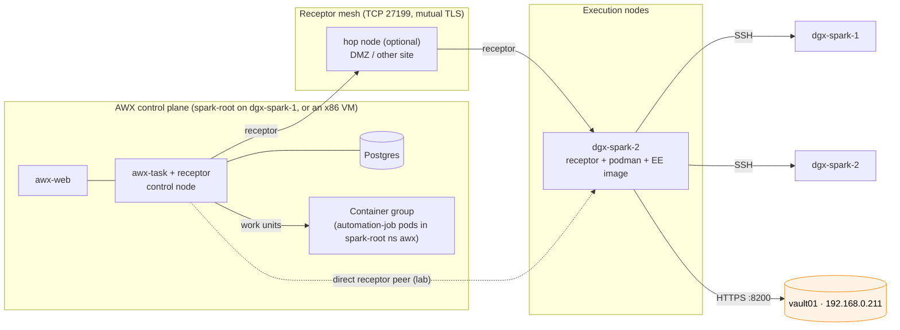
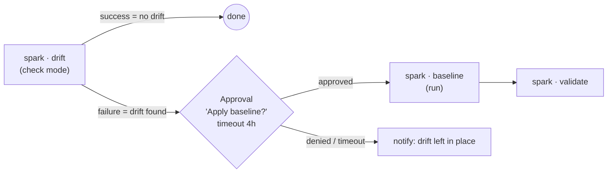

# Chapter 24 · AWX Production & Receptor: Execution Nodes, Vault Credentials, Approval Workflows, Backup/Restore, Monitoring

> **01-Ansible · Part IV — Secrets & platforms · Chapter 24 of 30** · ← [Chapter 23 · AWX install & configuration as code](23-awx-install-and-configuration-as-code.md) · [All chapters](00-ansible-step-by-step-guide.md) · [Chapter 25 · Testing, linting & CI](25-testing-linting-and-ci.md) →

| | |
|---|---|
| **You will build** | The operational layer around AWX: a Spark as a **Receptor execution node** (the hybrid pattern), Vault-backed credentials, a **drift → approval → remediate** workflow, scheduled backups with a tested restore, and metrics in Prometheus |
| **Prerequisite** | AWX from Chapter 23 (on the kubeadm root cluster, or on an x86 box for the hybrid pattern) |
| **Clusters** | `spark-root` (namespace `awx`) for the AWX control plane and container group |
| **Time** | 2–3 h |
| **Risk** | Medium. Restores and upgrades touch the AWX database; rehearse them on purpose |

> **AWX is the alternative controller here.** This lab's controller is **Semaphore on `sema01`** (192.168.0.210), with SSH certificates from **`vault01`** (192.168.0.211), both outside the Spark ([Chapter 01](01-management-plane-semaphore-and-vault.md), [Chapter 04](04-dgx-spark-as-semaphore-target.md)). The management plane must survive `19.2-reset-kubernetes.yml` and a re-image of the Spark, and an AWX on `spark-root` doesn't (Chapter 23 explains the trade-off). Learn AWX's production layer here because it's what large shops run; the concepts map one to one:
>
> | Semaphore in this lab | AWX equivalent (this chapter) |
> |---|---|
> | Task template + CLI args `--limit dgx-spark-1,localhost` | Job template + `ask_limit_on_launch` |
> | Variable group `vault-approle` (AppRole `semaphore`) + play 1 `00-vault-cert.yml` | *HashiCorp Vault Signed SSH* credential linked to a Machine credential (§2.2) |
> | `vault_lab_secrets_enabled` → play 1 reads `kv/spark-lab/*` | *HashiCorp Vault Secret Lookup* credential |
> | Schedule on `26.1 Drift check` | `awx.awx.schedule` |
> | Template permissions (*Task Runner* role, separate `spark-danger` project) | RBAC + an **approval node** (§2.3), which Semaphore doesn't have |
> | sema01 container + state volume `/opt/spark-lab/cache` | EE pods / execution nodes + PVCs |
>
> If you run both, keep AWX on its own AppRole and its own templates, and don't let both controllers change the same hosts.

---

## 1. Architecture

### 1.1 HLD: control plane vs execution plane



| Execution option | Where jobs run | Use it when |
|---|---|---|
| Control-plane pods (default) | `automation-job-*` pods in the AWX namespace | AWX sits next to the targets |
| **Container group** | Pods in any k8s namespace or cluster, with your pod spec | You want jobs on a specific node (`nodeSelector`), a GPU node, or with extra mounts |
| **Execution node** | A VM or bare-metal host running receptor + podman | AWX control plane is elsewhere (x86, cloud) but jobs must run *near* the Sparks; also the fix for the arm64 image gap (Chapter 23 §2) |
| **Hop node** | Relay only, runs no jobs | Crossing network zones (lab LAN ↔ office) with a single inbound port |

### 1.2 LLD: what lives where

| Object | Managed by | Notes |
|---|---|---|
| Instances / instance groups | `awx.awx.instance`, `awx.awx.instance_group` | Execution nodes join by an install bundle generated in AWX |
| Credential types | built-in: *HashiCorp Vault Secret Lookup*, *HashiCorp Vault Signed SSH* | Source credentials; target credentials *link* to them |
| Workflow | `awx.awx.workflow_job_template` + `workflow_job_template_node` | Nodes: job templates, approvals, inventory syncs |
| Backups | `AWXBackup` CR (operator) → PVC | Includes DB and secrets (`secret_key`!) |
| Metrics | `/api/v2/metrics/` (Prometheus text) | Scrape with a token |

---

## 2. Hands-on

### 2.1 Make dgx-spark-2 an execution node

#### What this lab does (AWX install bundle, playbook `install_receptor.yml`)

- **In AWX:** registers a new instance `dgx-spark-2` of type *execution*, listening on TCP **27199**, and produces an install bundle with its certificates.
- **On the Spark:** the bundle's playbook (collection `ansible.receptor`), run from the MacBook as `dgxadmin` with sudo, installs Receptor and podman and starts the `receptor` service. Jobs sent to this node run there in podman containers from your EE image.
- **One Spark:** this pattern is for an AWX control plane that runs somewhere else (an x86 VM, §1.1). With AWX on `spark-root`, jobs already run on the Spark as container-group pods, so skip it; in the hybrid layout use `dgx-spark-1` wherever this section says `dgx-spark-2`.
- **Not touched:** Semaphore, its templates and the Kubernetes cluster.

#### What to look for

1. **The bundle playbook:** `failed=0`.
2. **In AWX:** the instance moves to **Ready**, and `awx instances health_check dgx-spark-2` succeeds.
3. **On the Spark** (block below): `receptor` is `active (running)`; `receptorctl … status` lists the AWX control node among its connections and `ansible-runner` among the work types; `podman images` is empty until the first job, then shows the EE image.
4. **A job** from a template that uses the instance group `spark-exec` ends *Successful*.

**If something's off:** the instance stays **Unavailable** → TCP 27199 is blocked, or the hostname doesn't match the certificate. The first job fails pulling the EE → `podman pull` it by hand as the receptor user. More in §4.

#### Run it

1. In AWX: **Instances → Add** → hostname `dgx-spark-2`, node type **execution**, listener port `27199`, peers from control. Save and **download the install bundle** (`dgx-spark-2_install_bundle.tar.gz`).
2. From your MacBook (as `dgxadmin`, the bootstrap path):

```bash
# ▶ MacBook · 01-Ansible/lab (venv active)
mkdir -p .cache/receptor && tar xzf ~/Downloads/dgx-spark-2_install_bundle.tar.gz -C .cache/receptor
cd .cache/receptor/dgx-spark-2_install_bundle
ansible-galaxy collection install -r requirements.yml       # ansible.receptor
# the bundle ships install_receptor.yml + inventory.yml; point it at the Spark:
ansible-playbook -i inventory.yml install_receptor.yml -e ansible_user=dgxadmin -K
```

3. Back in AWX the instance moves to **Ready**. Health-check it: `awx instances health_check dgx-spark-2`.
4. Put it in an instance group `spark-exec` and point job templates at it.

On the Spark, check it:

```bash
# ▶ dgx-spark-2 (ssh dgx-spark-2)
systemctl status receptor
receptorctl --socket /var/run/receptor/receptor.sock status     # peers, work types
podman images | grep -i ee                                      # EE image pulled on first job
```

The execution node runs your EE with **podman** under a dedicated user. Pre-pull your arm64 `spark-ee` (Chapter 08) to avoid a slow first job.

### 2.2 Vault-backed credentials (no stored secrets)

#### What this lab does (tasks added to `playbooks/awx-config.yml`)

- **Three credentials in AWX:** `vault-approle` (*HashiCorp Vault Secret Lookup*) and `vault-ssh-ca` (*HashiCorp Vault Signed SSH*), both pointing at vault01 `https://192.168.0.211:8200`, and the Machine credential `spark-ssh-cert` for user `svc-ansible` with the private key `~/.ssh/awx_ed25519`.
- **One link:** the certificate field of `spark-ssh-cert` is filled per job by vault01's signing role `ansible` (`ssh-client-signer`), principal `svc-ansible`. Each job gets a certificate valid for 15 minutes.
- **What you prepare first:** AWX's own AppRole on vault01 (with permission to sign at `ssh-client-signer/sign/ansible`), its role ID and secret ID in `ANSIBLE_HASHI_VAULT_ROLE_ID` / `ANSIBLE_HASHI_VAULT_SECRET_ID` on the MacBook, the key pair `~/.ssh/awx_ed25519`, and vault01's CA in `.cache/vault-ca.crt`.
- **Nothing changes on the Sparks:** they already trust vault01's CA for `svc-ansible` (`04.1-semaphore-target.yml`).

#### What to look for

1. **The playbook run:** `failed=0`.
2. **A job using `spark-ssh-cert`** (with the extra variable `ansible_user: svc-ansible`) ends *Successful*.
3. **On the Spark**, the login used a certificate:
   ```bash
   # ▶ dgx-spark-1 (ssh dgx-spark-1)
   sudo grep 'Accepted publickey for svc-ansible' /var/log/auth.log | tail -1   # … ED25519-CERT ID … (serial N) CA …
   ```
   Run the job again: the serial number changes, because every job gets a new certificate.

**If something's off:** `Credential lookup failed: permission denied` → AWX's policy on vault01 lacks the signing path. `Permission denied (publickey)` although the lookup worked → the job logged in as `dgxadmin`; set `ansible_user: svc-ansible`. More in §4.

#### Run it

The Vault is **vault01**, the same one Semaphore uses. Give AWX its **own** AppRole (for example `awx`, created on vault01 the way Chapter 01 §4 creates `semaphore`, with a policy that allows `ssh-client-signer/sign/ansible` and, if needed, `kv/data/spark-lab/*`), so you can revoke one controller without breaking the other. The targets need nothing new: `04.1-semaphore-target.yml` already made them trust vault01's CA for `svc-ansible`.

```yaml
# playbooks/awx-config.yml (continued from Chapter 23)
- name: Vault lookup credential (AppRole)
  awx.awx.credential:
    name: vault-approle
    organization: SparkLab
    credential_type: HashiCorp Vault Secret Lookup
    inputs:
      url: https://192.168.0.211:8200                                  # vault01
      cacert: "{{ lookup('file', '.cache/vault-ca.crt') }}"            # vault01's TLS certificate (Chapter 04 §2)
      role_id: "{{ lookup('env', 'ANSIBLE_HASHI_VAULT_ROLE_ID') }}"    # AWX's own AppRole, not 'semaphore'
      secret_id: "{{ lookup('env', 'ANSIBLE_HASHI_VAULT_SECRET_ID') }}"
      api_version: v2
  no_log: true

- name: Vault signed-SSH credential (source for the machine credential)
  awx.awx.credential:
    name: vault-ssh-ca
    organization: SparkLab
    credential_type: HashiCorp Vault Signed SSH
    inputs:
      url: https://192.168.0.211:8200
      cacert: "{{ lookup('file', '.cache/vault-ca.crt') }}"
      role_id: "{{ lookup('env', 'ANSIBLE_HASHI_VAULT_ROLE_ID') }}"
      secret_id: "{{ lookup('env', 'ANSIBLE_HASHI_VAULT_SECRET_ID') }}"
  no_log: true

- name: Machine credential whose certificate is signed per job
  awx.awx.credential:
    name: spark-ssh-cert
    organization: SparkLab
    credential_type: Machine
    inputs:
      username: svc-ansible                                         # the automation account from Chapter 04
      ssh_key_data: "{{ lookup('file', '~/.ssh/awx_ed25519') }}"   # private key; public cert comes from Vault
  no_log: true

- name: Link the public-key certificate field to Vault signing
  awx.awx.credential_input_source:
    input_field_name: ssh_public_key_data
    target_credential: spark-ssh-cert
    source_credential: vault-ssh-ca
    metadata:
      public_key: "{{ lookup('file', '~/.ssh/awx_ed25519.pub') }}"
      secret_path: ssh-client-signer
      role: ansible
      valid_principals: svc-ansible                                 # the only principal role 'ansible' allows (Chapter 01 §4)
```

Each job now gets a freshly signed certificate with the signing role's lifetime (15 minutes on vault01). AWX stores **no** usable long-term access on its own: the private key alone won't pass sshd without a valid certificate.

Two lab details. `group_vars/spark.yml` picks `ansible_user` from `vault_role_id`, which AWX doesn't define, so it would say `dgxadmin` and override the credential's username: give the job templates the extra variable `ansible_user: svc-ansible`. And play 1 (`00-vault-cert.yml`) skips itself for the same reason, so it never competes with the credential plugin.

### 2.3 Workflow: drift → approval → remediate → validate

#### What this lab does (workflow tasks for `playbooks/awx-config.yml`)

- **One workflow template,** `spark · drift-remediate`, with four nodes: `spark · drift` → on failure, the approval "Apply baseline to drifted Sparks?" (4 h timeout) → on approval, `spark · baseline` → `spark · validate`.
- **One change you make to the drift template:** it must *fail* when it finds drift (a final task that fails when `spark_config_drift_tasks > 0`). Without it, the workflow never reaches the approval.
- **What runs on the Sparks:** only `drift` (check mode) until someone approves; then `baseline` changes hosts. That makes AWX a second controller that writes, so don't run the same baseline from Semaphore at the same time.

#### What to look for

1. **The workflow visualizer** shows four nodes, with a *failure* edge from `drift` to the approval.
2. **On a clean lab:** `drift` ends *Successful* and the workflow stops there.
3. **With drift** (change something `04.3-baseline.yml` manages): `drift` fails, the workflow waits in *Pending approval*. Approve it: `baseline` and `validate` end *Successful*. Deny it, or let it time out: nothing is changed.

**If something's off:** the workflow never reaches the approval → the drift job doesn't fail on drift, or it is wired to `success_nodes`. More in §4.

#### Run it



To make "drift found" a *failure* in AWX, the drift template runs `26.1-drift-check.yml` followed by the drift reporter (exit code 2 on drift, Chapter 26), for example as a final task that fails when `spark_config_drift_tasks > 0`.

```yaml
- name: Workflow template
  awx.awx.workflow_job_template:
    name: "spark · drift-remediate"
    organization: SparkLab
    inventory: spark-lab
    ask_limit_on_launch: true

- name: Nodes
  awx.awx.workflow_job_template_node:
    workflow_job_template: "spark · drift-remediate"
    organization: SparkLab
    identifier: "{{ item.id }}"
    unified_job_template: "{{ item.ujt | default(omit) }}"
    approval_node: "{{ item.approval | default(omit) }}"
    success_nodes: "{{ item.success | default([]) }}"
    failure_nodes: "{{ item.failure | default([]) }}"
  loop:
    - { id: validate, ujt: "spark · validate" }
    - { id: baseline, ujt: "spark · baseline", success: [validate] }
    - { id: approve, approval: { name: "Apply baseline to drifted Sparks?", timeout: 14400 }, success: [baseline] }
    - { id: drift, ujt: "spark · drift", failure: [approve] }
```

(Nodes are created leaf-first, so the referenced identifiers already exist.)

### 2.4 Backup and a restore drill

#### What this lab does (manifest `.cache/awx/backup.yaml`)

- **One `AWXBackup`,** `awx-backup-2026-09-29` in `awx`: the operator dumps the AWX database and its secrets (including `awx-secret-key`) onto a 20Gi PVC on `local-path`, a folder under `/data/k8s` on the Spark.
- **Restore drill:** a second AWX, `awx-restore`, built from that backup with an `AWXRestore` in a scratch namespace. It costs another AWX's worth of memory (about 4.5 GiB of limits, §1.3 of Chapter 23) while it runs; delete it afterwards.
- **The backup lives on the same Spark:** a `19.2 Reset Kubernetes` with `reset_wipe_data: true` deletes it too. Copy it off the Spark if it must survive that.

#### What to look for

1. **The backup's status** (the `jq` command under "Run it") shows a `Successful` condition with status `True`, and names the `backupClaim` and the `backupDirectory`.
2. **The backup PVC** in `awx` is `Bound` (`kubectl --context spark-root -n awx get pvc`).
3. **The restored AWX:** you log in with the same admin password, and opening a credential shows no error. That proves the secret key came back with the database.

**If something's off:** the backup never succeeds → read the operator log (`kubectl --context spark-root -n awx logs deploy/awx-operator-controller-manager -c awx-manager`). Credentials error in the restored AWX → it was restored without the matching `awx-secret-key`. More in §4.

#### Run it

```yaml
# .cache/awx/backup.yaml
apiVersion: awx.ansible.com/v1beta1
kind: AWXBackup
metadata: { name: awx-backup-2026-09-29, namespace: awx }
spec:
  deployment_name: awx
  backup_storage_class: local-path
  backup_storage_requirements: 20Gi
```

```bash
# ▶ MacBook · 01-Ansible/lab (venv active)
kubectl --context spark-root apply -f .cache/awx/backup.yaml
kubectl --context spark-root -n awx get awxbackup awx-backup-2026-09-29 -o jsonpath='{.status}' | jq
```

Schedule it with a Kubernetes CronJob that applies a dated `AWXBackup`, or with an AWX job that runs `kubernetes.core.k8s`. **Restore drill:** deploy a second AWX named `awx-restore` in a scratch namespace from that backup (`AWXRestore` with `backup_name`), log in, and confirm credentials decrypt (open one; it must not error).

### 2.5 Monitoring AWX

#### What this lab does (a scrape job in `roles/gpu_telemetry`, then template `12.1 Telemetry`)

- **One new scrape job,** `awx`, in the Prometheus config of Chapter 12: it reads `http://192.168.0.100:30080/api/v2/metrics/` with a bearer token.
- **The token file:** create an AWX API token and put it in `/opt/spark-monitoring/prometheus/awx.token` on dgx-spark-1, readable by the Prometheus container's user. The container sees that folder as `/etc/prometheus` (read-only). Create it before running `12.1`: Prometheus reads it on every scrape.
- **Deploy:** re-run `12.1 Telemetry`. Semaphore runs it from git, so commit and push the template change first (or run it break-glass from the MacBook). The play renders `prometheus.yml` and hot-reloads Prometheus; nothing else in the stack changes.
- **AWX side:** the metrics endpoint must be enabled in AWX's settings (Chapter 23 §4).

#### What to look for

1. **The `12.1 Telemetry` run:** `failed=0`, with `changed` on the stack configuration.
2. **http://192.168.0.100:9090/targets:** job `awx`, target `192.168.0.100:30080`, state `UP`.
3. **Queries in Prometheus:** `awx_running_jobs_total` and `awx_pending_jobs_total` return values, and `awx_instance_remaining_capacity` is above 0.

**If something's off:** the target is `DOWN` with `401` → the token is wrong or expired. The play fails at the promtool check → the new job's YAML indentation is off; it must line up with the other `- job_name:` entries. More in §4.

#### Run it

```yaml
# add to roles/gpu_telemetry/templates/prometheus.yml.j2
  - job_name: awx
    metrics_path: /api/v2/metrics/
    authorization: { type: Bearer, credentials_file: /etc/prometheus/awx.token }
    static_configs: [{ targets: ["192.168.0.100:30080"] }]
```

Useful series: `awx_pending_jobs_total`, `awx_running_jobs_total`, `awx_instance_remaining_capacity`, `awx_status_total{status="failed"}`. Alert when pending jobs stay above zero for 15 min (capacity or an execution node down).

---

## 3. Operations runbook

| Task | How |
|---|---|
| Upgrade AWX | Back up → bump the operator `ref` in `kustomization.yaml` → `kubectl --context spark-root apply -k` → the operator migrates the DB. Never skip the backup |
| Rotate `secret_key` | Not supported in place. It encrypts every credential; treat it as permanent and back it up with the DB |
| Add an execution node | Instances → Add → bundle → `install_receptor.yml` → add to the instance group |
| Remove a node | Disable it in AWX, wait for running jobs, remove from the instance group, delete the instance, `systemctl disable --now receptor` |
| Capacity tuning | Instance → capacity adjustment (CPU vs memory weighting); the job template `forks` value counts against capacity |

## 4. Troubleshooting & diagnostics

| Symptom | Diagnose | Fix |
|---|---|---|
| Execution node stuck **Unavailable** | `receptorctl status` on both ends; `journalctl -u receptor` | TCP 27199 blocked; certificate CN mismatch; the node hostname must match what AWX expects |
| Jobs on the execution node fail pulling the EE | `podman pull <ee>` as the receptor user | Registry auth; arm64 image missing → build `spark-ee` (Chapter 08) |
| `Credential lookup failed: permission denied` | vault01's audit log (`/var/log/vault_audit.log`) for AWX's AppRole | Policy lacks `ssh-client-signer/sign/ansible` or `kv/data/...` |
| `Permission denied (publickey)` although the lookup worked | The Spark's `journalctl -u ssh`: certificate principal | `valid_principals` must be `svc-ansible`, and the job must log in as `svc-ansible` (extra variable `ansible_user`, §2.2) |
| Workflow never reaches approval | Workflow visualizer: drift node edge type | The drift job must *fail* on drift; wire it to `failure_nodes` |
| Restore works, but credentials show errors | `awx-secret-key` in the restored namespace | The backup was restored without the matching secret key |
| `awx_instance_remaining_capacity` 0, jobs pending | Instance page | Too many forks per job for the instance's capacity; add a node or adjust capacity |

## 5. Validation

- [ ] dgx-spark-2 shows **Ready** as an execution node and runs `spark · validate`.
- [ ] A job's machine credential uses a vault01-signed cert (job output shows `Signed SSH` lookup; the Spark's `/var/log/auth.log` shows `Accepted publickey for svc-ansible ... ED25519-CERT ID ... (serial N) CA`).
- [ ] The drift workflow pauses for approval when you introduce drift.
- [ ] Restore drill: credentials decrypt in the restored instance.
- [ ] AWX metrics visible in Prometheus.
