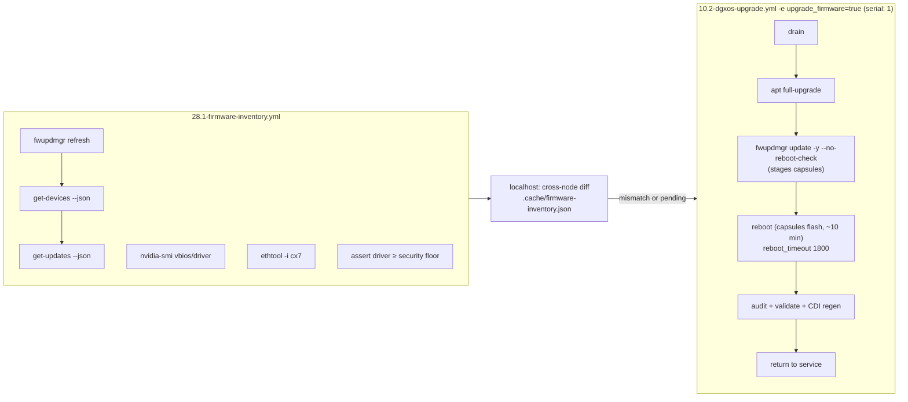

# Chapter 28 · Firmware Lifecycle & Vulnerability Patching on DGX Spark (fwupd, VBIOS, CX-7, Security Floors)

> **01-Ansible · Part V — Production operations · Chapter 28 of 30** · ← [Chapter 27 · Logging & audit compliance](27-logging-and-audit-compliance.md) · [All chapters](00-ansible-step-by-step-guide.md) · [Chapter 29 · Incident response & emergency drain](29-incident-response-and-emergency-drain.md) →

| | |
|---|---|
| **You will build** | A firmware and security-posture inventory across all Sparks (`28.1-firmware-inventory.yml`), with cross-node mismatch detection and a driver *security floor*. Firmware then gets folded into the rolling upgrade (`10.2-dgxos-upgrade.yml -e upgrade_firmware=true`) |
| **Hardware** | 1–2× DGX Spark |
| **Time** | 45 min (inventory) · 30–60 min per node (update, including a long capsule reboot) |
| **Risk** | **High during flashing.** Never interrupt power while capsules are being written |

---

## 1. What firmware a Spark has, and who updates it

| Component | Delivered as | Queried with |
|---|---|---|
| UEFI / system firmware | UEFI capsule via **fwupd** (LVFS), or the DGX Dashboard | `fwupdmgr get-devices` |
| Embedded controller (EC) | fwupd capsule | `fwupdmgr get-devices` |
| SoC firmware | fwupd capsule | `fwupdmgr get-devices` |
| USB-C power-delivery controller | fwupd capsule | `fwupdmgr get-devices` |
| GPU VBIOS | Rides inside the SoC capsule | `nvidia-smi --query-gpu=vbios_version` |
| ConnectX-7 NIC | Platform update path (don't flash it yourself with generic MFT images) | `ethtool -i <netdev>` (read-only) |
| GPU driver, kernel, DGX tooling | apt (DGX OS repos) | Chapter 10 |

**NVIDIA's guidance for Founders Edition units** is that the **DGX Dashboard** is the primary update path. The terminal equivalent, in order, is:

```bash
# ▶ dgx-spark-1 (ssh dgx-spark-1)
sudo apt update && sudo apt dist-upgrade
sudo fwupdmgr refresh && sudo fwupdmgr upgrade
sudo reboot
```

OEM GB10 systems (Dell, HP, ASUS, Lenovo, …) may use their own firmware channels. Follow the vendor's guide, but the Ansible structure below stays the same.

> **Field lesson (from teams running several GB10 units):** firmware on "identical" boxes drifts apart quickly. Different EC and SoC versions across units are a common finding, and they explain "why is node 3 slower/flakier". Inventory first, update second, and **compare across nodes**.

---

## 2. Architecture



**Why `--no-reboot-check` and our own reboot?** fwupd's own reboot would happen outside Ansible's control: no drain, no wait-for-GPU, no validation. Staging capsules and then using `ansible.builtin.reboot` with a long timeout keeps the whole window orchestrated.

---

## 3. Hands-on

### 3.1 Inventory and compare

#### What this lab does (template `28.1 Firmware inventory`)

- **Read-only on every Spark:** refreshes the fwupd metadata from LVFS (`fwupdmgr refresh --force`), then lists the firmware devices and their versions (UEFI, EC, SoC, USB-PD, …) and any pending updates. Nothing is flashed or installed.
- **GPU and NIC:** reads the VBIOS and driver version with `nvidia-smi`, and the CX-7 firmware version with `ethtool -i` on each port in `cx7_interfaces`.
- **Security floor:** compares the driver with `spark_driver_min_secure`. It is empty by default, so this check is skipped until you set it (§3.2).
- **Report on the controller:** the second play (on `localhost`) collects every Spark's record, finds components whose version differs between Sparks, and writes `firmware-inventory.json` to the lab cache folder (`01-Ansible/lab/.cache/` on the MacBook, the state volume on sema01).
- The listing below is the whole file: play 1 (`00-vault-cert.yml`), the collection play on the Sparks, and the comparison play that writes to `{{ lab_cache_dir }}`.

#### What to look for

1. **Semaphore run:** `failed=0` and `changed=0` on the Sparks every time (all their tasks are read-only). On `localhost` only the report file and play 1's new certificate can show `changed`.
2. **The "Summary" task** prints two lines:

   | Line | Healthy value |
   |---|---|
   | `Pending updates:` | `[]`. A Spark name here means fwupd has a firmware update for it; plan it with §3.3 |
   | `Version mismatches across nodes:` | `none`. With one Spark it is always `none`; it only means something with two |
3. **The report**, on the MacBook after a break-glass run:
   ```bash
   # ▶ MacBook · 01-Ansible/lab (venv active)
   jq '.hosts["dgx-spark-1"] | {vbios, driver, cx7, pending}' .cache/firmware-inventory.json
   jq '.hosts["dgx-spark-1"].fwupd' .cache/firmware-inventory.json
   ```
   Expect `driver` to start with `580.`, a non-empty `vbios`, one `firmware-version` string in `cx7`, and a `fwupd` map of component names to versions. Write these down: they are your firmware baseline.
4. **Version values like `0x00000001`** in the `fwupd` map mean fwupd could not read the real version. Treat them as unknown.

**If something's off:** "Refresh fwupd metadata" fails → the Spark has no internet access to LVFS (`fwupdmgr refresh -v` on the Spark). `cx7` is empty → `cx7_interfaces` is not set for that host, or the port names differ; the task has `failed_when: false`, so check its output by eye. More in §5.

#### Run it

```yaml
# lab/playbooks/28.1-firmware-inventory.yml
---
# Firmware + security-posture inventory across all Sparks.
#  * fwupd device versions (UEFI, EC, SoC, USB-PD, …) and pending updates
#  * GPU VBIOS, CX-7 firmware (read-only queries)
#  * driver version vs the minimum fixed version from the latest NVIDIA security bulletin
#  * cross-node consistency — mixed firmware across a cluster is a real, common finding
- name: Short-lived SSH certificate from vault01 (Semaphore runs only)
  ansible.builtin.import_playbook: 00-vault-cert.yml

- name: Collect firmware inventory
  hosts: spark
  become: true
  gather_facts: false
  tasks:
    - name: Refresh fwupd metadata (LVFS)
      ansible.builtin.command: fwupdmgr refresh --force
      register: fw_refresh
      changed_when: false
      failed_when: fw_refresh.rc not in [0, 2]      # 2 = nothing to do / already fresh

    - name: Devices known to fwupd
      ansible.builtin.command: fwupdmgr get-devices --json
      register: fw_devices
      changed_when: false

    - name: Pending firmware updates
      ansible.builtin.command: fwupdmgr get-updates --json
      register: fw_updates
      changed_when: false
      failed_when: fw_updates.rc not in [0, 2]       # 2 = no updates available

    - name: GPU VBIOS and driver
      ansible.builtin.command: nvidia-smi --query-gpu=vbios_version,driver_version --format=csv,noheader
      register: fw_gpu
      changed_when: false

    - name: CX-7 firmware (ethtool -i on each configured port)
      ansible.builtin.command: "ethtool -i {{ item.name }}"
      loop: "{{ cx7_interfaces | default([]) }}"
      loop_control:
        label: "{{ item.name }}"
      register: fw_cx7
      changed_when: false
      failed_when: false

    - name: Build per-host record
      ansible.builtin.set_fact:
        fw_record:
          fwupd: >-
            {{ (fw_devices.stdout | from_json).Devices | default([])
               | selectattr('Version', 'defined')
               | items2dict(key_name='Name', value_name='Version') }}
          pending: >-
            {{ (fw_updates.stdout | default('{}', true) | from_json).Devices | default([])
               | map(attribute='Name') | list }}
          vbios: "{{ fw_gpu.stdout.split(',')[0] | trim }}"
          driver: "{{ fw_gpu.stdout.split(',')[1] | trim }}"
          cx7: >-
            {{ fw_cx7.results | default([])
               | map(attribute='stdout') | map('regex_search', 'firmware-version: (.*)', '\1') | map('first') | list | unique }}

    - name: Security floor for the driver
      ansible.builtin.assert:
        that: fw_record.driver is version(spark_driver_min_secure | default(''), '>=')
        fail_msg: >-
          {{ inventory_hostname }} driver {{ fw_record.driver }} is below the security floor
          {{ spark_driver_min_secure }} — schedule playbooks/10.2-dgxos-upgrade.yml
        success_msg: "driver {{ fw_record.driver }} >= {{ spark_driver_min_secure }}"
      when: spark_driver_min_secure | default('') | length > 0   # set in inventory/group_vars/spark.yml (Chapter 28 §3.2)

- name: Cross-node comparison
  hosts: localhost
  connection: local
  gather_facts: false
  tasks:
    - name: Collate
      ansible.builtin.set_fact:
        fw_all: "{{ dict(groups['spark'] | zip(groups['spark'] | map('extract', hostvars, 'fw_record'))) }}"

    - name: Components whose version differs between nodes
      ansible.builtin.set_fact:
        fw_mismatch: >-
          
          
          
            
            
          
          
            
            
          
          {{ out }}

    - name: Write report
      ansible.builtin.copy:
        dest: "{{ lab_cache_dir }}/firmware-inventory.json"
        content: "{{ {'hosts': fw_all, 'mismatch': fw_mismatch} | to_nice_json }}"
        mode: "0644"

    - name: Summary
      ansible.builtin.debug:
        msg:
          - "Pending updates: {{ fw_all | dict2items | selectattr('value.pending') | map(attribute='key') | list }}"
          - "Version mismatches across nodes: {{ fw_mismatch if fw_mismatch else 'none' }}"
```

```bash
# ▶ MacBook · technical-depth (repo root)
cd "01-Ansible/lab"
ansible-playbook playbooks/28.1-firmware-inventory.yml -K
jq '.mismatch' .cache/firmware-inventory.json
```

Example output with two Sparks bought months apart:

```text
Pending updates: ['dgx-spark-1']
Version mismatches across nodes: {'UEFI': ['1.0.5', '1.0.7'], 'driver': ['580.82.09', '580.95.05']}
```

### 3.2 Set a security floor for the driver

#### What this lab does (variable `spark_driver_min_secure` + template `28.1 Firmware inventory`)

- **One variable:** the lowest driver version that has the fixes from the NVIDIA security bulletin for your branch.
- **One assert per Spark:** "Security floor for the driver" compares the loaded driver (from `nvidia-smi`) with that value. Nothing is upgraded; a node below the floor just fails the run.
- **Where to set it:** `spark_driver_min_secure` in `inventory/group_vars/spark.yml` (empty by default, which skips the check). Commit and push it, so Semaphore picks it up on the next run. For a one-off test, an extra variable (`-e spark_driver_min_secure=…`) overrides it.

#### What to look for

1. **The assert task is no longer `skipping`.** On a Spark at or above the floor it is `ok` with `driver 580.… >= <floor>`.
2. **Prove it fails:** run once with a floor above your driver (for example `-e spark_driver_min_secure=999.0`). The Spark must fail with `… is below the security floor 999.0 — schedule playbooks/10.2-dgxos-upgrade.yml`, and the Semaphore task turns red.
3. **Then run with the real bulletin value:** `failed=0`.

**If something's off:** the assert still shows `skipping` → the value did not reach the play (not pushed yet, or set in a different `group_vars` file). A fail right after an upgrade → a reboot is pending and the old module is still loaded; check with `10.1 Driver audit`. More in §5.

#### Run it

NVIDIA publishes **GPU Display Driver security bulletins** (several a year). Each lists fixed versions per driver branch. Turn the one that applies to you into a variable:

```yaml
# inventory/group_vars/spark.yml
spark_driver_min_secure: "580.95.05"     # example — take the value from the bulletin for your branch
```

Now `28.1-firmware-inventory.yml` fails any node below the floor, and so does AWX's scheduled run of it (Chapter 24). That turns "we should patch" into a red job.

Process to automate around it:


Also track OS-level CVEs: `apt list --upgradable 2>/dev/null | grep -i security`, or `pro security-status` if the Spark is attached to Ubuntu Pro.

### 3.3 Update firmware with the rolling upgrade

#### What this lab does (template `10.2 DGX OS upgrade` with `-e upgrade_firmware=true`, then `28.1` and `11.2`)

- **Drain:** one Spark at a time (`serial: 1`), the `node_drain` role cordons and drains the Kubernetes node, drains it in Slurm and stops GPU containers. With one Spark this stops every model and vCluster pod for the whole window.
- **Packages:** releases the NVIDIA holds and runs `apt full-upgrade`.
- **Firmware:** refreshes LVFS and stages the capsules with `fwupdmgr update -y --no-reboot-check`. They are written during the next reboot, not now.
- **Reboot:** Ansible reboots and waits up to **30 minutes** (`reboot_timeout: 1800`) for `nvidia-smi -L` to answer. Capsule flashing can make this reboot take about 10 minutes. Do not cut power.
- **Back to service:** re-applies the holds, regenerates the CDI spec and runs the container smoke test, then validates and uncordons the node.
- **No apt updates pending:** with `upgrade_firmware=true` the run still continues (drain, firmware, reboot, validate); without it, the playbook stops after its "Report" task because there is nothing to do.
- **One Spark:** the commands below use `-l dgx-spark-2`. With only dgx-spark-1, it is your canary and your only node: use `-l dgx-spark-1,localhost`, and plan for the downtime.

#### What to look for

1. **"Report" task:** `N packages pending, M driver/CUDA/kernel`. `N` can be `0`: the firmware step still runs.
2. **"Apply firmware without letting fwupd reboot on its own":** `changed` when capsules were staged, `ok` when fwupd had nothing to apply.
3. **The reboot task** finishes within its timeout, and the run ends `failed=0` with the node uncordoned.
4. **After the upgrade, `28.1 Firmware inventory`:** the components listed under `Pending updates` before are gone, and the `fwupd` versions in `firmware-inventory.json` moved up.
5. **`11.2 CUDA smoke`:** saxpy bandwidth and bf16 TFLOPS within about 10 % of your baseline (about **235 GB/s** and **46.6 TFLOPS** on this lab's Spark). Then measure your real workload too.

**If something's off:** the reboot takes longer than 10 minutes → wait; the playbook allows 30. The version did not change after the reboot → `fwupdmgr get-history` and `journalctl -b -u fwupd` on the Spark. The node does not come back → vendor recovery; this is why you canary one node. More in §5.

#### Run it

```bash
# ▶ MacBook · 01-Ansible/lab (venv active)
ansible-playbook playbooks/10.2-dgxos-upgrade.yml -K -l dgx-spark-2 -e upgrade_firmware=true
ansible-playbook playbooks/28.1-firmware-inventory.yml -K        # verify versions moved
ansible-playbook playbooks/11.2-cuda-smoke.yml -K -l dgx-spark-2     # performance regression check
```

**Canary rules for firmware:**

1. Stop all inference and benchmark containers first. The drain handles Kubernetes (including the vCluster pods, which are real pods on the root node) and Slurm, but also check `docker ps` for services with a `restart: unless-stopped` policy, which **come back by themselves after the reboot**.
2. One node, then verify with *independent* read-only checks (the inventory, `11.2-cuda-smoke`, a real workload) rather than trusting the updater's "success".
3. Measure **your** workload before and after. Firmware can shift synthetic benchmarks and real serving throughput in different directions.

---

## 4. Integrations

| System | How |
|---|---|
| AWX (Chapter 24) | Schedule `28.1-firmware-inventory` weekly; failing = below the security floor or mismatched |
| Prometheus (Chapter 12) | Export `.cache/firmware-inventory.json` → textfile metric `spark_firmware_pending{host}` (exercise) |
| Drift (Chapter 26) | Firmware versions are part of the "expected state"; a surprise change is drift |
| NetBox (Chapter 06) | Push firmware versions to device custom fields for fleet-wide views |

## 5. Troubleshooting & diagnostics

| Symptom | Diagnose | Fix |
|---|---|---|
| `fwupdmgr refresh` fails: metadata download error | `fwupdmgr refresh -v`; proxy/DNS | Check internet access from the Spark; `/etc/fwupd/remotes.d/lvfs.conf` enabled |
| `get-updates` shows nothing, but the Dashboard shows an update | Different channel (NVIDIA repo vs LVFS), or the metadata is stale | `refresh --force`; follow the Dashboard/OEM path for that component |
| Device version shows `0x00000001` or similar | fwupd plugin can't read the real version | Treat it as **unknown**, not up to date; cross-check with the vendor tool or Dashboard |
| Capsule update "succeeded" but the version didn't change after reboot | `fwupdmgr get-history`; `journalctl -b -u fwupd` | The capsule wasn't applied (Secure Boot/ESP issue); re-stage and reboot once more; report to NVIDIA/OEM with `fwupdmgr report-history` |
| Reboot takes > 10 min, the node looks dead | Capsule flashing | **Wait.** The playbook uses `reboot_timeout: 1800`. Don't power-cycle |
| Node won't POST after a firmware update | — | Vendor recovery procedure / support. This is why you canary one node |
| Driver floor assert fails right after an upgrade | `10.1-driver-audit.yml` | A reboot is pending (the loaded module is still old), or the DGX OS repo doesn't have the fixed build yet |

## 6. Validation

- [ ] `.cache/firmware-inventory.json` exists with every Spark, and `mismatch` is `{}` after remediation.
- [ ] `spark_driver_min_secure` is set from a real bulletin and all nodes pass.
- [ ] One node was updated through `10.2-dgxos-upgrade.yml -e upgrade_firmware=true`, with before/after workload numbers recorded.
