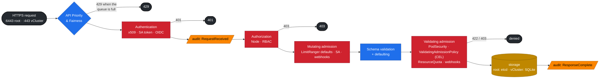
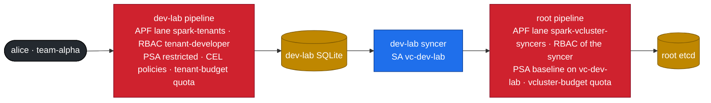

# Chapter 03 · kube-apiserver Internals: AuthN, RBAC, Admission (CEL), API Priority & Fairness, Audit

> **02-Kubernetes · Part I — Control plane & the nested lab · Chapter 03 of 28** · ← [Chapter 02 · etcd database deep dive](02-etcd-database-deep-dive.md) · [All chapters](00-kubernetes-step-by-step-guide.md) · [Chapter 04 · Nested clusters with vCluster](04-nested-clusters-with-vcluster.md) →

| | |
|---|---|
| **You will build** | Real users with client certificates, tenant RBAC, four in-process admission policies written in CEL, fair-queuing lanes for tenant traffic **and** for the vCluster syncers, Secret encryption you can prove in etcd, and an audit log you can query |
| **Hardware** | dgx-spark-1 (kubeadm root + two vClusters). Everything except the audit-log and etcd steps also works on the CI kind setup (`lab/tests/fake-gpu-node.sh` + two vClusters) |
| **Time** | 90 min |
| **Risk** | Low. Audit and encryption were configured at `kubeadm init` by 01-Ansible; nothing restarts |
| **Clusters** | `dev-lab` (users, RBAC, CEL, tenant APF) · `dev-llms` (CEL in the LLM sandbox) · `spark-root` (audit, encryption, syncer APF, and the LLM stack's CEL policies and CI ServiceAccount) |
| **Lab files** | [`kubeadm/audit-policy.yaml`](lab/kubeadm/audit-policy.yaml), 01-Ansible [`kubeadm-init.yaml.j2`](../01-Ansible/lab/roles/kubeadm_cluster/templates/kubeadm-init.yaml.j2), [`manifests/dev-lab/10-tenancy/rbac.yaml`](lab/manifests/dev-lab/10-tenancy/rbac.yaml), [`manifests/common/15-admission/policies.yaml`](lab/manifests/common/15-admission/policies.yaml), [`manifests/dev-lab/16-apf/apf.yaml`](lab/manifests/dev-lab/16-apf/apf.yaml), [`manifests/root/16-apf/vcluster-syncers.yaml`](lab/manifests/root/16-apf/vcluster-syncers.yaml), [`scripts/make-user.sh`](lab/scripts/make-user.sh), [`tests/policy/`](lab/tests/policy/) |

---

## 1. Why this matters on a Spark

A single Spark shared by several teams is a multi-tenant platform. Every guardrail that keeps team alpha from starving, reading or breaking team beta is enforced **inside a request pipeline** in an API server. In this lab there are three API servers, so there are three pipelines — and a tenant's request crosses **two** of them: first its vCluster's (where the tenant's identity, RBAC and policies apply), then the root's (where the vCluster's syncer is the caller and the vCluster's budget applies). If you understand both, you can predict the exact error message a misbehaving request gets, which API server rejects it, and which log records it.

---

## 2. Architecture — the request pipeline (HLD)



The same pipeline runs twice for a tenant pod:



| Stage | Question it answers | Typical failure text |
|---|---|---|
| APF | "Is there capacity for *this kind* of caller right now?" | `429 Too Many Requests`, header `X-Kubernetes-PF-FlowSchema-UID` |
| AuthN | "Who are you?" (user + groups) | `401 Unauthorized` / `You must be logged in` |
| AuthZ | "May *who* do *verb* on *resource* in *namespace*?" | `forbidden: User "alice" cannot create resource "pods"… in the namespace "tenant-beta"` |
| Mutating admission | "Fill in or rewrite fields" | usually silent (LimitRanger adds defaults) |
| Validating admission | "Is the final object acceptable?" | `ValidatingAdmissionPolicy 'x' … denied request: …`, `violates PodSecurity "restricted:latest"`, `exceeded quota` |

When the **root** pipeline rejects a synced pod, the tenant doesn't get an error from `kubectl` — its request already succeeded in the vCluster. The rejection shows up as a sync error event on the pod inside the vCluster, and the pod stays `Pending` (Chapter 04 §4, break/fix 02).

---

## 3. LLD

### 3.1 Identities in the lab

| Identity | Cluster | How it authenticates | Groups | Can do |
|---|---|---|---|---|
| `kubernetes-admin` (01-Ansible kubeconfig, context `spark-root`) | root | client cert from the kubeadm CA (`/etc/kubernetes/admin.conf`) | `kubeadm:cluster-admins` → bound to `cluster-admin` | everything on the root. Keep it off laptops you share. (`/etc/kubernetes/super-admin.conf` holds a `system:masters` cert for break-glass only) |
| vCluster admin (contexts `dev-lab`, `dev-llms`) | each vCluster | client cert from **that vCluster's own CA** (exported Secret `vc-<name>`) | `system:masters` *inside the vCluster* | everything in that vCluster, nothing on the root |
| `alice` | dev-lab | client cert via dev-lab's CSR API ([`make-user.sh`](lab/scripts/make-user.sh)) | `team-alpha` (cert `O=`) | `spark-tenant-developer` in `tenant-alpha`, read nodes |
| `bob` | dev-lab | client cert | `team-beta` | same in `tenant-beta` |
| `llm-serving/ci-deployer` | root | ServiceAccount token | `system:serviceaccounts:llm-serving` | `edit` in `llm-serving` only |
| `vc-dev-lab`, `vc-dev-llms` syncers | root | ServiceAccount token in the vCluster's pod | `system:serviceaccounts:vc-dev-lab` | a Role in its own `vc-*` namespace (created by the chart) + read nodes/storage classes |

Each vCluster has its own CA: Alice's certificate means nothing to the root or to `dev-llms`. That is the isolation you get for free. The LLM stack doesn't get it: it runs on the root, so anyone with cluster-wide rights there can reach the models, and `ci-deployer` is confined only by its RoleBinding in `llm-serving`.

### 3.2 RBAC design

| ClusterRole | Cluster | Verbs highlight | Bound where |
|---|---|---|---|
| `spark-tenant-developer` | dev-lab | full on pods/deployments/jobs/PVCs. Secrets **without `watch`**. **read-only** quota/limitrange. Read Kueue workloads | RoleBinding per tenant namespace |
| `spark-gpu-viewer` | dev-lab | get/list nodes (the synced Spark node), metrics | ClusterRoleBinding to both teams, so they can see GPU capacity |
| `edit` (built-in) | root | namespace-scoped write | `ci-deployer` in `llm-serving` ([`root-llms/10-tenancy/rbac.yaml`](lab/manifests/root-llms/10-tenancy/rbac.yaml)) |
| vCluster Role (chart) | root | pods, services, PVCs, … in `vc-<name>` only | the syncer's ServiceAccount |

### 3.3 Admission policies (CEL, no webhook server)

The same four policies ([`common/15-admission`](lab/manifests/common/15-admission/policies.yaml)) run inside **both** vClusters, each enforced by that vCluster's API server, and on the **root** for the LLM stack (`root-llms/15-admission`). On the root they bind only to `llm-serving` and `batch` — the tenant and sandbox namespaces don't exist there, and the platform namespaces are not matched:

| Policy | Binds to | Rule | Why on a Spark |
|---|---|---|---|
| `spark-no-latest-tag` | tenants, llm-sandbox, llm-serving, batch | image must have a tag or digest, and not `:latest` | reproducible rollbacks. Also avoids re-pulling a 10 GB NGC image |
| `spark-gpu-slice-limits` | `spark.lab/tenant=true` (tenants, `llm-sandbox`) | `nvidia.com/gpu` ≤ 1 per container | each vCluster has 2 slices in total. One pod must not take both |
| `spark-no-nvidia-env-bypass` | tenants | no `NVIDIA_VISIBLE_DEVICES`, `NVIDIA_DRIVER_CAPABILITIES` or `CUDA_VISIBLE_DEVICES` in env | with the nvidia default runtime, that env would grant GPU access without a quota-counted request — outside every budget |
| `spark-serving-needs-readiness` | `spark.lab/tier=serving` | Deployments/StatefulSets must have a `readinessProbe` | a vLLM pod takes minutes to load weights, and must not get traffic while it does |

Plus built-ins: **PodSecurity** `restricted` on tenant namespaces (`baseline` on `llm-sandbox` and `llm-serving`, since NGC images run as root; `privileged` on `batch` for RDMA), **LimitRanger**, **ResourceQuota** — in each vCluster for its tenants, again at the root for the `vc-*` namespaces (baseline PSA, LimitRange safety net, the vCluster budget), and at the root for the LLM stack (`serving-budget`, `batch-budget`).

### 3.4 API Priority & Fairness — two lanes, two layers

| Object | Cluster | Setting | Effect |
|---|---|---|---|
| PriorityLevel `spark-tenants` | dev-lab | `nominalConcurrencyShares: 10`, 16 queues, hand size 4 | Tenants share a small slice of dev-lab's API concurrency |
| FlowSchema `spark-tenants` | dev-lab | groups `team-alpha`, `team-beta`, `distinguisherMethod: ByUser`, precedence 900 | Fairness is **per user**. Alice's watch loop can't starve Bob |
| PriorityLevel `spark-vcluster-syncers` | root | `nominalConcurrencyShares: 30`, 8 queues, `lendablePercent: 50` | Everything the vClusters do reaches the root through this lane |
| FlowSchema `spark-vcluster-syncers` | root | ServiceAccounts in `vc-dev-lab` / `vc-dev-llms`, `distinguisherMethod: ByNamespace`, precedence 800 | Fairness is **per vCluster**: a tenant loop in dev-lab can't crowd out dev-llms, and neither can starve the kubelet, the GPU Operator or the LLM stack's controllers |

### 3.5 Secret encryption and audit (root)

Both are flags kubeadm put on the root API server from the 01-Ansible config:

| Flag | File | What it does |
|---|---|---|
| `--encryption-provider-config` | `/etc/kubernetes/encryption/config.yaml` (key generated once, mode 0600) | Secrets are stored in etcd encrypted with AES-CBC (`k8s:enc:aescbc:v1:key1:` prefix). Back the key up in vault01's KV (01-Ansible Chapter 18) — without it, an etcd backup's Secrets are unreadable |
| `--audit-policy-file`, `--audit-log-*` | [`audit-policy.yaml`](lab/kubeadm/audit-policy.yaml) → `/var/log/kubernetes/audit/audit.log`, rotated at 100 MB × 5 | Metadata for secrets/configmaps (never payloads), drops noisy reads, **RequestResponse** for every mutation in `vc-dev-lab`, `vc-dev-llms`, `llm-serving`, `batch`, `gpu-operator`, `platform-tools` |

The root audit log sees what reached the root: a tenant's pod appears as a **create by the syncer** (`system:serviceaccount:vc-dev-lab:vc-dev-lab`), not by Alice. Alice's own request is in dev-lab's API server. For a per-tenant audit trail, give each vCluster its own audit policy (§5 Task 7, last part).

---

## 4. Integrations

| With | How |
|---|---|
| vault01 (01-Ansible Chapters 01 and 18) | Store the tenant kubeconfigs `make-user.sh` produces in vault01's KV mount, e.g. `kv/k8s/<cluster>/<user>` — outside `kv/spark-lab/*`, which Semaphore's AppRole can read — and the encryption key `/etc/kubernetes/encryption/config.yaml`. For long-lived automation, prefer Vault's Kubernetes secrets engine, which mints short-lived SA tokens |
| Loki / Alloy (01-Ansible Chapter 27) | Ship `/var/log/kubernetes/audit/audit.log` with a `loki.source.file` block. Query `{job="k8s-audit"} \| json \| verb="delete"` |
| Kueue (Chapter 07) | Tenants get read-only access to `workloads`, so they can see *why* their job is queued |
| CI (GitHub Actions) | `ci-deployer` token (root) → `kubectl apply` into `llm-serving` only |

---

## 5. Lab

### Task 1 · Prove audit logging and Secret encryption (on the Spark)

#### What this lab does (reads `kube-apiserver.yaml`, raw `etcdctl` read)

- **Reads the flags** kubeadm put on the root API server: `--audit-policy-file`, `--audit-log-*` and `--encryption-provider-config`.
- **Creates one Secret,** `default/enc-test` (`password=hunter2`), on the root and reads its raw value from etcd with the etcd `healthcheck-client` certificate.
- **Optional re-encryption:** the `kubectl replace` line rewrites every root Secret unchanged, so each one is stored again with the current key.
- Nothing is reconfigured and nothing restarts. Runs on the Spark, because the etcd certificates exist only there.

#### What to look for

1. **Flags:** the `grep` prints the audit lines and `--encryption-provider-config=/etc/kubernetes/encryption/config.yaml`.
2. **Raw value:** the `od -c` output starts `k 8 s : e n c : a e s c b c : v 1 : k e y 1 :`, then binary. `hunter2` appears nowhere.
3. **Re-encryption** (if you ran it) prints `re-encrypted` and no errors.

**If something's off:** plaintext in the raw value → encryption is off; see the "Secrets readable in etcd" row in §7. `context deadline exceeded` from `etcdctl` → wrong endpoint or certificate (Chapter 02 §7).

#### Run it

```bash
# ▶ dgx-spark-1 (ssh dgx-spark-1)
sudo grep -E 'audit-|encryption-provider' /etc/kubernetes/manifests/kube-apiserver.yaml
kubectl --context spark-root -n default create secret generic enc-test --from-literal=password=hunter2
sudo ETCDCTL_API=3 etcdctl --endpoints=https://127.0.0.1:2379 --cacert=/etc/kubernetes/pki/etcd/ca.crt \
  --cert=/etc/kubernetes/pki/etcd/healthcheck-client.crt --key=/etc/kubernetes/pki/etcd/healthcheck-client.key \
  get /registry/secrets/default/enc-test --print-value-only | head -c 48 | od -c | head -3
```

Expected: the flags are there, and the stored value begins `k8s:enc:aescbc:v1:key1:` followed by ciphertext — `hunter2` appears nowhere.

Secrets created **before** encryption was switched on would still be stored in plaintext until they're written again. On this lab encryption was on from the first second, but the habit matters after any key change:

```bash
# ▶ MacBook · any folder
kubectl --context spark-root get secrets -A -o json | kubectl --context spark-root replace -f - >/dev/null && echo re-encrypted
```

### Task 2 · Apply tenancy, admission and APF

#### What this lab does (manifests `lab/manifests/dev-lab/00-platform`…`16-apf`, `dev-llms/00-platform`…`15-admission`, `root-llms/00-platform`…`15-admission`, `root/16-apf`)

- **dev-lab:** tenant namespaces with PSA labels, PriorityClasses and RuntimeClass (`00-platform`); `tenant-budget` quotas, LimitRanges, the `spark-tenant-developer` / `spark-gpu-viewer` roles and their bindings, NetworkPolicies (`10-tenancy`); the four CEL policies (`15-admission`); the APF lane `spark-tenants` (`16-apf`).
- **dev-llms:** `llm-sandbox`, `sandbox-budget` and its LimitRange, the same four CEL policies.
- **Root, LLM stack:** namespaces `llm-serving`, `batch`, `ingress`; `serving-budget`, `batch-budget`, LimitRanges, the `ci-deployer` ServiceAccount and the `llm-serving` NetworkPolicy; the CEL policies bound to `llm-serving` and `batch`.
- **Root, APF:** the lane `spark-vcluster-syncers` for the vCluster syncers.
- Nothing restarts. Re-applying is safe.

#### What to look for

1. **Command exit:** each `apply` prints `created` on a first run and `unchanged` on a re-run, with no `error:` lines.
2. **Policies in dev-lab:** the last command lists four: `spark-gpu-slice-limits`, `spark-no-latest-tag`, `spark-no-nvidia-env-bypass`, `spark-serving-needs-readiness`.
3. **APF objects:**
   ```bash
   # ▶ MacBook · 02-Kubernetes/lab
   kubectl --context dev-lab get flowschema spark-tenants
   kubectl --context spark-root get flowschema spark-vcluster-syncers
   ```
   Each prints one row, with priority level `spark-tenants` and `spark-vcluster-syncers`.

**If something's off:** `no matches for kind "ValidatingAdmissionPolicy"` → the API server is older than 1.30; check `kubectl version`. An apply that fails on `dev-lab` or `dev-llms` with a connection error → that vCluster isn't reachable (Chapter 04 §8).

#### Run it

```bash
# ▶ MacBook · 02-Kubernetes/lab
for d in 00-platform 10-tenancy 15-admission 16-apf; do kubectl --context dev-lab apply -k manifests/dev-lab/$d; done
for d in 00-platform 10-tenancy 15-admission; do kubectl --context dev-llms apply -k manifests/dev-llms/$d; done
for d in 00-platform 10-tenancy 15-admission; do kubectl --context spark-root apply -k manifests/root-llms/$d; done
kubectl --context spark-root apply -k manifests/root/16-apf
kubectl --context dev-lab get validatingadmissionpolicies
```

### Task 3 · Create real users (in dev-lab)

#### What this lab does (script `lab/scripts/make-user.sh`)

- **Key and CSR:** makes an ed25519 key and a certificate request with `CN=<user>` and `O=<group>` in `02-Kubernetes/lab/.cache/`.
- **Signing:** submits it to **dev-lab's** CSR API (signer `kubernetes.io/kube-apiserver-client`, valid 7 days), approves it as dev-lab admin, and saves the certificate.
- **Kubeconfig:** writes `.cache/<user>.kubeconfig` pointing at dev-lab's API with that certificate. Your main kubeconfig is not changed.
- Nothing on the root changes. Running it again replaces the user's CSR and files.

#### What to look for

1. **Script output:** `[PASS] …/.cache/alice.kubeconfig  (CN=alice, O=team-alpha, cluster dev-lab, valid 7 days)`, and the same for `bob` with `team-beta`.
2. **`kubectl auth whoami`** as Alice: `Username alice`, `Groups [team-alpha system:authenticated]`.
3. **Against the root:** `error: You must be logged in to the server (Unauthorized)`. That 401 is the expected result: the root doesn't trust dev-lab's CA.

**If something's off:** a `Forbidden` (403) instead of `Unauthorized` (401) against the root means the certificate *was* accepted there, so it was signed by the wrong CA; check the third argument of `make-user.sh` (default `dev-lab`). More in §7 (first row).

#### Run it

```bash
# ▶ MacBook · 02-Kubernetes/lab
scripts/make-user.sh alice team-alpha          # signed by dev-lab's CA
scripts/make-user.sh bob   team-beta
export ALICE=$PWD/.cache/alice.kubeconfig
KUBECONFIG=$ALICE kubectl auth whoami
```

```text
ATTRIBUTE   VALUE
Username    alice
Groups      [team-alpha system:authenticated]
```

Now point Alice's certificate at the root:

```bash
# ▶ MacBook · 02-Kubernetes/lab
KUBECONFIG=$ALICE kubectl --server https://192.168.0.100:6443 --insecure-skip-tls-verify get ns
# error: You must be logged in to the server (Unauthorized)
```

The root doesn't trust dev-lab's CA, so Alice isn't even a user there. That's a 401, not a 403.

### Task 4 · Probe RBAC before users hit it

#### What this lab does (`kubectl auth can-i` in dev-lab and on the root)

- **Impersonation checks** as dev-lab admin: what `alice` in group `team-alpha` may do in `tenant-alpha`, `tenant-beta` and cluster-wide.
- **One real request** as Alice into `tenant-beta`, which must be refused.
- **The syncer's rights on the root:** what ServiceAccount `vc-dev-lab:vc-dev-lab` may do in `vc-dev-lab`, `vc-dev-llms` and `llm-serving`.
- **Read-only:** nothing is created or changed.

#### What to look for

1. **The five-line table** matches the expected output below exactly: `yes`, `no`, `no`, `no`, `yes`. `watch secrets` is `no` on purpose: the tenant role allows Secrets without `watch`.
2. **Alice into `tenant-beta`:** `Error from server (Forbidden): pods is forbidden: User "alice" cannot list resource "pods" … in the namespace "tenant-beta"`.
3. **The syncer:** a list of rights in `vc-dev-lab`, and `no` for both `create pods` lines (other vCluster, LLM stack).

**If something's off:** `yes` where you expect `no` → a ClusterRoleBinding grants more than `spark-gpu-viewer`; `kubectl --context dev-lab get clusterrolebinding -o wide | grep team-`. All `no` → `10-tenancy` isn't applied in dev-lab (Task 2). More in §7 (second row).

#### Run it

```bash
# ▶ MacBook · any folder
kubectl --context dev-lab auth can-i --list -n tenant-alpha --as=alice --as-group=team-alpha | head -20
for v in "create pods -n tenant-alpha" "create pods -n tenant-beta" "update resourcequota -n tenant-alpha" \
         "watch secrets -n tenant-alpha" "list nodes"; do
  printf '%-40s %s\n' "$v" "$(kubectl --context dev-lab auth can-i $v --as=alice --as-group=team-alpha)"
done
```

Expected:

```text
create pods -n tenant-alpha              yes
create pods -n tenant-beta               no
update resourcequota -n tenant-alpha     no
watch secrets -n tenant-alpha            no   # Ctrl-C to stop
list nodes                               yes
```

Now as Alice for real:

```bash
# ▶ MacBook · 02-Kubernetes/lab
KUBECONFIG=$ALICE kubectl -n tenant-beta get pods
# Error from server (Forbidden): pods is forbidden: User "alice" cannot list resource "pods" in API group "" in the namespace "tenant-beta"
```

And what can a vCluster's syncer do on the root?

```bash
# ▶ MacBook · any folder
kubectl --context spark-root auth can-i --list -n vc-dev-lab --as=system:serviceaccount:vc-dev-lab:vc-dev-lab | head
kubectl --context spark-root auth can-i create pods -n vc-dev-llms --as=system:serviceaccount:vc-dev-lab:vc-dev-lab    # no
kubectl --context spark-root auth can-i create pods -n llm-serving --as=system:serviceaccount:vc-dev-lab:vc-dev-lab    # no
```

### Task 5 · Exercise the admission policies (server-side dry run)

#### What this lab does (script `lab/scripts/verify.sh admission`, fixtures `lab/tests/policy/`)

- **Twelve fixtures:** each YAML in `tests/policy/` names its target cluster (`# cluster:`) and the expected result (`# expect: allow|deny`) in a comment.
- **Dry run:** the script sends each one with `kubectl create --dry-run=server` to that cluster, so the request goes through authentication, RBAC, PSA, the CEL policies, LimitRanges and quotas, and is then thrown away. Nothing is created.
- **Fixtures cover:** `:latest` and untagged images, two GPU slices in one container, the `NVIDIA_*` env bypass, a privileged tenant pod, a pod over the LimitRange or the memory quota, serving workloads without a readiness probe (root and dev-llms), and three that must pass.

#### What to look for

1. **Command exit:** 12 `[PASS]` lines (3 `allowed`, 9 `denied`) and a summary ending `0 failed`.
2. **The full denial** for `deny-gpu-two-slices`: `ValidatingAdmissionPolicy 'spark-gpu-slice-limits' with binding 'spark-gpu-slice-limits' denied request: tenant containers may request at most 1 nvidia.com/gpu time-slice`.
3. **A `[FAIL]`** line prints the fixture, the cluster, the expected result and the API server's message: read the message, it names the stage that answered.

**If something's off:** a `deny-…` fixture allowed → the policy's binding doesn't match the namespace; check the namespace labels (`spark.lab/tenant=true`, `spark.lab/tier=serving`) from `00-platform`. An `allow-…` fixture denied by quota → something else already uses that namespace's budget. More in §7.

#### Run it

```bash
# ▶ MacBook · 02-Kubernetes/lab
scripts/verify.sh admission
```

```text
── admission (server-side dry-run inside each vCluster, nothing is created)
[PASS] allowed allow-digest-image (dev-lab)
[PASS] allowed allow-gpu-one-slice (dev-lab)
[PASS] allowed allow-serving-with-readiness (spark-root)
[PASS] denied  deny-gpu-two-slices (dev-lab)
[PASS] denied  deny-latest-tag (dev-lab)
[PASS] denied  deny-nvidia-env-bypass (dev-lab)
[PASS] denied  deny-over-limitrange (dev-lab)
[PASS] denied  deny-over-quota-memory (dev-lab)
[PASS] denied  deny-privileged-in-tenant (dev-lab)
[PASS] denied  deny-sandbox-without-readiness (dev-llms)
[PASS] denied  deny-serving-without-readiness (spark-root)
[PASS] denied  deny-untagged-image (dev-lab)
```

Read one denial in full, so you can recognize it in a pipeline log:

```bash
# ▶ MacBook · 02-Kubernetes/lab
kubectl --context dev-lab create --dry-run=server -f tests/policy/deny-gpu-two-slices.yaml
```

```text
The pods "pt-deny-gpu-two-slices" is invalid: : ValidatingAdmissionPolicy 'spark-gpu-slice-limits'
with binding 'spark-gpu-slice-limits' denied request: tenant containers may request at most 1 nvidia.com/gpu time-slice
```

The CEL behind it uses optional-field access, so pods without `resources` don't trip an error:

```yaml
- expression: >-
    object.spec.containers.all(c,
      quantity(c.?resources.?limits[?'nvidia.com/gpu'].orValue('0')).compareTo(quantity('1')) <= 0)
```

> **Seen `status.typeChecking.expressionWarnings: undefined field 'limits'`?** The type checker can't resolve `ResourceRequirements` maps on some versions. It's a warning, and the runtime result is correct. The dry-run tests above prove it. Keep a test fixture for every policy for exactly this reason.

### Task 6 · API Priority & Fairness under load — both layers

#### What this lab does (32 background LIST loops as Alice, metrics from both API servers)

- **Load:** terminal A starts 32 background loops that run `kubectl -n tenant-alpha get pods` as Alice as fast as they can. All of them land in dev-lab's lane `spark-tenants` (10 shares, 16 queues, per-user fairness).
- **Watching:** terminal B polls dev-lab's `/metrics` for that lane every 2 s. Terminal C times one request as Bob and one root request, and dumps the root's priority levels.
- **Nothing is reconfigured.** `pkill` stops the loops. The load costs CPU on the Spark while it runs, so don't leave it on.

#### What to look for

1. **dev-lab metrics (terminal B):** `apiserver_flowcontrol_current_inqueue_requests` and `…_current_executing_requests` for `priority_level="spark-tenants"` above 0 while the loops run; `rejected_requests_total` may start counting (Alice gets some `429`s).
2. **Bob stays fast:** the `time` for Bob's `get pods` stays well under a second (about 100 ms).
3. **The root barely notices:** `kubectl --context spark-root get nodes` is as fast as before, and the root's `spark-vcluster-syncers` row shows little activity, because LISTs of tenant pods are answered from dev-lab's own database.
4. **Cleanup:** after `pkill`, `pgrep -fc "kubectl -n tenant-alpha get pods"` prints `0`.

**If something's off:** no `spark-tenants` series at all → Alice's requests matched another FlowSchema; check that Alice's certificate group is `team-alpha` (Task 3) and that `dev-lab/16-apf` is applied. More in §7 (`429` row).

#### Run it

Generate tenant load as Alice (32 parallel LIST loops), and watch as admin in dev-lab *and* at the root:

```bash
# ▶ MacBook · 02-Kubernetes/lab
# terminal A — Alice misbehaves
for i in $(seq 32); do (while true; do KUBECONFIG=$ALICE kubectl -n tenant-alpha get pods -o name >/dev/null 2>&1; done &) ; done

# terminal B — dev-lab's API server: the tenant lane fills up
watch -n2 "kubectl --context dev-lab get --raw /metrics | grep -E 'apiserver_flowcontrol_(current_inqueue_requests|rejected_requests_total|current_executing_requests)\{.*spark-tenants' "   # Ctrl-C to stop

# terminal C — Bob, and the root, are unaffected
time KUBECONFIG=.cache/bob.kubeconfig kubectl -n tenant-beta get pods
time kubectl --context spark-root get nodes
kubectl --context spark-root get --raw /debug/api_priority_and_fairness/dump_priority_levels | column -t -s, \
  | grep -E 'PriorityLevelName|spark-vcluster-syncers|global-default'

# stop the flood
pkill -f "kubectl -n tenant-alpha get pods"
```

Expected: in dev-lab, `current_inqueue_requests{priority_level="spark-tenants"}` climbs and some of Alice's calls may get `429`. Bob's call stays under ~100 ms (queues are shuffle-sharded per user). The root barely notices: LISTs of tenant pods are answered from dev-lab's own database. Now make the root notice — create and delete pods in a loop (each one is a syncer write to the root) and watch the `spark-vcluster-syncers` lane instead.

### Task 7 · Query the audit log

#### What this lab does (one pod as Alice, `jq` over `/var/log/kubernetes/audit/audit.log`)

- **Creates one pod** as Alice: `tenant-alpha/audit-demo` (`pause:3.10`, restricted-PSA security settings) in dev-lab. The syncer creates its host copy `vc-dev-lab/audit-demo-x-tenant-alpha-x-dev-lab` on the root.
- **Reads the root audit log** on the Spark with `sudo jq` and prints the last three pod **create** events in `vc-dev-lab`: time, user, name, response code.
- Nothing is reconfigured. The exercise at the end (an audit log for dev-lab itself) is optional and changes `vclusters/dev-lab.yaml`.

#### What to look for

1. **The pod:** `kubectl --context dev-lab -n tenant-alpha get pod audit-demo` shows `Running`.
2. **The audit line:** `user` is `system:serviceaccount:vc-dev-lab:vc-dev-lab` (the syncer), `name` ends in `-x-tenant-alpha-x-dev-lab`, `code` is `201`. Alice's name is not in the root log.

**If something's off:** no matching line → the `jq` ran on the MacBook instead of the Spark, or the log rotated (100 MB × 5); look in `audit-*.log` next to it. Alice's `run` refused with `violates PodSecurity` → the `--overrides` JSON was cut while pasting. More in §7.

#### Run it

```bash
# ▶ MacBook · 02-Kubernetes/lab
KUBECONFIG=$ALICE kubectl -n tenant-alpha run audit-demo --image=registry.k8s.io/pause:3.10 \
  --overrides='{"spec":{"securityContext":{"runAsNonRoot":true,"runAsUser":65532,"seccompProfile":{"type":"RuntimeDefault"}},"containers":[{"name":"audit-demo","image":"registry.k8s.io/pause:3.10","securityContext":{"allowPrivilegeEscalation":false,"capabilities":{"drop":["ALL"]}}}]}}'
```

```bash
# ▶ dgx-spark-1 (ssh dgx-spark-1)
sudo jq -c 'select(.objectRef.namespace=="vc-dev-lab" and .objectRef.resource=="pods" and .verb=="create")
  | {t:.requestReceivedTimestamp, user:.user.username, name:.objectRef.name, code:.responseStatus.code}' \
  /var/log/kubernetes/audit/audit.log | tail -3
```

```json
{"t":"2026-…","user":"system:serviceaccount:vc-dev-lab:vc-dev-lab","name":"audit-demo-x-tenant-alpha-x-dev-lab","code":201}
```

The root saw the **syncer** create the pod. To answer "which *person* did it?", you need dev-lab's own audit log. Exercise: add an audit policy to dev-lab — put `--audit-policy-file`/`--audit-log-path` in `controlPlane.distro.k8s.apiServer.extraArgs` of `vclusters/dev-lab.yaml`, mount the policy from a ConfigMap, `helm upgrade`, repeat the query against that log. Denied requests are logged too: `code: 403` for RBAC, and `code: 422` or `403` for admission.

---

## 6. Verify

```bash
# ▶ MacBook · 02-Kubernetes/lab
scripts/verify.sh tenancy admission
```

Expected: `22 passed, 0 warnings, 0 failed` (10 tenancy checks + 12 admission fixtures).

---

## 7. Troubleshooting

| Symptom | Stage | Diagnose | Fix |
|---|---|---|---|
| `401 Unauthorized` | AuthN | `kubectl auth whoami` fails. `openssl x509 -in .cache/alice.crt -noout -enddate -issuer` | Cert expired (7 days here) → re-run `make-user.sh`. Or the cert is from another cluster's CA (dev-lab user against the root/dev-llms) |
| `403 … cannot list resource` | RBAC | `kubectl --context dev-lab auth can-i list pods -n X --as=alice --as-group=team-alpha` · `kubectl get rolebinding -n X -o wide` | Bind the ClusterRole in the right namespace **in the right cluster**. Check the **group** in the cert (`openssl x509 -noout -subject`) |
| Deployment created but 0 pods | Validating admission on the **pod** | `kubectl describe rs -l app=…` → `FailedCreate` | Fix the pod template (drill: `scripts/breakfix.sh inject 14`) |
| Pod created, stays `Pending`, no scheduler events | **root** admission refused the synced pod | events on the pod in the vCluster; `kubectl --context spark-root -n vc-<name> describe resourcequota` | Chapter 04 §8; break/fix 02 |
| `violates PodSecurity "restricted:latest"` | PSA | message lists the missing fields | add `runAsNonRoot`, `seccompProfile`, `capabilities.drop: [ALL]`, `allowPrivilegeEscalation: false` |
| `failed calling webhook … context deadline exceeded` | Webhook admission | `kubectl get validatingwebhookconfigurations,mutatingwebhookconfigurations` in that cluster. Is the webhook's pod running? | Restore the webhook's backend (cert-manager, KServe, Kueue — on the root). For lab-only emergencies, set `failurePolicy: Ignore`. This is why the lab prefers CEL policies |
| `429 Too Many Requests` | APF | `apiserver_flowcontrol_rejected_requests_total` by `priority_level` (in the cluster that answered) | Fix the client (watch instead of poll, add backoff) or raise shares |
| Secrets readable in etcd | Encryption off | `sudo grep encryption-provider /etc/kubernetes/manifests/kube-apiserver.yaml` | 01-Ansible `kubeadm_cluster` writes the config and the flag; on an existing cluster run `kubeadm init phase control-plane apiserver --config /etc/kubernetes/kubeadm-config.yaml`, then re-encrypt (§5 Task 1) |
| API server down after editing its manifest | bad flag / missing mount | `sudo crictl ps -a --name kube-apiserver`, `sudo crictl logs <id>` | revert the edit; every `--…-file` flag needs a matching `extraVolumes` mount |

---

## 8. Scale-out path

| Lab | Datacenter equivalent |
|---|---|
| x509 users via each cluster's CSR API | OIDC (Keycloak, Entra ID, Okta): `oidc-issuer-url` in the kubeadm `apiServer.extraArgs` *and* in each vCluster's `apiServer.extraArgs`, groups from IdP claims, no long-lived certs |
| 4 CEL policies per vCluster | A policy library (Kyverno or Gatekeeper, or CEL `ValidatingAdmissionPolicy` managed in Git) with audit mode first (`validationActions: [Audit, Warn]`), then Deny; root-level policies for what every vCluster must obey |
| One APF lane for tenants, one for syncers | Lanes per class (CI bots, operators, humans, each tenant cluster), sized from `apiserver_flowcontrol_*` history |
| Audit file on the node | Audit webhook backend → SIEM, retention per compliance policy, one stream per cluster |

---

## 9. Checklist

- [ ] I can predict which stage — and which of the two API servers — rejects a request from its error message.
- [ ] I created a user whose group comes from the certificate, bound it with RBAC, and showed it doesn't exist at the root.
- [ ] I can write a CEL policy that handles optional fields, and prove it with a dry-run fixture.
- [ ] I watched APF protect one user from another, and know which lane protects the root from the vClusters.
- [ ] I found the root's record of a tenant pod in the audit log and know why it names the syncer.
