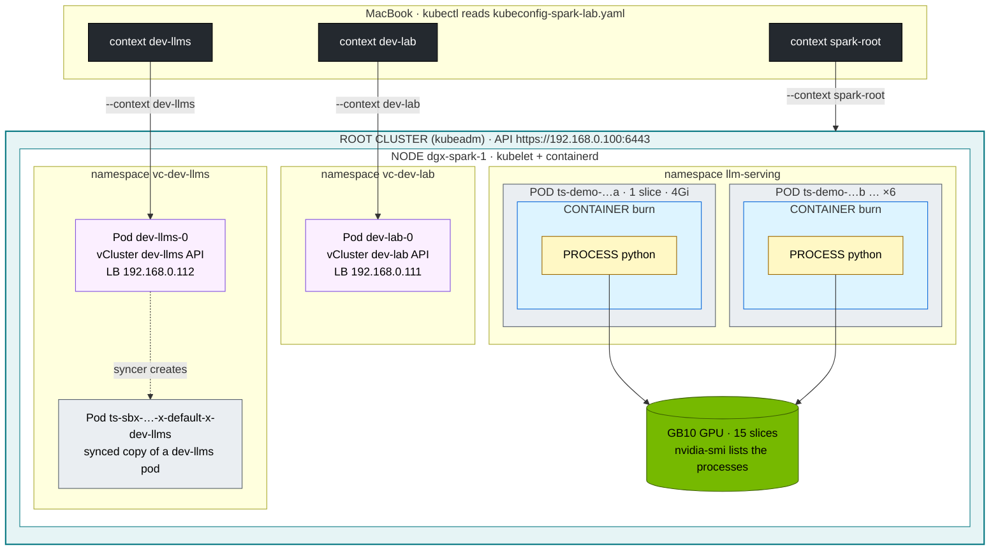
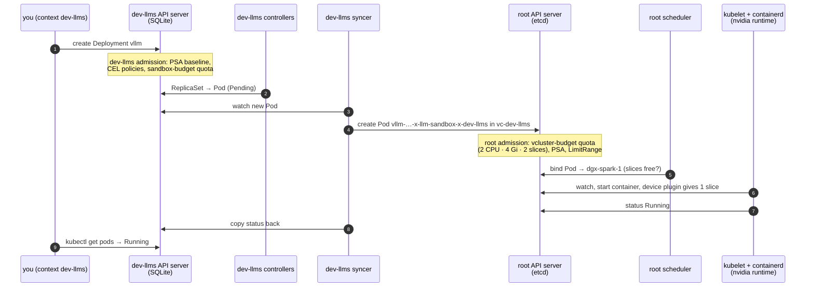

# Chapter 04 · Nested Clusters with vCluster: a kubeadm Root and Two vClusters on One DGX Spark

> **02-Kubernetes · Part I — Control plane & the nested lab · Chapter 04 of 28** · ← [Chapter 03 · kube-apiserver internals](03-kube-apiserver-internals.md) · [All chapters](00-kubernetes-step-by-step-guide.md) · [Chapter 05 · DGX Spark datacenter simulation lab](05-dgx-spark-datacenter-simulation-lab.md) →

| | |
|---|---|
| **You will build** | The lab's shape: a **root** Kubernetes cluster (kubeadm, one node that is master *and* worker) that owns the Spark's hardware and runs the LLM stack, and two small, identical **virtual clusters** inside it — `dev-lab` (tenancy drills) and `dev-llms` (an LLM sandbox) — each with its own API server, its own budget and its own tenants |
| **Hardware** | 1 DGX Spark (a second one later joins the root as a worker) |
| **Time** | 1 h to build and explore, then it is the stage for every other chapter |
| **Risk** | Low. A vCluster can be deleted and recreated in a minute; `01-Ansible playbooks/19.2-reset-kubernetes.yml` wipes everything |
| **Lab files** | [`lab/vclusters/`](lab/vclusters), [`lab/manifests/root/05-vclusters/`](lab/manifests/root/05-vclusters), [`lab/manifests/root-llms/10-tenancy/`](lab/manifests/root-llms/10-tenancy), `scripts/install-addons.sh vclusters`, 01-Ansible [`roles/vclusters`](../01-Ansible/lab/roles/vclusters) |

---

## 1. Why nest clusters on one box

One Spark can only be one *node*. But a datacenter has *several clusters*: a platform cluster, a dev cluster, a production inference cluster, each owned by a different team, upgraded on its own schedule and broken without breaking the others. Namespaces can't give you that. Nested clusters can.

| What you want to practise | Namespaces in one cluster | Root + vClusters (this lab) |
|---|---|---|
| A team is cluster-admin of "its" cluster | no — CRDs, webhooks, ClusterRoles are global | yes, inside its vCluster |
| Install an operator only for one team (KServe, Kueue, cert-manager) | clashes with everyone | install it in that vCluster |
| Break the control plane and recover | breaks the whole lab | break `dev-lab`; `dev-llms`, the root and the models keep running |
| Multi-cluster GitOps, promotion dev → prod | one destination | three destinations (Chapter 28) |
| Hard per-team budgets | namespace quotas | a root quota per vCluster **plus** tenant quotas inside |
| Real nodes, drains, node failure | yes | **only at the root** (a vCluster has no nodes of its own) |

### 1.1 Root on kubeadm, inner clusters on vCluster

| Layer | Distribution | Why |
|---|---|---|
| Root | **upstream Kubernetes with kubeadm** v1.36 | Same components and operations as production: static-pod control plane, etcd you snapshot and restore, `kubeadm upgrade`, kubelet config. Matches CKA/CKS and NVIDIA's GPU Operator docs |
| Inner | **vCluster** v0.37, standard Kubernetes distro, SQLite backing store | A full API server + controller-manager in **one pod**, data in SQLite on a 5 Gi PVC — no etcd to run. Created and deleted in a minute |

> **What happened to K3s inside?** vCluster changed its default distro from K3s to standard Kubernetes in v0.20 and **removed K3s support in v0.33**. Supported vCluster releases (0.34–0.37) run the standard distro only — which keeps what K3s offered here (a light, single-binary-style control plane) because the API server stores its data in an embedded SQLite database, just as K3s did. The lab therefore runs *Kubernetes in Kubernetes*: kubeadm outside, vCluster's Kubernetes inside.

### 1.2 Where the LLMs run, and why

The models run **directly on the root**, in ordinary root namespaces (`llm-serving`, `batch`, `ingress`), next to the root's platform. The two vClusters are small sandboxes of the same size (2 CPU · 4 Gi · 2 slices each).

Why the LLM stack is on the root:

- **All the memory headroom.** Model memory is GPU memory on the GB10. On the root, the model servers share one pool of ~90 GiB with nothing in between; inside a vCluster, its control plane, CoreDNS and a second quota would sit on top of the same memory.
- **No syncer translation.** A vLLM pod is `vllm-…` in `llm-serving` — the same name in `kubectl`, in Prometheus, in the scheduler's events and in Traefik's view. Nothing is renamed, copied back or delayed by a sync loop.
- **No nested quota.** One ResourceQuota per namespace (`serving-budget`, `batch-budget`) and the node's allocatable memory are the only limits. A pod that doesn't fit is `Pending` with a normal scheduler or quota event, not stuck behind a second quota one level up.
- **The models are the Spark's main job.** The box is bought to serve and train models; they get the cluster that owns the hardware.

Why two vClusters remain:

- **`dev-lab`** is where tenancy, the syncer, translated names and two-layer quotas are practised (tenants `tenant-alpha`, `tenant-beta`, `lab-tools`). Break it as often as you like.
- **`dev-llms`** is an LLM sandbox with its own API server: try LLM manifests, the mock LLM or a tiny model (≈0.5B at `--gpu-memory-utilization 0.02`) in namespace `llm-sandbox` before they go to the root.

The trade-off: whoever administers the root also operates the LLM stack, and the LLM stack is isolated by **namespaces** (quotas, LimitRanges, NetworkPolicy, admission policies, PSA, PriorityClasses — §5), not by a separate API server. A mistake with cluster-wide rights on the root can reach the models; in a vCluster it could not.

---

## 2. HLD — the whole picture

The full picture, with your MacBook as a client and sema01/vault01 running the automation outside the Spark, is at the top of the [module README](README.md#the-lab-in-one-picture-three-clusters-nested-on-one-spark) ([SVG](diagrams/nested-lab-architecture.svg)). The diagram below adds the communication paths between the components.

```mermaid
flowchart TB
  ADMIN(["your MacBook · kubectl<br/>one kubeconfig, 3 contexts<br/>(fetched from sema01)"])
  SEMA["sema01 · Semaphore<br/>runs 19.1 · 20.1 · 20.2<br/>certs from vault01"]
  SEMA -. "kubeconfig (fetch-kubeconfig.sh)" .-> ADMIN
  SEMA -- "helm · kubectl :6443" --> RAPI
  ADMIN -- "spark-root" --> RAPI
  ADMIN -- "dev-lab · 192.168.0.111" --> DAPI
  ADMIN -- "dev-llms · 192.168.0.112" --> LAPI
  subgraph SPARK["DGX Spark · DGX OS 7 · GB10 (15 time-slices) · ~121.7 GiB unified memory"]
    direction TB
    subgraph ROOT["Root cluster · kubeadm v1.36 · dgx-spark-1 = master + worker"]
      direction TB
      subgraph RCP["control plane (static pods)"]
        direction LR
        RAPI["kube-apiserver<br/>admission · RBAC · APF · audit"] <--> ETCD[("etcd · snapshots /6 h")]
        SCHED["scheduler + controllers"]
      end
      subgraph PLAT["platform (3 CPU · ~11.7 GiB · 2 slices)"]
        direction LR
        CIL["Cilium CNI<br/>kube-proxy (iptables)"]
        MLB["MetalLB<br/>.110–.119"]
        GPUOP["GPU Operator<br/>15 slices"]
        OBS["Prometheus · Grafana"]
        TOOLS["platform-tools<br/>probes · benchmarks · ledger"]
        LLMCTL["Traefik .115 · Kueue<br/>KEDA · KServe"]
      end
      subgraph LLM["LLM stack · root namespaces · shared pool ~90 GiB"]
        direction LR
        SERV["llm-serving · 8 CPU · ≤90 Gi · 6 slices<br/>vLLM · SGLang · KServe"]
        BATCH["batch · 2 CPU · ≤12 Gi · 3 slices<br/>Kueue jobs"]
      end
      subgraph VCD["namespace vc-dev-lab · budget 2 CPU · 4 Gi · 2 slices"]
        direction LR
        DAPI["vCluster dev-lab<br/>API server + SQLite + syncer"]
        DPODS["tenant pods<br/>tenant-alpha · tenant-beta · lab-tools"]
      end
      subgraph VCL["namespace vc-dev-llms · budget 2 CPU · 4 Gi · 2 slices"]
        direction LR
        LAPI["vCluster dev-llms<br/>API server + SQLite + syncer"]
        LPODS["sandbox pods<br/>llm-sandbox · mock LLM · tiny model"]
      end
    end
    HW["CPU 20 cores · 128 GB LPDDR5x · GB10 · NVMe 4 TB · CX-7"]
  end
  DAPI -- "syncs pods, services,<br/>PVCs, netpols" --> RAPI
  LAPI -- "syncs" --> RAPI
  RAPI --> SCHED
  SERV & BATCH & DPODS & LPODS & TOOLS --> GPUOP
  GPUOP --> HW
  classDef ctrl fill:#1f6feb,stroke:#0b3d91,color:#fff
  classDef net fill:#8250df,stroke:#4c2889,color:#fff
  classDef gpu fill:#76b900,stroke:#3d6000,color:#000
  classDef store fill:#bf8700,stroke:#7a5600,color:#fff
  classDef obs fill:#fb8500,stroke:#9a5200,color:#000
  classDef tenant fill:#eaeef2,stroke:#57606a,color:#000
  classDef ext fill:#24292f,stroke:#000,color:#fff
  class RAPI,SCHED,DAPI,LAPI ctrl
  class CIL,MLB net
  class GPUOP,HW gpu
  class ETCD store
  class OBS obs
  class LLMCTL net
  class SERV,BATCH gpu
  class DPODS,LPODS,TOOLS tenant
  class ADMIN ext
  classDef mgmt fill:#fff3e6,stroke:#fb8500,color:#000
  class SEMA mgmt
  style SPARK fill:#e6f4f5,stroke:#0e7c86,stroke-width:2px
  style ROOT fill:#ffffff,stroke:#1f6feb
  style LLM fill:#f3fbe6,stroke:#3d6000
  style VCD fill:#f6f8fa,stroke:#57606a,stroke-dasharray:5 3
  style VCL fill:#f6f8fa,stroke:#57606a,stroke-dasharray:5 3
```



The two dashed boxes are **ordinary root namespaces**. Everything a vCluster runs — its own control plane and every tenant pod — is a real pod in that namespace, counted against that namespace's root quota and scheduled by the **root's** scheduler onto the Spark. The green box is root namespaces too, but with no vCluster in between: model servers and training jobs are created through the root API server and keep their own names.

---

## 3. LLD — the master tables

### 3.1 Clusters, contexts, endpoints

| Context | What it is | API endpoint | Runs |
|---|---|---|---|
| `spark-root` | kubeadm root cluster | `https://192.168.0.100:6443` | control plane, Cilium, MetalLB, GPU Operator, storage, metrics-server, kube-prometheus-stack, Argo CD, `platform-tools` — and the LLM stack: `llm-serving`, `batch`, `ingress` (Traefik on `192.168.0.115`), `kueue-system`, `keda`, `kserve`, `cert-manager`, Gateway API CRDs |
| `dev-lab` | vCluster #1 in host namespace `vc-dev-lab` | `https://192.168.0.111:443` (MetalLB) | `tenant-alpha`, `tenant-beta`, `lab-tools` |
| `dev-llms` | vCluster #2 in host namespace `vc-dev-llms` | `https://192.168.0.112:443` (MetalLB) | `llm-sandbox` (LLM manifests, mock LLM, tiny models) |

All three contexts live in one file, `01-Ansible/lab/.cache/kubeconfig-spark-lab.yaml`, which every lab script uses. Reserve `192.168.0.110–119` in your router's DHCP settings.

#### What a context is, and what runs under it



Reading the picture from the outside in:

- **Context (black, on the MacBook)** is client-side only: a named bundle of *which API server*, *which credentials* and optionally *which default namespace*, stored in `kubeconfig-spark-lab.yaml`. Creating or deleting one changes nothing on any cluster. It works like saved sessions in an SSH client: you pick a name instead of typing the address, user and key each time.
- **Cluster → node:** one kubeadm cluster with one node, dgx-spark-1. Everything below runs on that machine.
- **Namespace (yellow):** a folder inside the root cluster. Each vCluster lives in its own namespace, and its API server is just a pod there (purple).
- **Pod → container → process:** Kubernetes schedules the **pod** (the unit quotas count), containerd starts its **container**, and the container runs the **process**, the actual program. `kubectl get pods` shows pods; `sudo crictl ps` on the Spark shows containers; `nvidia-smi` and `ps` show processes.
- **vCluster pods:** a pod you create with `--context dev-llms` first exists only in the vCluster's API. Its syncer creates the real copy in the root's `vc-dev-llms` namespace (`<name>-x-<namespace>-x-dev-llms`), and that copy is what runs on the node.
- **GPU slices are a budget, not a partition:** every pod's process shares the same GB10. The 15 slices are what Kubernetes counts against quotas.

**Why every command names its context.** `kubectl` is only a client: each command is an API call to one API server. The three API servers have their own addresses and credentials, and all three have a `default` namespace, nodes and pods, so a bare `kubectl get pods` means something different in each. Naming `--context` on every command makes the target visible in the command itself (a `delete` against the wrong default cluster is the classic mistake) and keeps copied commands pointing where the chapter meant. How the file is built is in 01-Ansible [Chapter 19 §2.5](../01-Ansible/19-kubernetes-kubeadm-root-cluster-and-vclusters.md).

### 3.2 Budgets

| | CPU (requests) | Memory (requests = limits) | GPU time-slices | Storage |
|---|---|---|---|---|
| Spark total | 20 | ~121.7 GiB visible (128 GB) | 15 | ~3.7 TiB |
| kubelet reservations | 3 (system 2 + kube 1) | 12 GiB (system 6 + kube 2 + eviction 4) | – | – |
| allocatable to pods | 17 | ~109.7 GiB | 15 | |
| vCluster `dev-lab` | **2** | **4 Gi** | **2** | 200 Gi |
| vCluster `dev-llms` | **2** | **4 Gi** | **2** | 200 Gi |
| **root keeps** | **13** | **~101.7 GiB** | **11** | the rest (~3.3 TiB) |
| ↳ platform (Cilium, MetalLB, GPU Operator, Prometheus, Traefik, Kueue, KEDA, `platform-tools`) | 3 | ~11.7 GiB | 2 | |
| ↳ LLM memory pool, shared | | ~90 GiB | | |
| &nbsp;&nbsp;↳ `llm-serving` ResourceQuota `serving-budget` | 8 | up to 90 Gi | 6 | 1 Ti |
| &nbsp;&nbsp;↳ `batch` ResourceQuota `batch-budget` = Kueue ClusterQueue `spark-cq` | 2 | up to 12 Gi | 3 | 200 Gi |

The vCluster budgets are defined in [`manifests/root/05-vclusters/quotas.yaml`](lab/manifests/root/05-vclusters/quotas.yaml), the LLM budgets in [`manifests/root-llms/10-tenancy/quotas.yaml`](lab/manifests/root-llms/10-tenancy/quotas.yaml). [`tests/budget_check.py`](lab/tests/budget_check.py) checks both against the kubelet reservations, the GPU Operator's slice count, Kueue's `spark-cq` and the MetalLB pool, and prints this table:

```bash
# ▶ MacBook · 02-Kubernetes/lab
python3 tests/budget_check.py            # in 02-Kubernetes/lab, on your MacBook; no cluster needed
```

```text
                  CPU  mem GiB  slices
Spark total      20.0    121.7      15
kubelet resv.     3.0     12.0       0
allocatable      17.0    109.7      15
vc-dev-lab        2.0      4.0       2
vc-dev-llms       2.0      4.0       2
root keeps       13.0     101.7      11
  platform        3.0      11.7       2
  llm-serving     8.0     90.0       6
  batch           2.0     12.0       3
  (llm-serving and batch share one memory pool; batch's memory is part of serving's)
model memory in llm-serving: 90 GiB = 0.74 of the GPU → keep the sum of --gpu-memory-utilization ≲ 0.72 (headroom)
LoadBalancer IPs: dev-lab API 192.168.0.111, dev-llms API 192.168.0.112, LLM gateway 192.168.0.115 (pool 192.168.0.110-192.168.0.119)
budget check OK
```

The kubelet reservations come from 01-Ansible Chapter 19 (`systemReserved` 2 CPU · 6 Gi, `kubeReserved` 1 CPU · 2 Gi, eviction below 4 Gi). `systemReserved` memory is 6 Gi because DGX OS runs headless (01-Ansible `04.3 Baseline`, `spark_baseline_headless: true`): no desktop session holds memory. What is left after the reservations is all that pods can ever be given.

**How the split is decided.** Everything must fit inside allocatable memory: 4 + 4 Gi for the vClusters leaves ~101.7 GiB to the root, of which the platform needs ~11.7 GiB and the models get the remaining ~90 GiB. Nothing is overcommitted, because on unified memory a promise of memory the box doesn't have ends with the OOM killer. CPU is compressible, so a budget is a guaranteed share and idle cores can still be used beyond it. The vClusters stay small: a vCluster's control plane and CoreDNS take ≈ 0.5–1 Gi of its 4 Gi; `dev-lab`'s tenants `tenant-alpha` and `tenant-beta` keep their 2 Gi ceilings (ceilings, not reservations), `dev-llms`' `llm-sandbox` gets 3 Gi. The root keeps 2 slices for `platform-tools` (GPU probes, the Chapter 14 §5.5 UMA experiment, the preemption demo's 2 filler replicas).

**One memory pool, shared by serving and batch.** CPU and slices are split exactly between platform, serving and batch (3 + 8 + 2 = 13 CPU; 2 + 6 + 3 = 11 slices). Memory is not: `serving-budget` allows up to 90 Gi, `batch-budget` up to 12 Gi, and both come out of the same ~90 GiB. Serving may use the whole pool while nothing trains; a training job takes up to 12 Gi of it when it runs. The quotas alone would allow 90 + 12 = 102 Gi, more than the pool. What stops the two from overcommitting unified memory is the **scheduler**:

- Every GPU container in the LLM stack sets memory **request = limit**: vLLM, SGLang and KServe 32 Gi; prefill/decode 20 Gi each; Triton 12 Gi; `resilient-train` 12 Gi; DDP ranks 6 Gi; gang workers 2 Gi. `budget_check.py` fails if any GPU container in `manifests/root-llms` doesn't.
- With request = limit, the node's allocatable memory is the real cap. A pod that doesn't fit stays `Pending` (`Insufficient memory`); it never squeezes a running model.
- Kueue may admit a job by its own quota (`spark-cq` = `batch-budget`) and its pods then wait `Pending` while the models fill the pool. Training waits for serving, never the reverse.

**Model memory.** ~90 GiB is 0.74 of the GPU's ~121.7 GiB, so the sum of vLLM `--gpu-memory-utilization` over all models running at the same time must stay at or below **0.72** (with headroom). Sets that fit: three 7–8B models at 0.20 each (16k context); one 32B FP8 model at 0.45 plus one 7B at 0.25; R1-Distill-32B in BF16 at 0.70 alone (Chapter 20 §2).

Three rules shape the quotas themselves:

- **CPU is capped on requests only.** A vCluster or namespace is guaranteed its share and may burst into idle CPU.
- **Memory is capped on requests *and* limits.** On a unified-memory box, memory is GPU memory too, so overcommit here is how model servers die.
- **GPU slices are time-slices, not GPUs.** All 15 share one GB10 and its memory (Chapter 16). `llm-serving` getting 6 slices means up to 6 GPU pods at once, not 6× the GPU, and they all share the same ~90 GiB of model memory.

The platform's 3 CPUs and ~11.7 GiB cover Cilium, MetalLB, the GPU Operator, Prometheus/Grafana, CoreDNS, local-path, Traefik, Kueue and KEDA; `budget_check.py` insists on at least 2 CPU · 8 GiB · 1 slice. There is little headroom left; giving a vCluster more means taking it from the LLM share (§6.5).

### 3.3 What a vCluster syncs

| Direction | Resources ([`vclusters/*.yaml`](lab/vclusters)) | Effect |
|---|---|---|
| vCluster → root | Pods, Services, Endpoints, PVCs, ConfigMaps, Secrets (default) | the workload really runs on the root |
| vCluster → root | **NetworkPolicies** | tenant policies are enforced by Cilium on the node |
| vCluster → root | **PriorityClasses** | the root scheduler can rank tenant pods (and preempt across vClusters — Chapter 07) |
| vCluster → root | **PodDisruptionBudgets** | a root `kubectl drain` respects tenant PDBs (break/fix 11) |
| root → vCluster | **Nodes** (real, all) | tenants see the GB10 labels, 15 allocatable slices, taints |
| root → vCluster | **StorageClasses** | `local-path`, `local-nvme`, `local-nvme-retain` (read-only) |
| root → vCluster | metrics-server proxy | `kubectl top` and HPAs inside |
| not synced | Deployments, Jobs, CRDs, Ingresses, RBAC | these stay inside the vCluster; only their pods go down |

None of this applies to the LLM stack: it runs on the root, so KEDA (also on the root) queries Prometheus directly at `http://kps-prometheus.observability.svc:9090`, and Traefik watches only `llm-serving` and `ingress`.

### 3.4 Names on the root

The syncer renames objects so two vClusters (or two namespaces) can't collide in one root namespace:

```text
inside dev-lab:  lab-tools  / echo-5d8f7c9b6-q4m2z
on the root:     vc-dev-lab / echo-5d8f7c9b6-q4m2z-x-lab-tools-x-dev-lab
annotations:     vcluster.loft.sh/object-name=echo-5d8f7c9b6-q4m2z
                 vcluster.loft.sh/object-namespace=lab-tools
```

A pod in `dev-llms`' `llm-sandbox` becomes `<pod>-x-llm-sandbox-x-dev-llms` in `vc-dev-llms` the same way. A model server on the root is not renamed: `llm-serving / vllm-7c9d5b6f4-x2k8p` is its only name. Services keep the same ClusterIP on both sides. Long names are shortened with a hash, so scripts find a pod's host copy through the annotations, not by building the name ([`scripts/lib.sh`](lab/scripts/lib.sh) `host_pod`).

---

## 4. Communication flow: one pod, three API servers

What happens when you try a small model in the sandbox with `kubectl --context dev-llms apply -f vllm-tiny.yaml` (a Deployment `vllm` in `llm-sandbox`):



The tenant's view stops at step 2. Steps 3–8 are the platform's, and the first place a problem shows up is often the **root's** admission in step 4: if the vCluster's budget is spent, the root refuses the pod and it stays `Pending` inside the vCluster with a sync error and *no scheduler events at all*. That one symptom (break/fix 02) is the most useful thing to recognise in this design.

The same manifest applied to the root (`kubectl --context spark-root -n llm-serving apply -f vllm.yaml`) has none of the syncer's steps (3, 4 and 8): one API server admits it (PSA, the CEL policies, `serving-budget`), the root scheduler binds it, and a refusal shows up where you'd look first — a `FailedCreate` event on the ReplicaSet for a quota, `Insufficient memory` or `Insufficient nvidia.com/gpu` on the pod for the node.

---

## 5. Two layers of every control

| Control | Inside a vCluster (its own API server) | At the root, around a vCluster | The LLM stack (root namespaces) | Volume |
|---|---|---|---|---|
| ResourceQuota | per-tenant ceilings (`tenant-budget`, `sandbox-budget`) | **the hard cap of the whole vCluster** (`vcluster-budget`) | `serving-budget`, `batch-budget` (= Kueue `spark-cq`); one layer only | 12 |
| Admission | PSA labels, 4 CEL policies (`common/15-admission`) | PSA on `vc-*`, LimitRange safety net | the same 4 CEL policies (`root-llms/15-admission`), PSA `llm-serving` baseline / `batch` privileged, LimitRanges | 02 |
| API fairness | APF lane for tenant users (`dev-lab/16-apf`) | APF lane for the **syncers**, by namespace (`root/16-apf`) | the root's own APF levels | 02 |
| Network | tenant NetworkPolicies | Cilium `vcluster-boundary`: Prometheus may scrape, the two vClusters can't talk to each other | NetworkPolicy `allow-ingress-and-same-namespace` in `llm-serving` (from `ingress`, `observability`, same namespace) | 06 |
| Scheduling | PriorityClasses | **one scheduler** for everything; preemption crosses vClusters | Kueue, PriorityClasses `spark-serving` > `spark-batch` | 05 |
| Audit | the vCluster's own API server | root audit log sees the syncer's writes in `vc-*` | root audit log, `RequestResponse` for `llm-serving` and `batch` | 02 |
| Backup | SQLite on the vCluster's PVC | etcd snapshots (do **not** contain vCluster state) | etcd snapshots | 03 |

The right-hand column is the whole isolation of the LLM stack: namespaces, quotas and policies on a shared API server. The root has no default PriorityClass, so a pod without one runs at priority 0. Because there is one scheduler, a vLLM pod at `spark-serving` in `llm-serving` can preempt a `spark-preemptible` pod in `dev-lab` (Chapter 07).

Inner quotas are ceilings, not reservations: `tenant-alpha` + `tenant-beta` + `lab-tools` may add up to more than `dev-lab`'s budget. Whoever asks first gets it; the next pod is refused by the root.

---

## 6. Step-by-step lab

### 6.1 Build it

#### What this lab does (templates `19.1 Kubernetes` → `20.1 GPU Operator` → `20.2 vClusters`, or script `lab/scripts/install-addons.sh`)

- **Root (19.1, 20.1):** the kubeadm root on dgx-spark-1 with Cilium and MetalLB, then the GPU Operator with 15 time-slices.
- **Storage first (20.2 or `install-addons.sh storage`):** local-path-provisioner writing to `/data/k8s`, StorageClasses `local-nvme` and `local-nvme-retain`, and `local-path` as the default class. Each vCluster keeps its SQLite database on a 5 Gi `local-nvme` PVC, so this has to exist before the vClusters.
- **Root-side objects:** namespaces `vc-dev-lab` and `vc-dev-llms` with their `vcluster-budget` quotas (2 CPU · 4 Gi · 2 slices each), LimitRanges and Cilium boundary policies (`root/05-vclusters`), and the PriorityClasses (`root/00-platform`). Template `20.2` also creates the LLM namespaces and their budgets (`root-llms/00-platform`, `10-tenancy`).
- **The vClusters:** Helm chart `loft/vcluster` 0.37.1 twice, values from `vclusters/dev-lab.yaml` and `dev-llms.yaml`. Each API gets a MetalLB IP: dev-lab `192.168.0.111`, dev-llms `192.168.0.112`.
- **Kubeconfig:** both contexts are merged into `01-Ansible/lab/.cache/kubeconfig-spark-lab.yaml` next to `spark-root`. Path B also runs `metrics-server` and `kps` (Prometheus/Grafana), which take several minutes on a first install.

#### What to look for

1. **Semaphore runs:** each template ends `failed=0`. On a re-run of `20.2`, the Helm and apply tasks show `ok` instead of `changed`.
2. **Contexts:** `kubectl config get-contexts -o name` prints `spark-root`, `dev-lab`, `dev-llms`.
3. **Pods at the root:**
   ```bash
   # ▶ MacBook · 02-Kubernetes/lab
   kubectl --context spark-root -n vc-dev-lab get pods,pvc,svc
   ```
   `dev-lab-0` is `Running`, PVC `data-dev-lab-0` is `Bound` (5Gi, `local-nvme`), and the LoadBalancer Service has `EXTERNAL-IP 192.168.0.111`. Same in `vc-dev-llms` with `.112`.
4. **Gate:** `scripts/verify.sh vclusters` prints the 11 `[PASS]` lines shown in §7 and `0 failed`.

**If something's off:** `dev-lab-0` `Pending` → its PVC is waiting for storage; install storage first. `context dev-lab` times out → MetalLB didn't hand out `.111`. More in §8.

#### Run it

Either path gives the same result. The vCluster definitions live once, in the 02 lab; Ansible applies those files.

**A — 01-Ansible, from Semaphore** (project `spark-lab` on sema01): run the templates `19.1 Kubernetes` → `20.1 GPU Operator` → `20.2 vClusters`, each to `failed=0`. They write the kubeconfig with all three contexts to sema01's state volume. Break-glass CLI from the MacBook: the same playbooks with `-l dgx-spark-1,localhost -K`.

```bash
# ▶ MacBook · technical-depth (repo root)
# after A (or after 05 + 06 for B) — on your MacBook
cd "01-Ansible/lab"
tools/fetch-kubeconfig.sh sema01                 # copies kubeconfig-spark-lab.yaml from sema01 to .cache/
export KUBECONFIG=$PWD/.cache/kubeconfig-spark-lab.yaml

# B — the 02 lab scripts from the MacBook (after 05 + 06); they merge dev-lab/dev-llms into this local kubeconfig only
cd "../../02-Kubernetes/lab"
scripts/install-addons.sh storage
scripts/install-addons.sh metrics-server
scripts/install-addons.sh kps
scripts/install-addons.sh vclusters
```

**Gate:** `kubectl config get-contexts` lists `spark-root`, `dev-lab`, `dev-llms`; `scripts/verify.sh vclusters` all PASS.

The LLM stack is installed on the root with `scripts/install-addons.sh traefik`, `kueue`, `keda` (and `kserve` when you need it), one at a time, followed by `scripts/apply-lab.sh` (its `root` part includes `manifests/root-llms`); `scripts/verify.sh llm-budget` checks its quotas (Chapter 05).

**If you built the old layout** with a large `llms` vCluster holding the LLM stack, remove it and rebuild on the root: `helm --kube-context spark-root uninstall llms -n vc-llms`, `kubectl --context spark-root delete ns vc-llms`, then `playbooks/20.2-vclusters.yml` (or `scripts/install-addons.sh vclusters`) to create `dev-llms` and the new budgets, `scripts/install-addons.sh traefik`, `kueue`, `keda` on the root (one at a time), and `scripts/apply-lab.sh`.

### 6.2 Look around

#### What this lab does (read-only `kubectl` in the root and in dev-lab)

- Lists the root's nodes, the node as dev-lab sees it (with the `spark.lab/gpu` and GPU product labels), the pods in the root namespace `vc-dev-lab`, and the namespaces on both sides.
- **Read-only:** nothing is created or changed.

#### What to look for

| Command | Healthy value |
|---|---|
| root `get nodes` | 1 node `dgx-spark-1`, `Ready`, roles `control-plane` |
| dev-lab `get nodes -L …` | the same `dgx-spark-1`, label `spark.lab/gpu=gb10` |
| allocatable `nvidia.com/gpu` inside dev-lab | `15`, although dev-lab's budget is 2 |
| root `-n vc-dev-lab get pods` | `dev-lab-0` `Running`, plus the host copies of any tenant pods |
| root namespaces containing `tenant` | `0` |

**If something's off:** dev-lab lists no node → node sync is off; check `sync.fromHost.nodes` in `vclusters/dev-lab.yaml`. More in §8.

#### Run it

```bash
# ▶ MacBook · any folder
kubectl --context spark-root get nodes                    # 1 node: control plane + worker
kubectl --context dev-lab get nodes -L spark.lab/gpu,nvidia.com/gpu.product
kubectl --context dev-lab get node dgx-spark-1 -o jsonpath='{.status.allocatable.nvidia\.com/gpu}{"\n"}'   # 15
kubectl --context spark-root -n vc-dev-lab get pods        # dev-lab-0 = the whole vCluster control plane
kubectl --context dev-lab get ns                           # its own world
kubectl --context spark-root get ns | grep -c tenant       # 0 — tenants don't exist at the root
```

The node shows 15 slices inside `dev-lab` even though `dev-lab` may only use 2: nodes are synced as they are, budgets are enforced by quota.

### 6.3 Follow one pod through both clusters

#### What this lab does (manifests `lab/manifests/dev-lab/30-networking`)

- **Creates in dev-lab's `lab-tools`:** `netshoot`, the `echo` Deployment (3 replicas on :8080) with Services `echo` (port 80) and `echo-headless`, and the two `dns-lab` pods used in Chapter 10.
- **Compares both views:** pod names and IPs in dev-lab and at the root (`vc-dev-lab`), and the ClusterIP of `echo` on both sides.
- The first run pulls the netshoot and agnhost images, so pods take a minute to get Ready.

#### What to look for

1. **Command exit:** `apply` prints `created` (first run) or `unchanged`.
2. **Same pods, two names:** each pod in dev-lab `lab-tools` appears at the root as `<pod>-x-lab-tools-x-dev-lab`, and the `VIRTUAL` column shows the dev-lab name.
3. **Same IPs:** the pod IPs (`10.42.x.x`) match on both sides.
4. **Same ClusterIP:** the `echo` Service has one ClusterIP (`10.43.x.x`) in dev-lab and at the root.

**If something's off:** pods `Pending` in dev-lab with no scheduler events → the root refused them (§6.4). Different IPs on the two sides would mean you're looking at two different pods; match them through the `vcluster.loft.sh/object-name` annotation. More in §8.

#### Run it

```bash
# ▶ MacBook · 02-Kubernetes/lab
kubectl --context dev-lab apply -k manifests/dev-lab/30-networking
kubectl --context dev-lab -n lab-tools get pods -o wide
kubectl --context spark-root -n vc-dev-lab get pods \
  -o custom-columns=ROOT-NAME:.metadata.name,VIRTUAL:.metadata.annotations.vcluster\\.loft\\.sh/object-name,IP:.status.podIP
kubectl --context dev-lab -n lab-tools get svc echo -o jsonpath='{.spec.clusterIP}{"\n"}'
kubectl --context spark-root -n vc-dev-lab get svc -o wide | grep echo      # same ClusterIP
```

Same pod IPs, same ClusterIPs: the network is the root's (Cilium, kube-proxy). Only the names and the API differ.

### 6.4 Spend a budget

#### What this lab does (script `lab/scripts/breakfix.sh inject 02`, manifest `lab/breakfix/02-gpu-oversubscribed.yaml`)

- **Injects:** Deployment `bf02-gpu` in dev-lab's `lab-tools`: 6 replicas of a `sleep` container, each asking for 1 GPU time-slice, 10m CPU and 64Mi.
- **What happens:** dev-lab's own API server accepts all 6 pods (`lab-tools` has no inner quota). The syncer then tries to create them at the root, where `vcluster-budget` on `vc-dev-lab` allows 2 slices. The root refuses the other 4.
- **`reset 02`** deletes the Deployment. Nothing else changes.

#### What to look for

1. **dev-lab:** `get pods -l app=bf02` shows 2 `Running` and 4 `Pending`.
2. **A Pending pod's events:** a sync error with `exceeded quota: vcluster-budget, requested: requests.nvidia.com/gpu=1, used: 2, limited: 2`. There is no `FailedScheduling` event: the root scheduler never saw the pod.
3. **Root quota:** `requests.nvidia.com/gpu` reads `2` used of `2` hard in `vcluster-budget`.
4. **After `reset 02`:** no `bf02` pods are left in dev-lab, and the root quota shows `0` GPUs used (or whatever other dev-lab GPU pods hold).

**If something's off:** fewer than 2 Running → another dev-lab pod already holds a slice (`gpu-smoke`, the §5.4 deadlock jobs in Chapter 07). `breakfix.sh answer 02` explains the scenario. More in §8 (first row).

#### Run it

```bash
# ▶ MacBook · 02-Kubernetes/lab
scripts/breakfix.sh inject 02              # 6 pods × 1 slice in dev-lab (budget: 2)
kubectl --context dev-lab -n lab-tools get pods -l app=bf02          # 2 Running, 4 Pending
kubectl --context dev-lab -n lab-tools describe pod <a-pending-one> | tail -5
kubectl --context spark-root -n vc-dev-lab describe resourcequota vcluster-budget
scripts/breakfix.sh reset 02
```

The Pending pods have **no scheduler events** — the root never saw them.

### 6.5 Resize a vCluster

#### What this lab does (two `kubectl patch` commands, then `tests/budget_check.py`)

- **Moves one GPU slice** from the LLM stack to dev-llms: `serving-budget` in `llm-serving` drops from 6 to 5 slices, `vcluster-budget` in `vc-dev-llms` rises from 2 to 3. No reinstall, no restart, no pod is evicted.
- **The patch is temporary:** re-applying `root/05-vclusters` and `root-llms/10-tenancy` puts the file values back. A permanent change goes into those files and must pass `python3 tests/budget_check.py`, which runs on the MacBook with no cluster.

#### What to look for

1. **Command exit:** each `patch` prints `resourcequota/… patched`.
2. **`describe resourcequota vcluster-budget`** in `vc-dev-llms` shows `requests.nvidia.com/gpu` hard `3`.
3. **`budget_check.py`** on the unchanged files ends `budget check OK` and prints the table from §3.2 (`root keeps 13.0 101.7 11`). If you edit only one vCluster's quota in the files, it fails, because the lab keeps the two sandboxes identical.
4. **Undo:** after re-applying the two folders, `scripts/verify.sh vclusters llm-budget` shows `dev-llms root budget: 2 4Gi 2` and `serving-budget: 8 90Gi 6` again.

**If something's off:** `budget_check.py` reports an overcommit → the budgets together promise more than allocatable; take from `serving-budget` first. More in §8.

#### Run it

A vCluster's size is its root quota. No reinstall, no restart. The root's slices are all handed out (platform 2, `llm-serving` 6, `batch` 3), so here `dev-llms` takes one of `llm-serving`'s:

```bash
# ▶ MacBook · any folder
kubectl --context spark-root -n llm-serving patch resourcequota serving-budget --type merge \
  -p '{"spec":{"hard":{"requests.nvidia.com/gpu":"5"}}}'
kubectl --context spark-root -n vc-dev-llms patch resourcequota vcluster-budget --type merge \
  -p '{"spec":{"hard":{"requests.nvidia.com/gpu":"3"}}}'
kubectl --context spark-root -n vc-dev-llms describe resourcequota vcluster-budget
```

Memory works the same way: more memory for a vCluster comes out of the LLM pool (lower `serving-budget` first, then raise `vcluster-budget`), because the platform's ~11.7 GiB has no slack. To make a change permanent, edit `manifests/root/05-vclusters/quotas.yaml` and `manifests/root-llms/10-tenancy/quotas.yaml` (and the LimitRange `max` if single pods need to grow) and run `python3 tests/budget_check.py` — it fails if the budgets together promise more than the Spark has, and also if `dev-lab` and `dev-llms` differ: the lab keeps the two sandboxes identical, so a permanent resize changes both. Shrinking works the same way, but doesn't evict running pods; it only blocks new ones until usage drops below the new limit. Undo the patches above with the values from the files (`kubectl --context spark-root apply -k manifests/root/05-vclusters` and `-k manifests/root-llms/10-tenancy`).

### 6.6 Add a third vCluster (exercise)

#### What this lab does (exercise: new `vclusters/train.yaml`, `helm upgrade --install`, `scripts/merge-vcluster-kubeconfig.sh`)

- **You write the files:** a values file for vCluster `train` on `192.168.0.113`, and namespace `vc-train` with a `vcluster-budget` and a `vcluster-defaults` LimitRange in `manifests/root/05-vclusters`, paid for by lowering `serving-budget`.
- **Helm** installs a third vCluster control plane (pod `train-0`, a 5 Gi `local-nvme` PVC, a LoadBalancer Service) in `vc-train`.
- **The merge script** reads Secret `vc-train` and adds context `train` to your current `$KUBECONFIG`, then waits until `/readyz` answers.

#### What to look for

1. **Helm:** the install ends `STATUS: deployed`; `kubectl --context spark-root -n vc-train get pods` shows `train-0` `Running`.
2. **Merge script:** `[PASS] context train → https://192.168.0.113:443`.
3. **`budget_check.py`** with `train` in `VCLUSTERS`: it fails until the budgets add up again, then prints `budget check OK` with a `vc-train` row.

**If something's off:** x509 errors on `.113` → the IP is missing from `proxy.extraSANs`. No IP on the Service → the `services.loadbalancers` quota in `vc-train` is missing or 0. More in §8.

#### Run it

1. Copy `vclusters/dev-lab.yaml` to `vclusters/train.yaml`; change the IP to `192.168.0.113` (in `annotations`, `extraSANs`, `exportKubeConfig.server`) and the context to `train`.
2. Add namespace `vc-train`, a `vcluster-budget` and a `vcluster-defaults` LimitRange to `manifests/root/05-vclusters` (the platform's 3 CPU / ~11.7 GiB / 2 slices have no slack, so lower `serving-budget` in `manifests/root-llms/10-tenancy/quotas.yaml` first and give `vc-train` what you took).
3. `kubectl --context spark-root apply -k manifests/root/05-vclusters`
4. `helm --kube-context spark-root upgrade --install train loft/vcluster --version $VCLUSTER_VERSION -n vc-train -f vclusters/train.yaml --wait`
5. `scripts/merge-vcluster-kubeconfig.sh train vc-train`
6. Add `train` to `VCLUSTERS` in `tests/budget_check.py`, run it — then fix whatever it reports.

### 6.7 Back up and restore a vCluster

#### What this lab does (StatefulSet scale + `tar` of the PVC folder, on the Spark)

- Scales dev-lab's control plane (`vc-dev-lab/dev-lab`) to 0, archives `/data/k8s/vc-dev-lab/data-dev-lab-0` into `~/dev-lab-<date>.tgz` on the Spark with `sudo tar`, and scales back to 1.
- For that minute the dev-lab API is gone; tenant pods keep running. Nothing else changes. Chapter 02 §5.8 has the same steps with a wait for the pod to be gone before the copy.

#### What to look for

1. **The PVC:** `data-dev-lab-0`, `Bound`, 5Gi, `local-nvme`.
2. **Before `tar`:** `kubectl --context spark-root -n vc-dev-lab get pods` no longer lists `dev-lab-0`. If it does, wait: copying a live SQLite file gives a broken backup.
3. **After:** `tar tzf ~/dev-lab-$(date +%F).tgz | head` lists files under `data-dev-lab-0/`, and `kubectl --context dev-lab get ns` answers again within a minute.

**If something's off:** `dev-lab-0` doesn't come back → `kubectl --context spark-root -n vc-dev-lab describe pod dev-lab-0`. A restored control plane that won't start → the copy was taken while it was running (Chapter 02 §7, last row). More in §8.

#### Run it

A root etcd snapshot does **not** contain a vCluster's objects: they live in SQLite on the vCluster's PVC, which `local-nvme` keeps at `/data/k8s/vc-<name>/<pvc>` on the Spark.

```bash
# ▶ MacBook · any folder
kubectl --context spark-root -n vc-dev-lab get pvc                      # data-dev-lab-0
kubectl --context spark-root -n vc-dev-lab scale statefulset dev-lab --replicas=0
```

```bash
# ▶ dgx-spark-1 (ssh dgx-spark-1)
sudo tar czf ~/dev-lab-$(date +%F).tgz -C /data/k8s/vc-dev-lab data-dev-lab-0
```

```bash
# ▶ MacBook · any folder
kubectl --context spark-root -n vc-dev-lab scale statefulset dev-lab --replicas=1
```

While the control plane is scaled to 0, tenant pods keep running (they are root pods); only the dev-lab API is gone. Restore = scale to 0, replace the directory, scale to 1. Newer `vcluster` CLIs also have `vcluster snapshot` — check `vcluster snapshot --help` for your version.

---

## 7. Verify

```bash
# ▶ MacBook · 02-Kubernetes/lab
scripts/verify.sh vclusters llm-budget
```

```text
── vclusters
[PASS] dev-lab control plane Running in vc-dev-lab
[PASS] dev-lab API answers (https://192.168.0.111:443)
[PASS] dev-lab root budget: 2 4Gi 2 (CPU · memory · GPU slices)
[PASS] dev-lab sees 1 real node(s) (sync.fromHost.nodes)
[PASS] dev-lab RuntimeClass nvidia
[PASS] dev-llms control plane Running in vc-dev-llms
[PASS] dev-llms API answers (https://192.168.0.112:443)
[PASS] dev-llms root budget: 2 4Gi 2 (CPU · memory · GPU slices)
[PASS] dev-llms sees 1 real node(s) (sync.fromHost.nodes)
[PASS] dev-llms RuntimeClass nvidia
[PASS] Cilium vCluster boundary policies
── llm-budget (the LLM stack on the root, context spark-root)
[PASS] llm-serving serving-budget: 8 90Gi 6 (CPU · memory · GPU slices)
[PASS] batch batch-budget: 2 12Gi 3
[PASS] Kueue spark-cq: 2 12Gi 3
```

---

## 8. Troubleshooting

| Symptom | Likely cause | Check / fix |
|---|---|---|
| Pod `Pending` in a vCluster, **no** scheduler events | root quota on `vc-<name>` spent | `kubectl --context spark-root -n vc-<name> describe resourcequota vcluster-budget`; resize (§6.5) or free capacity |
| Pod `Pending` with `Insufficient nvidia.com/gpu` | all 15 slices in use across the Spark | root scheduler event; `kubectl --context spark-root get cm -n platform-tools gpu-slice-ledger -o yaml` |
| `context dev-lab` times out | control-plane pod not Running, or MetalLB didn't give `.111` | `kubectl --context spark-root -n vc-dev-lab get pods,svc`; `kubectl --context spark-root -n metallb-system logs -l app.kubernetes.io/component=speaker` |
| x509 error on `https://192.168.0.11x` | IP missing from `proxy.extraSANs` | fix `vclusters/<name>.yaml`, `helm upgrade` |
| `services.loadbalancers` quota exceeded | a tenant created a LoadBalancer Service | each vCluster's root budget allows 1, its own API Service — by design; the LLM gateway (`.115`) is Traefik on the root |
| Model pod `Pending` in `llm-serving` with `Insufficient memory` | the LLM pool is full (request = limit) — another model or a training job holds it | `kubectl --context spark-root describe node dgx-spark-1 \| grep -A8 'Allocated resources'`; stop a model or lower `--gpu-memory-utilization` (sum ≲ 0.72) |
| Training pods `Pending` after Kueue admitted the job | models fill the shared pool | by design: training waits for serving; the job starts when memory frees |
| No pod at all in `llm-serving`, ReplicaSet shows `FailedCreate … exceeded quota: serving-budget` | the namespace quota is spent | `kubectl --context spark-root -n llm-serving describe resourcequota serving-budget` |
| `runtimeclass "nvidia" not found` inside a vCluster | `00-platform` not applied in that vCluster | `kubectl --context <v> apply -k manifests/<v>/00-platform` |
| PVC `Pending` inside a vCluster | StorageClass name typo; root provisioner down | events are copied from the root PVC; `kubectl --context spark-root -n local-path-storage logs deploy/local-path-provisioner` |
| A BestEffort pod is rejected | the root memory quota requires memory limits | by design — a vCluster can't run BestEffort pods (Chapter 14) |
| vCluster objects gone after an etcd restore? | they aren't — only root objects roll back | §6.7; restore the vCluster's PVC if you need its state rolled back too |

---

## 9. Scale-out and limits

- **dgx-spark-2** joins the *root* as a worker (01-Ansible `k8s_workers`). Both vClusters see the new node immediately (node sync) and the root scheduler spreads their pods. Budgets don't grow by themselves — raise the root quotas (`vcluster-budget`, `serving-budget`, `batch-budget` with `spark-cq`).
- **Control-plane HA**: each vCluster runs one control-plane replica with SQLite. For HA, vCluster supports several replicas with an embedded or external etcd; the root needs three control-plane nodes first (Chapter 02 §8).
- **Hard isolation**: vClusters share the node, the kernel and the GPU. For tenants you don't trust, use separate nodes (a vCluster can pin its pods with a node selector) or separate physical clusters.
- **More clusters**: each extra vCluster costs ~0.3 CPU and ~0.5–1.5 Gi for its control plane, taken from its own budget.

---

## 10. Checklist

- [ ] I can draw the three API servers and say which one each lab volume talks to.
- [ ] I can say why the models run on the root, why two small vClusters remain, and what the trade-off is.
- [ ] I can explain what keeps `llm-serving` and `batch` from overcommitting their shared memory pool (request = limit, the scheduler).
- [ ] I can explain why a pod can be Pending in a vCluster with no scheduler events — and find the root quota that caused it.
- [ ] I resized a vCluster with one `kubectl patch` and kept `budget_check.py` green.
- [ ] I backed up a vCluster's PVC and know that etcd snapshots don't cover it.
