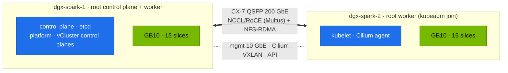

# Chapter 05 · DGX Spark Datacenter Simulation Lab: End-to-End Build, Gates & Day-2 Operations

> **02-Kubernetes · Part I — Control plane & the nested lab · Chapter 05 of 28** · ← [Chapter 04 · Nested clusters with vCluster](04-nested-clusters-with-vcluster.md) · [All chapters](00-kubernetes-step-by-step-guide.md) · [Chapter 06 · kube-controller-manager & controllers](06-kube-controller-manager-and-controllers.md) →

| | |
|---|---|
| **You will build** | The whole "AI datacenter in a box" on one Spark: a kubeadm **root cluster** that owns the hardware and runs the LLMs, two small **vClusters** with hard budgets (`dev-lab` for tenants, `dev-llms` as an LLM sandbox), a serving tier behind an API gateway, a gang-scheduled batch tier, observability across all three clusters, backups and a scripted verification gate after every layer. Everything is designed to add dgx-spark-2 without rework |
| **Hardware** | 1 DGX Spark (2 optional) · `sema01` (Semaphore, runs every playbook) and `vault01` (SSH CA, lab secrets) outside the Spark, from 01-Ansible [Chapter 01](../01-Ansible/01-management-plane-semaphore-and-vault.md) and [Chapter 04](../01-Ansible/04-dgx-spark-as-semaphore-target.md) · your MacBook as a client (browser, git, kubectl) |
| **Time** | 4–6 h the first time, ~45 min once practised |
| **Risk** | Medium. Everything is rebuildable: Semaphore template `19.2 Reset Kubernetes` wipes Kubernetes, `19.1 Kubernetes` → `20.1 GPU Operator` → `20.2 vClusters` rebuild it; sema01 and vault01 are outside the Spark and untouched |
| **Lab files** | the whole [`lab/`](lab/README.md) directory |

---

## 1. What "datacenter-like" means on one box

The goal isn't scale. It's the **same shape and the same failure modes** as a production GPU platform, small enough to break and rebuild in an afternoon.

| Datacenter concept | Simulated here by | Volume |
|---|---|---|
| Platform cluster run by a platform team | kubeadm root cluster: static-pod control plane, Cilium, MetalLB, GPU Operator, observability | 01, 16 |
| Separate clusters per team, upgraded independently | vCluster `dev-lab` and `dev-llms`, each with its own API server and admins | 27 |
| Hard budgets per cluster | root ResourceQuotas on `vc-dev-lab` and `vc-dev-llms` (2 CPU · 4 Gi · 2 slices each) | 12, 27 |
| Production tier on the platform cluster | the LLM stack in root namespaces `llm-serving`, `batch`, `ingress`, isolated by quotas, policies and PSA | 12, 20 |
| Control plane with backed-up datastore | stacked etcd, 6-hourly snapshots, off-box copy, restore drill; vCluster SQLite on PVCs | 03 |
| Identity, RBAC, admission policy, audit | per-cluster x509 users, tenant ClusterRoles, 4 CEL policies, PSA, root audit log | 02 |
| Teams with budgets inside a cluster | `tenant-alpha` / `tenant-beta` in dev-lab (500m · 2 Gi · 1 slice each) | 12 |
| Shared GPU pool with scheduling policy | 15 time-slices, one root scheduler, PriorityClasses, Kueue on the root | 05, 14 |
| Serving tier behind an API gateway | Traefik on the root on `192.168.0.115` (Ingress + Gateway API), mock OpenAI API, vLLM/Triton/SGLang | 09, 21–23 |
| Batch/training tier | root namespace `batch`, Kueue gangs, torchrun Indexed Jobs | 05, 17 |
| Storage tiers | NVMe local PVs (Delete/Retain) offered to both vClusters, model cache, NFS for 2 nodes | 11 |
| Observability & alerting | one kube-prometheus-stack on the root that scrapes the LLM stack and the vClusters' workloads | 16 |
| Change safety | server-side dry runs, CI on kind with the same root + 2 vClusters, break/fix drills | 19, 20 |

---

## 2. HLD — the whole picture

```mermaid
flowchart TB
  USER(["Users · SDKs · Open WebUI"]) --> EDGE
  ADMIN(["Your MacBook · browser · git · kubectl<br/>contexts spark-root · dev-lab · dev-llms"])
  subgraph MGMT["management plane · outside the Spark"]
    direction LR
    SEMA["sema01 · 192.168.0.210<br/>Semaphore · runs every playbook"]
    VLT["vault01 · 192.168.0.211<br/>SSH CA · 15-min certs · kv/spark-lab"]
  end
  subgraph SPARK["dgx-spark-1 · DGX OS 7 · GB10 · 128 GB UMA (~121.7 GiB usable)"]
    direction TB
    subgraph ROOT["Root cluster · kubeadm v1.36 · master + worker"]
      direction TB
      subgraph CP["Control plane (static pods)"]
        direction LR
        API["API server<br/>RBAC · APF · audit · encryption"]
        ETCD[("etcd<br/>snapshots /6 h")]
      end
      subgraph PLATFORM["Platform tier · 3 CPU · ~11.7 GiB · 2 slices"]
        direction LR
        NET["Cilium + kube-proxy<br/>MetalLB .110–.119"]
        OBS["Prometheus · Grafana · Alertmanager<br/>+ host node-exporter :9100"]
        GPUOP["GPU Operator<br/>device plugin ×15 slices · GFD"]
        PT["platform-tools<br/>ledger · probes · benchmarks"]
      end
      subgraph LLM["LLM stack on the root · shared memory pool ~90 GiB"]
        direction LR
        EDGE["Traefik .115<br/>Ingress + Gateway API"]
        SERVE["llm-serving · 8 CPU · ≤90 Gi · 6 slices<br/>mock-llm · vLLM · Triton · Qdrant"]
        BATCH["batch · 2 CPU · ≤12 Gi · 3 slices<br/>Kueue spark-cq · torchrun"]
      end
      subgraph DEV["vc-dev-lab · vCluster dev-lab (.111) · 2 CPU · 4 Gi · 2 slices"]
        direction LR
        TA["tenant-alpha<br/>500m · 2 Gi · 1 slice"]
        TB["tenant-beta<br/>500m · 2 Gi · 1 slice"]
        LT["lab-tools<br/>netshoot · echo · drills"]
      end
      subgraph DLL["vc-dev-llms · vCluster dev-llms (.112) · 2 CPU · 4 Gi · 2 slices"]
        direction LR
        SBX["llm-sandbox<br/>mock LLM · tiny model"]
      end
    end
    NVME[("NVMe 4 TB<br/>/data/k8s · model-cache")]
    GB10["GB10 GPU"]
  end
  S2["dgx-spark-2 (optional)<br/>root worker · +15 slices<br/>CX-7 200 GbE"]
  ADMIN --> API
  ADMIN -. "browser · fetch-kubeconfig.sh" .-> SEMA
  SEMA -->|"AppRole → cert"| VLT
  SEMA -->|"SSH svc-ansible · helm/kubectl"| SPARK
  EDGE --> SERVE
  SERVE & BATCH & TA & TB & SBX & PT --> GB10
  SERVE --> NVME
  API <--> ETCD
  DEV & DLL -. "syncer → root API" .-> API
  LLM -- "root API directly" --> API
  SPARK <-.-> S2
  classDef ctrl fill:#1f6feb,stroke:#0b3d91,color:#fff
  classDef net fill:#8250df,stroke:#4c2889,color:#fff
  classDef gpu fill:#76b900,stroke:#3d6000,color:#000
  classDef store fill:#bf8700,stroke:#7a5600,color:#fff
  classDef obs fill:#fb8500,stroke:#9a5200,color:#000
  classDef tenant fill:#eaeef2,stroke:#57606a,color:#000
  classDef ext fill:#24292f,stroke:#000,color:#fff
  class API ctrl
  class EDGE,NET net
  class GB10,GPUOP,S2 gpu
  class ETCD,NVME store
  class OBS obs
  class SERVE,BATCH,TA,TB,LT,SBX,PT tenant
  class USER,ADMIN ext
  classDef mgmt fill:#fff3e6,stroke:#fb8500,color:#000
  class SEMA,VLT mgmt
  style SPARK fill:#e6f4f5,stroke:#0e7c86,stroke-width:2px
  style ROOT fill:#ffffff,stroke:#1f6feb
  style PLATFORM fill:#ffffff,stroke:#8c959f
  style CP fill:#ffffff,stroke:#1f6feb
  style DEV fill:#f6f8fa,stroke:#57606a,stroke-dasharray:5 3
  style LLM fill:#f3fbe6,stroke:#3d6000
  style DLL fill:#f6f8fa,stroke:#57606a,stroke-dasharray:5 3
  style MGMT fill:#fffaf3,stroke:#fb8500,stroke-dasharray:5 3
```



**Why the LLMs run on the root.** The models are the Spark's main job, so they run in the cluster that owns the hardware: they get all the memory headroom (one ~90 GiB pool, no vCluster control plane or second quota on top), no syncer translation (a vLLM pod is `vllm-…` in `llm-serving` everywhere — kubectl, Prometheus, Traefik) and no nested quota. Two small, identical vClusters remain: `dev-lab` for tenancy and syncer drills, `dev-llms` as an LLM sandbox with its own API server where manifests and tiny models are tried before they go to the root. The trade-off: whoever administers the root also operates the LLM stack, and it is isolated by namespaces (quotas, LimitRanges, NetworkPolicy, CEL admission, PSA, PriorityClasses), not by its own API server. Chapter 04 §1.2 has the full reasoning.

---

## 3. LLD — the master tables

### 3.1 Network & ports

| Endpoint | Address | Notes |
|---|---|---|
| Root API server (`spark-root`) | `https://192.168.0.100:6443` | kubeconfig from 01-Ansible `.cache/kubeconfig-spark-lab.yaml` |
| dev-lab API (`dev-lab`) | `https://192.168.0.111:443` | MetalLB IP of the vCluster's Service; same kubeconfig |
| dev-llms API (`dev-llms`) | `https://192.168.0.112:443` | same |
| LLM gateway (Traefik on the root) | `192.168.0.115:80`, `:443` | hosts `llm.lab.local`, `gw.lab.local` in your MacBook's `/etc/hosts` |
| Grafana (kps) | `http://192.168.0.100:32000` | admin / `adminPassword` in the kps values (keep the real one in vault01 KV) |
| Hubble UI | `http://192.168.0.100:31235` | Cilium flow visibility |
| Host Grafana (01-Ansible) | `http://192.168.0.100:3000` | node/GPU view that survives a Kubernetes outage |
| Pod CIDR / Service CIDR / DNS | 10.42.0.0/16 · 10.43.0.0/16 · 10.43.0.10 | set in the kubeadm config; vCluster Services get root ClusterIPs |
| MetalLB pool | 192.168.0.110–119 | reserve in your router's DHCP |
| CX-7 | 192.168.100.0/24, 192.168.101.0/24 | only with dgx-spark-2 |

### 3.2 Namespaces, budgets and policies

| Cluster · namespace | PSA | Budget | Admission policies | Priority |
|---|---|---|---|---|
| root · `vc-dev-lab` | baseline | **2 CPU req · 4 Gi · 2 slices · 200 Gi · 1 LB** | — (Cilium boundary, APF lane) | — |
| root · `vc-dev-llms` | baseline | **2 CPU req · 4 Gi · 2 slices · 200 Gi · 1 LB** | — (Cilium boundary, APF lane) | — |
| root · `llm-serving` | baseline | `serving-budget`: **8 CPU req · up to 90 Gi · 6 slices · 1 Ti** | no-latest, readiness required; NetworkPolicy `allow-ingress-and-same-namespace` | serving |
| root · `batch` | privileged (warn: baseline). RDMA needs hostNetwork/IPC_LOCK | `batch-budget` = Kueue `spark-cq`: **2 CPU · up to 12 Gi · 3 slices · 200 Gi** | no-latest | batch |
| root · `ingress` | baseline | none (platform share) | — | platform |
| root · `platform-tools` | privileged | none (platform team) | — | platform / preemptible |
| root · `observability`, `gpu-operator`, `metallb-system` | privileged | none | — | platform |
| dev-lab · `tenant-alpha`, `tenant-beta` | restricted | 500m · 2 Gi · 1 slice · 100 Gi · 10 pods | no-latest, ≤1 slice, no NVIDIA env | interactive |
| dev-lab · `lab-tools` | baseline | none inside (the root caps it) | — | mixed |
| dev-llms · `llm-sandbox` | baseline | 1500m · 3 Gi · 2 slices · 150 Gi | no-latest, readiness required | — |

### 3.3 Capacity plan (one Spark)

| Consumer | CPU | Memory (UMA) | GPU slices |
|---|---|---|---|
| kubelet reservations (system 2 + kube 1 CPU; system 6 + kube 2 + eviction 4 Gi) | 3 | 12 Gi | — |
| root platform (Cilium, MetalLB, kps, metrics-server, GPU Operator, Traefik, Kueue, KEDA, platform-tools) | 3 | ~11.7 GiB | 2 |
| LLM memory pool on the root: `llm-serving` (8 CPU · 6 slices) and `batch` (2 CPU · 3 slices) | 10 | ~90 GiB, shared | 9 |
| vCluster dev-lab (control plane ~0.3 CPU · 0.5–1 Gi included) | 2 | 4 Gi | 2 |
| vCluster dev-llms (control plane included) | 2 | 4 Gi | 2 |
| **total** | **20** | **~121.7 GiB** | **15** |

Memory is split without overcommit: of ~109.7 GiB allocatable, the vClusters take 4 + 4 Gi and the root keeps ~101.7 GiB — ~11.7 GiB for its platform and ~90 GiB for the models. The kubelet's system reservation is 6 Gi because DGX OS runs headless (01-Ansible `04.3 Baseline`). CPU may burst into idle cores. The root's 2 platform slices are for `platform-tools` (GPU probes, the Chapter 14 §5.5 UMA experiment, the preemption demo's fillers).

CPU and slices are split exactly (3 + 8 + 2 = 13 CPU, 2 + 6 + 3 = 11 slices on the root). Only memory is shared: `serving-budget` allows up to 90 Gi and `batch-budget` up to 12 Gi of the same pool, so serving can use all of it while nothing trains. The **scheduler** keeps the two from overcommitting unified memory: every GPU container in the LLM stack sets memory request = limit, so a pod that doesn't fit waits `Pending` and never squeezes a running model; a Kueue-admitted training job waits for serving, never the reverse. ~90 GiB is 0.74 of the GPU, so the `--gpu-memory-utilization` values of the models running at the same time should add up to ≲ 0.72 (Chapter 20 §2). `tests/budget_check.py` keeps these numbers honest and checks request = limit on every GPU container in `manifests/root-llms` (Chapter 04 §3.2).

---

## 4. Build order with gates

Each step ends with a **gate**: a command that must pass before you continue. When a gate fails, stop and fix it. Later layers hide earlier faults.

The 01-Ansible stages run as **Semaphore templates** in project `spark-lab` on sema01 ([01-Ansible Chapter 04 §8](../01-Ansible/04-dgx-spark-as-semaphore-target.md#8-build-the-lab-from-semaphore)); a gate there is the task log ending in `failed=0`. Everything from the 02-Kubernetes layer on runs with `kubectl` from your MacBook.

```mermaid
flowchart LR
  G0["0 · Toolchain<br/>run-local-checks"] --> G1["1 · Root<br/>Semaphore 19.1 + 20.1: kubeadm · Cilium · MetalLB · GPU Op"]
  G1 --> G2["2 · Control plane<br/>etcd · audit · encryption"]
  G2 --> G3["3 · Platform + vClusters<br/>storage · metrics · kps · dev-lab · dev-llms<br/>Traefik · Kueue · KEDA"]
  G3 --> G4["4 · Tenancy<br/>ns · quotas · RBAC · CEL · APF · netpol"]
  G4 --> G5["5 · Workloads<br/>networking · Traefik · Qdrant · probes"]
  G5 --> G6["6 · GPU<br/>smoke · baseline · contention"]
  G6 --> G7["7 · Serving<br/>vLLM · Triton"]
  G7 --> G8["8 · Batch<br/>Kueue gangs · DDP"]
  G8 --> G9["9 · Ops<br/>backups · drills · dashboard"]
  classDef ctrl fill:#1f6feb,stroke:#0b3d91,color:#fff
  classDef gpu fill:#76b900,stroke:#3d6000,color:#000
  class G0,G1,G2,G3,G4,G5,G9 ctrl
  class G6,G7,G8 gpu
```



### Task 0 · Toolchain (your MacBook)

#### What this lab does (script `lab/tests/run-local-checks.sh`)

- **Static checks, no Spark needed:** `yamllint`; `kustomize build` of every folder plus `kubeconform` on every manifest, break/fix and policy fixture; the audit policy diffed against 01-Ansible's copy; `tests/budget_check.py`; `promtool` on the alert rules; the Grafana dashboard regenerated and compared; `py_compile` of every lab Python file; `shellcheck` on the scripts.
- **One local process:** starts `mock_llm.py` on `localhost:8000`, checks `/health` and that a streamed answer has 6 SSE events, then stops it.
- **Helm templates:** if `helm` is installed, renders the vCluster, Traefik, kube-prometheus-stack and metrics-server values against their charts (needs internet for the chart repos).
- Nothing is installed anywhere. `API=1` adds server-side dry runs against the three contexts; you don't need that here.

#### What to look for

1. **Command exit:** the last line is `ALL LOCAL CHECKS PASSED`. The script stops at the first failing step (`set -e`), so the last `==` header printed names the step that failed.
2. **`== budgets add up`** prints the budget table and `budget check OK`.
3. **`== helm template`** prints `vclusters/dev-lab.yaml OK`, `vclusters/dev-llms.yaml OK` and one `OK` per add-on values file.

**If something's off:** `command not found` for `kubeconform`, `promtool` or `shellcheck` → install the tool (the CI workflow lists them). `== mock-llm functional` failing → port 8000 is already in use on the MacBook.

#### Run it

```bash
# ▶ MacBook · any folder
git clone https://github.com/cloudone365/technical-depth.git && cd "technical-depth/02-Kubernetes/lab"
pip install yamllint shellcheck-py pyyaml     # plus kubectl, helm, kubeconform, promtool (see CI workflow)
tests/run-local-checks.sh
```

**Gate:** `ALL LOCAL CHECKS PASSED`.

### Task 1 · Root cluster (01-Ansible, from Semaphore)

#### What this lab does (templates `19.1 Kubernetes`, `20.1 GPU Operator`; script `lab/scripts/preflight.sh`)

- **`19.1 Kubernetes`:** kubeadm root cluster v1.36 on dgx-spark-1 (control plane and worker, no control-plane taint), Cilium, MetalLB with pool `192.168.0.110–119`, kubelet reservations of 3 CPU and 12 GiB, audit log, Secret encryption, and the etcd snapshot timer. It writes the kubeconfig with context `spark-root` to sema01's state volume.
- **`20.1 GPU Operator`:** the GPU Operator with time-slicing, so the node advertises 15 `nvidia.com/gpu`.
- **`fetch-kubeconfig.sh sema01`:** copies `kubeconfig-spark-lab.yaml` from sema01 into `01-Ansible/lab/.cache/` on the MacBook.
- **`preflight.sh`:** read-only checks of the host, the root cluster and (if they exist yet) the vClusters. The host checks (`nproc`, `nvidia-smi`, `systemctl`, `/data/k8s`) only mean something on the Spark: run preflight there.

#### What to look for

1. **Semaphore runs:** both end `failed=0`. A first run of `19.1` shows many `changed`; a re-run is mostly `ok`.
2. **Preflight summary:** `… passed, … warnings, 0 failed`, with these lines among the `[PASS]`:

   | Line | Healthy value |
   |---|---|
   | `kubeadm` | `v1.36.5` (the value in `versions.env`) |
   | taint | `dgx-spark-1 schedulable (no control-plane taint)` |
   | GPU | `dgx-spark-1 allocatable nvidia.com/gpu=15 (time-slices)` |
   | MetalLB | `MetalLB pool lab-pool (192.168.0.110–119)` |
   | memory | `MemTotal 121 GiB (unified CPU+GPU pool)` |

3. **vClusters:** on the Spark the two vCluster lines are `[....]` (`not reachable yet` before Task 3, or `context … not in /home/dgxadmin/.kube/config` because the Spark's kubeconfig holds only `spark-root`). Both are information, not failures. `helm` and `yq` show as `[....]` too: they're MacBook tools.

**If something's off:** `k3s is still installed` → template `19.2 Reset Kubernetes` with `reset_remove_k3s=true`. `no nvidia.com/gpu allocatable` → re-run `20.1`. More in §8 (gate 1).

#### Run it

In Semaphore (project `spark-lab`): run `19.1 Kubernetes`, then `20.1 GPU Operator` (break-glass CLI: `ansible-playbook playbooks/19.1-kubernetes.yml -l dgx-spark-1,localhost -K`). Then on your MacBook:

```bash
# ▶ MacBook · 01-Ansible/lab (venv active)
tools/fetch-kubeconfig.sh sema01                    # kubeconfig from sema01's state volume → .cache/
export KUBECONFIG=$PWD/.cache/kubeconfig-spark-lab.yaml
```

```bash
# ▶ dgx-spark-1 (ssh dgx-spark-1) · ~/technical-depth/02-Kubernetes/lab
# (repo copy on the Spark: the guide's "Where each command runs")
scripts/preflight.sh
```

**Gate:** both task logs end in `failed=0`; `fetch-kubeconfig.sh` lists `spark-root`; preflight `0 failed`. `allocatable nvidia.com/gpu=15`. No control-plane taint.

### Task 2 · Control plane hardening

#### What this lab does (`kubectl replace` of all Secrets, script `lab/scripts/etcd-drill.sh`)

- **Re-encrypts:** rewrites every root Secret unchanged, so each is stored with the current encryption key (Chapter 03 §5 Task 1).
- **`etcd-drill.sh status`:** member list, endpoint status, alarms, newest snapshots and the snapshot timer (Chapter 02 §5.1).
- **`etcd-drill.sh snapshot`:** one on-demand snapshot `/var/lib/etcd-snapshots/etcd-dgx-spark-1-<ts>-drill.db`.
- Nothing is reconfigured. The two `etcd-drill.sh` lines and `systemctl` run on the Spark (they use `sudo etcdctl` and the etcd certificates there); the `kubectl` line works from the MacBook.

#### What to look for

1. **Re-encryption:** no output and no error (the command sends its output to `/dev/null`).
2. **`status`:** 1 member `dgx-spark-1`, `IS LEADER true`, empty alarm list.
3. **`snapshot`:** ends `saved /var/lib/etcd-snapshots/etcd-dgx-spark-1-…-drill.db`, after an `etcdutl snapshot status` table with a non-zero `TOTAL KEYS`.
4. **Timer:** `etcd-snapshot.timer` listed with a `NEXT` time at most 6 h away.

**If something's off:** `etcdctl missing` or version errors → re-run `19.1 Kubernetes`. More in §8 (gate 2) and Chapter 02 §7.

#### Run it

```bash
# ▶ MacBook · any folder
kubectl --context spark-root get secrets -A -o json | kubectl --context spark-root replace -f - >/dev/null
```

```bash
# ▶ dgx-spark-1 (ssh dgx-spark-1) · ~/technical-depth/02-Kubernetes/lab
scripts/etcd-drill.sh status && scripts/etcd-drill.sh snapshot
systemctl list-timers etcd-snapshot.timer
```

**Gate:** 1 etcd member, leader, no alarms, ≥ 1 snapshot, timer scheduled. Secrets in etcd start with `k8s:enc:aescbc:v1:` (Chapter 03 §5 Task 1).

### Task 3 · Platform add-ons and vClusters

#### What this lab does (script `lab/scripts/install-addons.sh all`)

Installs seven add-ons on the root, one after the other (versions from `versions.env`):

- **`storage`:** local-path-provisioner on `/data/k8s`, StorageClasses `local-nvme` and `local-nvme-retain`, `local-path` as default.
- **`metrics-server`:** `kubectl top` and HPAs (Helm, `kube-system`).
- **`kps`:** kube-prometheus-stack in `observability`, Grafana on NodePort `32000`. Waits up to 15 min.
- **`vclusters`:** root namespaces, budgets and Cilium boundary for the vClusters, then `dev-lab` (`.111`) and `dev-llms` (`.112`) with Helm, and both contexts merged into your kubeconfig.
- **`traefik`:** namespaces `llm-serving`, `batch`, `ingress`, the Gateway API CRDs, and Traefik `traefik-lab` in `ingress` on `192.168.0.115`.
- **`kueue`, `keda`:** the controllers in `kueue-system` and `keda`. The queues come later with `apply-lab.sh`.

A first run pulls many images and takes a while. Re-running is safe (`helm upgrade --install`, `kubectl apply`).

#### What to look for

1. **Command exit:** the script stops at the first error. A full run prints `192.168.0.115` after the Traefik step and ends with `deployment "keda-operator" successfully rolled out`.
2. **Root pods:** the second command prints `root: all pods Running/Completed`.
3. **vClusters:** `scripts/verify.sh vclusters` shows `dev-lab root budget: 2 4Gi 2` and `dev-llms root budget: 2 4Gi 2`. It ends `9 passed, 0 warnings, 2 failed`: the two failures are `dev-lab RuntimeClass nvidia missing` and `dev-llms RuntimeClass nvidia missing`. They're expected at this point. The RuntimeClass is created inside each vCluster by `apply-lab.sh` in Task 4–5.
4. **Endpoints:**

   | Check | Healthy value |
   |---|---|
   | `kubectl --context spark-root -n ingress get svc traefik-lab` | `EXTERNAL-IP 192.168.0.115` |
   | http://192.168.0.100:32000 | Grafana login page |
   | `kubectl config get-contexts -o name` | `spark-root`, `dev-lab`, `dev-llms` |

**Built with Semaphore (`20.2`) instead of `install-addons.sh all`?** `20.2` installs storage and the vClusters but not Traefik, Kueue or KEDA. Run `scripts/install-addons.sh traefik`, then `kueue`, then `keda` before Task 4–5; until then `verify.sh llm-budget` prints `[....] Kueue not installed on the root yet`.

**If something's off:** a vCluster never Ready → its PVC is `Pending` because storage wasn't installed first. Traefik without an IP → the MetalLB pool. More in §8 (gate 3).

#### Run it

```bash
# ▶ MacBook · 02-Kubernetes/lab
scripts/install-addons.sh all          # all on the root: storage metrics-server kps vclusters traefik kueue keda
kubectl --context spark-root get pods -A | grep -vE 'Running|Completed|^NAMESPACE' || echo 'root: all pods Running/Completed'
scripts/verify.sh vclusters
```

**Gate:** no root pods outside `Running/Completed`. Both vClusters answer and show their budgets (`2 4Gi 2`); only the two `RuntimeClass nvidia` lines fail (Task 4–5 clears them). Traefik has `192.168.0.115`. Grafana answers on :32000.

### Task 4–5 · Tenancy, policies and workloads

#### What this lab does (scripts `lab/scripts/apply-lab.sh`, `verify.sh`)

- **Root:** PriorityClasses and platform namespaces, vCluster budgets and Cilium boundary, the syncer APF lane, `netshoot-host`, the `slice-ledger` controller, the `node-probe` DaemonSet, the `gemm-contention` Deployment at 0 replicas, and the observability objects (scrape targets, alert rules, dashboard).
- **Root, LLM stack:** namespaces and budgets (`serving-budget`, `batch-budget`), CEL policies, the `model-cache` PVC, the mock OpenAI API with Traefik Ingress and HTTPRoute, Qdrant, and the Kueue flavor, `spark-cq` and LocalQueue `train`.
- **dev-lab:** tenant namespaces, quotas, RBAC, NetworkPolicies, CEL policies, the tenant APF lane, and the networking tools in `lab-tools`. **dev-llms:** `llm-sandbox`, its budget and the CEL policies.
- **Folders whose CRDs are missing are skipped** with a `[WARN] skip …` line instead of failing. `verify.sh` then checks the result; its admission part uses server-side dry runs and creates nothing.

#### What to look for

1. **`apply-lab.sh` summary:** `… passed, … warnings, 0 failed`. Any `[WARN] skip` line names the add-on that's missing (Traefik, Kueue, kps).
2. **`verify.sh` summary:** `0 failed`, with these lines:

   | Line | Healthy value |
   |---|---|
   | `llm-serving serving-budget` | `8 90Gi 6` |
   | `batch batch-budget` | `2 12Gi 3` |
   | `Kueue spark-cq` | `2 12Gi 3` |
   | `tenant-alpha quota limits.cpu` | `500m` |
   | admission | 12 `allowed` / `denied` lines, all `[PASS]` |
   | StorageClasses | `local-path`, `local-nvme`, `local-nvme-retain` |

3. **`model-cache`** may show `[....] model-cache is 'Pending'`: the class binds on first use (Task 7). That line is information, not a failure.

**If something's off:** admission fixtures fail → a namespace label from `<cluster>/00-platform` is missing; re-apply it. `context dev-lab unreachable — skipping` → go back to Task 3. More in §8 (gates 3–4).

#### Run it

```bash
# ▶ MacBook · 02-Kubernetes/lab
scripts/apply-lab.sh                   # root (incl. root-llms) → dev-lab → dev-llms
scripts/verify.sh platform vclusters llm-budget tenancy admission storage
```

**Gate:** all PASS, including `llm-serving serving-budget: 8 90Gi 6`, `batch batch-budget: 2 12Gi 3` and `Kueue spark-cq: 2 12Gi 3`.

### Task 6 · GPU

#### What this lab does (`scripts/verify.sh gpu`, manifest `lab/manifests/root/70-gpu/gemm-solo.yaml`)

- **`verify.sh gpu`:** checks the node labelled `spark.lab/gpu=gb10`, its 15 allocatable slices and the GPU Operator's validator, then creates `tenant-beta/gpu-smoke` **inside dev-lab**, waits up to 180 s for it to succeed, prints its first log line and deletes it.
- **`gemm-solo`:** a one-off Job in the root's `platform-tools` on one time-slice (1 CPU, 4–8 Gi): `nvcr.io/nvidia/pytorch:25.09-py3` multiplies two 8192 × 8192 bf16 matrices 50 times and prints one JSON line. The first run pulls the PyTorch image (about 10 GB), so it takes several minutes.
- Nothing is reconfigured.

#### What to look for

1. **`verify.sh gpu`:** four `[PASS]` lines ending `gpu-smoke: GPU 0: NVIDIA GB10 (UUID: GPU-…)`, and `0 failed`.
2. **The `gemm-solo` JSON line:**

   | Field | Healthy value |
   |---|---|
   | `device` | `NVIDIA GB10` |
   | `cc` | `12.1` |
   | `tflops` | a number in the tens; with nothing else on the GPU, close to the host baseline from 01-Ansible `11.2 CUDA smoke` (≈ 46.6 on this lab's Spark) |
   | `mem_total_gib` | `121.7` |
   | `mem_free_gib` | below the total; on UMA it tracks host memory |

3. **Record** the `tflops` value. Chapter 16's contention lab compares against it.

**If something's off:** `gpu-smoke did not succeed` with phase `Pending` → dev-lab's 2 slices are in use (break/fix 02). `gemm-solo` stuck in `ContainerCreating` → still pulling the image (`kubectl describe` shows `Pulling`). More in §8 (gate 6).

#### Run it

```bash
# ▶ MacBook · 02-Kubernetes/lab
scripts/verify.sh gpu                  # gpu-smoke from inside dev-lab
kubectl --context spark-root apply -f manifests/root/70-gpu/gemm-solo.yaml
kubectl --context spark-root -n platform-tools logs -f job/gemm-solo
```

**Gate:** gpu-smoke PASS. Baseline TFLOPS recorded.

### Task 7 · Serving

#### What this lab does (manifests `lab/manifests/root-llms/60-storage/model-prefetch-job.yaml`, `90-serving/vllm`; `scripts/verify.sh ingress serving`)

- **Prefetch:** Job `llm-serving/model-prefetch` downloads `Qwen/Qwen2.5-0.5B-Instruct` with `hf download` into the shared `model-cache` PVC (`/models/hf`). It's the first pod to use that PVC, so the PVC binds now.
- **vLLM:** Deployment `llm-serving/vllm`, 1 replica of `nvcr.io/nvidia/vllm:25.09-py3`, served as `qwen2.5-0.5b`, `--gpu-memory-utilization=0.20`, 1 GPU slice, 32 Gi memory with request = limit. The first run pulls the vLLM image, which takes a while.
- **`verify.sh ingress serving`:** through Traefik on `192.168.0.115` it calls the mock OpenAI API (`llm.lab.local`, `gw.lab.local`) and counts streamed events; then it sends one chat completion to vLLM from inside its pod.
- Nothing else changes. vLLM's memory comes out of `serving-budget` (90 Gi).

#### What to look for

1. **Prefetch:** `wait` prints `job.batch/model-prefetch condition met`; the log ends `downloaded Qwen/Qwen2.5-0.5B-Instruct@main in …s`.
2. **vLLM:** `rollout status` prints `deployment "vllm" successfully rolled out`.
3. **`verify.sh` lines:**

   | Line | Healthy value |
   |---|---|
   | `Traefik LoadBalancer IP` | `192.168.0.115` |
   | `Ingress llm.lab.local/v1/models` | `→ 200` |
   | `SSE streaming through ingress` | 10 or more events |
   | `mock-llm ready` | `[PASS]` |
   | `vLLM answered a chat completion` | `[PASS]` |

**If something's off:** vLLM `Pending` with `Insufficient memory` → other models or a training job hold the shared pool. vLLM restarting → `kubectl --context spark-root -n llm-serving logs deploy/vllm` (download, image architecture, memory fraction). More in §8 (gate 7).

#### Run it

```bash
# ▶ MacBook · 02-Kubernetes/lab
kubectl --context spark-root apply -f manifests/root-llms/60-storage/model-prefetch-job.yaml
kubectl --context spark-root -n llm-serving wait --for=condition=complete job/model-prefetch --timeout=30m
kubectl --context spark-root apply -k manifests/root-llms/90-serving/vllm
kubectl --context spark-root -n llm-serving rollout status deploy/vllm --timeout=30m
scripts/verify.sh ingress serving
```

**Gate:** `vLLM answered a chat completion`. Streaming PASS through `192.168.0.115`.

### Task 8 · Batch

#### What this lab does (script `lab/tests/kueue-gang-test.sh`, manifests `lab/manifests/root-llms/80-distributed/base`)

- **Gang test:** applies `gang-a` and `gang-b` in the root's `batch` (each 3 pods × 1 slice, queue `train`), checks that Kueue admits exactly one whole and keeps the other suspended with no pods, then deletes both.
- **DDP:** Job `batch/ddp` with 2 ranks (each 1 CPU · 6 Gi · 1 slice, request = limit) behind headless Service `ddp-workers`, gang-admitted through queue `train`. Rank 0 runs an all-reduce sweep from 1 MiB to 1 GiB with `BACKEND=gloo` (one Spark: two ranks can't share one GPU under NCCL) and a correctness check. It uses the NGC PyTorch image.
- Nothing else changes; the Job stays until you delete it.

#### What to look for

1. **Gang test:** three lines, `workloads: gang-a=True gang-b=False` (or the other way round), `jobs: …=false …=true` and `PASS: one gang admitted whole, the other held whole (no partial start)`.
2. **DDP log (rank 0):** `backend=gloo world=2 device=cpu`, a table of six sizes with `algbw_GB/s` and `busbw_GB/s`, and the last line `correctness OK: sum(1..2) = 3.0`.
3. **Quota while it runs:** `kubectl --context spark-root get clusterqueue spark-cq -o jsonpath='{.status.flavorsUsage}'` shows 2 CPU and 12Gi in use: the DDP job fills `spark-cq`'s CPU and memory, and uses 2 of its 3 slices.

**If something's off:** `FAIL: expected exactly 1 admitted gang, got 0` → Kueue isn't running or `root-llms/20-scheduling` isn't applied. DDP pods `Pending` with `Insufficient memory` after admission → the models fill the shared pool; training waits for serving by design. More in §8 (gate 8).

#### Run it

```bash
# ▶ MacBook · 02-Kubernetes/lab
tests/kueue-gang-test.sh
kubectl --context spark-root apply -k manifests/root-llms/80-distributed/base
kubectl --context spark-root -n batch logs -f -l job-name=ddp --prefix
```

**Gate:** gang test PASS. DDP prints `correctness OK` (2 ranks × 1 CPU · 6 Gi · 1 slice fill `spark-cq` exactly).

### Task 9 · Operations

#### What this lab does (manifests `lab/manifests/root/95-observability`, scripts `verify.sh observability`, `collect-diag.sh`, `breakfix.sh`)

- **Observability objects:** a Service and EndpointSlice for the host's node_exporter on `:9100` with a ServiceMonitor, ServiceMonitors `vcluster-workloads` and `llm-workloads`, the alert rules (`SparkUMAPressure`, `VClusterQuotaNearlyExhausted`, `PodsPendingOnGPU`, `VLLMQueueBacklog`, `EtcdSlowFsync`, `EtcdDbNearQuota` and others), and dashboard ConfigMap `spark-k8s-dashboard` that Grafana's sidecar loads.
- **`verify.sh observability`:** asks Prometheus how many targets are `up` and how many model-server targets carry a `vcluster` label, and checks the dashboard ConfigMap.
- **`collect-diag.sh`:** read-only; writes `diag-<timestamp>.tar.gz` in the current folder with nodes, objects, describes and logs from all three API servers.
- **`breakfix.sh list`:** prints the scenarios; nothing is injected until you run `inject`.

#### What to look for

1. **`verify.sh observability`:** `[PASS] Prometheus: N targets up` with N of 5 or more, the model-server line, `[PASS] Grafana dashboard ConfigMap`, and `0 failed`.
2. **Grafana** (http://192.168.0.100:32000): dashboard *Spark · Kubernetes* has data in every row, including series with `vcluster="root", vnamespace="llm-serving"`.
3. **Diag bundle:** the script ends `[PASS] wrote diag-<timestamp>.tar.gz (<size>)`; `tar tzf` on it shows `diag-…/root/`, `diag-…/dev-lab/` and `diag-…/dev-llms/`. Run on the Spark, it also adds host files (`meminfo.txt`, `nvidia-smi-q.txt`, journals).
4. **Drills:** after each one, `scripts/breakfix.sh reset <NN>` and a clean `scripts/verify.sh`.

**If something's off:** `[WARN] Prometheus: only N targets up` → open http://192.168.0.100:32000 → Explore, query `up == 0` to see which target is down. `[....] no model-server targets yet` → vLLM or Traefik isn't deployed (Task 7).

#### Run it

```bash
# ▶ MacBook · 02-Kubernetes/lab
kubectl --context spark-root apply -k manifests/root/95-observability
scripts/verify.sh observability
scripts/collect-diag.sh                     # know how to produce a bundle before you need one
scripts/breakfix.sh list                    # then do at least three drills (Chapters 26/27)
```

**Gate:** `verify.sh` all PASS. Dashboard *Spark · Kubernetes* shows data in every row, including the model servers' metrics (`vcluster="root", vnamespace="llm-serving"`, ServiceMonitor `llm-workloads`).

---

## 5. Integrations across modules

| Module | Uses this platform for |
|---|---|
| 01-Ansible | builds the base (kubeadm root, Cilium, MetalLB, GPU Operator, the vClusters, NFS, telemetry) as Semaphore tasks on sema01, with 15-minute certificates and lab secrets from vault01, and owns node-level config |
| 03-DeepSeek · 04-Qwen · 05-NeMo · 06-Gemma | overlays on `root-llms/90-serving` (model, engine flags, quantisation), RAG on Qdrant, fine-tuning Jobs in the root's `batch` — sized to `serving-budget` (≈90 GiB, sum of `--gpu-memory-utilization` ≲ 0.72); tried first in `dev-llms` with a tiny model |
| 07-Nvidia | profiling (nsys/ncu) in root `platform-tools` pods on the same GPU |
| 08-Storage | benchmarks and caches behind `model-cache` and checkpoint PVCs (real PVs on the root) |

---

## 6. Verify (full gate)

```bash
# ▶ MacBook · 02-Kubernetes/lab
scripts/verify.sh
```

```text
── platform (root, context spark-root) …
── vclusters …
── llm-budget (the LLM stack on the root, context spark-root) …
── tenancy (inside dev-lab) …
── admission (server-side dry-run inside each vCluster, nothing is created) …
── gpu …
── ingress (Traefik on the root, context spark-root) …
── storage …
── serving (root, llm-serving) …
── observability (root) …

58 passed, 0 warnings, 0 failed
```

(The exact count grows as you deploy more of the optional layers.)

---

## 7. Day-2 operations

| Task | Frequency | How |
|---|---|---|
| etcd snapshot off-box | daily | copy `/var/lib/etcd-snapshots/` off the Spark to the MacBook or sema01's backed-up disk (Chapter 02 §5.7) |
| vCluster backup | weekly | scale the control plane to 0, tar its PVC directory (Chapter 04 §6.7) |
| Restore rehearsal | monthly | `scripts/etcd-drill.sh restore …` on a quiet day; one vCluster PVC restore |
| Version review | monthly | `versions.env` vs upstream releases. Test in CI (kind + 2 vClusters) first |
| Kubernetes upgrade | per minor release | 01-Ansible `kubeadm_cluster_version` → `kubeadm upgrade plan/apply` (Chapter 01 §8) → `scripts/verify.sh`; vCluster supports host 1.34–1.36 |
| vCluster upgrade | per release | bump `VCLUSTER_VERSION`, `helm upgrade` dev-lab first, then dev-llms (Chapter 04); the LLM stack is not affected |
| DGX OS / driver upgrade | per NVIDIA release | Semaphore template `10.2 DGX OS upgrade` (drain → upgrade → validate) → Chapter 14 UMA experiment again |
| Capacity review | weekly | Grafana *vCluster CPU/memory used / hard* panels and `serving-budget` / `batch-budget` usage. `VClusterQuotaNearlyExhausted`, `PodsPendingOnGPU` history; resize with one `kubectl patch` (Chapter 04 §6.5) |
| Drills | weekly | one `breakfix` scenario, timed |
| Drift check · validation | nightly · weekly | scheduled Semaphore templates `26.1 Drift check` and `30.1 Validate`; a failed task is the alert (01-Ansible Chapter 04 §10) |
| Full rebuild | when needed | Semaphore `19.2 Reset Kubernetes` (`reset_confirm=RESET`) → `19.1 Kubernetes` → `20.1 GPU Operator` → `20.2 vClusters`, then `fetch-kubeconfig.sh sema01` and `scripts/install-addons.sh all` |

---

## 8. Troubleshooting the build

| Gate fails at | Most common cause | Fix |
|---|---|---|
| 1 | `kubeadm init` preflight errors (swap, port 6443 busy) | an old k3s is still there → `19.2-reset-kubernetes.yml -e reset_remove_k3s=true`; swap → the role turns it off, check `/etc/fstab` |
| 1 | node `NotReady` | Cilium not running: `kubectl --context spark-root -n kube-system logs ds/cilium`; leftover CNI files from an earlier cluster → reset playbook |
| 1 | GPU Operator validator not Running | 01-Ansible Chapter 20 troubleshooting. containerd must have the `nvidia` runtime (`grep nvidia /etc/containerd/config.toml`) |
| 2 | no etcd snapshot | `systemctl status etcd-snapshot.service`; `etcdctl` version must match the etcd image (role downloads it) |
| 3 | a vCluster never Ready | its PVC Pending → storage not installed first; `kubectl --context spark-root -n vc-<name> describe pod <name>-0` |
| 3 | `context dev-lab` unreachable | MetalLB didn't assign `.111` (pool, `services.loadbalancers` quota) → Chapter 04 §8 |
| 4 | admission tests fail | a policy binding namespace label missing → re-apply `<vcluster>/00-platform` |
| 6 | gpu-smoke Pending with no events | dev-lab's 2 slices are in use → drill 02 explains it; scale down demos |
| 7 | vLLM never Ready | `kubectl --context spark-root -n llm-serving logs deploy/vllm`: model download, wrong image arch, `--gpu-memory-utilization` too high for free UMA (sum ≲ 0.72), or `serving-budget` (90 Gi) spent by other engines (Chapter 20 §9) |
| 7 | vLLM `Pending` with `Insufficient memory` | the shared pool is full (request = limit): other models or a training job hold it → stop one, or wait for the job |
| 8 | DDP hangs | Kueue not installed on the root → both jobs started partially (Chapter 07). NCCL on 1 node needs `BACKEND=gloo` |
| 8 | Kueue admitted the job, pods `Pending` | models fill the shared memory pool; by design training waits for serving |

---

## 9. Scale-out path: adding dgx-spark-2



1. Cable the QSFP ports. Run 01-Ansible `13.1-fabric.yml` (CX-7 addressing, MTU 9000) and `13.2-rdma-perftest.yml` (≥ 180 Gb/s gate).
2. Uncomment `dgx-spark-2` under `k8s_workers` in the inventory and run `19.1-kubernetes.yml` (kubeadm join, Cilium agent) and `20.1-gpu-operator.yml`.
3. `kubectl --context spark-root get nodes` → 2 Ready, 30 slices allocatable. Both vClusters see the new node at once (node sync). Raise the budgets you want to grow (`root-llms/10-tenancy/quotas.yaml` with `spark-cq`, `root/05-vclusters/quotas.yaml`, then `tests/budget_check.py` with `SPARK` doubled).
4. Serve weights from NFS (Chapter 13 §8) instead of per-node local PVs.
5. Run `manifests/root-llms/80-distributed/two-spark` (NCCL over RoCE, Chapter 18; the NetworkAttachmentDefinitions live in `batch`).
6. The root control plane still has one etcd voter. For real HA you need three control-plane nodes (Chapter 02 §8).

---

## 10. Checklist

- [ ] Every gate passed in order, and I know which volume to open when one fails.
- [ ] I can say which of the three clusters any object lives in — and find a vCluster pod's real copy on the root (LLM pods have no copy: they are root pods).
- [ ] I can rebuild the whole platform from `lab/` (`19.2` → `19.1` → `20.1` → `20.2` → `install-addons.sh all` → `apply-lab.sh`) in under an hour.
- [ ] Backups and a restore rehearsal exist for etcd **and** for a vCluster, not just the backups.
- [ ] I have a written plan (and the inventory change ready) for dgx-spark-2.
