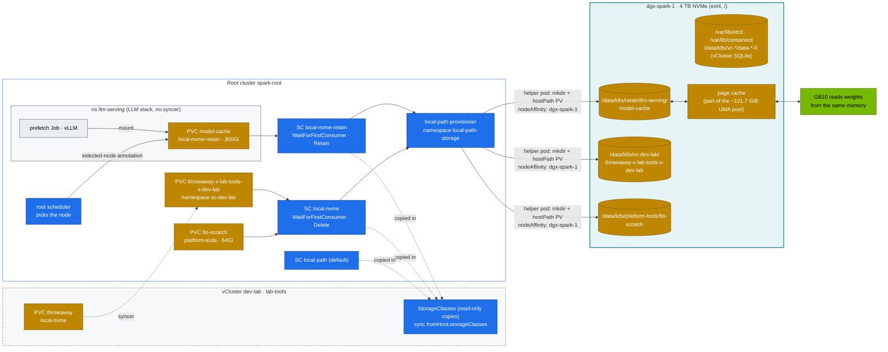

# Chapter 13 · Storage, CSI & High-Performance Volumes: local-path on NVMe, WaitForFirstConsumer, Model Caches, fio, UMA & Page Cache

> **02-Kubernetes · Part IV — Workloads, storage & tenancy · Chapter 13 of 28** · ← [Chapter 12 · Advanced workload controllers](12-advanced-workload-controllers.md) · [All chapters](00-kubernetes-step-by-step-guide.md) · [Chapter 14 · Multi-tenancy, resource quotas & cgroups](14-multi-tenancy-resource-quotas-and-cgroups.md) →

| | |
|---|---|
| **You will build** | A storage tier the root cluster owns and both vClusters consume: local-path-provisioner on the Spark's NVMe with two extra StorageClasses (scratch/Delete and models/Retain), a shared `model-cache` PVC in the root's `llm-serving` namespace pre-filled by a prefetch Job, an in-pod fio benchmark with AI-shaped I/O profiles, and a measured view of what the page cache does to unified memory when you load a model |
| **Hardware** | dgx-spark-1 (4 TB NVMe on the Founders Edition). §8 needs dgx-spark-2 |
| **Time** | 90 min |
| **Risk** | Low. fio writes 16 GiB of scratch data (deleted afterwards) |
| **Clusters** | `spark-root` (provisioner, StorageClasses, real PVs, fio, and the LLM stack's model cache and prefetch in `llm-serving`), `dev-lab` (the two-layer storage quota, Retain vs Delete), `dev-llms` (the copied StorageClasses) |
| **Lab files** | [`addons/local-path-nvme.yaml`](lab/addons/local-path-nvme.yaml), [`addons/local-path-config-patch.yaml`](lab/addons/local-path-config-patch.yaml), `scripts/install-addons.sh storage`, [`manifests/root-llms/60-storage/`](lab/manifests/root-llms/60-storage) (`pvcs.yaml`, `model-prefetch-job.yaml`), [`manifests/root/60-storage/fio-job.yaml`](lab/manifests/root/60-storage/fio-job.yaml), [`vclusters/dev-llms.yaml`](lab/vclusters/dev-llms.yaml) (`sync.fromHost.storageClasses`), [`scripts/uma-watch.sh`](lab/scripts/uma-watch.sh) |

---

## 1. Why this matters on a Spark

Every model server's start time is dominated by one number: **how fast can N gigabytes of weights get from disk into (unified) memory?** And every training job's resilience depends on how fast it can write a checkpoint without stalling etcd (Chapter 02). On the Spark:

- **One NVMe** holds DGX OS, container images (containerd for Kubernetes *and* Docker), the root's etcd data and WAL (`/var/lib/etcd`), both vClusters' SQLite databases, model weights and checkpoints. Isolation is by directory and I/O priority, not by device.
- **Unified memory** means the page cache and the GPU compete for the same pool — about 121.7 GiB visible of the 128 GB installed. Reading a 60 GB checkpoint through the page cache can briefly need 60 GB of cache *plus* 60 GB of model. NVIDIA's Spark guidance is to drop caches before loading big models, and `scripts/uma-watch.sh` shows why.
- **GPUDirect Storage** matters less here than on a discrete-GPU server. GDS avoids a CPU "bounce buffer" copy across PCIe into HBM, and on GB10 there's no separate HBM to copy into. O_DIRECT loaders and avoiding double-buffering in the page cache give the gains (module 08 goes deeper).
- **Storage is a root service.** A vCluster has no CSI driver, no provisioner and no PVs of its own. Tenants pick a class the root offers; their PVC is copied to the root, and the root's provisioner makes the directory. That gives one place to manage disks — and one more layer of quota for vCluster claims (§3.4). The LLM stack runs on the root, so its claims are root PVCs from the start.

---

## 2. Architecture — HLD



---

## 3. LLD

### 3.1 StorageClasses (root, offered to both vClusters)

| Class | Provisioner | Binding | Reclaim | Path pattern (root names) | Use |
|---|---|---|---|---|---|
| `local-path` (default) | rancher.io/local-path | WFFC | Delete | `/data/k8s/pvc-<uid>_<ns>_<pvc>` | anything unspecified |
| `local-nvme` | same | WFFC | **Delete** | `/data/k8s/<ns>/<pvc>` | scratch, Prometheus, fio, vCluster SQLite |
| `local-nvme-retain` | same | WFFC | **Retain** | `/data/k8s/retain/<ns>/<pvc>` | model weights, vector DBs |

kubeadm ships no storage at all (K3s used to bundle local-path). `scripts/install-addons.sh storage` installs local-path-provisioner `$LOCAL_PATH_VERSION` from `versions.env` into namespace `local-path-storage`, merge-patches its ConfigMap to root everything at `/data/k8s`, applies the two `local-nvme*` classes and marks `local-path` as the default.

`<ns>` and `<pvc>` are the **root's** names. The LLM stack's claims are root PVCs, so `model-cache` in `llm-serving` lands at `/data/k8s/retain/llm-serving/model-cache`. For a PVC from a vCluster, the names are `vc-<vcluster>` and `<pvc>-x-<namespace>-x-<vcluster>`, so dev-lab's `throwaway` in `lab-tools` (§5.3) lands at `/data/k8s/vc-dev-lab/throwaway-x-lab-tools-x-dev-lab`. Readable, and it tells you which namespace — and which vCluster, if any — owns every directory on the disk.

**Why WaitForFirstConsumer?** A local volume lives on one node. Binding at PVC creation (Immediate) could pick a node where the pod can't run (e.g. no free GPU slice). WFFC waits for the scheduler to choose the node, then provisions the volume there. With vClusters, "the scheduler" is the **root's**: it sets `volume.kubernetes.io/selected-node` on the root copy of the PVC when it places the root copy of the pod. Tenants see the result, not the mechanism.

**Capacity isn't enforced.** local-path creates a directory. `resources.requests.storage` counts against ResourceQuotas (Chapter 14), but nothing stops the pod writing 2 TB. Use ext4/XFS project quotas or a real CSI driver for hard limits (§8).

### 3.2 AI I/O profiles (fio)

| Job | Pattern | Stands for |
|---|---|---|
| `weights-seqread-1m` | sequential read, 1 MiB, QD32 × 4 | loading safetensors |
| `checkpoint-seqwrite-1m` | sequential write, 1 MiB | saving a checkpoint |
| `dataloader-randread-128k` | random read, 128 KiB, QD64 × 4 | shuffled WebDataset shards |
| `small-randread-4k` | random read, 4 KiB, QD128 × 4 | metadata, tokenizer files, many small files |

All use `direct=1` to measure the device, not the page cache. The Job runs on the root in `platform-tools` and requests 4 CPUs — twice dev-lab's whole CPU budget, which is exactly why benchmarks are a platform job.

### 3.3 Paths & facts

| Item | Value |
|---|---|
| Provisioner | Deployment `local-path-storage/local-path-provisioner` (root) |
| Provisioner config | ConfigMap `local-path-storage/local-path-config` (`nodePathMap` → `/data/k8s`) |
| Image store | `/var/lib/containerd` — containerd from DGX OS, shared with Docker (Kubernetes images in containerd namespace `k8s.io`, Docker's in `moby`). `sudo crictl images` lists the Kubernetes ones |
| Root etcd | `/var/lib/etcd` (stacked, static pod); snapshots in `/var/lib/etcd-snapshots` |
| vCluster backing stores | PVC `data-<name>-0` (5 Gi, `local-nvme`) → `/data/k8s/vc-<name>/data-<name>-0` |
| kubelet disk eviction | 01-Ansible `kubeadm_cluster_eviction_hard`: `nodefs.available<10%`, `nodefs.inodesFree<5%`, `imagefs.available<15%` → image GC, then pod eviction |

### 3.4 Storage quota: one layer on the root, two in a vCluster

| Cluster | Object | `requests.storage` | Counts |
|---|---|---|---|
| root (LLM stack) | ResourceQuota `llm-serving/serving-budget` | 1 Ti | PVCs in `llm-serving`: `model-cache` (300 Gi), Qdrant's `data-qdrant-0` (20 Gi) |
| root (LLM stack) | ResourceQuota `batch/batch-budget` | 200 Gi | PVCs in `batch`: the checkpoint claim `ckpt` (20 Gi) |
| inside dev-lab | `tenant-budget` per tenant | 100 Gi (+ LimitRange max 50 Gi per PVC) | that tenant's PVCs |
| root | `vc-dev-lab/vcluster-budget` | 200 Gi | **every** PVC of the vCluster: its own `data-dev-lab-0` (5 Gi) and all tenant PVCs |
| inside dev-llms | `llm-sandbox/sandbox-budget` | 150 Gi (+ LimitRange max 100 Gi per PVC) | the sandbox's PVCs |
| root | `vc-dev-llms/vcluster-budget` | 200 Gi | `data-dev-llms-0` (5 Gi) and all sandbox PVCs |

A claim in the LLM stack meets one quota, checked by the root API server when you apply it. A claim in a vCluster has to fit **both** layers. The inner refusal comes from the vCluster's API server, so the PVC is never created. The root refusal comes later: the PVC exists in the vCluster but stays `Pending`, and the syncer reports that the root quota refused its copy. The inner quotas are ceilings, not reservations: dev-lab's two tenants may claim 100 + 100 Gi, but the root budget is 200 Gi and already holds the vCluster's own 5 Gi, so the last claim to arrive when both tenants are full is refused by the root while its tenant quota still says yes. §5.1 shows both cases.

---

## 4. Integrations

- **Serving (Chapters 20, 22, 23)** mounts `model-cache` at `/models` with `HF_HOME=/models/hf`. The prefetch Job fills it once. vLLM, SGLang and the P/D pair all read it — all on the root, in `llm-serving`. A small model tried in dev-llms can't mount it (a vCluster pod can only use claims made in its own vCluster); give it its own claim in `llm-sandbox`, within the sandbox's 150 Gi.
- **Workloads (Chapter 12)**: Qdrant's `volumeClaimTemplates` use `local-nvme-retain` the same way.
- **01-Ansible NFS-over-RDMA (`playbooks/15.1-nfs-rdma.yml`)** exports `/srv/models` from dgx-spark-1 to dgx-spark-2. For 2 Sparks, back the model cache with a static NFS PV (§8) so both nodes share one copy.
- **Module 08-Storage** benchmarks the same NVMe with deeper tools (GDS, `gdsio`, MinIO, JuiceFS).
- **etcd (Chapter 02)**: run §5.4 while watching `etcd_disk_wal_fsync_duration_seconds` to see checkpoint-sized writes hurt the root control plane — and with it the LLM stack, which the root API server runs directly, and both vClusters, whose syncers write through it.

---

## 5. Lab

All commands run from `02-Kubernetes/lab` with `KUBECONFIG` set to the lab file:

```bash
# ▶ MacBook · 02-Kubernetes/lab
export KUBECONFIG="$PWD/../../01-Ansible/lab/.cache/kubeconfig-spark-lab.yaml"
```

Blocks marked `dgx-spark-1 (ssh dgx-spark-1) · ~/technical-depth/02-Kubernetes/lab` run a script on the Spark from the repo copy set up in the guide's *Where each command runs*, with the kubeconfig copied there as in [Chapter 02 §5](02-etcd-database-deep-dive.md) (`export KUBECONFIG=~/.kube/spark-lab.yaml`).

### 5.1 StorageClasses, the WFFC lifecycle, and the quotas

#### What this lab does (script `lab/scripts/install-addons.sh storage`, manifests `root-llms/10-tenancy`, `root-llms/60-storage`, `dev-lab/10-tenancy`)

- **Root, storage:** installs local-path-provisioner in `local-path-storage`, points it at `/data/k8s`, adds the classes `local-nvme` (Delete) and `local-nvme-retain` (Retain), and marks `local-path` as the default. The provisioner is restarted once.
- **Quota checks:** server-side dry runs, nothing persisted: the model cache against `serving-budget` on the root, and a 60 Gi claim against `tenant-alpha` in dev-lab.
- **Model cache:** creates PVC `model-cache` (300 Gi, `local-nvme-retain`) in `llm-serving`. No directory is created on the disk yet.
- The vClusters see the root's classes through `sync.fromHost.storageClasses`. Nothing in the vClusters is reconfigured.

#### What to look for

1. **Script exit:** ends with `deployment "local-path-provisioner" successfully rolled out`.
2. Compare with these values:

   | Check | Healthy value |
   |---|---|
   | `get sc` on the root | `local-path (default)`, `local-nvme`, `local-nvme-retain`, all `WaitForFirstConsumer` |
   | `local-path-config` | a `nodePathMap` with `/data/k8s` |
   | `get sc` in dev-llms | the same three names |
   | `serving-budget` storage | hard `1Ti`; used plus the 300 Gi of `model-cache` stays under it |
   | 60 Gi claim in `tenant-alpha` | refused by the LimitRange (max 50 Gi per PVC) |
   | `model-cache` | `Pending`, event `WaitForFirstConsumer` |

**If something's off:** `model-cache` `Pending` is the healthy state here. `exceeded quota: serving-budget` on the dry run means other PVCs in `llm-serving` already use most of the 1 Ti. More in §7.

#### Run it

```bash
# ▶ dgx-spark-1 (ssh dgx-spark-1)
sudo mkdir -p /data/k8s            # on the Spark (the 01-Ansible vclusters role already did)
```

```bash
# ▶ MacBook · 02-Kubernetes/lab
scripts/install-addons.sh storage
kubectl --context spark-root get sc
kubectl --context spark-root -n local-path-storage get cm local-path-config -o jsonpath='{.data.config\.json}{"\n"}'
kubectl --context dev-llms get sc   # the same three classes, copied in
```

Expected: `local-path (default)`, `local-nvme`, `local-nvme-retain` on the root; the same names in dev-llms. They are copies: the root owns the real objects, and a change to a class is made on the root.

Before creating the model cache, let the root API server check it. A server-side dry run runs quota admission without persisting anything:

```bash
# ▶ MacBook · 02-Kubernetes/lab
kubectl --context spark-root apply -k manifests/root-llms/10-tenancy
kubectl --context spark-root apply -k manifests/root-llms/60-storage --dry-run=server
kubectl --context spark-root -n llm-serving describe resourcequota serving-budget | grep storage
```

Do the arithmetic yourself: the PVC's request must be ≤ what's left of `serving-budget` (1 Ti). `model-cache` asks for 300 Gi; with Qdrant's 20 Gi that's 320 Gi of 1024 Gi — and 300 Gi still holds a few quantised 70B-class checkpoints. Change the size past what's left and the dry run answers `exceeded quota: serving-budget, …`. One API server, one quota: there's no second layer around the LLM stack.

A vCluster claim meets two. Ask dev-lab's API server about a claim in `tenant-alpha`, then read both budgets:

```bash
# ▶ MacBook · 02-Kubernetes/lab
kubectl --context dev-lab apply -k manifests/dev-lab/00-platform
kubectl --context dev-lab apply -k manifests/dev-lab/10-tenancy
kubectl --context dev-lab -n tenant-alpha apply --dry-run=server -f - <<'EOF'
apiVersion: v1
kind: PersistentVolumeClaim
metadata: {name: big}
spec: {storageClassName: local-nvme, accessModes: [ReadWriteOnce], resources: {requests: {storage: 60Gi}}}
EOF
kubectl --context dev-lab -n tenant-alpha describe resourcequota tenant-budget | grep storage
kubectl --context spark-root -n vc-dev-lab describe resourcequota vcluster-budget | grep storage
```

Expected: the inner layer says no — the LimitRange caps one claim at 50 Gi. At 50 Gi the dry run passes, because dev-lab's API server only knows its own quotas; the root's check happens later, when the syncer creates the copy in `vc-dev-lab`, and a refusal there shows up as a syncer event on a `Pending` PVC (§3.4: 100 + 100 + 5 > 200). Now create the model cache:

```bash
# ▶ MacBook · 02-Kubernetes/lab
kubectl --context spark-root apply -k manifests/root-llms/60-storage
kubectl --context spark-root -n llm-serving get pvc model-cache
kubectl --context spark-root -n llm-serving describe pvc model-cache | tail -3
```

Expected: `model-cache  Pending  …  local-nvme-retain`, with event `WaitForFirstConsumer: waiting for first consumer to be created before binding`. **Pending is correct here.** The claim exists, but no PV yet: nothing will be provisioned until a pod that uses it is scheduled.

### 5.2 Prefetch the model (binds the PVC)

#### What this lab does (manifest `lab/manifests/root-llms/60-storage/model-prefetch-job.yaml`)

- **Secret:** creates `hf-token` in `llm-serving` from `$HF_TOKEN` (optional for the default model).
- **Job `model-prefetch`:** downloads `Qwen/Qwen2.5-0.5B-Instruct@main` into `model-cache` at `/models/hf`. This first pod is what makes the root scheduler pick a node, so the PVC binds now.
- **Disk:** the provisioner creates `/data/k8s/retain/llm-serving/model-cache` on dgx-spark-1.
- The download takes seconds to minutes, depending on your link.

#### What to look for

1. **Job log:** ends with `downloaded Qwen/Qwen2.5-0.5B-Instruct@main in <n>s`.
2. Compare the binding:

   | Check | Healthy value |
   |---|---|
   | `get pvc model-cache` | `Bound`, `RWO`, `local-nvme-retain` |
   | `selected-node` annotation | `dgx-spark-1` |
   | PV | `/data/k8s/retain/llm-serving/model-cache  Retain  ["dgx-spark-1"]` |

3. **`scripts/verify.sh storage`** now reports `model-cache Bound (root, llm-serving)`.

**If something's off:** a log stuck on `pip install` or the download means the pod has no route to PyPI or Hugging Face (proxy, DNS: Chapter 10). `401`/`403` from Hugging Face means a gated model without a valid `hf-token`. More in §7.

#### Run it

```bash
# ▶ MacBook · 02-Kubernetes/lab
kubectl --context spark-root -n llm-serving create secret generic hf-token --from-literal=token="$HF_TOKEN" 2>/dev/null || true
kubectl --context spark-root apply -f manifests/root-llms/60-storage/model-prefetch-job.yaml
kubectl --context spark-root -n llm-serving logs -f job/model-prefetch
kubectl --context spark-root -n llm-serving get pvc model-cache
```

Follow the binding to the disk:

```bash
# ▶ MacBook · any folder
kubectl --context spark-root -n llm-serving get pvc model-cache \
  -o jsonpath='{.metadata.annotations.volume\.kubernetes\.io/selected-node}{"\n"}'
PV=$(kubectl --context spark-root -n llm-serving get pvc model-cache -o jsonpath='{.spec.volumeName}')
kubectl --context spark-root get pv "$PV" -o jsonpath='{.spec.hostPath.path}{"  "}{.spec.persistentVolumeReclaimPolicy}{"  "}{.spec.nodeAffinity.required.nodeSelectorTerms[0].matchExpressions[0].values}{"\n"}'
```

Expected:

```text
downloaded Qwen/Qwen2.5-0.5B-Instruct@main in 9s
model-cache   Bound   pvc-…   …   RWO   local-nvme-retain
dgx-spark-1
/data/k8s/retain/llm-serving/model-cache  Retain  ["dgx-spark-1"]
```

The download time is illustrative. Claim and PV are both root objects here, so there's nothing to translate. A claim made in a vCluster is different: `kubectl --context dev-lab get pv` may show a PV object while §5.3's claim exists, but that's a stand-in the syncer keeps so the claim looks bound inside the vCluster; the authoritative PV, with the hostPath and node affinity, is always the root's. To fetch a larger model for modules 03–06, edit `MODEL` and re-run (delete the finished Job first).

### 5.3 Retain vs Delete (dev-lab)

#### What this lab does (PVC and pod in dev-lab `lab-tools`)

- Creates PVC `throwaway` (1 Gi, `local-nvme`, reclaim Delete) and a `writer` pod that writes `/d/f` and exits.
- On the root the claim becomes `vc-dev-lab/throwaway-x-lab-tools-x-dev-lab`, so the directory is `/data/k8s/vc-dev-lab/throwaway-x-lab-tools-x-dev-lab`.
- Deletes the pod and the PVC, and checks the directory is gone.
- The `claimRef` patch is optional: it only matters when you want to re-use a `Released` Retain PV.

#### What to look for

1. **Pod:** `writer` reaches `Succeeded` within 120 s.
2. **On the Spark, before the delete:** `ls` lists `f`.
3. **After the delete:** `ls` prints `No such file or directory`.

**If something's off:** a `Pending` PVC in dev-lab with a syncer event about quota means the root's `vcluster-budget` refused the copy (§3.4). A directory that stays after the delete means the class was `local-nvme-retain`, not `local-nvme`. More in §7.

#### Run it

```bash
# ▶ MacBook · 02-Kubernetes/lab
kubectl --context dev-lab apply -k manifests/dev-lab/00-platform
kubectl --context dev-lab apply -k manifests/dev-lab/10-tenancy
kubectl --context dev-lab -n lab-tools apply -f - <<'EOF'
apiVersion: v1
kind: PersistentVolumeClaim
metadata: {name: throwaway}
spec: {storageClassName: local-nvme, accessModes: [ReadWriteOnce], resources: {requests: {storage: 1Gi}}}
---
apiVersion: v1
kind: Pod
metadata: {name: writer}
spec:
  containers: [{name: w, image: busybox:1.37, command: ["sh","-c","echo hello > /d/f && sleep 5"], volumeMounts: [{name: d, mountPath: /d}], resources: {limits: {memory: 64Mi}}}]
  restartPolicy: Never
  volumes: [{name: d, persistentVolumeClaim: {claimName: throwaway}}]
EOF
kubectl --context dev-lab -n lab-tools wait --for=jsonpath='{.status.phase}'=Succeeded pod/writer --timeout=120s
```

```bash
# ▶ dgx-spark-1 (ssh dgx-spark-1)
sudo ls /data/k8s/vc-dev-lab/throwaway-x-lab-tools-x-dev-lab                 # on the Spark: f
```

```bash
# ▶ MacBook · any folder
kubectl --context dev-lab -n lab-tools delete pod writer
kubectl --context dev-lab -n lab-tools delete pvc throwaway
```

```bash
# ▶ dgx-spark-1 (ssh dgx-spark-1)
sleep 10; sudo ls /data/k8s/vc-dev-lab/throwaway-x-lab-tools-x-dev-lab 2>&1 # gone (Delete)
```

Deleting the PVC in dev-lab deletes its root copy; the root PV's reclaim policy then decides what happens to the directory. Do the same with `model-cache` and the directory and the root PV (`Released`) survive. To re-use a Released PV, clear its `claimRef` — a root operation, since the PV is the root's:

```bash
# ▶ MacBook · any folder
kubectl --context spark-root patch pv <pv-name> --type json -p '[{"op":"remove","path":"/spec/claimRef"}]'
```

A recreated claim in `llm-serving` can then bind to it again (same class, compatible size and access mode — check with `kubectl --context spark-root get pv` that it took the old PV and not a fresh one). That's how you keep 60 GB of weights across a teardown of the LLM namespaces; a claim from a vCluster rebinds the same way, through its root copy, across a vCluster rebuild.

### 5.4 Measure the NVMe from inside a pod (root)

#### What this lab does (manifest `lab/manifests/root/60-storage/fio-job.yaml`)

- **Root, `platform-tools`:** PVC `fio-scratch` (64 Gi, `local-nvme`), ConfigMap `fio-profiles`, and Job `fio-ai` (4 CPUs).
- **Benchmark:** four profiles one after another, 45 s each on a 16 GB file with `direct=1`: sequential read 1 MiB, sequential write 1 MiB, random read 128 KiB, random read 4 KiB. Expect a few minutes in total, plus writing the test file first.
- **Output:** the log, and `result.all` in `/data/k8s/platform-tools/fio-scratch/` on the Spark.
- The write phase loads the same NVMe that carries the root's etcd WAL. Clean up deletes the Job, PVC and data.

#### What to look for

1. **Job:** `fio-ai` completes; the log shows a `READ:` or `WRITE:` summary per profile.
2. **JSON summary:** one row per profile. As a rough guide for this kind of NVMe:

   | Profile | Healthy shape |
   |---|---|
   | `weights-seqread-1m` | several GB/s read |
   | `checkpoint-seqwrite-1m` | several GB/s write |
   | `small-randread-4k` | hundreds of thousands of read IOPS |
   | any p99 | microseconds, not milliseconds |

3. **Record the numbers** as your baseline for modules 03–08.

**If something's off:** millisecond p99 latencies mean something else is using the disk at the same time. A Job that never starts is usually `fio-scratch` not binding (storage classes missing, §5.1). More in §7.

#### Run it

```bash
# ▶ MacBook · 02-Kubernetes/lab
kubectl --context spark-root apply -k manifests/root/00-platform
kubectl --context spark-root apply -f manifests/root/60-storage/fio-job.yaml
kubectl --context spark-root -n platform-tools logs -f job/fio-ai | grep -E '^\S+: \(groupid|READ:|WRITE:|lat \(usec\): min.*avg|clat percentiles'
```

Pull the JSON summary. The job wrote `/scratch/result.all` (human-readable text plus one JSON document; the `sed` cuts out the JSON) into the PVC directory on the host. This PVC is a root object, so the path uses its own namespace and name:

```bash
# ▶ dgx-spark-1 (ssh dgx-spark-1)
sudo sed -n '/^{/,/^}/p' /data/k8s/platform-tools/fio-scratch/result.all | jq -r '.jobs[] | [.jobname, (.read.bw_bytes/1e9|tostring+" GB/s rd"), (.write.bw_bytes/1e9|tostring+" GB/s wr"), (.read.iops|floor|tostring+" rIOPS"), ((.read.clat_ns.percentile["99.000000"] // 0)/1000|floor|tostring+" µs p99")] | @tsv'
```

Record your numbers. They're your baseline for everything in modules 03–08. As a rough guide for a PCIe Gen4/Gen5 NVMe: several GB/s sequential, hundreds of thousands of 4K random IOPS. **Any 99th-percentile latency in milliseconds under this load means something else is hammering the disk.** While the write phase runs, watch the root's etcd in Grafana (or `kubectl --context spark-root -n kube-system logs etcd-dgx-spark-1 | grep -i 'slow fdatasync'`): the same NVMe carries the WAL.

Clean up: `kubectl --context spark-root delete -f manifests/root/60-storage/fio-job.yaml`.

### 5.5 What loading a model does to unified memory

#### What this lab does (script `lab/scripts/uma-watch.sh`, needs vLLM from Chapter 20)

- **Terminal A (on the Spark):** prints every 2 s the host's `MemAvailable` and `Cached`, and the vLLM pod's cgroup `memory.current` and `memory.max`. Read-only.
- **Terminal B:** restarts `deploy/vllm` twice: once with a warm page cache, once after dropping the cache (`drop_caches`, needs sudo).
- Without vLLM deployed there is no pod to watch: skip this lab until Chapter 20.

#### What to look for

1. **Header line:** `time  MemAvailable  Cached  pod.mem.current  pod.mem.max`.
2. **During a cold load:** `Cached` climbs by about the model size, `MemAvailable` falls by about twice that.
3. **`pod.mem.current`** stays far below the drop in `MemAvailable`: the page cache isn't charged to the pod.
4. **At idle**, before the restarts, `MemAvailable` is close to the idle value of the Spark (≈ 119 GiB without models loaded), lower with the LLM stack running.

**If something's off:** `cat: …/memory.current: No such file` means the pod was replaced: re-run terminal A with the new pod name. More in §7.

#### Run it

`uma-watch.sh` takes a pod's namespace, name and context (for a vCluster pod it finds the host copy first) and prints the host pool next to that pod's cgroup:

```bash
# ▶ dgx-spark-1 (ssh dgx-spark-1) · ~/technical-depth/02-Kubernetes/lab
# terminal A (on the Spark): watch the pool while vLLM (Chapter 20) loads
POD=$(kubectl --context spark-root -n llm-serving get pod -l app=vllm -o jsonpath='{.items[0].metadata.name}')
scripts/uma-watch.sh llm-serving "$POD" spark-root 2
```

```bash
# ▶ dgx-spark-1 (ssh dgx-spark-1)
# terminal B: restart vLLM once with a warm cache, once after dropping it
kubectl --context spark-root -n llm-serving rollout restart deploy/vllm
sudo sh -c 'sync; echo 3 > /proc/sys/vm/drop_caches'; kubectl --context spark-root -n llm-serving rollout restart deploy/vllm
```

The restart creates a new pod, so re-run terminal A with the new name once it's scheduled. Watch the `Cached` column climb by roughly the model size while `MemAvailable` falls by about twice that during load. The page cache is reclaimable, and it isn't charged to anyone's quota: neither `serving-budget`'s 90 Gi nor any pod limit sees it. A CUDA allocation that arrives while the cache is full can still fail before the kernel reclaims. The 01-Ansible `playbooks/29.2-uma-relief.yml -e uma_drop_caches=true` automates the cache drop for big-model starts.

---

## 6. Verify

```bash
# ▶ MacBook · 02-Kubernetes/lab
scripts/verify.sh storage
```

```text
── storage
[PASS] StorageClass local-path (root)
[PASS] StorageClass local-nvme (root)
[PASS] StorageClass local-nvme-retain (root)
[PASS] dev-llms sees the root StorageClasses (sync.fromHost.storageClasses)
[PASS] model-cache Bound (root, llm-serving)
```

| Check | Expected |
|---|---|
| 3 StorageClasses on the root, same 3 in dev-lab and dev-llms | `local-path`, `local-nvme`, `local-nvme-retain` |
| `model-cache` | `Bound` in `llm-serving` (root); PV hostPath `/data/k8s/retain/llm-serving/model-cache`, Retain |
| fio `weights-seqread-1m` | multi-GB/s. Save the JSON as your baseline |

---

## 7. Troubleshooting

| Symptom | Cause | Diagnose | Fix |
|---|---|---|---|
| PVC `Pending` forever **with** a pod using it | StorageClass missing/typo, provisioner down | `kubectl --context <v> describe pvc` (drill `breakfix 12`), `kubectl --context spark-root -n local-path-storage logs deploy/local-path-provisioner` | fix the SC name (PVC spec is immutable → recreate) |
| PVC `Pending` and no pod yet | WFFC | event `waiting for first consumer` | expected. Create the pod |
| `exceeded quota: serving-budget` (or `tenant-budget`, `sandbox-budget`), `requested: requests.storage=…` on apply | the PVC is larger than what's left of that namespace's quota | `kubectl --context <ctx> -n <ns> describe resourcequota` | shrink the claim or delete an unused one; `serving-budget` is the root admin's, the tenant quotas are the vCluster admin's |
| PVC exists in the vCluster but `Pending` with a sync error mentioning `vcluster-budget` | the root's storage budget for the whole vCluster is spent | `kubectl --context spark-root -n vc-<name> describe resourcequota vcluster-budget` | delete unused PVCs (Released Retain PVs don't count; their claims did) or resize the vCluster |
| `kubectl get sc` in a vCluster is empty | `sync.fromHost.storageClasses` off | `vclusters/<name>.yaml` | enable, `helm upgrade` |
| Pod `Pending`: `volume node affinity conflict` | local PV lives on another node (dgx-spark-2 joined) | `kubectl --context spark-root get pv <pv> -o yaml` → `nodeAffinity` | schedule to that node, or use shared storage (NFS, §8) |
| `MountVolume.SetUp failed … permission denied` | non-root pod on a root-owned dir | `sudo ls -ln /data/k8s/…` | `fsGroup` in the pod securityContext (as in the prefetch Job) |
| Pods evicted, `The node was low on resource: ephemeral-storage` | images + emptyDirs + logs fill `/` | `df -h /`, `sudo crictl images`, `docker system df` | `sudo crictl rmi --prune`, `docker image prune`, set `emptyDir.sizeLimit`, move models to PVCs |
| Model load 5× slower than fio says | cold page cache + small-file layout / network FS | `iostat -x 1` during load | prefetch, safetensors, O_DIRECT-capable loaders |
| CUDA OOM during load despite "enough" memory | page cache holding the previous copy of the weights | `uma-watch.sh`, `free -g` | drop caches before the load. Leave headroom in `--gpu-memory-utilization` |

---

## 8. Scale-out path

| Lab | 2 Sparks | Datacenter |
|---|---|---|
| local-path, one node | static NFS PV from `/srv/models` on dgx-spark-1 (NFS over RDMA, 01-Ansible `playbooks/15.1-nfs-rdma.yml`). `ReadOnlyMany` for weights | parallel FS (Weka, VAST, Lustre, GPFS) via CSI. Module 08 |
| no capacity enforcement | XFS project quotas | CSI with real quotas + snapshots (`VolumeSnapshot`) |
| prefetch Job per model | same, run once on the NFS server | model registry + node-local cache DaemonSet (e.g. Fluid/Alluxio, KServe LocalModelCache) |
| storage owned by one root, consumed by vClusters | same split | the same split at scale: a platform team runs CSI, tenant clusters only see classes |

### 8.1 Shared model store for two Sparks

When dgx-spark-2 joins the root as a worker, a `local-nvme-retain` PV pins every model server to dgx-spark-1. The fix is a volume both nodes can mount. 01-Ansible's `nfs_rdma` role exports `/srv/models` from dgx-spark-1 over NFSv4.2 on RDMA (port 20049) across the CX-7 link (`192.168.100.11`), and installs the client side on dgx-spark-2.

The PV is a **root** object. The LLM stack's claim is on the root too, so it could name the PV with `spec.volumeName`; matching by class works for every claimant, though — a vCluster can't name a root PV (`spec.volumeName` inside the vCluster refers to its own objects), but it can claim from a class the root offers. So: the root offers a class with no provisioner, the platform team creates the PV in that class, and a claim in that class binds to it.

```yaml
# on the root: kubectl --context spark-root apply -f -
apiVersion: storage.k8s.io/v1
kind: StorageClass
metadata: {name: nfs-models}
provisioner: kubernetes.io/no-provisioner      # static PVs only
volumeBindingMode: Immediate
reclaimPolicy: Retain
---
apiVersion: v1
kind: PersistentVolume
metadata: {name: models-nfs}
spec:
  storageClassName: nfs-models
  capacity: {storage: 2Ti}
  accessModes: [ReadOnlyMany]
  persistentVolumeReclaimPolicy: Retain
  mountOptions: [nfsvers=4.2, proto=rdma, port=20049, ro]
  nfs: {server: 192.168.100.11, path: /srv/models}
```

```yaml
# on the root, for the LLM stack: kubectl --context spark-root apply -f -
apiVersion: v1
kind: PersistentVolumeClaim
metadata: {name: models-shared, namespace: llm-serving}
spec:
  storageClassName: nfs-models                 # matches the PV by class (a vCluster claim would see the class through sync.fromHost.storageClasses)
  accessModes: [ReadOnlyMany]
  resources: {requests: {storage: 100Gi}}
```

The claim binds to `models-nfs` (a claim from a vCluster does so through its root copy), and every kubelet that runs a pod using it mounts the export itself — so both nodes need the NFS client and the `rpcrdma` module (the role handles that). Note the quota detail: `requests.storage` counts the **claim's** 100 Gi, not the PV's 2 Ti, against `serving-budget` (for a claim from a vCluster: against its tenant quota and the root's `vcluster-budget`). Write the model once from dgx-spark-1 (a prefetch Job on a read-write claim, or directly into `/srv/models`), then serve it read-only from both nodes. With only one Spark, the role's TCP fallback works the same way — just drop `proto=rdma,port=20049`.

---

## 9. Checklist

- [ ] I can explain why a local PVC is Pending until a pod exists, and who decides the node when the PVC came from a vCluster.
- [ ] I found a vCluster PVC's root copy, its PV and its directory on the NVMe.
- [ ] I checked a claim against its storage quota with a server-side dry run, and know where the root's second check on a vCluster claim shows up.
- [ ] My model weights live on a Retain volume that survives PVC deletion.
- [ ] I have a saved fio baseline for my NVMe with AI-shaped profiles.
- [ ] I watched the page cache and a model load compete for unified memory.
