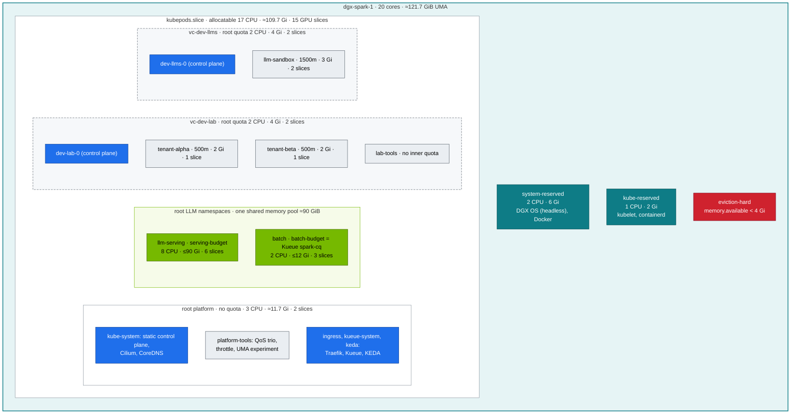

# Chapter 14 · Multi-Tenancy, Resource Quotas & cgroups: Quotas at Two Layers, LimitRanges, QoS, cgroups v2 & the Unified-Memory Question

> **02-Kubernetes · Part IV — Workloads, storage & tenancy · Chapter 14 of 28** · ← [Chapter 13 · Storage, CSI & high-performance volumes](13-storage-csi-and-high-performance-volumes.md) · [All chapters](00-kubernetes-step-by-step-guide.md) · [Chapter 15 · NVIDIA hardware & driver stack](15-nvidia-hardware-and-driver-stack.md) →

| | |
|---|---|
| **You will build** | A budget hierarchy on one node: kubelet reservations, root quotas that cap each vCluster (CPU, memory, GPU slices, storage, LoadBalancers), tenant quotas inside a vCluster, and the root's LLM quotas around one shared memory pool that the scheduler guards. You'll watch each layer refuse a pod in its own way, trace Kubernetes requests and limits to cgroup v2 files, reproduce CPU throttling and OOM kills, and run the experiment that decides how you protect a unified-memory node: *is CUDA memory charged to the pod?* |
| **Hardware** | dgx-spark-1 |
| **Time** | 90 min |
| **Risk** | Low. The OOM and UMA experiments are bounded by limits and `restartPolicy: Never`. §5.6 is optional and fills memory on purpose |
| **Clusters** | `spark-root` (kubelet, root budgets, the LLM stack's quotas in `llm-serving` and `batch`, QoS/cgroup experiments in `platform-tools`), `dev-lab` (tenant budgets, break/fix 01, 02, 04), `dev-llms` (the sandbox budget) |
| **Lab files** | [`manifests/root/05-vclusters/`](lab/manifests/root/05-vclusters) (`quotas.yaml`, `limitranges.yaml`), [`manifests/dev-lab/10-tenancy/`](lab/manifests/dev-lab/10-tenancy) (`quotas.yaml`, `limitranges.yaml`), [`manifests/dev-llms/10-tenancy/`](lab/manifests/dev-llms/10-tenancy) (`quotas.yaml`, `limitranges.yaml`), [`manifests/root-llms/10-tenancy/quotas.yaml`](lab/manifests/root-llms/10-tenancy/quotas.yaml), [`manifests/root/12-cgroups/`](lab/manifests/root/12-cgroups) (`qos-trio.yaml`, `cpu-throttle.yaml`, `uma-cgroup-experiment.yaml`), [`scripts/cgroup-inspect.sh`](lab/scripts/cgroup-inspect.sh), [`scripts/uma-watch.sh`](lab/scripts/uma-watch.sh), [`breakfix/01-quota-exceeded.yaml`](lab/breakfix/01-quota-exceeded.yaml), [`02`](lab/breakfix/02-gpu-oversubscribed.yaml), [`04`](lab/breakfix/04-oomkilled.yaml), [`15`](lab/breakfix/15-uma-pressure.yaml), [`tests/budget_check.py`](lab/tests/budget_check.py), 01-Ansible [`roles/kubeadm_cluster`](../01-Ansible/lab/roles/kubeadm_cluster/defaults/main.yml) (kubelet reservations) |

---

## 1. Why this matters on a Spark

There are several layers of protection, and they fail differently:

| Layer | Enforced by | When it acts | Failure you'll see |
|---|---|---|---|
| **Tenant budget** (ResourceQuota, LimitRange inside a vCluster) | the vCluster's own API server | at object creation | `exceeded quota: tenant-budget`, in the vCluster |
| **vCluster budget** (ResourceQuota, LimitRange on `vc-*` at the root) | the root API server, when the syncer creates the host pod | after the tenant's object exists | pod `Pending` in the vCluster, sync error, **no scheduler events** |
| **LLM namespace budget** (ResourceQuota, LimitRange on `llm-serving`, `batch` at the root) | the root API server | at object creation — one layer, no syncer | `exceeded quota: serving-budget`, on the root |
| **Shared memory pool** (node allocatable, memory request = limit) | the root scheduler | when it places the pod | pod `Pending` with `Insufficient memory` — a waiting model never squeezes a running one |
| **Runtime** (cgroups v2) | Linux kernel | while the process runs | CPU throttling (slow, no error), `OOMKilled` (exit 137) |
| **Node** (kubelet reservations + eviction) | kubelet | when the node runs low | `Evicted: The node was low on resource: memory` — in any cluster |

Two facts shape everything below. First, **quotas are admission, cgroups are runtime**: there is no `vc-dev-lab` cgroup and no `llm-serving` cgroup. `serving-budget`'s 90 Gi is enforced as the *sum of its pods' declared limits*, and each pod's limit is enforced by its own `memory.max`. Second, on a UMA machine there's an awkward question: **CUDA allocations come from the same RAM, but are they counted in the pod's cgroup?** The answer decides whether any of these memory budgets protect the node from a greedy model server. §5.5 measures it on your DGX OS release instead of assuming.

---

## 2. Architecture — HLD



Everything inside `kubepods.slice` is a sibling at runtime: a tenant pod, a model server in `llm-serving` and the root's own kube-apiserver all sit next to each other in the same cgroup tree, grouped only by QoS class. The boxes exist in the API servers, not in the kernel.

---

## 3. LLD

### 3.1 From node capacity to allocatable (kubelet)

| | CPU | Memory | Set in |
|---|---|---|---|
| capacity | 20 | ≈121.7 GiB (128 GB installed) | hardware |
| `systemReserved` | 2 | 6 Gi | 01-Ansible `kubeadm_cluster_system_reserved` |
| `kubeReserved` | 1 | 2 Gi | `kubeadm_cluster_kube_reserved` |
| `evictionHard` `memory.available` | — | 4 Gi | `kubeadm_cluster_eviction_hard` |
| **allocatable** | **17** | **≈109.7 GiB** | what the scheduler can hand out |

6 Gi of `systemReserved` is enough because DGX OS runs headless: 01-Ansible `04.3 Baseline` (role `spark_baseline`, `spark_baseline_headless: true`) sets the default target to `multi-user.target`, so no desktop session holds memory. If you keep the desktop, reserve more and keep `tests/budget_check.py` green.

The role renders these into the `KubeletConfiguration` in [`kubeadm-init.yaml.j2`](../01-Ansible/lab/roles/kubeadm_cluster/templates/kubeadm-init.yaml.j2); on the node they live in `/var/lib/kubelet/config.yaml`.

On kubeadm, `kubeReserved` protects the kubelet and containerd — **not** the control plane. kube-apiserver, etcd, the scheduler and the controller-manager are static pods: they sit in `kubepods.slice`, their requests count against allocatable, and no quota covers `kube-system`. (On K3s the API server ran inside the k3s service, so kube-reserved covered it.) Docker containers started outside Kubernetes count against nothing but `systemReserved` and the eviction threshold.

### 3.2 Two budget layers in a vCluster, one around the LLM stack

A vCluster pod meets two quotas: its tenant's, checked by the vCluster's API server, and the vCluster's, checked by the root when the syncer creates the host pod. The two vClusters are identical in size:

| Resource | Root: `vcluster-budget` on `vc-dev-lab` | Inside dev-lab: `tenant-budget` per tenant | Root: `vcluster-budget` on `vc-dev-llms` | Inside dev-llms: `sandbox-budget` on `llm-sandbox` |
|---|---|---|---|---|
| CPU | `requests.cpu: 2` | `requests.cpu` **and** `limits.cpu: 500m` | `requests.cpu: 2` | `requests.cpu: 1500m` |
| Memory | `requests.memory` = `limits.memory` = 4 Gi | `requests.memory` = `limits.memory` = 2 Gi | 4 Gi / 4 Gi | 3 Gi / 3 Gi |
| GPU slices | `requests.nvidia.com/gpu: 2` | 1 | 2 | 2 |
| Storage | 200 Gi, 20 PVCs | 100 Gi, 5 PVCs | 200 Gi, 20 PVCs | 150 Gi, 5 PVCs |
| Objects | 60 pods, 1 LoadBalancer (the API `.111`), 2 NodePorts (the API Service's ports) | 10 pods, 0 LBs, 0 NodePorts | 60 pods, 1 LoadBalancer (the API `.112`), 2 NodePorts | 20 pods, 0 LBs, 0 NodePorts |

The LLM stack runs on the root, in ordinary namespaces, so its pods meet one quota, checked by the root API server when they are created ([`manifests/root-llms/10-tenancy/quotas.yaml`](lab/manifests/root-llms/10-tenancy/quotas.yaml)):

| Resource | `serving-budget` on `llm-serving` | `batch-budget` on `batch` (same numbers as Kueue's `spark-cq`) |
|---|---|---|
| CPU | `requests.cpu: 8` | `requests.cpu: 2` |
| Memory | `requests.memory` = `limits.memory` = 90 Gi | 12 Gi / 12 Gi |
| GPU slices | 6 | 3 |
| Storage | 1 Ti | 200 Gi |

How the Spark is split ([`manifests/root/05-vclusters/quotas.yaml`](lab/manifests/root/05-vclusters/quotas.yaml) carries the same table in its header, and `python3 tests/budget_check.py` prints it):

| | CPU (req) | Memory | GPU slices | Storage |
|---|---|---|---|---|
| Spark total | 20 | ≈121.7 GiB | 15 | ≈3.7 TiB |
| kubelet reservations | 3 (system 2 + kube 1) | 12 GiB (system 6 + kube 2 + eviction 4) | – | – |
| allocatable | 17 | ≈109.7 GiB | 15 | |
| vCluster dev-lab | 2 | 4 Gi | 2 | 200 Gi |
| vCluster dev-llms | 2 | 4 Gi | 2 | 200 Gi |
| **root keeps** | 13 | ≈101.7 GiB | 11 | the rest (≈3.3 TiB) |
| ↳ platform (Cilium, MetalLB, GPU Operator, Prometheus, Traefik, Kueue, KEDA, platform-tools) | 3 | ≈11.7 GiB | 2 | |
| ↳ LLM memory pool, shared | | ≈90 GiB | | |
| &nbsp;&nbsp;↳ `llm-serving` · `serving-budget` | 8 | up to 90 Gi (requests = limits) | 6 | 1 Ti |
| &nbsp;&nbsp;↳ `batch` · `batch-budget` = Kueue `spark-cq` | 2 | up to 12 Gi | 3 | 200 Gi |

The split follows one rule per resource. Memory must fit allocatable with no overcommit: 4 + 4 + ≈11.7 + ≈90 = ≈109.7 GiB, because on unified memory an overcommitted gigabyte is one a model server can't have. CPU and slices are split exactly — 3 + 8 + 2 = 13 CPU and 2 + 6 + 3 = 11 slices for the root — and CPU may burst into idle cores anyway (it's compressible), so a tight CPU split costs only latency. The two vClusters stay small and identical: dev-lab for tools and tenancy drills, dev-llms to try LLM manifests or a tiny model with its own API server. The root keeps the rest, because the models run there. The root's 2 platform slices are for `platform-tools`: GPU probes, the §5.5 UMA experiment and the preemption-demo filler (2 replicas).

**The shared LLM memory pool.** Only memory is shared. `serving-budget` (90 Gi) and `batch-budget` (12 Gi) add up to more than the ≈90 GiB pool on purpose: serving may use the whole pool while nothing trains, and a training job takes up to 12 Gi of the same pool. Two quotas that overlap can't stop the two from overcommitting it — the **scheduler** does. Every GPU container in the LLM stack sets memory **request = limit** (vLLM, SGLang and KServe 32 Gi; the prefill and decode pods 20 Gi each; Triton 12 Gi; `resilient-train` 12 Gi; DDP ranks 6 Gi; gang workers 2 Gi), so the scheduler reserves a pod's full size against the node's allocatable memory. A pod that doesn't fit waits `Pending` with `Insufficient memory`; it never squeezes a running model. Kueue can admit a job whose pods then wait `Pending` while models fill the pool — training waits for serving, never the reverse (and PriorityClass `spark-serving` > `spark-batch` settles any race). [`tests/budget_check.py`](lab/tests/budget_check.py) checks request = limit on every GPU container in `root-llms`. In engine terms: ≈90 GiB of model memory means the sum of vLLM `--gpu-memory-utilization` across models running at the same time stays ≲ **0.72** (util × ≈121.7 GiB, with headroom) — three 7–8B models at 0.20, or one 32B FP8 at 0.45 plus one 7B at 0.25 (Chapter 20).

Three design rules:

- **CPU is capped on requests only at the root.** A vCluster or an LLM namespace is guaranteed its share and may burst into idle CPU. dev-lab's *tenants* also have `limits.cpu`, so their pods get a hard `cpu.max`; the model servers don't.
- **Memory is capped on requests *and* limits at the root.** On a unified-memory box memory is GPU memory too, so overcommit is how model servers die. Capping `limits.memory` forces every pod in a vCluster, in `llm-serving` and in `batch` to declare a limit.
- **Inner quotas are ceilings, not reservations.** `tenant-alpha` + `tenant-beta` + `lab-tools` may promise more than dev-lab's 2 CPU / 4 Gi; whoever asks first gets it and the root refuses the next pod. The same idea holds in one layer on the root: serving's and batch's memory ceilings overlap in the shared pool, and the scheduler, Kueue and PriorityClasses decide who waits.

The root budget of a vCluster also pays for the vCluster itself: its control-plane pod (`dev-lab-0`, `dev-llms-0`) requests 200m and 512 Mi (limit 1 Gi), and the vCluster's CoreDNS is a synced pod too — together ≈0.5–1 Gi of the 4 Gi. That's why dev-llms' sandbox gets 3 Gi, and why dev-lab's two 2 Gi tenant ceilings are ceilings, not reservations. The LLM stack carries no such overhead: Traefik, Kueue and KEDA run on the root and come out of the platform share. [`tests/budget_check.py`](lab/tests/budget_check.py) fails if the budgets together promise more than the Spark has.

### 3.3 LimitRanges fill the gaps

| Where | Object | Container default limit | Default request | Max |
|---|---|---|---|---|
| dev-lab `tenant-alpha`, `tenant-beta` | `defaults` | 250m · 512 Mi | 100m · 256 Mi | 500m · 2 Gi; PVC 50 Gi |
| dev-lab `lab-tools` | `defaults` | 256 Mi | 50m · 64 Mi | — |
| dev-llms `llm-sandbox` | `defaults` | 512 Mi | 50m · 128 Mi | 3 Gi; PVC 100 Gi |
| root `llm-serving` / `batch` / `ingress` | `defaults` | 512 Mi / 1 Gi / 512 Mi | 50m·128 Mi / 100m·256 Mi / 50m·128 Mi | — |
| root `vc-dev-lab`, `vc-dev-llms` | `vcluster-defaults` | 256 Mi | 50m · 128 Mi | 4 Gi |

In a vCluster, the inner LimitRange normally fills a pod's resources before it's synced; the root one is the safety net for anything that arrives bare (a namespace the tenant created without a LimitRange). Its `max` stops one pod from taking a whole vCluster's memory. The LLM namespaces have one LimitRange each, for the same reason their quotas need it: a quota on `limits.memory` refuses a container that declares none.

### 3.4 Requests/limits → cgroup v2

| Kubernetes | cgroup v2 file | Semantics |
|---|---|---|
| `limits.cpu: 500m` | `cpu.max = 50000 100000` | 50 ms of CPU per 100 ms period. Hard cap → **throttling** |
| `requests.cpu: 100m` | `cpu.weight` (shares = m×1024/1000 → weight = 1+((shares−2)×9999)/262142) | relative share under contention only |
| `limits.memory: 256Mi` | `memory.max = 268435456` | hard. Exceeding it → kernel OOM kill in the cgroup |
| `requests.memory` | none on the pod cgroup | scheduling + eviction ranking only |
| no limits | `cpu.max = max`, `memory.max = max` | bounded only by the parent `kubepods` slice |

With the systemd cgroup driver (containerd `SystemdCgroup = true`, kubelet `cgroupDriver: systemd`), a pod's directory is `/sys/fs/cgroup/kubepods.slice/kubepods-<qos>.slice/kubepods-<qos>-pod<uid>.slice/` (Guaranteed pods sit directly under `kubepods.slice`). The `<uid>` is the **root** pod's UID — a vCluster pod's cgroup belongs to its synced copy.

### 3.5 QoS classes

| Class | Rule | `oom_score_adj` | Evicted |
|---|---|---|---|
| Guaranteed | requests = limits for CPU **and** memory, every container | −997 | last |
| Burstable | anything in between | 2 … 999 (by request size) | middle |
| BestEffort | no requests/limits at all | 1000 | first |

**BestEffort can't exist inside a vCluster in this lab** — nor in the root's LLM namespaces. The quotas on every `vc-*` namespace and on `llm-serving` and `batch` cover memory, so a pod must declare memory, and the LimitRanges add it if it doesn't. A bare `kubectl run` in dev-lab comes out Burstable. That's why the QoS experiments run on the root in `platform-tools` (no quota there). The model servers set memory request = limit (so the scheduler reserves their full size, §3.2) but no CPU limit, so they are Burstable, not Guaranteed. Under node pressure the kubelet evicts pods that use more than they requested first, so a model server inside its request goes after those. Add a CPU limit equal to the CPU request and it becomes Guaranteed — at the price of CPU throttling (§5.3).

---

## 4. Integrations

- **vCluster (Chapter 04)**: resizing a vCluster *is* editing its root quota (Chapter 04 §6.5) — no reinstall.
- **Admission (Chapter 03)**: the quota admission plugin and the CEL GPU policy together keep tenants inside their slice — in each vCluster's own API server. The root runs quota admission a second time on the synced pod. For the LLM stack the root's admission is the only one: the same CEL policies are installed on the root (`root-llms/15-admission`) and match `llm-serving` and `batch`.
- **Kueue (Chapter 07)**: on the root, `batch` is governed by Kueue's `spark-cq` and by `batch-budget` with the same numbers (2 CPU · 12 Gi · 3 slices), `llm-serving` by `serving-budget`. A quota and a ClusterQueue on one namespace must agree — if they differ, the smaller one wins silently and Kueue admits jobs whose pods the quota then refuses.
- **Grafana (Chapter 17)**: the *Tenancy* row plots the root quotas' `kube_resourcequota{type="used"}` against `hard` per namespace — `vc-dev-lab`, `vc-dev-llms`, `llm-serving`, `batch` — plus the top-5 throttled containers.
- **01-Ansible (`roles/kubeadm_cluster`)** owns `systemReserved`, `kubeReserved`, `evictionHard` and `maxPods: 200`. kubeadm doesn't reconcile a running node: change the defaults there for rebuilds, and on a live node edit `/var/lib/kubelet/config.yaml` and restart the kubelet (the role prints exactly that when the config changed).

---

## 5. Lab

Each block's location line says where it runs. The cgroup scripts (`cgroup-inspect.sh`, `uma-watch.sh`) run from `~/technical-depth/02-Kubernetes/lab` **on the Spark** (they read `/sys/fs/cgroup`), as your normal user with `KUBECONFIG` set — the cgroup and `/proc` files they read are world-readable; the rest runs from the MacBook:

```bash
# ▶ MacBook · 02-Kubernetes/lab
export KUBECONFIG="$PWD/../../01-Ansible/lab/.cache/kubeconfig-spark-lab.yaml"
```

Blocks marked `dgx-spark-1 (ssh dgx-spark-1) · ~/technical-depth/02-Kubernetes/lab` run a script on the Spark from the repo copy set up in the guide's *Where each command runs*, with the kubeconfig copied there as in [Chapter 02 §5](02-etcd-database-deep-dive.md) (`export KUBECONFIG=~/.kube/spark-lab.yaml`).

### 5.1 Capacity, allocatable, and the budget layers

#### What this lab does (manifests `dev-lab/00-platform`, `dev-lab/10-tenancy`; drills `breakfix 01`, `02`; test `lab/tests/budget_check.py`)

- **Reads** the node's capacity and allocatable, the kubelet reservations in `/var/lib/kubelet/config.yaml`, and the quotas at each layer: `vcluster-budget` on `vc-dev-lab`, `tenant-budget` in dev-lab, `serving-budget` and `batch-budget` on the root.
- **Drill 01 (dev-lab):** Deployment `bf01-big` in `tenant-alpha`, 3 × 250m against a 500m tenant quota. `reset 01` deletes it.
- **Drill 02 (dev-lab):** Deployment `bf02-gpu` in `lab-tools`, 6 pods × 1 GPU slice against the root's 2-slice `vcluster-budget`. `reset 02` deletes it. The first run pulls `nvcr.io/nvidia/cuda:13.0.1-base-ubuntu24.04`.
- **`budget_check.py`:** a static check of the repo files, no cluster needed. It prints the split table and checks request = limit on every GPU container in `root-llms`.
- **BestEffort test:** a bare `pause` pod in dev-lab `lab-tools`, deleted right after.

#### What to look for

1. **Node:** capacity `cpu 20`, allocatable `cpu 17`, `nvidia.com/gpu 15`, allocatable memory about 109.7 GiB (shown in `Ki`).
2. **Kubelet config:** `systemReserved` 2 CPU · 6Gi, `kubeReserved` 1 CPU · 2Gi, `evictionHard` `memory.available: 4Gi`.
3. **Drills:**

   | Drill | Healthy result |
   |---|---|
   | 01 | `bf01-big` `2/3`, ReplicaSet event `exceeded quota: tenant-budget`, `grep -c bf01` on the root prints `2` |
   | 02 | 2 Running, 4 Pending; the Pending pod's event quotes `exceeded quota: vcluster-budget … requests.nvidia.com/gpu=2`; no scheduler events |

4. **`budget_check.py`:** the table below, then `budget check OK`. Without `kubectl` on the PATH it also prints `training window not checked`, which is harmless.
   ```text
                     CPU  mem GiB  slices
   allocatable      17.0    109.7      15
   vc-dev-lab        2.0      4.0       2
   vc-dev-llms       2.0      4.0       2
   root keeps       13.0    101.7      11
     platform        3.0     11.7       2
     llm-serving     8.0     90.0       6
     batch           2.0     12.0       3
   ```
5. **BestEffort test:** `Burstable` with the `lab-tools` LimitRange defaults.

**If something's off:** a fourth `bf02` pod Running means `vcluster-budget` on `vc-dev-lab` isn't applied (`kubectl --context spark-root apply -k manifests/root/05-vclusters`). `budget check` failing names the file that disagrees. More in §7.

#### Run it

```bash
# ▶ MacBook · any folder
kubectl --context spark-root get node dgx-spark-1 -o jsonpath='{.status.capacity}{"\n"}{.status.allocatable}{"\n"}' | jq -c '{cpu, memory, "nvidia.com/gpu"}'
```

```bash
# ▶ dgx-spark-1 (ssh dgx-spark-1)
sudo grep -A3 -E '^(systemReserved|kubeReserved|evictionHard):' /var/lib/kubelet/config.yaml
```

```bash
# ▶ MacBook · 02-Kubernetes/lab
kubectl --context spark-root -n vc-dev-lab describe resourcequota vcluster-budget
kubectl --context dev-lab apply -k manifests/dev-lab/00-platform
kubectl --context dev-lab apply -k manifests/dev-lab/10-tenancy
kubectl --context dev-lab -n tenant-alpha describe resourcequota tenant-budget
```

Check the arithmetic: capacity memory minus 6 Gi, 2 Gi and 4 Gi is allocatable; 20 − 2 − 1 CPUs is 17. Note that `vcluster-budget` already shows usage before any tenant has done anything — dev-lab's own control plane and CoreDNS.

**Layer 1 — the tenant quota (inside dev-lab):**

```bash
# ▶ MacBook · 02-Kubernetes/lab
scripts/breakfix.sh inject 01
kubectl --context dev-lab -n tenant-alpha get deploy bf01-big                     # 2/3
kubectl --context dev-lab -n tenant-alpha describe rs -l app=bf01 | grep -A2 FailedCreate
kubectl --context spark-root -n vc-dev-lab get pods | grep -c bf01               # 2: the third never reached the root
scripts/breakfix.sh reset 01
```

Expected: `exceeded quota: tenant-budget, requested: limits.cpu=250m,requests.cpu=250m, used: limits.cpu=500m,requests.cpu=500m, limited: limits.cpu=500m,requests.cpu=500m`. dev-lab's API server refused the pod; the ReplicaSet has the event because the pod was never created.

**Layer 2 — the vCluster budget (at the root):**

```bash
# ▶ MacBook · 02-Kubernetes/lab
scripts/breakfix.sh inject 02
kubectl --context dev-lab -n lab-tools get pods -l app=bf02                      # 2 Running, 4 Pending
kubectl --context dev-lab -n lab-tools describe pod "$(kubectl --context dev-lab -n lab-tools get pods -l app=bf02 --field-selector=status.phase=Pending -o name | head -1 | cut -d/ -f2)" | tail -4
kubectl --context spark-root -n vc-dev-lab describe resourcequota vcluster-budget | grep gpu
scripts/breakfix.sh reset 02
```

Expected: the Pending pod's events come from the vCluster syncer and quote `exceeded quota: vcluster-budget, requested: requests.nvidia.com/gpu=1, used: requests.nvidia.com/gpu=2, limited: requests.nvidia.com/gpu=2`. `lab-tools` has no inner quota, so dev-lab's API server accepted all six; the root refused four host copies. The node still has 15 slices — it's not the scheduler that says no, so there are no scheduler events at all.

**The LLM stack — one layer, then the scheduler:**

```bash
# ▶ MacBook · 02-Kubernetes/lab
kubectl --context spark-root -n llm-serving describe resourcequota serving-budget
kubectl --context spark-root -n batch describe resourcequota batch-budget
kubectl --context spark-root describe node dgx-spark-1 | grep -A10 'Allocated resources'
python3 tests/budget_check.py
```

`budget_check.py` prints the split table of §3.2 and ends with `budget check OK`; it also confirms that every GPU container in `root-llms` sets memory request = limit. A model server that asks for more than `serving-budget` has left is refused at once, on the root, with `exceeded quota: serving-budget` — there is no syncer to delay it. One that fits the quota but not the pool (other models and training pods have reserved it) is created and waits `Pending` with a **scheduler** event, `Insufficient memory` — the opposite of layer 2, where there are no scheduler events at all.

**And BestEffort is gone:**

```bash
# ▶ MacBook · any folder
kubectl --context dev-lab -n lab-tools run be --image=registry.k8s.io/pause:3.10
kubectl --context dev-lab -n lab-tools get pod be -o jsonpath='{.status.qosClass} {.spec.containers[0].resources}{"\n"}'
kubectl --context dev-lab -n lab-tools delete pod be
```

Expected: `Burstable {"limits":{"memory":"256Mi"},"requests":{"cpu":"50m","memory":"64Mi"}}` — the lab-tools LimitRange's defaults.

### 5.2 Read the cgroups behind each QoS class (root)

#### What this lab does (manifest `lab/manifests/root/12-cgroups/qos-trio.yaml`, script `lab/scripts/cgroup-inspect.sh`)

- **Root, `platform-tools`:** three `pause` pods, `qos-guaranteed` (500m · 256Mi, request = limit), `qos-burstable` (100m · 64Mi request, 512Mi limit) and `qos-besteffort` (nothing).
- **Reads** each pod's cgroup v2 files under `/sys/fs/cgroup/kubepods*` (`cpu.max`, `cpu.weight`, `memory.max`, `memory.current`, `cpu.stat`, `memory.events`) and the `oom_score_adj` of its processes. Runs on the Spark, read-only.
- Repeats this for a bare pod `qos-v` in dev-lab, found through its root copy. All test pods are deleted at the end.

#### What to look for

| Pod | `cpu.max` | `memory.max` | `oom_score_adj` |
|---|---|---|---|
| `qos-guaranteed` | `50000 100000` | `268435456` | `-997` |
| `qos-burstable` | `max 100000` | `536870912` | between 2 and 999 |
| `qos-besteffort` | `max 100000` | `max` | `1000` |
| dev-lab `qos-v` (root copy `vc-dev-lab/qos-v-x-lab-tools-x-dev-lab`) | `max 100000` | `268435456` | `qos=Burstable` |

**If something's off:** `[FAIL] cgroup for pod uid … not found` means the script ran on the MacBook instead of the Spark. More in §7.

#### Run it

```bash
# ▶ MacBook · 02-Kubernetes/lab
kubectl --context spark-root apply -k manifests/root/00-platform
kubectl --context spark-root apply -f manifests/root/12-cgroups/qos-trio.yaml
```

```bash
# ▶ dgx-spark-1 (ssh dgx-spark-1) · ~/technical-depth/02-Kubernetes/lab
for p in guaranteed burstable besteffort; do scripts/cgroup-inspect.sh platform-tools qos-$p | sed -n '1,8p'; echo; done
```

Expected (key lines):

```text
pod spark-root platform-tools/qos-guaranteed → root platform-tools/qos-guaranteed  uid=…  qos=Guaranteed
cgroup /sys/fs/cgroup/kubepods.slice/kubepods-pod…slice
  cpu.max                50000 100000
  memory.max             268435456
    pid 81234    oom_score_adj=-997   /pause
pod spark-root platform-tools/qos-burstable → … qos=Burstable
  cpu.max                max 100000
  memory.max             536870912
pod spark-root platform-tools/qos-besteffort → … qos=BestEffort
  cpu.max                max 100000
  memory.max             max
    pid 81301    oom_score_adj=1000   /pause
```

Now the same script on a **vCluster** pod: pass the context and it finds the host copy through the syncer's annotations.

```bash
# ▶ MacBook · any folder
kubectl --context dev-lab -n lab-tools run qos-v --image=registry.k8s.io/pause:3.10
```

```bash
# ▶ dgx-spark-1 (ssh dgx-spark-1) · ~/technical-depth/02-Kubernetes/lab
scripts/cgroup-inspect.sh lab-tools qos-v dev-lab | sed -n '1,6p'
```

```bash
# ▶ MacBook · any folder
kubectl --context dev-lab -n lab-tools delete pod qos-v
```

```text
pod dev-lab lab-tools/qos-v → root vc-dev-lab/qos-v-x-lab-tools-x-dev-lab  uid=…  qos=Burstable
cgroup /sys/fs/cgroup/kubepods.slice/kubepods-burstable.slice/kubepods-burstable-pod…slice
  cpu.max                max 100000
  memory.max             268435456
```

Same tree, same rules. Nothing in the path says "dev-lab": the kernel has never heard of vClusters.

```bash
# ▶ MacBook · 02-Kubernetes/lab
kubectl --context spark-root delete -f manifests/root/12-cgroups/qos-trio.yaml
```

### 5.3 CPU throttling: slow with no error

#### What this lab does (manifest `lab/manifests/root/12-cgroups/cpu-throttle.yaml`)

- **Root, `platform-tools`:** pod `cpu-throttle`, 4 busy-loop processes under a 200m CPU limit.
- After 30 s reads its `cpu.stat`, then deletes the pod. Nothing else changes.

#### What to look for

1. **`cpu.stat`:** `nr_throttled` close to `nr_periods` (ratio above 0.9), and `throttled_usec` large and growing.
2. **`kubectl top`** (if metrics-server is installed): about `200m` CPU, never more.
3. **The pod** stays `Running` with no restarts and no error: throttling only shows up in these counters.

**If something's off:** `nr_throttled 0` means the limit isn't applied (check `cpu.max` is `20000 100000`). More in §7.

#### Run it

```bash
# ▶ MacBook · 02-Kubernetes/lab
kubectl --context spark-root apply -f manifests/root/12-cgroups/cpu-throttle.yaml
```

```bash
# ▶ dgx-spark-1 (ssh dgx-spark-1) · ~/technical-depth/02-Kubernetes/lab
sleep 30; scripts/cgroup-inspect.sh platform-tools cpu-throttle | grep -A3 'cpu.stat'
```

```bash
# ▶ MacBook · 02-Kubernetes/lab
kubectl --context spark-root -n platform-tools top pod cpu-throttle 2>/dev/null || true
kubectl --context spark-root delete -f manifests/root/12-cgroups/cpu-throttle.yaml
```

Expected: `nr_throttled` close to `nr_periods` and `throttled_usec` growing by a large amount every second (4 threads want 4 cores, the limit gives 0.2). In Grafana: *CPU throttling (top 5)*. **Throttling is the #1 hidden cause of slow tokenizers and data loaders.** Their CPU limit is far below their thread count. In this lab it bites dev-lab tenants first: `tenant-budget` requires `limits.cpu`, so every tenant pod gets a `cpu.max`.

### 5.4 Memory limit → OOMKilled (a vCluster pod)

#### What this lab does (drill `breakfix 04`)

- **dev-lab, `lab-tools`:** pod `bf04-oom` allocates 512 MiB under a 256 MiB limit. It is killed and restarts again and again (`restartPolicy: Always`).
- Reads its last termination state in dev-lab and its root cgroup's `memory.events` (on the Spark), then `reset 04` deletes it.

#### What to look for

1. **Pod status:** `OOMKilled` or `CrashLoopBackOff`, `RESTARTS` above 0.
2. **`lastState.terminated`:** `"reason": "OOMKilled"`, `"exitCode": 137`.
3. **`memory.events`:** `oom_kill` above 0.

**If something's off:** a pod that stays `Running` means the limit isn't 256Mi (`kubectl --context dev-lab -n lab-tools get pod bf04-oom -o jsonpath='{.spec.containers[0].resources}'`). More in §7.

#### Run it

```bash
# ▶ MacBook · 02-Kubernetes/lab
scripts/breakfix.sh inject 04
sleep 20; kubectl --context dev-lab -n lab-tools get pod bf04-oom
kubectl --context dev-lab -n lab-tools get pod bf04-oom -o jsonpath='{.status.containerStatuses[0].lastState.terminated}{"\n"}' | jq
```

```bash
# ▶ dgx-spark-1 (ssh dgx-spark-1) · ~/technical-depth/02-Kubernetes/lab
scripts/cgroup-inspect.sh lab-tools bf04-oom dev-lab | grep -A6 memory.events
```

```bash
# ▶ MacBook · 02-Kubernetes/lab
scripts/breakfix.sh reset 04
```

Expected: `"reason":"OOMKilled","exitCode":137`, and `oom_kill` > 0 in `memory.events`. The kernel killed the process on the root; the kubelet reported it on the root pod; the syncer copied the status into dev-lab. A tenant sees the right answer without any access to the node.

### 5.5 The UMA question: is CUDA memory charged to the pod?

#### What this lab does (manifest `lab/manifests/root/12-cgroups/uma-cgroup-experiment.yaml`)

- **Root, `platform-tools`:** pod `uma-cgroup-experiment` with a 4 Gi memory limit and 1 GPU slice. It allocates 16 GiB on the GPU with PyTorch, prints its cgroup `memory.current`, holds it for 30 s and prints `survived`, unless it is OOM-killed first.
- **In parallel** `uma-watch.sh` (on the Spark) prints the host pool and the pod's cgroup every second. Read-only.
- The first run pulls `nvcr.io/nvidia/pytorch:25.09-py3`, a large image, so it takes a while. The pod is deleted at the end.

#### What to look for

1. **Log line `start:`** shows a small `memory.current` (well under 1 GiB).
2. **Then one of two outcomes**, see the table under the block: `OOMKilled` around 4 GiB (CUDA memory is charged), or `allocated 16 GiB on GPU: cgroup memory.current=…` with a small value, then `survived` (it isn't).
3. **`uma-watch.sh`:** `MemAvailable` drops by about 16 GiB while the allocation is held, whichever outcome you get.
4. **Record** the outcome with the driver version (580.x on this lab's Spark).

**If something's off:** a pod stuck `Pending` with `Insufficient nvidia.com/gpu` means all 15 slices are in use. `ContainerCreating` for minutes is the image pull. More in §7.

#### Run it

The experiment runs on the root in `platform-tools`: it needs a GPU slice and a 4 Gi limit it's allowed to blow through, and its answer is about the node, not about any tenant.

```bash
# ▶ MacBook · 02-Kubernetes/lab
kubectl --context spark-root apply -f manifests/root/12-cgroups/uma-cgroup-experiment.yaml
kubectl --context spark-root -n platform-tools logs -f uma-cgroup-experiment
```

```bash
# ▶ dgx-spark-1 (ssh dgx-spark-1) · ~/technical-depth/02-Kubernetes/lab
# in parallel, on the Spark:
scripts/uma-watch.sh platform-tools uma-cgroup-experiment spark-root 1
```

Two possible outcomes:

| Log | Meaning | How you protect the node |
|---|---|---|
| `start: … 0.3 GiB` → pod `OOMKilled` around 4 GiB | CUDA memory **is** charged to the pod cgroup | pod memory limits are a real GPU-memory guardrail — and so the root's `limits.memory` quotas (per vCluster, `serving-budget`, `batch-budget`) really cap GPU memory too. Size limits as weights + KV cache + overhead |
| `allocated 16 GiB … memory.current=0.6 GiB` → `survived` | CUDA memory **isn't** charged (driver-owned pages) | pod limits don't bound GPU use, and **neither do the memory budgets**: `serving-budget`'s 90 Gi counts declared limits, not what the model servers put on the GPU. Rely on engine flags (`--gpu-memory-utilization`, `--mem-fraction-static`), the `SparkUMAPressure` alert, PriorityClasses and eviction |

**Record your result in the lab log**, with the driver version (`nvidia-smi --query-gpu=driver_version --format=csv,noheader`). Re-run it after every DGX OS or driver upgrade. The rest of this module is written to be safe under either outcome. That's why every serving manifest sets both a pod memory limit *and* an engine memory fraction.

```bash
# ▶ MacBook · 02-Kubernetes/lab
kubectl --context spark-root delete -f manifests/root/12-cgroups/uma-cgroup-experiment.yaml --ignore-not-found
```

### 5.6 (Optional, risky) Node-level pressure

#### What this lab does (drill `breakfix 15`)

- **Root, `platform-tools`:** Job `bf15-uma` (`spark-preemptible`, 1 Gi request, 110 Gi limit) grabs 92 % of `MemAvailable` and holds it for 2 minutes. It stops itself after 150 s.
- **Effect:** node `MemoryPressure`, and the kubelet evicts pods in every cluster once `memory.available` falls below 4 Gi, possibly including model servers in `llm-serving` and vCluster pods. On UMA this also starves the GPU.
- Asks you to type `yes` first. Only run it when an outage of the whole Spark is acceptable.

#### What to look for

1. **Job log:** `MemAvailable=… GiB, grabbing … GiB`, then `holding`.
2. **Node conditions:** `MemoryPressure True` while it holds, `False` again a few minutes after it ends.
3. **Evictions:** `reason=Evicted` events, BestEffort and `spark-preemptible` pods first.
4. **Afterwards:** `scripts/verify.sh platform` passes again.

**If something's off:** if the node stays under pressure after 150 s, run `scripts/breakfix.sh reset 15` and check `free -h` on the Spark. More in §7.

#### Run it

```bash
# ▶ MacBook · 02-Kubernetes/lab
scripts/breakfix.sh inject 15      # asks for confirmation; self-terminates after 150 s
kubectl --context spark-root describe node dgx-spark-1 | grep -A8 Conditions
kubectl --context spark-root get events -A --field-selector reason=Evicted
```

`bf15-uma` is a root pod in `platform-tools` with a 110 Gi limit and a 1 Gi request — no quota stops it, the scheduler reserves only its request, and the quotas don't reserve anything for anyone. Watch which pods the kubelet evicts first once `memory.available` drops below 4 Gi: BestEffort and `spark-preemptible` go before serving and platform. Evictions hit the model servers in `llm-serving` and the pods in `vc-dev-lab` and `vc-dev-llms` too; inside the vClusters they show up as failed pods that their controllers replace. `scripts/breakfix.sh reset 15` if it hasn't finished by itself.

---

## 6. Verify

```bash
# ▶ MacBook · 02-Kubernetes/lab
scripts/verify.sh vclusters llm-budget tenancy
python3 tests/budget_check.py
```

| Check | Expected |
|---|---|
| node allocatable | 17 CPU, ≈109.7 GiB, `nvidia.com/gpu: 15` |
| root budgets | `dev-lab root budget: 2 4Gi 2`, `dev-llms root budget: 2 4Gi 2` |
| LLM budgets | `llm-serving serving-budget: 8 90Gi 6`, `batch batch-budget: 2 12Gi 3`, `Kueue spark-cq: 2 12Gi 3` |
| `budget_check.py` | the split table, then `budget check OK` |
| tenant quota `limits.cpu` | `500m` in both tenants |
| bf01 / bf02 | inner refusal in dev-lab / root refusal with no scheduler events |
| bare pod in dev-lab | `Burstable` |
| QoS trio | `oom_score_adj` −997 / (2…999) / 1000 |
| throttle pod | `nr_throttled / nr_periods` > 0.9 |
| UMA experiment | outcome recorded with the driver version |

---

## 7. Troubleshooting

| Symptom | Cause | Diagnose | Fix |
|---|---|---|---|
| `must specify limits.cpu` / `requests.memory` on create (inside a vCluster) | the tenant quota covers it and there's no LimitRange default | `kubectl --context <v> -n X describe limitrange` | add the LimitRange (lab has one) or set resources |
| Some replicas never appear | inner quota exhausted | ReplicaSet `FailedCreate` events in the vCluster | raise the quota / shrink requests (drill 01) |
| Pod Pending in a vCluster, **no** scheduler events | root `vcluster-budget` spent | pod events (from the syncer); `kubectl --context spark-root -n vc-<name> describe resourcequota vcluster-budget` | free capacity, Kueue, or move budget between vClusters (drill 02, Chapter 04 §6.5) |
| A pod is rejected with `maximum memory usage per Container is 4Gi` | root LimitRange `max` on `vc-dev-lab` / `vc-dev-llms` | `kubectl --context spark-root -n vc-<name> get limitrange vcluster-defaults -o yaml` | by design; raise `max` with the budget |
| Model server `Pending` with `Insufficient memory`, `serving-budget` not used up | the shared LLM pool is reserved by other model servers and training pods (request = limit) | `kubectl --context spark-root describe node dgx-spark-1 \| grep -A10 'Allocated resources'`; `kubectl --context spark-root -n llm-serving describe resourcequota serving-budget` | stop or shrink a model (memory request and `--gpu-memory-utilization` together), or let it wait — training yields to serving |
| Job 5× slower than on the laptop, no errors | CPU throttling | `cgroup-inspect.sh <ns> <pod> <context>` → `nr_throttled` | raise the CPU limit or remove it (keep the request). Match thread count (`OMP_NUM_THREADS`, `torch.set_num_threads`) to the limit |
| `OOMKilled` (137) | container exceeded `memory.max` | `lastState.terminated`, `memory.events` | raise the limit to measured peak + 20 %, or fix the leak |
| `cgroup for pod uid … not found` | wrong context, or not run on the node hosting the pod | pass the vCluster context; `kubectl --context spark-root get pod -o wide` | run on that node |
| `Evicted … low on resource: memory` | node-level pressure | node Conditions, `memory.available` | find the greedy pod (`uma-watch.sh`), lower engine memory fractions, drop page cache |
| CUDA `out of memory` with plenty of pod limit left | UMA pool exhausted by *other* consumers (page cache, other pods, Docker containers) | `free -g`, `SparkUMAPressure` | headroom policy: sum of `--gpu-memory-utilization` ≲ 0.72 (§3.2) |
| Allocatable lower than expected after a rebuild | kubelet reservations changed in 01-Ansible | `/var/lib/kubelet/config.yaml` | keep `tests/budget_check.py` green against the new numbers |

---

## 8. Scale-out path

| Lab | Datacenter |
|---|---|
| root quota per vCluster + tenant quotas inside; one quota per LLM namespace on the root | the same hierarchy, generated from a tenant catalog in Git; or Capsule / HNC for namespace-level hierarchies |
| quotas count declared limits, not usage | the same — plus admission policies that require realistic limits, and showback from measured usage |
| time-slicing, no GPU memory isolation | MIG (H100/B200) for hard isolation, or DRA with GPU partitioning (Chapter 07). **GB10 has no MIG** |
| all tenants share one kernel and one kubepods tree | separate nodes per tenant class (node selectors on the vCluster), or separate clusters for untrusted tenants |
| engine flags as the GPU-memory guardrail | the same, plus admission policies that *require* those flags on serving images |

---

## 9. Checklist

- [ ] I derived allocatable from capacity and the kubelet reservations, and know that on kubeadm the control plane lives inside allocatable.
- [ ] I can tell an inner-quota refusal from a root-quota refusal by where the event appears.
- [ ] I can explain why a vCluster in this lab can't run a BestEffort pod.
- [ ] I can map any `resources:` block to `cpu.max`, `cpu.weight` and `memory.max` — for a root pod and for a vCluster pod.
- [ ] I reproduced throttling and an OOM kill, and diagnosed both from the cgroup.
- [ ] I can explain why the LLM stack's two quotas add up to more than its memory pool, and what stops them overcommitting it.
- [ ] I measured whether CUDA memory counts against the pod on *my* driver, wrote it down, and know what that means for the memory budgets.
