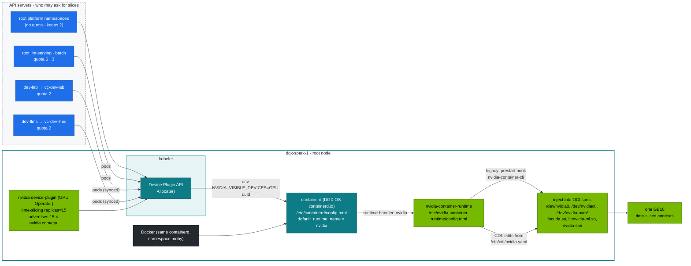
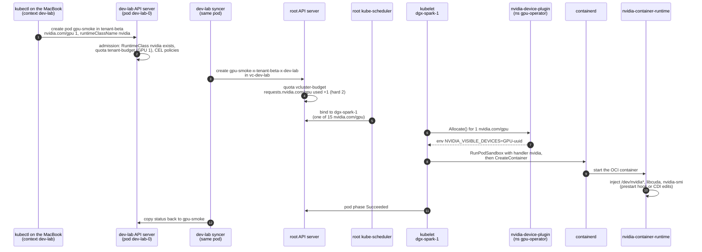

# Chapter 16 · NVIDIA Container Toolkit & GPU Virtualization: CDI and GPU Sharing on GB10 (Time-Slicing, MPS, no MIG)

> **02-Kubernetes · Part V — GPU platform · Chapter 16 of 28** · ← [Chapter 15 · NVIDIA hardware & driver stack](15-nvidia-hardware-and-driver-stack.md) · [All chapters](00-kubernetes-step-by-step-guide.md) · [Chapter 17 · NVIDIA GPU Operator & Network Operator](17-nvidia-gpu-operator-and-network-operator.md) →

| | |
|---|---|
| **You will build** | A clear picture of how a GPU gets into a container on the root's containerd (runtime hook vs CDI), and how one GB10 becomes 15 time-slices split 2 / 2 / 11 between the root and the two vClusters. You'll measure what time-slicing actually gives several pods on one GB10, and close the "GPU leak" where pods that asked for no GPU — in any cluster — still get one |
| **Hardware** | dgx-spark-1 |
| **Time** | 75 min |
| **Risk** | Low. §5.5 (runtime hardening) restarts containerd, which Docker shares |
| **Clusters** | `spark-root` (containerd, device plugin, RuntimeClass, the benchmark in `platform-tools`), `dev-lab` (`gpu-smoke`, the leak) |
| **Lab files** | [`manifests/root/70-gpu/`](lab/manifests/root/70-gpu) (`gemm-bench.yaml`, `gemm-solo.yaml`, `gemm_bench.py`), [`manifests/dev-lab/70-gpu/gpu-smoke.yaml`](lab/manifests/dev-lab/70-gpu/gpu-smoke.yaml), [`manifests/common/runtimeclass/`](lab/manifests/common/runtimeclass), [`breakfix/10-gpu-leak.yaml`](lab/breakfix/10-gpu-leak.yaml), [`manifests/common/15-admission/policies.yaml`](lab/manifests/common/15-admission/policies.yaml), 01-Ansible [`roles/kubeadm_cluster/tasks/containerd.yml`](../01-Ansible/lab/roles/kubeadm_cluster/tasks/containerd.yml), [`roles/gpu_operator`](../01-Ansible/lab/roles/gpu_operator/defaults/main.yml) |

---

## 1. Why this matters on a Spark

One GPU, three clusters, several tenants. The sharing mechanism decides **isolation** (can one tenant crash or starve another?), **accounting** (does the quota mean anything?) and **performance** (what does each tenant actually get?). GB10 has no MIG, so the realistic options are time-slicing and MPS. The lab runs time-slicing with **15 replicas**, which the 01-Ansible `gpu_operator` role configured, and splits them with root quotas: `dev-lab` gets 2, `dev-llms` gets 2, the LLM stack on the root gets 6 (`llm-serving`) + 3 (`batch`), and the platform keeps the remaining 2.

| | Time-slicing (lab) | MPS | MIG | Whole GPU |
|---|---|---|---|---|
| On GB10 | ✅ | device-plugin MPS mode (validate on your stack) | ❌ | ✅ (replicas: 1) |
| Compute isolation | none, context switched | shared SMs, optional % cap | hardware | n/a |
| Memory isolation | **none** (and UMA shares with the OS) | per-client limit | hardware | n/a |
| Fault isolation | none. One Xid can hit all | none | yes | n/a |
| Best for | dev pods, small services, CI | many small inference processes | multi-tenant prod on datacenter GPUs | one big model |

The vClusters add no GPU machinery of their own. A model pod that asks for `nvidia.com/gpu: 1` in the root's `llm-serving` is scheduled by the root scheduler against the root node's 15 slices and started by the root's kubelet and containerd; a tenant pod doing the same inside dev-lab or dev-llms is first synced to the root and then takes exactly the same path. Everything in this chapter happens on the root.

---

## 2. Architecture — HLD



**The split is admission, not hardware.** The device plugin knows nothing about vClusters: it advertises 15 identical slices on the node. The 2 · 6 · 3 · 2 · 2 split exists only as `requests.nvidia.com/gpu` in root ResourceQuotas: `serving-budget` in `llm-serving` (6), `batch-budget` in `batch` (3), and `vcluster-budget` in `vc-dev-lab` and `vc-dev-llms` (2 each). The platform namespaces have no quota, so "platform keeps 2" means "whatever the quotas don't hand out".

**The leak (breakfix 10).** With `default_runtime_name = "nvidia"`, every container on the node goes through `nvidia-container-runtime`. Any image that sets `NVIDIA_VISIBLE_DEVICES=all` (every CUDA base image does) gets the GPU injected, even though it never asked the device plugin — so neither the namespace's quota nor the root scheduler counted it. Docker containers on the same box are the same story, without any Kubernetes accounting at all.

### 2.1 A GPU pod from dev-lab, step by step

`gpu-smoke` (§5.2) asks for one slice inside dev-lab. This is the path it takes until the GB10 appears in the container:



- **Steps 2 and 4 are two quotas in two API servers.** If the root refuses at step 4, the pod stays `Pending` in dev-lab with a syncer event and no scheduler event (break/fix 02, §7).
- **Step 5 counts tickets only.** The scheduler sees 15 identical `nvidia.com/gpu` on `dgx-spark-1` and knows nothing about vClusters.
- **Steps 6–7** are what §5.2 reads with `crictl inspect`: `NVIDIA_VISIBLE_DEVICES=GPU-<uuid>`, the same UUID for every slice.
- **Steps 8–10** are what §5.2 reads with `crictl inspectp` (handler `nvidia`) and the `hooks` / `devices` query.
- **The leak (§5.4) skips steps 6–7.** `bf10-leak` asks for no GPU, so there is no `Allocate()`, but with the default runtime `nvidia` steps 9–10 still run and the image's `NVIDIA_VISIBLE_DEVICES=all` does the rest.

---

## 3. LLD

### 3.1 Files and settings

| Item | Location | Lab value |
|---|---|---|
| containerd | `containerd.io` from DGX OS, shared with Docker; config **`/etc/containerd/config.toml`** | regenerated once by 01-Ansible `kubeadm_cluster` (CRI plugin enabled, original kept as `config.toml.dgxos-orig`), `SystemdCgroup = true` |
| containerd NVIDIA runtime | same file, or the drop-in `/etc/containerd/conf.d/99-nvidia.toml` on newer toolkits (§5.1); written by `nvidia-ctk runtime configure --runtime=containerd --set-as-default` | runtime `nvidia` → `nvidia-container-runtime`, `default_runtime_name = "nvidia"` (role default `kubeadm_cluster_default_runtime_nvidia: true`) |
| crictl | `/etc/crictl.yaml` → `unix:///run/containerd/containerd.sock` | use `sudo crictl …` |
| Toolkit config | `/etc/nvidia-container-runtime/config.toml` | DGX OS defaults, converged by 01-Ansible `container_runtime` |
| CDI spec | `/etc/cdi/nvidia.yaml` (`nvidia-ctk cdi generate`) | regenerated by 01-Ansible `container_runtime` when the driver changes; used by Docker (`features.cdi: true`) |
| GPU Operator | Helm values in 01-Ansible `roles/gpu_operator` | `driver.enabled=false`, `toolkit.enabled=false`, `cdi.enabled=false` — DGX OS owns them |
| RuntimeClass `nvidia` (root) | created by the GPU Operator | handler `nvidia` |
| RuntimeClass `nvidia` (dev-lab, dev-llms) | [`manifests/common/runtimeclass/`](lab/manifests/common/runtimeclass), applied by each vCluster's `00-platform` | same name and handler |
| Time-slicing | ConfigMap `gpu-operator/time-slicing-config` | `replicas: 15`, `renameByDefault: false`, `failRequestsGreaterThanOne: true` |

**Why a RuntimeClass inside each vCluster?** A vCluster has its own API server, and it validates `runtimeClassName` against its *own* objects: a pod naming `nvidia` is rejected there if no RuntimeClass `nvidia` exists in the vCluster. The copy only has to exist; the synced pod carries the name to the root, and the root's containerd resolves handler `nvidia` from `/etc/containerd/config.toml`.

### 3.2 Hardened mode (recommended once you're comfortable)

| Setting | Default lab | Hardened |
|---|---|---|
| containerd `default_runtime_name` | `nvidia` | **`runc`**. GPU pods set `runtimeClassName: nvidia` (in every vCluster too) |
| toolkit `accept-nvidia-visible-devices-envvar-when-unprivileged` | true | **false** |
| device plugin `deviceListStrategy` | `envvar` | **`volume-mounts`** or `cdi-cri` |
| Admission | CEL policy forbids `NVIDIA_*` env in tenant namespaces | same, plus require `runtimeClassName: nvidia` only with a GPU request |

---

## 4. Integrations

- **01-Ansible**: `kubeadm_cluster_default_runtime_nvidia` (role `kubeadm_cluster`) and `gpu_operator_timeslice_replicas` (role `gpu_operator`) are the two knobs; the split is `requests.nvidia.com/gpu` in [`manifests/root/05-vclusters/quotas.yaml`](lab/manifests/root/05-vclusters/quotas.yaml) (the two vClusters) and [`manifests/root-llms/10-tenancy/quotas.yaml`](lab/manifests/root-llms/10-tenancy/quotas.yaml) (`llm-serving`, `batch`). Change the slice count and the quotas together and keep `tests/budget_check.py` green.
- **Admission (Chapter 03)**: `spark-no-nvidia-env-bypass` stops explicit env bypasses in tenant namespaces (inside each vCluster). The hardened runtime closes the implicit one.
- **Kueue / quotas (Chapters 07, 14)** count `nvidia.com/gpu` requests. The leak is exactly the GPU use they *don't* see — and so is the slice ledger in `platform-tools` (Chapter 06).
- **Chapter 15** gives the single-slice baseline B that §5.3 compares against.

---

## 5. Lab

All `kubectl` commands run from `02-Kubernetes/lab` with `KUBECONFIG` set to the lab file:

```bash
# ▶ MacBook · technical-depth (repo root)
cd "02-Kubernetes/lab"
export KUBECONFIG="$PWD/../../01-Ansible/lab/.cache/kubeconfig-spark-lab.yaml"
```

### 5.1 Inspect the toolkit, containerd and CDI on the host

#### What this lab does (commands on dgx-spark-1)

- **Reads the GPU container plumbing:** the NVIDIA Container Toolkit version, the CDI devices in `/etc/cdi/nvidia.yaml`, containerd's runtime settings in `/etc/containerd/config.toml`, the toolkit's `/etc/nvidia-container-runtime/config.toml` and `/etc/crictl.yaml`.
- **Shows that Docker and Kubernetes share one containerd:** `ctr namespaces ls` lists `k8s.io` (kubelet) and `moby` (Docker).
- **Runs one throwaway Docker container** through CDI (`--device nvidia.com/gpu=all`) that prints `nvidia-smi -L`, outside Kubernetes.
- **Nothing is reconfigured.** All commands only read, except the `docker run --rm`, which leaves nothing behind.

#### What to look for

1. **Command exit:** every command prints output; none says `permission denied` (use `sudo` where shown).
2. **Compare with this table:**

   | Line/Field | Healthy value |
   |---|---|
   | `nvidia-ctk cdi list` | three devices: `nvidia.com/gpu=0`, `nvidia.com/gpu=GPU-<uuid>`, `nvidia.com/gpu=all` |
   | containerd `default_runtime_name` | `"nvidia"` |
   | `BinaryName` | `/usr/bin/nvidia-container-runtime` |
   | `SystemdCgroup` | `true` |
   | `crictl info` default runtime | `nvidia` |
   | `/etc/crictl.yaml` | `unix:///run/containerd/containerd.sock` |
   | `ctr namespaces ls` | both `k8s.io` and `moby` |

3. **The Docker CDI run** prints `GPU 0: NVIDIA GB10 (UUID: GPU-…)`, with the same UUID as the CDI list.

**If something's off:** `unresolvable CDI devices` or a UUID that differs from `nvidia-smi -L` → stale CDI spec after a driver upgrade; regenerate it. `disabled_plugins` contains `cri` → a DGX OS update restored containerd's stock config; re-run the 01-Ansible Kubernetes playbook. More in §7.

#### Run it

```bash
# ▶ dgx-spark-1 (ssh dgx-spark-1)
nvidia-ctk --version
sudo nvidia-ctk cdi list
grep -rnE --include='*.toml' 'default_runtime_name|runtimes.\W?nvidia|BinaryName|SystemdCgroup' /etc/containerd/
grep -nE 'accept-nvidia-visible-devices|mode' /etc/nvidia-container-runtime/config.toml
cat /etc/crictl.yaml
sudo crictl info | jq '.config.containerd.defaultRuntimeName // .config.containerd.default_runtime_name'
sudo ctr namespaces ls        # k8s.io (kubelet) and moby (Docker) on one containerd
```

Expected: CDI devices `nvidia.com/gpu=0`, `nvidia.com/gpu=GPU-<uuid>`, `nvidia.com/gpu=all`; an `nvidia` runtime whose `BinaryName` is `/usr/bin/nvidia-container-runtime`; `SystemdCgroup = true`; and `nvidia` as the default runtime. The exact TOML section names depend on the containerd major version DGX OS ships, which is why the `grep` matches the keys, not the headers.

**Two files, one answer.** Newer `nvidia-ctk` releases don't edit `config.toml`; they write `/etc/containerd/conf.d/99-nvidia.toml`, which `config.toml` imports. Then the grep shows `default_runtime_name = "runc"` in `config.toml` *and* `default_runtime_name = "nvidia"` in `99-nvidia.toml`. The drop-in is loaded last and wins. `crictl info` prints the merged result, so trust it over either file.

Run a container through CDI without Kubernetes (Docker 25+ understands CDI):

```bash
# ▶ dgx-spark-1 (ssh dgx-spark-1)
docker run --rm --device nvidia.com/gpu=all nvcr.io/nvidia/cuda:13.0.1-base-ubuntu24.04 nvidia-smi -L
```

That container used one of nobody's 15 slices: Docker talks to the same containerd and the same GB10, entirely outside Kubernetes.

### 5.2 See what the device plugin hands a pod — from a vCluster

#### What this lab does (manifest `lab/manifests/dev-lab/70-gpu/gpu-smoke.yaml`, then `crictl` on the Spark)

- **Checks the prerequisites:** the root offers 15 `nvidia.com/gpu` slices, and RuntimeClass `nvidia` exists on the root and inside dev-lab. If dev-lab lacks it, the command applies `manifests/dev-lab/00-platform`, which creates it with the dev-lab namespaces.
- **Creates `gpu-smoke`** in `tenant-beta` inside dev-lab (one slice, `runtimeClassName: nvidia`). It prints `nvidia-smi -L` and exits.
- **Looks at the real container** on the Spark with `crictl`: the `NVIDIA_*` environment the device plugin set, the hooks or device nodes the runtime injected, and the sandbox's runtime handler.
- **Cleans up:** the last command deletes the pod.

#### What to look for

1. **Command exit:** allocatable prints `15`; both `get runtimeclass` commands show `nvidia` with handler `nvidia`; `wait` prints `condition met`.
2. **gpu-smoke log:** `GPU 0: NVIDIA GB10 (UUID: GPU-…)`.
3. **On the Spark, from `crictl`:**

   | Line/Field | Healthy value |
   |---|---|
   | `NVIDIA_VISIBLE_DEVICES` | `GPU-<uuid>`, the one GB10. Every slice has the same UUID |
   | `hooks` / `devices` | a prestart hook (legacy injection) **or** `/dev/nvidia*` entries (CDI injection), depending on the toolkit `mode` |
   | runtime handler | `nvidia` |

**If something's off:** the root pod is not found → it is named `gpu-smoke-x-tenant-beta-x-dev-lab` only while the dev-lab pod exists; don't delete `gpu-smoke` before the `crictl` step. `runtimeclass "nvidia" not found` → apply `manifests/dev-lab/00-platform`. More in §7.

#### Run it

```bash
# ▶ MacBook · 02-Kubernetes/lab
kubectl --context spark-root get node dgx-spark-1 -o jsonpath='{.status.allocatable.nvidia\.com/gpu}{"\n"}'   # 15
kubectl --context spark-root get runtimeclass nvidia
kubectl --context dev-lab get runtimeclass nvidia || kubectl --context dev-lab apply -k manifests/dev-lab/00-platform
kubectl --context dev-lab apply -f manifests/dev-lab/70-gpu/gpu-smoke.yaml
kubectl --context dev-lab -n tenant-beta wait --for=jsonpath='{.status.phase}'=Succeeded pod/gpu-smoke --timeout=180s
kubectl --context dev-lab -n tenant-beta logs gpu-smoke
```

Now find the container on the node. `gpu-smoke` is a dev-lab pod; its root copy is `gpu-smoke-x-tenant-beta-x-dev-lab` in `vc-dev-lab`, and that's the pod containerd knows:

Print the container ID from the MacBook, then inspect it on the Spark:

```bash
# ▶ MacBook · 02-Kubernetes/lab
HPOD=gpu-smoke-x-tenant-beta-x-dev-lab
kubectl --context spark-root -n vc-dev-lab get pod $HPOD -o jsonpath='{.status.containerStatuses[0].containerID}' | sed 's|.*://||'
```

```bash
# ▶ dgx-spark-1 (ssh dgx-spark-1)
POD_CID=<the container ID printed on the MacBook>
sudo crictl inspect "$POD_CID" | jq -r '.info.config.envs[] | select(.key|startswith("NVIDIA")) | "\(.key)=\(.value)"'
sudo crictl inspect "$POD_CID" | jq '{hooks: (.info.runtimeSpec.hooks | keys? // []), devices: [.info.runtimeSpec.linux.devices[]?.path]}'
sudo crictl inspectp "$(sudo crictl inspect "$POD_CID" | jq -r .info.sandboxID)" | jq -r .info.runtimeHandler      # nvidia
```

Expected: `NVIDIA_VISIBLE_DEVICES=GPU-<uuid>` — the device plugin's `Allocate()` answer for one slice, which is the UUID of the one GB10 (every slice is the same GPU) — and either a prestart hook (legacy injection) or `/dev/nvidia*` device entries (CDI injection), depending on the toolkit's `mode`. The sandbox's runtime handler is `nvidia` because `gpu-smoke` sets `runtimeClassName: nvidia` — the RuntimeClass the pod named inside dev-lab.

```bash
# ▶ MacBook · 02-Kubernetes/lab
kubectl --context dev-lab -n tenant-beta delete pod gpu-smoke
```

### 5.3 Measure time-slicing: 1 → 2 → 4 pods

#### What this lab does (manifests `lab/manifests/root/70-gpu`, Deployment `gemm-contention`)

- **Applies** the root platform namespaces and `manifests/root/70-gpu`: the `gemm-bench` ConfigMap and the `gemm-contention` Deployment in `platform-tools`, at 0 replicas.
- **Scales it to 1, then 2, then 4 pods.** Each pod takes one time-slice, runs the bf16 GEMM benchmark in a loop (`LOOP=1`) and prints one JSON line per run.
- **Prints a small table** after each step: TFLOPS per pod and the sum.
- **Scales back to 0** at the end. The loop takes several minutes: each step waits for the rollout and then 60 s. The first rollout pulls the NGC PyTorch image unless Chapter 15 already did.

#### What to look for

1. **Command exit:** each `rollout status` returns; the loop prints three blocks, `== 1 pod(s)`, `== 2 pod(s)`, `== 4 pod(s)`.
2. **The numbers**, against your baseline **B** from Chapter 15 §5.4: see the table below. The aggregate stays about B at every step; the per-pod figure drops to about B/N.
3. **The slice ledger** (Chapter 06) shows the extra slices in use while the loop runs: `kubectl --context spark-root -n platform-tools get cm gpu-slice-ledger -o yaml`.
4. **After the loop:** `kubectl --context spark-root -n platform-tools get deploy gemm-contention` shows `0/0`. Leaving it running holds up to 4 slices and the whole GPU.

**If something's off:** `rollout status` times out → pods `Pending` (`kubectl --context spark-root -n platform-tools get pods -l app=gemm-contention`): other workloads already hold most of the 15 slices, or memory is short. Aggregate far below B → something else is computing on the GPU (`nvidia-smi` on the Spark). More in §7.

#### Run it

The contention Deployment runs on the root in `platform-tools`: GPU benchmarking is a platform job, and the root has no quota that would stop it at a vCluster's 2 slices.

```bash
# ▶ MacBook · 02-Kubernetes/lab
kubectl --context spark-root apply -k manifests/root/00-platform
kubectl --context spark-root apply -k manifests/root/70-gpu
for n in 1 2 4; do
  kubectl --context spark-root -n platform-tools scale deploy gemm-contention --replicas=$n
  kubectl --context spark-root -n platform-tools rollout status deploy gemm-contention --timeout=15m >/dev/null
  sleep 60
  echo "== $n pod(s)"
  kubectl --context spark-root -n platform-tools logs -l app=gemm-contention --tail=1 --prefix | sed -E 's/.*"tflops": ([0-9.]+).*/\1/' | awk -v n=$n '{s+=$1; print "  pod", NR, $1, "TFLOPS"} END {print "  aggregate", s, "TFLOPS  (per pod ≈", s/n, ")"}'
done
kubectl --context spark-root -n platform-tools scale deploy gemm-contention --replicas=0
```

What to expect, with your baseline B from Chapter 15:

| Pods | Per pod | Aggregate |
|---|---|---|
| 1 | ≈ B | ≈ B |
| 2 | ≈ B/2 | ≈ B (minus switch overhead) |
| 4 | ≈ B/4 | ≈ B, or a bit lower |

**Time-slicing adds no capacity.** It shares one GPU fairly and costs some context-switch overhead. Fifteen `nvidia.com/gpu` slices don't mean fifteen GPUs. They mean fifteen tickets to one GPU — and the split gives `llm-serving` 6 tickets, not 6/15 of the GPU's throughput. If `llm-serving` runs one busy model server and dev-lab runs one, each gets about half while they're both computing, whatever the quota says. While the loop runs, `kubectl --context spark-root -n platform-tools get cm gpu-slice-ledger -o yaml` (Chapter 06) shows the slices in use across all three clusters.

### 5.4 Reproduce and understand the leak

#### What this lab does (script `lab/scripts/breakfix.sh`, scenario 10)

- **Injects break/fix 10:** applies `lab/breakfix/10-gpu-leak.yaml`, a pod `bf10-leak` in `lab-tools` inside dev-lab. It requests **no** GPU and names no RuntimeClass, and runs `nvidia-smi -L` from a CUDA base image.
- **Shows the leak:** the pod still sees the GB10, and no quota counts it.
- **Shows why** on the Spark: the pod's sandbox ran on containerd's default runtime, which is `nvidia`.
- **Cleans up:** `answer 10` prints the explanation, `reset 10` deletes the pod.

#### What to look for

1. **Command exit:** `inject` ends with `Injected BF-10 [dev-lab]: GPU visible to a pod that didn't ask for one`.
2. **Compare with this table:**

   | Check | What you should see |
   |---|---|
   | `logs bf10-leak` | `GPU 0: NVIDIA GB10 (UUID: GPU-…)`, although the pod asked for no GPU |
   | `runtimeClassName` / resources | empty runtime class; only `memory: 64Mi` in the limits |
   | `vcluster-budget` `requests.nvidia.com/gpu` | the used count does **not** go up for `bf10-leak` |
   | sandbox runtime handler (on the Spark) | empty or `(default)`: the pod used containerd's default, which is `nvidia` |

**If something's off:** the log says `nvidia-smi: not found` or lists no GPU → containerd's default is already `runc` (you hardened it in §5.5), so the leak is closed. Pod still `ContainerCreating` after 15 s → the image is pulling; wait and read the logs again.

#### Run it

```bash
# ▶ MacBook · 02-Kubernetes/lab
scripts/breakfix.sh inject 10
sleep 15; kubectl --context dev-lab -n lab-tools logs bf10-leak     # GPU 0: NVIDIA GB10 … although it requested nothing
kubectl --context dev-lab -n lab-tools get pod bf10-leak -o jsonpath='{.spec.runtimeClassName} {.spec.containers[0].resources}{"\n"}'
kubectl --context spark-root -n vc-dev-lab describe resourcequota vcluster-budget | grep gpu   # not counted
kubectl --context spark-root -n vc-dev-lab get pod bf10-leak-x-lab-tools-x-dev-lab -o jsonpath='{.status.containerStatuses[0].containerID}' | sed 's|.*://||'
```

```bash
# ▶ dgx-spark-1 (ssh dgx-spark-1)
POD_CID=<the container ID printed on the MacBook>
sudo crictl inspectp "$(sudo crictl inspect "$POD_CID" | jq -r .info.sandboxID)" | jq -r '.info.runtimeHandler // "(default)"'
```

```bash
# ▶ MacBook · 02-Kubernetes/lab
scripts/breakfix.sh answer 10; scripts/breakfix.sh reset 10
```

The pod names no RuntimeClass and requests no GPU, so its sandbox runs on containerd's **default** runtime — which is `nvidia`. The image's own `NVIDIA_VISIBLE_DEVICES=all` does the rest. dev-lab's quota, the root scheduler and the slice ledger never saw a GPU request.

### 5.5 (Optional) Harden the runtime

#### What this lab does (edit of containerd's default runtime on dgx-spark-1)

- **Finds the file that sets the default:** `/etc/containerd/conf.d/99-nvidia.toml` when `nvidia-ctk` wrote a drop-in (it overrides `config.toml`), otherwise `/etc/containerd/config.toml`. Backs it up with a `.pre-hardening` suffix.
- **Changes one line:** containerd's `default_runtime_name` from `"nvidia"` to `"runc"`, then restarts containerd. Running containers keep running; Docker reconnects.
- **Retests:** injects break/fix 10 again (the leak should be gone) and runs `gpu-smoke` (it should still work, because it names `runtimeClassName: nvidia`).
- **This is a lasting change** to the node. Many lab manifests rely on the default runtime and must get `runtimeClassName: nvidia` afterwards (see below). Undo by restoring the backup.

#### What to look for

1. **Command exit:** `grep` shows no `default_runtime_name = "nvidia"` left in any `*.toml`; `systemctl restart containerd` returns without error; `crictl info` now prints `runc`.
2. **`bf10-leak` log:** no GPU listed (`nvidia-smi` not found, or no devices).
3. **`gpu-smoke` log:** still `GPU 0: NVIDIA GB10 (UUID: GPU-…)`.
4. **The node stays healthy:** `kubectl --context spark-root get node dgx-spark-1` shows `Ready` after the restart.

**If something's off:** `crictl info` still prints `nvidia` → another `*.toml` under `/etc/containerd` still sets it (the grep shows which), or the `sed` pattern didn't match your layout; edit the line by hand. Node `NotReady` → `sudo journalctl -u containerd -n 50`, and restore the `.pre-hardening` copy. More in §7.

#### Run it

Switch containerd's default back to `runc`, so only pods that name `runtimeClassName: nvidia` go through the NVIDIA runtime. The 01-Ansible role writes the default when it *registers* the runtime, and doesn't remove it from an existing config — so on a running node make the change by hand, and set the role variable so a rebuild keeps it:

```bash
# ▶ dgx-spark-1 (ssh dgx-spark-1)
f=/etc/containerd/conf.d/99-nvidia.toml; [ -f "$f" ] || f=/etc/containerd/config.toml   # the drop-in wins when it exists
sudo cp "$f" "$f.pre-hardening"             # .pre-hardening isn't *.toml, so containerd doesn't load it
sudo sed -i -E 's/(default_runtime_name\s*=\s*)"nvidia"/\1"runc"/' "$f"
grep -rn --include='*.toml' default_runtime_name /etc/containerd/
sudo systemctl restart containerd           # running containers keep running; Docker reconnects
sudo crictl info | jq '.config.containerd.defaultRuntimeName // .config.containerd.default_runtime_name'
# for rebuilds: inventory or -e kubeadm_cluster_default_runtime_nvidia=false (01-Ansible playbooks/19.1-kubernetes.yml)
```

```bash
# ▶ MacBook · 02-Kubernetes/lab
scripts/breakfix.sh inject 10; sleep 15; kubectl --context dev-lab -n lab-tools logs bf10-leak   # now: nvidia-smi not found / no devices
scripts/breakfix.sh reset 10
kubectl --context dev-lab apply -f manifests/dev-lab/70-gpu/gpu-smoke.yaml && sleep 20 && kubectl --context dev-lab -n tenant-beta logs gpu-smoke   # still works: runtimeClassName: nvidia
kubectl --context dev-lab -n tenant-beta delete pod gpu-smoke
```

After hardening, **every GPU pod must set `runtimeClassName: nvidia`**, in whichever cluster it's written. `gpu-smoke.yaml` does. The other lab manifests (the GEMM benchmarks, the UMA experiment, the node probe, the serving and training manifests in `root-llms`) rely on the default runtime, so add the field to them. The GPU Operator's own pods are fine because the operator sets it. To undo: copy the `.pre-hardening` file back over the one you edited (`99-nvidia.toml` or `config.toml`) and restart containerd.

---

## 6. Verify

```bash
# ▶ MacBook · 02-Kubernetes/lab
scripts/verify.sh gpu
```

```text
── gpu
[PASS] GB10 node: dgx-spark-1
[PASS] allocatable nvidia.com/gpu=15 (platform 2 · llm-serving 6 · batch 3 · dev-lab 2 · dev-llms 2)
[PASS] operator-validator Running
[....] gpu-smoke from INSIDE dev-lab (tenant-beta → syncer → root scheduler → nvidia runtime)
[PASS] gpu-smoke: GPU 0: NVIDIA GB10 (UUID: GPU-…)
```

| Check | Expected |
|---|---|
| `sudo nvidia-ctk cdi list` | `nvidia.com/gpu=all` present |
| allocatable | `nvidia.com/gpu: 15` |
| root quotas | `requests.nvidia.com/gpu` 2 on `vc-dev-lab`, 2 on `vc-dev-llms`, 6 on `llm-serving`, 3 on `batch` |
| RuntimeClass `nvidia` | on the root and in both vClusters |
| contention table | aggregate ≈ baseline, per-pod ≈ baseline/N |
| hardened mode | `bf10-leak` no longer sees the GPU, `gpu-smoke` still does |

---

## 7. Troubleshooting

| Symptom | Cause | Diagnose | Fix |
|---|---|---|---|
| `could not select device driver "" with capabilities: [[gpu]]` (docker) | Docker not configured for the NVIDIA runtime | `docker info \| grep -i runtime` | `sudo nvidia-ctk runtime configure --runtime=docker && sudo systemctl restart docker` |
| kubelet: `container runtime is down` / CRI errors after a DGX OS update | the update restored containerd's stock config with the CRI plugin disabled | `grep disabled_plugins /etc/containerd/config.toml` | re-run 01-Ansible `playbooks/19.1-kubernetes.yml` (it regenerates the config and re-registers the runtime) |
| `unresolvable CDI devices nvidia.com/gpu=…` | stale CDI spec after a driver upgrade | `nvidia-ctk cdi list` vs `nvidia-smi -L` UUID | `sudo nvidia-ctk cdi generate --output=/etc/cdi/nvidia.yaml` (01-Ansible does this) |
| `runtimeclass "nvidia" not found` in a vCluster | the vCluster has no RuntimeClass copy | `kubectl --context <v> get runtimeclass` | `kubectl --context <v> apply -k manifests/<v>/00-platform` |
| `no runtime for "nvidia" is configured` on the root | runtime not registered in containerd (`config.toml` or `conf.d/99-nvidia.toml`) | `grep -rn --include='*.toml' nvidia /etc/containerd/` | `sudo nvidia-ctk runtime configure --runtime=containerd` + restart containerd, or re-run 01-Ansible `playbooks/19.1-kubernetes.yml` |
| allocatable `nvidia.com/gpu: 1` instead of 15 | time-slicing ConfigMap not applied or wrong key | `kubectl --context spark-root -n gpu-operator get cm time-slicing-config -o yaml`, device-plugin logs | fix and restart the device-plugin DaemonSet (or re-run 01-Ansible `playbooks/20.1-gpu-operator.yml`) |
| Pod Pending in a vCluster, no scheduler events, slices free on the node | that vCluster's root GPU quota is spent | `kubectl --context spark-root -n vc-<v> describe resourcequota vcluster-budget` | by design (break/fix 02); move slices between vClusters in `manifests/root/05-vclusters/quotas.yaml` |
| Model pod never appears in `llm-serving`; ReplicaSet event `exceeded quota: serving-budget` | the namespace's 6 slices are in use | `kubectl --context spark-root -n llm-serving describe resourcequota serving-budget` | scale another model down, or move slices in `manifests/root-llms/10-tenancy/quotas.yaml` (keep `tests/budget_check.py` green) |
| Pod asks for 2 GPUs → `UnexpectedAdmissionError` | `failRequestsGreaterThanOne: true` | pod events | request 1 (2 slices of one GPU are not 2 GPUs) |
| Tenant's pod is slow at random times | another tenant's (or another cluster's) kernels share the GPU | `nvidia-smi` process list on the host. Grafana *GPU slices in use* | Kueue/priorities, or a dedicated time window |
| Pod sees GPU without requesting | the leak | §5.4 | hardened mode §5.5 |

---

## 8. Scale-out path

| Spark | Datacenter |
|---|---|
| time-slicing ×15, split by root quotas | MIG on H100/B200 (hardware isolation) for multi-tenant inference. Whole GPUs for training |
| envvar device list, nvidia default runtime | CDI everywhere (`cdi-cri`), no default nvidia runtime |
| device plugin integer counts | DRA (`ResourceClaim`s) with the NVIDIA DRA driver: sharing strategies and MIG profiles as claim parameters |
| one node's slices shared by the LLM stack and every vCluster | GPU node pools per workload or tenant cluster (node selectors / dedicated nodes), so "6 slices" can become "these 6 GPUs" |
| vGPU? | vGPU is for VMs (virtual desktops, VM-per-tenant clouds). For containers on bare metal, the stack above is simpler and faster, and there's no hypervisor tax |

---

## 9. Checklist

- [ ] I can explain both injection paths (legacy hook and CDI) and find their config files — including the one containerd that Kubernetes and Docker share.
- [ ] I can say why each vCluster needs its own RuntimeClass object, and where its handler is resolved.
- [ ] I measured that time-slices share one GPU's throughput rather than multiplying it, and know the 2 · 6 · 3 · 2 · 2 split is a quota, not a partition.
- [ ] I reproduced the GPU leak from inside a vCluster and know the two changes that close it.
- [ ] I know which sharing modes GB10 supports and which it doesn't.
