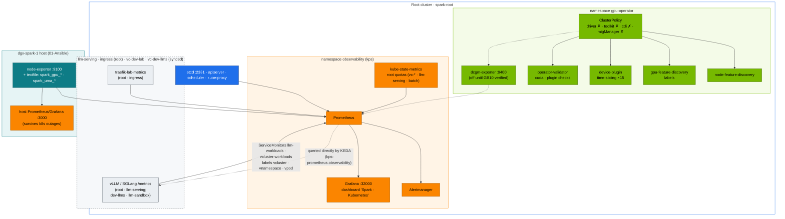
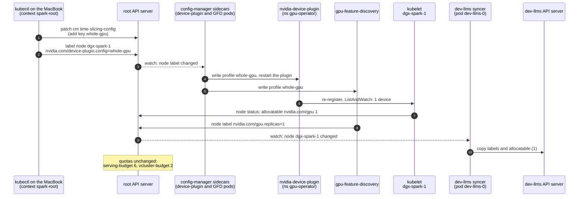

# Chapter 17 · NVIDIA GPU Operator & Network Operator, with GPU Observability

> **02-Kubernetes · Part V — GPU platform · Chapter 17 of 28** · ← [Chapter 16 · NVIDIA Container Toolkit & GPU virtualization](16-nvidia-container-toolkit-and-gpu-virtualization.md) · [All chapters](00-kubernetes-step-by-step-guide.md) · [Chapter 18 · Distributed AI training & NCCL](18-distributed-ai-training-and-nccl.md) →

| | |
|---|---|
| **You will build** | Operational command of the GPU Operator that 01-Ansible installed on the root cluster: read its ClusterPolicy, switch device-plugin profiles per node and see both vClusters follow, and read the validator. You'll run kube-prometheus-stack on the root with host exporters, alert rules, a *Spark · Kubernetes* dashboard and two ServiceMonitors — one for the root's LLM namespaces, one that reaches into the vClusters — and prepare the Network Operator for RDMA pod networking on 2 Sparks |
| **Clusters** | `spark-root` (GPU Operator, Network Operator, observability, `platform-tools` load, the LLM stack's serving metrics, the RDMA test pod in `batch`) · `dev-lab` (`gpu-smoke`, break/fix 02) · `dev-llms` (node view) |
| **Hardware** | dgx-spark-1. §5.6 needs dgx-spark-2 |
| **Time** | 90 min |
| **Risk** | Low. Profile switches restart the device plugin (GPU pods keep running) |
| **Lab files** | [`addons/kube-prometheus-stack-values.yaml`](lab/addons/kube-prometheus-stack-values.yaml), [`addons/dcgm-exporter-values.md`](lab/addons/dcgm-exporter-values.md), [`manifests/root/95-observability/`](lab/manifests/root/95-observability/), [`manifests/root/70-gpu/`](lab/manifests/root/70-gpu/), [`manifests/dev-lab/70-gpu/gpu-smoke.yaml`](lab/manifests/dev-lab/70-gpu/gpu-smoke.yaml), [`manifests/root/85-network-operator/`](lab/manifests/root/85-network-operator/), [`manifests/root-llms/85-network-operator/`](lab/manifests/root-llms/85-network-operator/), 01-Ansible [`roles/gpu_operator`](../01-Ansible/lab/roles/gpu_operator) |

---

## 1. Why this matters on a Spark

The GPU Operator is a controller (Chapter 06) that turns one `ClusterPolicy` into a set of DaemonSets: feature discovery, device plugin, validator, optionally DCGM and exporters. On DGX OS it runs in **host-driver mode**: DGX OS owns the driver and container toolkit, and the operator must never install its own. Knowing which component does what tells you where to look when `nvidia.com/gpu` goes to 0.

In this lab the operator is a **root-only** concern. The vClusters run no device plugin, no NFD and no GFD: they see the root's node as it is (labels, `allocatable nvidia.com/gpu: 15`) through node sync, and their GPU pods are scheduled by the root scheduler and handed a slice by the root's device plugin. The LLM stack runs on the root itself, so its model pods are ordinary root pods. One operator serves three clusters; one bad ConfigMap breaks GPUs in all of them.

Observability is built to answer three questions, fast:

1. **Is the GPU healthy?** Temperature, power, clocks, throttling, Xid. Host exporters own this.
2. **Is the unified memory pool safe?** MemAvailable, page cache, MemoryPressure.
3. **Are users getting service?** Queue depth, TTFT and token latency (vLLM in the root's `llm-serving`), namespace and vCluster budgets, pending GPU pods.

---

## 2. Architecture — HLD



**Two Prometheuses on purpose.** The 01-Ansible host stack watches the *node* and keeps working when Kubernetes is broken. kps watches the *clusters*. Both scrape the same node-exporter.

**One kps for three clusters.** Tenants can't run a Prometheus Operator inside a vCluster (and it couldn't see the root's metrics anyway). The platform team scrapes the vClusters' workloads from the root, where their pods really run. The LLM stack is simpler: its model servers are root pods in `llm-serving`, scraped like any root Service, and KEDA — also on the root — queries `http://kps-prometheus.observability.svc:9090` directly (Chapter 20).

### 2.1 A device-plugin profile switch, step by step

§5.3 switches `dgx-spark-1` from 15 slices to one whole GPU. Nothing in Helm changes; a node label and the operator's `config-manager` sidecars do the work:



- **Steps 1–2** are the `patch` and `label` commands in §5.3. The ConfigMap key is read only when the label names it; the default stays `any` (15).
- **Steps 3–8** take a few seconds to a minute; that's the `sleep 45`. Pods that already hold a slice keep it. Only new allocations see the new count.
- **Steps 7–8** are the first check line in §5.3: allocatable and `gpu.replicas` both `1`.
- **Steps 9–10** are the second check line: `dev-llms` shows `1` too. No vCluster runs a device plugin; it only copies the root's node.
- **The note** is the third check line: `serving-budget` still says 6. From now on the root scheduler's `Insufficient nvidia.com/gpu` is the binding limit, in every cluster.

---

## 3. LLD

### 3.1 GPU Operator in host-driver mode (01-Ansible `gpu_operator` role)

| Component | State | Why |
|---|---|---|
| `driver`, `toolkit` | **disabled** | DGX OS owns them. Two owners would fight on every update |
| `cdi` | **disabled** | on by default since operator v25.10; this lab injects GPUs through the `nvidia` runtime that the kubeadm role set as containerd's default (`nvidia-ctk runtime configure --set-as-default`) |
| `operator.defaultRuntime` | `containerd` | the root uses DGX OS's `containerd.io` (shared with Docker) |
| `devicePlugin` | on, config `time-slicing-config`, `default: any` → **15 replicas**, `failRequestsGreaterThanOne: true` | Chapter 16. A pod asking for 2 slices is refused: 2 slices of one GPU are not 2 GPUs |
| `gfd`, `nfd` | on | labels for selectors and Kueue's `gb10` ResourceFlavor (synced into both vClusters) |
| `validator` | on | the Ansible role waits for it, then asserts every node advertises 15 |
| `migManager` | off | no MIG on GB10 |
| `dcgmExporter` | off by default | enable after `dcgmi discovery -l` lists GB10 |
| chart | `v26.7.1` (`GPU_OPERATOR_VERSION` in `versions.env`). Upgrade via 01-Ansible `gpu_operator_chart_version` after reading the release notes |

### 3.2 Device-plugin profiles (per node) and the budgets on top

| Profile key in `time-slicing-config` | Effect | Select with |
|---|---|---|
| `any` (default) | 15 time-slices | nothing |
| `whole-gpu` (you add it in §5.3) | 1 exclusive GPU | `kubectl --context spark-root label node dgx-spark-1 nvidia.com/device-plugin.config=whole-gpu` |

The 15 slices are split by **root ResourceQuotas**, not by the device plugin:

| Who | Slices | Enforced by |
|---|---|---|
| LLM serving (root, `llm-serving`) | 6 | `llm-serving/serving-budget` `requests.nvidia.com/gpu: 6` |
| LLM training (root, `batch`, admitted by Kueue `spark-cq`) | 3 | `batch/batch-budget` `requests.nvidia.com/gpu: 3` |
| vCluster `dev-lab` | 2 | `vc-dev-lab/vcluster-budget` `requests.nvidia.com/gpu: 2` |
| vCluster `dev-llms` | 2 | `vc-dev-llms/vcluster-budget` `requests.nvidia.com/gpu: 2` |
| root platform (`platform-tools` benchmarks, probes, the Chapter 14 §5.5 UMA experiment, the preemption-demo filler) | 2 | **nothing** — the platform namespaces have no quota. It's a convention the platform team keeps |

A profile switch changes the supply; the quotas don't move. After a switch to `whole-gpu` the budgets still say 6 + 3 + 2 + 2, but only one GPU exists, and the scheduler's `Insufficient nvidia.com/gpu` becomes the binding limit (§5.3).

### 3.3 Alert rules ([`rules.yaml`](lab/manifests/root/95-observability/rules.yaml))

| Alert | Expression (short) | Severity |
|---|---|---|
| `SparkUMAPressure` | MemAvailable/MemTotal < 10 % for 2 m | warning |
| `SparkNodeMemoryPressureCondition` | node condition MemoryPressure | critical |
| `VClusterQuotaNearlyExhausted` | used/hard > 90 % of a root `vcluster-budget` (`vc-*`) for 10 m | info |
| `PodsPendingOnGPU` | GPU-requesting pods Pending **on the root** > 10 m | warning |
| `VLLMQueueBacklog` / `VLLMKVCacheFull` | waiting > 32 / KV cache > 95 %, by `vcluster`, `vnamespace` | warning |
| `EtcdSlowFsync` / `EtcdDbNearQuota` | fsync p99 > 50 ms / DB > 80 % | warning / critical |
| `ConntrackTableFilling` | > 75 % | warning |
| recording rules | `spark:vllm_ttft_p95_seconds`, `spark:vllm_tpot_p95_seconds` | — |

Two of these see the nesting differently. `VClusterQuotaNearlyExhausted` reads the root quotas on `vc-*`, so it fires when a *whole vCluster* is nearly full; quotas *inside* a vCluster (dev-lab's `tenant-budget`, dev-llms' sandbox quota) are invisible to the root's kube-state-metrics. `PodsPendingOnGPU` only sees pods that exist on the root. A pod that the root quota refused never got there: it waits inside its vCluster with a sync error. That's break/fix 02, and §5.4 shows that the right alert for it is the quota one. The LLM stack has no such gap: `serving-budget` and `batch-budget` are root quotas that kube-state-metrics exports directly (the *Tenancy* panels show them), and a model pod that fits the quota but not the free memory or slices is a root pod Pending — exactly what `PodsPendingOnGPU` sees.

### 3.4 Scraping the model servers ([`vcluster-workloads.yaml`](lab/manifests/root/95-observability/vcluster-workloads.yaml))

The file holds two ServiceMonitors. `llm-workloads` selects the root's own `llm-serving` and `ingress` namespaces, keeps the same Service names, and sets `vcluster="root"` plus `vnamespace`/`vservice`/`vpod` from the real namespace, Service and pod — there is no translation to undo. NetworkPolicy `allow-ingress-and-same-namespace` in `llm-serving` admits `observability`. `vcluster-workloads` reaches into the vClusters:

| Step | What happens |
|---|---|
| select | `namespaceSelector: [vc-dev-llms, vc-dev-lab]`, every Service |
| keep | only Services whose `vcluster.loft.sh/object-name` annotation is a model server (`vllm`, `vllm-prefill`, `vllm-decode`, `sglang`, `qwen-small-predictor` on port `http`) or `triton` / `traefik-lab-metrics` (port `metrics`) |
| relabel | `vcluster` ← `vc-(.*)` of the root namespace · `vnamespace` ← `object-namespace` · `vservice` ← `object-name` (Service) · `vpod` ← `object-name` (Pod) |
| network | tenant NetworkPolicies are synced to `vc-dev-llms` / `vc-dev-lab` and enforced by Cilium. The root's `vcluster-boundary` CiliumNetworkPolicy allows ingress from `observability`, and Cilium allows are a union, so the scrape gets through |

Queries then read like the tenant thinks: `vllm:num_requests_waiting{vcluster="dev-llms", vnamespace="llm-sandbox"}` for a sandbox model, `{vcluster="root", vnamespace="llm-serving"}` for the real ones — one label scheme for both. For sandbox pods the `namespace` and `pod` labels keep the root names (`vc-dev-llms`, `vllm-…-x-llm-sandbox-x-dev-llms`); for the root's model servers they are simply `llm-serving` and `vllm-…`.

### 3.5 Dashboard rows

| Row | Panels |
|---|---|
| Unified memory & GB10 (host exporters) | UMA available · GPU temp · power · Xid 24 h · slices in use · pending GPU pods · UMA vs page cache · utilisation · clocks/throttle |
| Tenancy | vCluster CPU used / hard (root quotas) · vCluster memory used / hard (root quotas) — every root ResourceQuota, so `serving-budget` and `batch-budget` appear next to the `vc-*` budgets · top-5 throttled containers |
| Serving SLOs (vLLM) | TTFT p95 · TPOT p95 (by `vcluster/vnamespace`) · queue and KV cache |
| Control plane | etcd fsync p99 · API p99 (mutating) · APF rejected/queued (shows the root's `spark-vcluster-syncers` lane) |

The dashboard is *generated* by [`gen_dashboard.py`](lab/manifests/root/95-observability/gen_dashboard.py), and CI fails if the JSON drifts from the generator.

---

## 4. Integrations

- **01-Ansible Chapter 12 (telemetry)**: provides `spark_gpu_*` and `spark_uma_*` metrics, and the `SparkGpuMetricsStale` rule for a textfile collector that stops updating.
- **01-Ansible Chapter 20**: owns the operator's Helm values and the time-slicing ConfigMap. Change replicas/profiles there, then re-run `20.1-gpu-operator.yml`. If you change the slice count, change the root quotas in `manifests/root/05-vclusters/quotas.yaml` and `manifests/root-llms/10-tenancy/quotas.yaml` too and run `python3 tests/budget_check.py` — it reads the slice count straight from the role's defaults.
- **01-Ansible `21.1-multus-rdma.yml`** is the lighter alternative to the Network Operator in §5.6 (Multus thick v4.3.0 + RDMA shared device plugin + NADs `cx7-a`/`cx7-b` in `platform-tools` and `batch`). Use one of the two, not both.
- **KEDA (Chapter 20)** runs on the root next to the models and queries `http://kps-prometheus.observability.svc:9090` directly. The same metrics drive autoscaling and alerts.
- **Alertmanager → your pager**: add a receiver (Slack, e-mail, Webex webhook) in the kps values.

---

## 5. Lab

```bash
# ▶ MacBook · technical-depth (repo root)
export KUBECONFIG="$PWD/01-Ansible/lab/.cache/kubeconfig-spark-lab.yaml"   # spark-root, dev-lab, dev-llms
cd "02-Kubernetes/lab"
```

### 5.1 Read the operator's state

#### What this lab does (kubectl, read-only)

- **On the root:** reads the GPU Operator's `ClusterPolicy` (overall state and which components are switched on), its DaemonSets and pods in `gpu-operator`, the last lines of the validator log, and the time-slicing profile in ConfigMap `time-slicing-config`.
- **From inside dev-lab:** checks what a tenant sees: no `gpu-operator` namespace, but 15 allocatable slices and a RuntimeClass `nvidia`.
- **Nothing is changed.**

#### What to look for

1. **Command exit:** every command prints output, except `get ns gpu-operator` in dev-lab, which must say `NotFound`.
2. **Compare with this table:**

   | Line/Field | Healthy value |
   |---|---|
   | ClusterPolicy state | `ready` |
   | `driver`, `toolkit`, `cdi`, `mig`, `dcgmExporter` | all `false` (DGX OS owns the driver and toolkit) |
   | `devicePlugin` | `{"name":"time-slicing-config","default":"any"}` |
   | `gpu-operator` pods | all `Running` or `Completed` (validator jobs complete) |
   | time-slicing profile `any` | `replicas: 15` and `failRequestsGreaterThanOne: true` |
   | dev-lab allocatable | `15` |
   | dev-lab RuntimeClass | `nvidia` |

**If something's off:** state `notReady` → find the pod that is not ready and read its logs; usually the validator, pointing at a host driver or containerd runtime problem. Any of driver/toolkit/cdi `true` → the Helm values drifted; re-run 01-Ansible `20.1-gpu-operator.yml`. More in §7.

#### Run it

```bash
# ▶ MacBook · 02-Kubernetes/lab
kubectl --context spark-root get clusterpolicies.nvidia.com -o jsonpath='{.items[0].status.state}{"\n"}'
kubectl --context spark-root -n gpu-operator get ds,pods -o wide
kubectl --context spark-root get clusterpolicies.nvidia.com cluster-policy -o json \
  | jq -c '.spec | {driver: .driver.enabled, toolkit: .toolkit.enabled, cdi: .cdi.enabled, mig: .migManager.enabled, dcgmExporter: .dcgmExporter.enabled, devicePlugin: .devicePlugin.config}'
kubectl --context spark-root -n gpu-operator logs -l app=nvidia-operator-validator -c nvidia-operator-validator --tail=5
kubectl --context spark-root -n gpu-operator get cm time-slicing-config -o jsonpath='{.data.any}{"\n"}'
```

Expected: `ready`; `{"driver":false,"toolkit":false,"cdi":false,"mig":false,"dcgmExporter":false,"devicePlugin":{"name":"time-slicing-config","default":"any"}}`; and a profile with `replicas: 15` and `failRequestsGreaterThanOne: true`.

Now look for the operator from inside a vCluster:

```bash
# ▶ MacBook · 02-Kubernetes/lab
kubectl --context dev-lab get ns gpu-operator                     # NotFound — the operator is root-only
kubectl --context dev-lab get node dgx-spark-1 -o jsonpath='{.status.allocatable.nvidia\.com/gpu}{"\n"}'   # 15
kubectl --context dev-lab get runtimeclass nvidia                 # from manifests/common/runtimeclass
```

The tenant sees the *result* (15 allocatable slices, GFD labels, a RuntimeClass) without any of the machinery.

### 5.2 Labels GFD wrote — and who can use them

#### What this lab does (kubectl, then script `lab/scripts/verify.sh gpu`)

- **Lists the `nvidia.com/` labels** GPU Feature Discovery wrote on `dgx-spark-1` on the root, and counts the same labels as `dev-llms` sees them through node sync.
- **Runs `scripts/verify.sh gpu`:** checks the GB10 node label, allocatable slices and the operator validator, then creates `gpu-smoke` in dev-lab (`tenant-beta`), waits for it and deletes it.
- **Nothing else is changed.**

#### What to look for

1. **Command exit:** the label list is not empty; the `grep -c` count in dev-llms equals the number of `nvidia.com/` lines on the root.
2. **Labels on the root** include `nvidia.com/gpu.compute.major=12`, `nvidia.com/gpu.replicas=15` and `nvidia.com/gpu.sharing-strategy=time-slicing` (full list in Chapter 15 §3.2).
3. **`verify.sh gpu` output:**
   ```
   [PASS] GB10 node: dgx-spark-1
   [PASS] allocatable nvidia.com/gpu=15 (platform 2 · llm-serving 6 · batch 3 · dev-lab 2 · dev-llms 2)
   [PASS] operator-validator Running
   [PASS] gpu-smoke: GPU 0: NVIDIA GB10 (UUID: GPU-…)
   ```
   No `[FAIL]` lines. A `[WARN]` on allocatable means the node does not offer 15 slices.

**If something's off:** fewer labels in dev-llms → node sync lagging; check the vCluster syncer logs. `[FAIL] gpu-smoke did not succeed` → the line shows the pod's phase and state; `Pending` usually means the dev-lab GPU quota is used up. More in §7.

#### Run it

```bash
# ▶ MacBook · 02-Kubernetes/lab
kubectl --context spark-root get node dgx-spark-1 -o json \
  | jq -r '.metadata.labels | to_entries[] | select(.key|startswith("nvidia.com/")) | "\(.key)=\(.value)"' | sort
kubectl --context dev-llms get node dgx-spark-1 --show-labels | tr ',' '\n' | grep -c '^nvidia.com/'
```

Both commands count the same labels: node sync copies them into `dev-llms`, so a sandbox pod can select on `spark.lab/gpu: gb10` inside a vCluster that has no GFD. On the root, Kueue's ResourceFlavor `gb10` (`nodeLabels: spark.lab/gpu: gb10`) reads the labels straight from the node.

Then prove the full chain from a tenant namespace:

```bash
# ▶ MacBook · 02-Kubernetes/lab
scripts/verify.sh gpu          # applies manifests/dev-lab/70-gpu/gpu-smoke.yaml in dev-lab/tenant-beta
```

Expected: `[PASS] allocatable nvidia.com/gpu=15 (platform 2 · llm-serving 6 · batch 3 · dev-lab 2 · dev-llms 2)`, `[PASS] operator-validator Running`, and `[PASS] gpu-smoke: GPU 0: NVIDIA GB10 (UUID: GPU-…)`. That pod went dev-lab API → syncer → root quota → root scheduler → device plugin → nvidia runtime.

### 5.3 Switch a node to "whole GPU" and back

#### What this lab does (ConfigMap `gpu-operator/time-slicing-config`, node label)

- **Adds a second device-plugin profile** `whole-gpu` (no time-slicing) to the ConfigMap `time-slicing-config`. The default profile `any` (15 slices) stays.
- **Labels the node** `nvidia.com/device-plugin.config=whole-gpu`. The device plugin restarts with that profile, and the node advertises **1** `nvidia.com/gpu` instead of 15, in all three clusters at once.
- **Runs the `gemm-solo` benchmark** (Chapter 15 §5.4) on the whole GPU, then removes the label so the node goes back to 15.
- **What stays:** the `whole-gpu` key remains in the ConfigMap until the next 01-Ansible `20.1-gpu-operator.yml` run rewrites it. Quotas are never touched.

#### What to look for

1. **Command exit:** `patch` prints `configmap/time-slicing-config patched`, `label` prints `node/dgx-spark-1 labeled`.
2. **After the switch:**

   | Check | Value with `whole-gpu` | Value after switching back |
   |---|---|---|
   | root allocatable / `gpu.replicas` label | `1  1` | `15` |
   | dev-llms allocatable | `1` | `15` |
   | `serving-budget` `requests.nvidia.com/gpu` | still `6` | `6` |

3. **The benchmark** prints one JSON line. With no other GPU pods, its TFLOPS should be close to your Chapter 15 baseline B.
4. **Other GPU pods:** while the node advertises 1, any new GPU pod in any cluster is `Pending` with `Insufficient nvidia.com/gpu`. Pods already running keep their allocation.

**If something's off:** allocatable still 15 after 45 s → the device plugin has not restarted yet; wait and check `kubectl --context spark-root -n gpu-operator get pods`. `gemm-solo` stays `Pending` → another pod already holds the single GPU. Allocatable stuck at 1 after removing the label → see the device-plugin row in §7.

#### Run it

```bash
# ▶ MacBook · 02-Kubernetes/lab
kubectl --context spark-root -n gpu-operator patch cm time-slicing-config --type merge \
  -p '{"data":{"whole-gpu":"version: v1\nflags:\n  migStrategy: none\n"}}'
kubectl --context spark-root label node dgx-spark-1 nvidia.com/device-plugin.config=whole-gpu --overwrite
sleep 45
kubectl --context spark-root get node dgx-spark-1 -o jsonpath='{.status.allocatable.nvidia\.com/gpu}{"  "}{.metadata.labels.nvidia\.com/gpu\.replicas}{"\n"}'   # 1  1
kubectl --context dev-llms get node dgx-spark-1 -o jsonpath='{.status.allocatable.nvidia\.com/gpu}{"\n"}'                                                # 1 — node sync
kubectl --context spark-root -n llm-serving get resourcequota serving-budget -o jsonpath='{.spec.hard.requests\.nvidia\.com/gpu}{"\n"}'               # still 6
```

Run a benchmark on the whole GPU, then switch back:

```bash
# ▶ MacBook · 02-Kubernetes/lab
kubectl --context spark-root -n platform-tools delete job gemm-solo --ignore-not-found
kubectl --context spark-root apply -k manifests/root/70-gpu        # the gemm-bench ConfigMap
kubectl --context spark-root apply -f manifests/root/70-gpu/gemm-solo.yaml
kubectl --context spark-root -n platform-tools logs -f job/gemm-solo
kubectl --context spark-root label node dgx-spark-1 nvidia.com/device-plugin.config-                                                                      # back to default
sleep 45; kubectl --context spark-root get node dgx-spark-1 -o jsonpath='{.status.allocatable.nvidia\.com/gpu}{"\n"}'                                     # 15
```

Use `whole-gpu` for a benchmark or a big single-model run, when you want no one else on the GPU. Running pods keep their allocation. New pods see the new count — in every cluster at once. While the node advertises 1, the budgets (6, 3, 2 and 2) are promises the hardware can't keep: the first GPU pod wins and every other one, in any cluster, gets `0/1 nodes are available: 1 Insufficient nvidia.com/gpu` from the root scheduler. Quotas cap demand; they never create supply.

> The ConfigMap is owned by the 01-Ansible `gpu_operator` role. A later run of `20.1-gpu-operator.yml` rewrites it without your `whole-gpu` key. To make the profile permanent, add it to the role's time-slicing ConfigMap task.

### 5.4 Observability stack

#### What this lab does (script `lab/scripts/install-addons.sh kps`, manifests `lab/manifests/root/95-observability`)

- **Installs kube-prometheus-stack** (Helm release `kps`) on the root in `observability`: Prometheus (15 days of history on local NVMe), Alertmanager and Grafana on NodePort **32000**. Values: `lab/addons/kube-prometheus-stack-values.yaml`.
- **Applies `95-observability`:** a Service and EndpointSlice `spark-host-exporters` that point Prometheus at the host node_exporter on `192.168.0.100:9100`, the scrape config for model servers (`vcluster-workloads.yaml`), the alert rules (`rules.yaml`) and the dashboard **Spark · Kubernetes**.
- **Generates load** to light up the dashboard: 2 `gemm-contention` pods, the `cpu-throttle` pod and break/fix 02 (dev-lab asks for 6 slices and has 2).
- **Fills the GPU on purpose** with `slice-hog` in `platform-tools` (one pod more than the free slices) to fire `PodsPendingOnGPU`, then removes everything.
- **Takes time:** both alerts need 10 minutes (`for: 10m`) before they fire.

#### What to look for

1. **Command exit:** `install-addons.sh kps` ends after `deploy/kps-grafana` rolls out; `apply -k` prints `created` lines; `get prometheus,alertmanager,servicemonitors,prometheusrules` lists one Prometheus, one Alertmanager, and the lab's ServiceMonitors and rules.
2. **Targets** (first `curl`): every `job` shows `up`, including `spark-host-exporters`. With Traefik and a model server running, the second `curl` lists entries with `vcluster` `root` and the value `1`. Empty is fine before Chapters 11 and 20.
3. **KEDA address:** the ScaledObject's `serverAddress` is `http://kps-prometheus.observability.svc:9090`, and the `promq` pod prints the start of a JSON answer (`{"status":"success",…`). No ScaledObject yet is fine before Chapter 20 §5.7. The pod is gone again before `kubectl` attaches, so you may also see `warning: couldn't attach to pod/promq, falling back to streaming logs … no running task found` and a "recorded in container logs" banner; both are harmless when the JSON line is there.
4. **Grafana:** http://192.168.0.100:32000, user `admin`, password `change-me` unless you changed it (do). Dashboard **Spark · Kubernetes**: GPU utilization and slices in use rise with `gemm-contention`; the throttling panel shows `cpu-throttle`.
5. **Alerts** after 10–12 minutes:

   | Step | Alert | Expected state |
   |---|---|---|
   | break/fix 02 injected | `VClusterQuotaNearlyExhausted` for `vc-dev-lab` | `firing` |
   | break/fix 02 injected | `PodsPendingOnGPU` | absent: the Pending pods exist only inside dev-lab |
   | `slice-hog` running | `PodsPendingOnGPU` for `platform-tools` | `firing`, with exactly 1 `slice-hog` pod Pending |

6. **After cleanup:** `gemm-contention` at 0 replicas, no `slice-hog`, no `cpu-throttle`, and the port-forward stopped (`kill %1` works only in the same terminal that started it).

**If something's off:** `curl` to `localhost:9090` fails → the port-forward is not running in this terminal. `spark-host-exporters` down → node_exporter on the Spark (`curl 192.168.0.100:9100/metrics`). No alert after 12 minutes → check the rule loaded (`curl -s localhost:9090/api/v1/rules`) and that `kube-state-metrics` is `up`. More in §7.

#### Run it

```bash
# ▶ MacBook · 02-Kubernetes/lab
scripts/install-addons.sh kps
kubectl --context spark-root apply -k manifests/root/95-observability
kubectl --context spark-root -n observability get prometheus,alertmanager,servicemonitors,prometheusrules
kubectl --context spark-root -n observability port-forward svc/kps-prometheus 9090 &
curl -s 'localhost:9090/api/v1/targets?state=active' | jq -r '.data.activeTargets[] | "\(.labels.job)  \(.health)"' | sort | uniq -c
curl -s 'localhost:9090/api/v1/query' --data-urlencode 'query=up{vcluster!=""}' | jq -r '.data.result[] | "\(.metric.vcluster)/\(.metric.vnamespace)/\(.metric.vservice)  \(.value[1])"'
```

Expected targets `up`: apiserver, kubelet, kube-state-metrics, coredns, kube-proxy, etcd (via :2381), controller-manager, scheduler, `spark-host-exporters`, and — once Traefik and a model server run on the root — `traefik-lab-metrics` and `vllm` with `vcluster="root"` (a sandbox model in dev-llms adds `vcluster="dev-llms"`). If the second query is empty, Traefik isn't installed yet (`scripts/install-addons.sh traefik`).

Check the address KEDA uses — the root's Prometheus Service, no replicated copy in between:

```bash
# ▶ MacBook · 02-Kubernetes/lab
kubectl --context spark-root -n llm-serving get scaledobjects -o jsonpath='{range .items[*]}{.metadata.name}{"  "}{.spec.triggers[0].metadata.serverAddress}{"\n"}{end}'
kubectl --context spark-root -n batch run promq --rm -i --restart=Never --image=nicolaka/netshoot:v0.13 \
  -- curl -s 'http://kps-prometheus.observability.svc:9090/api/v1/query?query=up' | head -c 200; echo
```

Open Grafana at `http://192.168.0.100:32000` → dashboard **Spark · Kubernetes**. Generate some signal and watch each row respond:

```bash
# ▶ MacBook · 02-Kubernetes/lab
kubectl --context spark-root -n platform-tools scale deploy gemm-contention --replicas=2   # GPU util, slices in use
kubectl --context spark-root apply -f manifests/root/12-cgroups/cpu-throttle.yaml         # throttling panel
scripts/breakfix.sh inject 02                                                             # dev-lab asks for 6 slices, has 2
```

Watch the alerts for 10–12 minutes:

```bash
# ▶ MacBook · 02-Kubernetes/lab
curl -s localhost:9090/api/v1/alerts | jq -r '.data.alerts[] | "\(.labels.alertname) \(.labels.namespace // "") \(.state)"'
```

Expected: `VClusterQuotaNearlyExhausted vc-dev-lab firing` (the `requests.nvidia.com/gpu` budget is at 2/2) — and **no** `PodsPendingOnGPU`. The four Pending bf02 pods exist only in dev-lab's API server; the root's kube-state-metrics never saw them. Now make the root itself run out of slices, which is what `PodsPendingOnGPU` is for:

```bash
# ▶ MacBook · 02-Kubernetes/lab
scripts/breakfix.sh reset 02
USED=$(kubectl --context spark-root get pods -A -o json | jq '[.items[] | select(.spec.nodeName != null and (.status.phase=="Running" or .status.phase=="Pending")) | .spec.containers[].resources.limits["nvidia.com/gpu"] // "0" | tonumber] | add')
kubectl --context spark-root -n platform-tools create deployment slice-hog --replicas=$((15 - USED + 1)) \
  --image=nvcr.io/nvidia/cuda:13.0.1-base-ubuntu24.04 -- sleep infinity
kubectl --context spark-root -n platform-tools set resources deploy slice-hog --limits=nvidia.com/gpu=1,memory=32Mi --requests=cpu=10m
kubectl --context spark-root -n platform-tools get pods -l app=slice-hog | grep -c Pending        # 1
```

`platform-tools` has no quota, so the root can take every slice — including the ones dev-lab, dev-llms, `llm-serving` and `batch` are "budgeted". The platform's 2 slices are a convention, not a control. After 10 minutes `PodsPendingOnGPU` fires for `platform-tools`. Clean up:

```bash
# ▶ MacBook · 02-Kubernetes/lab
kubectl --context spark-root -n platform-tools delete deploy slice-hog
kubectl --context spark-root -n platform-tools scale deploy gemm-contention --replicas=0
kubectl --context spark-root delete -f manifests/root/12-cgroups/cpu-throttle.yaml; kill %1
```

### 5.5 DCGM exporter (when supported)

#### What this lab does (template `20.1 GPU Operator` with `gpu_operator_dcgm_exporter: true`)

- **Checks first** that DCGM on the Spark can see the GB10 (`dcgmi discovery -l`). If it can't, stop here and keep DCGM off.
- **Re-runs the GPU Operator template** with one extra variable. The operator then adds the `nvidia-dcgm-exporter` DaemonSet in `gpu-operator`, serving metrics on port **9400**. Driver, toolkit and time-slicing settings are not changed.
- **Reads a few DCGM metrics** through a short port-forward: GPU utilization, temperature, power.

#### What to look for

1. **`dcgmi discovery -l`** lists one GPU, the GB10.
2. **Semaphore run:** `failed=0`; expect `changed` on the Helm release (the DCGM exporter is added).
3. **Exporter:** `kubectl --context spark-root -n gpu-operator get ds nvidia-dcgm-exporter` shows 1 ready pod.
4. **Metrics:** the `curl` prints `DCGM_FI_DEV_GPU_UTIL`, `DCGM_FI_DEV_GPU_TEMP` and `DCGM_FI_DEV_POWER_USAGE` lines with numbers.

**If something's off:** `dcgmi` lists no GPU → this DGX OS release's DCGM doesn't support the GB10 yet; leave `gpu_operator_dcgm_exporter` false, since the host textfile metrics feed the same panels. Exporter pod crash-looping → its logs; turn it back off with the same template and `false`. More in §7.

#### Run it

```bash
# ▶ MacBook · 02-Kubernetes/lab
ssh dgxadmin@192.168.0.100 'dcgmi discovery -l'        # must list GB10
# Semaphore: run template "20.1 GPU Operator" with extra variables {"gpu_operator_dcgm_exporter": true}
# (break-glass CLI: cd "../../01-Ansible/lab" && ansible-playbook playbooks/20.1-gpu-operator.yml -l dgx-spark-1,localhost -K -e gpu_operator_dcgm_exporter=true)
kubectl --context spark-root -n gpu-operator port-forward ds/nvidia-dcgm-exporter 9400 & sleep 2
curl -s localhost:9400/metrics | grep -E '^DCGM_FI_DEV_(GPU_UTIL|GPU_TEMP|POWER_USAGE)' | head; kill %1
```

If `dcgmi` doesn't list the GB10 on your DGX OS release, keep it off. The textfile metrics cover the same panels. Note that DCGM's per-pod attribution (`pod`, `namespace` labels) uses root names: a model pod shows up under its own name in `llm-serving`, but a dev-lab pod shows up as `…-x-lab-tools-x-dev-lab` in `vc-dev-lab`.

### 5.6 (2 Sparks) Network Operator for RDMA pod networking

#### What this lab does (Helm chart `network-operator`, manifests `lab/manifests/root/85-network-operator`)

- **Installs the NVIDIA Network Operator** in `nvidia-network-operator`, with its own NFD switched off (the GPU Operator already runs NFD). It does not install a NIC driver: DGX OS ships it.
- **Applies `nicclusterpolicy.yaml`:** the RDMA shared device plugin (resource `rdma/rdma_shared_cx7`, 16 per Spark, on the CX-7 ports `enp1s0f1np1` and `enP2p1s0f1np1`), Multus, CNI plugins and whereabouts IPAM. A `MacvlanNetwork` `cx7-rdma` creates the NetworkAttachmentDefinition in `batch`, with addresses `192.168.100.100–199` and MTU 9000.
- **Runs a test pod** `rdma-test` in `batch` that prints its interfaces and RDMA devices, then deletes it. It uses the NGC PyTorch image, so the first start may pull for a while.
- **One Spark only:** skip this lab. It needs dgx-spark-2 joined to the root and the CX-7 cabled between the two.

#### What to look for

1. **Command exit:** `helm install … --wait` returns `STATUS: deployed`; NicClusterPolicy state `ready`.
2. **Compare with this table:**

   | Check | Healthy value |
   |---|---|
   | allocatable `rdma/rdma_shared_cx7` | `16` on each Spark |
   | `get network-attachment-definitions -n batch` | `cx7-rdma` |
   | `rdma-test` log, `ip -br addr` | `eth0` with `10.42.x.x` (Cilium) and `net1` with an address in `192.168.100.100–199` |
   | `rdma-test` log, `ibv_devices` | at least one RoCE device |
   | `network-status` annotation | two entries: `eth0` and `net1` |

**If something's off:** NicClusterPolicy not ready → Multus from `21.1-multus-rdma.yml` may already be installed; use one installer only. `rdma-test` stuck in `ContainerCreating` with `cx7-rdma not found` → the NAD is not in `batch`. More in §7.

#### Run it

Prerequisites: dgx-spark-2 joined the root (Chapter 05 §9), 01-Ansible `13.1-fabric.yml` and `13.2-rdma-perftest.yml` passed, and **01-Ansible `21.1-multus-rdma.yml` not applied** (both install Multus and an RDMA device plugin).

```bash
# ▶ MacBook · 02-Kubernetes/lab
helm repo add nvidia https://helm.ngc.nvidia.com/nvidia && helm repo update
helm search repo nvidia/network-operator -l | head -3          # pick a release and pin it
NETOP_VERSION=<chosen chart version>
helm --kube-context spark-root install network-operator nvidia/network-operator -n nvidia-network-operator --create-namespace \
  --version "$NETOP_VERSION" --set nfd.enabled=false --wait      # NFD already runs via the GPU Operator
kubectl --context spark-root apply -f manifests/root/85-network-operator/nicclusterpolicy.yaml
kubectl --context spark-root get nicclusterpolicy nic-cluster-policy -o jsonpath='{.status.state}{"\n"}'     # ready
kubectl --context spark-root get node -o json | jq '.items[] | {name: .metadata.name, rdma: .status.allocatable["rdma/rdma_shared_cx7"]}'
kubectl --context spark-root -n batch get network-attachment-definitions            # cx7-rdma, rendered from the MacvlanNetwork
```

The `MacvlanNetwork` names `networkNamespace: batch` on purpose. Multus looks up a NetworkAttachmentDefinition in the namespace of the pod it is wiring, and the training pods run in the root's `batch` namespace. The pod only names the network in its `k8s.v1.cni.cncf.io/networks: cx7-rdma` annotation:

```bash
# ▶ MacBook · 02-Kubernetes/lab
kubectl --context spark-root apply -f manifests/root-llms/85-network-operator/rdma-test-pod.yaml
kubectl --context spark-root -n batch wait --for=condition=Ready pod/rdma-test --timeout=5m
kubectl --context spark-root -n batch logs rdma-test
kubectl --context spark-root -n batch get pod rdma-test \
  -o jsonpath='{.metadata.annotations.k8s\.v1\.cni\.cncf\.io/network-status}{"\n"}' | jq -r '.[] | "\(.interface // "eth0")  \(.ips)"'
kubectl --context spark-root -n batch delete pod rdma-test
```

Expected: allocatable `rdma/rdma_shared_cx7: 16` per Spark (`rdmaHcaMax: 16`). Inside the pod you'll see `eth0` (Cilium, `10.42.x.x`), `net1` with an address from `192.168.100.100–199` (whereabouts), and the RoCE device(s) in `ibv_devices`. The `network-status` annotation is written by Multus and lists both interfaces. The pod's 500m CPU and 4 Gi count against `batch-budget` like any other. Chapter 18 uses this path for NCCL as the alternative to `hostNetwork`.

---

## 6. Verify

```bash
# ▶ MacBook · 02-Kubernetes/lab
scripts/verify.sh gpu observability
```

| Check | Expected |
|---|---|
| ClusterPolicy state | `ready`, driver/toolkit/cdi disabled |
| `gpu-smoke` from dev-lab | `PASS`, prints the GB10 |
| Profile switch | allocatable 15 → 1 → 15, seen identically in `spark-root` and `dev-llms` |
| Prometheus targets | ≥ 5 `up`, including `spark-host-exporters`; ≥ 1 with `vcluster="root"` once Traefik/vLLM run on the root |
| Alerts | `VClusterQuotaNearlyExhausted` fires for `vc-dev-lab` during drill 02; `PodsPendingOnGPU` fires only for root-level shortage (`slice-hog`) |
| Dashboard | every row has data after §5.4 |

---

## 7. Troubleshooting

| Symptom | Cause | Diagnose | Fix |
|---|---|---|---|
| ClusterPolicy `notReady` | a component DaemonSet not ready | `kubectl --context spark-root -n gpu-operator get pods` → the failing one's logs | most often the validator: host driver/toolkit problem, or containerd lost the `nvidia` runtime (`grep -rn --include='*.toml' nvidia /etc/containerd/`, which also reads `conf.d/99-nvidia.toml`, and `sudo crictl info`; Chapter 16 §5.1) |
| allocatable `nvidia.com/gpu` 0 or missing | device plugin crashed / wrong config key | `kubectl --context spark-root -n gpu-operator logs ds/nvidia-device-plugin-daemonset` | fix the ConfigMap (YAML inside YAML: indentation!), delete the plugin pod |
| Allocatable is 15 on the root but 0/stale in a vCluster | node sync lagging or the vCluster control plane down | `kubectl --context spark-root -n vc-<name> logs <name>-0 -c syncer --tail=50` | restart the vCluster pod; `scripts/verify.sh vclusters` |
| GPU pod in a vCluster `Pending`, no events | root quota on `vc-<name>` spent, not the GPU | `kubectl --context spark-root -n vc-<name> describe resourcequota vcluster-budget` | break/fix 02, Chapter 04 §8 |
| Pod asking `nvidia.com/gpu: 2` fails with `UnexpectedAdmissionError` | `failRequestsGreaterThanOne: true` | pod status message | by design: request 1 slice (tenants are also stopped earlier by CEL `spark-gpu-slice-limits`) |
| GFD labels missing | GFD not running or NFD disabled | `kubectl --context spark-root -n gpu-operator get pods -l app=gpu-feature-discovery` | re-enable NFD |
| Operator tries to install a driver | values drift (`driver.enabled` true) | ClusterPolicy spec | re-run 01-Ansible `20.1-gpu-operator.yml` (the source of truth) |
| Prometheus target `spark-host-exporters` down | host node-exporter stopped or the node IP changed | `curl 192.168.0.100:9100/metrics` | `systemctl status prometheus-node-exporter`. Update the EndpointSlice |
| No `vcluster=…` targets | Service not in the keep-regex, wrong port name, or a policy drop | `kubectl --context spark-root -n llm-serving get svc` (or `-n vc-dev-llms` for the sandbox); `kubectl --context spark-root -n kube-system exec ds/cilium -- hubble observe --from-namespace observability --verdict DROPPED --last 20` | name the port `http`/`metrics`; re-apply `root-llms/10-tenancy` (`allow-ingress-and-same-namespace` admits `observability`) or `root/05-vclusters` (the boundary policy) |
| KEDA ScaledObject not `Ready`, `error inspecting prometheus metrics` | wrong `serverAddress` or kps not installed | `kubectl --context spark-root -n llm-serving describe scaledobject`; `kubectl --context spark-root -n observability get svc kps-prometheus` | `serverAddress: http://kps-prometheus.observability.svc:9090`; `scripts/install-addons.sh kps` |
| Two node-exporters fight for :9100 | kps `nodeExporter.enabled` left true | pod in CrashLoop, `bind: address already in use` | keep it false (lab values) |
| Grafana empty panels | wrong datasource variable / metric names from a different exporter version | Explore → run the panel query | regenerate the dashboard, check metric names |
| NicClusterPolicy not ready | DOCA/MOFED on the host missing or mismatched; Multus from `21.1-multus-rdma.yml` already present | `kubectl --context spark-root -n nvidia-network-operator logs …`; `kubectl --context spark-root -n kube-system get ds kube-multus-ds` | DGX OS provides the host driver — never enable `ofedDriver` on Sparks; use one Multus installer |
| `rdma-test` stuck `ContainerCreating`, `cx7-rdma not found` | NAD in the wrong namespace | `kubectl --context spark-root get net-attach-def -A` | it must be in `batch`, the pod's own namespace (root/85-network-operator `networkNamespace`, or `multus_nad_namespaces` in 01-Ansible 21.1) |

---

## 8. Scale-out path

| Lab | Datacenter |
|---|---|
| host-driver mode | same on DGX OS / BCM. Operator-managed precompiled drivers on generic OS images |
| time-slicing profile per node, budgets per namespace and vCluster | MIG profiles via `mig.config` labels (MIG Manager) on H100/B200 nodes, time-slicing on dev nodes; per-team quotas or Kueue cohorts on top |
| textfile + optional DCGM | DCGM everywhere + DCGM health checks + NVIDIA Health Monitoring, feeding node remediation |
| one kps on the root scraping the LLM namespaces and into vClusters | Prometheus per cluster → Thanos/Mimir, long retention, SLO burn-rate alerts; tenant-facing views via label-based multi-tenancy |
| Network Operator for 1 link, NAD per tenant namespace | SR-IOV + GPUDirect RDMA per rail, NVIDIA IPAM, `spectrum-x` or IB configurations (Chapter 19) |

---

## 9. Checklist

- [ ] I can list what the GPU Operator runs on DGX OS and what it deliberately doesn't (driver, toolkit, CDI, MIG).
- [ ] I switched a node between 15 slices and 1 whole GPU without touching Helm, and saw both vClusters follow while their quotas stayed put.
- [ ] I can explain why drill 02 fires `VClusterQuotaNearlyExhausted` but not `PodsPendingOnGPU`.
- [ ] Prometheus scrapes host, root control plane, etcd, ingress and serving metrics with `vcluster`/`vnamespace` labels.
- [ ] I know when to enable DCGM exporter on GB10 and how to check.
- [ ] (2 Sparks) I know why the RDMA NetworkAttachmentDefinition lives in `batch`.
