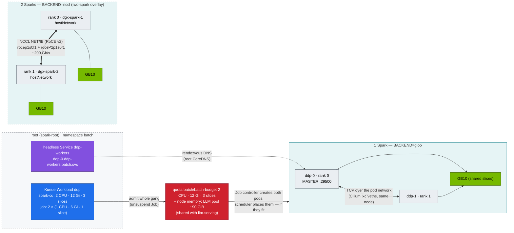

# Chapter 18 · Distributed AI Training & NCCL: torchrun, RoCE over CX-7 & Hang Diagnosis

> **02-Kubernetes · Part VI — Distributed training & fabrics · Chapter 18 of 28** · ← [Chapter 17 · NVIDIA GPU Operator & Network Operator](17-nvidia-gpu-operator-and-network-operator.md) · [All chapters](00-kubernetes-step-by-step-guide.md) · [Chapter 19 · Large-scale SuperPOD & network fabrics](19-large-scale-superpod-and-network-fabrics.md) →

| | |
|---|---|
| **You will build** | A torchrun job that needs no training operator: an Indexed Job, a headless Service and Kueue gang admission, in the root cluster's `batch` namespace next to the serving tier. You'll run an all-reduce bandwidth sweep that uses `gloo` on one Spark and NCCL over RoCE on two, find out what happens when Kueue admits a gang that the namespace quota or the shared memory pool can't hold, and learn a repeatable procedure for the two classic failures: the silent hang and the straggler |
| **Clusters** | `spark-root` (the job, Kueue, the headless Service, the `batch-budget` quota, host-side evidence, dgx-spark-2) |
| **Hardware** | dgx-spark-1 (§5.1–5.4). dgx-spark-2 + QSFP cable for §5.5 |
| **Time** | 90 min |
| **Risk** | Low |
| **Lab files** | [`manifests/root-llms/80-distributed/base/`](lab/manifests/root-llms/80-distributed/base/) (`allreduce_bench.py`, `ddp-job.yaml`), [`two-spark/`](lab/manifests/root-llms/80-distributed/two-spark/kustomization.yaml), [`resilient/`](lab/manifests/root-llms/80-distributed/resilient/) (Chapter 25), [`manifests/root-llms/20-scheduling/kueue.yaml`](lab/manifests/root-llms/20-scheduling/kueue.yaml), [`manifests/root-llms/10-tenancy/quotas.yaml`](lab/manifests/root-llms/10-tenancy/quotas.yaml), [`manifests/root-llms/85-network-operator/`](lab/manifests/root-llms/85-network-operator/) |

---

## 1. Why this matters on a Spark

A single Spark trains and fine-tunes models up to its memory limit. Two Sparks joined by the CX-7 cable are a real 2-node distributed system, the smallest one that shows every production failure mode: rendezvous, NCCL transport selection, RDMA configuration, stragglers and hangs.

In this lab, training runs on the root cluster in namespace `batch`, next to the models in `llm-serving`. It is admitted by Kueue's `spark-cq`, then its pods have to pass the `batch-budget` ResourceQuota and fit the node's memory, which batch **shares** with the serving tier. That second gate is where single-box training most often surprises people.

### 1.1 The memory equation that decides single vs multi-node — and which budget

Training memory ≈ weights + gradients + optimizer state + activations. For mixed precision with Adam:

| Method | Bytes per parameter (approx.) | 7B model | 32B model | Fits one Spark (~109.7 GiB allocatable)? | Fits `batch` (spark-cq / batch-budget 12 Gi)? |
|---|---|---|---|---|---|
| Full fine-tune, BF16 + FP32 Adam | ~16 | ~112 GB + activations | ~512 GB | 7B: no. 32B: no | no |
| Full fine-tune, 8-bit Adam | ~10 | ~70 GB | ~320 GB | 7B: yes. 32B: no | no |
| LoRA on BF16 base | ~2 (+ small adapter) | ~15 GB | ~65 GB | yes / yes | no / no |
| QLoRA on 4-bit base | ~0.6 (+ adapter) | ~5 GB | ~20 GB | yes / yes | 7B: yes. 32B: no |

The Spark has ~121.7 GiB of unified memory, ~109.7 GiB allocatable after reservations (Chapter 01 §3.3), and that is CPU *and* GPU memory. The root keeps ~90 GiB of it as one LLM memory pool, shared by `llm-serving` (up to 90 Gi) and `batch` (up to 12 Gi). `spark-cq` and the `batch-budget` quota carry the same numbers: 2 CPU · 12 Gi · 3 slices (`root-llms/10-tenancy/quotas.yaml`; the `batch` LimitRange sets defaults only, no max, so one container may use the whole 12 Gi). Running models take their memory from the same pool and the same UMA (Chapter 20 §2), and every GPU container sets memory request = limit, so a training pod that doesn't fit next to the models waits Pending: training waits for serving, never the reverse. A bigger job is a decision for the platform team: raise `batch-budget` and `spark-cq` together and give serving less (CPU and slices on the root are split exactly, Chapter 04 §3.2), or park a model while the job runs. Two Sparks with FSDP/ZeRO-3 shard weights, gradients and optimizer state, which roughly halves the per-node figure (modules 03 and 05 go deep).

---

## 2. Architecture — HLD



**Why `gloo` on one Spark?** NCCL requires one distinct GPU per rank. Two ranks on two time-slices of the *same* GB10 fail with `Duplicate GPU detected`. On one Spark you learn the orchestration with gloo, and on two you get the real NCCL path.

**Why two gates?** Kueue admits *workloads* against its own books: `spark-cq` and the jobs submitted to it, nothing else. The `batch-budget` quota counts every *pod* in `batch`, including pods Kueue never saw, and the scheduler counts the node's real memory, which serving shares. Both see pods one at a time, as the Job controller creates them. Kueue's all-or-nothing promise therefore holds only if the quota and the node have room for the whole gang (§5.3).

---

## 3. LLD

### 3.1 Job wiring ([`ddp-job.yaml`](lab/manifests/root-llms/80-distributed/base/ddp-job.yaml))

| Piece | Value | Purpose |
|---|---|---|
| Job | `completionMode: Indexed`, `completions=parallelism=2`, `backoffLimit: 0` | rank = `JOB_COMPLETION_INDEX`. Any failure fails the job (no half-restarted ranks) |
| Pod DNS | `subdomain: ddp-workers` → `ddp-<i>.ddp-workers.batch.svc.cluster.local` | stable rendezvous address, answered by the root's CoreDNS |
| Service | headless, `publishNotReadyAddresses: true` | rank 1 can resolve rank 0 before readiness |
| Kueue | label `kueue.x-k8s.io/queue-name: train`, `suspend: true` | both ranks or neither — *within spark-cq's books* (Chapter 07) |
| Resources per rank | requests = limits: `cpu: 1`, `memory: 6Gi`, `nvidia.com/gpu: 1` | gang total 2 CPU · 12 Gi · 2 slices: exactly spark-cq's CPU and memory. The third slice stays unused, and any other batch job waits until the gang finishes |
| Priority | `spark-batch` | below `spark-serving`: the scheduler preempts training before serving |
| `/dev/shm` | `emptyDir: {medium: Memory, sizeLimit: 2Gi}` | NCCL/gloo and DataLoader workers use shared memory. The 64 MiB default breaks them. On UMA it's also GPU-side memory, so keep it sized |
| `TORCH_NCCL_ASYNC_ERROR_HANDLING=1` | turns a hung collective into an exception after the timeout | hangs become failures you can see |

### 3.2 Budget arithmetic: what fits beside what

| Consumer | CPU req | Memory (request = limit) | Slices | Source |
|---|---|---|---|---|
| `batch` budget (`batch-budget` = `spark-cq`) | **2** | **12 Gi** | **3** | `root-llms/10-tenancy/quotas.yaml`, `20-scheduling/kueue.yaml` |
| `llm-serving` budget (`serving-budget`) | **8** | **up to 90 Gi** | **6** | `root-llms/10-tenancy/quotas.yaml` |
| LLM memory pool, shared by both | — | **~90 GiB** | — | `python3 tests/budget_check.py` |
| `ddp` gang (this chapter) | 2 | 12 Gi | 2 | `80-distributed/base` |
| `resilient-train` (Chapter 25) | 1 | 12 Gi | 1 | `80-distributed/resilient` |
| `vllm` (Chapter 20) | 1500m | 32 Gi | 1 | `90-serving/vllm/vllm.yaml` |

Add the rows you plan to run together before you start. CPU and slices are batch's own; memory is not. The `ddp` gang takes all of batch's 2 CPU and 12 Gi, so `resilient-train` waits for it. Next to one `vllm` (32 Gi) the gang fits easily: 32 + 12 = 44 of ~90 GiB. With models holding more than ~78 GiB of the pool, the ranks are created but wait Pending with `Insufficient memory` until serving shrinks. Read it live with `kubectl --context spark-root -n batch describe resourcequota batch-budget` and `kubectl --context spark-root describe node dgx-spark-1 | grep -A8 'Allocated resources'`.

Jobs bigger than batch's everyday share (fine-tuning a 7–8B model, ZeRO-3) run in the **training window**: park the model servers, `kubectl --context spark-root apply -k manifests/root-llms/training-window` (batch 8 CPU · 80 Gi, serving 2 CPU · 10 Gi), and re-apply `root-llms/10-tenancy` and `root-llms/20-scheduling` afterwards ([Chapter 07 §3.2](07-kube-scheduler-and-ai-batch-scheduling.md)).

### 3.3 NCCL environment (two-spark overlay)

| Variable | Value | Why |
|---|---|---|
| `NCCL_SOCKET_IFNAME` | `enp1s0f1np1` | bootstrap/OOB over the CX-7, not the 10 GbE |
| `NCCL_IB_HCA` | `rocep1s0f1,roceP2p1s0f1` | both logical halves of the QSFP port (see 01-Ansible host_vars; confirm with `ibdev2netdev`) |
| `NCCL_IB_GID_INDEX` | `3` | RoCE v2 IPv4 GID (`show_gids` to confirm) |
| `NCCL_DEBUG` | `INFO` (then `WARN`) | shows the chosen transport: `NET/IB` good, `NET/Socket` bad |
| pod | `hostNetwork: true`, `dnsPolicy: ClusterFirstWithHostNet`, required pod anti-affinity on `kubernetes.io/hostname` | sees RoCE devices, one rank per Spark. Allowed because `batch` enforces PSA `privileged`, warning at `baseline` (`root-llms/00-platform`) |

Alternatives to `hostNetwork`, both giving the pod a second interface `net1` on the CX-7 — set `NCCL_SOCKET_IFNAME=net1`:

- Network Operator: `rdma/rdma_shared_cx7` + MacvlanNetwork `cx7-rdma` with `networkNamespace: batch` (Chapter 17 §5.6).
- 01-Ansible `21.1-multus-rdma.yml`: Multus + NADs `cx7-a`/`cx7-b` (static IPAM) in `platform-tools` and `batch` (`multus_nad_namespaces`). The pod picks its IP in the annotation, e.g. `k8s.v1.cni.cncf.io/networks: '[{"name":"cx7-a","ips":["192.168.100.21/24"]}]'`.

Either way the NAD must be in `batch`: Multus looks for it in the pod's own namespace.

### 3.4 Bus bandwidth

`busbw = algbw × 2(n−1)/n` for all-reduce, where algbw = bytes / time. For n = 2, busbw = algbw. That's the number to compare against the link's line rate (200 Gb/s ≈ 25 GB/s).

---

## 4. Integrations

- **01-Ansible `14.2-nccl-test.yml` / `13.2-rdma-perftest.yml`** give the **host baseline** (`ib_write_bw`, `all_reduce_perf`) with no Kubernetes. If the pod result is much lower than the host result, the gap is in the pod setup: network path, `/dev/shm`, `IPC_LOCK`, GID — or CPU throttling from the 1-CPU limit.
- **Kueue (Chapter 07)** gangs the ranks on the root. **The `batch-budget` quota and the shared memory pool (Chapter 04 §3.2)** decide whether the gang's pods fit. **Storage (Chapter 13)** holds checkpoints. **Chapter 25** covers elastic/fault-tolerant training with `80-distributed/resilient`.
- **Modules 03/05/06** replace `allreduce_bench.py` with real FSDP/DeepSpeed/Megatron jobs on the same wiring.

---

## 5. Lab

Set up once: Kueue on the root, the LLM-stack namespaces and quotas, and the `spark-cq` queue.

```bash
# ▶ MacBook · technical-depth (repo root)
export KUBECONFIG="$PWD/01-Ansible/lab/.cache/kubeconfig-spark-lab.yaml"
cd "02-Kubernetes/lab"
scripts/install-addons.sh kueue                       # on the root, once
kubectl --context spark-root apply -k manifests/root-llms/00-platform && kubectl --context spark-root apply -k manifests/root-llms/10-tenancy
kubectl --context spark-root apply -k manifests/root-llms/20-scheduling   # ResourceFlavor gb10, ClusterQueue spark-cq, LocalQueue batch/train
kubectl --context spark-root -n batch describe resourcequota batch-budget   # note what's already used
```

### 5.1 One Spark: gang-admitted 2-rank job with gloo

#### What this lab does (manifests `lab/manifests/root-llms/80-distributed/base`)

- **Setup (the block above, once):** installs Kueue on the root, applies the `llm-serving`/`batch` namespaces and their quotas, and the Kueue objects: ResourceFlavor `gb10`, ClusterQueue `spark-cq` (2 CPU · 12 Gi · 3 slices), LocalQueue `batch/train`.
- **Creates in `batch`:** ConfigMap `allreduce-bench` (the benchmark script), headless Service `ddp-workers` (port 29500), and Indexed Job `ddp` with 2 ranks. The Job starts suspended; Kueue admits both ranks together or neither.
- **Each rank:** 1 CPU, 6 Gi (request = limit), 1 GPU slice, a 2 Gi memory-backed `/dev/shm`. torchrun connects the ranks through `ddp-0.ddp-workers.batch.svc.cluster.local`.
- **What runs:** an all-reduce sweep from 1 MiB to 1 GiB with the **gloo** backend on CPU tensors (NCCL can't put two ranks on one GPU, §5.2), then a correctness check. The first run pulls the NGC PyTorch image.

#### What to look for

1. **Command exit:** `apply -k` prints `configmap/allreduce-bench`, `service/ddp-workers` and `job.batch/ddp` created. `get workloads` shows one workload with `ADMITTED` `True`.
2. **Pods:** two, `ddp-0-…` and `ddp-1-…`, both `Running` then `Completed`, both on `dgx-spark-1`.
3. **Rank 0 log:**

   | Line | Healthy value |
   |---|---|
   | first line | `backend=gloo world=2 device=cpu` |
   | size rows | six rows, `1048576` up to `1073741824`; `algbw` = `busbw` (n = 2). The numbers measure the pod network and 1 CPU, not the GPU |
   | last line | `correctness OK: sum(1..2) = 3.0` |

4. **Books, while the ranks run:** `spark-cq` shows `cpu=2 memory=12Gi nvidia.com/gpu=2`, and `batch-budget` shows the same used, if nothing else runs in `batch`. Both drop back once the job completes.

**If something's off:** workload not admitted → `spark-cq` full or the LocalQueue missing (`kubectl --context spark-root -n batch describe workload`). Only one pod → §5.3 explains the two gates. Rank 0 waits forever with both pods `Running` → rank 1 can't resolve `ddp-0.ddp-workers`. More in §7.

#### Run it

```bash
# ▶ MacBook · 02-Kubernetes/lab
kubectl --context spark-root apply -k manifests/root-llms/80-distributed/base
kubectl --context spark-root -n batch get workloads
kubectl --context spark-root -n batch get pods -l job-name=ddp -o wide
kubectl --context spark-root -n batch logs -f -l job-name=ddp --prefix --max-log-requests=2
```

Expected (rank 0; the numbers are illustrative):

```text
backend=gloo world=2 device=cpu
      size   time_ms  algbw_GB/s  busbw_GB/s
   1048576      0.61        1.72        1.72
   …
1073741824    312.40        3.44        3.44
correctness OK: sum(1..2) = 3.0
```

gloo moves CPU tensors over TCP through the pod network. The numbers measure *that* path (and a 1-CPU limit per rank), not the GPU.

See what Kueue booked:

```bash
# ▶ MacBook · 02-Kubernetes/lab
kubectl --context spark-root get clusterqueue spark-cq -o jsonpath='{range .status.flavorsUsage[0].resources[*]}{.name}={.total} {end}{"\n"}'
kubectl --context spark-root -n batch describe resourcequota batch-budget
```

Both show 2 CPU · 12 Gi · 2 slices in use: the queue and the quota agree because the gang is the only thing in `batch`. Job, Workload, ClusterQueue, pods and Service all live in the same cluster; the pods keep their own names (`ddp-0-…`, `ddp-1-…`).

### 5.2 See NCCL refuse duplicate GPUs

#### What this lab does (the §5.1 job with `BACKEND=nccl`)

- **Deletes the gloo job** and re-creates it with one change: the backend is `nccl`, so each rank uses the GPU.
- **Both ranks get the same GB10:** two time-slices are two tickets to one GPU, with the same UUID.
- **NCCL refuses to start**, the ranks fail, and the job is deleted at the end. Nothing else changes.

#### What to look for

1. **Command exit:** the `apply` prints `job.batch/ddp created`. The pods end in `Error`, not `Completed`.
2. **The log** contains `ncclInvalidUsage` and `Duplicate GPU detected : rank 1 and rank 0 both on CUDA device …`.

**If something's off:** the `grep` prints nothing → the pods have not started yet (image pull or Kueue admission); wait and run the `logs` line again. A gloo-style table appears → the `sed` did not change the backend; check `kubectl --context spark-root -n batch get job ddp -o yaml | grep -A1 BACKEND`.

#### Run it

```bash
# ▶ MacBook · 02-Kubernetes/lab
kubectl --context spark-root -n batch delete job ddp
kubectl kustomize manifests/root-llms/80-distributed/base | sed 's/value: gloo/value: nccl/' | kubectl --context spark-root apply -f -
kubectl --context spark-root -n batch logs -l job-name=ddp --prefix | grep -iE 'duplicate|error' | head -3
kubectl --context spark-root -n batch delete job ddp
```

Expected: `ncclInvalidUsage … Duplicate GPU detected : rank 1 and rank 0 both on CUDA device …`. **One rank per physical GPU** is a hard NCCL rule, and time-slicing doesn't change it: the device plugin handed both pods the same GB10 UUID.

### 5.3 Rendezvous and the two gates

#### What this lab does (Deployment `slice-filler`, the `ddp` job with and without its Kueue label)

- **Creates `slice-filler`** in `batch`: tiny CUDA pods that hold one GPU slice each and run outside Kueue. It is scaled so exactly **one** slice of `batch-budget` stays free.
- **Runs `ddp` without the Kueue label** and unsuspended: the Job controller creates rank 0, and the namespace quota refuses rank 1.
- **Runs `ddp` again with the label:** Kueue admits the gang (its own books still show room), and the quota still refuses rank 1. Kueue can't see what runs outside its queue.
- **Cleans up:** deletes the job and the filler. Needs `yq` on the MacBook.

#### What to look for

1. **Command exit:** `slice-filler` scales to `HARD - USED - 1` replicas (with an idle `batch`, that is 2).
2. **Without the label:** `get pods` shows one `ddp` pod `Running` and no second pod. `describe job ddp` ends with a `FailedCreate` event: `exceeded quota: batch-budget, requested: requests.nvidia.com/gpu=1 …`. Read which resources the event names; with the filler's CPU and memory, `requests.cpu` and `limits.memory` can appear too.
3. **With the label:** `get workloads -o wide` shows `ADMITTED` `True`, and still only one pod `Running`.
4. **After cleanup:** `kubectl --context spark-root -n batch get pods` shows no `ddp` and no `slice-filler` pods.

**If something's off:** `slice-filler` scale fails with a negative number → `batch-budget` has fewer free slices than expected; something else runs in `batch` (`kubectl --context spark-root -n batch get pods`). Rank 1 is created but `Pending` with `Insufficient memory` → the node gate, not the quota gate: models in `llm-serving` hold the shared pool (§3.2). More in §7.

#### Run it

First the familiar failure: no gang at all. Leave exactly one GPU slice free in `batch-budget` with a filler, then submit the job **without** its Kueue label:

```bash
# ▶ MacBook · 02-Kubernetes/lab
kubectl --context spark-root -n batch create deployment slice-filler --replicas=0 \
  --image=nvcr.io/nvidia/cuda:13.0.1-base-ubuntu24.04 -- sleep infinity
kubectl --context spark-root -n batch set resources deploy slice-filler --limits=nvidia.com/gpu=1,memory=32Mi --requests=cpu=10m,memory=32Mi
read HARD USED < <(kubectl --context spark-root -n batch get resourcequota batch-budget \
  -o jsonpath='{.status.hard.requests\.nvidia\.com/gpu} {.status.used.requests\.nvidia\.com/gpu}')
kubectl --context spark-root -n batch scale deploy slice-filler --replicas=$((HARD - USED - 1))
kubectl kustomize manifests/root-llms/80-distributed/base \
  | yq 'with(select(.kind=="Job"); del(.metadata.labels["kueue.x-k8s.io/queue-name"]) | .spec.suspend = false)' \
  | kubectl --context spark-root apply -f -
kubectl --context spark-root -n batch get pods -l job-name=ddp                 # one Running, no second pod
kubectl --context spark-root -n batch logs -l job-name=ddp --prefix --tail=3   # the running rank waits in c10d rendezvous
```

Now ask *why* there is no second rank:

```bash
# ▶ MacBook · 02-Kubernetes/lab
kubectl --context spark-root -n batch describe job ddp | tail -5
```

Expected: a `FailedCreate` event from the Job controller — `exceeded quota: batch-budget, requested: requests.nvidia.com/gpu=1 …` (with the filler's CPU and memory in use, `requests.cpu` and `limits.memory` are named too: read which resources). The quota refused the pod at admission, so it never existed and the scheduler never had a chance to queue it. Same deadlock as Chapter 07, one gate later.

Then put the Kueue label back:

```bash
# ▶ MacBook · 02-Kubernetes/lab
kubectl --context spark-root -n batch delete job ddp
kubectl --context spark-root apply -k manifests/root-llms/80-distributed/base
kubectl --context spark-root -n batch get workloads -o wide                    # ADMITTED: True
kubectl --context spark-root -n batch get pods -l job-name=ddp                 # still one Running, no second pod
```

Kueue admitted the gang: `spark-cq` had 3 free slices, 2 CPU and 12 Gi on its books; the gang needs 2 slices, 2 CPU and 12 Gi. It has no idea that the filler (outside any LocalQueue) spent part of `batch-budget`. The Job controller then created rank 0, the quota let it in, and refused rank 1. The node is the other gate: when the models in `llm-serving` hold most of the shared memory pool, the quota admits both ranks, and rank 1 waits Pending with `Insufficient memory` instead. **Kueue's all-or-nothing guarantee only holds when the quota and the node have room for the whole gang.** Three ways to make that true:

1. Keep everything that runs in `batch` under Kueue, so `spark-cq` and `batch-budget` (same numbers) are one ledger.
2. Leave 12 Gi of the pool free before a training run: park or shrink a model (the sum of `--gpu-memory-utilization` is the lever, Chapter 20 §2). Serving is never squeezed by training; training waits.
3. Raise `batch-budget` and `spark-cq` together (Chapter 04 §3.2) — the only fix that adds capacity for batch, and it comes out of serving's CPU and slices.

Clean up:

```bash
# ▶ MacBook · 02-Kubernetes/lab
kubectl --context spark-root -n batch delete job ddp
kubectl --context spark-root -n batch delete deploy slice-filler
```

### 5.4 Diagnose a hang and a straggler

#### What this lab does (the gloo `ddp` job with a frozen rank 1)

- **Runs the §5.1 job with one change:** 20 s after start, rank 1 freezes its Python processes (SIGSTOP) for 90 s, then resumes. Rank 0 is untouched.
- **Shows a straggler from the healthy side:** rank 0 just waits, with no error.
- **Triage tools:** `py-spy dump` on rank 0 (installed with `pip` inside the pod), the process `State` of rank 1, and `scripts/cgroup-inspect.sh` on the Spark for rank 1's cgroup CPU throttling.
- **Cleans up:** deletes the job. Needs `yq` on the MacBook.

#### What to look for

1. **Command exit:** `job.batch/ddp created`, both ranks `Running`.
2. **Rank 0's table:** one size row's `time_ms` jumps to thousands of ms (the 90 s pause, averaged over that row's 10 timed iterations) where the others take milliseconds. No error is printed; the job still ends with `correctness OK`.
3. **During the freeze:**

   | Check | What you should see |
   |---|---|
   | `py-spy dump` on rank 0 | the stack sits in `all_reduce`: it waits for a peer |
   | rank 1 `State` lines | `T (stopped)` |
   | `cgroup-inspect.sh` on rank 1 | `cpu.max` `100000 100000` (1 CPU); `nr_throttled` small for this job. A real DataLoader at 1 CPU makes it climb |

**If something's off:** no slow row → the `pkill` pattern did not match (check `kubectl --context spark-root -n batch logs <rank-1 pod>`), or the job finished before the 20 s mark. `py-spy` fails with a permission error → the container lacks `SYS_PTRACE`; use the `State` check instead. `cgroup for pod uid … not found` → run the script on the node that hosts the pod. More in §7.

#### Run it

Simulate a straggler: add a sleep to rank 1 only.

```bash
# ▶ MacBook · 02-Kubernetes/lab
kubectl --context spark-root -n batch delete job ddp --ignore-not-found
kubectl kustomize manifests/root-llms/80-distributed/base | yq 'with(select(.kind=="Job");
  .spec.template.spec.containers[0].args[0] += " & if [ \"$JOB_COMPLETION_INDEX\" = 1 ]; then sleep 20; pkill -STOP -f \"allreduce_bench[.]py$\"; sleep 90; pkill -CONT -f \"allreduce_bench[.]py$\"; fi; wait")' \
  | kubectl --context spark-root apply -f -
kubectl --context spark-root -n batch logs -f -l job-name=ddp --prefix
```

After 20 s, rank 1's Python processes freeze (SIGSTOP) for 90 s. The pattern `allreduce_bench[.]py$` matches torchrun and its worker but not the wrapping shell, whose command line doesn't *end* in `.py`. Rank 0's all-reduce timings jump from milliseconds to ~90 s for one step, **with no error**. That's what a straggler (thermal throttle, noisy neighbour, bad link) looks like from the healthy rank.

The hang triage sequence, from inside the pods:

```bash
# ▶ MacBook · 02-Kubernetes/lab
R0=$(kubectl --context spark-root -n batch get pod -l job-name=ddp,batch.kubernetes.io/job-completion-index=0 -o name)
R1=$(kubectl --context spark-root -n batch get pod -l job-name=ddp,batch.kubernetes.io/job-completion-index=1 -o name)
kubectl --context spark-root -n batch exec "$R0" -- sh -c 'pip install -q py-spy && py-spy dump --pid $(pgrep -f "python.*allreduce_bench" | tail -1)'
kubectl --context spark-root -n batch exec "$R1" -- sh -c 'for p in $(pgrep -f allreduce_bench); do grep State /proc/$p/status; done'
```

…and from the host, on the Spark, where the rank runs:

```bash
# ▶ dgx-spark-1 (ssh dgx-spark-1)
# from 02-Kubernetes/lab in a copy of this repo on the Spark, with the lab kubeconfig exported
R1=<rank 1's pod name, as printed on the MacBook>
scripts/cgroup-inspect.sh batch "${R1#pod/}"      # context defaults to spark-root
```

Look at `cpu.stat`: a rank capped at `cpu: 1` that runs a DataLoader with several workers shows `nr_throttled` climbing — a straggler the job built for itself (Chapter 14 §5.3).

| Evidence | Reading |
|---|---|
| all ranks in `all_reduce` / `ncclKernel` | collective waiting for a peer. Find the rank that *isn't* there |
| one rank in dataloader / I/O / `T (stopped)` | that rank is the straggler |
| one rank's cgroup with `nr_throttled` rising | CPU limit too tight for its data pipeline |
| a rank missing with a `FailedCreate … exceeded quota: batch-budget` event on the Job, or `Pending` with `Insufficient memory` | not a hang: the gang never formed (§5.3) |
| `NCCL WARN … Timeout` then `ProcessGroupNCCL … watchdog` after `TORCH_NCCL_ASYNC_ERROR_HANDLING` | hang converted to an error. Check that rank's node |

```bash
# ▶ MacBook · 02-Kubernetes/lab
kubectl --context spark-root -n batch delete job ddp
```

### 5.5 Two Sparks: NCCL over RoCE

#### What this lab does (overlay `lab/manifests/root-llms/80-distributed/two-spark`)

- **Same `ddp` job, patched for two Sparks:** `hostNetwork: true`, `dnsPolicy: ClusterFirstWithHostNet`, a required anti-affinity that puts one rank on each Spark, and `BACKEND=nccl`.
- **NCCL settings:** bootstrap over the CX-7 interface `enp1s0f1np1`, both RoCE HCAs `rocep1s0f1,roceP2p1s0f1`, GID index 3, `NCCL_DEBUG=INFO` so the log shows the transport.
- **Budgets don't change:** the gang still takes 2 CPU · 12 Gi · 2 slices of `batch-budget` and `spark-cq`.
- **One Spark only:** skip this lab. With one node, the anti-affinity leaves rank 1 `Pending` forever.

#### What to look for

1. **Command exit:** `job.batch/ddp created`; `get pods -o wide` shows one rank on `dgx-spark-1` and one on `dgx-spark-2`.
2. **The NCCL lines:**

   | Line | Healthy value |
   |---|---|
   | `NCCL INFO NET/IB : Using …` | both `rocep1s0f1` and `roceP2p1s0f1`, `/RoCE`, OOB on `enp1s0f1np1` |
   | `NCCL INFO Using network` | `IB`, never `Socket` |
   | 1 GiB row, `busbw_GB/s` | in the low twenties; at least 80 % of the 01-Ansible host baseline (`14.2-nccl-test.yml`) |
   | last line | `correctness OK: sum(1..2) = 3.0` |

**If something's off:** `NET/Socket` or single-digit GB/s → RDMA devices not visible or wrong GID/MTU (§7). Rendezvous fails → check the pod's `dnsPolicy` and `resolv.conf` with the commands below. More in §7.

#### Run it

Prerequisites: dgx-spark-2 joined the root as a worker (Chapter 05 §9; `kubectl --context spark-root get nodes` lists it), 01-Ansible `13.2-rdma-perftest.yml` ≥ 180 Gb/s. The gang still needs 2 CPU · 12 Gi · 2 slices of `batch-budget` and `spark-cq`; dgx-spark-2 adds 15 slices and its memory to the root's nodes, not to those budgets.

```bash
# ▶ MacBook · 02-Kubernetes/lab
kubectl --context spark-root apply -k manifests/root-llms/80-distributed/two-spark
kubectl --context spark-root -n batch get pods -l job-name=ddp -o wide          # one on dgx-spark-1, one on dgx-spark-2
kubectl --context spark-root -n batch logs -l job-name=ddp --prefix | grep -E 'NCCL INFO (NET/|Using network|Channel 00)|busbw|correctness' | head -20
```

Look for:

```text
NCCL INFO NET/IB : Using [0]rocep1s0f1:1/RoCE [1]roceP2p1s0f1:1/RoCE ; OOB enp1s0f1np1:192.168.100.11<0>
NCCL INFO Using network IB
…
1073741824     48.9       21.96       21.96
correctness OK: sum(1..2) = 3.0
```

A large-message busbw in the low twenties of GB/s means you're close to line rate. If you see `NET/Socket` or single-digit GB/s, go to §7.

With `hostNetwork`, the pod IPs are the node IPs, and rank 1 still has to resolve `ddp-0.ddp-workers.batch.svc.cluster.local`. If rendezvous fails, check what DNS the pod really got:

```bash
# ▶ MacBook · 02-Kubernetes/lab
R1=$(kubectl --context spark-root -n batch get pod -l job-name=ddp,batch.kubernetes.io/job-completion-index=1 -o name)
kubectl --context spark-root -n batch get "$R1" -o jsonpath='{.spec.dnsPolicy}{"\n"}'
kubectl --context spark-root -n batch exec "$R1" -- cat /etc/resolv.conf
```

`ClusterFirstWithHostNet` makes a hostNetwork pod use the cluster's CoreDNS (the `kube-dns` Service IP in `resolv.conf`) instead of the node's resolver, which knows nothing about `*.svc.cluster.local`.

```bash
# ▶ MacBook · 02-Kubernetes/lab
kubectl --context spark-root delete -k manifests/root-llms/80-distributed/two-spark
```

---

## 6. Verify

| Check | Expected |
|---|---|
| gloo job | `correctness OK`, both ranks admitted together, `spark-cq` and `batch-budget` both show 2 CPU · 12 Gi · 2 slices used |
| NCCL on one GPU | `Duplicate GPU detected` (by design) |
| Kueue vs namespace quota | with the filler, the Workload is `Admitted` and the Job reports `FailedCreate … exceeded quota: batch-budget` for one rank — you can name the resource |
| 2 Sparks | `Using network IB`, busbw at 1 GiB ≥ 80 % of the 01-Ansible host baseline |

---

## 7. Troubleshooting

| Symptom | Cause | Diagnose | Fix |
|---|---|---|---|
| rank 0 waits forever at start, rank 1 never created | `batch-budget` refused rank 1 — even though Kueue admitted the gang | `kubectl --context spark-root -n batch describe job ddp` (`FailedCreate … exceeded quota`); `kubectl --context spark-root -n batch describe resourcequota batch-budget` | remove non-Kueue pods from `batch`, or raise `batch-budget` and `spark-cq` together (§5.3, Chapter 04 §3.2) |
| rank 0 waits forever, rank 1 Pending with `Insufficient memory` | the models in `llm-serving` hold the shared memory pool | scheduler event; `kubectl --context spark-root describe node dgx-spark-1 \| grep -A8 'Allocated resources'` | wait, or park/shrink a model (§3.2). Training waits for serving by design |
| rank 0 waits forever, rank 1 Pending with `Insufficient nvidia.com/gpu` | all 15 slices on the node taken (platform, serving, batch, dev-lab, dev-llms together) | scheduler event; `kubectl --context spark-root get cm -n platform-tools gpu-slice-ledger -o yaml` | free slices; Kueue can't see what runs outside `spark-cq` |
| rank 0 waits forever, both Running | rank 1 can't resolve the master | `getent hosts ddp-0.ddp-workers.batch.svc.cluster.local` from rank 1 | `publishNotReadyAddresses` on the headless Service; check CoreDNS (`kubectl --context spark-root -n kube-system get pods -l k8s-app=kube-dns`) |
| Workload never admitted | spark-cq full, or the LocalQueue/ClusterQueue missing | `kubectl --context spark-root -n batch describe workload <name>` | apply `root-llms/20-scheduling`; free spark-cq quota |
| `Duplicate GPU detected` | two ranks on one GPU | NCCL log | 1 rank per GPU. gloo for single-GPU tests |
| `NET/Socket` instead of `NET/IB` | RDMA devices not visible in the pod | `ibv_devices` inside the pod | hostNetwork or `net1` via Network Operator / Multus (NAD in `batch`). `NCCL_IB_HCA` names |
| pod rejected: `violates PodSecurity "baseline": host namespaces` | PSA on `batch` tightened | the warning names the namespace | `privileged` enforce on `batch` for RDMA work (`root-llms/00-platform`) |
| `ibv_create_qp failed` / `Cannot allocate memory` | no `IPC_LOCK` / memlock limit | pod securityContext | add `IPC_LOCK` (batch is privileged for this) |
| NCCL connects then very slow | wrong GID index (RoCE v1 vs v2), MTU mismatch, only one of the two logical ports used | `show_gids`, `ip link` MTU on both, NCCL log channel list | `NCCL_IB_GID_INDEX=3`, MTU 9000 both ends, list both HCAs |
| One rank consistently slower | CPU throttling at the 1-CPU limit, thermal throttle | `scripts/cgroup-inspect.sh batch <pod>`; `nvidia-smi -q -d PERFORMANCE` | more CPU for the rank (and for spark-cq and `batch-budget`), fewer DataLoader workers |
| `Bus error` / DataLoader crash | `/dev/shm` too small | `df -h /dev/shm` in the pod | memory-backed emptyDir (the lab sets 2 Gi; it counts toward the container's memory) |
| Job restarts one rank only | `backoffLimit > 0` with non-elastic torchrun | job events | `backoffLimit: 0` + restart the whole job, or elastic torchrun (Chapter 25) |

---

## 8. Scale-out path

| Lab | Datacenter |
|---|---|
| Indexed Job + headless Service | JobSet / Kubeflow Trainer (`TrainJob`) / MPI Operator: same wiring, more features |
| Kueue on the root + a namespace quota + a memory pool shared with serving | Kueue with cohorts per team (one ledger, borrowing between serving and training), or MultiKueue dispatching to worker clusters |
| 2 ranks, 1 link | 8 GPUs/node over NVLink (NCCL `P2P/NVLS`) + 8 rails of 400 Gb/s IB/RoCE between nodes (Chapter 19) |
| hostNetwork RoCE | SR-IOV VFs per rail, GPUDirect RDMA, topology-aware placement (Kueue TAS), SHARP in-network reductions |
| gloo on one GPU | not needed. Real GPUs per rank |

---

## 9. Checklist

- [ ] I launched a gang-admitted 2-rank torchrun job with no training operator, on the root next to the serving tier, and read its use in `spark-cq` and `batch-budget`.
- [ ] I can explain why NCCL refuses two ranks on one time-sliced GPU.
- [ ] I reproduced "Kueue admitted, quota refused" and can name the three ways to prevent it.
- [ ] I produced and diagnosed a straggler from the healthy rank's point of view and from the host.
- [ ] (2 Sparks) NCCL reports `NET/IB` over both CX-7 halves, near line rate.
