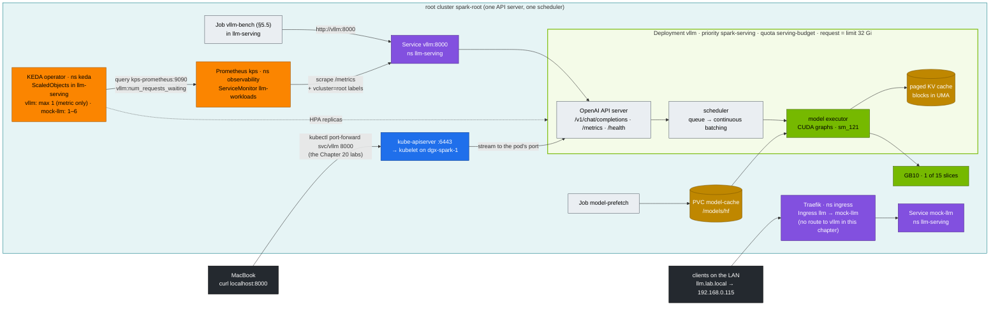
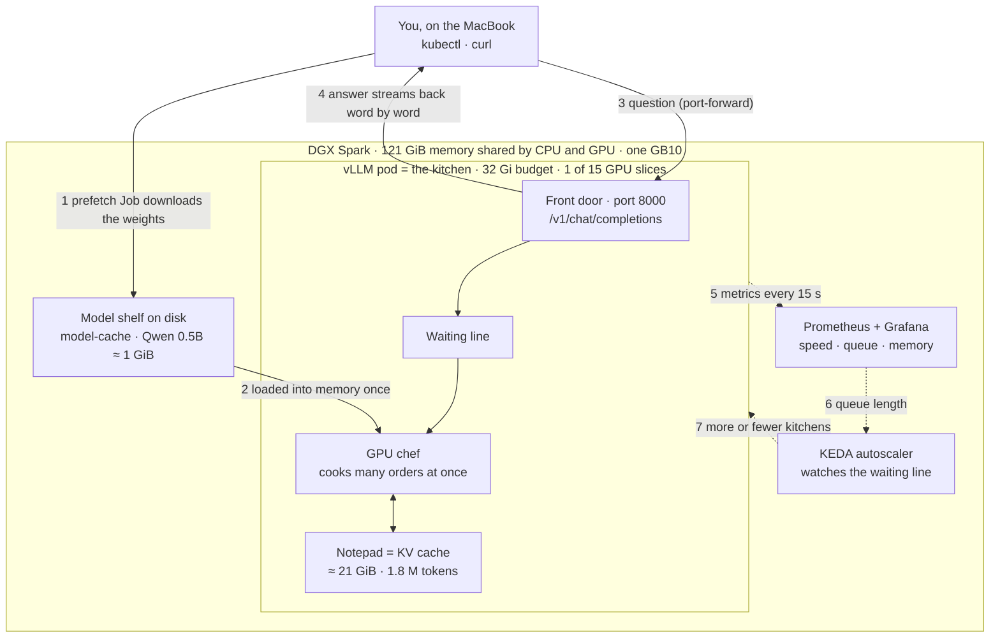
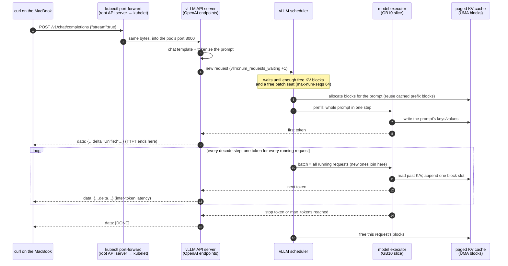

# Chapter 20 · vLLM High-Throughput LLM Serving: KV-Cache Budgeting, Probes, Autoscaling & Load Testing

> **02-Kubernetes · Part VII — LLM serving · Chapter 20 of 28** · ← [Chapter 19 · Large-scale SuperPOD & network fabrics](19-large-scale-superpod-and-network-fabrics.md) · [All chapters](00-kubernetes-step-by-step-guide.md) · [Chapter 21 · NVIDIA Triton Inference Server](21-nvidia-triton-inference-server.md) →

| | |
|---|---|
| **You will build** | A production-shaped vLLM Deployment in the root's `llm-serving` namespace: shared model cache, startup/readiness/liveness probes, graceful drain, UMA-aware memory flags, metrics scraped by the root's Prometheus, queue-depth autoscaling with KEDA, a repeatable benchmark that gives you TTFT/TPOT/throughput for your GB10 — and a sizing table that shows which engines fit `serving-budget` together |
| **Hardware** | dgx-spark-1 |
| **Time** | 90 min |
| **Risk** | Low. The engine takes ~24 GiB of UMA at `--gpu-memory-utilization 0.20`; the pod may use up to 32 Gi of the `llm-serving` budget |
| **Clusters** | `spark-root` (the Deployment and its cgroup, the `serving-budget` quota, KEDA, Traefik, Prometheus, alerts) · optionally `dev-llms` (try the manifest in `llm-sandbox` first) |
| **Lab files** | [`manifests/root-llms/90-serving/vllm/`](lab/manifests/root-llms/90-serving/vllm/) (`vllm.yaml`, `vllm-bench.yaml`), [`manifests/root-llms/60-storage/model-prefetch-job.yaml`](lab/manifests/root-llms/60-storage/model-prefetch-job.yaml), [`manifests/root-llms/90-serving/autoscaling.yaml`](lab/manifests/root-llms/90-serving/autoscaling.yaml), [`manifests/root-llms/10-tenancy/quotas.yaml`](lab/manifests/root-llms/10-tenancy/quotas.yaml), [`manifests/root/95-observability/`](lab/manifests/root/95-observability/) (`rules.yaml`, `vcluster-workloads.yaml` with the ServiceMonitor `llm-workloads`), [`scripts/uma-watch.sh`](lab/scripts/uma-watch.sh) |

---

## 1. Why this matters on a Spark

vLLM's throughput comes from **PagedAttention** (the KV cache is paged in fixed blocks, like virtual memory, so it doesn't fragment) and **continuous batching** (new requests join the running batch at every decode step). On a Spark there's one extra rule: `--gpu-memory-utilization` is a fraction of the **whole unified pool** (≈121.7 GiB), the same memory DGX OS, the kubeadm control plane, both vCluster control planes, the page cache and every other pod use. On a discrete GPU, 0.90 is normal. Here, 0.90 would starve the whole machine.

And there are **two budgets**, both of which must hold:

1. **vLLM's own**: weights + activations + KV cache ≤ fraction × 121.7 GiB. At 0.20 that's ≈ 24 GiB.
2. **The cluster's**: the pod's memory request and limit (both 32 Gi) must fit `serving-budget` in `llm-serving` (up to 90 Gi), *and* the node must still have 32 Gi of allocatable memory that no other pod has requested — the ~90 GiB LLM memory pool is shared with the `batch` namespace, and the scheduler is what keeps the two from overcommitting it. Whether CUDA allocations are charged to the pod's cgroup is something you measure (Chapter 14 §5.5); the manifests are sized as if they are.

| Flag | What it controls | Lab value | Rule of thumb on a Spark |
|---|---|---|---|
| `--gpu-memory-utilization` | weights + activations + KV cache ≤ fraction × total | 0.20 | sum over all engines running at once ≲ 0.72 (§2) |
| `--max-model-len` | longest context per sequence | 8192 | only what users need. KV grows linearly |
| `--max-num-seqs` | concurrent sequences in the batch | 64 | lower → better latency, higher → throughput |
| `--enable-prefix-caching` | reuse KV for shared prefixes (system prompts, RAG templates) | on | almost always on |
| `--download-dir` / `HF_HOME` | where weights live | `/models/hf` (PVC `model-cache`) | never inside the container layer |

---

## 2. Architecture — HLD



**How requests reach vLLM in this chapter.** There is no Traefik route to `vllm` here: `llm.lab.local` still goes to `mock-llm` (Chapter 11), and the KEDA lab in §5.7 needs it there. The labs call vLLM through `kubectl port-forward svc/vllm 8000` (§5.2), which tunnels laptop → root API server → kubelet → pod; the benchmark Job in §5.5 calls the Service from inside the cluster. A Traefik route to a real model comes with the model modules: `qwen.lab.local` (04-Qwen Chapter 04) and `api.lab.local` through LiteLLM (03-DeepSeek Chapter 12).

Everything in this chapter is applied to the root (`--context spark-root`) and runs there under its real name: the vLLM pod is `vllm-…` in `llm-serving`, with no syncer in between. The root scheduler hands it a time-slice, the root's kube-proxy routes the Service, the root's Prometheus scrapes it, and KEDA (namespace `keda`, also on the root) queries that Prometheus directly at `http://kps-prometheus.observability.svc:9090`. If you want to try a changed manifest before it touches the running models, apply it to the `dev-llms` sandbox first (namespace `llm-sandbox`, a ~0.5B model at util 0.02, Chapter 04).

**Model memory on the root.** Of the ~109.7 GiB allocatable, the two vClusters take 4 Gi each and the platform (Cilium, MetalLB, GPU Operator, Prometheus, Traefik, Kueue, KEDA, platform-tools) ~11.7 GiB, which leaves an **LLM memory pool of about 90 GiB**, shared by `llm-serving` and `batch`. In `--gpu-memory-utilization` terms that is 90 / 121.7 ≈ 0.75; with some headroom the rule is: **the sum of the util values of all models running at the same time ≲ 0.72**. Each util value is a fraction of the whole pool (util × ~121.7 GiB). Sets that fit:

| Set running together | util values | Sum | ≈ UMA |
|---|---|---|---|
| three 7–8B models, 16k context | 0.20 + 0.20 + 0.20 | 0.60 | 3 × 24 GiB |
| one 32B FP8 + one 7B | 0.45 + 0.25 | 0.70 | 54 + 30 GiB |
| R1-Distill-32B BF16, alone | 0.70 | 0.70 | 84 GiB |

The quota is the second check, not the first: `serving-budget` (90 Gi of requests and of limits) holds two of the lab's 32 Gi engines plus the always-on pods, and every GPU container sets memory request = limit, so the scheduler places a model only where its full size is still free; a model that doesn't fit waits Pending instead of squeezing a running one. A set near 0.72 needs pod requests/limits sized from the Chapter 14 §5.5 measurement (is CUDA memory charged to the cgroup?), not from the util value. §9 has the lab's combinations.


#### The big idea, in plain words

A language model is a big file of numbers (its weights). On its own it does nothing. vLLM is the program that loads those numbers onto the GPU and answers questions over the network, the way ChatGPT does. Think of a restaurant kitchen:

- **The recipe book** = the model weights. Here the small Qwen 0.5B, about 1 GiB, kept on the `model-cache` shelf.
- **The front door** = port 8000 (`/v1/chat/completions`). Questions go in, answers come out.
- **The chef** = the GPU. A good chef cooks many orders at once and starts a new one the moment a pan is free: continuous batching.
- **The notepad** = the KV cache, where the chef keeps notes on every conversation in progress. A bigger notepad means more conversations at once (about 21 GiB, 1.8 M tokens at util 0.20).
- **The budget** = `serving-budget`: the kitchen may use 32 Gi of the 90 Gi the Spark sets aside for models, and 1 of its 15 GPU slices.

This chapter opens the kitchen (§5.1), serves a first customer (§5.2), watches its memory (§5.3), restarts it without cutting anyone off (§5.4), times it at rush hour (§5.5), puts it on a dashboard (§5.6) and lets it hire help when the line grows (§5.7). Three numbers matter throughout: **memory used**, **requests waiting** and **time to first token**.



### 2.1 One request, step by step



- **Steps 1–2 are only the lab's path.** Port-forward is a debugging tunnel through the API server; production traffic goes client → Traefik → Service → pod, as in Chapter 11.
- **Step 4 is what KEDA scales on.** `vllm:num_requests_waiting` counts requests in the queue; `vllm:num_requests_running` counts those in the batch (§3.3).
- **Steps 4–9 are TTFT**: queueing (the note before step 5) plus prefill. Steps 10–13 repeat once per output token; their spacing is the inter-token latency the benchmark reports (§5.5).
- **When the KV cache is full**, new requests wait before step 5, and under pressure vLLM preempts a running request, frees its blocks and recomputes it later (`vllm:num_preemptions`). That's why `--gpu-memory-utilization`, `--max-model-len` and `--max-num-seqs` decide throughput (§3.1).

---

## 3. LLD

### 3.1 KV-cache math

Per token, per sequence: `2 (K and V) × layers × kv_heads × head_dim × bytes_per_element`.

| Model | Layers | KV heads | Head dim | KV / token (BF16) | 8K context, 1 seq | 64 seqs × 2K tokens |
|---|---|---|---|---|---|---|
| Qwen2.5-0.5B-Instruct (lab smoke) | 24 | 2 | 64 | **12 KiB** | 96 MiB | 1.5 GiB |
| Qwen2.5-7B-Instruct | 28 | 4 | 128 | **56 KiB** | 448 MiB | 7 GiB |
| Llama-3.1-8B-Instruct | 32 | 8 | 128 | **128 KiB** | 1 GiB | 16 GiB |
| Qwen2.5-32B-Instruct | 64 | 8 | 128 | **256 KiB** | 2 GiB | 32 GiB |

Budget at `--gpu-memory-utilization 0.20` ≈ 24 GiB: the 0.5B model (≈1 GiB weights, a little more for activations and CUDA graphs) leaves ~21 GiB for KV — about 1.8 M tokens, far more than 64 × 8K. A 7B model in BF16 (~15 GiB weights) leaves ~7 GiB, ≈ 130 K tokens: it fits, at lower concurrency. A 32B model in BF16 (~64 GiB weights) doesn't fit 0.20 at all; it needs 0.70, nearly the whole LLM memory pool, and runs alone (§2). FP8 or AWQ-INT4 (~17–35 GiB) at 0.45 leaves room for a 7B beside it (modules 03/04). vLLM logs the exact figure at startup: `Available KV cache memory` / `GPU KV cache size: … tokens`.

### 3.2 Probes and lifecycle

| Mechanism | Setting | Protects against |
|---|---|---|
| `startupProbe` | `/health`, 10 s × 180 = 30 min | killing a pod that's still downloading or compiling (breakfix 05) |
| `readinessProbe` | `/health`, 5 s | routing to a loading or overloaded pod. Required in `llm-serving` by the CEL policy `spark-serving-needs-readiness` |
| `livenessProbe` | `/health`, 15 s × 4 | a wedged engine |
| `preStop: sleep 15` + `terminationGracePeriodSeconds: 120` | — | cutting in-flight streams on rollout (Chapter 09 §5.6) |
| `strategy: Recreate` | — | two copies of the model in UMA (and 2 × 32 Gi in the quota) during a rollout |
| `/dev/shm` 8 Gi | memory-backed emptyDir | tensor-parallel and worker IPC |

The probes are executed by the kubelet on dgx-spark-1 against the pod, and their results go straight into the pod status on the root API server — there is no second copy of the pod to update. The `preStop` sleep covers the propagation that matters for traffic: the pod leaving the Service's EndpointSlice, which is what kube-proxy and Traefik route by (Chapter 09).

### 3.3 Metrics you'll use

| Metric | Meaning |
|---|---|
| `vllm:num_requests_running` / `vllm:num_requests_waiting` | batch size / queue depth. **Scale on waiting** |
| `vllm:kv_cache_usage_perc` (older: `gpu_cache_usage_perc`) | KV-cache fill. Near 1.0 → preemptions |
| `vllm:num_preemptions` | sequences evicted and recomputed |
| `vllm:time_to_first_token_seconds` | TTFT histogram (prefill + queue) |
| `vllm:inter_token_latency_seconds` (older: `time_per_output_token_seconds`) | decode speed per token |
| `vllm:prompt_tokens` / `vllm:generation_tokens` | token throughput counters |

The root ServiceMonitor `llm-workloads` (in [`vcluster-workloads.yaml`](lab/manifests/root/95-observability/vcluster-workloads.yaml)) keeps only the engine Services in `llm-serving` and `ingress` and adds labels, so every series carries `vcluster="root"`, `vnamespace="llm-serving"`, `vservice="vllm"` and `vpod`. On the root, `vnamespace`/`vpod` simply repeat `namespace`/`pod`; the labels exist so the same queries also cover sandbox engines, which the ServiceMonitor `vcluster-workloads` in the same file labels `vcluster="dev-llms"`, `vnamespace="llm-sandbox"` (their `namespace` and `pod` are the translated root names, `vc-dev-llms` and `vllm-…-x-llm-sandbox-x-dev-llms`). The lab's rules in [`rules.yaml`](lab/manifests/root/95-observability/rules.yaml) aggregate by `vcluster, vnamespace` and use `A or B` so they work with both metric generations.

---

## 4. Integrations

- **Storage (Chapter 13)**: the prefetch Job fills `model-cache` (300 Gi, StorageClass `local-nvme-retain`), and vLLM starts from local NVMe. On the Spark the weights are under `/data/k8s/retain/llm-serving/model-cache` — the namespace and PVC name you wrote, since nothing translates them.
- **Ingress (Chapter 11)**: Traefik runs on the root next to the models (`ingress` namespace, `192.168.0.115`) and watches only `llm-serving` and `ingress`. Point an HTTPRoute at `vllm:8000` instead of `mock-llm` once you've proven the path with the mock.
- **Autoscaling**: KEDA (on the root) queries `kps-prometheus.observability` directly. On one GB10, extra replicas mostly add *queueing* capacity, not compute — and a second replica, which fits `serving-budget` (§9), costs another 0.20 of model memory for that. `maxReplicaCount: 1` until dgx-spark-2 joins.
- **Scheduling (Chapter 07)**: `spark-serving` is a root PriorityClass, and one root scheduler places every pod on the Spark, so a vLLM pod at `spark-serving` can preempt a `spark-preemptible` pod in dev-lab to start.
- **Modules 03–06**: each model family is a kustomize-style variation of this Deployment (model, quantisation, engine flags, chat template), sized against §9.

---

## 5. Lab

All commands run from `02-Kubernetes/lab` with the lab kubeconfig:

```bash
# ▶ MacBook · technical-depth (repo root)
cd "02-Kubernetes/lab"
export KUBECONFIG="$PWD/../../01-Ansible/lab/.cache/kubeconfig-spark-lab.yaml"
scripts/apply-lab.sh root                                   # includes root-llms: namespaces, quotas, model-cache PVC, mock-llm, Qdrant
kubectl --context spark-root -n llm-serving describe resourcequota serving-budget
```

### 5.1 Prefetch weights, then deploy

#### What this lab does (script `lab/scripts/apply-lab.sh root`, manifests `root-llms/60-storage` and `root-llms/90-serving/vllm`)

- **Setup (the block above):** `apply-lab.sh root` applies the root platform manifests and the LLM stack: namespaces `llm-serving` and `batch`, their quotas, the `model-cache` PVC (StorageClass `local-nvme-retain`), `mock-llm`, Qdrant and the Kueue queue.
- **Secret `hf-token`** in `llm-serving`, from `$HF_TOKEN`, only if you set it. The smoke model is public, so no token is needed; vLLM reads the Secret as optional.
- **Job `model-prefetch`:** downloads `Qwen/Qwen2.5-0.5B-Instruct` into `model-cache`. On the Spark the files land under `/data/k8s/retain/llm-serving/model-cache`.
- **Drops the page cache** on the Spark, so the load starts from a clean memory picture.
- **Deployment `vllm`** and Service `vllm` (port 8000): one GPU slice, 1.5 CPU, 32 Gi memory (request = limit), `--gpu-memory-utilization=0.20`, `strategy: Recreate`. The first start pulls the NGC vLLM image (many GB) and captures CUDA graphs, so give it several minutes.

#### What to look for

1. **Command exit:** `wait` prints `job.batch/model-prefetch condition met`; `apply -k` prints `service/vllm created` and `deployment.apps/vllm created`. A `Warning: would violate PodSecurity "restricted:latest"` line is expected: `llm-serving` enforces `baseline` and only warns on `restricted`, and the NGC engine runs as root.
2. **The vLLM log** shows, in order: `Loading weights`, `Model loading took … GiB`, `Available KV cache memory: … GiB`, `GPU KV cache size: … tokens`, CUDA graph capture, then the API server line: `Starting vLLM API server … on http://0.0.0.0:8000` and `Application startup complete` (older releases print `Uvicorn running on http://0.0.0.0:8000`). Write down your KV-cache size; §3.1 predicts about 21 GiB at 0.20 for this model.
3. **What was charged:**

   | Check | Healthy value |
   |---|---|
   | `serving-budget` `requests.nvidia.com/gpu` | `1` of `6` used (more if other engines run) |
   | `serving-budget` `limits.memory` | `32Gi` plus the always-on helpers: about 34.4 Gi of 90 Gi (§9) |
   | node *Allocated resources* | the vLLM pod's 32 Gi and 1500m included |
   | `get pods -o wide` | one `vllm-…` pod, `1/1 Running`, on `dgx-spark-1` |

**If something's off:** `model-prefetch` fails → read `kubectl --context spark-root -n llm-serving logs job/model-prefetch` (network or token). The pod restarts during startup → the liveness probe, see §7. `exceeded quota: serving-budget` in the ReplicaSet events, or `Insufficient memory` → other engines hold the pool; park one (§9). More in §7.

#### Run it

```bash
# ▶ MacBook · 02-Kubernetes/lab
[ -n "${HF_TOKEN:-}" ] && kubectl --context spark-root -n llm-serving create secret generic hf-token --from-literal=token="$HF_TOKEN" \
  --dry-run=client -o yaml | kubectl --context spark-root apply -f -   # only with a token; an invalid one fails even for public models
kubectl --context spark-root apply -f manifests/root-llms/60-storage/model-prefetch-job.yaml
kubectl --context spark-root -n llm-serving wait --for=condition=complete job/model-prefetch --timeout=30m
```

```bash
# ▶ dgx-spark-1 (ssh dgx-spark-1)
sudo sh -c 'sync; echo 3 > /proc/sys/vm/drop_caches'   # start the load with a clean page cache
```

```bash
# ▶ MacBook · 02-Kubernetes/lab
kubectl --context spark-root apply -k manifests/root-llms/90-serving/vllm
kubectl --context spark-root -n llm-serving logs -f deploy/vllm | grep -E 'Loading|weights|KV cache|blocks|CUDA graph|API server|startup complete|Uvicorn|ERROR'
```

`vllm.yaml` carries no `hf-token` Secret, so applying it never overwrites your token. Without the Secret, `HF_TOKEN` is simply unset: fine for the public Qwen smoke model. Gated models need the Secret; in production it comes from Vault (Chapter 28).

Expected log landmarks:

```text
INFO … Loading weights took 1.9 seconds
INFO … Model loading took 0.93 GiB and 3.1 seconds
INFO … Available KV cache memory: 21.2 GiB
INFO … GPU KV cache size: 1,850,000 tokens
INFO … Capturing CUDA graphs … took 12 seconds
INFO … Starting vLLM API server 0 on http://0.0.0.0:8000
INFO:     Application startup complete.
```

(Numbers are illustrative. Note yours.) Then look at what the quota and the scheduler charged:

```bash
# ▶ MacBook · 02-Kubernetes/lab
kubectl --context spark-root -n llm-serving describe resourcequota serving-budget | grep -E 'memory|requests.cpu|gpu'
kubectl --context spark-root describe node dgx-spark-1 | grep -A9 'Allocated resources'
kubectl --context spark-root -n llm-serving get pods -o wide | grep vllm
```

The pod's 32 Gi, 1.5 CPU and 1 slice appear in `serving-budget` (checked when the API server admits the pod) and in the node's *Allocated resources* (counted by the scheduler when it placed the pod). Because the request equals the limit, the 32 Gi the scheduler subtracted is the size the engine may really reach. There is one quota layer, and the pod name is the one in the Deployment's ReplicaSet — no vCluster suffix.

#### What each command does

The four blocks above, in order. Think of a kitchen: the weights are the recipe book, `model-cache` is the shelf it sits on, and vLLM is the kitchen that cooks the answers.

**Block 1 · Weights onto the shelf (MacBook)**

1. **`[ -n "${HF_TOKEN:-}" ] && kubectl … create secret generic hf-token … --dry-run=client -o yaml | kubectl … apply -f -`**: creates Secret `hf-token` only if `HF_TOKEN` is set in your terminal. `--dry-run=client -o yaml | apply` writes the YAML and lets `apply` create or update it, so the line can run twice (a plain `create` fails when the Secret exists). The Qwen 0.5B smoke model is public, so no token is fine; gated models (Llama) need one, and the prefetch Job and vLLM read it from this Secret.
2. **`kubectl … apply -f manifests/root-llms/60-storage/model-prefetch-job.yaml`**: starts Job `model-prefetch` in `llm-serving`. Its pod runs `hf download Qwen/Qwen2.5-0.5B-Instruct` into PVC `model-cache`; on the Spark the files land in `/data/k8s/retain/llm-serving/model-cache`. Downloading first keeps vLLM's start short and predictable (a slow download can't trip its startup probe), and every later engine reads the same shelf.
3. **`kubectl … wait --for=condition=complete job/model-prefetch --timeout=30m`**: blocks until the Job is `Complete` (`job.batch/model-prefetch condition met`), at most 30 min, so vLLM never loads a half-downloaded model.

**Block 2 · Clean the counter (on the Spark)**

4. **`sudo sh -c 'sync; echo 3 > /proc/sys/vm/drop_caches'`**: `sync` writes pending data to disk; `echo 3 > drop_caches` makes Linux forget the files it kept in memory for speed (`buff/cache` in `free -h`). It runs on the Spark because that is where the memory is: CPU and GPU share one 121 GiB pool, and vLLM sizes itself from free memory at start, so §5.3 then measures vLLM alone. Safe: Linux re-reads files from disk when needed. `sudo` asks for the `dgxadmin` password.

**Block 3 · Open the kitchen (MacBook)**

5. **`kubectl … apply -k manifests/root-llms/90-serving/vllm`**: `-k` applies the folder's kustomization, `vllm.yaml`: Deployment `vllm` (NGC vLLM container, 1 GPU slice, 1.5 CPU, 32 Gi with request = limit, `--gpu-memory-utilization=0.20`) and Service `vllm` (the stable name `vllm:8000`). Before the pod starts, the CEL policy checks it has a readiness probe, `serving-budget` checks the 32 Gi fit the 90 Gi, and the scheduler finds a node with 32 Gi and a free slice. The PodSecurity `restricted` warning is expected.
6. **`kubectl … logs -f deploy/vllm | grep -E '…'`**: follows the log and keeps only the milestones (weights loaded, KV-cache size, CUDA graphs, API server up, any `ERROR`). These lines are the chapter's first measurement; write them down. Ctrl-C stops following.

**Block 4 · Check the bill (MacBook)**

7. **`kubectl … describe resourcequota serving-budget | grep …`**: the namespace budget. vLLM's 32 Gi, 1.5 CPU and 1 slice now sit on top of the helpers (mock-llm, Qdrant): GPU `1/6`, memory about 34 of 90 Gi. Enforced by the API server when it admits the pod.
8. **`kubectl … describe node dgx-spark-1 | grep -A9 'Allocated resources'`**: what the scheduler has promised all pods on the whole machine, vLLM's 32 Gi and 1500m included. The quota is per namespace; this is the node. With request = limit, the 32 Gi set aside is the most vLLM may use.
9. **`kubectl … get pods -o wide | grep vllm`**: one `vllm-…` pod, `1/1 Running`, on `dgx-spark-1`, with its pod IP. `1/1` = the readiness probe passes, so Service `vllm` sends it traffic.

The setup block at the top of §5 (`cd`, `export KUBECONFIG`, `apply-lab.sh root`) is only needed in a fresh terminal: it points `kubectl` at the lab kubeconfig and makes sure the LLM namespaces, quotas and the `model-cache` PVC exist.

### 5.2 First request (streaming)

#### What this lab does (port-forward to Service `vllm`)

- **Opens a port-forward** from the MacBook's `localhost:8000` to the `vllm` Service, in the background of this terminal.
- **Lists the served models** and sends one streaming chat request (64 tokens at most).
- **Nothing is changed** in the cluster. §5.4 and §5.6 reuse this port-forward, so keep the terminal open.

#### What to look for

1. **`/v1/models`** prints `qwen2.5-0.5b`.
2. **The stream** prints one sentence about unified memory, word by word, then returns to the prompt.

**If something's off:** `connection refused` on `localhost:8000` → the port-forward is not running (it stops when the pod restarts); start it again. Empty answer → check the model name in the request matches `/v1/models`. Tokens arrive all at once → buffering somewhere in front (§7).

#### Run it

```bash
# ▶ MacBook · 02-Kubernetes/lab
kubectl --context spark-root -n llm-serving port-forward svc/vllm 8000 &
curl -s localhost:8000/v1/models | jq -r '.data[].id'
curl -sN localhost:8000/v1/chat/completions -H 'Content-Type: application/json' -d '{
  "model":"qwen2.5-0.5b","stream":true,"max_tokens":64,
  "messages":[{"role":"user","content":"In one sentence: what is unified memory on the DGX Spark?"}]}' \
  | sed -n 's/^data: //p' | grep -v DONE | jq -rj '.choices[0].delta.content // empty'; echo
```

The port-forward goes laptop → root API server → the kubelet on dgx-spark-1 → the pod. (Port-forwarding to a pod in the `dev-llms` sandbox takes one more hop: its API server at `192.168.0.112` proxies the request to the root's kubelet.)

### 5.3 Watch UMA during load and restart

#### What this lab does (script `lab/scripts/uma-watch.sh` on dgx-spark-1)

- **Prints a line every 2 s:** host `MemAvailable`, page cache (`Cached`), and the vLLM pod's cgroup `memory.current` and `memory.max`.
- **You restart `deploy/vllm`** in another terminal and watch memory leave and come back. With `Recreate`, the old pod's memory is freed before the new pod loads.
- **Optional experiment:** switch the Deployment to `RollingUpdate`, repeat, and see both copies in memory at once. Then set it back to `Recreate`.
- **The script only reads.** It runs on the Spark because it reads `/sys/fs/cgroup`, and it uses `kubectl` there.

#### What to look for

1. **Command exit:** a header line, then one line every 2 s, until Ctrl-C.
2. **Compare with this table:**

   | Column | Healthy value |
   |---|---|
   | `pod.mem.max` | `34359738368` (32 Gi in bytes, the limit) |
   | `pod.mem.current` | well below the limit once loaded |
   | `MemAvailable` | below the idle ~119 GiB by roughly the engine's 0.20 share while vLLM runs |

3. **During a `Recreate` restart:** `MemAvailable` rises when the old pod exits, then falls while the new pod loads. It never drops by two engines' worth.
4. **With `RollingUpdate`:** `MemAvailable` dips by about two engines' worth (0.40 of the pool) while both pods run.

**If something's off:** `cgroup … not found` or `cat: …/memory.current: No such file` → the pod name is stale after a restart; start the script again with the new pod.

#### Run it

On the Spark (the script reads `/sys/fs/cgroup`; the context defaults to `spark-root`, and only a sandbox pod needs `dev-llms` as third argument):

```bash
# ▶ dgx-spark-1 (ssh dgx-spark-1) · ~/technical-depth/02-Kubernetes/lab
cd ~/technical-depth/02-Kubernetes/lab   # the repo copy on the Spark (02 guide, "Where each command runs")
scripts/uma-watch.sh llm-serving "$(kubectl --context spark-root -n llm-serving get pod -l app=vllm -o jsonpath='{.items[0].metadata.name}')" spark-root 2
```

The `pod.mem.max` column is the 32 Gi limit as the kernel sees it, in the pod's cgroup. Leave the script running and open a **second terminal on the MacBook** for the restart:

```bash
# ▶ MacBook · any folder (second terminal; uma-watch.sh keeps running on the Spark)
kubectl --context spark-root -n llm-serving rollout restart deploy/vllm
kubectl --context spark-root -n llm-serving rollout status deploy/vllm --timeout=15m   # "successfully rolled out"
```

Watch the Spark window while it runs. `Recreate` stops the old pod first: `MemAvailable` jumps up by about one engine, then falls again while the new pod loads. When the old pod is gone its cgroup disappears, so `uma-watch.sh` prints errors or stops changing: press Ctrl-C and run the same `uma-watch.sh` line again. It looks up the new pod by its label.

**Optional: two copies at once.** Switch the Deployment to `RollingUpdate`, restart again, and watch `MemAvailable` dip by about *two* engines' worth (0.40 of the pool) while both pods run. The rollout goes through, because a second 32 Gi pod fits `serving-budget` (66.4 of 90 Gi, §9) and the node still has 32 Gi unrequested in the LLM memory pool when no batch job runs. The quota doesn't stop a double copy; memory is the limit, which is why the lab keeps `Recreate`. Set it back afterwards:

```bash
# ▶ MacBook · any folder (second terminal)
kubectl --context spark-root -n llm-serving patch deploy vllm --type merge \
  -p '{"spec":{"strategy":{"type":"RollingUpdate","rollingUpdate":{"maxSurge":1,"maxUnavailable":0}}}}'
kubectl --context spark-root -n llm-serving rollout status deploy/vllm --timeout=15m    # the patch itself starts a rollout
# back to the lab setting (rollingUpdate must be cleared for Recreate)
kubectl --context spark-root -n llm-serving patch deploy vllm --type merge \
  -p '{"spec":{"strategy":{"type":"Recreate","rollingUpdate":null}}}'
kubectl --context spark-root -n llm-serving get deploy vllm -o jsonpath='{.spec.strategy.type}{"\n"}'   # Recreate
```

Each restart also ends the §5.2 port-forward (its pod is gone). Start it again before §5.4: `kubectl --context spark-root -n llm-serving port-forward svc/vllm 8000 &`.

### 5.4 Graceful rollout with streams in flight

#### What this lab does (5 streams + `rollout restart deploy/vllm`)

- **Starts 5 long streaming requests** (up to 1500 tokens each) through the §5.2 port-forward.
- **Restarts the vLLM Deployment** 3 s later, while the streams are still running.
- **Shows the graceful path:** the old pod leaves the Service endpoints, the `preStop` sleep (15 s) and the 120 s grace period let running generations finish, and only then is the engine stopped.

#### What to look for

1. **Command exit:** `deployment.apps/vllm restarted`.
2. **Five lines** `data: [DONE]`, one per stream. A missing line means a stream was cut.
3. **Afterwards:** a new `vllm-…` pod becomes `1/1 Running` after its startup; the port-forward is gone, so start it again (§5.2).

**If something's off:** fewer than five `[DONE]` → a generation took longer than the 120 s grace; lower `max_tokens` or raise `terminationGracePeriodSeconds`. `curl` fails immediately → the port-forward from §5.2 was not running.

#### Run it

```bash
# ▶ MacBook · 02-Kubernetes/lab
( for i in $(seq 5); do curl -sN localhost:8000/v1/chat/completions -H 'Content-Type: application/json' \
   -d '{"model":"qwen2.5-0.5b","stream":true,"max_tokens":1500,"messages":[{"role":"user","content":"Count slowly."}]}' \
   | grep -F '[DONE]' & done; wait ) &
sleep 3; kubectl --context spark-root -n llm-serving rollout restart deploy/vllm; wait $!   # waits for the 5 streams only
```

Expected: each stream ends with `data: [DONE]`. The preStop sleep and 120 s grace let running generations finish before SIGTERM. Streams longer than 120 s would still be cut, so size the grace to your longest generation. The grace period travels with the delete: the kubelet gives the container exactly the `terminationGracePeriodSeconds` the API server recorded. Restart the port-forward afterwards (it was bound to the old pod).

### 5.5 Benchmark

#### What this lab does (manifest `lab/manifests/root-llms/90-serving/vllm/vllm-bench.yaml`)

- **Job `vllm-bench`** in `llm-serving`: runs `vllm bench serve` against `http://vllm:8000` three times, at concurrency 1, 8 and 32. Each pass sends 128 random prompts (1024 tokens in, 256 out).
- **Prints** throughput, TTFT, TPOT, ITL and end-to-end latency for each pass.
- **Charges** 500m CPU and 1.5 Gi to `serving-budget`; no GPU slice. The Job deletes itself an hour after it finishes.
- **Second run with a neighbour:** `gemm-contention` at 2 replicas on the root, then back to 0.

#### What to look for

1. **Command exit:** `job.batch/vllm-bench created`; the log shows three blocks, `=== max-concurrency 1`, `8`, `32`.
2. **In each block:** `Successful requests: 128`. Fewer means requests failed.
3. **The shape** in the table below: throughput rises a lot from 1 to 8 and again to 32; TTFT and TPOT rise with concurrency.
4. **With `gemm-contention` running:** lower throughput and higher latency at every level. That drop is the cost of a GPU neighbour from another namespace.

**If something's off:** `exceeded quota: serving-budget` → other engines hold the rest of the 90 Gi; park one (§9). `Connection refused` in the log → `vllm` is not ready (restarted in §5.4?); wait for `1/1` and run the Job again (delete it first).

#### Run it

The benchmark client is small: 500m CPU and a 1.5 Gi memory limit bring `serving-budget` to 2.4 of 8 CPU and 35.9 of 90 Gi next to vLLM (§9). Check the headroom first if other engines are running:

```bash
# ▶ MacBook · 02-Kubernetes/lab
kubectl --context spark-root -n llm-serving describe resourcequota serving-budget | grep -E 'requests.cpu|limits.memory'
kubectl --context spark-root apply -f manifests/root-llms/90-serving/vllm/vllm-bench.yaml
kubectl --context spark-root -n llm-serving logs -f job/vllm-bench
```

If it is refused (`exceeded quota: serving-budget`), other engines beside vLLM are holding the rest of the 90 Gi; park one of them (§9).

Record, per concurrency (1 / 8 / 32): **output token throughput**, **mean and P99 TTFT**, **mean and P99 TPOT/ITL**. The shape to expect:

| Concurrency | Throughput | TTFT | TPOT |
|---|---|---|---|
| 1 | lowest | lowest | lowest |
| 8 | ~5–7× higher | slightly up | slightly up |
| 32 | highest (continuous batching) | up (queueing, prefill contention) | up |

Now repeat with `gemm-contention` at 2 replicas **on the root** (`kubectl --context spark-root -n platform-tools scale deploy gemm-contention --replicas=2`, Chapter 16). Those pods don't appear in `serving-budget` — they come out of the platform's 2 slices — but they share the same GB10. The drop is what a noisy GPU neighbour from another namespace costs your SLO. Scale it back to 0.

### 5.6 Observability and alerts

#### What this lab does (manifests `lab/manifests/root/95-observability`)

- **Reads vLLM's own metrics** through the §5.2 port-forward: running and waiting requests, KV-cache use, preemptions.
- **Applies `95-observability`** (if Chapter 17 hasn't): the ServiceMonitor `llm-workloads` that scrapes `vllm` and adds the `vcluster`/`vnamespace`/`vservice`/`vpod` labels, the alert rules and the dashboard.
- **Queries Prometheus** through a port-forward on `localhost:9090` and shows which labels the vLLM series carry.
- **Optional:** force `VLLMQueueBacklog` (more than 32 waiting for 5 min) with a lower `--max-num-seqs` and a higher benchmark concurrency, then put both back.

#### What to look for

1. **`/metrics`** prints `vllm:num_requests_running`, `vllm:num_requests_waiting` and a KV-cache line (`kv_cache_usage_perc`, or `gpu_cache_usage_perc` on older releases), all with numbers.
2. **The Prometheus query** prints exactly one line: `root llm-serving vllm-… ← llm-serving/vllm-…`.
3. **Grafana** (http://192.168.0.100:32000), row *Serving SLOs*: TTFT p95, TPOT p95, queue and KV-cache panels have data after a benchmark run.

**If something's off:** the query prints nothing → Prometheus hasn't scraped `vllm` yet (wait one scrape interval) or the ServiceMonitor is missing (`kubectl --context spark-root -n observability get servicemonitors`). `curl` to `localhost:9090` fails → start the port-forward in this terminal. More in Chapter 17 §7.

#### Run it

```bash
# ▶ MacBook · 02-Kubernetes/lab
curl -s localhost:8000/metrics | grep -E '^vllm:(num_requests_(running|waiting)|kv_cache_usage_perc|gpu_cache_usage_perc|num_preemptions)' | head
kubectl --context spark-root apply -k manifests/root/95-observability
kubectl --context spark-root -n observability port-forward svc/kps-prometheus 9090 &
curl -s 'localhost:9090/api/v1/query' --data-urlencode 'query=vllm:num_requests_running' \
  | jq -r '.data.result[].metric | "\(.vcluster) \(.vnamespace) \(.vpod)  ←  \(.namespace)/\(.pod)"'
```

Expected: one line, `root llm-serving vllm-… ← llm-serving/vllm-…` — on the root the `v` labels repeat the real names. A sandbox engine in dev-llms would print `dev-llms llm-sandbox vllm-… ← vc-dev-llms/vllm-…-x-llm-sandbox-x-dev-llms`: the tenant's name and the root's name for the same series. In Grafana (`http://192.168.0.100:32000`), row *Serving SLOs*: TTFT p95, TPOT p95, queue and KV cache. Force a `VLLMQueueBacklog` alert (more than 32 waiting) by setting `--max-num-seqs=16` in `vllm.yaml` and running the benchmark loop with `--max-concurrency 256`; put both back afterwards.

### 5.7 Queue-depth autoscaling (KEDA)

#### What this lab does (script `install-addons.sh keda`, manifest `lab/manifests/root-llms/90-serving/autoscaling.yaml`)

- **Installs KEDA** on the root (namespace `keda`).
- **Creates two ScaledObjects** in `llm-serving`, both querying `http://kps-prometheus.observability.svc:9090`:
  - `vllm`: scales on `vllm:num_requests_waiting` (target 16), with `minReplicaCount` and `maxReplicaCount` both 1. On one Spark it only shows the metric.
  - `mock-llm`: scales on open connections at Traefik (target 8), from 1 up to 6 replicas, cooldown 120 s.
- **Sends load** to `mock-llm` through Traefik at `llm.lab.local` (400 streaming requests, 64 at a time).
- **From now on KEDA owns the replica count** of `vllm` and `mock-llm`; use the pause annotation in §9 to park vLLM.

#### What to look for

1. **Command exit:** `install-addons.sh keda` ends after `deploy/keda-operator` rolls out; `apply -f` creates two ScaledObjects.
2. **`get scaledobject,hpa`:** both ScaledObjects `READY` `True`, and one HPA per ScaledObject (`keda-hpa-vllm`, `keda-hpa-mock-llm`).
3. **Under load:** `get deploy mock-llm -w` shows the replica count climb, up to 6.
4. **After the load:** the count goes back down to 1 after the HPA's scale-down window (5 min by default). KEDA's `cooldownPeriod` (120 s) only applies to scaling to 0, which `minReplicaCount: 1` never does.

**If something's off:** ScaledObject not `Ready` with `connection refused` or `no such host` → kps not installed or wrong `serverAddress` (§7). No scale-out → `curl` can't reach `llm.lab.local`: add `192.168.0.115 llm.lab.local` to `/etc/hosts` on the MacBook. More in §7.

#### Run it

```bash
# ▶ MacBook · 02-Kubernetes/lab
scripts/install-addons.sh keda                                      # on the root
kubectl --context spark-root -n observability get svc kps-prometheus  # what the ScaledObjects query
kubectl --context spark-root apply -f manifests/root-llms/90-serving/autoscaling.yaml
kubectl --context spark-root -n llm-serving get scaledobject,hpa
```

KEDA creates an HPA in `llm-serving`; the root's controller-manager scales the Deployment and creates or deletes the pods. With `maxReplicaCount: 1`, the vLLM ScaledObject only shows the metric (`kubectl --context spark-root -n llm-serving get hpa -w` → current/target). The `mock-llm` ScaledObject really scales on in-flight connections at Traefik (needs `192.168.0.115 llm.lab.local` in your laptop's `/etc/hosts`):

```bash
# ▶ MacBook · 02-Kubernetes/lab
seq 400 | xargs -P64 -I{} curl -sN -o /dev/null http://llm.lab.local/v1/chat/completions -d '{"stream":true,"max_tokens":200}' &
kubectl --context spark-root -n llm-serving get deploy mock-llm -w        # 1 (or still 2) → up to 6, back to 1 about 5 min after the load · Ctrl-C to stop
```

From now on, KEDA owns `deploy/vllm`'s replica count: `kubectl scale` alone is undone at the next poll. To swap engines (Chapters 21–23), use the pause annotation in §9.

---

## 6. Verify

```bash
# ▶ MacBook · 02-Kubernetes/lab
scripts/verify.sh llm-budget storage serving observability
```

| Check | Expected |
|---|---|
| `vLLM answered a chat completion` | PASS |
| startup log | `KV cache size` line recorded |
| `llm-budget` | `llm-serving serving-budget: 8 90Gi 6` · the vLLM pod counted in `serving-budget` and in the node's allocated memory (32 Gi request) |
| rollout with 5 streams | 5 × `[DONE]` |
| benchmark | table for c = 1/8/32 saved, with and without a root GPU neighbour |
| Prometheus | `vllm:*` series with `vcluster="root"`, `vnamespace="llm-serving"` |
| KEDA | `mock-llm` scales out under load and back after the cooldown |

---

## 7. Troubleshooting

| Symptom | Cause | Diagnose | Fix |
|---|---|---|---|
| `ValueError: … memory … is less than the model` / CUDA OOM at startup | fraction too small for weights + activations, **or** UMA already used by others (any cluster, or the page cache) | log line with requested vs available. `free -g` on the Spark | raise the fraction carefully, drop page cache, scale down neighbours (`kubectl --context spark-root get pods -A -o wide`), quantise |
| `EngineCore failed to start` … `ValueError: VLLM_PORT 'tcp://10.43.…:8000' appears to be a URI` | Kubernetes injects `<SERVICE>_PORT` variables for every Service in the namespace; Service `vllm` becomes `VLLM_PORT=tcp://…`, which vLLM reads as its own setting | `kubectl --context spark-root -n llm-serving exec deploy/vllm -- env \| grep VLLM_PORT` (while it restarts) | `enableServiceLinks: false` in the pod spec (in the lab files since 2026-10-14): `git pull`, re-apply `root-llms/90-serving/vllm` |
| `No available memory for the cache blocks` | weights fit, no room for KV | startup log | raise the fraction, or lower `--max-model-len` |
| Deployment shows 0/1, `exceeded quota: serving-budget` in the ReplicaSet events | other engines already hold most of the 90 Gi in `llm-serving` | `kubectl --context spark-root -n llm-serving describe resourcequota serving-budget` | park an engine (§9) |
| Pod `Pending`, event `Insufficient memory` | the LLM memory pool is taken: other engines plus running batch pods (all request = limit) | `kubectl --context spark-root describe node dgx-spark-1 \| grep -A9 'Allocated resources'`, `kubectl --context spark-root -n batch get pods` | wait for the batch job, park an engine (§9), or lower the engine's request/limit to the measured peak |
| PVC `model-cache` refused: `exceeded quota … requests.storage` | the PVC, plus Qdrant's 20 Gi and any other claims in `llm-serving`, asks for more than `serving-budget` (1 Ti) | `kubectl --context spark-root -n llm-serving describe resourcequota serving-budget` | request a size that fits |
| Pod `OOMKilled` (137) | pod memory limit < CPU-side peak (tokenizer, CUDA graphs, host buffers, CUDA memory if charged) | `kubectl --context spark-root -n llm-serving describe pod`, Chapter 14 §5.5 result | raise request and limit together to measured peak + 20 % — and check §9 still adds up |
| Restarts during first start | liveness fires before load completes | events `Liveness probe failed` | startupProbe (as in the lab) |
| `no kernel image is available` | wheel/image without sm_121 | image tag | NGC vLLM image for DGX Spark / arm64 |
| High TTFT, low GPU use | queueing in front (ingress rate limit) or prefill-heavy prompts | `num_requests_waiting` vs running | raise `max-num-seqs`, chunked prefill (default in recent vLLM), prefix caching |
| Tokens arrive in bursts | buffering proxy | TTFB ≈ total (Chapter 11 §5.3) | remove response buffering |
| `KV cache usage` ~1.0 and preemptions rising | too many long sequences | `vllm:num_preemptions` | lower `max-num-seqs`/`max-model-len`, or add capacity |
| `kubectl scale deploy vllm --replicas=0` doesn't stick | KEDA's HPA scales it back to `minReplicaCount` | `kubectl --context spark-root -n llm-serving get scaledobject vllm` | pause the ScaledObject (§9) |
| KEDA `ScaledObject` not Ready, `connection refused` / `no such host` | kps not installed on the root, or `serverAddress` not `http://kps-prometheus.observability.svc:9090` | `kubectl --context spark-root -n observability get svc,endpoints kps-prometheus` | `scripts/install-addons.sh kps`, then re-apply `autoscaling.yaml` |

---

## 8. Scale-out path

| Lab | 2 Sparks | Datacenter |
|---|---|---|
| 1 replica, 1 slice | 2 replicas (one per Spark) behind Traefik, weights on NFS, KEDA `maxReplicaCount: 2` — `serving-budget` already holds two 32 Gi engines, and each replica's 0.20 is taken from its own Spark's pool (§9). The root scheduler places pods on dgx-spark-2 as soon as it joins | many replicas, prefix/KV-aware routing (Gateway API Inference Extension, llm-d) |
| single-GPU model | tensor/pipeline parallel across the CX-7 (`--tensor-parallel-size 2` with Ray, or `--pipeline-parallel-size 2`) for models that don't fit one Spark | TP within NVLink domains, PP/EP across nodes, disaggregated prefill/decode (Chapter 23) |
| KEDA on queue depth | same | + SLO-based scaling and admission control |
| the LLM stack in root namespaces, a dev-llms sandbox in front | same | a serving cluster per environment or business unit; budgets per cluster, promoted by GitOps (Chapter 28) |

---

## 9. The llm-serving budget: which engines fit together

Chapters 20–23 all deploy into `llm-serving` on the root, which has one ceiling ([`manifests/root-llms/10-tenancy/quotas.yaml`](lab/manifests/root-llms/10-tenancy/quotas.yaml)) and shares its memory with `batch`:

```text
llm-serving  serving-budget  8 CPU · up to 90 Gi · 6 slices · 1 Ti    ← model servers
batch        batch-budget    2 CPU · up to 12 Gi · 3 slices · 200 Gi  ← training (= Kueue spark-cq)
pool         ~90 GiB of memory shared by both; CPU and slices are split
platform     3 CPU · ~11.7 GiB · 2 slices (no quota)                   ← Cilium, MetalLB, GPU Operator, Prometheus, Traefik, Kueue, KEDA, platform-tools
```

CPU and slices are split exactly (3 + 8 + 2 = 13 CPU, 2 + 6 + 3 = 11 slices); only memory is shared. Serving may use the whole pool while nothing trains; a training job takes up to 12 Gi of the same pool. What keeps the two from overcommitting unified memory is the scheduler: every GPU container sets memory request = limit, so a pod that doesn't fit waits Pending and never squeezes a running model. What each lab object charges to `serving-budget` (CPU requests, memory **limits** — equal to the requests for the engines — slices, from the manifests), and the share of the UMA pool it asks vLLM/SGLang for:

| Object | CPU | Memory limit | Slices | util | Chapter |
|---|---|---|---|---|---|
| `mock-llm` ×2 + `mock-llm-canary` (always on) | 150m | 384 Mi | 0 | – | 09 (KEDA may scale mock-llm to 6: +200m, +512 Mi) |
| `qdrant` (always on) | 250m | 2 Gi | 0 | – | 12 |
| `vllm` | 1500m | 32 Gi | 1 | 0.20 | 20 |
| `vllm-bench` Job | 500m | 1.5 Gi | 0 | – | 20 |
| `triton` + `triton-perf` | 1000m + 500m | 12 Gi + 2 Gi | 1 | small (toy models) | 21 |
| `sglang` | 1500m | 32 Gi | 1 | 0.20 (`--mem-fraction-static`) | 22 |
| KServe `qwen-small` predictor | 1500m | 32 Gi | 1 | 0.20 | 22 |
| `vllm-prefill` + `vllm-decode` + `pd-proxy` | 1600m | 40.25 Gi | 2 | 0.15 + 0.15 | 23 |

| Combination | CPU | Memory | util sum | Fits 8 CPU · 90 Gi (and ≲ 0.72)? |
|---|---|---|---|---|
| always-on + vLLM | 1.9 | 34.4 Gi | 0.20 | yes — 55.6 Gi to spare |
| always-on + vLLM + bench (§5.5) | 2.4 | 35.9 Gi | 0.20 | yes |
| always-on + vLLM + Triton + perf | 3.4 | 48.4 Gi | 0.20 + small | yes |
| always-on + Triton + perf | 1.9 | 16.4 Gi | small | yes |
| always-on + vLLM + one of SGLang / KServe | 3.4 | 66.4 Gi | 0.40 | yes |
| always-on + vLLM + SGLang + KServe | 4.9 | 98.4 Gi | 0.60 | **no** — memory → park one |
| always-on + P/D | 2.0 | 42.6 Gi | 0.30 | yes |
| always-on + vLLM + P/D | 3.5 | 74.6 Gi | 0.50 | yes — 15.4 Gi to spare |

So the rule for 21–23 is **two engines side by side**: `serving-budget` holds two 32 Gi engines (or vLLM + Triton, or vLLM + P/D), and memory, i.e. the sum of their util values, is the real limit (§2). Three 32 Gi engines overflow the quota even though their util sum (0.60) would fit; running three 7–8B models needs requests/limits trimmed to the measured peak (Chapter 14 §5.5). To make room for a third engine, or for a bigger model, park one like this:

```bash
# ▶ MacBook · 02-Kubernetes/lab
# park vLLM (KEDA-safe: the annotation scales to 0 and keeps it there)
kubectl --context spark-root -n llm-serving annotate scaledobject vllm autoscaling.keda.sh/paused-replicas=0 --overwrite \
  || kubectl --context spark-root -n llm-serving scale deploy vllm --replicas=0
while kubectl --context spark-root -n llm-serving get pod -l app=vllm -o name | grep -q .; do sleep 5; done
# bring it back
kubectl --context spark-root -n llm-serving annotate scaledobject vllm autoscaling.keda.sh/paused-replicas- \
  || kubectl --context spark-root -n llm-serving scale deploy vllm --replicas=1
```

Two things the table doesn't show. First, **batch** draws on the same ~90 GiB: Kueue admits a training job against `spark-cq` (up to 12 Gi), but its pods still need free memory on the node. With vLLM + P/D running (74.6 Gi) a 12 Gi job fits; with more serving than ~78 Gi its pods wait Pending until an engine is parked — training waits for serving, never the reverse. Read the real state with `kubectl --context spark-root describe node dgx-spark-1 | grep -A9 'Allocated resources'` before starting a batch job next to running engines. Second, quotas and requests count *declared* bytes, the GB10 counts *real* bytes: an engine's `--gpu-memory-utilization` share of 121.7 GiB is taken from the same pool as every other pod, and no quota sees the `platform-tools` benchmarks, a sandbox model in dev-llms or a `docker run` on the host. Keep the util sum ≲ 0.72 yourself.

---

## 10. Checklist

- [ ] I can compute KV bytes per token for any model from its config and turn that into a context/concurrency budget.
- [ ] My vLLM pod starts from a pre-filled cache, drains gracefully, and never runs two copies during a rollout.
- [ ] I can show the vLLM pod in `serving-budget` and in the node's allocated memory, and find its cgroup on the Spark.
- [ ] I have TTFT/TPOT/throughput numbers for three concurrency levels, with and without a GPU neighbour.
- [ ] Alerts and autoscaling key off queue depth, not GPU utilisation — and KEDA queries the root's Prometheus directly.
- [ ] I can tell from §9 whether a new engine fits beside the running ones — by quota and by util sum — and park one without fighting KEDA.
