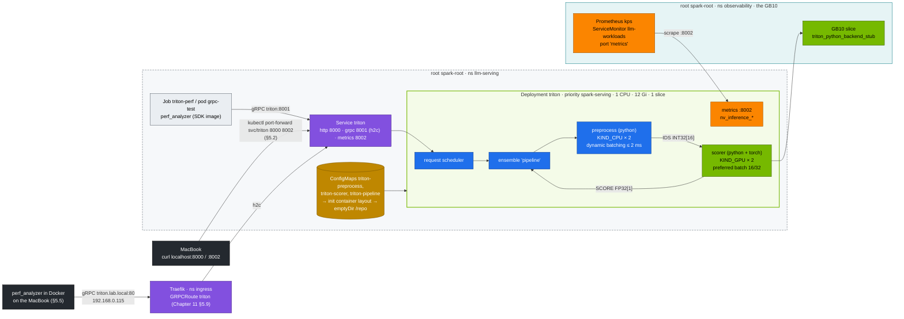
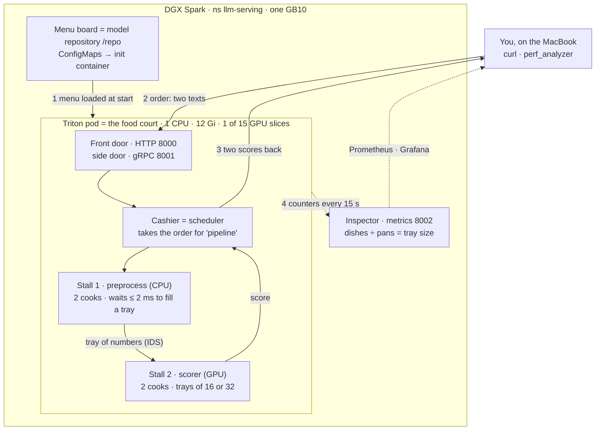
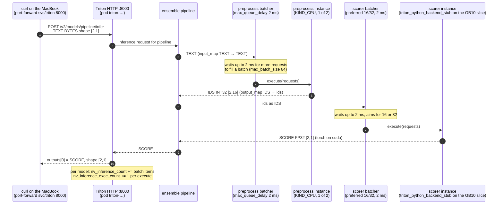

# Chapter 21 · NVIDIA Triton Inference Server: Model Repository, Ensembles, Dynamic Batching, perf_analyzer

> **02-Kubernetes · Part VII — LLM serving · Chapter 21 of 28** · ← [Chapter 20 · vLLM high-throughput LLM serving](20-vllm-high-throughput-llm-serving.md) · [All chapters](00-kubernetes-step-by-step-guide.md) · [Chapter 22 · LLM inference alternatives & KServe](22-llm-inference-alternatives-and-kserve.md) →

| | |
|---|---|
| **You will build** | A Triton deployment in the root's `llm-serving` namespace serving a two-step **ensemble** (tokenise on CPU → score on the GB10), fed from a GitOps-friendly model repository. You'll measure dynamic batching with Triton's own metrics (scraped by the root's Prometheus), load-test it with `perf_analyzer` over gRPC, and trace Triton's GPU process on the Spark back to its pod |
| **Hardware** | dgx-spark-1 |
| **Time** | 75 min |
| **Risk** | Low. Triton's 12 Gi (request = limit) fits `llm-serving` next to vLLM's 32 Gi (48.4 of 90 Gi, Chapter 20 §9); vLLM can stay up |
| **Clusters** | `spark-root` (Triton, the perf Job, the `serving-budget` quota, Prometheus) · the Spark itself (`nvidia-smi`) |
| **Lab files** | [`manifests/root-llms/90-serving/triton/`](lab/manifests/root-llms/90-serving/triton/) (`triton.yaml`, `kustomization.yaml`, `model_repository/{preprocess,scorer,pipeline}`), [`manifests/root/95-observability/vcluster-workloads.yaml`](lab/manifests/root/95-observability/vcluster-workloads.yaml) |

---

## 1. Why this matters on a Spark

vLLM is an LLM engine. Triton is a **general inference server**: many models, many frameworks (TensorRT, TensorRT-LLM, ONNX Runtime, PyTorch, Python, FIL), one process, one API, one metrics endpoint. A realistic AI service needs both. Picture the chat model in vLLM or TensorRT-LLM, with embeddings, rerankers, classifiers, guardrail models and pre/post-processing in Triton.

| Triton feature | What it solves |
|---|---|
| Model repository + versions | declarative deploys, A/B by version, hot reload |
| Dynamic batching | many small requests → one efficient GPU batch |
| Instance groups | N copies of a model per GPU (or CPU) for concurrency |
| Ensembles / BLS | multi-step pipelines server-side, no client round trips |
| HTTP/REST + gRPC (KServe v2 protocol) | same API for every model |

On one Spark, Triton is also the *cheap* engine: the lab's toy pipeline needs 12 Gi (request = limit, like every GPU container in the LLM stack) and one slice, against vLLM's 32 Gi. That's why it shares `llm-serving` with the mocks, Qdrant and a 32 Gi LLM engine without either being parked.

---

## 2. Architecture — HLD



There is no Ingress or HTTPRoute to Triton: the labs reach it through `kubectl port-forward` (§5.2, §5.3), from pods in `llm-serving` (`triton-perf`, `grpc-test`), and in §5.5 through the `GRPCRoute` you add in Chapter 11 §5.9.

#### The big idea, in plain words

Chapter 20's vLLM is a **ramen shop**: it makes one dish, one large language model, and its whole kitchen is built for that (continuous batching, the KV cache). **Triton is a food court**: many stalls (models) under one roof, with one front door, one cashier and one set of inspectors. Each stall brings its own equipment (a *backend*: Python, PyTorch, ONNX, TensorRT, TensorRT-LLM, even vLLM), and one order can go from stall to stall (an *ensemble*).

In this chapter's food court:

- **The menu board** = the model repository `/repo`: one folder per model with its `config.pbtxt`, built from the ConfigMaps `triton-preprocess`, `triton-scorer`, `triton-pipeline`.
- **Two stalls** = the two models. `preprocess` chops the text into numbers on the CPU; `scorer` turns those numbers into a score on the GPU (the GB10 slice).
- **The combo meal** = the ensemble `pipeline`: you order once, the tray goes from `preprocess` to `scorer` and comes back with the answer.
- **The front door** = port 8000 (HTTP, `/v2/models/pipeline/infer`), with a side door for regulars on 8001 (gRPC).
- **Filling the tray** = dynamic batching: a cook waits up to 2 ms for more orders and cooks them together (the scorer aims for trays of 16 or 32). One pan for many orders is cheaper than one pan each.
- **Two cooks per stall** = instance groups (`count: 2`): while one cook plates, the other is already cooking. §5.4 tries one.
- **The inspector's counters** = metrics on 8002: `nv_inference_count` (dishes served) and `nv_inference_exec_count` (times a pan was used). Dishes ÷ pans = average tray size, the proof that batching works.
- **The budget** = the same `serving-budget` as vLLM: Triton gets 1 CPU, 12 Gi and 1 GPU slice, so it fits next to vLLM's kitchen (48.4 of 90 Gi together).

This chapter opens the food court (§5.1), places a first order (§5.2), runs a rush hour and counts the trays (§5.3), changes the number of cooks (§5.4), lets regulars in through the side door via the gateway (§5.5) and closes up (§5.6).



| | vLLM (Chapter 20) | Triton (this chapter) |
|---|---|---|
| Picture | a ramen shop | a food court |
| Serves | one large language model | many models of any kind, and chains of them |
| Batching | continuous: new chats join the pot every step | dynamic: wait a few ms, then cook a full tray |
| API | OpenAI-style `/v1/chat/completions` | KServe v2 `/v2/models/<name>/infer`, HTTP and gRPC |
| Use it when | you chat with or benchmark an LLM | a request needs several models, or you serve non-LLM models |

### 2.1 One ensemble request, step by step



- **Steps 1–2 and 10** are what §5.2 shows: `/v2/models/pipeline/infer` with two texts returns two scores. `triton-perf` and `grpc-test` enter at step 1 over gRPC `:8001` instead.
- **Steps 3, 5 and 6** follow the `input_map`/`output_map` in `pipeline/config.pbtxt`. A wrong key there gives the `unable to find … output` error in §7.
- **The notes before steps 4 and 7 are dynamic batching.** Under load (§5.3) several clients' requests reach one `execute`, so `nv_inference_count` grows faster than `nv_inference_exec_count`. Their ratio is the average batch size; with `max_queue_delay_microseconds: 0` it falls towards 1.
- **Steps 7–8 run on the GB10.** The process that holds the slice is `triton_python_backend_stub`; §5.2 finds it with `nvidia-smi` and maps it to the `triton-…` pod. With two scorer instances, two stubs share the slice; §5.4 drops to one.

---

## 3. LLD

### 3.1 Repository layout

```text
/repo
├── preprocess/            config.pbtxt   1/model.py   # TEXT (BYTES) → IDS (INT32[16])
├── scorer/                config.pbtxt   1/model.py   # IDS → SCORE (FP32[1]), torch on cuda
└── pipeline/              config.pbtxt   1/           # ensemble: preprocess → scorer
```

In the lab, the files are kustomize-generated ConfigMaps (`triton-preprocess`, `triton-scorer`, `triton-pipeline`), which the `layout` init container copies into an `emptyDir`. They live in `llm-serving` next to the pod, and the kubelet on dgx-spark-1 mounts them. In production the repository lives on a PVC, S3 or GCS (`--model-repository=s3://…`), and models are TensorRT engines or ONNX files.

### 3.2 Key config

| Model | `max_batch_size` | Batching | Instances | Why |
|---|---|---|---|---|
| preprocess | 64 | `max_queue_delay_microseconds: 2000` | 2 × CPU | cheap Python. Batches amortise per-call overhead |
| scorer | 64 | `preferred_batch_size: [16, 32]`, 2 ms | 2 × GPU 0 | GEMM efficiency needs batches. 2 instances overlap H2D and compute |
| pipeline | 64 | ensemble scheduling | — | one client call, two model hops |

`gpus: [ 0 ]` is the only GPU the container sees: the device plugin hands the pod one time-slice of the GB10, and both scorer instances share it.

### 3.3 Ports & metrics

| Port | Protocol | Notes |
|---|---|---|
| 8000 | HTTP/REST (KServe v2) | `/v2/health/ready`, `/v2/models/<m>/infer`, `/v2/repository/index` |
| 8001 | gRPC | Service `appProtocol: kubernetes.io/h2c` (Chapter 11 §5.9) |
| 8002 | Prometheus | `nv_inference_request_success`, `nv_inference_count`, `nv_inference_exec_count`, `nv_inference_queue_duration_us`, `nv_inference_compute_infer_duration_us` |

**Average batch size = `nv_inference_count / nv_inference_exec_count`.** That's the number that proves dynamic batching works. The root's ServiceMonitor `llm-workloads` scrapes the `metrics` port of the `triton` Service and labels the series `vcluster="root"`, `vnamespace="llm-serving"`, so the same ratio works as a PromQL query on the root.

### 3.4 Budget

| | CPU request | Memory limit | Slices |
|---|---|---|---|
| `triton` (init container `layout`: 50m / 64 Mi, counted as the max with the main container) | 1 | 12 Gi (= request) | 1 |
| `triton-perf` Job (created suspended) | 500m | 2 Gi | 0 |
| always-on in `llm-serving` (mocks, Qdrant) | 400m | 2.4 Gi | 0 |
| **total** against `serving-budget` (8 CPU · 90 Gi · 6) | 1.9 | 16.4 Gi | 1 |

With vLLM's 1.5 CPU / 32 Gi / 1 slice on top: 3.4 CPU, 48.4 Gi, 2 slices — it fits, so vLLM keeps running in §5.1. In UMA the toy pipeline adds little to vLLM's 0.20; a real Triton model counts toward the util sum ≲ 0.72 like any engine (Chapter 20 §2).

---

## 4. Integrations

- **Image choice:** `tritonserver:25.09-pyt-python-py3` ships PyTorch for the Python backend (the scorer uses `torch.cuda`). The plain `-py3` image would fall back to CPU. The SDK image `-py3-sdk` carries `perf_analyzer`.
- **TensorRT-LLM backend (modules 03–06)**: the same Deployment with the `-trtllm-python-py3` image and an engine built for sm_121 — and a 32 Gi-class memory limit, so it counts as one of the two engines `serving-budget` holds side by side (Chapter 20 §9).
- **Guardrails / RAG (module 05)**: rerankers and embedding models are natural Triton tenants next to vLLM; on one Spark they fit `serving-budget` beside one or two engines, as long as the util sum stays ≲ 0.72.
- **Gateway (Chapter 11 §5.9)**: Traefik on the root (namespace `ingress`) routes gRPC to Triton with a `GRPCRoute`.

---

## 5. Lab

```bash
# ▶ MacBook · technical-depth (repo root)
cd "02-Kubernetes/lab"
export KUBECONFIG="$PWD/../../01-Ansible/lab/.cache/kubeconfig-spark-lab.yaml"
```

### 5.1 Deploy

#### What this lab does (manifests `lab/manifests/root-llms/90-serving/triton`)

- **Three ConfigMaps** in `llm-serving` hold the model repository: `triton-preprocess`, `triton-scorer`, `triton-pipeline`.
- **Deployment `triton`:** an init container `layout` copies the ConfigMaps into an `emptyDir` at `/repo`; then Triton (`tritonserver:25.09-pyt-python-py3`) loads three models. Requests one GPU slice, 1 CPU and 12 Gi (request = limit).
- **Service `triton`:** HTTP 8000, gRPC 8001 (`appProtocol: kubernetes.io/h2c`), metrics 8002.
- **Job `triton-perf`**, created **suspended**: the load test for §5.3. It does nothing until you unsuspend it.
- **vLLM keeps running.** Both fit `serving-budget` (§3.4). The first start pulls about 15 GB of image.

#### What to look for

1. **Command exit:** `apply -k` creates 3 ConfigMaps, the Service, the Deployment and the Job; `rollout status` prints `deployment "triton" successfully rolled out`.
2. **`layout` log:** five files under `/repo`: two `config.pbtxt` plus `model.py` for preprocess and scorer, and `pipeline/config.pbtxt`.
3. **Triton log:** `pipeline`, `preprocess` and `scorer` all `READY`, and three `Started …` lines for gRPC 8001, HTTP 8000 and metrics 8002.
4. **Quota after the apply:** `serving-budget` shows one more GPU slice and 12 Gi more memory used than before (2 Gi more once `triton-perf` runs).

**If something's off:** `exceeded quota: serving-budget` or `Insufficient memory` in `kubectl --context spark-root -n llm-serving get events` → park an engine (Chapter 20 §9). A model `UNAVAILABLE` with `ModuleNotFoundError: torch` → wrong image tag. More in §7.

#### Run it

vLLM can stay running: both fit `serving-budget` (§3.4).

```bash
# ▶ MacBook · 02-Kubernetes/lab
kubectl --context spark-root -n llm-serving describe resourcequota serving-budget | grep -E 'requests.cpu|limits.memory|gpu'
kubectl --context spark-root apply -k manifests/root-llms/90-serving/triton
kubectl --context spark-root -n llm-serving rollout status deploy/triton --timeout=15m     # first pull ≈ 15 GB
kubectl --context spark-root -n llm-serving logs deploy/triton -c layout                  # the init container's file list
kubectl --context spark-root -n llm-serving logs deploy/triton | grep -E 'successfully loaded|READY|Started'
```

Expected:

```text
| Model      | Version | Status |
| pipeline   | 1       | READY  |
| preprocess | 1       | READY  |
| scorer     | 1       | READY  |
I… Started GRPCInferenceService at 0.0.0.0:8001
I… Started HTTPService at 0.0.0.0:8000
I… Started Metrics Service at 0.0.0.0:8002
```

If the rollout never starts, look for `exceeded quota: serving-budget` (other engines hold more than ~78 Gi of the 90) or, on a Pending pod, `Insufficient memory` (a batch job holds the rest of the shared LLM memory pool) in `kubectl --context spark-root -n llm-serving get events`; park an engine (Chapter 20 §9). With two 32 Gi engines up, or vLLM + P/D, Triton and the perf Job in §5.3 still fit (80.4 and 88.6 Gi).

### 5.2 Talk to it

#### What this lab does (port-forward to Service `triton`, `nvidia-smi` on the Spark)

- **Opens a port-forward** from the MacBook's `localhost:8000` (HTTP) and `localhost:8002` (metrics) to the `triton` Service, in the background of this terminal. If vLLM's port-forward from Chapter 20 still holds `localhost:8000`, stop it first.
- **Asks Triton** for its health, its repository index and the ensemble's steps, then sends one inference with two texts.
- **Checks on the Spark** which GPU processes exist and which pod's cgroup they belong to.
- **Nothing is changed.** §5.3 reuses the port-forward.

#### What to look for

1. **Health:** `200`.
2. **Repository index:** three lines, `pipeline`, `preprocess`, `scorer`, each `"state":"READY"`.
3. **Ensemble steps:** `"preprocess"` then `"scorer"`.
4. **Inference:** `{"name":"SCORE","datatype":"FP32","shape":[2,1],"data":[…, …]}`: two scores for two inputs.
5. **GPU processes:** `triton_python_backend_stub` lines whose `pod…` part matches the UID of the `triton-…` pod, with dashes written as underscores. Processes of the `vllm` pod may also be listed if vLLM runs; their `pod…` part carries the vLLM pod's UID.

**If something's off:** `bind: address already in use` → another port-forward holds 8000; stop it (`jobs`, then `kill %N`). Empty `data` or an error about `TEXT` → check the request's input name and shape against `curl -s localhost:8000/v2/models/pipeline/config`. No Triton process in `nvidia-smi` → the scorer fell back to CPU (§7).

#### Run it

```bash
# ▶ MacBook · 02-Kubernetes/lab
kubectl --context spark-root -n llm-serving port-forward svc/triton 8000 8002 &
curl -s localhost:8000/v2/health/ready -o /dev/null -w '%{http_code}\n'           # 200
curl -s -X POST localhost:8000/v2/repository/index | jq -c '.[]'
curl -s localhost:8000/v2/models/pipeline/config | jq '.ensemble_scheduling.step[].model_name'
curl -s -X POST localhost:8000/v2/models/pipeline/infer -H 'Content-Type: application/json' -d '{
  "inputs":[{"name":"TEXT","shape":[2,1],"datatype":"BYTES","data":["unified memory on the spark","two sparks over cx7"]}]}' | jq '.outputs[0]'
```

Expected: `{"name":"SCORE","datatype":"FP32","shape":[2,1],"data":[0.5…,0.4…]}`.

Confirm the scorer really runs on the GPU, and that the GPU process belongs to the Triton pod:

```bash
# ▶ MacBook · 02-Kubernetes/lab
ssh dgxadmin@192.168.0.100 'for p in $(nvidia-smi --query-compute-apps=pid --format=csv,noheader); do
  echo "$p $(cat /proc/$p/comm) $(grep -oE "pod[0-9a-f]{8}[0-9a-f_-]+" /proc/$p/cgroup | head -1)"; done'
kubectl --context spark-root -n llm-serving get pods -o custom-columns=UID:.metadata.uid,NAME:.metadata.name | grep triton
```

Expected: `triton_python_backend_stub` processes whose cgroup contains `pod<uid>` (dashes become underscores under the systemd cgroup driver) with the UID of `triton-…`. The pod runs directly on the root, so the UID the API server shows is the one the kernel's cgroup path carries. (For a pod in a vCluster, such as the `dev-llms` sandbox, you would look up the translated pod in `vc-dev-llms` instead: the vCluster's API server has its own UID for the virtual pod.)

### 5.3 Load test and batching efficiency

#### What this lab does (Job `triton-perf`, then a scorer config change)

- **Reads the scorer's counters** (`nv_inference_count`, `nv_inference_exec_count`) from `localhost:8002` before and after the test.
- **Unsuspends `triton-perf`:** `perf_analyzer` sends gRPC requests to the `pipeline` model at concurrency 1, 3, 5 … 31 (range `1:32:2`) and prints throughput and latency per step. It charges 500m CPU and 2 Gi to `serving-budget`, no GPU.
- **Computes the average batch size** the scorer achieved: requests ÷ executions.
- **Second run:** you set `max_queue_delay_microseconds: 0` for the scorer, re-apply, restart Triton (the init container copies the repository only at start) and repeat. The re-apply re-creates `triton-perf` suspended.

#### What to look for

1. **Command exit:** `job.batch/triton-perf patched`; the log prints one `Concurrency: N, throughput: …, latency …` line per step and ends.
2. **Throughput** rises with concurrency until the GPU or the Python stub saturates.
3. **Average batch size**, with the lab config: well above 1.
4. **With `max_queue_delay_microseconds: 0`:** average batch size falls towards 1, and throughput at high concurrency falls with it.
5. **Prometheus** gives the same ratio with the PromQL below, if kps is installed (Chapter 17 §5.4).

**If something's off:** the awk line prints `nan`, `inf` or an error → the port-forward on 8002 was not running when `before` or `after` was read; restart it and repeat. The Job stays at 0 pods → quota: `kubectl --context spark-root -n llm-serving describe job triton-perf`. More in §7.

#### Run it

```bash
# ▶ MacBook · 02-Kubernetes/lab
before=$(curl -s localhost:8002/metrics | awk '/^nv_inference_(count|exec_count)\{model="scorer"/ {print $2}' | paste -sd' ')
kubectl --context spark-root -n llm-serving patch job triton-perf -p '{"spec":{"suspend":false}}'
kubectl --context spark-root -n llm-serving logs -f job/triton-perf --pod-running-timeout=15m | grep -E 'Concurrency|Throughput|p99 latency'   # first SDK image pull takes minutes
after=$(curl -s localhost:8002/metrics | awk '/^nv_inference_(count|exec_count)\{model="scorer"/ {print $2}' | paste -sd' ')
echo "$before | $after" | awk '{printf "scorer average batch size during the test: %.1f\n", ($4-$1)/($5-$2)}'
```

The same number from the root's Prometheus (`kubectl --context spark-root -n observability port-forward svc/kps-prometheus 9090 &`):

```promql
sum(rate(nv_inference_count{vcluster="root", model="scorer"}[5m]))
  / sum(rate(nv_inference_exec_count{vcluster="root", model="scorer"}[5m]))
```

Expected shape: throughput rises with concurrency until the GPU or Python stub saturates, and **average batch size climbs well above 1**. Now set `max_queue_delay_microseconds: 0` in `model_repository/scorer/config.pbtxt`, then re-apply and restart (the init container only copies the repository at start):

```bash
# ▶ MacBook · 02-Kubernetes/lab
kubectl --context spark-root -n llm-serving delete job triton-perf
kubectl --context spark-root apply -k manifests/root-llms/90-serving/triton
kubectl --context spark-root -n llm-serving rollout restart deploy/triton && kubectl --context spark-root -n llm-serving rollout status deploy/triton
```

The restart ends the §5.2 port-forward (it was bound to the old pod): start it again (`kubectl --context spark-root -n llm-serving port-forward svc/triton 8000 8002 &`) before you read `before` once more. The default `RollingUpdate` strategy briefly runs a second Triton pod, so the restart needs another 12 Gi and one slice free in `serving-budget`; with two 32 Gi engines up, park one first. Then repeat. Batch size falls towards 1, and throughput at high concurrency falls with it. That's the latency/throughput trade dynamic batching makes. The re-apply creates `triton-perf` suspended again, ready for the next run.

### 5.4 Instance groups

#### What this lab does (edit `model_repository/scorer/config.pbtxt`)

- **Changes the scorer's `instance_group`** from `count: 2` to `count: 1` on GPU 0.
- **Re-applies and restarts** Triton as in §5.3, then repeats the §5.3 load test.

#### What to look for

1. **Triton log** after the restart: `scorer` `READY` again.
2. **`perf_analyzer`:** p99 latency at the same concurrency is higher than with two instances. Put `count: 2` back afterwards.

**If something's off:** no change at all → Triton still runs the old config: check that the ConfigMap changed (`kubectl --context spark-root -n llm-serving get cm triton-scorer -o yaml | grep count`) and that the pod restarted.

#### Run it

Change `count: 2` → `count: 1` for `scorer`, re-apply and restart as above, and repeat §5.3. With one instance, compute can't overlap with the Python stub's CPU work, and p99 latency rises at the same concurrency.

### 5.5 gRPC: east-west and through the gateway

#### What this lab does (pod `grpc-test`, then `perf_analyzer` in Docker on the MacBook)

- **East-west:** a temporary pod `grpc-test` in `llm-serving` runs `perf_analyzer` against `triton:8001` over gRPC at concurrency 4, then is removed (`--rm`). It gets 50m / 512 Mi from the `llm-serving` LimitRange.
- **Through the gateway:** after you add the `GRPCRoute` `triton.lab.local` (Chapter 11 §5.9), the same test runs from Docker on the MacBook through Traefik on `192.168.0.115:80`.
- **Nothing else is changed.** The SDK image is large; the first pull on each side takes a while.

#### What to look for

1. **Both runs** end with a `Concurrency: 4, throughput: …, latency …` line and no errors.
2. **p99 latency** through the gateway is higher than east-west. The difference is the extra hop: MacBook → MetalLB `.115` → Traefik → Triton.

**If something's off:** the gateway run fails with `UNAVAILABLE` → the GRPCRoute is missing or not `Accepted` (Chapter 11 §5.9 shows how to check). `--network host` is not needed on macOS: `--add-host` alone points `triton.lab.local` at `192.168.0.115`. More in §7.

#### Run it

Inside the cluster, straight to the Service (east-west, routed by kube-proxy):

```bash
# ▶ MacBook · 02-Kubernetes/lab
kubectl --context spark-root -n llm-serving run grpc-test --rm -it --restart=Never --image=nvcr.io/nvidia/tritonserver:25.09-py3-sdk -- \
  perf_analyzer -m pipeline -u triton:8001 -i grpc --string-data "hello spark" --concurrency-range 4
```

The pod has no `resources`, so the llm-serving LimitRange gives it 50m / 512 Mi — enough for the client, and it keeps the quota happy. Through Traefik: add the `GRPCRoute` from Chapter 11 §5.9 (host `triton.lab.local`), then from a laptop with Docker:

```bash
# ▶ MacBook · any folder
docker run --rm --add-host triton.lab.local:192.168.0.115 nvcr.io/nvidia/tritonserver:25.09-py3-sdk \
  perf_analyzer -m pipeline -u triton.lab.local:80 -i grpc --string-data "hello spark" --concurrency-range 4
```

Compare p99 latency between the two: the difference is the gateway hop (laptop → MetalLB `.115` → Traefik pod → Triton pod, all on the same Spark).

### 5.6 Clean up

```bash
# ▶ MacBook · 02-Kubernetes/lab
kubectl --context spark-root delete -k manifests/root-llms/90-serving/triton
```

---

## 6. Verify

| Check | Expected |
|---|---|
| `/v2/health/ready` | 200 |
| repository index | 3 models `READY` |
| inference | 2 scores returned for 2 inputs |
| average scorer batch size under load | > 1 (typically several), same from `/metrics` and from the root's Prometheus |
| `nvidia-smi` on the Spark | Triton Python stub listed as a GPU process, in the cgroup of the `triton-…` pod |
| `serving-budget` | Triton and vLLM both counted, within 8 CPU · 90 Gi · 6 |

---

## 7. Troubleshooting

| Symptom | Cause | Diagnose | Fix |
|---|---|---|---|
| Deployment 0/1, `exceeded quota: serving-budget` | other engines hold most of `llm-serving` (vLLM + P/D, or two 32 Gi engines for the perf Job) | `kubectl --context spark-root -n llm-serving describe resourcequota serving-budget` | park one engine (Chapter 20 §9) |
| `failed to load 'scorer' … ModuleNotFoundError: torch` | image without PyTorch | model load log | `-pyt-python-py3` image (lab default). The code falls back to CPU otherwise |
| model `UNAVAILABLE: Invalid argument: … dims` | config dims don't match the tensors the model returns | `/v2/models/<m>/config` | fix `config.pbtxt`. Remember `max_batch_size > 0` adds an implicit batch dim |
| ensemble error `unable to find … output` | step `output_map` key mismatch | `pipeline/config.pbtxt` | the map key is the *model's* tensor name, the value is the ensemble-internal name |
| config change has no effect | ConfigMap updated but the init container ran before | `kubectl --context spark-root -n llm-serving logs deploy/triton -c layout` | `rollout restart deploy/triton` |
| gRPC `UNAVAILABLE` via Traefik | h2c not negotiated | Service `appProtocol` | `kubernetes.io/h2c` |
| batch size stays 1 | `max_queue_delay` 0, or clients too slow to overlap | metrics ratio | allow 1–5 ms delay. Raise client concurrency |
| pod Ready but model not | readiness checks server, not model | `/v2/models/pipeline/ready` | use a model-level readiness endpoint in the probe for single-model servers |
| no `nv_inference_*` series in Prometheus | Service port not named `metrics`, or Triton not in the ServiceMonitor's keep-list | `kubectl --context spark-root -n llm-serving get svc triton -o jsonpath='{.spec.ports[*].name}'` | keep the port name; the regex in the `llm-workloads` ServiceMonitor (`vcluster-workloads.yaml`) matches `triton` |

---

## 8. Scale-out path

| Lab | Datacenter |
|---|---|
| Python toy models | TensorRT engines, ONNX, TensorRT-LLM, FIL for trees |
| ConfigMap repository | S3/GCS repository, `--model-control-mode=explicit` + load API from CI |
| 1 pod, one slice, next to one LLM engine in `llm-serving` | replicas behind the gateway, sized per pool. KServe `InferenceService` with the Triton runtime (Chapter 22). NVIDIA NIM containers package Triton/TRT-LLM per model |
| manual perf_analyzer | Model Analyzer sweeps (instances × batch sizes × precisions) in CI |

---

## 9. Checklist

- [ ] I can lay out a Triton repository and explain every field in a `config.pbtxt`.
- [ ] My ensemble runs CPU and GPU steps server-side in one call.
- [ ] I proved dynamic batching with `nv_inference_count / nv_inference_exec_count`, locally and in the root's Prometheus.
- [ ] I traced Triton's GPU process on the Spark back to its pod in `llm-serving`.
- [ ] I know when to put a model in Triton rather than vLLM, and what it costs in `serving-budget`.
