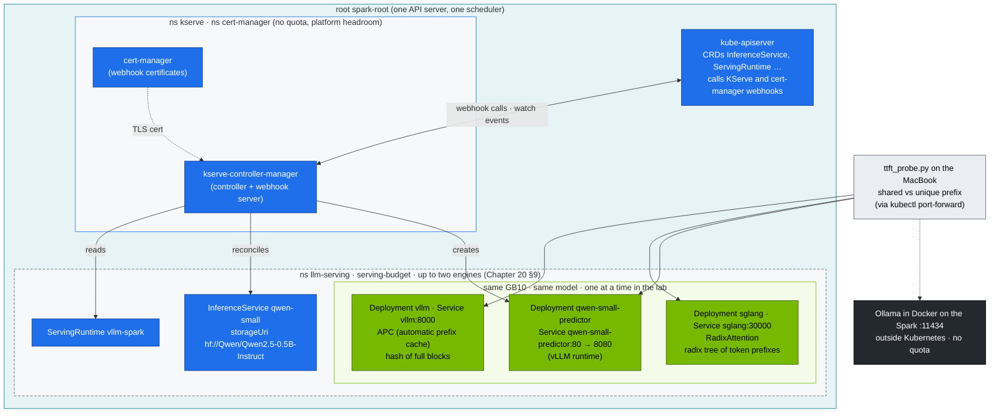
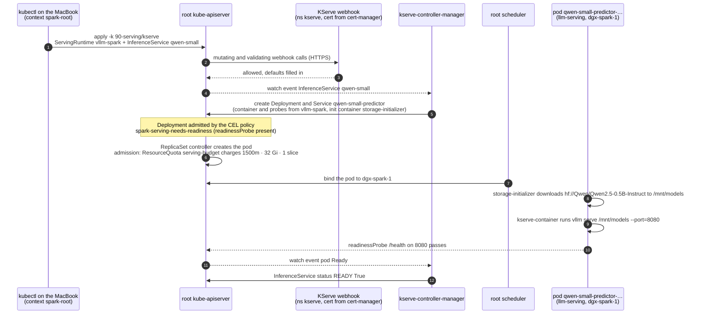

# Chapter 22 · LLM Inference Alternatives & KServe: Choosing Between SGLang, TensorRT-LLM and llama.cpp/Ollama

> **02-Kubernetes · Part VII — LLM serving · Chapter 22 of 28** · ← [Chapter 21 · NVIDIA Triton Inference Server](21-nvidia-triton-inference-server.md) · [All chapters](00-kubernetes-step-by-step-guide.md) · [Chapter 23 · Disaggregated prefill & decode serving](23-disaggregated-prefill-and-decode-serving.md) →

| | |
|---|---|
| **You will build** | SGLang side by side with vLLM on the same model and hardware, a measured prefix-cache speed-up with a portable TTFT probe, the same model served through **KServe** in RawDeployment mode — an operator with CRDs and webhooks, installed on the root next to the models — and a decision matrix grounded in your own numbers |
| **Hardware** | dgx-spark-1. `llm-serving` holds two engines side by side (Chapter 20 §9); the lab runs them one at a time so each measurement has the GB10 to itself |
| **Time** | 90 min |
| **Risk** | Low–medium. KServe installs cert-manager, CRDs and webhooks on the root API server; the dev-lab and dev-llms API servers never see them |
| **Clusters** | `spark-root` (vLLM, SGLang, cert-manager, KServe and its CRDs, `serving-budget`) · `dev-llms` (only to show that a vCluster doesn't see the CRDs) · the Spark host (Ollama, outside every quota) |
| **Lab files** | [`manifests/root-llms/90-serving/sglang/`](lab/manifests/root-llms/90-serving/sglang/sglang.yaml), [`manifests/root-llms/90-serving/kserve/`](lab/manifests/root-llms/90-serving/kserve/inferenceservice.yaml), [`scripts/ttft_probe.py`](lab/scripts/ttft_probe.py), [`scripts/install-addons.sh`](lab/scripts/install-addons.sh) `kserve` |

---

## 1. The engine landscape (as of the lab's pinned versions)

| Engine | Strength | Weakness | On a Spark |
|---|---|---|---|
| **vLLM** | broadest model support, PagedAttention, continuous batching, OpenAI API, huge community | tuning surface is large | NGC `nvcr.io/nvidia/vllm` for arm64/sm_121 (Chapter 20) |
| **SGLang** | RadixAttention (automatic prefix reuse across requests), fast structured/JSON output, strong for agents and multi-turn | fewer exotic models | `lmsysorg/sglang:spark` build |
| **TensorRT-LLM** | peak performance: compiled engines, FP8/FP4 kernels, in-flight batching | build step per model/GPU/precision. Less flexible | via Triton TRT-LLM backend or `trtllm-serve` (modules 03–06) |
| **llama.cpp / Ollama** | GGUF quantisation, tiny footprint, trivial UX | lower throughput under concurrency, fewer serving features | great for dev boxes and single users. Ollama ships arm64 + CUDA |
| **Hugging Face TGI** | mature, simple | development has slowed relative to vLLM/SGLang (check upstream status) | not used in this lab |
| **NVIDIA NIM** | pre-built, validated containers per model (TRT-LLM/vLLM inside) + OpenAI API | licence/entitlement, fixed model list | check the NIM catalogue for DGX Spark support per model |

Platforms around the engines:

| Platform | Adds | Lab |
|---|---|---|
| plain Deployment + Service + Ingress | nothing, which is the point | Chapter 20 |
| **KServe** (RawDeployment) | `InferenceService` CRD, runtimes, storage initializers, canary, autoscaling hooks | §5.4 |
| Ray Serve / KubeRay | Python-native composition, multi-node TP/PP with Ray | module 03 (DeepSeek multi-node) |
| llm-d / Dynamo | distributed, KV-aware, disaggregated serving at scale | Chapter 23 §8 |

### 1.1 Where KServe lives here

KServe brings cluster-scoped CRDs (`InferenceService`, `ServingRuntime`, `ClusterServingRuntime`…), mutating and validating webhooks, and a hard dependency on cert-manager — another set of CRDs and webhooks. In one shared cluster, every team gets them, and every upgrade is everyone's. On the Spark the models run on the root, so `scripts/install-addons.sh kserve` installs both **on the root**, next to them:

| Object | Exists in | Why |
|---|---|---|
| KServe + cert-manager CRDs, webhooks, controllers | root API server (etcd) | the predictor has to run in `llm-serving`, where the models and `serving-budget` are. CRDs are not synced into vClusters, so the dev-lab and dev-llms API servers don't know `InferenceService` |
| controller *pods* (`kserve`, `cert-manager` namespaces) | root namespaces `kserve`, `cert-manager` | ordinary pods without a ResourceQuota → they come out of the root's platform headroom, not out of `serving-budget` |
| the predictor Deployment KServe generates | `llm-serving` | a Deployment like vLLM's, counted in `serving-budget` |

The webhooks are called by the root API server, which reaches the webhook Services by their ClusterIP. This is the trade-off of running the LLM stack on the root: whoever administers the root also operates KServe's CRDs and webhooks, and a broken webhook affects the root API server. The alternative — installing an operator into a vCluster so its CRDs stay in that vCluster's own API server — is what the vClusters are for when the operator is small; the `dev-llms` sandbox (4 Gi) has no room for a 32 Gi predictor, so the lab installs KServe where the models are.

---

## 2. Architecture — HLD



### 2.1 Prefix caching: why it matters for agents and RAG

Every request in a RAG or agent workflow repeats the same long system prompt, tool schema and few-shot examples. With prefix caching, the KV for that shared prefix is computed **once** and reused, so TTFT drops from "prefill the whole prompt" to "prefill only the new part".

| | vLLM APC | SGLang RadixAttention |
|---|---|---|
| Granularity | full KV blocks (e.g. 16 tokens), hash-matched | any token prefix, radix tree |
| Eviction | LRU of free blocks | LRU of tree nodes |
| Best at | identical prefixes | branching conversations, tree-of-thought, many partial overlaps |

### 2.2 From InferenceService to a serving pod, step by step



- **Steps 2–3** need cert-manager: until its certificate exists, the webhook has no TLS and the apply fails with a webhook error (§7). Install order in `install-addons.sh kserve`: cert-manager, then KServe, then the cluster runtimes.
- **Step 5** is what `get deploy,svc,hpa -l serving.kserve.io/inferenceservice=qwen-small` shows in §5.4. Nothing is created in a vCluster: `dev-llms` has no `InferenceService` CRD at all.
- **Step 5 (the note) and step 6** are the same checks your hand-written vLLM Deployment passes: the CEL policy and `serving-budget`. A refusal shows up in `kubectl --context spark-root -n llm-serving get events`, not on the InferenceService.
- **Step 8** is the slow part on the first run. Read it with `kubectl --context spark-root -n llm-serving logs <predictor pod> -c storage-initializer`.
- **Step 12** is what `get inferenceservice qwen-small -w` waits for; then `/v1/models` on the port-forward lists `qwen-small`.

---

## 3. LLD

| Setting | vLLM | SGLang | KServe (vllm-spark runtime) |
|---|---|---|---|
| memory flag | `--gpu-memory-utilization=0.20` | `--mem-fraction-static=0.20` | `--gpu-memory-utilization=0.20` |
| pod resources | 1500m · 32 Gi (request = limit) · 1 slice | same | same (in the `ServingRuntime`) |
| replicas | 1 (KEDA, Chapter 20 §5.7) | 0 in the manifest — scale to 1 in §5.2 | `minReplicas: 1`, `maxReplicas: 1` |
| port | 8000 | 30000 | 8080 (container) → Service `qwen-small-predictor` 80 |
| health | `/health` | `/health` | `/health` on 8080 (startup and readiness probes in the `ServingRuntime`) |
| metrics | `/metrics` (`vllm:*`) | `/metrics` with `--enable-metrics` (`sglang:*`) | runtime's own (`vllm:*`) |
| weights | PVC `model-cache` | PVC `model-cache` | storage-initializer downloads to an emptyDir (`hf://`) |

All three ask for the same 32 Gi (request = limit) and 0.20 of the pool: `serving-budget` holds two of them side by side (66.4 of 90 Gi, util sum 0.40), and refuses a third (Chapter 20 §9). The root ServiceMonitor `llm-workloads` already keeps `vllm`, `sglang` and `qwen-small-predictor` Services, so whichever runs shows up in Prometheus with `vcluster="root"`, `vnamespace="llm-serving"`.

---

## 4. Integrations

- **`serving-budget` (Chapter 20 §9):** never run vLLM, SGLang and KServe's vLLM at once — `serving-budget` refuses the third one (98.4 Gi of limits). Two fit; memory, the sum of their util values, is the real limit. For the comparison the lab still parks vLLM with the KEDA pause annotation, because two engines on one GB10 slow each other's TTFT; SGLang starts at `replicas: 0`.
- **Gateway (Chapter 11):** Traefik on the root watches `llm-serving`; add an `HTTPRoute` rule per engine (`/sglang/v1` → `sglang:30000`) to A/B engines behind one hostname on `192.168.0.115`.
- **Admission (Chapter 03):** `llm-serving` is labelled `spark.lab/tier: serving`, so the CEL policy `spark-serving-needs-readiness` applies to every Deployment there — including the one KServe generates. That is why the `vllm-spark` ServingRuntime carries its own startup and readiness probes: KServe copies them into the predictor Deployment.
- **Modules 03/04** use SGLang for DeepSeek/Qwen structured output and tool calling. The probe here is their baseline.

---

## 5. Lab

```bash
# ▶ MacBook · technical-depth (repo root)
cd "02-Kubernetes/lab"
export KUBECONFIG="$PWD/../../01-Ansible/lab/.cache/kubeconfig-spark-lab.yaml"
```

### 5.1 Baseline: vLLM prefix-cache effect

#### What this lab does (script `lab/scripts/ttft_probe.py`)

- **Target:** the vLLM engine from Chapter 20 (`llm-serving/vllm` on the root, port 8000, `--enable-prefix-caching`), reached with a `kubectl port-forward`. Nothing is deployed or changed.
- **Probe:** sends 10 streaming chat requests that share one long system prompt (about 1,740 words), then 10 whose prompt starts with a random UUID, so no prefix can be reused. Each asks for 8 tokens.
- **Output:** the cold first request, the median time to first token (TTFT) for both groups, and the ratio. That ratio is your prefix-cache baseline for §5.2.

#### What to look for

1. **Rollout:** `deployment "vllm" successfully rolled out`.
2. **Probe output:**

   | Line | Healthy value |
   |---|---|
   | `first request (cold)` | the slowest number: nothing is cached yet |
   | `shared prefix  median TTFT` | clearly below the unique-prefix median |
   | `speed-up from prefix cache` | well above `1.0x` |

3. **Record** the shared and unique medians and the speed-up in §5.6.

**If something's off:** a speed-up near `1.0x` means prefix caching is off or the prompt changed between requests (check the engine flags). `connection refused` means the port-forward isn't running or vLLM is parked (KEDA `paused-replicas`, Chapter 20 §9). `bind: address already in use` → an older port-forward (Chapter 20 §5.2) still holds 8000; stop it (`jobs`, then `kill %N`) and check that `kill %1` below stops the right job. More in §7.

#### Run it

```bash
# ▶ MacBook · 02-Kubernetes/lab
kubectl --context spark-root -n llm-serving rollout status deploy/vllm          # from Chapter 20
kubectl --context spark-root -n llm-serving port-forward svc/vllm 8000 &
python3 scripts/ttft_probe.py --url http://localhost:8000 --model qwen2.5-0.5b -n 10
kill %1
```

Record `shared prefix median`, `unique prefix median` and the speed-up.

### 5.2 Swap to SGLang

#### What this lab does (manifests `lab/manifests/root-llms/90-serving/sglang`)

- **Parks vLLM:** sets the KEDA annotation `autoscaling.keda.sh/paused-replicas=0` on its ScaledObject (or scales it to 0 if KEDA isn't there). This keeps the comparison clean; it is not needed for the quota.
- **Creates** Deployment `sglang` (image `lmsysorg/sglang:spark`, starts at `replicas: 0`) and Service `sglang` on port 30000 in the root's `llm-serving`, then scales it to 1.
- **Engine:** serves `Qwen/Qwen2.5-0.5B-Instruct` as `qwen2.5-0.5b` with RadixAttention prefix caching, `--mem-fraction-static=0.20`, 1500m CPU · 32 Gi (request = limit) · 1 GPU slice. Weights go to the `model-cache` PVC.
- **First run is slow:** the image pull and model download can take many minutes, which is why the rollout waits up to 30 min.
- **Measures** the same TTFT probe as §5.1 on port 30000 and reads SGLang's own metrics.

#### What to look for

1. **Pods:** `kubectl --context spark-root -n llm-serving get pods` shows `sglang-…` `1/1 Running` and no `vllm-…` pod.
2. **Startup log:** a `max_total_num_tokens=…` line (the KV-cache size SGLang reserved) and Uvicorn running on port 30000. No `ERROR` lines.
3. **Probe:** shared-prefix median clearly below unique-prefix median, speed-up well above `1.0x`. Put the numbers next to vLLM's in §5.6.
4. **Metrics:** `sglang:cache_hit_rate` above 0 after the probe; `sglang:num_running_reqs` back at 0 when idle.

**If something's off:** `0/1` with `exceeded quota: serving-budget` → two other engines still hold the budget (`kubectl --context spark-root -n llm-serving get pods`). `CreateContainerConfigError` about `hf-token` → the Secret from Chapter 20's `vllm` layer is missing. `exec format error` → wrong image tag for arm64/sm_121. More in §7.

#### Run it

```bash
# ▶ MacBook · 02-Kubernetes/lab
kubectl --context spark-root -n llm-serving annotate scaledobject vllm autoscaling.keda.sh/paused-replicas=0 --overwrite \
  || kubectl --context spark-root -n llm-serving scale deploy vllm --replicas=0
kubectl --context spark-root apply -k manifests/root-llms/90-serving/sglang
kubectl --context spark-root -n llm-serving scale deploy sglang --replicas=1
kubectl --context spark-root -n llm-serving rollout status deploy/sglang --timeout=30m
kubectl --context spark-root -n llm-serving logs deploy/sglang | grep -E 'max_total_num_tokens|Uvicorn|ready|ERROR'
kubectl --context spark-root -n llm-serving port-forward svc/sglang 30000 &
python3 scripts/ttft_probe.py --url http://localhost:30000 --model qwen2.5-0.5b -n 10
curl -s localhost:30000/metrics | grep -E '^sglang:(cache_hit_rate|num_running_reqs|gen_throughput)' ; kill %1
```

Parking vLLM here is for clean numbers, not for the quota: SGLang would fit beside it. If SGLang stays at 0/1 with `exceeded quota: serving-budget`, other engines (P/D from Chapter 23, a KServe predictor) still hold the budget — `kubectl --context spark-root -n llm-serving get pods`. Re-applying `manifests/root-llms/90-serving/sglang` later resets it to `replicas: 0`; that's deliberate.

### 5.3 Structured output (JSON schema)

#### What this lab does (a `curl` against `sglang:30000`)

- **Request:** one chat completion to the SGLang engine from §5.2 with an OpenAI-style `response_format` that carries a JSON schema: `name` (string), `memory_gb` (integer), `unified` (boolean), all required.
- **Engine side:** SGLang constrains decoding so only tokens that keep the output valid against the schema can be produced.
- **Nothing changes** in the cluster. You only need the port-forward.

#### What to look for

1. **`jq .` prints an object** with exactly the keys `name`, `memory_gb`, `unified`. A `jq` parse error means the output wasn't valid JSON.
2. **Types match:** `memory_gb` is a number without quotes, `unified` is `true` or `false`.
3. **Repeat it** 5–10 times: the shape must hold every time. The values may be wrong (a 0.5B model guesses); the structure may not.

**If something's off:** `null` from the first `jq` usually means an error object came back instead of `choices`: run the `curl` without the `jq` filters to read it. Port 30000 refused → SGLang isn't at `1/1` (§5.2).

#### Run it

Both engines accept OpenAI-style `response_format` with a JSON schema:

```bash
# ▶ MacBook · 02-Kubernetes/lab
kubectl --context spark-root -n llm-serving port-forward svc/sglang 30000 &
curl -s localhost:30000/v1/chat/completions -H 'Content-Type: application/json' -d '{
 "model":"qwen2.5-0.5b","max_tokens":128,
 "messages":[{"role":"user","content":"Describe the DGX Spark GPU."}],
 "response_format":{"type":"json_schema","json_schema":{"name":"gpu","schema":{
   "type":"object","properties":{"name":{"type":"string"},"memory_gb":{"type":"integer"},"unified":{"type":"boolean"}},
   "required":["name","memory_gb","unified"]}}}}' | jq -r '.choices[0].message.content' | jq .
kill %1
```

Expected: valid JSON with exactly those three keys, **every time**. The engine constrains decoding to the schema. That's the foundation for tool calling (modules 03/04/06).

### 5.4 The same model through KServe (RawDeployment)

#### What this lab does (script `scripts/install-addons.sh kserve` + manifests `lab/manifests/root-llms/90-serving/kserve`)

- **Parks SGLang** (scale to 0). vLLM stays parked from §5.2.
- **Installs on the root only:** cert-manager (namespace `cert-manager`), the KServe controller (namespace `kserve`) and KServe's cluster runtimes, with RawDeployment as the default mode (no Knative, no Istio). Versions come from `versions.env`. The vClusters get none of it.
- **Creates** ServingRuntime `vllm-spark` (`nvcr.io/nvidia/vllm:25.09-py3`, port 8080, `--gpu-memory-utilization=0.20`, its own startup and readiness probes) and InferenceService `qwen-small` (`hf://Qwen/Qwen2.5-0.5B-Instruct`, 1 replica) in `llm-serving`.
- **KServe generates** a predictor Deployment with a storage-initializer init container that downloads the model to `/mnt/models`, a Service `qwen-small-predictor` (port 80 → 8080) and, depending on min/max replicas, an HPA.
- **Resources:** the predictor takes 1500m · 32 Gi (request = limit) · 1 slice from `serving-budget`. The cert-manager and KServe controllers have no quota; they use the root's platform headroom.

#### What to look for

1. **CRD counts:** a dozen or more on `spark-root`, `0` on `dev-llms`.
2. **Controllers:** all pods `Running` in `kserve` and in `cert-manager`.
3. **InferenceService:** `qwen-small` reaches `READY True` (the first run waits for the image pull and the model download).
4. **Generated objects:** a Deployment and a Service labelled `serving.kserve.io/inferenceservice=qwen-small`.
5. **Endpoint:** `/v1/models` lists `qwen-small`. The TTFT probe prints the same four lines as in §5.1.
6. **Cost:** `Allocated resources` on the root node rises after the install by the controllers' requests; `serving-budget` only counts the predictor pod.

**If something's off:** webhook errors on apply → cert-manager isn't ready yet; wait and re-apply. Predictor stuck in `Init` → read the storage-initializer log (`-c storage-initializer`). Predictor Deployment denied with `serving workloads must define a readinessProbe` → the ServingRuntime lost its probes. More in §7.

#### Run it

```bash
# ▶ MacBook · 02-Kubernetes/lab
kubectl --context spark-root -n llm-serving scale deploy sglang --replicas=0
scripts/install-addons.sh kserve                      # cert-manager + KServe + cluster runtimes on the root, RawDeployment default
kubectl --context spark-root get crd | grep -cE 'kserve|cert-manager'        # a dozen or more
kubectl --context dev-llms get crd | grep -cE 'kserve|cert-manager'          # 0 — a vCluster's API server never heard of them
kubectl --context spark-root get pods -n kserve; kubectl --context spark-root get pods -n cert-manager
kubectl --context spark-root apply -k manifests/root-llms/90-serving/kserve
kubectl --context spark-root -n llm-serving get inferenceservice qwen-small -w      # READY True · Ctrl-C to stop
kubectl --context spark-root -n llm-serving get deploy,svc,hpa -l serving.kserve.io/inferenceservice=qwen-small
kubectl --context spark-root -n llm-serving port-forward svc/qwen-small-predictor 8080:80 &
curl -s localhost:8080/v1/models | jq -r '.data[].id'
python3 scripts/ttft_probe.py --url http://localhost:8080 --model qwen-small -n 5; kill %1
```

What KServe generated for you: a Deployment with a storage-initializer init container (it downloads `hf://Qwen/Qwen2.5-0.5B-Instruct` to `/mnt/models`), a Service and — depending on min/max replicas — an HPA. Compare it with your hand-written Chapter 20 manifest. Deleting the `InferenceService` removes all of it. Look at the pods once more: `kubectl --context spark-root -n llm-serving get pods | grep qwen-small` — there's the predictor pod, an ordinary pod in `serving-budget`; the `InferenceService` itself is only an object in the API server.

The cost of the operator is visible too: compare `kubectl --context spark-root describe node dgx-spark-1 | grep -A9 'Allocated resources'` before and after the install. cert-manager's and KServe's controllers have no quota; they are charged to the root's platform headroom, not to `serving-budget`.

### 5.5 (Optional) GGUF with Ollama, outside Kubernetes

#### What this lab does (a Docker container on dgx-spark-1)

- **Starts** `ollama/ollama` with plain Docker on the Spark, GPU through `--gpus=all`, API on port **11434**, models in the Docker volume `ollama`.
- **Pulls** the GGUF build of `qwen2.5:0.5b` on first use and answers one prompt.
- **Measures** TTFT with the same probe through Ollama's OpenAI-compatible `/v1` API.
- **Removes** the container at the end. The `ollama` volume with the downloaded model stays until you `docker volume rm ollama`.
- **Kubernetes is not involved:** no namespace, quota, slice or PriorityClass covers this container.

#### What to look for

1. **`ollama run`** prints one sentence about unified memory.
2. **Probe:** the same four lines as §5.1. Record the cold and shared-prefix TTFT in §5.6.
3. **Invisible to the cluster:** while the container runs, `kubectl --context spark-root -n llm-serving describe resourcequota serving-budget` shows no change, while `free -h` on the Spark shows less memory available.
4. **Cleanup:** `docker ps` no longer lists `ollama`.

**If something's off:** `could not select device driver "" with capabilities: [[gpu]]` → Docker's NVIDIA runtime is missing (01-Ansible Chapter 11, template `11.1 Containers`). `port is already allocated` → an old `ollama` container is still there: `docker rm -f ollama`. More in §7.

#### Run it

For a quick single-user comparison on the host (DGX OS ships Docker, which shares containerd with the kubelet but not its accounting):

```bash
# ▶ dgx-spark-1 (ssh dgx-spark-1) · ~/technical-depth/02-Kubernetes/lab
docker run -d --gpus=all -p 11434:11434 -v ollama:/root/.ollama --name ollama ollama/ollama
docker exec ollama ollama run qwen2.5:0.5b "One sentence about unified memory."
python3 scripts/ttft_probe.py --url http://localhost:11434 --model qwen2.5:0.5b -n 5   # Ollama speaks the OpenAI API at /v1
docker rm -f ollama
```

(Run the probe from a checkout of the repo on the Spark, or point `--url` at `http://192.168.0.100:11434` from the laptop.) Notice what this container is *not* part of: no namespace, no ResourceQuota, no slice from the device plugin, no PriorityClass. It eats UMA and GPU time from the LLM memory pool and nothing in Kubernetes sees it — exactly why the lab keeps engines inside the cluster.

### 5.6 Fill in your decision matrix

| | vLLM | SGLang | KServe+vLLM | Ollama |
|---|---|---|---|---|
| cold TTFT (ms) | | | | |
| shared-prefix TTFT (ms) | | | | |
| throughput @32 (tok/s, `vllm bench serve` against each) | | | | |
| JSON-schema reliability | | | | |
| ops effort (1–5) | | | | |
| `serving-budget` used (CPU · Gi · slices) | | | | n/a (outside) |

### 5.7 Back to the baseline

```bash
# ▶ MacBook · 02-Kubernetes/lab
kubectl --context spark-root delete -k manifests/root-llms/90-serving/kserve
kubectl --context spark-root -n llm-serving annotate scaledobject vllm autoscaling.keda.sh/paused-replicas- \
  || kubectl --context spark-root -n llm-serving scale deploy vllm --replicas=1
```

---

## 6. Verify

| Check | Expected |
|---|---|
| prefix-cache speed-up (vLLM and SGLang) | shared-prefix TTFT clearly below unique-prefix TTFT |
| JSON-schema output | parses, has all required keys |
| `inferenceservice/qwen-small` | `READY True`, `/v1/models` lists `qwen-small` |
| KServe CRDs | present on the root, absent in dev-lab and dev-llms |
| `serving-budget` | two 32 Gi engines fit, a third is refused |

---

## 7. Troubleshooting

| Symptom | Cause | Diagnose | Fix |
|---|---|---|---|
| SGLang/predictor 0/1, `exceeded quota: serving-budget` | two other engines still hold the budget | `kubectl --context spark-root -n llm-serving describe resourcequota serving-budget` | park one of them (Chapter 20 §9) |
| vLLM comes back by itself after `scale --replicas=0` | KEDA's HPA enforces `minReplicaCount: 1` | `kubectl --context spark-root -n llm-serving get hpa` | use the `paused-replicas` annotation |
| SGLang OOM at start | another engine (any namespace, the dev-llms sandbox, or the host) still holds UMA | `kubectl --context spark-root get pods -A -o wide`, `free -g` on the Spark | scale the other engine to 0, drop caches |
| SGLang image `exec format error` / no sm_121 kernels | wrong tag | image manifest | use the Spark build tag. Check release notes |
| no prefix speed-up | prefix caching off, or the prompt isn't *identical* (timestamps, request IDs in the system prompt) | engine flags, prompt diff | move variable content *after* the shared prefix |
| `InferenceService` not Ready: storage-initializer error | HF download blocked / no token for gated models | `kubectl --context spark-root -n llm-serving logs <pod> -c storage-initializer` | HF token secret + `serviceAccount` with the secret. Or `pvc://model-cache/…` storageUri |
| predictor Deployment denied: `serving workloads must define a readinessProbe` | a ServingRuntime without a readiness probe (yours, or one you edited) and `llm-serving` enforces one | `kubectl --context spark-root -n llm-serving get events` | keep the `readinessProbe` (`/health` on 8080) on the `ServingRuntime` container, as `vllm-spark` has |
| KServe webhook errors on apply | cert-manager not ready | `kubectl --context spark-root -n cert-manager get pods` | wait for cert-manager, then re-apply |
| cert-manager/KServe pods Pending, `Insufficient cpu` or `Insufficient memory` | the node is full: engines, batch jobs and platform pods hold the allocatable resources | `kubectl --context spark-root describe node dgx-spark-1 \| grep -A9 'Allocated resources'` | park an engine (Chapter 20 §9) or wait for the batch job |
| Ollama slow under concurrency | single-request-optimised engine | ttft_probe with parallel clients | use vLLM/SGLang for shared services |

---

## 8. Scale-out path

| Lab | Datacenter |
|---|---|
| one or two engines on one GPU | an engine per model pool. Heterogeneous pools (TRT-LLM for top traffic, vLLM for long tail) |
| KServe RawDeployment on the lab's root, next to the models | KServe with LLMInferenceService / llm-d integration, or NVIDIA Dynamo, for disaggregated, KV-aware routing — one serving cluster per team, operators upgraded per cluster |
| manual matrix | continuous benchmark in CI (same prompts, same SLOs) gating engine/image upgrades |

---

## 9. Checklist

- [ ] I measured prefix-cache benefit on two engines with the same probe.
- [ ] I produced schema-valid JSON reliably through constrained decoding.
- [ ] I deployed the same model as a hand-written Deployment and as a KServe `InferenceService`, and can explain the difference.
- [ ] I can show which KServe objects exist on the root, that a vCluster's API server doesn't see them, and what pays for the operator.
- [ ] My engine choice is backed by numbers from my Spark.
