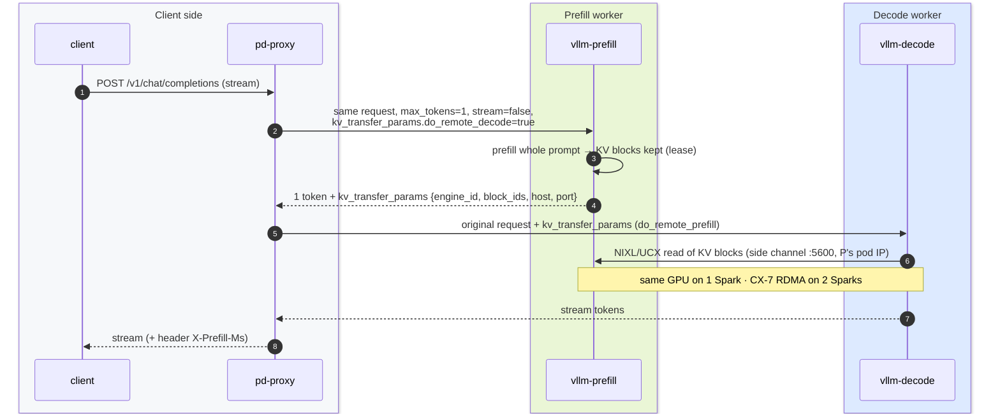
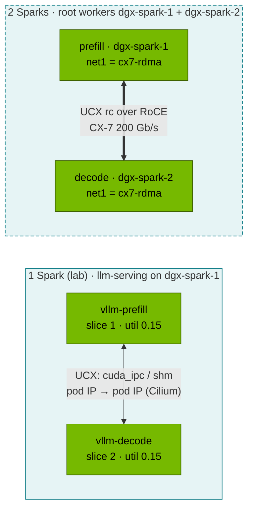

# Chapter 23 · Disaggregated Prefill & Decode Serving: KV-Cache Transfer with vLLM + NIXL, Routing, and When It Pays Off

> **02-Kubernetes · Part VII — LLM serving · Chapter 23 of 28** · ← [Chapter 22 · LLM inference alternatives & KServe](22-llm-inference-alternatives-and-kserve.md) · [All chapters](00-kubernetes-step-by-step-guide.md) · [Chapter 24 · Hyperscaler silicon & compilers](24-hyperscaler-silicon-and-compilers.md) →

| | |
|---|---|
| **You will build** | A working prefill/decode (P/D) split in the root's `llm-serving` namespace, next to vLLM: two vLLM instances with the NIXL KV connector and a small proxy that routes each request prefill → decode. You'll see the KV handoff in logs and headers, plus a transfer-time model that tells you when disaggregation is worth it. On two Sparks, the KV cache moves over the CX-7 |
| **Hardware** | dgx-spark-1 (both roles share the GB10 via 2 slices: mechanics, not speed). 2 Sparks for §5.5 |
| **Time** | 90 min |
| **Risk** | Medium-low. Experimental feature: pin versions, and verify `import nixl` in your image first. Prefill + decode need 40 Gi (request = limit); they fit `llm-serving`'s 90 Gi ceiling next to vLLM, so nothing has to be parked |
| **Clusters** | `spark-root` (P, D, proxy, the `serving-budget` ceiling, pod IPs, Cilium, and on two Sparks the CX-7 NetworkAttachmentDefinition in `batch`) |
| **Lab files** | [`manifests/root-llms/90-serving/pd-disagg/`](lab/manifests/root-llms/90-serving/pd-disagg/) (`pd.yaml`, `pd_proxy.py`), [`manifests/root-llms/10-tenancy/quotas.yaml`](lab/manifests/root-llms/10-tenancy/quotas.yaml), [`manifests/root-llms/85-network-operator/rdma-test-pod.yaml`](lab/manifests/root-llms/85-network-operator/rdma-test-pod.yaml) |

---

## 1. Why this matters

LLM inference has two phases with opposite hardware appetites:

| | Prefill | Decode |
|---|---|---|
| Work | process the whole prompt in parallel | one token per step per sequence |
| Bound by | **compute** (big GEMMs) | **memory bandwidth** (read all weights + KV each step) |
| Latency metric | TTFT | TPOT / inter-token latency |
| Batch behaviour | a few long prompts saturate the GPU | many sequences needed to use the GPU |

In one engine, a burst of long prompts stalls every in-flight decode (TPOT spikes), and a crowd of decoders delays new prefills (TTFT spikes). **Disaggregation** runs them on separate workers sized and scaled independently, at the cost of moving the prompt's KV cache from P to D.

---

## 2. Architecture — HLD





The side channel uses `VLLM_NIXL_SIDE_CHANNEL_HOST=status.podIP`. That IP is the pod's address from the root's 10.42.0.0/16 pod CIDR, assigned by Cilium, so the two engines reach each other directly, without any Service. (A vCluster has no network of its own either: the same manifest in the `dev-llms` sandbox would report the same kind of root pod IP.)

---

## 3. LLD

### 3.1 Components

| Object | Key settings |
|---|---|
| `vllm-prefill`, `vllm-decode` Deployments | `--kv-transfer-config={"kv_connector":"NixlConnector","kv_role":"kv_both"}`, `--enforce-eager`, `--gpu-memory-utilization=0.15` each, `VLLM_NIXL_SIDE_CHANNEL_HOST=<podIP>`, port 5600, `UCX_TLS=all`; 750m · 20 Gi (request = limit) · 1 slice each |
| `pd-proxy` | stdlib Python (`pd_proxy.py`): prefill with `max_tokens=1` → copy `kv_transfer_params` → decode, streaming passthrough, `X-Prefill-Ms` header; 100m · 256 Mi limit |
| Services | `vllm-prefill:8000`, `vllm-decode:8000`, `pd-proxy:8000` |

| Budget (Chapter 20 §9) | CPU | Memory limit | Slices |
|---|---|---|---|
| P + D + proxy | 1.6 | 40.25 Gi | 2 |
| + always-on (mocks, Qdrant) | 2.0 | 42.6 Gi | 2 |
| + vLLM, which stays up | 3.5 | 74.6 Gi | 3 |
| `serving-budget` (`llm-serving`) | 8 | **90 Gi** | 6 |

The experiment fits next to vLLM with 15.4 Gi to spare, and no quota needs lifting. Because P and D set request = limit, the scheduler also checks the shared LLM memory pool: with a 12 Gi training job running in `batch` the total is 86.6 of ~90 GiB, still inside. The limit to watch is UMA memory: P and D take 0.15 each, so with vLLM's 0.20 the util sum is 0.50, well inside the ≲ 0.72 the root has for models (Chapter 20 §2). Parking vLLM is only needed for a bigger model.

### 3.2 KV-transfer time model

KV bytes for a prompt = prompt tokens × KV bytes/token (Chapter 20 §3.1). Transfer time ≈ bytes / effective bandwidth.

| Model | Prompt | KV size | CX-7 RDMA (~22 GB/s eff.) | 10 GbE TCP (~1.1 GB/s) | Same GPU (UMA copy) |
|---|---|---|---|---|---|
| Qwen2.5-0.5B | 4K tokens | 48 MiB | ~2 ms | ~45 ms | < 1 ms |
| Qwen2.5-7B | 4K | 224 MiB | ~10 ms | ~210 ms | ~1 ms |
| Llama-3.1-8B | 32K | 4 GiB | ~195 ms | ~3.9 s | ~15 ms |

**Rule:** disaggregation pays off when the TTFT/TPOT interference you remove is larger than the transfer you add. That means long prompts, strict TPOT SLOs, and a fast interconnect. Over the 10 GbE management network (where Cilium's VXLAN overlay carries pod traffic between Sparks), it rarely pays off.

---

## 4. Integrations

- **Chapter 20** supplies the model cache and monitoring. Both P and D export `vllm:*` metrics; the root ServiceMonitor keeps `vllm-prefill` and `vllm-decode`, so the dashboard's TTFT comes from prefill, TPOT from decode, both labelled `vcluster="root"`, `vnamespace="llm-serving"`.
- **Chapters 17/18**: on two Sparks, UCX needs the RDMA devices in the pods: the Multus `cx7-rdma` NetworkAttachmentDefinition (in namespace `batch`, where 01-Ansible playbook 21.1 puts it; a pod in `llm-serving` references it as `batch/cx7-rdma`), `rdma/rdma_shared_cx7`, `IPC_LOCK`, and `UCX_NET_DEVICES=rocep1s0f1:1,roceP2p1s0f1:1`.
- **Chapter 08**: P↔D traffic on port 5600 stays inside `llm-serving`. The NetworkPolicy `allow-ingress-and-same-namespace` there admits pods of the same namespace (plus `ingress` and `observability`), so 5600 is open between the two Deployments, and pods from the vClusters (`vc-dev-lab`, `vc-dev-llms`) can't reach it. A stricter policy that default-denies ingress must allow 5600 between P and D explicitly.
- **Chapter 11 §8**: at scale, the proxy's job moves into the gateway (Gateway API Inference Extension / llm-d / Dynamo routers), which also pick decode workers by KV-cache locality.

---

## 5. Lab

```bash
cd "02-Kubernetes/lab"
export KUBECONFIG="$PWD/../../01-Ansible/lab/.cache/kubeconfig-spark-lab.yaml"
```

### 5.1 Pre-flight: does the image have NIXL?

P/D uses the same image as Chapter 20's vLLM, so ask the running engine. vLLM stays up (74.6 of 90 Gi, util sum 0.50); park the other engines from Chapters 21–22: SGLang or KServe would push the memory past 90 Gi (and the util sum to 0.70); Triton would still fit (88.6 Gi with its perf Job) but shares the GB10 and blurs the comparison:

```bash
kubectl --context spark-root -n llm-serving exec deploy/vllm -- python3 -c "import nixl, vllm; print('nixl OK, vllm', vllm.__version__)"
# park the other engines (Chapter 20 §9); vLLM stays
kubectl --context spark-root -n llm-serving scale deploy sglang triton --replicas=0 2>/dev/null
kubectl --context spark-root -n llm-serving delete inferenceservice qwen-small --ignore-not-found 2>/dev/null
```

If `import nixl` fails, use a newer NGC vLLM tag that bundles it, or build a thin image `FROM nvcr.io/nvidia/vllm:<tag>` with `RUN pip install nixl` (and pin it).

Park vLLM too only if memory requires it: for a bigger model in P and D, or if something outside `llm-serving` already uses model memory (a benchmark in `platform-tools`, a model in the dev-llms sandbox) and P + D + vLLM would take the sum past 0.72, use the KEDA pause annotation (Chapter 20 §9).

### 5.2 Deploy P, D and the proxy

Check that the quota and the node have room for 40 Gi more:

```bash
kubectl --context spark-root -n llm-serving describe resourcequota serving-budget | grep -E 'memory|requests.cpu|gpu'
kubectl --context spark-root describe node dgx-spark-1 | grep -A9 'Allocated resources'
kubectl --context spark-root apply -k manifests/root-llms/90-serving/pd-disagg
kubectl --context spark-root -n llm-serving rollout status deploy/vllm-prefill --timeout=30m
kubectl --context spark-root -n llm-serving rollout status deploy/vllm-decode --timeout=30m
kubectl --context spark-root -n llm-serving logs deploy/vllm-prefill | grep -iE 'nixl|kv_transfer|connector' | head
```

Expected: both engines log that the `NixlConnector` initialised (role `kv_both`) with a side-channel port. If the node's free memory is below ~41 Gi (a larger training job in `batch`, another engine), the second engine sits `Pending` with `Insufficient memory` — it never squeezes the running vLLM. Wait for the batch job (Chapter 25) or park an engine rather than lowering the requests. If Argo CD already manages the root's LLM namespaces (Chapter 28), its `selfHeal` reverts §5.5's namespace label within minutes: pause `spark-root-llms-00-platform` for that experiment, as Chapter 28 §2.3 shows.

Prove the side-channel address is the pod IP:

```bash
kubectl --context spark-root -n llm-serving get pods -l pd-role -o custom-columns=NAME:.metadata.name,IP:.status.podIP,ROLE:.metadata.labels.pd-role
kubectl --context spark-root -n llm-serving logs deploy/vllm-prefill | grep -iE 'side.?channel' | head -3     # same IP, port 5600
```

### 5.3 Send traffic through the proxy

```bash
kubectl --context spark-root -n llm-serving port-forward svc/pd-proxy 8000 &
curl -sN -D /tmp/h localhost:8000/v1/chat/completions -H 'Content-Type: application/json' -d '{
  "model":"Qwen/Qwen2.5-0.5B-Instruct","stream":true,"max_tokens":64,
  "messages":[{"role":"user","content":"Explain prefill vs decode in two sentences."}]}' \
  | sed -n 's/^data: //p' | grep -v DONE | jq -rj '.choices[0].delta.content // empty'; echo
grep -i x-prefill-ms /tmp/h
kubectl --context spark-root -n llm-serving logs deploy/vllm-decode --since=1m | grep -iE 'nixl|remote|transfer' | tail -5
```

Evidence of a real handoff: the decode log shows remote-prefill/NIXL read activity for the request, and the prefill log shows a request with `max_tokens=1`. The proxy header reports how long prefill took. On one Spark you can also watch the flow on the root with Hubble — `hubble observe --namespace llm-serving --port 5600` shows the side-channel handshake between the two pod IPs; the KV bytes themselves move through `cuda_ipc`/shared memory, not the network.

### 5.4 Compare with a monolithic engine under mixed load

```bash
python3 scripts/ttft_probe.py --url http://localhost:8000 --model Qwen/Qwen2.5-0.5B-Instruct -n 10      # through P/D
kill %1
kubectl --context spark-root delete -k manifests/root-llms/90-serving/pd-disagg
kubectl --context spark-root -n llm-serving rollout status deploy/vllm --timeout=30m   # if you parked it: remove the pause annotation first (Chapter 20 §9)
kubectl --context spark-root -n llm-serving port-forward svc/vllm 8000 &
python3 scripts/ttft_probe.py --url http://localhost:8000 --model qwen2.5-0.5b -n 10; kill %1
```

On one GB10 expect **no latency win**, and possibly a small loss: both roles share the same compute, and the proxy adds a hop. That's the honest result, and it's the point. Disaggregation is an *interference* fix for separate hardware. Write down both numbers. §5.5 is where the architecture starts to make sense.

### 5.5 (2 Sparks) Prefill on dgx-spark-1, decode on dgx-spark-2

dgx-spark-2 joins the **root** (01-Ansible `k8s_workers`), where the models run, and `21.1-multus-rdma.yml` has put the `cx7-rdma` NetworkAttachmentDefinition into `batch` (`multus_nad_namespaces: [platform-tools, batch]`). Check the plumbing with the lab's test pod first:

```bash
kubectl --context spark-root get nodes                                    # dgx-spark-1, dgx-spark-2
kubectl --context spark-root -n batch get network-attachment-definitions  # cx7-rdma
kubectl --context spark-root apply -f manifests/root-llms/85-network-operator/rdma-test-pod.yaml
kubectl --context spark-root -n batch logs rdma-test                            # net1 + the rocep* devices
kubectl --context spark-root -n batch delete pod rdma-test
```

`llm-serving` enforces Pod Security **baseline**, which forbids the `IPC_LOCK` capability RDMA needs (`batch` is privileged for that reason). For the experiment, relax it the same way `batch` is labelled, and put it back afterwards:

```bash
kubectl --context spark-root label ns llm-serving pod-security.kubernetes.io/enforce=privileged --overwrite
# afterwards: kubectl --context spark-root apply -k manifests/root-llms/00-platform
```

Then add to the prefill Deployment `nodeSelector: {kubernetes.io/hostname: dgx-spark-1}`, to decode `dgx-spark-2`, plus on both:

```yaml
      metadata:
        annotations:
          k8s.v1.cni.cncf.io/networks: batch/cx7-rdma   # namespace/name: the NAD lives in batch
      spec:
        containers:
          - name: vllm
            env:
              - {name: UCX_NET_DEVICES, value: "rocep1s0f1:1,roceP2p1s0f1:1"}
              - {name: UCX_TLS, value: "rc,cuda_copy,cuda_ipc"}
            securityContext: {capabilities: {add: [IPC_LOCK]}}
            resources: {limits: {rdma/rdma_shared_cx7: "1"}}     # Network Operator / Multus (Chapter 17 §5.6)
```

`nodeSelector` uses the nodes' own `kubernetes.io/hostname` labels; the root scheduler places each role on its Spark. Then run a prefill-heavy mix (long prompts, short outputs) against both setups with `vllm bench serve --random-input-len 8192 --random-output-len 64`. Now decode TPOT stays flat while prefill runs on the other Spark.

---

## 6. Verify

| Check | Expected |
|---|---|
| `import nixl` in the image | OK |
| `serving-budget` | P + D + proxy counted (40.25 Gi), within 90 Gi next to vLLM; ceiling unchanged before and after |
| P and D pod IPs | the side-channel address in the prefill log matches `status.podIP` |
| proxy response | streamed tokens + `X-Prefill-Ms` header |
| decode log | NIXL/remote-prefill activity per request |
| written result | P/D vs monolithic TTFT on 1 Spark (and on 2 if available) |

---

## 7. Troubleshooting

| Symptom | Cause | Diagnose | Fix |
|---|---|---|---|
| `vllm-decode` 0/1, `exceeded quota: serving-budget` | another engine besides vLLM (SGLang, KServe, Triton) still in `llm-serving`: P + D + vLLM + it > 90 Gi | `kubectl --context spark-root -n llm-serving describe resourcequota serving-budget` | park it (§5.1, Chapter 20 §9) |
| a P/D pod Pending, `Insufficient memory` | the shared LLM memory pool is taken (other engines, batch jobs; all request = limit) | `kubectl --context spark-root describe node dgx-spark-1 \| grep -A9 'Allocated resources'` | wait for the batch job, or park another engine |
| decode recomputes the prompt (slow, no NIXL logs) | `kv_transfer_params` not forwarded, or prefill returned none | proxy logic, prefill response JSON | proxy must copy `kv_transfer_params` from the prefill response |
| `NIXL handshake failed / timeout` | side-channel host/port unreachable | `VLLM_NIXL_SIDE_CHANNEL_HOST` = pod IP, containerPort 5600, NetworkPolicy; `hubble observe --namespace llm-serving --port 5600 --verdict DROPPED` | allow 5600 between the two Deployments (same namespace is allowed in the lab) |
| UCX errors `no usable transports` | UCX can't find RDMA/cuda transports | `UCX_LOG_LEVEL=info` | set `UCX_TLS`, give pods RDMA devices + `IPC_LOCK` |
| pod rejected: `violates PodSecurity "baseline" … IPC_LOCK` | §5.5 on a baseline namespace | `kubectl --context spark-root get ns llm-serving --show-labels` | relabel for the experiment (§5.5) |
| no `net1` in the pod | NAD looked up in the wrong namespace | `kubectl --context spark-root -n batch get net-attach-def` | reference it as `batch/cx7-rdma` from `llm-serving` (a bare `cx7-rdma` is looked up in the pod's own namespace) |
| KV blocks freed before decode reads them | lease too short under load | prefill log `lease expired` | `kv_connector_extra_config.kv_lease_duration` |
| OOM when both start | two engines × fraction > free UMA | `free -g` on the Spark | 0.15 each (lab), scale other engines to 0 |

---

## 8. Scale-out path

| Lab | Datacenter |
|---|---|
| 1 P + 1 D, stdlib proxy | xP + yD pools sized from traffic mix (prefill-heavy RAG vs decode-heavy chat), KV-aware router (llm-d, NVIDIA Dynamo, Gateway API Inference Extension) |
| UCX over one CX-7 link | NIXL over IB/RoCE rails, GPUDirect RDMA, KV offload tiers (CPU memory → NVMe → remote, e.g. LMCache) |
| one shared `serving-budget` for P, D and the monolithic engine | separate budgets per pool (a prefill quota and a decode quota), sized from SLOs |
| manual comparison | SLO-driven autoscaling per pool (TTFT for P, TPOT for D) |

---

## 9. Checklist

- [ ] I can explain why prefill and decode interfere, and which metric each one hurts.
- [ ] I ran a P/D split and found evidence of the KV handoff in logs and headers.
- [ ] I checked P + D against `serving-budget`, the node's free memory and the util sum before deploying — no ceiling had to move, and vLLM stayed up.
- [ ] I can estimate KV-transfer time for any model/prompt/link and decide whether P/D pays off.
- [ ] I have an honest one-Spark result, and a plan for the two-Spark experiment.
