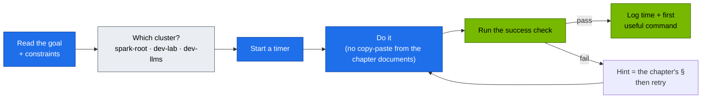

# Chapter 27 · Hands-On Practice Exercises Workbook: 20 Production Challenges on the Spark Platform

> **02-Kubernetes · Part IX — Operations · Chapter 27 of 28** · ← [Chapter 26 · Cluster diagnostics & failure scenarios](26-cluster-diagnostics-and-failure-scenarios.md) · [All chapters](00-kubernetes-step-by-step-guide.md) · [Chapter 28 · Production MLOps & GitOps](28-production-mlops-and-gitops.md) →

| | |
|---|---|
| **You will build** | Proof that you can operate the platform without the chapter documents open. Twenty timed challenges, each with a goal, constraints, a success check you can run, and a pointer to the volume with the answer |
| **Clusters** | all three. Each exercise says which: `spark-root` (node, platform, budgets, and the LLM stack: `llm-serving`, `batch`, Traefik, Kueue), `dev-lab` (tenants, `lab-tools`), `dev-llms` (`llm-sandbox`) |
| **Hardware** | dgx-spark-1 |
| **Time** | 6–8 h total. Do 2–3 per session |
| **Risk** | as per the referenced volume. Ex 20 restores root etcd |
| **Lab files** | all of [`lab/`](lab/README.md) |

---

## 0. How to use this workbook



#### What this lab does (start check: `tests/run-local-checks.sh`, `scripts/verify.sh`, `scripts/breakfix.sh reset all`)
- **Static checks** (yamllint, kustomize build + kubeconform, and the rest of what CI runs without a Spark). Nothing touches a cluster.
- **`verify.sh`** checks the platform, vClusters, LLM budgets, tenancy, admission (server-side dry-run), GPU, ingress, storage, serving and observability. Its only change is a short-lived `gpu-smoke` pod in dev-lab's `tenant-beta`.
- **`breakfix.sh reset all`** undoes any drill left over from Chapter 26.

#### What to look for
1. **Local checks:** the last line is `ALL LOCAL CHECKS PASSED`.
2. **verify:** ends with `<n> passed, <w> warnings, 0 failed`. Warnings for add-ons you haven't installed yet are fine.
3. **Reset:** `[PASS] all scenarios reset`.

**If something's off:** the `&&` chain stops at the first failure, so read the last `[FAIL]` line and fix that layer first. Chapter 26 §1 is the triage method.

#### Run it

Start from a clean, verified platform:

```bash
# ▶ MacBook · technical-depth (repo root)
export KUBECONFIG="$PWD/01-Ansible/lab/.cache/kubeconfig-spark-lab.yaml"   # contexts spark-root, dev-lab, dev-llms
cd "02-Kubernetes/lab"
tests/run-local-checks.sh && scripts/verify.sh && scripts/breakfix.sh reset all
```

Rules of the game: every `kubectl` and `helm` command you type names its context (`--context` / `--kube-context`). Half of these exercises are about knowing which one.

Progress log (copy into your notes):

| # | Challenge | Cluster(s) | Target time | Your time | First useful command |
|---|---|---|---|---|---|
| 01–20 | … | … | … | | |

---

## Part A — Control plane

### Ex 01 · Namespaces and cgroups of a vCluster pod (20 min)

#### What this lab does (exercise `Ex 01`)
- **Read-only:** you trace dev-lab's `lab-tools/netshoot` pod to its synced copy in `vc-dev-lab` on the root, then to its process, network namespace and cgroup on dgx-spark-1. Nothing is changed.

#### What to look for
1. **Root name:** `netshoot-…-x-lab-tools-x-dev-lab` in `vc-dev-lab`.
2. **Inodes:** the `net:[…]` number from `/proc/<pid>/ns/net` on the host equals the one `readlink` prints inside the pod.
3. **cgroup:** `cpu.max` = `max 100000` (no CPU limit), `memory.max` = `268435456` (the 256 Mi limit).

**If something's off:** `crictl` or `nsenter` refused → use `sudo`. `cgroup-inspect.sh` says `cgroup … not found` → it must run on the Spark, not the MacBook.

#### Run it

**Cluster:** dev-lab → root host.
**Goal:** for the `netshoot` pod in dev-lab's `lab-tools`, print its name on the root, its PID on the host, its network namespace inode, its cgroup path and its `cpu.max`.
**Constraints:** `kubectl --context spark-root get` to find the root name, then host shell only (`crictl`, `nsenter`, `/proc`). No `kubectl exec`, no lab scripts.
**Success check:** `sudo ls -l /proc/<pid>/ns/net` inode equals the one inside the pod (`kubectl --context dev-lab -n lab-tools exec deploy/netshoot -- readlink /proc/1/ns/net`). Then compare your answer with `scripts/cgroup-inspect.sh lab-tools <pod> dev-lab` and `scripts/pod-netns.sh lab-tools <pod> dev-lab`.
**Answer:** [Chapter 01 §5 Task 5](01-kubernetes-core-architecture.md), [Chapter 04 §3.4](04-nested-clusters-with-vcluster.md), [Chapter 14 §5.2](14-multi-tenancy-resource-quotas-and-cgroups.md).

### Ex 02 · Read a raw key from etcd — and find a key that isn't there (15 min)

#### What this lab does (exercise `Ex 02`)
- **Root:** reads the raw etcd value of Secret `platform-tools/demo` with `etcdctl` on the Spark (create the Secret first if it isn't there).
- **dev-lab:** creates Secret `tenant-alpha/demo` inside the vCluster and looks for it in root etcd.

#### What to look for
1. **Root value** starts with `k8s:enc:aescbc:v1:key1:`, not with readable text.
2. **`grep tenant-alpha`** prints nothing: the tenant Secret lives in dev-lab's SQLite database on its PVC.
3. **Your explanation:** a root copy (named `…-x-tenant-alpha-x-dev-lab` in `vc-dev-lab`) appears only once a dev-lab pod uses the Secret.

**If something's off:** plain text after the key → encryption at rest isn't active (Chapter 02 §5.3). `etcdctl` TLS errors → pass the certificates under `/etc/kubernetes/pki/etcd/` as `scripts/etcd-drill.sh` does.

#### Run it

**Cluster:** spark-root (etcd), dev-lab.
**Goal:** show the etcd key for Secret `platform-tools/demo` and prove it's encrypted. Then create Secret `tenant-alpha/demo` in dev-lab and explain why `/registry/secrets/tenant-alpha/demo` doesn't exist in root etcd.
**Success check:** the root value starts with `k8s:enc:aescbc:v1:key1:`. `etcdctl get --prefix --keys-only /registry/secrets/ | grep tenant-alpha` prints nothing, and you can say where the tenant Secret lives and when a copy of it would appear on the root.
**Answer:** [Chapter 02 §5.3](02-etcd-database-deep-dive.md), [Chapter 03 §3.5](03-kube-apiserver-internals.md), [Chapter 04 §3.3](04-nested-clusters-with-vcluster.md).

### Ex 03 · APF lane for a noisy CI bot (30 min)

#### What this lab does (exercise `Ex 03`)
- **Creates** in dev-lab: ServiceAccount `lab-tools/ci-deployer` (if missing), a PriorityLevelConfiguration with `nominalConcurrencyShares: 5` and a FlowSchema for that ServiceAccount, beside the existing `spark-tenants` lane.
- **Load:** a LIST flood as `ci-deployer`, while you time an admin `get nodes`. The root API server is not touched.

#### What to look for
1. **During the flood:** `apiserver_flowcontrol_current_inqueue_requests` for your priority level is above 0.
2. **Admin call:** `kubectl --context dev-lab get nodes` stays under 200 ms.
3. **Root lane:** `spark-vcluster-syncers` metrics on `spark-root` don't move.

**If something's off:** your priority level never queues → the FlowSchema doesn't match (subject kind `ServiceAccount`, namespace `lab-tools`, name `ci-deployer`) or a FlowSchema with a lower `matchingPrecedence` catches the requests first.

#### Run it

**Cluster:** dev-lab.
**Goal:** give ServiceAccount `lab-tools/ci-deployer` its own PriorityLevelConfiguration (`nominalConcurrencyShares: 5`) and FlowSchema in dev-lab, next to the tenant lane from `manifests/dev-lab/16-apf`, then prove its LIST flood doesn't slow an admin's `kubectl --context dev-lab get nodes`.
**Success check:** `kubectl --context dev-lab get --raw /metrics | grep 'apiserver_flowcontrol_current_inqueue_requests{.*priority_level="<yours>"'` > 0 during the flood. Admin `get nodes` stays < 200 ms. Bonus: show that the root's `spark-vcluster-syncers` lane (`manifests/root/16-apf`) is untouched — the flood never reached the root API server.
**Answer:** [Chapter 03 §3.4, §5 Task 6](03-kube-apiserver-internals.md).

### Ex 04 · RBAC for a read-only auditor (20 min)

#### What this lab does (exercise `Ex 04`)
- **`make-user.sh carol auditors`** creates a client certificate through dev-lab's CSR API and writes `.cache/carol.kubeconfig`. The certificate is signed by dev-lab's CA only.
- **You write** a ClusterRole and the bindings (one RoleBinding per `tenant-*` namespace, plus node read access) in dev-lab.

#### What to look for
1. **`can-i list secrets -n tenant-alpha`** → `no`.
2. **`can-i list pods -n tenant-alpha`** → `yes`.
3. **Same user on the root** (`list pods -n vc-dev-lab`) → `no`.

**If something's off:** `yes` for Secrets → a rule with `resources: ["*"]` includes them; list the resources explicitly.

#### Run it

**Cluster:** dev-lab.
**Goal:** user `carol` (group `auditors`) can `get/list/watch` everything in `tenant-*` except Secrets, and can read nodes. Issue her certificate with `scripts/make-user.sh carol auditors`.
**Success check:** `kubectl --context dev-lab auth can-i list secrets -n tenant-alpha --as=carol --as-group=auditors` → `no`. `list pods` → `yes`. `kubectl --context spark-root auth can-i list pods -n vc-dev-lab --as=carol --as-group=auditors` → `no` (dev-lab's RBAC means nothing to the root).
**Answer:** [Chapter 03 §5 Task 3–4](03-kube-apiserver-internals.md).

### Ex 05 · Write and prove a new CEL policy (30 min)

#### What this lab does (exercise `Ex 05`)
- **Edits** the shared policy file `manifests/common/15-admission/policies.yaml` (a new ValidatingAdmissionPolicy and binding) and adds two fixtures under `tests/policy/`.
- **Applies** it to the root with `root-llms/15-admission`. dev-lab and dev-llms get the same policy the next time their `15-admission` layers are applied.
- **`verify.sh admission`** server-side dry-runs every fixture; nothing is created.

#### What to look for
1. **verify output:** `[PASS] denied  deny-serving-no-memory-limit (spark-root)` and `[PASS] allowed allow-… (spark-root)`, plus all the existing fixtures still passing.
2. **Trap:** a bare Pod fixture in `llm-serving` is *allowed*, because the LimitRange `defaults` (512 Mi) fills `limits.memory` in before validation runs. Write the policy and the deny fixture for Deployments, as `spark-serving-needs-readiness` does, and give the deny fixture a `readinessProbe` and a pinned image so only your rule can deny it.

**If something's off:** `expected deny, got rc=0` → see the trap above. All fixtures fail after your edit → a CEL syntax error; `kubectl --context spark-root get validatingadmissionpolicy <name> -o yaml` shows it in `status.typeChecking`.

#### Run it

**Cluster:** spark-root (the policy file is shared with both vClusters).
**Goal:** in `llm-serving`, every container must set `resources.limits.memory`. Add it to `manifests/common/15-admission/policies.yaml` with a binding that selects `spark.lab/tier: serving`.
**Success check:** add `tests/policy/deny-serving-no-memory-limit.yaml` (`# expect: deny`, `# cluster: spark-root`) and an `allow-…` fixture (`# expect: allow`). After `kubectl --context spark-root apply -k manifests/root-llms/15-admission`, `scripts/verify.sh admission` passes with your new fixtures. Then explain why `llm-serving`'s LimitRange `defaults` would have filled in a limit anyway — and why the policy is still worth having (hint: request = limit is what keeps models from overcommitting the shared memory pool).
**Answer:** [Chapter 03 §5 Task 5](03-kube-apiserver-internals.md), [Chapter 14 §3.3](14-multi-tenancy-resource-quotas-and-cgroups.md).

### Ex 06 · Trace a reconciliation cascade across two control planes (20 min)

#### What this lab does (exercise `Ex 06`)
- **Scales** dev-lab's `lab-tools/echo` from 3 to 5. Two new pods appear in dev-lab and their copies in `vc-dev-lab` on the root.
- **You read** the events and `managedFields` in both clusters. Scale back to 3 afterwards.

#### What to look for
1. **dev-lab events:** `ScalingReplicaSet` (deployment-controller), then `SuccessfulCreate` (replicaset-controller).
2. **Root events** in `vc-dev-lab`: `Scheduled` (default-scheduler), then `Pulled`/`Created`/`Started` (kubelet) for the `…-x-lab-tools-x-dev-lab` pods.
3. **Your list** says which API server received each write: dev-lab's for the Deployment and ReplicaSet, the root's for the synced pods.

**If something's off:** the Deployment goes back to 3 by itself → Argo CD `selfHeal` manages `dev-lab/30-networking` (Chapter 28); pause that app first.

#### Run it

**Cluster:** dev-lab, spark-root.
**Goal:** scale dev-lab's `lab-tools/echo` from 3 to 5 and list, in order, every controller that wrote an object and every event emitted — in both clusters.
**Success check:** your list names deployment-controller → replicaset-controller (dev-lab's controller-manager) → the vCluster syncer → default-scheduler (root) → kubelet, and says which API server each write went to.
**Answer:** [Chapter 06 §5.2, §5.6](06-kube-controller-manager-and-controllers.md), [Chapter 04 §4](04-nested-clusters-with-vcluster.md).

## Part B — Scheduling

### Ex 07 · Dedicated GPU node (20 min)

#### What this lab does (exercise `Ex 07`)
- **Taints** dgx-spark-1 on the root with `spark.lab/dedicated=gpu:PreferNoSchedule`. With one node, every cluster sees it.
- **Deploys** `affinity-demo` (2 replicas, 50m · 32 Mi, tolerations for `spark.lab/dedicated=gpu`, node affinity `spark.lab/gpu=gb10`) in dev-lab's `tenant-beta`.
- **Removes** the taint at the end (`spark.lab/dedicated-`).

#### What to look for
1. **Pods:** 2 × `affinity-demo` `Running` in `tenant-beta`.
2. **Tolerations** present in the dev-lab pod spec and in its root copy in `vc-dev-lab`.
3. **Taint visible from dev-lab** while it is set; gone after removal (`describe node dgx-spark-1 | grep -i taint` on the root).

**If something's off:** pods Pending with `didn't match Pod's node affinity` → the node lacks the label `spark.lab/gpu=gb10` (`scripts/verify.sh gpu` checks it).

#### Run it

**Cluster:** spark-root (taint), dev-lab (workload).
**Goal:** taint dgx-spark-1 `spark.lab/dedicated=gpu:PreferNoSchedule` on the root, deploy `affinity-demo` from `manifests/dev-lab/20-scheduling/taints-affinity.yaml` in dev-lab, then remove the taint.
**Success check:** `affinity-demo` pods Running in `tenant-beta`, with the toleration visible in the virtual pod's spec **and** in its root copy in `vc-dev-lab`; `kubectl --context dev-lab describe node dgx-spark-1` showed the taint while it was set.
**Answer:** [Chapter 07 §5.6](07-kube-scheduler-and-ai-batch-scheduling.md).

### Ex 08 · Gang scheduling with Kueue (30 min)

#### What this lab does (exercise `Ex 08`)
- **Deadlock (dev-lab):** `no-kueue-deadlock.yaml` creates Service `peers` and Jobs `job-x`, `job-y` in `lab-tools`, each 2 ranks × 1 GPU slice, against dev-lab's 2-slice root budget. Stop other GPU pods in dev-lab first.
- **Gang test (root):** `tests/kueue-gang-test.sh` applies `gang-demo-jobs.yaml` in `batch`: two 3-slice gangs against `spark-cq` (3 slices).

#### What to look for
1. **Deadlock:** often one rank of each Job `Running` and the other `Pending` forever, with a sync error from the root quota. The split is random; run it 2–3 times.
2. **Gang test:** ends with `PASS: one gang admitted whole, the other held whole (no partial start)`.
3. **Bonus:** the Job's `FailedCreate` event names `batch-budget`.

**If something's off:** the gang test prints `FAIL: expected exactly 1 admitted gang` → another workload holds `spark-cq` capacity (`kubectl --context spark-root -n batch get workloads`). Delete the deadlock Jobs when done.

#### Run it

**Cluster:** dev-lab (deadlock), spark-root (Kueue).
**Goal:** reproduce the partial-gang deadlock without Kueue (`manifests/dev-lab/20-scheduling/no-kueue-deadlock.yaml`), then run gangs through `batch/train` on the root. Bonus: reproduce "Kueue admitted, quota refused" from Chapter 18 §5.3.
**Success check:** `tests/kueue-gang-test.sh` → `PASS`. For the bonus, you can point at the Job controller's `FailedCreate` event that names `batch-budget`, and say which other gate (the node's memory) would have kept rank 1 Pending instead.
**Answer:** [Chapter 07 §5.4–5.5](07-kube-scheduler-and-ai-batch-scheduling.md), [Chapter 18 §5.3](18-distributed-ai-training-and-nccl.md).

## Part C — Networking

### Ex 09 · veth to Cilium to pod (20 min)

#### What this lab does (exercise `Ex 09`)
- **Read-only:** finds the host-side `lxc*` veth of dev-lab's `netshoot` pod on dgx-spark-1, captures on it with `tcpdump` while the pod curls `echo`, and cross-checks with Hubble on the root.

#### What to look for
1. **tcpdump:** a SYN to a `10.42.x.x:8080` address: a pod IP, not the ClusterIP.
2. **Hubble:** the same flow from `vc-dev-lab/<root name>`.

**If something's off:** no packets → wrong veth; `scripts/pod-netns.sh lab-tools <pod> dev-lab` prints the right one.

#### Run it

**Cluster:** dev-lab → root host.
**Goal:** for dev-lab's `lab-tools/netshoot` pod, identify its `lxc*` host veth on the root and capture its traffic on that veth while it curls `echo`.
**Success check:** `sudo tcpdump -ni <lxc…> tcp port 8080` shows the SYN to a `10.42.x.x:8080` address (after kube-proxy translated the ClusterIP), and `kubectl --context spark-root -n kube-system exec ds/cilium -- hubble observe --from-pod vc-dev-lab/<root name> --last 5` shows the same flow.
**Answer:** [Chapter 08 §5.2–5.3](08-kubernetes-networking-deep-dive.md), `scripts/pod-netns.sh lab-tools <pod> dev-lab`.

### Ex 10 · iptables for a ClusterIP (20 min)

#### What this lab does (exercise `Ex 10`)
- **Read-only:** reads the NAT rules for dev-lab's `lab-tools/echo` Service (3 replicas) from `sudo iptables-save` on the Spark.

#### What to look for
1. **Three endpoint rules** under the Service's chain. Probabilities `0.33333…` on the first, `0.50000…` on the second, none on the last: each pod gets 1/3.
2. **Pod IPs** match the EndpointSlice in dev-lab.

**If something's off:** you can't find the chain → search for the ClusterIP from `kubectl --context dev-lab -n lab-tools get svc echo`; `scripts/svc-trace.sh lab-tools echo dev-lab` shows the whole path.

#### Run it

**Cluster:** dev-lab Service, root kube-proxy.
**Goal:** from `sudo iptables-save` on the Spark alone, predict which pod IPs back dev-lab's `lab-tools/echo`, with each one's probability.
**Success check:** matches `kubectl --context dev-lab -n lab-tools get endpointslices -l kubernetes.io/service-name=echo`. You can explain why a Service that exists only in dev-lab's API has rules in the *root's* iptables (same ClusterIP on both sides).
**Answer:** [Chapter 09 §5.1](09-kube-proxy-and-cluster-ip-mechanics.md), `scripts/svc-trace.sh lab-tools echo dev-lab`.

### Ex 11 · Fix the ndots tax for a model server (25 min)

#### What this lab does (exercise `Ex 11`)
- **Patches** the root's `llm-serving/mock-llm` Deployment with `dnsConfig.options ndots: "1"`. The pod restarts.
- **Captures** DNS queries on its host veth while it resolves `huggingface.co`.

#### What to look for
1. **Before the patch:** about 10 queries (every search domain, A and AAAA).
2. **After:** at most 2 (A and AAAA for the name itself).
3. **Who answered:** the root CoreDNS at `10.43.0.10`. In dev-llms' `llm-sandbox` it would be that vCluster's own DNS.

**If something's off:** the patch disappears after a few minutes → Argo CD `selfHeal` on `spark-root-llms-40-ingress` (Chapter 28). Put the change in Git instead.

#### Run it

**Cluster:** spark-root (pod), root host (capture).
**Goal:** patch the root's `llm-serving/mock-llm` (`dnsConfig.options ndots: "1"`) so an external lookup produces 2 DNS queries instead of ~10.
**Success check:** on the Spark, capture on the mock-llm pod's host veth (`sudo tcpdump -nli <lxc…> udp dst port 53`) while `kubectl --context spark-root -n llm-serving exec deploy/mock-llm -- python3 -c "import socket; socket.getaddrinfo('huggingface.co', 443)"` runs: ≤ 2 queries after the patch. Say which CoreDNS answered them (the root's `10.43.0.10` — and which one would have answered the same pod in dev-llms' `llm-sandbox`).
**Answer:** [Chapter 10 §3.2, §5.3](10-coredns-and-service-discovery.md).

### Ex 12 · Streaming through the gateway (25 min)

#### What this lab does (exercise `Ex 12`)
- **Creates** an HTTPRoute for `api.lab.local` in `llm-serving`, attached to Gateway `lab-gateway` in `ingress`, backend `mock-llm:8000`, request timeout 900 s.
- **Streams** 1,000 tokens from the mock (20 tokens/s) through Traefik on `192.168.0.115`.

#### What to look for
1. **`time_starttransfer`** under 0.5 s.
2. **`time_total`** about 50 s (1,000 tokens at 20/s).

**If something's off:** `404` → the route didn't attach: `kubectl --context spark-root -n llm-serving describe httproute <name>` shows the parent status. TTFB ≈ total → something buffers the response (BF-09).

#### Run it

**Cluster:** spark-root.
**Goal:** add a new HTTPRoute `api.lab.local` → `mock-llm` in `llm-serving` on Traefik's Gateway (namespace `ingress`) with a 900 s request timeout, and prove a 1,000-token stream through `192.168.0.115` isn't buffered.
**Success check:** `curl -s -o /dev/null -w '%{time_starttransfer} %{time_total}\n' -H 'Host: api.lab.local' http://192.168.0.115/v1/chat/completions -d '{"stream":true,"max_tokens":1000}'` shows TTFB < 0.5 s and total ≈ 50 s.
**Answer:** [Chapter 11 §5.3–5.4, §5.7](11-ingress-controllers-and-gateway-api.md).

## Part D — Workloads & storage

### Ex 13 · Stateful vector DB survives (25 min)

#### What this lab does (exercise `Ex 13`)
- **Writes** 100 points into the root's `llm-serving/qdrant` (1 replica, PVC on `local-nvme-retain`, 20 Gi).
- **Deletes** pod `qdrant-0`, then the whole StatefulSet with its PVCs kept, and re-applies `manifests/root-llms/50-workloads`.

#### What to look for
1. **`points_count`** is `100` after each deletion.
2. **Storage:** the PVC binds the same PV both times; its directory is under `/data/k8s/retain/llm-serving/` on the Spark.

**If something's off:** count is 0 → the PVC was deleted too (a `Retain` PV then needs its `claimRef` cleared to bind again, see Ex 15). Qdrant's PDB has `maxUnavailable: 0`; that only blocks evictions, not your `delete`.

#### Run it

**Cluster:** spark-root.
**Goal:** insert 100 points into Qdrant (`llm-serving/qdrant`), delete `qdrant-0`, then delete the whole StatefulSet (keep PVCs), re-apply `manifests/root-llms/50-workloads`, and count the points.
**Success check:** `points_count == 100` after both deletions. You can name the PV that held the data and its directory under `/data/k8s/retain/llm-serving/`.
**Answer:** [Chapter 12 §5.1](12-advanced-workload-controllers.md), [Chapter 12 §3.4](12-advanced-workload-controllers.md).

### Ex 14 · Sharded preprocessing with a bad shard (25 min)

#### What this lab does (exercise `Ex 14`)
- **Runs** Indexed Job `tokenize-shards` in dev-lab's `tenant-alpha`: 8 indexes, 2 at a time, 200m · 512 Mi limit per pod, `backoffLimitPerIndex: 2`, `maxFailedIndexes: 1`.
- **`BAD_SHARD=5`** makes index 5 fail every time. A second run processes only index 5.

#### What to look for
1. **First run:** `status.failedIndexes: "5"`, `completedIndexes: "0-4,6-7"`; index 5 tried 3 times (1 + 2 retries).
2. **Second run:** only index 5 runs and completes.
3. **Budget:** never more than 2 pods at once (400m of `tenant-alpha`'s 500m).

**If something's off:** pods missing and a `FailedCreate` with `exceeded quota: tenant-budget` → other pods in `tenant-alpha` use the budget.

#### Run it

**Cluster:** dev-lab.
**Goal:** run `tenant-alpha/tokenize-shards` (`manifests/dev-lab/50-workloads/tokenizer-indexed-job.yaml`) with `BAD_SHARD=5`, then re-process only shard 5 after "fixing" it.
**Success check:** first run `failedIndexes: "5"`. Second run completes index 5 only. Every pod fit inside `tenant-alpha`'s 500m / 2 Gi budget.
**Answer:** [Chapter 12 §5.4](12-advanced-workload-controllers.md).

### Ex 15 · NVMe baseline and a Retain volume (30 min)

#### What this lab does (exercise `Ex 15`)
- **Root:** `fio-job.yaml` in `platform-tools` creates PVC `fio-scratch` (`local-nvme`), ConfigMap `fio-profiles` (1M sequential read and write, 128k and 4k random read, 4 jobs each) and the fio Job.
- **dev-lab:** a `local-nvme-retain` PVC, a file written to it, the PVC deleted, and the `Released` PV re-bound to a new PVC.

#### What to look for
1. **fio:** a JSON summary per profile. Save it as your NVMe baseline.
2. **After the delete:** the root PV is `Released`, not deleted.
3. **New PVC** `Bound` to the same PV, and the file is readable.

**If something's off:** the new PVC stays Pending → the PV still has the old `claimRef`. Clearing it is a root-only step (`--context spark-root`); a dev-lab tenant has no rights on root PVs.

#### Run it

**Cluster:** spark-root (fio, PV), dev-lab (claim).
**Goal:** run the fio profiles (`manifests/root/60-storage/fio-job.yaml` in `platform-tools`) and save the JSON summary. Then in dev-lab create a `local-nvme-retain` PVC, write a file, delete the PVC, and re-bind the `Released` root PV to a new dev-lab PVC.
**Success check:** the file is readable from the new PVC. You can say which step needed `--context spark-root` and why a dev-lab tenant couldn't do it.
**Answer:** [Chapter 13 §5.3–5.4](13-storage-csi-and-high-performance-volumes.md).

### Ex 16 · Tenant budget from first principles (30 min)

#### What this lab does (exercise `Ex 16`)
- **Creates** namespace `tenant-gamma` in dev-lab with a ResourceQuota at 25 % of `vc-dev-lab`'s `vcluster-budget` (2 CPU · 4 Gi · 2 slices · 200 Gi), a LimitRange, NetworkPolicies and a RoleBinding for `team-gamma`.
- **Tests** it with a 3-replica Deployment of 250m pods.

#### What to look for
1. **Quota:** 500m CPU, 1 Gi memory, 50 Gi storage. 25 % of 2 slices is 0.5, and a quota counts whole slices, so 0.
2. **Deployment:** exactly 2 pods; the third gets `exceeded quota` in the ReplicaSet events.
3. **`scripts/verify.sh tenancy`** still `0 failed`.

**If something's off:** 3 pods start → the quota doesn't cover the resource the pods set (compare `requests.cpu`/`limits.cpu` in the quota with the pod spec).

#### Run it

**Cluster:** dev-lab (tenant), spark-root (the number it's computed from).
**Goal:** create `tenant-gamma` in dev-lab with a budget of **25 %** of dev-lab's root budget, computed from `kubectl --context spark-root -n vc-dev-lab get resourcequota vcluster-budget -o json` (not hard-coded), with a LimitRange, NetworkPolicies and a RoleBinding for `team-gamma`.
**Success check:** `scripts/verify.sh tenancy` still passes, and a 3-replica Deployment of 250m-CPU pods in gamma gets exactly 2 pods. Then explain why alpha + beta + gamma (1.5 CPU) don't reserve anything on the root.
**Answer:** [Chapter 14 §3.2](14-multi-tenancy-resource-quotas-and-cgroups.md), [Chapter 04 §5](04-nested-clusters-with-vcluster.md).

## Part E — GPU

### Ex 17 · CDI and the GPU leak (25 min)

#### What this lab does (exercise `Ex 17`)
- **Host:** `nvidia-ctk cdi generate` on the Spark prints a CDI spec; compare it with the GPU Operator's setup (CDI off).
- **Leak:** BF-10 starts `bf10-leak` in dev-lab, a CUDA image with no GPU request. Then you apply the hardened runtime settings.
- **Changes the runtime config of the root node.** Plan for GPU pods restarting.

#### What to look for
1. **Before hardening:** `bf10-leak` logs list the GB10, and dev-lab's GPU quota shows no use.
2. **After:** `bf10-leak` sees no GPU.
3. **`scripts/verify.sh gpu`:** `[PASS] gpu-smoke: …` (it uses `runtimeClassName: nvidia`).

**If something's off:** gpu-smoke fails after hardening → GPU pods now need `runtimeClassName: nvidia`; check the RuntimeClass exists (`manifests/common/runtimeclass`).

#### Run it

**Cluster:** spark-root host (runtime), dev-lab (pods).
**Goal:** generate the CDI spec on the host (`nvidia-ctk cdi generate`) and compare it with what the GPU Operator uses (CDI off), then demonstrate and close the GPU leak (BF-10, dev-lab) using the hardened runtime settings.
**Success check:** after hardening, `bf10-leak` can't see the GPU, `scripts/verify.sh gpu` (gpu-smoke with `runtimeClassName: nvidia`) still passes, and you can explain why dev-lab's GPU quota never counted the leaking pod.
**Answer:** [Chapter 16 §5.1, §5.4–5.5](16-nvidia-container-toolkit-and-gpu-virtualization.md).

### Ex 18 · Device-plugin profile per node (20 min)

#### What this lab does (exercise `Ex 18`)
- **Switches** the device-plugin profile on dgx-spark-1 to `whole-gpu` (a node label on the root), runs `gemm-solo` in `platform-tools`, and switches back.
- **While on `whole-gpu`,** only one GPU pod can start anywhere; running pods keep their slice.

#### What to look for
1. **Allocatable `nvidia.com/gpu`:** 15 → 1 → 15, on the root and in dev-llms.
2. **Budgets unchanged:** `serving-budget` still 6, `vc-dev-llms` `vcluster-budget` still 2.
3. **gemm-solo JSON:** `tflops` about your baseline (≈ 46.6 on this Spark), `mem_total_gib` ≈ 121.7.

**If something's off:** `gemm-solo` Pending with `Insufficient nvidia.com/gpu` → another GPU pod took the single GPU; scale it down. `verify.sh gpu` warns about allocatable ≠ 15 until you switch back.

#### Run it

**Cluster:** spark-root (switch, benchmark), dev-llms (observe).
**Goal:** switch dgx-spark-1 to `whole-gpu`, show allocatable 1 on the root **and** in dev-llms, run `gemm-solo` in `platform-tools`, then switch back.
**Success check:** allocatable goes 15 → 1 → 15 in both contexts while `serving-budget` keeps saying 6 and `vc-dev-llms`'s `vcluster-budget` keeps saying 2. GEMM TFLOPS equals your baseline.
**Answer:** [Chapter 17 §5.3](17-nvidia-gpu-operator-and-network-operator.md).

### Ex 19 · Multi-tenant GPU contention report (40 min)

#### What this lab does (exercise `Ex 19`)
- **Scales** `platform-tools/gemm-contention` to 1, 2, 3, 4 replicas. Each pod loops the bf16 GEMM and prints one JSON line per run.
- **Measures** p95 TTFT of `llm-serving/mock-llm` through `192.168.0.115` at each step. Scale back to 0 at the end.

#### What to look for
1. **Per pod:** `tflops` falls roughly as 1/N.
2. **Aggregate:** the sum stays within ~10 % of the single-pod value (≈ 46.6 TFLOPS).
3. **Your explanation:** slices are a scheduling count; time-slicing gives no isolation, so no quota can prevent this.

**If something's off:** replicas Pending → not enough free slices; the ledger `platform-tools/gpu-slice-ledger` shows who holds them.

#### Run it

**Cluster:** spark-root (`gemm-contention`, `mock-llm`).
**Goal:** produce a table of per-pod and aggregate TFLOPS for 1, 2, 3 and 4 concurrent `platform-tools/gemm-contention` pods, plus p95 TTFT of `llm-serving/mock-llm` (through `192.168.0.115`) measured at the same time.
**Success check:** aggregate stays within ~10 % of the single-pod baseline. You can explain why — and why the slice budgets (`serving-budget`, the `vc-*` budgets) can't prevent this contention.
**Answer:** [Chapter 16 §5.3](16-nvidia-container-toolkit-and-gpu-virtualization.md).

## Part F — Disaster recovery

### Ex 20 · Full etcd restore under time pressure (45 min)

#### What this lab does (exercise `Ex 20`)
- **On the Spark:** `etcd-drill.sh snapshot` writes a snapshot to `/var/lib/etcd-snapshots`. `restore <file>` asks you to type `restore`, stops the control-plane static pods, keeps the old data as `/var/lib/etcd.before-restore-<timestamp>`, restores, and starts them again.
- **Destructive for the root:** every root object created after the snapshot is gone. The root API is down for a minute or two; running pods keep running.

#### What to look for
1. **Restore output** ends with `restored from <file>` and the warning that the vClusters' data was not rolled back.
2. **The three root objects** (namespace, ConfigMap, LocalQueue) are gone; the dev-llms ConfigMap is still there.
3. **`scripts/verify.sh`** ends `0 failed`.

**If something's off:** the API doesn't come back → follow Chapter 26 §3.1 (`crictl ps`, `journalctl -u kubelet`). The old data dir lets you go back.

#### Run it

**Cluster:** spark-root (etcd), dev-llms.
**Goal:** snapshot (`scripts/etcd-drill.sh snapshot`), then create four "doomed" objects: a root namespace, a ConfigMap in `platform-tools`, a Kueue LocalQueue in the root's `batch`, and a ConfigMap in dev-llms' `llm-sandbox`. Restore the snapshot (`scripts/etcd-drill.sh restore <file>`).
**Success check:** `scripts/verify.sh` all PASS after the restore. The three root objects — the LocalQueue included, because the LLM stack lives in root etcd — are gone; the sandbox ConfigMap is **still there**, and you can explain why (dev-llms keeps its state in SQLite on its PVC) and how you would have rolled it back too.
**Answer:** [Chapter 02 §5.6, §5.8](02-etcd-database-deep-dive.md), [Chapter 04 §6.7](04-nested-clusters-with-vcluster.md).

---

## Capstone — the 60-minute rebuild

#### What this lab does (capstone: `delete -k` + `helm uninstall`, then `install-addons.sh vclusters` and `apply-lab.sh`)
- **Deletes** the root's lab layers (`root/16-apf` … `95-observability`), the root's LLM-stack layers except `00-platform` and `60-storage`, and the whole dev-lab vCluster (Helm release and namespace `vc-dev-lab` with its SQLite PVC).
- **Keeps** the 01-Ansible base, the add-ons, Traefik's `ingress` namespace and the `model-cache` PVC, so no model download is repeated.
- **Rebuilds** `vc-dev-lab`'s budget, reinstalls dev-lab, re-merges the contexts, applies every lab layer and verifies.

#### What to look for
1. **Deletion done:** `kubectl --context spark-root get ns vc-dev-lab` → `NotFound` before you start the clock.
2. **After the rebuild:** `kubectl --context dev-lab get ns` answers (new CA, new context).
3. **Pass:** `verify.sh` ends `0 failed` within 60 minutes.
4. **Afterwards:** re-issue every dev-lab user certificate (`make-user.sh`); the old ones were signed by the old CA.

**If something's off:** `vc-dev-lab` stuck `Terminating` → an object with a finalizer is left; `kubectl --context spark-root get all,pvc -n vc-dev-lab`. dev-lab never gets `192.168.0.111` → see Chapter 26 §3.11.

#### Run it

Tear down the 02 layer — the root's lab objects and the whole `dev-lab` vCluster — keeping 01-Ansible's base (kubeadm root, Cilium, MetalLB, GPU Operator), the add-ons (storage, metrics-server, kps, Traefik, Kueue, KEDA) and the LLM stack's model cache. Then rebuild to green:

```bash
# ▶ MacBook · 02-Kubernetes/lab
# root lab layers (never delete root/00-platform or root/05-vclusters: they hold observability and the vc-* namespaces)
for d in 95-observability 70-gpu 50-workloads 45-controller 30-networking 16-apf; do
  kubectl --context spark-root delete -k manifests/root/$d --ignore-not-found --wait=false; done
# the root's LLM-stack layers (keep 00-platform: the ingress namespace holds Traefik; keep 60-storage: model-cache)
for d in 20-scheduling 50-workloads 40-ingress 15-admission 10-tenancy; do
  kubectl --context spark-root delete -k manifests/root-llms/$d --ignore-not-found --wait=false; done
# the whole dev-lab vCluster: control plane, SQLite, every synced object
helm --kube-context spark-root uninstall dev-lab -n vc-dev-lab
kubectl --context spark-root delete namespace vc-dev-lab --wait=true
# start the clock
kubectl --context spark-root apply -k manifests/root/05-vclusters      # vc-dev-lab namespace, budget, LimitRange, boundary policy
scripts/install-addons.sh vclusters                                    # reinstalls dev-lab (dev-llms: no-op upgrade), re-merges contexts
scripts/apply-lab.sh && scripts/verify.sh
```

**Pass:** `0 failed` within 60 minutes, including one drill of your choice fixed along the way. Note what the rebuild cost you: dev-lab has a new CA, so every `make-user.sh` certificate for dev-lab must be re-issued.

---

## CI: the workbook for your laptop

Everything that doesn't need a GPU is checked on every PR by [`.github/workflows/k8s-lab-ci.yml`](../.github/workflows/k8s-lab-ci.yml). It runs lint, kubeconform, promtool and shellcheck, then builds the same shape on kind: kind plays the root (context `spark-root`, a fake GB10 with 15 slices from `tests/fake-gpu-node.sh`), the two vClusters come from `vclusters/*.yaml` (ClusterIP + port-forward instead of MetalLB), Kueue runs on the root with the LLM stack, and it applies the lab to all three clusters, runs the budget, tenancy and admission checks and the Kueue gang test. Run the same on a laptop:

#### What this lab does (CI on the laptop: kind + `tests/`)
- **Creates** a local kind cluster `spark-sim` (Docker on the MacBook) and renames its context to `spark-root`. The Spark is not involved.
- **`fake-gpu-node.sh`** labels the kind node like a GB10 and advertises 15 `nvidia.com/gpu`. Pods can't use a GPU, but quotas, admission and Kueue behave as on the Spark.
- **Then** the vCluster and CRD steps from the workflow, the server-side dry-runs against all three contexts (`API=1`) and the Kueue gang test.
- **Delete it** afterwards with `kind delete cluster --name spark-sim`.

#### What to look for
1. **Fake GPU:** `kubectl --context spark-root get nodes -o jsonpath='{..allocatable.nvidia\.com/gpu}'` → `15`.
2. **`API=1 tests/run-local-checks.sh`** ends `ALL LOCAL CHECKS PASSED`.
3. **Gang test:** `PASS: one gang admitted whole, the other held whole (no partial start)`.

**If something's off:** `context "spark-root" already exists` on the rename → this shell still points at the lab's kubeconfig; open a new shell without that `KUBECONFIG` so kind uses `~/.kube/config`. The gang test times out → Kueue isn't installed on the kind root yet (a workflow step you skipped). Dry-run errors about unknown kinds → the CRD step is missing.

#### Run it

```bash
# ▶ MacBook · 02-Kubernetes/lab (new shell, lab KUBECONFIG not set)
kind create cluster --name spark-sim --image kindest/node:v1.34.0
kubectl config rename-context kind-spark-sim spark-root
tests/fake-gpu-node.sh
# then the vCluster + CRD steps of the workflow's "kind" job, and:
API=1 tests/run-local-checks.sh
tests/kueue-gang-test.sh
```

The workflow file is the reference for the steps in between (Cilium/Prometheus CRDs on the root, `helm --kube-context spark-root upgrade --install` of each vCluster with `controlPlane.service.spec.type=ClusterIP`, port-forwards, `scripts/merge-vcluster-kubeconfig.sh`).
