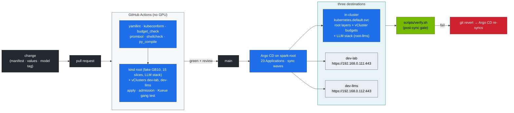
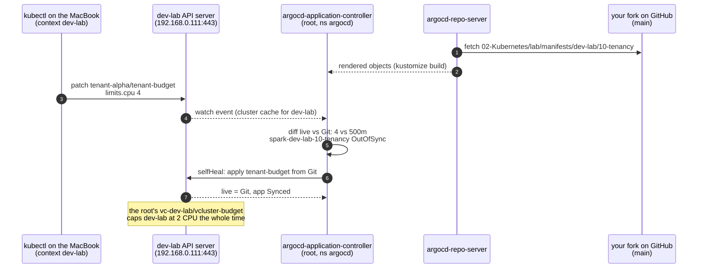

# Chapter 28 · Production MLOps & GitOps: CI, Promotion and Rollback on the Spark Platform

> **02-Kubernetes · Part IX — Operations · Chapter 28 of 28** · ← [Chapter 27 · Hands-on practice exercises workbook](27-hands-on-practice-exercises-workbook.md) · [All chapters](00-kubernetes-step-by-step-guide.md)

| | |
|---|---|
| **You will build** | Git as the only way to change the platform: CI validates every change without a GPU (on kind, with the same root + two vClusters shape), one Argo CD on the root syncs the lab layers to **three clusters** in dependency order, models and engines are promoted through canaries, and a rollback is `git revert` |
| **Hardware** | dgx-spark-1 + a GitHub fork of this repo |
| **Time** | 60 min |
| **Clusters** | `spark-root` (Argo CD in `argocd`, the root layers, the vCluster budgets, the LLM stack from `manifests/root-llms`) · `dev-lab` and `dev-llms` (Argo CD destinations, reached on their MetalLB API IPs `.111` / `.112`) |
| **Lab files** | [`gitops/applications.yaml`](lab/gitops/applications.yaml), [`scripts/argocd-register-vclusters.sh`](lab/scripts/argocd-register-vclusters.sh), [`scripts/install-addons.sh`](lab/scripts/install-addons.sh) `argocd`, [`.github/workflows/k8s-lab-ci.yml`](../.github/workflows/k8s-lab-ci.yml), [`tests/`](lab/tests/), [`versions.env`](lab/versions.env) |

---

## 1. The delivery pipeline



| Concern | Lab mechanism | Where |
|---|---|---|
| Validation | static checks + `budget_check.py` (the vCluster and LLM budgets add up, inner ceilings fit their vCluster, every GPU container in `root-llms` sets memory request = limit) + kind-with-fake-GPU CI that builds the root and both vClusters | `k8s-lab-ci.yml`, `tests/` |
| Desired state | Git, one Argo CD Application per `manifests/<cluster>/<layer>` | `gitops/applications.yaml` |
| Destinations | the root (`in-cluster`) and two vClusters registered as clusters | `scripts/argocd-register-vclusters.sh` |
| Ordering | sync waves (-10 → 10): root platform → vCluster budgets → LLM stack / in-vCluster platform → policy → workloads. CRD-dependent layers last | annotations |
| Drift | `selfHeal: true`: a manual `kubectl edit` in any of the three clusters is reverted within minutes | Argo CD |
| Safety | `prune: false` on the namespace layers (`*-00-platform`), the vCluster budgets (`spark-root-05-vclusters`) and storage (`spark-root-llms-60-storage`); the vClusters themselves (Helm releases) are **not** Argo CD apps | `applications.yaml` |
| Secrets | never in Git. Vault (01-Ansible Chapter 18) → Kubernetes Secrets (Vault Agent / External Secrets) | `hf-token`, `llm-api-users`, TLS |
| Versions | one file | `versions.env` |
| Progressive delivery | HTTPRoute weights (90/10 → 50/50 → 0/100) on Traefik in the root's `ingress` | Chapter 11 §5.7 |
| Rollback | `git revert` → auto-sync | Argo CD |

### 1.1 The Applications

| Wave | Root platform (`in-cluster`) | Root LLM stack (`in-cluster`) | dev-lab (`.111`) | dev-llms (`.112`) |
|---|---|---|---|---|
| -10 | `spark-root-00-platform` | | | |
| -9 | `spark-root-05-vclusters` (namespaces, quotas, LimitRanges, Cilium boundary) | | | |
| -8 | | `spark-root-llms-00-platform` | `spark-dev-lab-00-platform` | `spark-dev-llms-00-platform` |
| -5 | `spark-root-16-apf` | `spark-root-llms-10-tenancy`, `-15-admission` | `spark-dev-lab-10-tenancy`, `-15-admission`, `-16-apf` | `spark-dev-llms-10-tenancy`, `-15-admission` |
| 0 | `spark-root-30-networking`, `-45-controller`, `-50-workloads`, `-70-gpu` | `spark-root-llms-60-storage` | `spark-dev-lab-30-networking` | |
| 5 | | `spark-root-llms-40-ingress`, `-50-workloads`, `-20-scheduling` | | |
| 10 | `spark-root-95-observability` | | | |

The `spark-root-llms-*` apps have the same destination as the root's platform apps — the LLM stack is root namespaces (`llm-serving`, `batch`, `ingress`), so Argo CD writes its objects straight to the root API server, with no vCluster in between. dev-llms gets only its platform, tenancy and admission layers: what runs in its `llm-sandbox` is short-lived trial work, applied by hand.

Not in Git-driven sync on purpose: the vCluster Helm releases (an Application that can prune a whole vCluster is one typo away from deleting it — 01-Ansible `roles/vclusters` or `install-addons.sh vclusters` own them), the add-ons (`install-addons.sh`), and the labs you change by hand while learning (`root/12-cgroups`, `root-llms/80-distributed`, `root-llms/90-serving` — whose `vllm.yaml` also carries a placeholder `hf-token` Secret that GitOps would keep overwriting).

### 1.2 How Argo CD reaches a vCluster

Argo CD runs in the root's `argocd` namespace. For dev-lab and dev-llms it's an ordinary external cluster: a `cluster` Secret holding the vCluster's API URL and the client certificate vCluster exported into Secret `vc-<name>` in `vc-<name>`. The script writes exactly what `argocd cluster add` would, without needing the `argocd` CLI. The traffic goes Argo CD pod → `192.168.0.11x:443` → (the root's kube-proxy turns the LoadBalancer IP into the vCluster pod) → the vCluster API server. Two consequences:

- Argo CD's watches and applies load the **vCluster's** API server (in its budget, behind its APF), not the root's. What reaches the root is the syncer's traffic, in the `spark-vcluster-syncers` APF lane.
- Objects Argo CD creates in a vCluster carry its tracking annotation *inside* the vCluster. Their synced copies on the root are owned by the syncer, so the root-side `spark-root-*` apps never fight over them.

### 1.3 A drift revert in dev-lab, step by step

§2.3 edits a quota inside dev-lab by hand and watches Argo CD put it back. All of it happens between the root's `argocd` namespace and dev-lab's API server:



- **Steps 1–2** run on every refresh. A fork that Argo CD can't read stops here with `ComparisonError` (§2.2).
- **Step 3** is the `patch` command in §2.3.
- **Steps 4–5** are the `OutOfSync` you may catch with the `get application` command. The watch comes through dev-lab's API on `.111`, so this load lands on dev-lab's API server, not the root's.
- **Steps 6–7** put `500m` back: the last command in §2.3.
- **The note** is why the patch never gave tenant-alpha 4 CPU: the root quota on `vc-dev-lab` is the real ceiling.

---

## 2. Lab

```bash
# ▶ MacBook · technical-depth (repo root)
cd "02-Kubernetes/lab"
export KUBECONFIG="$PWD/../../01-Ansible/lab/.cache/kubeconfig-spark-lab.yaml"
```

### 2.1 Install Argo CD on the root and register the vClusters

#### What this lab does (scripts `install-addons.sh argocd` and `argocd-register-vclusters.sh`)

- **Installs Argo CD** `v3.1.8` (`ARGOCD_VERSION` in `versions.env`) from the upstream `install.yaml` into namespace `argocd` on the root, and waits up to 10 min for `argocd-server`.
- **Registers dev-lab and dev-llms:** for each, reads the admin kubeconfig vCluster exported into Secret `vc-<name>` in `vc-<name>`, and writes a `cluster` Secret `cluster-<name>` in `argocd` with the API URL and client certificate. No `argocd` CLI needed.
- **UI access:** reads the initial admin password and port-forwards `argocd-server` to https://localhost:8443.
- **Nothing is synced yet.** No Applications exist until §2.2.

#### What to look for

1. **Script output:** `[PASS] Argo CD destination dev-lab → https://192.168.0.111:443` and the same for `dev-llms` → `.112`.
2. **Cluster Secrets:** two rows, `cluster-dev-lab` and `cluster-dev-llms`. Decoded, `SERVER` is `https://192.168.0.111:443` and `https://192.168.0.112:443`.
3. **Password:** a random string, printed once.
4. **UI:** *Settings → Clusters* lists `in-cluster`, `dev-lab` and `dev-llms`. The browser warns about the self-signed certificate; that's expected.

**If something's off:** `Argo CD not installed` from the register script → run `install-addons.sh argocd` first. A vCluster shows as unreachable in the UI → check `kubectl --context dev-lab get ns` from the MacBook; if that fails too, see Chapter 26 §3.11.

#### Run it

```bash
# ▶ MacBook · 02-Kubernetes/lab
scripts/install-addons.sh argocd                       # Argo CD (versions.env ARGOCD_VERSION) into argocd on spark-root
scripts/argocd-register-vclusters.sh                   # cluster Secrets for dev-lab and dev-llms
kubectl --context spark-root -n argocd get secret -l argocd.argoproj.io/secret-type=cluster \
  -o custom-columns=NAME:.metadata.name,SERVER:.data.server
kubectl --context spark-root -n argocd get secret argocd-initial-admin-secret -o jsonpath='{.data.password}' | base64 -d; echo
kubectl --context spark-root -n argocd port-forward svc/argocd-server 8443:443 &      # https://localhost:8443  (admin / above)
```

The `SERVER` column is base64; `echo <value> | base64 -d` shows `https://192.168.0.111:443` and `https://192.168.0.112:443`. In the UI, *Settings → Clusters* lists `in-cluster`, `dev-lab` and `dev-llms`.

### 2.2 Point it at your fork and sync

#### What this lab does (manifest `lab/gitops/applications.yaml`)

- **Edits** `applications.yaml` locally so every `repoURL` points at your fork.
- **Creates 23 Applications** in `argocd`: one per `manifests/<cluster>/<layer>`, with destination `in-cluster` (root platform, vCluster budgets, LLM stack) or `https://192.168.0.111:443` / `https://192.168.0.112:443` (the vClusters). Table in §1.1.
- **Auto-sync with `selfHeal: true`.** The `*-00-platform` layers, `spark-root-05-vclusters` and `spark-root-llms-60-storage` have `prune: false`; the other layers prune, the `10-tenancy` layers included.
- **Optional app-of-apps:** a parent Application `spark-app-of-apps` that syncs the `gitops` folder itself, so the children are applied wave by wave.
- **Not touched:** the vCluster Helm releases, the add-ons, and the hand-run labs (`root/12-cgroups`, `root-llms/80-distributed`, `root-llms/90-serving`).

#### What to look for

1. **Count:** `get applications` lists 23 rows.
2. **Status after a few minutes:**

   | Applications | Healthy value |
   |---|---|
   | most | `Synced` / `Healthy` |
   | `spark-root-llms-40-ingress`, `spark-root-llms-20-scheduling` | `Synced` once Traefik and Kueue are installed on the root; `SyncFailed`/`Missing` before |
   | `spark-root-95-observability` | `Synced` once kube-prometheus-stack's CRDs are on the root |

3. **DEST column:** `https://kubernetes.default.svc` for `spark-root-*`, `.111` for `spark-dev-lab-*`, `.112` for `spark-dev-llms-*`.

**If something's off:** `ComparisonError` / repository not found → the `sed` didn't change `repoURL`, or the fork is private without credentials in Argo CD. An app stuck retrying with `namespace not found` → it ran before its namespace layer; the `retry` block (5 tries) normally clears it, or use the app-of-apps.

#### Run it

```bash
# ▶ MacBook · 02-Kubernetes/lab
sed -i.bak 's|github.com/cloudone365/technical-depth.git|github.com/<you>/technical-depth.git|' gitops/applications.yaml && rm gitops/applications.yaml.bak   # your fork (BSD and GNU sed)
kubectl --context spark-root apply -n argocd -f gitops/applications.yaml
kubectl --context spark-root -n argocd get applications \
  -o custom-columns=APP:.metadata.name,DEST:.spec.destination.server,WAVE:.metadata.annotations.argocd\\.argoproj\\.io/sync-wave,SYNC:.status.sync.status,HEALTH:.status.health.status
```

Expected after a few minutes: every app `Synced` / `Healthy`. `spark-root-llms-40-ingress` and `spark-root-llms-20-scheduling` report `SyncFailed`/`Missing` until Traefik and Kueue are installed on the root (`scripts/install-addons.sh traefik`, then `kueue`) — they need the Gateway API, Traefik and Kueue CRDs. `spark-root-95-observability` needs kube-prometheus-stack's CRDs on the root (`install-addons.sh kps`).

Applied like this, the Applications all start at once, and the sync waves don't order them — waves order resources *within one sync*. The `retry` block (5 tries, backoff to 3 min) is what lets a layer whose namespace doesn't exist yet succeed on a later try. For real ordering, sync `applications.yaml` itself from a parent **app-of-apps**:

```bash
# ▶ MacBook · 02-Kubernetes/lab
kubectl --context spark-root apply -n argocd -f - <<'YAML'
apiVersion: argoproj.io/v1alpha1
kind: Application
metadata: {name: spark-app-of-apps, namespace: argocd}
spec:
  project: default
  source:
    repoURL: https://github.com/<you>/technical-depth.git
    targetRevision: main
    path: "02-Kubernetes/lab/gitops"
  destination: {server: https://kubernetes.default.svc, namespace: argocd}
  syncPolicy: {automated: {prune: false, selfHeal: true}}
YAML
```

Now the parent applies the children wave by wave. Argo CD waits for a child to be *healthy* before the next wave only if the Application health check is enabled in `argocd-cm` (`resource.customizations` for `argoproj.io/Application`, see the Argo CD app-of-apps docs).

### 2.3 Watch drift correction — in a vCluster

#### What this lab does (a manual patch that Argo CD reverts)

- **Patches** `tenant-alpha`'s ResourceQuota `tenant-budget` inside dev-lab to `limits.cpu: 4`, a change that isn't in Git.
- **Argo CD** (Application `spark-dev-lab-10-tenancy`, `selfHeal: true`) sees the drift through dev-lab's API server and puts `500m` back. Nothing on the root changes.
- **Optional:** the same experiment on a root budget (`vc-dev-llms/vcluster-budget` or `llm-serving/serving-budget`) reverts the same way.

#### What to look for

1. **Sync status:** `OutOfSync` right after the patch, then `Synced` again. Repeat the `get application` command if you only see `Synced`; the revert can be quick.
2. **Quota:** `limits.cpu` back to `500m` within a few minutes.
3. **Ceiling unaffected:** even while the patch is live, dev-lab can't use more than the root's `vcluster-budget` of 2 CPU.

**If something's off:** the value stays at `4` → the app's auto-sync is off (paused for a drill, see the note below) or the app isn't `Healthy`; check `kubectl --context spark-root -n argocd get application spark-dev-lab-10-tenancy`.

#### Run it

```bash
# ▶ MacBook · 02-Kubernetes/lab
kubectl --context dev-lab -n tenant-alpha patch resourcequota tenant-budget --type merge -p '{"spec":{"hard":{"limits.cpu":"4"}}}'
kubectl --context spark-root -n argocd get application spark-dev-lab-10-tenancy -o jsonpath='{.status.sync.status}{"\n"}'   # OutOfSync, then Synced
kubectl --context dev-lab -n tenant-alpha get resourcequota tenant-budget -o jsonpath='{.spec.hard.limits\.cpu}{"\n"}'   # back to 500m
```

Argo CD on the root noticed a change inside dev-lab's own API server and reverted it there. Even during those minutes, tenant-alpha could never have used 4 CPU: the root's `vcluster-budget` caps all of dev-lab at 2. Drift inside a vCluster is a policy problem; drift on the root (`spark-root-05-vclusters`) is a capacity problem — try the same patch on `vc-dev-llms`'s `vcluster-budget`, or on `llm-serving`'s `serving-budget` (`spark-root-llms-10-tenancy`), and watch it revert too. From now on, resizing a vCluster (Chapter 04 §6.5) is a Git change.

> **Drills vs GitOps:** with `selfHeal: true`, Argo CD "fixes" most `breakfix.sh` injections by itself within minutes, which spoils the exercise. Pause the app first: `kubectl --context spark-root -n argocd patch application <app> --type merge -p '{"spec":{"syncPolicy":{"automated":null}}}'`, then re-apply `gitops/applications.yaml` afterwards (`kubectl --context spark-root apply -n argocd -f gitops/applications.yaml`).

### 2.4 A change the right way: raise tenant-beta's GPU slices

#### What this lab does (a Git change to `manifests/dev-lab/10-tenancy/quotas.yaml`)

- **Raises** `tenant-beta`'s `requests.nvidia.com/gpu` from `"1"` to `"2"` in Git, on a branch.
- **Checks it locally** with `tests/budget_check.py`, then in CI on your PR (static checks plus the kind job with the root and both vClusters).
- **After the merge,** Argo CD syncs `spark-dev-lab-10-tenancy` to dev-lab. `scripts/verify.sh tenancy` is the gate. A `git revert` undoes it the same way.

#### What to look for

1. **`budget_check.py`:** ends with `budget check OK` for `"2"`. With `"3"` it prints a `FAIL:` line for tenant-beta's GPU ceiling against the `vc-dev-lab` budget and exits non-zero.
2. **CI:** all jobs green on the PR.
3. **After the sync:** `kubectl --context dev-lab -n tenant-beta get resourcequota tenant-budget -o jsonpath='{.spec.hard.requests\.nvidia\.com/gpu}'` → `2`, and `verify.sh tenancy` ends `0 failed`.
4. **After a revert:** the same query shows `1` again.

**If something's off:** the quota in dev-lab doesn't change after the merge → Argo CD tracks a different `repoURL` or branch than the one you merged into (§2.2).

#### Run it

1. Branch, then edit `manifests/dev-lab/10-tenancy/quotas.yaml` (`requests.nvidia.com/gpu: "2"` in tenant-beta).
2. Run `python3 tests/budget_check.py`: an inner ceiling of 2 fits dev-lab's 2 slices; `"3"` would fail (`tenant-beta GPU ceiling > vc-dev-lab budget`). The two tenants' ceilings may add up to more than the vCluster — they're ceilings, not reservations.
3. Add a policy fixture if behaviour changes (Chapter 03 §5 Task 5).
4. Push and open a PR. CI runs `tests/run-local-checks.sh` and the kind job (root + both vClusters).
5. Merge. Argo CD syncs `spark-dev-lab-10-tenancy`; run `scripts/verify.sh tenancy` as the post-sync gate.
6. To roll back, `git revert <sha>` and push.

### 2.5 Promote a new model or engine version

| Step | Change in Git | Gate |
|---|---|---|
| budget | does the canary fit? Two 32 Gi engines fit `serving-budget`'s 90 Gi (Chapter 20 §9), so old and new can run side by side if their util sum stays ≲ 0.72 (Chapter 20 §2). A third 32 Gi engine doesn't fit: park it, or lower its `--gpu-memory-utilization` and memory request (request = limit) in the same PR. The scheduler enforces the rest — a canary that doesn't fit waits Pending and never squeezes the running model | `budget_check.py` in CI |
| prefetch | `model-prefetch-job.yaml` `MODEL=`/`REVISION=` new revision (in the root's `llm-serving`) | Job completes |
| canary | a second Deployment (e.g. `vllm-canary`) + HTTPRoute weight 10 on `lab-gateway` | `vllm bench serve` (Chapter 20 §5.5) + TTFT/TPOT alerts quiet for 1 h, filtered by `vcluster="root", vnamespace="llm-serving"` |
| ramp | weights 50/50, then 0/100 | same |
| cleanup | delete the old Deployment (and shrink the budgets back, if you raised them) | `verify.sh serving` |

Pin every image by tag (the admission policy forbids `:latest`). For immutable promotion, pin by digest (`image@sha256:…`), which the policy allows.

---

## 3. Checklist for a production-ready change

- [ ] Change is in Git. No `kubectl edit` survives in any of the three clusters (Argo CD self-heals).
- [ ] CI green: static checks + `budget_check.py` + kind apply on root and both vClusters + admission fixtures + gang test.
- [ ] Secrets referenced, not committed.
- [ ] Versions updated in `versions.env` and in the manifests.
- [ ] Capacity changes touch every layer they cross: the tenant ceiling inside the vCluster and the vCluster's root budget; for the LLM stack, `serving-budget`/`batch-budget` and Kueue's `spark-cq` together (`budget_check.py` checks both).
- [ ] Post-sync `scripts/verify.sh` green. Dashboards and alerts checked.
- [ ] Rollback path tested (revert, sync, verify).

---

## 4. Scale-out path

| Lab | Production |
|---|---|
| one Argo CD on the root, three destinations | Argo CD ApplicationSets with a cluster generator (one template per layer, every registered cluster: spark pair, staging, prod), or Flux per cluster |
| vClusters registered by a script | vCluster Platform or Cluster API creating clusters and registering them with Argo CD in the same pipeline |
| add-ons via `install-addons.sh` | add-ons as Argo CD Helm Applications with pinned chart versions, destination = the cluster that needs them (Kueue, KEDA, KServe, Traefik → the root, next to the models) |
| kind + fake GPU in CI | + a self-hosted arm64 GPU runner (a Spark) for smoke tests on real hardware (the 01-Ansible CI shows the pattern) |
| manual canary steps | Argo Rollouts / Flagger with Prometheus analysis on TTFT/TPOT/error rate |
| model files by HF revision | model registry (MLflow, NGC private registry, Hugging Face revisions pinned by commit hash) |
