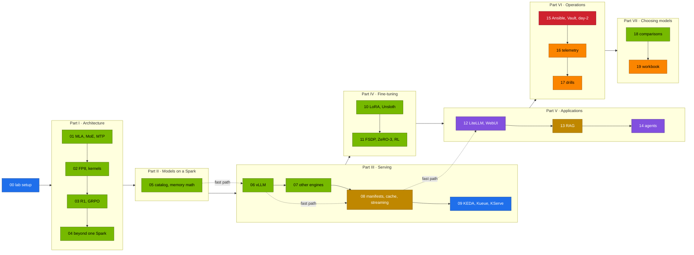

# Chapter 00 · DeepSeek Step-by-Step Guide

> **03-DeepSeek · Chapter 00 of 20** · Start here · [Module overview](README.md) · [Chapter 01 · DeepSeek architecture: MLA, DeepSeekMoE & MTP](01-deepseek-architecture-mla-moe-mtp.md) →

This page is the build order for the whole module. Each section below is one chapter: it links the document that explains it, says what to run, and how you know the chapter is done. A section carries its document's chapter number: Chapter 13 is `13-….md`. The commands here are the key ones from each chapter's lab; the chapter has the full task list, the expected output and the troubleshooting table.

**What you build.** On the root cluster that 01-Ansible built and 02-Kubernetes configured: the DeepSeek architecture ideas (MLA, DeepSeekMoE, MTP, FP8, GRPO) proved in code on a CPU and then on the GB10; a model catalog with memory math that tells you what fits in the ~90 GiB LLM pool; vLLM serving driven by that catalog, plus SGLang, llama.cpp and TensorRT-LLM on the same weights; office-hours autoscaling and Kueue-admitted fine-tuning and RL inside the training window; an application stack (LiteLLM gateway, Open WebUI, RAG with Qdrant and BGE-M3, a tool-calling agent); and the operations layer around it (the `15.1` playbook in Semaphore, secrets from vault01, day-2 jobs, telemetry, drills). It ends with measured model comparisons and a workbook that proves you can rebuild and operate all of it.

**Fast path.** To get a DeepSeek model answering in a browser first and read the theory afterwards, do **Chapter 05 → 06 → 08 → 12**: size the model (05), serve it from the catalog (06), take ownership of the manifests, weight cache and streaming path (08), then put LiteLLM and Open WebUI in front of it (12). Come back to Part I and the rest in order once that works.

**Prerequisites.**

- The [01-Ansible step-by-step guide](../01-Ansible/00-ansible-step-by-step-guide.md) through Chapter 20: sema01 and vault01 as the management plane ([01-Ansible Chapter 04](../01-Ansible/04-dgx-spark-as-semaphore-target.md)), the kubeadm root cluster with Cilium and MetalLB ([Chapter 19](../01-Ansible/19-kubernetes-kubeadm-root-cluster-and-vclusters.md)), the GPU Operator with 15 time-slices and the two vClusters ([Chapter 20](../01-Ansible/20-nvidia-gpu-operator-and-time-slicing.md)).
- The [02-Kubernetes step-by-step guide](../02-Kubernetes/00-kubernetes-step-by-step-guide.md) through Chapter 05 (add-ons, tenancy, LLM budgets, [the build gates](../02-Kubernetes/05-dgx-spark-datacenter-simulation-lab.md)) and Chapter 20 ([vLLM on the root under KEDA](../02-Kubernetes/20-vllm-high-throughput-llm-serving.md)). The chapters that use Kueue, Traefik, Qdrant, the model cache, KServe or the observability stack name the 02 chapter that installs it.
- The kubeconfig `01-Ansible/lab/.cache/kubeconfig-spark-lab.yaml` on your MacBook, fetched with `01-Ansible/lab/tools/fetch-kubeconfig.sh sema01`.
- Two secrets in vault01: the NGC API key at `kv/spark-lab/ngc` (01-Ansible [Chapter 18](../01-Ansible/18-vault-approle-secrets-and-ssh-certificates.md) uses it for `docker login nvcr.io` on dgx-spark-1) and a Hugging Face read token at `kv/spark-lab/hf`, field `token` (you store it in Chapter 06 Task 5.2; Chapter 15 automates the sync into Secret `hf-token` in `llm-serving`). Nothing secret lives in the repository.

**Three clusters, one kubeconfig.** Every `kubectl` names its context:

| Context | What it is | In this module |
|---|---|---|
| `spark-root` | kubeadm root, `https://192.168.0.100:6443` | **runs the LLMs**: `llm-serving` (model servers, apps), `batch` (training, Kueue LocalQueue `train` → ClusterQueue `spark-cq`), `ingress` (Traefik at 192.168.0.115) |
| `dev-llms` | vCluster, namespace `llm-sandbox`, 2 CPU · 4 Gi · 2 slices | try a manifest or a tiny model before it goes to the root (Chapter 17 Task 5.3) |
| `dev-lab` | vCluster for tenants | not used here |

**Where each command runs.** Every shell block starts with one location line:

| Location line | Where | What runs there |
|---|---|---|
| `# ▶ MacBook · 03-DeepSeek/lab` | your MacBook, in this module's lab folder | `kubectl --context spark-root`, the lab scripts, the CPU tools |
| `# ▶ MacBook · 02-Kubernetes/lab` | your MacBook, in the 02 lab folder | the training window, 02 add-ons and 02 manifests |
| `# ▶ MacBook · 01-Ansible/lab (venv active)` | your MacBook, in the 01 lab folder | the `15.1` playbook as break-glass (Chapter 15) |
| `# ▶ MacBook · any folder` | your MacBook | `/etc/hosts`, one-off Python |
| `# ▶ dgx-spark-1 (ssh dgx-spark-1)` | the Spark, as `dgxadmin` (headless DGX OS) | `free -g`, `/proc/meminfo`, dropping the page cache, `docker build`, `hf download` |
| `# ▶ dgx-spark-2 (ssh dgx-spark-2)` | the optional second Spark | the **(2×)** tasks |
| `# ▶ vault01 (ssh vault01)` | the Vault server, 192.168.0.211 | `vault kv put kv/spark-lab/…` |

Semaphore steps (sema01, 192.168.0.210) are prose that starts with **Semaphore UI:**. Each new MacBook shell needs `export KUBECONFIG=…/01-Ansible/lab/.cache/kubeconfig-spark-lab.yaml` once; the chapters repeat it at the top of their labs.

**One Spark or two?** Everything works on one. Chapters with **(2×)** have an optional part that needs `dgx-spark-2` joined to the root, the QSFP cable and the NFS-RDMA model share.

## The shared pool and the training window

Serving and training share one **~90 GiB LLM memory pool** on the GB10 (~121.7 GiB visible). The root's quotas split it ([02-Kubernetes Chapter 14](../02-Kubernetes/14-multi-tenancy-resource-quotas-and-cgroups.md)):

| | `llm-serving` (`serving-budget`) | `batch` (`batch-budget` = Kueue `spark-cq`) |
|---|---|---|
| everyday | 8 CPU · 90 Gi · 6 slices · 1 Ti | 2 CPU · 12 Gi · 3 slices · 200 Gi |
| training window | 2 CPU · 10 Gi · 6 slices | 8 CPU · 80 Gi · 3 slices |

Four rules hold in every chapter, and `tests/budget_check.py` checks them on every manifest in the lab:

1. **Every GPU container sets memory request = limit.** The scheduler is what keeps serving and training from overcommitting unified memory, and it can only do that if requests are real. A pod that doesn't fit waits `Pending`; it never squeezes a running model.
2. **Σ `--gpu-memory-utilization` of the models running at the same time ≲ 0.72** (× ~121.7 GiB). 0.20 ≈ 24 GiB; bge-m3 adds 0.06. One model never takes more than 0.70. `r1-32b` (BF16, 0.70 ≈ 85 GiB, pod 87 Gi) runs **alone**, with everything else parked. `models.yaml` lists the sets that fit together.
3. **Park vLLM with KEDA, not with `kubectl scale`.** The ScaledObject `vllm` would undo a scale-down; pausing it holds the Deployment at 0.
4. **Training needs the training window.** Each Job in `batch` fits ≤ 8 CPU · ≤ 80 Gi · 1 slice per pod, request = limit, and says so in its header comment. Without the window, Kueue holds it (Chapter 09 Task 5.3 shows this on purpose).

Open the window (Chapters 03, 09, 10, 11 and 19 do this):

```bash
# ▶ MacBook · 02-Kubernetes/lab
kubectl --context spark-root -n llm-serving annotate scaledobject vllm autoscaling.keda.sh/paused-replicas=0 --overwrite
for d in sglang trtllm llama-server bge-m3; do
  kubectl --context spark-root -n llm-serving scale deploy "$d" --replicas=0 2>/dev/null || true
done
while kubectl --context spark-root -n llm-serving get pod -l app=vllm -o name | grep -q .; do sleep 5; done
kubectl --context spark-root apply -k manifests/root-llms/training-window
```

Close it when the Jobs are done:

```bash
# ▶ MacBook · 02-Kubernetes/lab
kubectl --context spark-root -n batch get jobs                          # nothing still running that you need
kubectl --context spark-root apply -k manifests/root-llms/10-tenancy
kubectl --context spark-root apply -k manifests/root-llms/20-scheduling
kubectl --context spark-root -n llm-serving annotate scaledobject vllm autoscaling.keda.sh/paused-replicas-
kubectl --context spark-root -n llm-serving scale deploy bge-m3 --replicas=1 2>/dev/null || true
```

A window left open starves serving: `serving-budget` stays at 10 Gi and vLLM can't come back. Check `kubectl --context spark-root -n batch describe resourcequota batch-budget` reads 2 CPU · 12 Gi before you move on.

**The Spark is your playground.** `scripts/breakfix.sh reset <drill>` undoes every injected fault (D01–D08), `scripts/serve-model.sh r1-7b` returns to the default model, and the whole stack is one Semaphore run of `15.1 Deploy DeepSeek` away (Chapter 15). Semaphore and Vault live outside the Spark, so nothing you break here takes them with it.

---

## Before Chapter 01 · Lab setup (20 min) → [lab README](lab/README.md)

Fetch the kubeconfig, prove the lab files are sane on the CPU, and ship the tools and eval data to the root as ConfigMaps:

```bash
# ▶ MacBook · 03-DeepSeek/lab
pip install yamllint shellcheck-py pyyaml
# kubectl, kubeconform, promtool and mikefarah yq: versions as in the CI workflow
../../01-Ansible/lab/tools/fetch-kubeconfig.sh sema01
export KUBECONFIG="$PWD/../../01-Ansible/lab/.cache/kubeconfig-spark-lab.yaml"
kubectl config get-contexts -o name                      # spark-root, dev-lab, dev-llms
tests/run-local-checks.sh                                # yamllint, overlays, budgets, kubeconform, promtool, tool tests vs mocks
kubectl --context spark-root apply -k .                  # tools + eval data as ConfigMaps (llm-serving, batch)
scripts/verify.sh platform
```

✅ **Done when** `tests/run-local-checks.sh` prints `ALL LOCAL CHECKS PASSED`, the three contexts are listed, and `verify.sh platform` passes: namespaces `llm-serving` and `batch`, the `model-cache` PVC, and the `deepseek-tools` / `deepseek-evaldata` ConfigMaps.

---

## Progress

Times are rough working times on one Spark, not counting reading or first-time downloads. Tick the first column in your notebook as you go.

| ☐ | Chapter | Document | What you do | Time | Done when |
|---|---|---|---|---|---|
| | **Part I** | **Architecture** | | | |
| ☐ | 01 | [DeepSeek architecture: MLA, DeepSeekMoE & MTP](01-deepseek-architecture-mla-moe-mtp.md) | MLA three ways, the V3 router, speculative decoding on the GB10 | 3 h | MLA forms agree; draft model accepts tokens |
| ☐ | 02 | [FP8 training, FlashMLA & DeepGEMM](02-fp8-training-and-kernels.md) | FP8 block scaling, grouped GEMMs, 32B in BF16 vs FP8 | 3 h | BF16 vs FP8 table recorded |
| ☐ | 03 | [R1 reasoning & GRPO](03-r1-reasoning-and-grpo.md) | GRPO in the training window, serving R1 with its parser | 3–4 h | Format reward → ~1.0; `reasoning_content` filled |
| ☐ | 04 | [Scaling beyond one Spark](04-scaling-beyond-one-spark.md) | Sizing V3, ring attention, EPLB, 128K, (2×) 70B and 671B | 2 h (+3 h 2×) | Needle table at 128K |
| | **Part II** | **Models on a Spark** | | | |
| ☐ | 05 | [Model catalog & memory math](05-model-catalog-and-memory-math.md) | `model_math.py` vs vLLM vs host, 32B pair, Coder-V2-Lite | 2.5 h | Prediction within ~15 % of vLLM |
| | **Part III** | **Serving** | | | |
| ☐ | 06 | [Serving DeepSeek with vLLM](06-vllm-serving.md) | Catalog overlays, HF token, model switch, parsers, drills D01–D03 | 90 min | `verify.sh platform serving` all PASS |
| ☐ | 07 | [Alternative engines](07-alternative-engines-sglang-llamacpp-trtllm.md) | SGLang, llama.cpp for sm_121, TensorRT-LLM on the same weights | 3.5 h | One comparison table, engine choice written |
| ☐ | 08 | [Kubernetes deployment, weight caching & streaming](08-kubernetes-deployment-storage-and-streaming.md) | Overlays, validation layers, cold vs warm loads, SSE per hop | 2.5 h | Three hops stream with no `BUFFERED` |
| ☐ | 09 | [Autoscaling & queueing](09-autoscaling-and-queueing.md) | KEDA office hours, the window, Kueue preemption, KServe | 90 min | `Preempted` event seen; window closed |
| | **Part IV** | **Fine-tuning** | | | |
| ☐ | 10 | [LoRA/QLoRA, Unsloth & LLaMA-Factory](10-lora-qlora-unsloth-and-llama-factory.md) | One LoRA three ways, adapters on one vLLM | 3.5 h | Four models in `/v1/models`, format % up |
| ☐ | 11 | [Distributed training & RL](11-distributed-training-and-rl.md) | GRPO layouts, ZeRO-3 + NVMe, (2×) FSDP2 and disaggregated RL | 4 h | ZeRO-3 run completes under 80 Gi |
| | **Part V** | **Applications** | | | |
| ☐ | 12 | [Open WebUI & the LiteLLM gateway](12-open-webui-and-litellm-gateway.md) | Aliases, keys and budgets, fallbacks, chat UI, backup/restore | 2.5 h | `verify.sh apps` all PASS |
| ☐ | 13 | [RAG with Qdrant & BGE-M3](13-rag-with-qdrant-and-bge.md) | Gated blue/green index, cited answers, rollback | 90 min | hit@5 ≥ 0.6; `verify.sh rag` PASS |
| ☐ | 14 | [Tool calling & agents](14-tool-calling-and-agents.md) | Agent with schema checks, audit log, least-privilege SA | 75 min | Schema-constrained JSON 20/20 |
| | **Part VI** | **Operations** | | | |
| ☐ | 15 | [Automation, secrets & day-2](15-automation-secrets-and-day2.md) | vault-sync, key rotation, `15.1 Deploy DeepSeek`, pin and verify weights | 3 h | Semaphore run `failed=0`, rotation proved |
| ☐ | 16 | [Telemetry](16-telemetry.md) | Nine alerts with unit tests, 27-panel dashboard, a real alert | 90 min | `ReasoningTruncated` fired and resolved |
| ☐ | 17 | [Troubleshooting playbook](17-troubleshooting-playbook.md) | `llm-triage.sh`, drills D01–D07 timed, support bundle | 2 h | Every drill diagnosed, times recorded |
| | **Part VII** | **Choosing models** | | | |
| ☐ | 18 | [DeepSeek vs other model families](18-choosing-models-deepseek-vs-others.md) | Controlled pairs, two families at once, local vs hosted | 4–6 h | Alias table backed by your numbers |
| ☐ | 19 | [Hands-on workbook](19-hands-on-workbook.md) | 30 exercises, the release gate, the capstone | 3–5 days | Capstone report saved |
| | **Part VIII** | **Going faster** | | | |
| ☐ | 20 | [The fast lane](20-fast-lane-more-tokens-per-second.md) | MoE + 4-bit on llama.cpp (74.6 tok/s), a 120B alone (optional), a newer vLLM with NVFP4 + MTP as `vllm-next` (72 / 516 tok/s; `fast` and `smart` aliases) | 1 + 1.5 + 2 h | One table, your numbers, engines compared with the same sweep |

## Overview



Green: GPU, models and training. Blue: platform and scheduling. Purple: gateway and agents. Amber: storage and retrieval. Red: automation and secrets. Orange: observability and operations. The dotted arrows are the fast path (05 → 06 → 08 → 12).

---

# Part I · Architecture

## Chapter 01 · DeepSeek architecture: MLA, DeepSeekMoE & MTP → [document](01-deepseek-architecture-mla-moe-mtp.md)

The three ideas that define DeepSeek-V2/V3, each proved in code: Multi-head Latent Attention in three equivalent forms, DeepSeek-V3's router with auxiliary-loss-free balancing, and a speed-up model for multi-token prediction and speculative decoding. Tasks 1–4 run on your MacBook; Tasks 5–8 show the same ideas on the GB10, with the real router inside DeepSeek-V2-Lite and speculative decoding of the R1 7B distill.

```bash
# ▶ MacBook · 03-DeepSeek/lab
python3 tools/mla_attention_demo.py
python3 tools/model_math.py --compare deepseek-v2-lite deepseek-v3 qwen2.5-7b qwen2.5-32b llama-3.1-8b llama-3.3-70b
python3 tools/moe_router_demo.py
python3 tools/spec_decode_calc.py --alpha 0.85 --k 1 --draft-cost 0.05     # V3-style MTP, one extra token
```

On the GB10: park vLLM, run the probes, keep the router loads for Chapter 04, then serve V2-Lite and the speculative-decoding overlays (Chapter 01 Tasks 5–8):

```bash
# ▶ MacBook · 03-DeepSeek/lab
kubectl --context spark-root -n llm-serving annotate scaledobject vllm autoscaling.keda.sh/paused-replicas=0 --overwrite
kubectl --context spark-root apply -f k8s/jobs/gpu-probes.yaml
mkdir -p results
kubectl --context spark-root -n llm-serving logs job/gpu-probes | sed -n 's/^LOADS_JSON: //p' > results/v2lite-loads.json
kubectl --context spark-root -n llm-serving delete job gpu-probes
kubectl --context spark-root -n llm-serving annotate scaledobject vllm autoscaling.keda.sh/paused-replicas-
scripts/serve-model.sh v2-lite
scripts/serve-model.sh r1-1.5b                       # caches the draft weights in model-cache
scripts/serve-model.sh r1-7b
kubectl --context spark-root apply -k k8s/spec-decode/r1-7b-draft
kubectl --context spark-root apply -k k8s/spec-decode/r1-7b-ngram
scripts/serve-model.sh r1-7b                         # back to the default
```

✅ **Done when** the three MLA forms agree (`✓ all three formulations produce the same output`), the balanced router's max/mean load drops below ~4, `results/v2lite-loads.json` exists, the vLLM log for `v2-lite` names an MLA backend, and the draft run shows `vllm:spec_decode_num_accepted_tokens_total` > 0 with maths accuracy unchanged.

## Chapter 02 · FP8 training, FlashMLA & DeepGEMM → [document](02-fp8-training-and-kernels.md)

The numerics and kernels behind DeepSeek-V3: why FP8 is scaled per 128×128 block, why MLA decode kernels attend on the latent, and why MoE layers need grouped GEMMs. You prove each point on a CPU, measure them on the GB10's tensor cores, find which kernels vLLM really runs on sm_121, and serve the same 32B in BF16 and FP8.

```bash
# ▶ MacBook · 03-DeepSeek/lab
python3 tools/fp8_blockscale.py
python3 tools/grouped_gemm_bench.py
python3 tools/mla_attention_demo.py --decode-bench 4096 --batch 2
scripts/serve-model.sh v2-lite
kubectl --context spark-root -n llm-serving logs deploy/vllm | grep -iE 'mla|attention backend|flash' | head
scripts/serve-model.sh r1-32b                        # BF16, runs alone (Chapter 02 Task 7)
scripts/serve-model.sh r1-32b-fp8
python3 tools/eval_harness.py --report results/r1-32b-*.json
```

`r1-32b` takes 0.70 of the pool: if the apps are already deployed, scale them to 0 first (Chapter 05 Task 5.5 has the commands). Run the harness against each model as Chapter 02 Task 7 shows before the report.

✅ **Done when** per-tensor FP8 collapses at large outliers while 128×128 blocks don't, FP8 dense TFLOPS beat BF16 in the GPU probe, and your BF16 vs FP8 table shows accuracy within a few points with the FP8 weights and load time about half.

## Chapter 03 · R1 reasoning & GRPO → [document](03-r1-reasoning-and-grpo.md)

A working GRPO loop that teaches a 0.5B model the `<think>…</think><answer>…</answer>` form with rule-based rewards only, trained in `batch` inside the training window. Then an R1 distill served with its reasoning separated from the answer, the sampling settings R1 needs, and what thinking costs in tokens.

```bash
# ▶ MacBook · 03-DeepSeek/lab
python3 tools/grpo_tiny.py --dry-run
```

Open the training window ([The shared pool and the training window](#the-shared-pool-and-the-training-window)), then:

```bash
# ▶ MacBook · 03-DeepSeek/lab
kubectl --context spark-root apply -k .                                   # deepseek-train ConfigMap in batch
kubectl --context spark-root apply -f k8s/jobs/train-common.yaml -f k8s/jobs/grpo.yaml
kubectl --context spark-root -n batch get workloads                       # ADMITTED by spark-cq
kubectl --context spark-root -n batch logs -f job/grpo | grep -E "'(rewards/reward_format/mean|rewards/reward_correct/mean|completions/mean_length)'"
```

Close the window, then serve R1 and measure the cost of thinking (Chapter 03 Tasks 6–7):

```bash
# ▶ MacBook · 03-DeepSeek/lab
scripts/serve-model.sh r1-7b
pkill -f 'port-forward svc/vllm 8000'; kubectl --context spark-root -n llm-serving port-forward svc/vllm 8000 & sleep 2
python3 tools/eval_harness.py --url http://localhost:8000 --model r1-7b --suites math json --out results/r1-7b.json
scripts/breakfix.sh inject D06          # prints a harness command at temperature 0 — run it
scripts/breakfix.sh answer D06
kill %1
```

✅ **Done when** the format reward reaches ~1.0 and the correctness reward climbs above its step-5 value, `batch-budget` is back to 2 CPU · 12 Gi with vLLM unpaused, R1 answers with non-empty `reasoning_content` and a clean `\boxed{41}`, and you can explain why D06 (temperature 0) truncates.

## Chapter 04 · Scaling beyond one Spark: long context, EPLB, 3FS & V3 671B → [document](04-scaling-beyond-one-spark.md)

A sizing plan for DeepSeek-V3/R1 671B on any hardware and the techniques that make it servable: ring attention verified against full attention, expert placement with DeepSeek's EPLB fed with your own router loads, an I/O budget on the Spark's NVMe, and a 128K-token window on one GB10 with a needle test. **(2×)** Ring attention over the CX-7 link, a 70B with tensor parallelism (LeaderWorkerSet + Ray + vLLM), and R1 671B at 1.58 bit across both GB10s with llama.cpp RPC.

```bash
# ▶ MacBook · 03-DeepSeek/lab
python3 tools/model_math.py deepseek-v3 --dtype fp8 --sparks 2
python3 tools/ring_attention_demo.py --world 2 --seq 1024
git clone --depth 1 https://github.com/deepseek-ai/EPLB /tmp/eplb
python3 tools/eplb_sim.py --experts 64 --gpus 8 --redundant 8 --loads results/v2lite-loads.json \
  --upstream /tmp/eplb/eplb.py --nodes 1
scripts/serve-model.sh r1-7b                          # cache the weights, baseline
kubectl --context spark-root apply -k k8s/long-context/r1-7b-128k
kubectl --context spark-root -n llm-serving rollout status deploy/vllm --timeout=30m
pkill -f 'port-forward svc/vllm 8000'; kubectl --context spark-root -n llm-serving port-forward svc/vllm 8000 & sleep 2
python3 tools/needle_test.py --url http://localhost:8000 --model r1-7b \
  --lengths 4000 16000 64000 120000 --depths 0.1 0.5 0.9
kill %1
scripts/serve-model.sh r1-7b
```

(2×) Tasks 7–9: `k8s/multinode/lws-vllm-70b.yaml` and `k8s/llamacpp/rpc-2spark.yaml`, with vLLM parked and both Sparks fully loaded; the chapter has the per-node commands.

✅ **Done when** the sizing verdicts match the chapter (V3 FP8 on two Sparks `✗`, IQ1_S `✓`), ring attention prints `✓ identical`, you have a max/mean expert load before and after EPLB placement on your V2-Lite loads, vLLM starts with `max_model_len=131072` and your needle table has TTFT per length. (2×) the 70B lists itself in `/v1/models` over `Using network IB`, and the 671B gives a coherent answer.

---

# Part II · Models on a Spark

## Chapter 05 · Model catalog & memory math on GB10 → [document](05-model-catalog-and-memory-math.md)

**Fast path step 1.** A method and a tool that turn any `config.json` into weight memory, KV bytes per token, a `--gpu-memory-utilization` value, a pod memory size and a concurrency estimate, checked against what vLLM and the host report. With it you read `models.yaml`, decide which models run side by side in the ~90 GiB pool, and compare the two 32B models and DeepSeek-Coder-V2-Lite on the same tests.

```bash
# ▶ MacBook · 03-DeepSeek/lab
kubectl --context spark-root -n llm-serving describe resourcequota serving-budget
python3 tools/model_math.py --list
python3 tools/model_math.py deepseek-r1-distill-qwen-32b --util 0.70 --ctx 16384
scripts/serve-model.sh r1-32b-fp8
kubectl --context spark-root -n llm-serving logs deploy/vllm \
  | grep -E 'Model loading took|Available KV cache memory|GPU KV cache size|Maximum concurrency'
```

```bash
# ▶ dgx-spark-1 (ssh dgx-spark-1)
free -g
grep -E 'MemTotal|MemAvailable|^Cached' /proc/meminfo
```

Then compare `r1-32b-fp8` with `qwen2.5-32b-awq`, and run the sandboxed code and maths evaluation for `coder-v2-lite` (Chapter 05 Tasks 5.5–5.6).

✅ **Done when** the `model_math.py` budget line reads `× 121.7 GiB`, the prediction is within a few % on weights and ~15 % on KV tokens of what vLLM logs, the pod shows `requests.memory` = `limits.memory` = the catalog's `mem`, and for every set you plan to run together Σ util ≲ 0.72 (bge-m3 included) and Σ pod memory ≤ 90 Gi.

---

# Part III · Serving

## Chapter 06 · Serving DeepSeek with vLLM → [document](06-vllm-serving.md)

**Fast path step 2.** The catalog drives every vLLM deployment on the root: one `models.yaml` entry generates a kustomize overlay of 02's vLLM Deployment, `serve-model.sh` switches models with prefetch and smoke test, and the parsers make R1 reasoning and tool calling work. You store the Hugging Face token in vault01, add a model, benchmark it, and fix three serving drills.

```bash
# ▶ vault01 (ssh vault01)
vault kv put kv/spark-lab/hf token="hf_…"        # read access is granted by the lab policy (01-Ansible Chapter 18)
```

```bash
# ▶ MacBook · 03-DeepSeek/lab
python3 scripts/gen_overlays.py --check          # "14 overlays checked, 0 drifted"
export VAULT_ADDR=https://192.168.0.211:8200
kubectl --context spark-root -n llm-serving create secret generic hf-token \
  --from-literal=token="$(vault kv get -field=token kv/spark-lab/hf)" --dry-run=client -o yaml \
  | kubectl --context spark-root apply -f -
scripts/serve-model.sh r1-7b
kubectl --context spark-root -n llm-serving get pod -l app=vllm -L model
scripts/breakfix.sh list
scripts/breakfix.sh inject D01     # reasoning parser missing; then D02, D03
scripts/verify.sh platform serving
```

✅ **Done when** `verify.sh platform serving` passes (`vLLM serving 'r1-7b'`, `/v1/models` lists `r1-7b`, metrics exposed), the pod has label `model=r1-7b` with memory request = limit = 28Gi counted in `serving-budget`, R1 fills `reasoning_content` and `qwen2.5-7b-tools` returns `tool_calls`, and D01–D03 are each diagnosed in under 10 minutes.

## Chapter 07 · Alternative engines: SGLang, llama.cpp & TensorRT-LLM → [document](07-alternative-engines-sglang-llamacpp-trtllm.md)

The same R1 distill served by four engines on the root, one at a time, in the same memory slot: SGLang with RadixAttention and schema-constrained JSON, llama.cpp built for sm_121 serving GGUF (with a quantisation sweep and Ollama), and TensorRT-LLM's `trtllm-serve`. One comparison table on identical weights and prompts, and a written engine choice.

```bash
# ▶ MacBook · 03-DeepSeek/lab
# With KEDA's ScaledObject (02 Chapter 20 §5.7) a plain `scale --replicas=0` is undone within seconds, so pause it;
# without one, scale the Deployment. Define these in every new terminal (they vanish with it).
park_vllm()  { if kubectl --context spark-root -n llm-serving get scaledobject vllm >/dev/null 2>&1; then
                 kubectl --context spark-root -n llm-serving annotate scaledobject vllm autoscaling.keda.sh/paused-replicas=0 --overwrite
               else kubectl --context spark-root -n llm-serving scale deploy vllm --replicas=0; fi
               while kubectl --context spark-root -n llm-serving get pod -l app=vllm -o name | grep -q .; do sleep 5; done; echo "vllm parked"; }
resume_vllm(){ if kubectl --context spark-root -n llm-serving get scaledobject vllm >/dev/null 2>&1; then
                 kubectl --context spark-root -n llm-serving annotate scaledobject vllm autoscaling.keda.sh/paused-replicas-
               else kubectl --context spark-root -n llm-serving scale deploy vllm --replicas=1; fi; }
scripts/serve-model.sh r1-32b-fp8                                   # vLLM baseline (Task 5.1)
park_vllm
kubectl --context spark-root apply -k k8s/sglang/r1-32b-fp8
kubectl --context spark-root -n llm-serving rollout status deploy/sglang --timeout=45m
kubectl --context spark-root -n llm-serving scale deploy sglang --replicas=0
```

```bash
# ▶ dgx-spark-1 (ssh dgx-spark-1)
cd technical-depth/03-DeepSeek/lab/k8s/llamacpp          # wherever the repo is checked out on the Spark
docker build -t spark-local/llama.cpp:server-sm121 --build-arg LLAMACPP_REF=b6500 .
docker save spark-local/llama.cpp:server-sm121 | sudo ctr -n k8s.io images import -
```

```bash
# ▶ MacBook · 03-DeepSeek/lab
kubectl --context spark-root apply -f k8s/llamacpp/llama-server.yaml
kubectl --context spark-root -n llm-serving scale deploy llama-server --replicas=0
kubectl --context spark-root apply -f k8s/trtllm/trtllm-serve.yaml
kubectl --context spark-root -n llm-serving scale deploy trtllm --replicas=1
python3 tools/eval_harness.py --report results/vllm-32b-fp8.json results/sglang-32b-fp8.json results/trtllm-32b-fp8.json
kubectl --context spark-root -n llm-serving scale deploy trtllm sglang llama-server --replicas=0
resume_vllm
scripts/serve-model.sh r1-7b
```

Run the probes and the harness against each engine as Chapter 07 Tasks 5.1–5.8 show; the TensorRT-LLM image comes from nvcr.io, so check it has an arm64 build first.

✅ **Done when** SGLang and TRT-LLM answer on `/health` with request = limit, shared-prefix TTFT is clearly below unique-prefix TTFT, `llama-server` logs `offloaded 29/29 layers`, accuracy is within noise across vLLM, SGLang and TRT-LLM, and only `vllm` (`r1-7b`) runs at the end with no `paused-replicas` annotation on its ScaledObject.

## Chapter 08 · Kubernetes deployment, weight caching & streaming → [document](08-kubernetes-deployment-storage-and-streaming.md)

**Fast path step 3.** Ownership of every manifest the lab ships: how 02's single vLLM Deployment becomes fourteen overlays, how tools reach Jobs without custom images, and three validation layers that catch a broken pod template before a ReplicaSet does. Then the weights (cold and warm loads, the page cache on unified memory, pinned snapshots) and the request path client → Traefik (192.168.0.115) → LiteLLM → vLLM with server-sent events measured hop by hop.

```bash
# ▶ MacBook · 03-DeepSeek/lab
python3 scripts/gen_overlays.py --check
API=1 tests/run-local-checks.sh               # + server-side dry-run + pod templates against spark-root
scripts/serve-model.sh r1-7b                  # prefetch → apply overlay → wait → smoke test
kubectl --context spark-root -n llm-serving rollout restart deploy/vllm
time kubectl --context spark-root -n llm-serving rollout status deploy/vllm --timeout=30m
kubectl --context spark-root apply -f k8s/ops/weights-verify.yaml
kubectl --context spark-root -n llm-serving create job --from=cronjob/weights-verify wv-now
```

```bash
# ▶ dgx-spark-1 (ssh dgx-spark-1)
sudo du -sh /data/k8s/retain/llm-serving/model-cache/hf/models--* | sort -h
free -g                                           # note buff/cache
sudo sh -c 'sync; echo 3 > /proc/sys/vm/drop_caches'
```

The streaming tasks (5.7–5.9) need the LiteLLM gateway: on the fast path, deploy it with `kubectl --context spark-root apply -k k8s/apps` (Chapter 12 Task 5.1) before you run them.

```bash
# ▶ MacBook · 03-DeepSeek/lab
KEY=$(kubectl --context spark-root -n llm-serving get secret litellm-master-key -o jsonpath='{.data.key}' | base64 -d)
pkill -f 'port-forward svc/vllm 8000'; kubectl --context spark-root -n llm-serving port-forward svc/vllm 8000 & sleep 2
kubectl --context spark-root -n llm-serving port-forward svc/litellm 4000 &
python3 tools/stream_probe.py --url http://localhost:8000 --model r1-7b                                  # hop 1: vLLM
python3 tools/stream_probe.py --url http://localhost:4000 --api-key "$KEY" --model reasoning-fast         # hop 2: + LiteLLM
python3 tools/stream_probe.py --url http://api.lab.local --api-key "$KEY" --model reasoning-fast         # hop 3: + Traefik
scripts/breakfix.sh inject D04
```

✅ **Done when** `gen_overlays.py --check` reports `14 overlays checked, 0 drifted`, `API=1 tests/run-local-checks.sh` shows `0 rejected`, `model-cache` is `Bound` on `local-nvme-retain`, a warm restart loads weights in seconds, `/models/manifests` has one JSON per snapshot, and all three hops end `finish_reason=stop` with no `BUFFERED`.

## Chapter 09 · Autoscaling & queueing: KEDA, KServe & Kueue → [document](09-autoscaling-and-queueing.md)

One GB10 shared between serving and training over time: KEDA keeps vLLM up in office hours and scales it to zero outside them, the training window moves the LLM pool from `llm-serving` to `batch`, Kueue admits fine-tuning Jobs inside that quota and lets an urgent run preempt a routine one, and KServe serves an R1 distill through an `InferenceService` for comparison.

```bash
# ▶ MacBook · 02-Kubernetes/lab
scripts/install-addons.sh keda                         # on the root
scripts/install-addons.sh kserve                       # cert-manager + KServe, RawDeployment mode
```

```bash
# ▶ MacBook · 03-DeepSeek/lab
scripts/serve-model.sh r1-7b
kubectl --context spark-root apply -f k8s/autoscale/vllm-office-hours.yaml
kubectl --context spark-root apply -f k8s/jobs/train-common.yaml -f k8s/jobs/sft.yaml
kubectl --context spark-root -n batch get workloads -o wide             # not admitted: everyday quota
```

Open the training window, then:

```bash
# ▶ MacBook · 03-DeepSeek/lab
kubectl --context spark-root apply -f k8s/jobs/grpo.yaml
yq '.metadata.name = "grpo-urgent" | .metadata.labels."kueue.x-k8s.io/priority-class" = "urgent"
    | .spec.template.spec.containers[0].args[0] |= sub("--steps 200"; "--steps 20")' k8s/jobs/grpo.yaml \
  | kubectl --context spark-root apply -f -
kubectl --context spark-root -n batch get events --field-selector reason=Preempted
```

Close the window, then the KServe comparison (Chapter 09 Task 5.7):

```bash
# ▶ MacBook · 03-DeepSeek/lab
kubectl --context spark-root apply -k ../../02-Kubernetes/lab/manifests/root-llms/90-serving/kserve   # ServingRuntime vllm-spark
kubectl --context spark-root -n llm-serving delete isvc qwen-small                                      # 02's 32 Gi demo, frees quota
kubectl --context spark-root apply -f k8s/kserve/r1-1.5b.yaml
kubectl --context spark-root -n llm-serving get isvc r1-1-5b -w           # READY True after download + load · Ctrl-C to stop
```

✅ **Done when** the ScaledObject `vllm` is `READY True` and the Deployment reads `0/0` outside office hours, `sft` waits under the everyday quota with a message naming cpu/memory, a routine Job shows `Preempted` when `grpo-urgent` arrives, `serving-budget` is back to 8 CPU · 90Gi with vLLM Ready, and `r1-1-5b` answers with `reasoning_content`.

---

# Part IV · Fine-tuning

## Chapter 10 · LoRA/QLoRA sizing, Unsloth & LLaMA-Factory → [document](10-lora-qlora-unsloth-and-llama-factory.md)

A sizing habit and a full adapter lifecycle: predict LoRA, QLoRA and full fine-tuning memory against the window's 80 Gi, train the same rank-16 LoRA on R1-Distill-Qwen-1.5B with TRL + PEFT, Unsloth and LLaMA-Factory as Kueue Jobs, publish the adapters into the model cache, serve base and adapters from one vLLM, and measure what each adapter changed.

```bash
# ▶ MacBook · 03-DeepSeek/lab
python3 tools/lora_calc.py deepseek-r1-distill-qwen-1.5b --method lora --rank 16
scripts/serve-model.sh r1-1.5b
pkill -f 'port-forward svc/vllm 8000'; kubectl --context spark-root -n llm-serving port-forward svc/vllm 8000 & sleep 2
python3 tools/format_check.py --url http://localhost:8000 --model r1-1.5b -n 50     # baseline
kill %1
```

Open the training window, then run the three Jobs one after the other:

```bash
# ▶ MacBook · 03-DeepSeek/lab
kubectl --context spark-root apply -k .
kubectl --context spark-root apply -f k8s/jobs/train-common.yaml          # PVC deepseek-ckpt
kubectl --context spark-root apply -f k8s/jobs/sft.yaml
kubectl --context spark-root -n batch wait --for=condition=complete job/sft --timeout=2h
kubectl --context spark-root apply -f k8s/jobs/unsloth.yaml
kubectl --context spark-root -n batch wait --for=condition=complete job/unsloth --timeout=2h
kubectl --context spark-root apply -f k8s/jobs/llamafactory.yaml
```

Close the window, then publish and serve the adapters (Chapter 10 Tasks 5.8–5.9):

```bash
# ▶ MacBook · 03-DeepSeek/lab
for a in sft-lora unsloth-lora lf-lora; do scripts/publish-adapter.sh "$a"; done
kubectl --context spark-root apply -k k8s/lora/r1-1.5b-sft                 # base + r1-sft
pkill -f 'port-forward svc/vllm 8000'; kubectl --context spark-root -n llm-serving port-forward svc/vllm 8000 & sleep 2
for m in r1-1.5b r1-sft r1-unsloth r1-lf; do
  python3 tools/format_check.py --url http://localhost:8000 --model "$m" -n 50 --show 0
done
```

(`r1-unsloth` and `r1-lf` are loaded at runtime with `/v1/load_lora_adapter`, Chapter 10 Task 5.8.)

✅ **Done when** your `lora_calc.py` prediction is within ~20 % of `peak_cuda_gib` in `STATS`, `sft`, `unsloth` and `llamafactory` are `Complete` with an `adapter_config.json` each, `/v1/models` lists `r1-1.5b`, `r1-sft`, `r1-unsloth` and `r1-lf` on one vLLM, every adapter's format % is clearly above the base, and `batch-budget` is back to 2 CPU · 12Gi.

## Chapter 11 · Distributed training & RL: FSDP, ZeRO-3 & GRPO rollouts → [document](11-distributed-training-and-rl.md)

The training that outgrows Chapter 10. The R1-style GRPO loop run three ways (Hugging Face `generate`, colocated vLLM, and **(2×)** a separate rollout server on dgx-spark-2 that receives weights over NCCL), and a full-parameter fine-tune of R1-Distill-Qwen-7B (~114 GiB of training state): DeepSpeed ZeRO-3 with NVMe offload on one Spark, **(2×)** FSDP2 across two. You see where each step's time goes and why CPU offload buys nothing on unified memory.

Open the training window, then:

```bash
# ▶ MacBook · 03-DeepSeek/lab
kubectl --context spark-root apply -k . && kubectl --context spark-root apply -f k8s/jobs/train-common.yaml
kubectl --context spark-root apply -f k8s/jobs/grpo.yaml
kubectl --context spark-root -n batch wait --for=condition=complete job/grpo --timeout=3h
kubectl --context spark-root apply -f k8s/jobs/grpo-vllm.yaml
python3 tools/lora_calc.py deepseek-r1-distill-qwen-7b --method full          # ✗ needs 2 Sparks (FSDP/ZeRO-3) …
kubectl --context spark-root -n batch patch resourcequota batch-budget --type merge -p '{"spec":{"hard":{"requests.storage":"320Gi"}}}'
kubectl --context spark-root apply -f k8s/jobs/zero3-nvme.yaml
kubectl --context spark-root -n batch logs -f job/zero3-nvme | grep -E 'async_io|cpu_adam|ZeRO|nvme|loss|STATS'
```

```bash
# ▶ dgx-spark-1 (ssh dgx-spark-1)
iostat -xm 2 | grep -E 'Device|nvme'          # sustained read+write during each optimizer step
free -g                                       # well under the pod's 80 Gi
```

(2×) `k8s/rl/grpo-2spark.yaml` and `k8s/jobs/fsdp-2spark.yaml` (Chapter 11 Tasks 5.5 and 5.8; the second widens `batch-budget` and `spark-cq` for two pods). Close the window at the end: re-applying `10-tenancy` also undoes the patches.

✅ **Done when** GRPO layouts A and B complete with `reward` trending up and B faster per step, the learned format scores far above the base with `format_check.py`, ZeRO-3 finishes 30 steps with the GB10 peak far below 80 Gi and the NVMe busy during optimizer steps, and the budgets are back at everyday values. (2×) NCCL initialises on both sides and each FSDP rank holds about half the state.

---

# Part V · Applications

## Chapter 12 · Open WebUI & the LiteLLM gateway → [document](12-open-webui-and-litellm-gateway.md)

**Fast path step 4.** One OpenAI-compatible endpoint, `api.lab.local`, in front of every engine: LiteLLM with stable aliases (`reasoning`, `reasoning-fast`, `agent`, `embeddings`), virtual keys with allow-lists, budgets and rate limits in PostgreSQL, retries and fallbacks. Behind `webui.lab.local`, Open WebUI talks only to LiteLLM, shows R1's thinking as a collapsible block, admits users after approval, and has a nightly backup you restore in a drill.

```bash
# ▶ MacBook · 03-DeepSeek/lab
kubectl --context spark-root apply -k k8s/apps                                    # bge-m3, LiteLLM + PostgreSQL, Open WebUI, HTTPRoutes
kubectl --context spark-root -n llm-serving rollout status deploy/litellm --timeout=10m   # DB migrations on first start
kubectl --context spark-root -n llm-serving rollout status sts/open-webui --timeout=10m
kubectl --context spark-root -n llm-serving describe quota serving-budget         # CPU and memory used vs 8 / 90Gi
```

Add the names to the MacBook's `/etc/hosts` once. Run this block **on its own**: `sudo` asks for your **MacBook login password** (not the Spark's), and lines pasted after it would be read as password attempts. The `grep` skips it if the names are already there.

```bash
# ▶ MacBook · any folder
grep -q ' api.lab.local' /etc/hosts || echo "192.168.0.115 api.lab.local webui.lab.local" | sudo tee -a /etc/hosts
```

```bash
# ▶ MacBook · any folder
curl -s http://webui.lab.local/health                                              # {"status":true}
```

```bash
# ▶ MacBook · 03-DeepSeek/lab
KEY=$(kubectl --context spark-root -n llm-serving get secret litellm-master-key -o jsonpath='{.data.key}' | base64 -d)
API=http://api.lab.local
H=(-H "Authorization: Bearer $KEY" -H 'Content-Type: application/json')
curl -s $API/v1/models "${H[@]}" | jq -r '.data[].id'
kubectl --context spark-root apply -f k8s/ops/webui-backup.yaml
kubectl --context spark-root -n llm-serving create job --from=cronjob/webui-backup webui-backup-now
scripts/verify.sh apps
```

Then the scoped team key, spend, the fallback, Open WebUI's own key and the restore drill (Chapter 12 Tasks 5.3–5.8).

✅ **Done when** `verify.sh apps` passes (`litellm-db`, `litellm`, `bge-m3`, `open-webui` Ready, LiteLLM lists its aliases), a scoped key gets 401 outside its allow-list and 429 above its RPM, `reasoning` answers through a fallback, a new user stays `pending` until approved, and the backup reports `integrity: ok` and restores a deleted chat.

## Chapter 13 · RAG with Qdrant & BGE-M3 → [document](13-rag-with-qdrant-and-bge.md)

Retrieval-augmented generation over this repository, run like a production service: bge-m3 embeds on the GB10 next to the chat model, Qdrant stores vectors behind an alias so a re-index builds a new collection, is scored against a gold question set and only then goes live, and R1 answers with numbered citations or refuses when the sources are silent.

```bash
# ▶ MacBook · 02-Kubernetes/lab
kubectl --context spark-root apply -k manifests/root-llms/50-workloads              # Qdrant (no-op if already there)
```

```bash
# ▶ MacBook · 03-DeepSeek/lab
kubectl --context spark-root apply -f k8s/jobs/rag-ingest.yaml
kubectl --context spark-root -n llm-serving logs -f job/rag-ingest -c ingest
kubectl --context spark-root -n llm-serving port-forward svc/qdrant 6333 >/dev/null &
kubectl --context spark-root -n llm-serving port-forward svc/bge-m3 8001:8000 >/dev/null &
pkill -f 'port-forward svc/vllm 8000'; kubectl --context spark-root -n llm-serving port-forward svc/vllm 8000 >/dev/null & sleep 2
E=(--qdrant http://localhost:6333 --embed-url http://localhost:8001)      # an array: works in zsh and bash
for k in 1 3 5 10; do python3 tools/rag_demo.py eval "${E[@]}" -k $k | tail -1; done
python3 tools/rag_demo.py ask "Why does the vLLM Deployment use Recreate and a preStop drain?" "${E[@]}" \
  --chat-url http://localhost:8000 --chat-model r1-7b --show-context | tail -15
python3 tools/rag_demo.py ingest --repo ../.. --dirs "02-Kubernetes" "03-DeepSeek" "${E[@]}"
python3 tools/rag_demo.py rollback "${E[@]}"
scripts/verify.sh rag
```

✅ **Done when** the alias `technical-depth` resolves with more than 100 points, hit@5 ≥ 0.6 on the gold set, answers cite `[n]` and an off-corpus question is refused, the rollback moves the alias without failed queries, a gate at 0.99 deletes the new collection and exits 1, and chat util + 0.06 ≲ 0.72.

## Chapter 14 · Tool calling & agents → [document](14-tool-calling-and-agents.md)

A small agent that uses the Spark's own models to call three tools (calculator, cluster query, document search), validates every argument against the tool's schema, caps its steps, writes one audit line per call, and runs in-cluster with a ServiceAccount that can only list pods. You also force schema-valid JSON with guided decoding and measure how often free-form JSON breaks.

```bash
# ▶ MacBook · 03-DeepSeek/lab
scripts/serve-model.sh qwen2.5-7b-tools
pkill -f 'port-forward svc/vllm 8000'; kubectl --context spark-root -n llm-serving port-forward svc/vllm 8000 >/dev/null & sleep 2
kubectl --context spark-root -n llm-serving port-forward svc/qdrant 6333 >/dev/null &
kubectl --context spark-root -n llm-serving port-forward svc/bge-m3 8001:8000 >/dev/null &
export QDRANT_URL=http://localhost:6333 EMBED_URL=http://localhost:8001
mkdir -p results
python3 tools/agent_tools.py "How many GPU slices are in use, and what is 17% of 121.7 GiB?" --audit results/agent-audit.jsonl
kubectl --context spark-root apply -f k8s/jobs/agent.yaml
kubectl --context spark-root auth can-i delete pods --as=system:serviceaccount:llm-serving:agent-readonly -A               # no
scripts/breakfix.sh inject D07
```

Then guided vs free-form JSON (Chapter 14 Task 5.5), and the planner/actor pair with `k8s/multi/qwen2.5-7b-tools` (optional).

✅ **Done when** a raw call returns `finish_reason: tool_calls` with parsable arguments, the agent answers correctly with one audit line per tool call, invalid arguments are rejected before execution, the ServiceAccount can list pods but not delete them or read Secrets, schema-constrained JSON is 20/20, and D07 is diagnosed from the missing `tool_calls`.

---

# Part VI · Operations

## Chapter 15 · Automation, secrets & day-2: Ansible, Vault, weight sync → [document](15-automation-secrets-and-day2.md)

The operations layer. One idempotent playbook, `lab/ansible/15.1-deploy-deepseek.yml`, takes the 02 platform to a verified stack from the catalog and runs as the Semaphore template `15.1 Deploy DeepSeek`. The secrets live in vault01 under `kv/spark-lab/*`; the `vault-sync` CronJob logs in with its own ServiceAccount, writes only the Secrets it may, and rolls their consumers after a rotation. Day-2 jobs pin models to Hugging Face commits, detect drift, verify cached weights byte for byte and back up the databases. Argo CD with an eval gate is the optional last step.

```bash
# ▶ vault01 (ssh vault01)
read -rsp "HF token: " HF; echo
printf %s "$HF" | vault kv put kv/spark-lab/hf token=-                # read scope is enough; gated repos: accept the licence first
unset HF
openssl rand -hex 16 | sed 's/^/sk-/' | tr -d '\n' | vault kv put kv/spark-lab/deepseek/litellm master_key=-
openssl rand -hex 32 | tr -d '\n' | vault kv put kv/spark-lab/deepseek/webui secret_key=-
vault kv list kv/spark-lab                                            # deepseek/  hf  ngc
```

```bash
# ▶ MacBook · 03-DeepSeek/lab
scripts/vault-k8s-auth-setup.sh                                         # with VAULT_ADDR, VAULT_CACERT and an admin VAULT_TOKEN set (Task 5.2)
kubectl --context spark-root apply -f k8s/ops/vault-sync.yaml
kubectl --context spark-root -n llm-serving create job --from=cronjob/vault-sync vs-now
kubectl --context spark-root -n llm-serving logs -f job/vs-now
```

```bash
# ▶ MacBook · 01-Ansible/lab (venv active)
PB=../../03-DeepSeek/lab/ansible/15.1-deploy-deepseek.yml
ansible-lint "$PB"                                                       # Passed … profile 'production'
ansible-playbook "$PB" --check --diff -e deepseek_model=r1-32b-fp8
ansible-playbook "$PB" --check -e deepseek_model=r1-32b                  # 0.70 + 0.06 > 0.72 → refused
```

**Semaphore UI:** in project `spark-lab`, create the task template `15.1 Deploy DeepSeek` (playbook `03-DeepSeek/lab/ansible/15.1-deploy-deepseek.yml`, inventory `spark-lab`, variable group `vault-approle`, survey variable `deepseek_model`, default `r1-7b`) as Chapter 15 §3.2 describes, and **Run** it. Then switch to `r1-32b-fp8` and back with CLI args `["--tags", "serve"]`.

```bash
# ▶ MacBook · 03-DeepSeek/lab
kubectl --context spark-root -n llm-serving get deploy vllm -L model             # the model label follows each run
kubectl --context spark-root apply -f k8s/ops/
python3 tools/catalog_drift.py pin --only r1-7b
scripts/breakfix.sh inject D05        # deletes hf-token, serves llama-3.1-8b (gated): the download fails
```

✅ **Done when** `kv/spark-lab/hf` and `kv/spark-lab/deepseek/{litellm,webui}` exist and nothing secret is in the repository or a task log, a second sync reports all `unchanged`, a rotated master key gives 401 for the old and 200 for the new, `15.1 Deploy DeepSeek` ends `failed=0` with `verify.sh` all PASS, both playbook guards refuse before touching the cluster, five CronJobs run, and a tampered snapshot copy fails `weights_verify.py`.

## Chapter 16 · Telemetry: DCGM, Prometheus & Grafana → [document](16-telemetry.md)

Observability for everything this module deploys: vLLM's serving metrics (throughput, TTFT, inter-token latency, reasoning length, KV pressure, finish reasons), GB10 health and power, unified-memory headroom, gateway traffic and the day-2 CronJobs. A 27-panel dashboard generated from code, nine alerts with promtool unit tests, and a load that moves every panel.

```bash
# ▶ MacBook · 03-DeepSeek/lab
python3 observability/gen_dashboard.py | diff -q - observability/deepseek-serving-dashboard.json && echo "dashboard in sync"
kubectl --context spark-root apply -k observability
kubectl --context spark-root -n observability get prometheusrule spark-reasoning -o jsonpath='{.spec.groups[*].name}'; echo
scripts/serve-model.sh r1-7b
pkill -f 'port-forward svc/vllm 8000'; kubectl --context spark-root -n llm-serving port-forward svc/vllm 8000 >/dev/null & pf=$!; sleep 2
python3 tools/eval_harness.py --url http://localhost:8000 --model r1-7b --suites math --concurrency 16 --max-tokens 8192
kill $pf
```

```bash
# ▶ dgx-spark-1 (ssh dgx-spark-1)
grep -E 'MemTotal|MemAvailable|^Cached' /proc/meminfo
nvidia-smi --query-gpu=name,utilization.gpu,power.draw,temperature.gpu,clocks_event_reasons.active,memory.used --format=csv
```

Then the promtool unit tests (Task 5.3), a real `ReasoningTruncated` (Task 5.5) and a silence for `VLLMDown` during a training window (Task 5.7).

✅ **Done when** PrometheusRule `spark-reasoning` has three groups and nine rules, the dashboard has 27 panels and matches the committed JSON, vLLM, GPU, UMA, kube-state-metrics and Traefik all return series, the dashboard's UMA available matches `MemAvailable` on dgx-spark-1, `promtool test rules` reports SUCCESS, and `ReasoningTruncated` fired and resolved.

## Chapter 17 · Troubleshooting playbook → [document](17-troubleshooting-playbook.md)

One place to start when anything misbehaves: a five-step triage routine, a decision tree from symptom to layer, `llm-triage.sh` (a read-only live check that points at the drill or chapter with the fix), a symptom index, a support bundle, and timed practice on the injected faults D01–D07. Fixes are tried in the `dev-llms` sandbox first.

```bash
# ▶ MacBook · 03-DeepSeek/lab
mkdir -p results
scripts/llm-triage.sh | tee results/triage-known-good.txt
for d in D01 D02 D03 D04 D05 D06 D07; do
  echo "=== $d"; scripts/breakfix.sh inject $d
  printf 'diagnose, then press enter for the answer… '; read -r _      # zsh's read -p means something else
  scripts/breakfix.sh answer $d; scripts/breakfix.sh reset $d
done
kubectl --context dev-llms -n llm-sandbox apply --dry-run=server -k k8s/models/r1-1.5b
```

```bash
# ▶ MacBook · 02-Kubernetes/lab
scripts/collect-diag.sh llm-serving batch observability ingress
```

✅ **Done when** triage on the healthy stack shows no FAIL and is saved as known good, D01–D07 are diagnosed with times and signals recorded, at least one fix was proved with a server-side dry run in `dev-llms`, the `diag-*.tar.gz` bundle holds the `llm-serving` pod logs, and `scripts/verify.sh && scripts/llm-triage.sh | diff - results/triage-known-good.txt` is clean.

---

# Part VII · Choosing models

## Chapter 18 · Choosing models: DeepSeek vs Llama, Qwen, Mistral, o1/Claude & multi-ecosystem → [document](18-choosing-models-deepseek-vs-others.md)

Controlled comparisons that change one variable at a time, served by the same vLLM and scored by the same harness: R1 distillation on a fixed Llama base, distilled vs RL-trained vs instruct on a fixed Qwen base, Mistral's coarse MoE vs DeepSeekMoE, and local reasoners vs hosted reasoning APIs through one LiteLLM gateway with break-even economics. Then two model families at once on one GB10, Nemotron's reasoning switch, and a routing table backed by your numbers.

```bash
# ▶ MacBook · 03-DeepSeek/lab
python3 tools/model_math.py --compare llama-3.1-8b deepseek-r1-distill-llama-8b deepseek-r1-distill-qwen-7b \
  qwen2.5-32b deepseek-r1-distill-qwen-32b qwq-32b mistral-7b mixtral-8x7b deepseek-v2-lite
MAX_TOKENS=8192 POWER_W=200 scripts/compare-models.sh llama-3.1-8b r1-llama-8b r1-7b
kubectl --context spark-root -n llm-serving scale deploy/bge-m3 --replicas=0
MAX_TOKENS=8192 scripts/compare-models.sh r1-32b r1-32b-fp8 qwq-32b-awq qwen2.5-32b-awq
kubectl --context spark-root -n llm-serving scale deploy/bge-m3 --replicas=1
scripts/serve-model.sh r1-7b
kubectl --context spark-root apply -k k8s/multi/qwen2.5-7b-tools
kubectl --context spark-root -n llm-serving rollout status deploy/vllm-qwen2-5-7b-tools --timeout=30m
MAX_TOKENS=8192 scripts/compare-models.sh r1-7b r1-llama-8b qwen2.5-7b-tools llama-3.1-8b mistral-7b nemotron-nano-8b
```

The hosted comparison (Task 5.8) needs provider keys in vault01 at `kv/spark-lab/providers`; decide first what data may leave the lab.

✅ **Done when** your `model_math.py` predictions are written down before any run, every run used the same suites, sampling, concurrency and `max_tokens`, the BF16 vs FP8 control is recorded before any model conclusion, the two-family run shows both Deployments Ready with ITL alone vs busy recorded, break-even is computed from measured watts, and you have one alias table with a one-line reason per row.

## Chapter 19 · Hands-on workbook → [document](19-hands-on-workbook.md)

Proof that you can do what this module teaches: 30 exercises with objective pass criteria, the accuracy release gate used for every model change, and a capstone that rebuilds the stack from Semaphore, upgrades a model through the gate, runs a training window and survives an unannounced fault.

```bash
# ▶ MacBook · 03-DeepSeek/lab
pkill -f 'port-forward svc/vllm 8000'; kubectl --context spark-root -n llm-serving port-forward svc/vllm 8000 >/dev/null & pf=$!; sleep 2
python3 tools/eval_harness.py --url http://localhost:8000 --model r1-7b --suites math json --out results/baseline-r1-7b.json
python3 tools/eval_harness.py --url http://localhost:8000 --model r1-7b --suites math json \
  --gate results/baseline-r1-7b.json --tolerance 0.02 --out results/candidate-r1-7b.json
kill $pf
tests/run-local-checks.sh && scripts/verify.sh && scripts/llm-triage.sh
```

For the capstone, rebuild with the Semaphore template `15.1 Deploy DeepSeek` (Chapter 15) and use the training window exactly as [above](#the-shared-pool-and-the-training-window).

✅ **Done when** CI is green on your pull request, every **record yours** in your notebook is filled in, the gate has shown at least one PASS and one deliberate FAIL, the quotas are at everyday values after every training window (`spark-cq` 2 CPU · 12 Gi · 3 slices), and the capstone report is saved next to the results.

## Chapter 20 · The fast lane → [document](20-fast-lane-more-tokens-per-second.md)

One user's speed on a GB10 is 273 GB/s ÷ bytes read per token. Three steps change that denominator and the engine, each measured with the Chapter 06 sweep and kept beside the everyday setup: gpt-oss-20b (MoE, MXFP4) on llama.cpp (13 → 74.6 tok/s for one user), gpt-oss-120b alone (optional), and a newer NGC vLLM image (26.09 = vLLM 0.29) with NVFP4 kernels and multi-token prediction as a second engine, `vllm-next` (72 tok/s one user, 516 at 32). End state: alias `fast` (thinking off, ~0.6 s answers) and `smart` on `vllm-next`, r1-7b kept as the baseline and fallback.

```bash
# ▶ MacBook · 03-DeepSeek/lab
kubectl --context spark-root apply -f k8s/llamacpp/gpt-oss-20b.yaml
kubectl --context spark-root -n llm-serving rollout status deploy/llama-gptoss --timeout=30m
pkill -f 'port-forward svc/'; kubectl --context spark-root -n llm-serving port-forward svc/llama-gptoss 8080 >/dev/null & sleep 2
python3 tools/eval_harness.py --url http://localhost:8080 --model gpt-oss-20b --suites math --limit 8 --concurrency 1 --max-tokens 2048 | grep -E 'math|tok/s'
pkill -f 'port-forward svc/llama-gptoss'
```

✅ **Done when** the §3 table of Chapter 20 holds your numbers for every engine you ran, `fast` answers through LiteLLM and Open WebUI, and the lab is back to r1-7b + quota 90 Gi after each step.
