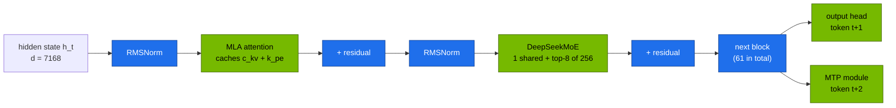
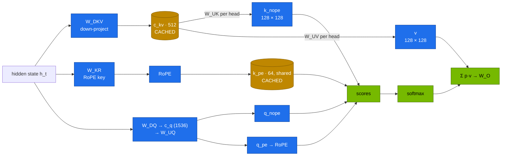
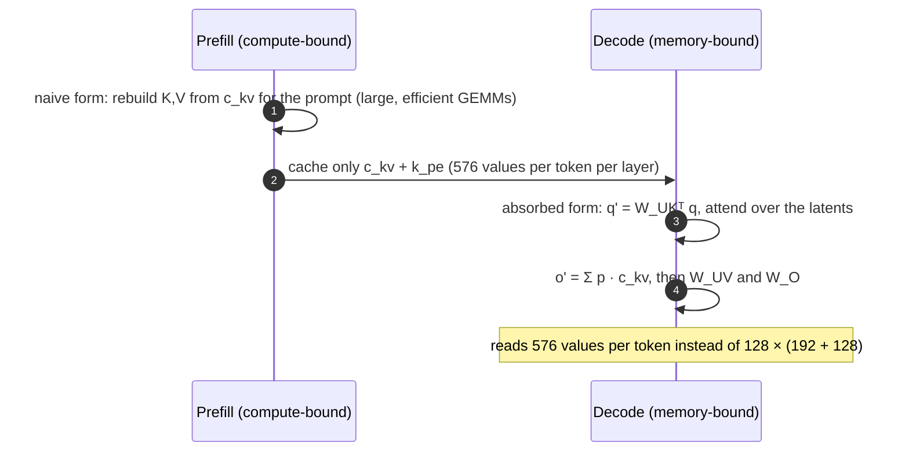
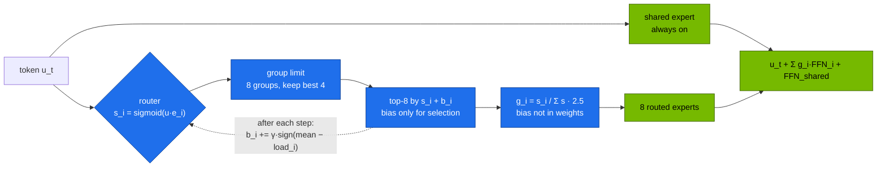
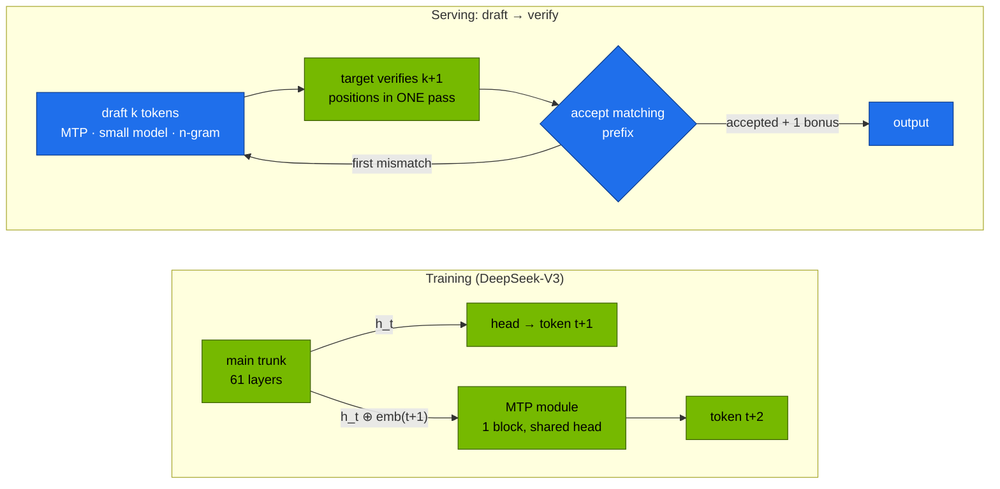

# Chapter 01 · DeepSeek architecture: MLA, DeepSeekMoE & MTP

> **03-DeepSeek · Part I — Architecture · Chapter 01 of 19** · ← [All chapters](00-deepseek-step-by-step-guide.md) · [Chapter 02 · FP8 training, FlashMLA & DeepGEMM](02-fp8-training-and-kernels.md) →

| | |
|---|---|
| **You will build** | The three ideas that define DeepSeek-V2/V3, each proved in code: Multi-head Latent Attention in three equivalent forms (plain MHA, MLA with reconstructed K/V, and the "absorbed" decode form), DeepSeek-V3's router with auxiliary-loss-free balancing, and a speed-up model for multi-token prediction and speculative decoding. Then you'll see all three on the GB10: MLA at V3 sizes, the real router inside DeepSeek-V2-Lite, the MLA backend vLLM picks, and speculative decoding of the R1 7B distill with a 1.5B draft and with n-gram lookup |
| **Hardware** | MacBook (or any CPU with Python 3 and PyTorch) for Tasks 1–4. dgx-spark-1 for Tasks 5–8 |
| **Time** | 3 h |
| **Risk** | Low. Tasks 5–8 park the running vLLM model and use up to ~58 Gi of `serving-budget` |
| **Clusters** | none for Tasks 1–4 · `spark-root` (namespace `llm-serving`: the `vllm` Deployment, the `gpu-probes` Job) for Tasks 5–8 |
| **Lab files** | [`tools/mla_attention_demo.py`](lab/tools/mla_attention_demo.py), [`tools/moe_router_demo.py`](lab/tools/moe_router_demo.py), [`tools/moe_router_probe.py`](lab/tools/moe_router_probe.py), [`tools/spec_decode_calc.py`](lab/tools/spec_decode_calc.py), [`tools/model_math.py`](lab/tools/model_math.py), [`tools/eval_harness.py`](lab/tools/eval_harness.py), [`k8s/jobs/gpu-probes.yaml`](lab/k8s/jobs/gpu-probes.yaml), [`k8s/models/v2-lite`](lab/k8s/models/v2-lite/kustomization.yaml), [`k8s/models/r1-7b`](lab/k8s/models/r1-7b/kustomization.yaml), [`k8s/spec-decode/`](lab/k8s/spec-decode/) |

---

## 1. Why this matters on a Spark

A GB10 has a lot of memory (~121.7 GiB visible, unified between CPU and GPU) and modest bandwidth (~273 GB/s). Generating one token means reading every *active* weight once plus the KV cache of every sequence in the batch, with very little arithmetic per byte. Single-stream decode is therefore bandwidth-bound, and the KV cache, not the weights, decides how many users and how much context fit.

DeepSeek-V2 and V3 attack exactly these limits, each with one architectural idea:

| Idea | Resource it saves | Effect on a GB10 |
|---|---|---|
| **MLA** (Multi-head Latent Attention) | KV-cache memory and KV bytes read per token | DeepSeek-V3 caches 68.6 KiB per token where an MHA layout would need 5,856 KiB (85× less). A 16B MLA model holds ~777K cached tokens at util 0.45 |
| **DeepSeekMoE** (fine-grained experts, shared experts, aux-loss-free balancing) | bytes of weights read per token | DeepSeek-V2-Lite has 15.7B parameters but reads ~2.4B per token, so it decodes at roughly the speed of a 3B dense model |
| **MTP** (multi-token prediction) | idle compute during decode | a built-in draft: guess the next token cheaply, verify in the same pass. DeepSeek reports 85–90 % acceptance for the second token, about 1.8× decode throughput |

The full V3/R1 (671B) doesn't fit one Spark ([Chapter 04](04-scaling-beyond-one-spark.md)). DeepSeek-V2-Lite and Coder-V2-Lite do, and they carry the same MLA and DeepSeekMoE design, so they are the lab's way to see the architecture on real hardware.

---

## 2. Concepts

### 2.1 One DeepSeek-V3 block



The first three V3 layers use a dense FFN instead of MoE (`n_dense_layers` = 3). Everything else repeats this block.

### 2.2 Multi-head Latent Attention

During decoding, every new token attends to the keys and values of all previous tokens. Those tensors are cached:

| Attention type | Cached per token per layer | Example | KV per token (BF16, all layers) |
|---|---|---|---|
| MHA (multi-head) | K and V for every head | DeepSeek-V3 *if it used MHA*: 128 heads × (192 + 128) | **5,856 KiB** |
| GQA (grouped-query) | K and V for a few shared KV heads | Qwen2.5-32B: 8 KV heads × 128 | 256 KiB |
| **MLA** | one compressed latent `c_kv` (512) + one shared RoPE key (64) | **DeepSeek-V3**: 61 layers × 576 | **68.6 KiB** |

DeepSeek-V3 caches less per token than Qwen2.5-7B with GQA (56 KiB at 28 layers vs V3's 61 layers).



Two ideas make MLA work:

1. **Low-rank compression.** Keys and values for all 128 heads are generated from a 512-dimensional latent `c_kv`. Only `c_kv` is cached; per-head K and V can always be rebuilt from it.
2. **Decoupled RoPE.** Rotary position embedding depends on position and would not commute with `W_UK`, so it can't pass through the low-rank projection. 64 dimensions per head carry position through a separate key `k_pe`, shared by all heads and cached too.

**The absorption trick.** Because

`q_nope · k_nope = q_nope · (W_UK c_kv) = (W_UKᵀ q_nope) · c_kv`

`W_UK` can be folded into the query, and `W_UV` into the output projection. Attention then runs directly on the 576-wide latent, and per-head K/V are never materialised for the thousands of cached tokens. This is the form decode kernels implement (FlashMLA, vLLM's MLA backends; [Chapter 02](02-fp8-training-and-kernels.md)).



DeepSeek-V3 attention dimensions (from `inference/configs/config_671B.json`):

| Symbol | Config key | V3 | V2-Lite |
|---|---|---|---|
| hidden size d | `dim` | 7168 | 2048 |
| heads | `n_heads` | 128 | 16 |
| KV latent rank | `kv_lora_rank` | 512 | 512 |
| query latent rank | `q_lora_rank` | 1536 | 0 (no query compression) |
| non-RoPE head dim | `qk_nope_head_dim` | 128 | 128 |
| RoPE head dim | `qk_rope_head_dim` | 64 | 64 |
| value head dim | `v_head_dim` | 128 | 128 |
| layers | `n_layers` | 61 | 27 |

### 2.3 DeepSeekMoE

A Mixture-of-Experts layer replaces one big feed-forward block with many small experts and a **router** that sends each token to a few of them. Compute and bytes read per token follow the *active* parameters; memory follows the *total*:

| Model | Total | Active per token | Weights (BF16) | Fits one Spark? |
|---|---|---|---|---|
| DeepSeek-V2-Lite / Coder-V2-Lite | 15.7B | ~2.4B (2.7B incl. embeddings) | 29.3 GiB | yes |
| Mixtral-8x7B | 46.7B | 12.9B | 87 GiB | only quantised |
| DeepSeek-V3 / R1 | 671B | 37B | 1.25 TiB (FP8: 625 GiB) | no ([Chapter 04](04-scaling-beyond-one-spark.md)) |

More memory for cheaper tokens is the right trade on a box with lots of memory and modest bandwidth.



| Decision | DeepSeekMoE | Alternative (Mixtral, GShard) | Why it helps |
|---|---|---|---|
| Expert granularity | **many small** experts (256 × 2048 hidden), top-8 | few large ones (8 experts, top-2) | far more combinations, finer specialisation |
| Shared experts | 1 (V3) or 2 (V2) always-on experts | none | common knowledge lives in one place instead of in every routed expert |
| Balancing | **auxiliary-loss-free**: a per-expert bias used only for top-k selection, nudged after each step | an auxiliary loss term | balance without a loss that fights the language-modelling objective |
| Group-limited routing (V3) | experts in 8 groups (≈ 8 nodes in training); a token uses at most 4 groups | none | caps cross-node all-to-all traffic, which makes expert parallelism affordable ([Chapter 04](04-scaling-beyond-one-spark.md)) |

Router parameters from the config files:

| Key | DeepSeek-V3 | DeepSeek-V2-Lite |
|---|---|---|
| `n_routed_experts` | 256 | 64 |
| `n_shared_experts` | 1 | 2 |
| `n_activated_experts` (top-k) | 8 | 6 |
| `n_expert_groups` / `n_limited_groups` | 8 / 4 | 1 / 1 (no group limit) |
| `score_func` | sigmoid | softmax |
| `route_scale` | 2.5 | 1.0 |
| `moe_inter_dim` (expert hidden size) | 2048 | 1408 |
| `n_dense_layers` | 3 | 1 |

**The efficiency tax.** With experts sharded over GPUs (expert parallelism), every MoE layer waits for the most loaded GPU. `max/mean GPU load` is therefore the multiplier on MoE layer time; 1.0 is perfect. The router bias evens out *routing* during training; EPLB evens out *placement* during serving ([Chapter 04](04-scaling-beyond-one-spark.md)). On one GPU there is no expert parallelism, but skew still matters for kernel efficiency ([Chapter 02](02-fp8-training-and-kernels.md)).

### 2.4 Multi-token prediction and speculative decoding

Decoding a 7B BF16 model (≈ 15 GB) on ~273 GB/s gives at most about 18 forward passes per second for one stream, however many TFLOPS sit idle. Speculative decoding spends that idle compute: guess several tokens cheaply, verify them all in **one** forward pass of the big model, keep the prefix it agrees with.

DeepSeek-V3 builds the guesser into the model. An **MTP module** (one transformer block sharing the embedding and output head) is trained to predict token t+2 from the trunk's hidden state and the embedding of token t+1. In training it densifies the learning signal; in serving it becomes a built-in draft.



**Output quality is unchanged.** With rejection sampling, the verified sequence follows exactly the target model's distribution. Speculation changes speed, never the answer distribution.

With per-token acceptance rate α, k drafted tokens and draft cost c (relative to one target pass):

`E[tokens per target pass] = (1 − α^(k+1)) / (1 − α)`   and   `speed-up ≈ E / (1 + k·c)`

From `spec_decode_calc.py --sweep --draft-cost 0.1`:

| α | k=1 | k=2 | k=3 | k=4 | k=6 |
|---|---|---|---|---|---|
| 0.5 | 1.36× | 1.46× | 1.44× | 1.38× | 1.24× |
| 0.7 | 1.55× | 1.82× | 1.95× | 1.98× | 1.91× |
| 0.8 | 1.64× | 2.03× | 2.27× | 2.40× | 2.47× |
| 0.9 | 1.73× | 2.26× | 2.65× | 2.93× | 3.26× |

Acceptance rate dominates, and past the optimum extra draft tokens cost more than they save.

| Draft method | vLLM `--speculative-config` | Draft cost | Typical α | Best for |
|---|---|---|---|---|
| built-in MTP (V3/R1) | `{"method": "deepseek_mtp", "num_speculative_tokens": 1}` | ~1 block | high | the full V3/R1 models |
| small draft model | `{"model": "<draft>", "num_speculative_tokens": 4}` | 0.05–0.15 | 0.5–0.8 | same tokenizer family: R1-1.5B → R1-7B/32B |
| n-gram / prompt lookup | `{"method": "ngram", "num_speculative_tokens": 4, "prompt_lookup_max": 4}` | ~0 | high on copy-heavy output, ~0 otherwise | RAG, code edits, summaries |
| EAGLE-style heads | `{"method": "eagle3", "model": "<head>", …}` | small | 0.6–0.8 | models with a trained head |

The keys of `--speculative-config` change between vLLM releases. Check `vllm serve --help=speculative` in the image pinned in `lab/versions.env`.

---

## 3. Prove it in code

Tasks 1–4 run on a laptop. Install PyTorch for CPU once (`python3 -m pip install torch`); `model_math.py` and `spec_decode_calc.py` need only the standard library.

### Task 1 · MLA: three forms, one answer

```bash
# ▶ MacBook · 03-DeepSeek/lab
python3 tools/mla_attention_demo.py
```

```text
device=cpu dtype=torch.float64 d=512 heads=8 nope=32 rope=16 v=32 latent r=64 tokens=64
max rel. |naive - absorbed| = 6.36e-16   max rel. |naive - MHA| = 5.56e-16
✓ all three formulations produce the same output

KV cache per token per layer (elements):
  MHA (8 heads)       :    768
  GQA (8 KV heads)      :    768
  MLA (latent + rope)   :     80   → 9.6× smaller than MHA
```

Read the code alongside the diagram in §2.2. `out_abs` never builds `k_nope` or `v` for the cached tokens: it contracts with `W_UK_h` on the query side and `W_UV_h` on the output side. The scaled-down layer gives 9.6×; at V3 sizes (Task 5) the ratio is 85×.

Then time the two decode forms:

```bash
# ▶ MacBook · 03-DeepSeek/lab
python3 tools/mla_attention_demo.py --decode-bench 1024 --batch 2
```

The naive form rebuilds K and V for every cached token at every step; the absorbed form only projects the new query and output. Expect the absorbed form to be one to two orders of magnitude faster on CPU (record yours); [Chapter 02](02-fp8-training-and-kernels.md) explains why decode kernels are built around this.

### Task 2 · KV per token across the catalog

```bash
# ▶ MacBook · 03-DeepSeek/lab
python3 tools/model_math.py --compare deepseek-v2-lite deepseek-v3 qwen2.5-7b qwen2.5-32b llama-3.1-8b llama-3.3-70b
```

```text
model                            kind      total B  active B   KV/token  MHA-equiv
deepseek-v2-lite                 mla-moe      15.7       2.7     30.4KiB    324.0KiB
deepseek-v3                      mla-moe     671.0      37.6     68.6KiB   5856.0KiB
qwen2.5-7b                       gqa           7.6       7.6     56.0KiB    392.0KiB
qwen2.5-32b                      gqa          32.8      32.8    256.0KiB   1280.0KiB
llama-3.1-8b                     gqa           8.0       8.0    128.0KiB    512.0KiB
llama-3.3-70b                    gqa          70.6      70.6    320.0KiB   2560.0KiB
```

`active` counts embeddings; DeepSeek quotes 2.4B for V2-Lite and 37B for V3. `model_math.py --config <path>/config.json` sizes any Hugging Face model the same way, including newer V3.x releases.

### Task 3 · DeepSeek-V3's router on skewed traffic

```bash
# ▶ MacBook · 03-DeepSeek/lab
python3 tools/moe_router_demo.py
```

```text
== WITHOUT aux-loss-free bias balancing (256 experts, top-8, groups 4/8)
 step   max/mean expert load   idle experts   max/mean GPU load (EP=8)
    1                  11.50             11                   1.84
   60                  11.71             13                   1.86

== WITH aux-loss-free bias balancing (256 experts, top-8, groups 4/8)
 step   max/mean expert load   idle experts   max/mean GPU load (EP=8)
    1                  11.50             11                   1.84
   20                   9.70              5                   1.59
   40                   6.91              2                   1.37
   60                   3.81              0                   1.14
 bias range after 60 steps: [-0.120, 0.120]
```

Traffic comes from four "topics" with a 55/25/15/5 mix. Without balancing the hottest expert gets ~11.7× the average load and a dozen experts sit idle. With the bias update (γ = 0.002) imbalance falls steadily and every expert gets work. The bias never enters the combine weights, so the output scale is untouched.

Turn the knobs and answer the questions in your notes:

```bash
# ▶ MacBook · 03-DeepSeek/lab
python3 tools/moe_router_demo.py --gamma 0.01                                  # faster balancing: does it oscillate?
python3 tools/moe_router_demo.py --groups 1 --limited 1                        # no group limit
python3 tools/moe_router_demo.py --experts 64 --topk 6 --groups 1 --limited 1 --route-scale 1.0   # V2-Lite shape
```

- What happens to *idle experts* when γ is too small?
- Does removing the group limit change GPU imbalance here? It shouldn't much: the group limit exists to bound cross-node *traffic*, not to balance load.

### Task 4 · Predict speculative decoding before you measure it

```bash
# ▶ MacBook · 03-DeepSeek/lab
python3 tools/spec_decode_calc.py --alpha 0.85 --k 1 --draft-cost 0.05     # V3-style MTP, one extra token
python3 tools/spec_decode_calc.py --sweep --draft-cost 0.1                 # a 1.5B draft for a 7B target
```

```text
α=0.85 k=1 c=0.05: 1.85 tokens/step, ≈1.76× decode speed-up
```

Keep the sweep table next to you for Task 8.

### Task 5 · MLA at V3 sizes and the real router on the GB10

The `gpu-probes` Job runs the architecture tools on the GPU in sequence: `mla_attention_demo.py --v3` (d = 7168, 128 heads, r = 512, plus a decode bench at 8,192 cached tokens), the FP8 and grouped-GEMM probes of [Chapter 02](02-fp8-training-and-kernels.md), and `moe_router_probe.py` on DeepSeek-V2-Lite-Chat in BF16 (~31 GB). Park the served model first so the probe has the memory:

```bash
# ▶ MacBook · 03-DeepSeek/lab
export KUBECONFIG="$PWD/../../01-Ansible/lab/.cache/kubeconfig-spark-lab.yaml"
kubectl --context spark-root -n llm-serving annotate scaledobject vllm autoscaling.keda.sh/paused-replicas=0 --overwrite
kubectl --context spark-root -n llm-serving get deploy vllm                     # READY 0/0
kubectl --context spark-root apply -k .                                         # tools ConfigMaps (llm-serving, batch)
kubectl --context spark-root apply -f k8s/jobs/gpu-probes.yaml
kubectl --context spark-root -n llm-serving logs -f job/gpu-probes | head -8
```

At V3 sizes in FP32 on CUDA the relative agreement is ~1e-6 (TF32 rounding) instead of ~1e-16, and the KV ratio becomes 85×. When the Job reaches the router probe:

```bash
# ▶ MacBook · 03-DeepSeek/lab
kubectl --context spark-root -n llm-serving logs job/gpu-probes | sed -n '/hooked/,$p'
```

Expected shape (expert IDs are illustrative, record yours):

```text
hooked 26 router modules; top-6 of 64 routed experts
layer 14: top-5 experts per domain
  code     [3, 11, 27, 40, 58]
  math     [3, 19, 27, 33, 51]
  chat     [6, 12, 22, 41, 60]
  chinese  [8, 15, 29, 44, 63]

overlap of top-5 sets (Jaccard):
  code     vs math    : 0.25
  code     vs chat    : 0.00
  …
layer 14 load max/mean = 2.9
```

Low overlap between domains is specialisation you can see. Save the measured loads for the EPLB task in [Chapter 04](04-scaling-beyond-one-spark.md):

```bash
# ▶ MacBook · 03-DeepSeek/lab
mkdir -p results
kubectl --context spark-root -n llm-serving logs job/gpu-probes | sed -n 's/^LOADS_JSON: //p' > results/v2lite-loads.json
```

### Task 6 · MLA in a served model

```bash
# ▶ MacBook · 03-DeepSeek/lab
kubectl --context spark-root -n llm-serving delete job gpu-probes
kubectl --context spark-root -n llm-serving annotate scaledobject vllm autoscaling.keda.sh/paused-replicas-
scripts/serve-model.sh v2-lite
kubectl --context spark-root -n llm-serving logs deploy/vllm | grep -iE 'MLA|attention backend|KV cache|GPU KV'
```

Record the backend name and the logged KV-cache capacity, and compare it with the prediction:

```bash
# ▶ MacBook · 03-DeepSeek/lab
python3 tools/model_math.py deepseek-v2-lite --util 0.45 --ctx 16384
```

At util 0.45 (the catalog's value for `v2-lite`) the tool predicts ~22.5 GiB of KV and ~777K tokens. vLLM's figure is a little lower: activation workspace, CUDA graphs and the sampler take their share. On sm_121 expect a Triton-based MLA backend; FlashMLA's kernels are built for SM90/SM100 ([Chapter 02](02-fp8-training-and-kernels.md)).

### Task 7 · MoE decodes like a small dense model

With `v2-lite` still serving:

```bash
# ▶ MacBook · 03-DeepSeek/lab
kubectl --context spark-root -n llm-serving port-forward svc/vllm 8000 &
python3 tools/eval_harness.py --url http://localhost:8000 --model v2-lite --suites json --concurrency 1 --out results/v2lite-c1.json | grep 'tok/s aggregate'
kill %1
scripts/serve-model.sh qwen2.5-7b-tools
kubectl --context spark-root -n llm-serving port-forward svc/vllm 8000 &
python3 tools/eval_harness.py --url http://localhost:8000 --model qwen2.5-7b-tools --suites json --concurrency 1 --out results/qwen7b-c1.json | grep 'tok/s aggregate'
kill %1
```

The MoE with ~2.4B active parameters should decode faster per stream than the dense 7B, despite twice the total parameters (`model_math.py` predicts ceilings of ≈ 50 and ≈ 18 tok/s). Record both.

### Task 8 · Speculative decoding: draft model and n-gram

Baseline first, then the two speculative overlays of the same model. The draft overlay raises util from 0.30 to 0.36 to hold the 1.5B draft and its KV; the sum over everything running stays under 0.72.

```bash
# ▶ MacBook · 03-DeepSeek/lab
scripts/serve-model.sh r1-1.5b                       # caches the draft weights in model-cache
scripts/serve-model.sh r1-7b
kubectl --context spark-root -n llm-serving port-forward svc/vllm 8000 &
python3 tools/eval_harness.py --url http://localhost:8000 --model r1-7b --suites math --concurrency 1 --out results/r1-7b-base.json
kill %1

kubectl --context spark-root apply -k k8s/spec-decode/r1-7b-draft
kubectl --context spark-root -n llm-serving rollout status deploy/vllm --timeout=30m
kubectl --context spark-root -n llm-serving port-forward svc/vllm 8000 &
python3 tools/eval_harness.py --url http://localhost:8000 --model r1-7b --suites math --concurrency 1 --out results/r1-7b-draft.json
curl -s localhost:8000/metrics | grep -E '^vllm:spec_decode_num_(accepted|draft)_tokens_total'
kill %1

kubectl --context spark-root apply -k k8s/spec-decode/r1-7b-ngram
kubectl --context spark-root -n llm-serving rollout status deploy/vllm --timeout=20m
kubectl --context spark-root -n llm-serving port-forward svc/vllm 8000 &
python3 tools/eval_harness.py --url http://localhost:8000 --model r1-7b --suites math --concurrency 1 --out results/r1-7b-ngram.json
kill %1
python3 tools/eval_harness.py --report results/r1-7b-*.json
```

Compute α = accepted / draft from the metrics, feed it to `spec_decode_calc.py --alpha <α> --k 4 --draft-cost 0.1`, and compare the prediction with the measured single-stream tok/s. Accuracy must be identical within run-to-run noise; if it isn't, the configuration is wrong, not the method.

Then repeat the draft run at `--concurrency 16`. At high batch the GPU is no longer idle between passes, verification competes with real work, and the gain shrinks or turns negative. Put the plain overlay back afterwards:

```bash
# ▶ MacBook · 03-DeepSeek/lab
scripts/serve-model.sh r1-7b
```

---

## 4. What it means on a Spark

### 4.1 Concurrency per model

From `model_math.py` with the catalog's settings (121.7 GiB, 3 GiB activations and graphs):

| Model | Attention | Weights | KV/token | util | KV budget | Tokens in cache | Concurrent seqs |
|---|---|---|---|---|---|---|---|
| DeepSeek-V2-Lite (16B MoE) | MLA | 29.3 GiB | **30.4 KiB** | 0.45 | 22.5 GiB | ~777K | 47 @ 16K |
| R1-Distill-Qwen-7B | GQA (4 KV heads) | 14.2 GiB | 56 KiB | 0.30 | 19.3 GiB | ~362K | 11 @ 32K |
| R1-Distill-Qwen-32B | GQA (8 KV heads) | 61.0 GiB | 256 KiB | 0.70 | 21.2 GiB | ~87K | 5 @ 16K |

The MLA model holds about twice the tokens of the 7B in a similar budget, and roughly 9× those of the 32B. [Chapter 05](05-model-catalog-and-memory-math.md) turns this into the full catalog and the memory rule (sum of util over models running together ≲ 0.72; request = limit for every GPU pod).

### 4.2 Speculation costs memory

| Configuration | util | What's resident |
|---|---|---|
| `r1-7b` alone | 0.30 | 14.2 GiB weights + KV |
| `r1-7b` + 1.5B draft | 0.36 | + ~3.4 GiB draft weights + draft KV |

Reasoning models emit long `<think>` chains, so decode dominates their latency and they benefit most from speculation. High-concurrency serving benefits least.

### 4.3 Where these ideas show up later

- [Chapter 02](02-fp8-training-and-kernels.md): FlashMLA and the MLA backends that run on sm_121; grouped GEMMs for the MoE layer.
- [Chapter 04](04-scaling-beyond-one-spark.md): MLA makes 128K context and KV transfer cheap; EPLB places experts across GPUs using the loads from Task 5.
- [Chapter 06](06-vllm-serving.md): the vLLM Deployment these overlays patch.
- [Chapter 16](16-telemetry.md): `vllm:spec_decode_num_accepted_tokens_total / vllm:spec_decode_num_draft_tokens_total` is α in production; add it to the serving dashboard when you run speculation.
- [02-Kubernetes Chapter 23](../02-Kubernetes/23-disaggregated-prefill-and-decode-serving.md): prefill/decode disaggregation moves KV caches between engines; MLA makes that 85× cheaper.

### 4.4 Scale-out path

| On one Spark | In a datacenter |
|---|---|
| a 16B MLA MoE holds ~777K cached tokens | V3/R1 on 8×H200/B200: MLA plus FP8 KV serves 128K context to many users |
| decode on Triton MLA kernels | FlashMLA on Hopper and datacenter Blackwell, paged latent cache with block size 64 |
| all experts on one GPU; bias balancing seen in simulation | 256 experts sharded with expert parallelism, all-to-all dispatch (DeepEP), EPLB replicas ([Chapter 04](04-scaling-beyond-one-spark.md)) |
| 1.5B draft for 7B, n-gram for RAG | MTP heads on V3/R1 (`deepseek_mtp`), EAGLE-3 heads per model, speculation disabled above a batch size |

---

## 5. Verify

| Check | Expected |
|---|---|
| `mla_attention_demo.py` (CPU) | both relative errors < 1e-10, `✓ all three formulations produce the same output` |
| `mla_attention_demo.py --v3` (GPU, Task 5) | errors < 1e-3 (TF32), KV ratio 85× |
| `model_math.py --compare` | V3: 68.6 KiB per token, MHA-equivalent 5,856 KiB |
| `moe_router_demo.py` with balancing | max/mean expert load below ~4 by step 60, idle experts 0; without balancing it stays ~11–12 |
| router probe on V2-Lite | 26 hooked gates (27 layers − 1 dense), domain top-5 sets differ, `results/v2lite-loads.json` saved |
| vLLM log for `v2-lite` | an MLA backend named; KV capacity in the hundreds of thousands of tokens |
| `spec_decode_calc.py` | 1.85 tokens/step, ≈ 1.76× for α = 0.85, k = 1, c = 0.05 |
| draft run | `vllm:spec_decode_num_accepted_tokens_total` > 0; single-stream tok/s above baseline; math accuracy unchanged |

---

## 6. Troubleshooting

| You see | Cause | Fix |
|---|---|---|
| vLLM: `Model architectures ['DeepseekV2ForCausalLM'] … trust_remote_code` | older transformers mapping | the catalog passes `--trust-remote-code` for `v2-lite` and `coder-v2-lite` |
| `No MLA backend available for … capability 12.1`, slow fallback | FlashMLA / FlashInfer MLA kernels not built for sm_121 | use the NGC vLLM image pinned in `lab/versions.env`; check the release notes for sm_120/121 MLA support |
| Demo error ~1e-3 on the GPU | TF32 matmul in FP32 | expected; CPU float64 is the exactness proof |
| KV estimate far above vLLM's log | activations at `--max-num-seqs`, CUDA graphs, sampler buffers | raise `--overhead-gib` in `model_math.py`; compare after warm-up |
| Probe: `hooked 0 router modules` | gate class names differ in your transformers version | print `{type(m).__name__ for m in model.modules()}` and adjust the match in the script |
| `gpu-probes` pod `Pending`, `Insufficient memory`, or CUDA OOM loading V2-Lite | vLLM or another engine still holds the pool | pause the ScaledObject (Task 5), check `kubectl --context spark-root -n llm-serving get pods`, drop the page cache on dgx-spark-1 |
| `kubectl scale deploy vllm --replicas=0` doesn't stick | KEDA scales it back | pause the ScaledObject with `autoscaling.keda.sh/paused-replicas=0` |
| Router demo oscillates at large γ | the bias overshoots | γ ≈ 1e-3 is the paper's order of magnitude |
| MoE decode slower than expected at large batch | batching spreads tokens over more experts, so more expert weights are read per step | compare tok/s at concurrency 1 and 32; large batches touch most experts |
| `Speculative decoding … vocab size mismatch` | draft and target tokenizers differ | draft from the same family (R1-Qwen 1.5B ↔ R1-Qwen 7B/32B) |
| OOM at start after enabling the draft | two models and two KV caches | the overlay already raises util to 0.36; otherwise lower `--max-model-len` |
| α ≈ 0 with n-gram | the output doesn't repeat the input | expected for open-ended reasoning; use a draft model |
| speculation slower at high concurrency | the GPU is already busy | disable speculation above a batch size (check the `--speculative-config` options of your vLLM version) |

---

## 7. Checklist

- [ ] I can explain which two tensors MLA caches, why RoPE needs its own path, and how absorption avoids rebuilding K/V.
- [ ] I ran the three-way equivalence test and can point at the absorption step in the code.
- [ ] I computed KV per token for MLA, GQA and MHA models and turned it into concurrency on a GB10.
- [ ] I can explain fine-grained and shared experts, sigmoid scores, group-limited routing and why the bias is only used for selection.
- [ ] I watched bias balancing remove idle experts, and measured real expert specialisation in V2-Lite.
- [ ] I know why active parameters, not total, set decode speed on a bandwidth-bound GPU.
- [ ] I can compute tokens per step and speed-up from α, k and draft cost, and I measured α on the Spark.
- [ ] I confirmed that speculation didn't change answer quality, and saw where it stops paying.
