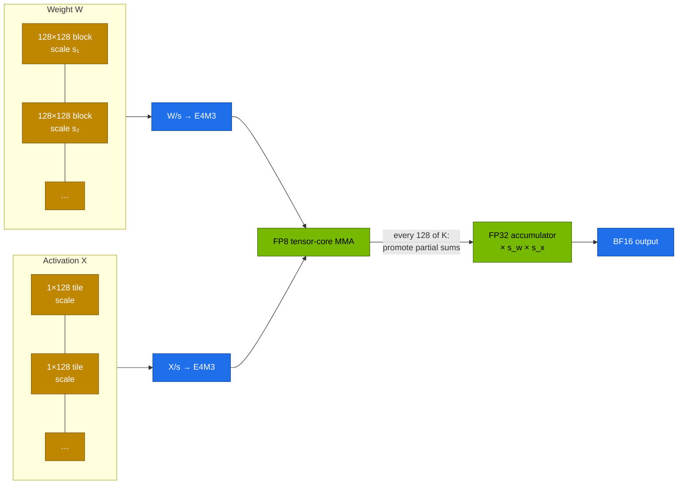
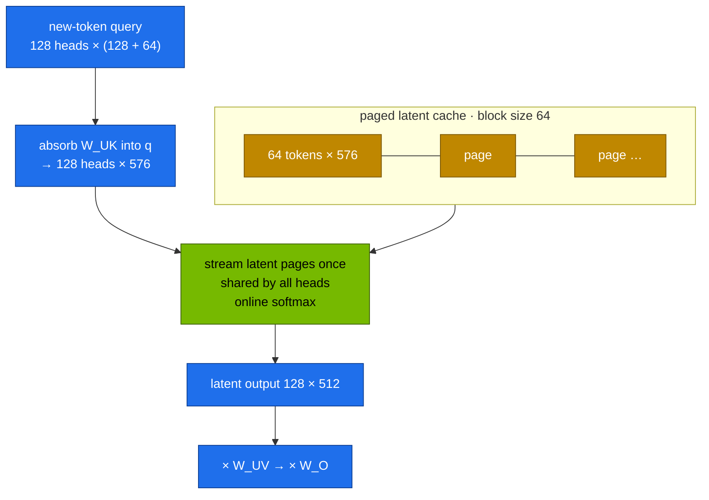
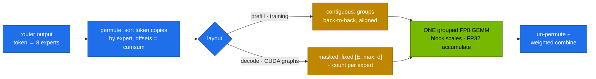

# Chapter 02 · FP8 training, FlashMLA & DeepGEMM

> **03-DeepSeek · Part I — Architecture · Chapter 02 of 19** · ← [Chapter 01 · DeepSeek architecture: MLA, DeepSeekMoE & MTP](01-deepseek-architecture-mla-moe-mtp.md) · [All chapters](00-deepseek-step-by-step-guide.md) · [Chapter 03 · R1 reasoning & GRPO](03-r1-reasoning-and-grpo.md) →

| | |
|---|---|
| **You will build** | A measured understanding of the numerics and kernels behind DeepSeek-V3: why FP8 is scaled per 128×128 block and not per tensor, why MLA decode kernels attend on the latent, and why MoE layers need grouped GEMMs. You'll prove each point on a CPU, measure FP8 vs BF16 and grouped vs looped GEMMs on the GB10's tensor cores, find out which MLA and MoE kernels vLLM really runs on sm_121, and serve the same 32B model in BF16 and FP8 to compare memory, speed and accuracy |
| **Hardware** | MacBook (or any CPU with PyTorch) for Tasks 1–3. dgx-spark-1 for Tasks 4–8 |
| **Time** | 3 h |
| **Risk** | Low. Task 7 runs the 32B BF16 model alone: every other model server and app in `llm-serving` is parked for its duration |
| **Clusters** | none for Tasks 1–3 · `spark-root` (namespace `llm-serving`: `vllm` Deployment, `gpu-probes` Job, `serving-budget`) for Tasks 4–8 |
| **Lab files** | [`tools/fp8_blockscale.py`](lab/tools/fp8_blockscale.py), [`tools/grouped_gemm_bench.py`](lab/tools/grouped_gemm_bench.py), [`tools/mla_attention_demo.py`](lab/tools/mla_attention_demo.py), [`tools/model_math.py`](lab/tools/model_math.py), [`tools/eval_harness.py`](lab/tools/eval_harness.py), [`k8s/jobs/gpu-probes.yaml`](lab/k8s/jobs/gpu-probes.yaml), [`k8s/models/v2-lite`](lab/k8s/models/v2-lite/kustomization.yaml), [`k8s/models/r1-32b`](lab/k8s/models/r1-32b/kustomization.yaml), [`k8s/models/r1-32b-fp8`](lab/k8s/models/r1-32b-fp8/kustomization.yaml) |

---

## 1. Why this matters on a Spark

On a bandwidth-bound GPU every halving of bytes per parameter halves weight memory **and** roughly doubles single-stream decode speed. Number formats are the most powerful knob on a GB10:

| Format | Bits | Exponent/mantissa | Range | Where you meet it |
|---|---|---|---|---|
| FP32 | 32 | 8/23 | huge | optimizer state, master weights, accumulators |
| BF16 | 16 | 8/7 | same as FP32 | default training and serving |
| FP8 **E4M3** | 8 | 4/3 | ±448 | weights and activations |
| FP8 E5M2 | 8 | 5/2 | ±57,344 | gradients in classic FP8 recipes |
| NVFP4 | 4 | 2/1 + an FP8 scale per 16 values | — | Blackwell 4-bit inference (the GB10's 1 PFLOP figure is FP4 with sparsity) |

DeepSeek-V3 was the first frontier model trained mostly in FP8. Getting there took two things this chapter takes apart: a scaling scheme that survives outliers, and kernels written for it — **DeepGEMM** for block-scaled and grouped GEMMs, **FlashMLA** for decode attention on the latent cache.

There is a catch on a Spark. The GB10 is compute capability **12.1** (sm_121), a different Blackwell variant from the datacenter B200 (SM100). FlashMLA and DeepGEMM are compiled for SM90 (Hopper) and SM100 only, so **they don't run on a GB10**. The *problems* they solve are the same on any GPU, so this chapter measures those problems with kernels that do run here: PyTorch's `_scaled_mm` and `_grouped_mm`, and vLLM's Triton and CUTLASS kernels.

---

## 2. Concepts

### 2.1 Fine-grained FP8 scaling

E4M3 covers about 18 binades (powers of two). LLM tensors contain **outliers**: a handful of values hundreds or thousands of times larger than the rest. Scale the whole tensor so the largest value fits, and the small values lose precision or underflow to zero. DeepSeek's answer is to give every small block its own scale:



DeepSeek-V3's recipe in five rules:

| Rule | Why |
|---|---|
| Weights scaled per **128×128 block**, activations per **1×128 tile** | an outlier only damages its own block or tile |
| FP8 **E4M3 everywhere**, including gradients | with fine-grained scales the extra mantissa bit is worth more than E5M2's range |
| **Promote** partial sums to FP32 every 128 elements of K | Hopper's FP8 tensor-core accumulation keeps limited precision; periodic promotion bounds error growth |
| Keep sensitive parts in BF16/FP32: embeddings, output head, MoE gates, norms, attention softmax | a small share of compute, a large share of numerical risk |
| Master weights, optimizer gradients and Adam moments in higher precision | the update step needs the precision |

The released V3/R1 weights are stored in this block format: every FP8 weight comes with a `weight_scale_inv` tensor holding one scale per 128×128 block.

**Formats you will actually serve on a Spark:**

| Checkpoint style | Example | vLLM | Notes |
|---|---|---|---|
| FP8 **dynamic** (W8A8: per-channel weights, per-token activations computed on the fly) | `RedHatAI/DeepSeek-R1-Distill-Qwen-32B-FP8-dynamic` | auto-detected (`compressed-tensors`) | no calibration data; catalog entry `r1-32b-fp8` |
| FP8 **block** (DeepSeek-native 128×128) | `deepseek-ai/DeepSeek-V3` | auto-detected | the format of the full V3/R1 checkpoints |
| AWQ / GPTQ INT4 | `Qwen/Qwen2.5-32B-Instruct-AWQ` | `--quantization awq_marlin` | 4-bit weights, BF16 activations |
| FP8 **KV cache** | any model | `--kv-cache-dtype fp8` | halves KV memory for a small accuracy cost |
| NVFP4 | where a checkpoint exists | auto-detected when the kernels support sm_121 | check the current vLLM release notes |

### 2.2 FlashMLA: decode on the latent

MLA shrinks the cache ([Chapter 01](01-deepseek-architecture-mla-moe-mtp.md)). It only pays off at decode time if the kernel reads that small cache as is, instead of expanding it back into per-head K and V for every cached token at every step. **FlashMLA** is DeepSeek's CUDA kernel that does this over a paged latent cache:



Decode is memory-bound. The absorbed form reads the latent cache once (576 values per token per layer) and shares it across all 128 heads, which raises arithmetic intensity enough to use the tensor cores. The naive form does O(cache × r × heads × head_dim) work **per step** just to rebuild K/V; the absorbed form does O(cache × r × heads). The gap grows with cache length.

MLA backends you may see in vLLM (names vary by release):

| Backend | Hardware | Notes |
|---|---|---|
| `FLASHMLA` | SM90, SM100 | DeepSeek's kernel; paged, block size 64 |
| `CUTLASS_MLA` | SM100 | NVIDIA's CUTLASS implementation for datacenter Blackwell |
| `FLASHINFER_MLA` | depends on the build | FlashInfer's MLA kernels |
| `TRITON_MLA` | portable | Triton-generated; **the usual choice on a GB10** |

`VLLM_ATTENTION_BACKEND=<name>` forces one. An unsupported choice should fail fast with a clear message about compute capability; vLLM's log says which backend it took.

### 2.3 DeepGEMM and grouped GEMMs

Nearly all of an LLM's FLOPs are matrix multiplies. DeepSeek-V3 needs two kinds that standard libraries handled poorly when it was built:

1. **FP8 GEMMs with per-block scales** (§2.1). cuBLAS's FP8 path originally assumed one scale per tensor.
2. **Grouped GEMMs for MoE.** 256 experts each multiply a different, variable number of tokens. One launch per expert wastes time; padding every expert to the busiest wastes FLOPs.

DeepGEMM is a small library (about 300 lines of core kernel), JIT-compiled at runtime for the exact shapes. It covers a normal layout and two grouped layouts:



| Approach | Launches | Wasted FLOPs | GPU utilisation |
|---|---|---|---|
| loop over experts | E (64–256) | none | poor: small GEMMs, launch overhead, idle SMs |
| pad to the busiest expert, one batched GEMM | 1 | `E × max / Σcounts − 1`, often hundreds of % | high, but on zeros |
| **grouped GEMM** | 1 | only alignment | high, on real work |

What runs where:

| Need | DeepSeek's kernel (SM90/SM100) | On a GB10 (sm_121) |
|---|---|---|
| dense FP8 GEMM with block scales | DeepGEMM | vLLM's CUTLASS/Triton FP8 kernels; `torch._scaled_mm` (per-tensor or row-wise scales) |
| grouped MoE GEMM | DeepGEMM contiguous/masked | vLLM `fused_moe` (Triton); `torch._grouped_mm` where built |
| MLA decode | FlashMLA | `TRITON_MLA` (or FlashInfer where built) |
| MoE all-to-all across GPUs | DeepEP | not needed on one GPU; NCCL across two Sparks ([Chapter 04](04-scaling-beyond-one-spark.md)) |

vLLM tunes its Triton fused-MoE kernel per GPU with JSON configs. For a GPU without a shipped config (often the case for GB10) it falls back to defaults and says so in the log.

---

## 3. Prove it in code

Tasks 1–3 run on a laptop with PyTorch for CPU (`python3 -m pip install torch`).

### Task 1 · Why blocks: the FP8 error sweep

```bash
# ▶ MacBook · 03-DeepSeek/lab
python3 tools/fp8_blockscale.py
```

```text
weight 1024x1024 ~ N(0, 0.02) with 16 outliers; error measured on the non-outlier weights
  outlier  max/typical | per-tensor err  flushed→0 |  128x128 err  flushed→0
        1           50 |         0.0266       0.0% |       0.0265       0.0%
       10          500 |         0.0265       0.1% |       0.0265       0.0%
      100         5000 |         0.0265       0.9% |       0.0264       0.2%
     1000        50000 |         0.0630       8.7% |       0.0377       1.9%
     5000       250000 |         0.3147      41.4% |       0.1491       9.1%
```

With modest outliers both schemes work. Then per-tensor scaling collapses while blocks degrade gracefully; long training runs do produce outliers of this size. Read `q_block`: it reshapes the matrix to `(M/128, 128, N/128, 128)`, takes the max per block and stores one scale per block. That array is the `weight_scale_inv` tensor in DeepSeek's checkpoint files.

### Task 2 · Why MoE needs grouped GEMMs

```bash
# ▶ MacBook · 03-DeepSeek/lab
python3 tools/grouped_gemm_bench.py
python3 tools/grouped_gemm_bench.py --skew 0.0          # uniform expert popularity
python3 tools/grouped_gemm_bench.py --skew 2.0          # extreme skew
```

```text
device=cpu experts=16 routed tokens=12288 (top-6) busiest expert=4409 quietest=172 padding waste=474%
  loop    :    19.30 ms       0.2 TFLOPS (useful)   max|Δ| vs loop 0.0e+00
  padded  :   197.98 ms       0.0 TFLOPS (useful)   max|Δ| vs loop 0.0e+00
  grouped : unavailable in this PyTorch build (torch._grouped_mm needs CUDA + recent PyTorch)
```

(Timings are from one CPU; record yours.) All paths agree numerically. With realistic skew, padding does ~5.7× the useful work. The `padding waste` line tracks the skew: about 8 % at `--skew 0.0`, about 900 % at `--skew 2.0`. Load balancing ([Chapter 01](01-deepseek-architecture-mla-moe-mtp.md), [Chapter 04](04-scaling-beyond-one-spark.md)) makes MoE kernels efficient, not only GPUs.

### Task 3 · Naive vs absorbed MLA decode

```bash
# ▶ MacBook · 03-DeepSeek/lab
python3 tools/mla_attention_demo.py --decode-bench 1024 --batch 2
python3 tools/mla_attention_demo.py --decode-bench 4096 --batch 2
```

```text
decode step, batch 2, 1024 cached tokens, latent cache 4 MiB/layer
  naive (rebuild K/V each step):  … ms/layer
  absorbed (attend on latent)  :  … ms/layer   → …× faster
```

Expect the absorbed form to be one to two orders of magnitude faster, and the ratio to grow from 1,024 to 4,096 cached tokens. This is the design decision FlashMLA is built around.

### Task 4 · FP8, grouped GEMM and MLA decode on the GB10

The `gpu-probes` Job runs the same tools on the GPU: the MLA decode bench at V3 sizes (8,192 cached tokens, batch 8, BF16), `fp8_blockscale.py --gemm --n 8192` (BF16 vs FP8 GEMM via `torch._scaled_mm`) and `grouped_gemm_bench.py` at V2-Lite sizes (64 experts, d = 2048, expert FFN 1408). It ends with the router probe of [Chapter 01](01-deepseek-architecture-mla-moe-mtp.md), so park the served model first:

```bash
# ▶ MacBook · 03-DeepSeek/lab
export KUBECONFIG="$PWD/../../01-Ansible/lab/.cache/kubeconfig-spark-lab.yaml"
kubectl --context spark-root -n llm-serving annotate scaledobject vllm autoscaling.keda.sh/paused-replicas=0 --overwrite
kubectl --context spark-root apply -k .
kubectl --context spark-root -n llm-serving delete job gpu-probes --ignore-not-found
kubectl --context spark-root apply -f k8s/jobs/gpu-probes.yaml
kubectl --context spark-root -n llm-serving logs -f job/gpu-probes | sed -n '/decode step/,/grouped /p'
```

Expected shape:

```text
decode step, batch 8, 8192 cached tokens, latent cache … MiB/layer
  naive (rebuild K/V each step):   … ms/layer
  absorbed (attend on latent)  :   … ms/layer   → …× faster
NVIDIA GB10  cc=(12, 1)  n=8192
  BF16 GEMM :   …  TFLOPS
  FP8  GEMM :   …  TFLOPS
device=cuda experts=64 routed tokens=49152 (top-6) …
  loop    : …
  padded  : …
  grouped : …    (or "unavailable")
```

Fill in (record yours):

| Kernel | ms | TFLOPS |
|---|---|---|
| MLA decode, naive | | — |
| MLA decode, absorbed | | — |
| BF16 dense GEMM 8192³ | | |
| FP8 dense GEMM 8192³ | | |
| MoE loop (64 experts) | | |
| MoE padded | | |
| MoE grouped (`torch._grouped_mm`) | | (or "unavailable on sm_121") |

FP8 should beat BF16; if `_scaled_mm` reports `unavailable`, the PyTorch build lacks FP8 kernels for sm_121 and you need a newer NGC PyTorch image. When you're done:

```bash
# ▶ MacBook · 03-DeepSeek/lab
kubectl --context spark-root -n llm-serving delete job gpu-probes
kubectl --context spark-root -n llm-serving annotate scaledobject vllm autoscaling.keda.sh/paused-replicas-
```

### Task 5 · Which MLA and MoE kernels does vLLM use?

```bash
# ▶ MacBook · 03-DeepSeek/lab
scripts/serve-model.sh v2-lite
kubectl --context spark-root -n llm-serving logs deploy/vllm | grep -iE 'mla|attention backend|flash' | head
kubectl --context spark-root -n llm-serving logs deploy/vllm | grep -iE 'moe|fused|config file|triton' | head
```

Write down the attention backend. FlashMLA or CUTLASS MLA being skipped for capability 12.1 is expected. A line like `Using default MoE config. Performance might be sub-optimal! Config file not found at …` means no tuned fused-MoE config ships for your GPU and expert shape: normal for a new architecture, and a real tuning opportunity (vLLM's MoE benchmark script writes the JSON you would mount).

Try forcing the datacenter kernel and see how the engine refuses it:

```bash
# ▶ MacBook · 03-DeepSeek/lab
kubectl --context spark-root -n llm-serving set env deploy/vllm VLLM_ATTENTION_BACKEND=FLASHMLA
kubectl --context spark-root -n llm-serving rollout status deploy/vllm --timeout=20m \
  || kubectl --context spark-root -n llm-serving logs deploy/vllm | tail -20
kubectl --context spark-root -n llm-serving set env deploy/vllm VLLM_ATTENTION_BACKEND-     # back to automatic
kubectl --context spark-root -n llm-serving rollout status deploy/vllm --timeout=20m
```

An unsupported backend should fail at startup with a message about compute capability, not crash mid-request. Check that behaviour before trusting a new image.

### Task 6 · Decode throughput vs batch size

```bash
# ▶ MacBook · 03-DeepSeek/lab
kubectl --context spark-root -n llm-serving port-forward svc/vllm 8000 &
for c in 1 4 16 32; do
  python3 tools/eval_harness.py --url http://localhost:8000 --model v2-lite --suites json math \
    --concurrency $c --temperature 0.3 --out results/v2lite-c$c.json | grep 'tok/s aggregate'
done
kill %1
```

| Concurrency | What to expect on a bandwidth-bound GPU | Your aggregate tok/s |
|---|---|---|
| 1 | limited by reading ~2.4B active parameters per token | |
| 4–16 | rises almost linearly: weights are read once per step for all sequences | |
| 32 | KV reads, attention and more experts per step start to dominate; gains flatten | |

### Task 7 · The same 32B in BF16 and FP8

`r1-32b` runs at util 0.70 (~85 GiB of the ~90 GiB LLM pool) with its pod memory raised to fit, so it runs **alone**: scale every other model server and app in `llm-serving` to 0 (bge-m3, Open WebUI, LiteLLM, SGLang, TensorRT-LLM) and make sure no training job is running in `batch`. Check what is left with `kubectl --context spark-root -n llm-serving describe resourcequota serving-budget`.

```bash
# ▶ MacBook · 03-DeepSeek/lab
scripts/serve-model.sh r1-32b
kubectl --context spark-root -n llm-serving port-forward svc/vllm 8000 &
python3 tools/eval_harness.py --url http://localhost:8000 --model r1-32b --out results/r1-32b-bf16.json
kubectl --context spark-root -n llm-serving logs deploy/vllm | grep -E 'Loading weights took|KV cache size'
kill %1

scripts/serve-model.sh r1-32b-fp8
kubectl --context spark-root -n llm-serving port-forward svc/vllm 8000 &
python3 tools/eval_harness.py --url http://localhost:8000 --model r1-32b-fp8 --out results/r1-32b-fp8.json
kubectl --context spark-root -n llm-serving logs deploy/vllm | grep -E 'Loading weights took|KV cache size'
kill %1
python3 tools/eval_harness.py --report results/r1-32b-*.json
```

While each model serves, look at the host:

```bash
# ▶ dgx-spark-1 (ssh dgx-spark-1)
free -g
```

| | BF16 | FP8 |
|---|---|---|
| math / code / json accuracy | | |
| aggregate tok/s | | |
| `free -g` used while serving | | |
| vLLM `GPU KV cache size` | | |

The usual outcome: accuracy within noise, half the weight memory, faster single-stream decode. Once `r1-32b-fp8` is serving, the parked apps can come back.

### Task 8 · FP8 KV cache

```bash
# ▶ MacBook · 03-DeepSeek/lab
kubectl --context spark-root -n llm-serving patch deploy vllm --type json \
  -p '[{"op":"add","path":"/spec/template/spec/containers/0/args/-","value":"--kv-cache-dtype=fp8"}]'
kubectl --context spark-root -n llm-serving rollout status deploy/vllm --timeout=30m
kubectl --context spark-root -n llm-serving logs deploy/vllm | grep -i 'KV cache size'
```

The KV token count roughly doubles. Re-run the eval from Task 7 to check accuracy, then restore the catalog overlay:

```bash
# ▶ MacBook · 03-DeepSeek/lab
scripts/serve-model.sh r1-32b-fp8
```

---

## 4. What it means on a Spark

### 4.1 32B on one GB10: BF16 vs FP8

From `model_math.py` (121.7 GiB, 3 GiB activations and graphs):

| | `r1-32b` (BF16) | `r1-32b-fp8` | `r1-32b-fp8` + FP8 KV |
|---|---|---|---|
| Weights | 61.0 GiB | 30.5 GiB | 30.5 GiB |
| `--gpu-memory-utilization` | 0.70 (runs alone) | 0.45 | 0.45 |
| KV budget → tokens | 21.2 GiB → ~87K | 21.3 GiB → ~87K | 21.3 GiB → ~174K |
| Room left in the 0.72 rule | none | 0.27: bge-m3, a small model, a tenant | 0.27 |

FP8 doesn't buy more KV at the same token count here: it buys the same KV at a much smaller util, and that frees the pool for everything else. FP8 KV then doubles the tokens. [Chapter 05](05-model-catalog-and-memory-math.md) applies this to the whole catalog.

### 4.2 Training precision on a Spark

FP8 *training* at DeepSeek's scale needs Hopper or datacenter Blackwell kernels (DeepGEMM, Transformer Engine). On a Spark you train in BF16, or in 4-bit for QLoRA ([Chapter 10](10-lora-qlora-unsloth-and-llama-factory.md)), and use FP8 for inference. The lesson carries over: fine-grained scales, high-precision accumulators and keeping norms, gates and the output head in high precision are the same rules behind every quantisation format you serve.

### 4.3 Integrations

- [Chapter 01](01-deepseek-architecture-mla-moe-mtp.md) proves the absorbed MLA form is exact; [Chapter 04](04-scaling-beyond-one-spark.md) uses the MoE skew from Task 2 for EPLB.
- [Chapter 06](06-vllm-serving.md) runs the same vLLM Deployment; the attention backend is an environment variable on the container.
- [Chapter 07](07-alternative-engines-sglang-llamacpp-trtllm.md): SGLang and TensorRT-LLM bring their own MLA and MoE kernels; check what they select on sm_121 the same way.
- The eval harness answers the only question that matters about a quantised model: did accuracy on *your* tasks move? [Chapter 19](19-hands-on-workbook.md) turns it into a regression gate.

### 4.4 Scale-out path

| One Spark | Datacenter |
|---|---|
| FP8 inference, FP8 KV cache | FP8 training at scale (DeepSeek-V3 recipe, Transformer Engine, MXFP8 on datacenter Blackwell) |
| NVFP4 checkpoints where the kernels support sm_121 | NVFP4/MXFP4 inference on B200/GB200 with FP8 KV |
| Triton MLA and Triton fused MoE on one GPU | FlashMLA / CUTLASS MLA; DeepGEMM grouped FP8 with DeepEP all-to-all over NVLink/InfiniBand |
| one GEMM probe, default MoE configs | auto-tuned kernel configs per GPU type shipped with the image; per-layer numerics monitoring (amax histograms, outlier tracking, loss-spike alerts) |

---

## 5. Verify

| Check | Expected |
|---|---|
| FP8 error sweep | per-tensor collapses (≥ 8 % flushed to zero) at 50,000× outliers; 128×128 blocks don't |
| grouped GEMM bench | `max|Δ| vs loop` ≈ 0 for every path; padding waste grows with `--skew` |
| MLA decode bench | absorbed much faster than naive on CPU and GPU; the ratio grows with cache length |
| GPU probe | FP8 dense TFLOPS > BF16 dense TFLOPS; grouped (if available) beats the loop |
| vLLM log | an MLA backend named (Triton on sm_121); a forced `FLASHMLA` fails cleanly at startup |
| concurrency sweep | aggregate tok/s rises with concurrency, then flattens |
| BF16 vs FP8 eval | accuracy within a few points; FP8 weights about half; `Loading weights took …` about half |
| FP8 KV | logged KV token count roughly doubles |

---

## 6. Troubleshooting

| You see | Cause | Fix |
|---|---|---|
| `_scaled_mm … not supported on this device` | PyTorch build without sm_121 FP8 kernels | the NGC PyTorch image pinned in `lab/versions.env` or newer |
| vLLM: `quantization method … not supported for capability 121` | the quantisation backend isn't compiled for this Blackwell variant | a newer vLLM image; try another checkpoint format (FP8-dynamic vs AWQ) |
| FP8 model much worse on code or maths | aggressive activation quantisation or a poor static calibration | prefer dynamic per-token FP8; keep the KV cache in BF16; compare checkpoints with the harness |
| No memory saving from FP8 | weights dequantised at load (fallback path) | `Loading weights took … GiB` should be about half of BF16 |
| `FlashMLA is only supported on … SM90/SM100` | GB10 is sm_121 | leave the backend on automatic (Triton MLA) |
| Very low decode speed for V2-Lite | a non-MLA path that expands K/V | check the backend line; use a vLLM release with MLA support for sm_121 |
| `pip install deep_gemm` builds but fails at runtime | DeepGEMM supports SM90/SM100 only | expected; use the engine's built-in kernels |
| `_grouped_mm … not supported` | PyTorch build or architecture limits | the probe reports it and continues |
| vLLM MoE throughput low, `Using default MoE config` | no tuned fused-MoE config for GB10 | tune with vLLM's MoE benchmark script for your shapes and mount the JSON |
| Probe OOM at large cache | the naive path materialises K/V for the whole cache | lower `--decode-bench` or `--batch`; the naive path is a deliberate worst case |
| `r1-32b` pod `Pending`, `exceeded quota: serving-budget` or `Insufficient memory` | other apps or engines still hold part of the pool | park them (Task 7); `kubectl --context spark-root describe node dgx-spark-1 \| grep -A9 'Allocated resources'` |

---

## 7. Checklist

- [ ] I can explain why per-tensor FP8 scaling fails with outliers, and what 128×128 blocks and 1×128 tiles change.
- [ ] I know which parts of a model stay in high precision during FP8 training, and why.
- [ ] I can explain why decode kernels attend on the latent, and I know which MLA backend my GB10 runs and why FlashMLA doesn't.
- [ ] I can explain contiguous vs masked grouped layouts, and measured why per-expert loops and padding both waste the GPU.
- [ ] I measured FP8 vs BF16 GEMM throughput on my GB10.
- [ ] I compared a BF16 and an FP8 checkpoint of the same model on accuracy, memory and speed, and tried an FP8 KV cache.
