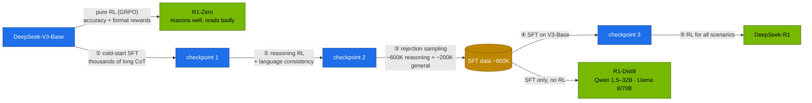
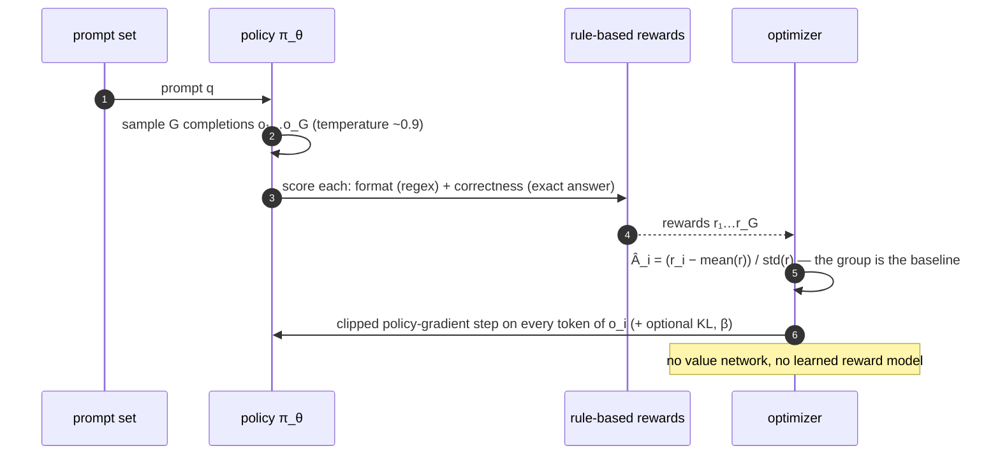

# Chapter 03 · R1 reasoning & GRPO

> **03-DeepSeek · Part I — Architecture · Chapter 03 of 19** · ← [Chapter 02 · FP8 training, FlashMLA & DeepGEMM](02-fp8-training-and-kernels.md) · [All chapters](00-deepseek-step-by-step-guide.md) · [Chapter 04 · Scaling beyond one Spark](04-scaling-beyond-one-spark.md) →

| | |
|---|---|
| **You will build** | A working GRPO loop that teaches a 0.5B model to answer in `<think>…</think><answer>…</answer>` form and get arithmetic right, using only verifiable, rule-based rewards — trained in the root's `batch` namespace inside the training window. You'll also serve an R1 distill with its reasoning separated from the answer, learn the sampling settings R1 models need, and measure what thinking costs in tokens |
| **Hardware** | MacBook (or any CPU) for Tasks 1–2. dgx-spark-1 for Tasks 3–7 (the GRPO run takes 1–2 h on one GPU slice) |
| **Time** | 3–4 h including the training run |
| **Risk** | Low. Training runs in `batch` under Kueue during the training window; serving is parked for that time |
| **Clusters** | none for Tasks 1–2 · `spark-root` (namespace `batch`: Kueue LocalQueue `train` → ClusterQueue `spark-cq`, the `grpo` Job, PVC `deepseek-ckpt`; namespace `llm-serving`: the `vllm` Deployment) for Tasks 3–7 |
| **Lab files** | [`tools/grpo_tiny.py`](lab/tools/grpo_tiny.py), [`tools/eval_harness.py`](lab/tools/eval_harness.py), [`k8s/jobs/grpo.yaml`](lab/k8s/jobs/grpo.yaml), [`k8s/jobs/grpo-vllm.yaml`](lab/k8s/jobs/grpo-vllm.yaml), [`k8s/jobs/train-common.yaml`](lab/k8s/jobs/train-common.yaml), [`k8s/models/r1-7b`](lab/k8s/models/r1-7b/kustomization.yaml), [`k8s/models/qwen2.5-7b-tools`](lab/k8s/models/qwen2.5-7b-tools/kustomization.yaml), [`scripts/breakfix.sh`](lab/scripts/breakfix.sh), [`02-Kubernetes … training-window`](../02-Kubernetes/lab/manifests/root-llms/training-window/kustomization.yaml) |

---

## 1. Why this matters on a Spark

DeepSeek-R1 showed that strong step-by-step reasoning can be grown with **reinforcement learning on checkable rewards**: no human-written reasoning traces, and no learned reward model for maths and code. The algorithm, **GRPO** (Group Relative Policy Optimization, introduced with DeepSeekMath), drops PPO's value network, which makes it cheap enough to run on one Spark at small scale.

The *distilled* R1 models (Qwen 1.5B–32B, Llama 8B/70B) are also the most useful reasoning models a Spark can serve. Serving them well needs a few settings that differ from ordinary chat models, and their thinking tokens cost real decode time on a bandwidth-bound GPU.

---

## 2. Concepts

### 2.1 The R1 pipeline



| Stage | What it adds | Why |
|---|---|---|
| R1-Zero (pure RL from the base model) | long chains of thought, self-verification, "aha" re-checks | shows reasoning can emerge from rewards alone |
| Cold-start SFT | a readable format and a single language | R1-Zero mixed languages and looped |
| Reasoning RL | accuracy on maths, code, logic; a language-consistency reward | the main capability gain |
| Rejection sampling + SFT | ~800K curated samples, reasoning and general | bakes the RL gains into a clean dataset |
| RL for all scenarios | helpfulness and harmlessness rewards next to the rule-based ones | a general assistant, not only a solver |
| Distillation | the same ~800K samples fine-tune smaller Qwen and Llama models | no RL needed for the distills; they are what fits a Spark |

The lab reproduces the shape of this recipe in miniature: SFT for format ([Chapter 10](10-lora-qlora-unsloth-and-llama-factory.md), `sft_lora.py` builds chain-of-thought data for the same task), then GRPO for correctness (this chapter), then scaled-out rollouts ([Chapter 11](11-distributed-training-and-rl.md)).

### 2.2 GRPO



For a prompt q, sample G completions from the current policy and score each with rewards r₁…r_G. Every token of completion i gets the same advantage

`Â_i = (r_i − mean(r₁…r_G)) / std(r₁…r_G)`

and the policy maximises the PPO-style clipped objective

`J(θ) = E[ (1/G) Σ_i (1/|o_i|) Σ_t min( ρ_i,t · Â_i , clip(ρ_i,t, 1−ε, 1+ε) · Â_i ) ] − β · KL(π_θ ‖ π_ref)`

with `ρ_i,t = π_θ(o_i,t | q, o_i,<t) / π_old(o_i,t | q, o_i,<t)`. Completions better than their siblings are pushed up, worse ones down. When every sample gets the same reward, std is 0 and the prompt carries no signal — which is why the prompt mix must be neither too easy nor too hard.

| | PPO (classic RLHF) | **GRPO** |
|---|---|---|
| Baseline for the advantage | a learned value network as large as the policy | **the mean reward of G samples of the same prompt** |
| Reward | a learned reward model | **rules**: exact-match answers, unit tests, format regex |
| Models in memory | policy + reference + value + reward | policy (+ reference if β > 0) |
| Fits one Spark at small scale | hardly | yes |

### 2.3 The lab's task and rewards

| Piece | `grpo_tiny.py` |
|---|---|
| Prompts | generated on the fly: shop totals, GPUs left after draining, checkpoint counts; answers are integers, always computable |
| System prompt | "think step by step inside `<think></think>`, then give only the final number inside `<answer></answer>`" |
| `reward_format` | 1.0 if the whole output matches `^\s*<think>.+?</think>\s*<answer>\s*(-?\d+)\s*</answer>\s*$` |
| `reward_correct` | 2.0 if the number inside `<answer>` equals the ground truth |
| Model | `Qwen/Qwen2.5-0.5B-Instruct` |
| `GRPOConfig` | G = 8 completions per prompt, lr 1e-6, β = 0 (no KL, no reference model), max completion 256 tokens, temperature 0.9, gradient accumulation 4, BF16 |
| `--vllm` | rollouts generated by vLLM inside the trainer process (`vllm_gpu_memory_utilization` 0.2), much faster than HF `generate` |

The reward functions are the whole supervision signal. In real projects most of the work, and most of the reward-hacking risk, lives there.

### 2.4 Serving R1 distills correctly

| Setting | Value | Why |
|---|---|---|
| `--reasoning-parser deepseek_r1` | catalog default for every `r1-*` entry | moves `<think>…</think>` into `message.reasoning_content`; clients see a clean `content` |
| temperature | **0.6** (0.5–0.7) | greedy decoding makes R1 models repeat inside `<think>` until `max_tokens` (drill D06) |
| top_p | 0.95 | DeepSeek's recommendation |
| system prompt | avoid; put instructions in the user turn | recommended for the R1 distills |
| maths prompts | "Please reason step by step, and put your final answer within \boxed{}." | the format the models were trained with |
| `max_tokens` | thousands | chains of thought are long; too low truncates the answer (alert `ReasoningTruncated`, [Chapter 16](16-telemetry.md)) |

---

## 3. Prove it in code

### Task 1 · Rewards first

#### What this lab does (script `lab/tools/grpo_tiny.py --dry-run`)

- **Where:** on the MacBook. No GPU, no TRL, no model download.
- **What it does:** generates four arithmetic prompts (fixed seed) and checks the two reward functions on hand-made completions: a well-formed correct one must score format 1.0 and correctness 2.0, a plain-text one format 0.0.

#### What to look for

1. **Command exit:** 0.
2. **Output:** the three lines shown below: the GPU-drain prompt, `ground truth   : 205`, and `✓ rewards behave: format and correctness are verifiable without a model`. The seed is fixed, so every run prints the same prompt.
3. **Your notes:** the answer to the reward-hacking question below the output (a single space inside `<think>` passes).

**If something's off:** an `AssertionError` instead of the ✓ line → the reward regex in `grpo_tiny.py` was edited; compare it with §2.3. More in §6.

#### Run it

```bash
# ▶ MacBook · 03-DeepSeek/lab
python3 tools/grpo_tiny.py --dry-run
```

```text
example prompt : A cluster has 26 nodes with 8 GPUs each. 3 GPUs are drained for maintenance. How many GPUs are available?
ground truth   : 205
✓ rewards behave: format and correctness are verifiable without a model
```

The dry run needs neither a GPU nor TRL. Read `reward_format` and `reward_correct`, then try to break them: would `<think> </think><answer>205</answer>` pass the format check? (No: `.+?` needs at least one character, but a single space passes. Tightening this is the kind of change that decides whether a run learns to reason or learns to game the regex.)

### Task 2 · The group is the baseline

#### What this lab does (a Python one-liner)

- **Where:** on the MacBook, any folder, standard library only.
- **What it computes:** GRPO's advantages for one group of eight completions: each reward minus the group mean, divided by the group's standard deviation.

#### What to look for

1. **Output:** `mean 1.375 std 1.41` and the eight advantages shown below.
2. **The signs:** the three correct completions (reward 3) are positive at 1.15; format-only (1) slightly negative at −0.27; failures (0) at −0.98.
3. **With eight 3s:** `statistics.stdev` is 0 and the division fails. That is the "no gradient from this group" case TRL guards.

**If something's off:** a `ZeroDivisionError` with all-equal rewards is the expected result of step 3, not a bug.

#### Run it

Compute the advantages GRPO would assign to one group of eight completions with total rewards 3 (format + correct), 1 (format only) or 0:

```bash
# ▶ MacBook · any folder
python3 -c '
import statistics as s
r = [3, 3, 1, 0, 0, 1, 3, 0]
m, sd = s.mean(r), s.stdev(r)
print("mean", m, "std", round(sd, 2)); print([round((x - m) / sd, 2) for x in r])'
```

```text
mean 1.375 std 1.41
[1.15, 1.15, -0.27, -0.98, -0.98, -0.27, 1.15, -0.98]
```

Correct answers are pushed up, format-only answers slightly down, failures firmly down. Change `r` to eight 3s: std becomes 0 and there is nothing to learn from that prompt (TRL guards the division, and the group contributes no gradient).

### Task 3 · Open the training window

#### What this lab does (manifests `02-Kubernetes/lab/manifests/root-llms/training-window`)

- **Parks serving:** pauses the vLLM ScaledObject at 0 replicas. You also scale the other model servers in `llm-serving` (bge-m3, SGLang, any second engine) to 0 by hand.
- **Moves memory from serving to batch** on the root cluster:

  | Object | Everyday | Training window |
  |---|---|---|
  | ResourceQuota `serving-budget` (`llm-serving`) | 8 CPU · 90 Gi | 2 CPU · 10 Gi |
  | ResourceQuota `batch-budget` (`batch`) | 2 CPU · 12 Gi | 8 CPU · 80 Gi |
  | ClusterQueue `spark-cq` nominal quota | 2 CPU · 12Gi | 8 CPU · 80Gi |
- **Not changed:** GPU slices (serving 6, batch 3), the platform's 3 CPU · ~11.7 GiB, and nothing is evicted. A smaller quota only blocks new pods.

#### What to look for

1. **Parking:** `get deploy vllm` shows `READY 0/0` before you apply the window.
2. **`batch-budget`:** `requests.cpu` hard `8`, `requests.memory` and `limits.memory` hard `80Gi`, `requests.nvidia.com/gpu` hard `3`.
3. **`spark-cq`:** the jsonpath output lists `cpu` `"8"`, `memory` `80Gi`, `nvidia.com/gpu` `"3"`.
4. **Nothing else left in `llm-serving`** that holds tens of GiB: `kubectl --context spark-root -n llm-serving get pods`.

**If something's off:** the quotas show the everyday numbers again a few minutes later → Argo CD self-heal; disable it for the window. More in §6.

#### Run it

GRPO with G = 8 doesn't fit the everyday `batch` budget (2 CPU · 12 Gi · 3 slices). The training window parks serving and lends `batch` 8 CPU · 80 Gi of the LLM memory pool:

```bash
# ▶ MacBook · 02-Kubernetes/lab
export KUBECONFIG="$PWD/../../01-Ansible/lab/.cache/kubeconfig-spark-lab.yaml"
kubectl --context spark-root -n llm-serving annotate scaledobject vllm autoscaling.keda.sh/paused-replicas=0 --overwrite
kubectl --context spark-root -n llm-serving get deploy vllm                    # READY 0/0 before you go on
kubectl --context spark-root apply -k manifests/root-llms/training-window
kubectl --context spark-root -n batch describe resourcequota batch-budget | grep -E 'memory|cpu|gpu'
kubectl --context spark-root get clusterqueue spark-cq -o jsonpath='{.spec.resourceGroups[0].flavors[0].resources}'; echo
```

Park other model servers in `llm-serving` too (bge-m3, SGLang, any second engine): a window quota below what is already in use doesn't evict anything, so the memory has to be free on the node.

### Task 4 · Run GRPO on the Spark

#### What this lab does (Job `lab/k8s/jobs/grpo.yaml`)

- **Ships the training code:** `kubectl apply -k .` creates the ConfigMap `deepseek-train` in `batch` with `grpo_tiny.py` and the other training scripts.
- **Creates the checkpoint volume:** PVC `deepseek-ckpt` in `batch`, 90 Gi on `local-nvme-retain` (`train-common.yaml`).
- **Submits Job `grpo`** suspended, in LocalQueue `train`, priority `spark-batch`. Kueue admits it once the window has room. The pod uses the NGC PyTorch image, **4 CPU · 48 Gi** (request = limit) and 1 GPU slice.
- **The run:** installs TRL and PEFT with pip, downloads Qwen2.5-0.5B-Instruct into `/ckpt/hf`, then runs 200 GRPO steps (G = 8, β = 0) and saves to `/ckpt/grpo-tiny`.

#### What to look for

1. **Admission:** `get workloads` shows the `grpo` workload with `ADMITTED` true, and the pod goes `Running`.
2. **Training log** every 5 steps (fill in the table below):

   | Field | Healthy trend |
   |---|---|
   | `rewards/reward_format/mean` | low at step 5, ≈ 1.0 by step 200 |
   | `rewards/reward_correct/mean` | above its step-5 value at the end |
   | `completions/mean_length` | changes as the model learns the format; record it |
3. **Sample completions** (`log_completions`) gain `<think>` and `<answer>` tags.
4. **Finish:** `kubectl --context spark-root -n batch get job grpo` shows `COMPLETIONS 1/1`.

**If something's off:** workload stays `Pending` with `insufficient quota` → the window isn't open (Task 3). Pod `Pending` with `Insufficient memory` → a model server still holds the pool. All rewards stay 0 → the reward is too sparse for this model. More in §6.

#### Run it

```bash
# ▶ MacBook · 03-DeepSeek/lab
export KUBECONFIG="$PWD/../../01-Ansible/lab/.cache/kubeconfig-spark-lab.yaml"
kubectl --context spark-root apply -k .                                   # deepseek-train ConfigMap in batch
kubectl --context spark-root apply -f k8s/jobs/train-common.yaml -f k8s/jobs/grpo.yaml
kubectl --context spark-root -n batch get workloads                       # ADMITTED by spark-cq
kubectl --context spark-root -n batch logs -f job/grpo | grep -E "'(rewards/reward_format/mean|rewards/reward_correct/mean|completions/mean_length)'"
```

The Job is created suspended with the `train` queue label; Kueue admits it whole when the window's quota has room, at priority `spark-batch` (which never preempts serving). Its pod requests 1 slice and sets memory request = limit, within the window's per-pod ceiling of 8 CPU · 80 Gi.

TRL logs a dict every 5 steps. Watch three numbers (record yours):

| Step | `rewards/reward_format/mean` | `rewards/reward_correct/mean` | `completions/mean_length` |
|---|---|---|---|
| 5 | low (≈ 0.0–0.3) | low | |
| 100 | rising towards 1.0 | rising | |
| 200 | ≈ 1.0 | above the step-5 value | |

With `log_completions=True` you also see sample outputs gain `<think>` tags. The checkpoint lands in `/ckpt/grpo-tiny` on the `deepseek-ckpt` PVC (`local-nvme-retain`).

Optional: run `k8s/jobs/grpo-vllm.yaml` (same task, rollouts by a colocated vLLM at util 0.2 inside the 48 Gi pod) and compare step time with the HF-generate run. Generation dominates GRPO step time, which is why [Chapter 11](11-distributed-training-and-rl.md) moves rollouts to a separate engine.

### Task 5 · Close the window

#### What this lab does (manifests `root-llms/10-tenancy` and `20-scheduling`)

- **Puts the everyday numbers back:** re-applying the two base directories resets `serving-budget` to 8 CPU · 90 Gi, `batch-budget` and `spark-cq` to 2 CPU · 12 Gi.
- **Un-pauses** the vLLM ScaledObject, so KEDA brings the chat model back.
- **Not changed:** the `grpo` Job, its pod history and the `deepseek-ckpt` PVC with the checkpoint stay.

#### What to look for

1. **Before:** `get jobs` shows `grpo` complete (`1/1`). Closing the window under a running job leaves it running but over the new quota.
2. **After:** `kubectl --context spark-root -n batch describe resourcequota batch-budget` shows `8`→`2` CPU and `80Gi`→`12Gi` hard values.
3. **Serving:** `kubectl --context spark-root -n llm-serving get deploy vllm` returns to `1/1` within the model's load time.

**If something's off:** vLLM stays `0/0` → the `paused-replicas-` annotate step (with the trailing dash) was skipped. More in §6.

#### Run it

```bash
# ▶ MacBook · 02-Kubernetes/lab
kubectl --context spark-root -n batch get jobs                             # grpo Complete
kubectl --context spark-root apply -k manifests/root-llms/10-tenancy
kubectl --context spark-root apply -k manifests/root-llms/20-scheduling
kubectl --context spark-root -n llm-serving annotate scaledobject vllm autoscaling.keda.sh/paused-replicas-
```

If Argo CD manages these paths ([02-Kubernetes Chapter 28](../02-Kubernetes/28-production-mlops-and-gitops.md)), disable self-heal for the window or it puts the everyday numbers back mid-run.

### Task 6 · Serve an R1 distill properly

#### What this lab does (script `lab/scripts/serve-model.sh r1-7b`)

- **Serves R1-Distill-Qwen-7B** as Deployment `vllm` in `llm-serving`: util **0.20**, **28 Gi** (request = limit), `--max-model-len=32768`, `--reasoning-parser=deepseek_r1`, from `models.yaml`.
- **Sends one maths prompt** with DeepSeek's settings (temperature 0.6, top_p 0.95, no system prompt) through a port-forward and shows only the reasoning length, the answer and the token usage.

#### What to look for

1. **`serve-model.sh`:** `[PASS] answer: 144  (reasoning chars: N)` with N above 0, and `0 failed`.
2. **The curl result:**

   | Field | Healthy value |
   |---|---|
   | `reasoning_chars` | hundreds to thousands |
   | `answer` | contains `\boxed{41}`, no `<think>` text |
   | `usage.completion_tokens` | far more than the visible answer needs |

**If something's off:** `reasoning_chars` is 0 and `<think>` text shows up in `answer` → the reasoning parser is missing (drill D01). More in §6.

#### Run it

```bash
# ▶ MacBook · 03-DeepSeek/lab
scripts/serve-model.sh r1-7b
pkill -f 'port-forward svc/vllm 8000'; kubectl --context spark-root -n llm-serving port-forward svc/vllm 8000 & sleep 2
curl -s localhost:8000/v1/chat/completions -H 'Content-Type: application/json' -d '{
  "model":"r1-7b","temperature":0.6,"top_p":0.95,"max_tokens":4096,
  "messages":[{"role":"user","content":"A cluster has 12 nodes with 4 GPUs each and 7 are drained. How many GPUs are available? Please reason step by step, and put your final answer within \\boxed{}."}]}' \
 | jq '{reasoning_chars: (.choices[0].message.reasoning_content|length), answer: .choices[0].message.content, usage}'
```

Expected: hundreds to thousands of reasoning characters, an answer containing `\boxed{41}`, and `completion_tokens` far larger than the visible answer. You pay for thinking tokens.

### Task 7 · Measure the cost of thinking, then break it

#### What this lab does (`eval_harness.py`, then drill D06 with `lab/scripts/breakfix.sh`)

- **Same eval on two 7B models** with the same base: `r1-7b` and `qwen2.5-7b-tools` (both util 0.20, 28 Gi), math and JSON suites. Writes `results/r1-7b.json` and `results/qwen7b.json` and prints a comparison report.
- **Drill D06:** `breakfix.sh inject D06` changes nothing in the cluster. It prints a harness command at temperature 0 for you to run, then you run the same 5 maths items at 0.6. `breakfix.sh answer D06` prints the explanation.
- Switching models replaces the model in Deployment `vllm`; the last state is `r1-7b`.

#### What to look for

1. **Report:** `r1-7b` has higher maths accuracy, many more output tokens, and a reasoning share above 0.5 on maths; `qwen2.5-7b-tools` has a reasoning share near 0.
2. **JSON suite:** similar accuracy for both, with `r1-7b` slower.
3. **D06:** at temperature 0 some items run all the way to `--max-tokens` 8192 (`finish_reason=length`: the model repeats inside `<think>`), so output tokens and p50 latency jump and maths accuracy drops. At 0.6 they finish normally. The harness prints tokens and latency, not `finish_reason`; check one request with curl if you want to see it.

**If something's off:** `Connection refused` → the port-forward is still bound to the old pod after a model switch; `kill %1` and start it again. More in §6.

#### Run it

R1-Distill-Qwen-7B and Qwen2.5-7B-Instruct share the same base architecture; the difference is R1 distillation.

```bash
# ▶ MacBook · 03-DeepSeek/lab
python3 tools/eval_harness.py --url http://localhost:8000 --model r1-7b --suites math json --out results/r1-7b.json
kill %1
scripts/serve-model.sh qwen2.5-7b-tools
pkill -f 'port-forward svc/vllm 8000'; kubectl --context spark-root -n llm-serving port-forward svc/vllm 8000 & sleep 2
python3 tools/eval_harness.py --url http://localhost:8000 --model qwen2.5-7b-tools --suites math json --out results/qwen7b.json
kill %1
python3 tools/eval_harness.py --report results/r1-7b.json results/qwen7b.json
```

Compare accuracy, `out tok` and `reason%`. Reasoning usually wins on maths and costs many more tokens; on simple extraction (JSON) it can be slower for no gain. That is the routing argument behind LiteLLM's `reasoning` and `reasoning-fast` aliases ([Chapter 12](12-open-webui-and-litellm-gateway.md)).

Then the classic failure:

```bash
# ▶ MacBook · 03-DeepSeek/lab
scripts/serve-model.sh r1-7b
pkill -f 'port-forward svc/vllm 8000'; kubectl --context spark-root -n llm-serving port-forward svc/vllm 8000 & sleep 2
scripts/breakfix.sh inject D06          # prints a harness command at temperature 0 — run it
python3 tools/eval_harness.py --url http://localhost:8000 --model r1-7b --suites math --limit 5 --temperature 0.6 --max-tokens 8192
scripts/breakfix.sh answer D06
kill %1
```

Compare `finish_reason` and completion tokens at temperature 0 and 0.6.

---

## 4. What it means on a Spark

### 4.1 Memory for GRPO in the window

| Piece | Memory (0.5B policy, BF16) | Notes |
|---|---|---|
| policy weights + gradients + Adam | ~8 GiB | 16 bytes per parameter in mixed precision |
| activations for G × 256 tokens | a few GiB | grows with G and `max_completion_length` |
| reference model | 0 | β = 0 in the lab; with β > 0 add one more copy of the weights |
| colocated vLLM (`grpo-vllm`) | util 0.2 ≈ 24 GiB | must fit inside the pod's own memory limit |

A 7B policy with LoRA fits the window too; full fine-tuning of a 7B with GRPO doesn't. [Chapter 10](10-lora-qlora-unsloth-and-llama-factory.md) has the sizing calculator; [Chapter 11](11-distributed-training-and-rl.md) splits rollouts and learner across two Sparks.

### 4.2 Reasoning models in the serving pool

| | Effect on a GB10 | What to do |
|---|---|---|
| long `<think>` chains | decode time dominates; single-stream tok/s matters most | speculative decoding ([Chapter 01](01-deepseek-architecture-mla-moe-mtp.md)), FP8 weights ([Chapter 02](02-fp8-training-and-kernels.md)) |
| `max_tokens` in the thousands | each sequence holds more KV for longer | size `--max-model-len` and concurrency with `model_math.py` ([Chapter 05](05-model-catalog-and-memory-math.md)) |
| gateway timeouts | long answers outlive default proxy timeouts | streaming and generous timeouts in Traefik and LiteLLM ([Chapter 08](08-kubernetes-deployment-storage-and-streaming.md), [Chapter 12](12-open-webui-and-litellm-gateway.md)) |

### 4.3 Scale-out path

| One Spark | Datacenter |
|---|---|
| 0.5B policy, G = 8, synthetic arithmetic | 7B–671B policies, G = 16–64, maths, code and agent tasks with sandboxed verifiers |
| generation and training share one GPU | a rollout fleet (vLLM/SGLang) and a learner fleet (FSDP/Megatron) with weight sync over the network ([Chapter 11](11-distributed-training-and-rl.md)) |
| rule-based rewards | plus process and outcome reward models, unit-test sandboxes, multi-turn tool environments |
| eval harness on a laptop | regression gates in CI before a checkpoint is promoted ([Chapter 19](19-hands-on-workbook.md)) |

---

## 5. Verify

| Check | Expected |
|---|---|
| dry run | `✓ rewards behave` |
| advantages | the snippet prints mean 1.375 and the eight advantages; all-equal rewards give std 0 |
| training window | `batch-budget` shows 8 CPU · 80 Gi; the `grpo` workload is admitted |
| GRPO run | format reward → ~1.0; correctness reward above its step-5 value; checkpoint in `/ckpt/grpo-tiny` |
| window closed | `batch-budget` back to 2 CPU · 12 Gi; the vLLM ScaledObject unpaused |
| R1 serving | non-empty `reasoning_content`, clean `content` with `\boxed{41}` |
| harness | `reasoning_share` > 0.5 for `r1-7b` on maths, ≈ 0 for `qwen2.5-7b-tools` |
| D06 | temperature 0 ends with `finish_reason=length` on some items; 0.6 doesn't |

---

## 6. Troubleshooting

| You see | Cause | Fix |
|---|---|---|
| Workload `Pending`, `couldn't assign flavors … insufficient quota` | the training window isn't open, or something already uses `spark-cq` | Task 3; `kubectl --context spark-root -n batch get workloads` |
| Pod `Pending`, `Insufficient memory` | vLLM or another engine still holds the pool | pause the ScaledObject and park the other servers; check `kubectl --context spark-root describe node dgx-spark-1 \| sed -n '/Allocated resources/,/Events/p'` |
| All rewards 0, no learning | the model never produces the format (reward too sparse) | SFT cold start first ([Chapter 10](10-lora-qlora-unsloth-and-llama-factory.md)), or partial-credit format rewards |
| Reward rises, real accuracy doesn't | reward hacking (e.g. format satisfied with an empty think) | tighten the regex, add length or quality checks, evaluate separately |
| `std(r) = 0`, no gradient | all G samples got the same reward | larger G, higher temperature, a harder or easier prompt mix |
| OOM in GRPO | G × completion length × batch too large | lower `--max-len` or `--group`, or use `grpo-vllm` with its small util |
| R1 answers contain `<think>` text | no reasoning parser (drill D01) | `--reasoning-parser deepseek_r1` via the catalog |
| R1 repeats until `max_tokens` | greedy decoding (drill D06) | temperature 0.6, top_p 0.95 in the client default |
| Quotas snap back during the window | Argo CD self-heal on the tenancy and scheduling apps | disable self-heal for the window |

---

## 7. Checklist

- [ ] I can describe the R1 pipeline from V3-Base to R1 and the distills, and why R1-Zero alone wasn't enough.
- [ ] I can explain GRPO's advantage estimate and why no value network is needed.
- [ ] I opened and closed the training window and ran GRPO under Kueue, and watched format and correctness rewards climb.
- [ ] I serve R1 distills with the reasoning parser and the recommended sampling settings.
- [ ] I measured how many extra tokens reasoning costs on my tasks, and reproduced the temperature-0 loop.
