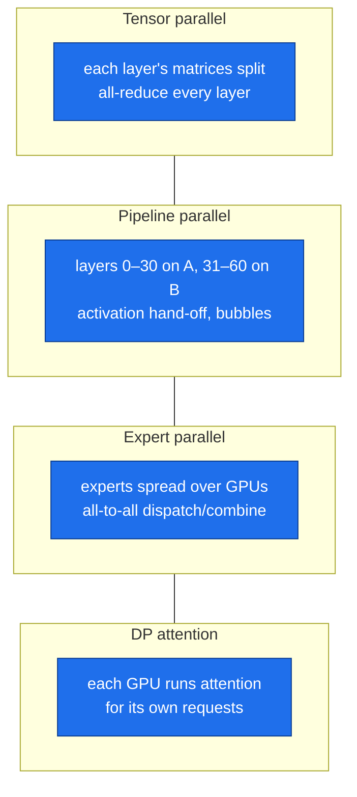
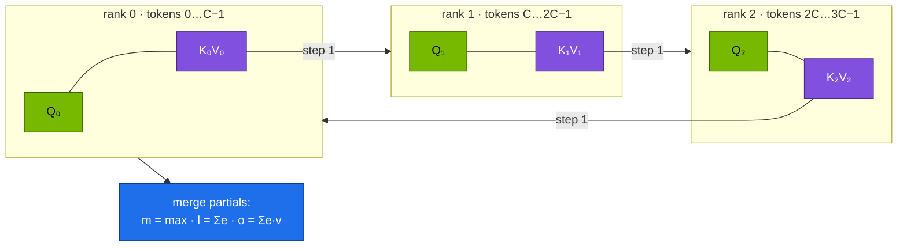
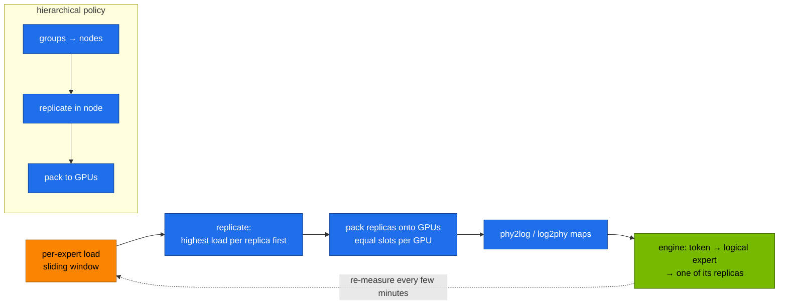
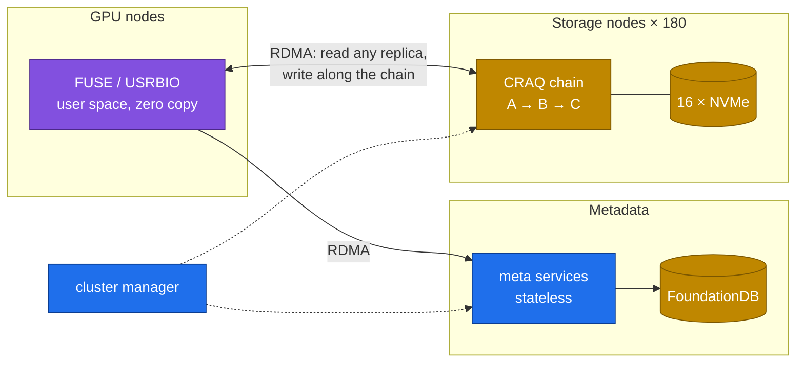

# Chapter 04 · Scaling beyond one Spark: long context, EPLB, 3FS & V3 671B

> **03-DeepSeek · Part I — Architecture · Chapter 04 of 19** · ← [Chapter 03 · R1 reasoning & GRPO](03-r1-reasoning-and-grpo.md) · [All chapters](00-deepseek-step-by-step-guide.md) · [Chapter 05 · Model catalog & memory math](05-model-catalog-and-memory-math.md) →

| | |
|---|---|
| **You will build** | A sizing plan for DeepSeek-V3/R1 671B on any hardware, and the four techniques that make it servable at scale, each proved in code: ring attention (context parallelism) verified against full attention, expert placement with DeepSeek's EPLB fed with router loads from your own Spark, an I/O budget measured on the Spark's NVMe against DeepSeek's 3FS, and a 128K-token window served on one GB10 with a needle test. With two Sparks: ring attention over the CX-7 link, a 70B reasoning model with tensor parallelism (LeaderWorkerSet + Ray + vLLM), and DeepSeek-R1 671B itself at 1.58 bit across both GB10s with llama.cpp RPC |
| **Hardware** | MacBook (or any CPU with PyTorch) for Tasks 1–4. dgx-spark-1 for Tasks 5–6. dgx-spark-2 joined to the root, QSFP cable and the NFS-RDMA model share for Tasks 7–9 |
| **Time** | 2 h on one Spark; +3 h with two Sparks (downloads of ~71 GB and ~131 GB) |
| **Risk** | Low on one Spark. Medium for Tasks 8–9: both Sparks fully loaded, every other LLM workload parked |
| **Clusters** | none for Tasks 1–4 · `spark-root` (namespace `llm-serving`: `vllm`; `platform-tools`: the fio Job) for Tasks 5–6 · `spark-root` with dgx-spark-2 as a worker (namespace `llm-multinode`: LWS group, llama.cpp RPC) for Tasks 8–9 |
| **Lab files** | [`tools/model_math.py`](lab/tools/model_math.py), [`tools/ring_attention_demo.py`](lab/tools/ring_attention_demo.py), [`tools/eplb_sim.py`](lab/tools/eplb_sim.py), [`tools/moe_router_probe.py`](lab/tools/moe_router_probe.py), [`tools/needle_test.py`](lab/tools/needle_test.py), [`k8s/long-context/r1-7b-128k`](lab/k8s/long-context/r1-7b-128k/kustomization.yaml), [`k8s/multinode/`](lab/k8s/multinode/) (`namespace.yaml`, `lws-vllm-70b.yaml`), [`k8s/llamacpp/`](lab/k8s/llamacpp/) (`Dockerfile`, `rpc-2spark.yaml`), [`02-Kubernetes … fio-job.yaml`](../02-Kubernetes/lab/manifests/root/60-storage/fio-job.yaml) |

---

## 1. Why this matters on a Spark

DeepSeek-V3 and R1 have 671B parameters (37B active). Their native FP8 weights alone are ~625 GiB, five times what one Spark holds and more than two. Serving them for real takes four things a single GPU never needs:

| Problem at scale | DeepSeek's answer | What you can do with Sparks |
|---|---|---|
| weights larger than any GPU | tensor, pipeline and expert parallelism; DP attention | size it exactly; run a 70B with TP = 2 and R1 671B at 1.58 bit on two Sparks |
| 128K-token sequences | MLA's small KV; context parallelism for training and long prefills | serve 128K on one GB10; prove ring attention exact on CPU and over CX-7 |
| hot and cold experts across hundreds of GPUs | EPLB: replicate hot experts, pack replicas evenly | simulate placement with your own router loads |
| TiB/s of reads for data, checkpoints and KV reuse | 3FS: a disaggregated, RDMA file system | measure your NVMe in LLM terms and know which problems are cluster-only |

The Spark is a place to learn every one of these techniques with real numbers, and two Sparks run several of them for real.

---

## 2. Concepts

### 2.1 Sizing V3/R1

| Hardware | Memory | V3/R1 FP8 (625 GiB)? | What fits |
|---|---|---|---|
| 1 Spark | ~121.7 GiB (LLM pool ~90 GiB) | no | 32B BF16, 70B FP8 (tight), 16B MoE |
| **2 Sparks** | ~243 GiB | no (FP8) / yes at **1.58-bit GGUF (~131 GB)** | 70B FP8 with TP = 2 and room for KV; R1 671B at very low bit width |
| 8× H200 (141 GB) | 1.1 TB | yes | V3/R1 FP8, TP = 8 + EP |
| 8× B200 (180 GB) | 1.4 TB | yes | V3/R1 FP8/FP4 |
| DeepSeek's production | many nodes | yes | prefill/decode disaggregated, EP32-class prefill and EP144-class decode, data-parallel MLA attention |

The parallelism menu:



| Strategy | Traffic per token | Suits one 200 Gb/s CX-7 link? |
|---|---|---|
| TP = 2 | two all-reduces of the hidden size per layer | acceptable for 70B at modest batch; latency-sensitive |
| PP = 2 | one activation hand-off per micro-batch per stage | yes; lower bandwidth need, pipeline bubbles |
| EP | all-to-all of routed tokens per MoE layer | fine at 2 nodes; the pattern V3 needs at scale |
| llama.cpp RPC | layers offloaded to a remote GGML backend (PP-like) | yes; simple, slow-ish, works for 671B |

Sizing from `model_math.py` (121.7 GiB per Spark):

| Plan | Weights | Verdict |
|---|---|---|
| V3/R1 FP8 on 2 Sparks | 624.9 GiB | no |
| V3/R1 INT4 on 2 Sparks | 312.5 GiB | no |
| V3/R1 IQ1_S (1.58-bit dynamic) on 2 Sparks | ~123 GiB | yes, with llama.cpp (not vLLM), everything else parked |
| R1-Distill-Llama-70B FP8, TP = 2, util 0.60 | 65.7 GiB total (~33 GiB per Spark) | yes, ~244K KV tokens |
| R1-Distill-Llama-70B FP8 on **one** Spark, util 0.70 | 65.7 GiB | yes, alone, ~54K KV tokens |

A worked datacenter example: V3 in FP8 with a 128K context for 32 concurrent users needs 625 GiB of weights plus 32 × 131,072 × 68.6 KiB ≈ 274 GiB of KV, about 900 GiB. One 8×H200 node has ~1.05 TiB of HBM, so one node, just. Without MLA the same KV would be 85× larger.

### 2.2 Long context and context parallelism

Long context costs in two places:

| Phase | Cost grows like | On a GB10 |
|---|---|---|
| **Prefill** (reading the prompt) | attention compute ∝ L² | a 128K prompt is a large one-time compute job; chunked prefill keeps it from blocking other users |
| **Decode** (each new token) | KV memory ∝ L, KV reads ∝ L per token | 128K × 56 KiB = **7 GiB** for one R1-7B sequence; 128K × 256 KiB = **32 GiB** for R1-32B |

When one device can't hold a sequence's activations or KV, **context parallelism** (CP) splits the *sequence* across GPUs. Each GPU keeps a chunk of queries, and the key/value chunks travel around a ring:



At each of W steps a rank attends its queries to the K/V chunk it holds, then passes that chunk on (`isend`/`irecv`), overlapping communication with compute. Partial results combine exactly with the **online softmax** used by FlashAttention: keep a running max `m`, denominator `l` and numerator `o`, and rescale when the max changes. With a causal mask, a rank skips chunks from the future.

| Technique | Splits | Communication | Used for |
|---|---|---|---|
| ring attention / CP | the sequence; K/V passed in a ring | P2P, W − 1 steps | training and prefill of very long inputs |
| Ulysses (sequence parallel) | sequence ↔ heads via all-to-all | 2 all-to-alls per layer | training with many heads |
| chunked prefill (one GPU) | the prompt, over time | none | serving: steady decode latency during long prefills |
| RoPE scaling (YaRN etc.) | — | — | extending a model's trained window |
| sparse attention (V3.2's DSA) | which past tokens each query reads | — | cutting the L² cost of very long contexts |

Long-context settings for the lab's models:

| Model | Native window | KV/token | KV for one full-window sequence | On one Spark |
|---|---|---|---|---|
| R1-Distill-Qwen-7B (util 0.20) | 131,072 | 56 KiB | 7 GiB | yes: `k8s/long-context/r1-7b-128k`, ~134K KV tokens = 1 full-window sequence |
| R1-Distill-Qwen-32B (BF16, util 0.70) | 131,072 | 256 KiB | 32 GiB | no: ~21 GiB of KV left (drill D03); FP8 weights + FP8 KV get closer |
| DeepSeek-V2-Lite (MLA) | 32,768 | 30.4 KiB | ~1 GiB | yes |
| DeepSeek-V3/R1 (MLA) | 131,072 | 68.6 KiB | 8.6 GiB | the weights don't fit |

The 128K overlay sets `--max-model-len 131072`, `--enable-chunked-prefill` and `--max-num-batched-tokens 8192` (the chunk size: smaller means smoother decode latency for others, larger means faster prefill).

### 2.3 EPLB: placing experts so no GPU waits

With expert parallelism, V3's 256 routed experts are spread over dozens to hundreds of GPUs. Every MoE layer waits for the slowest GPU, and real traffic is skewed ([Chapter 01](01-deepseek-architecture-mla-moe-mtp.md) measured ~3× max/mean in V2-Lite's router on four domains). **EPLB** (Expert-Parallelism Load Balancer) fixes placement:

1. **Replicate** hot experts into spare "redundant" slots so their load splits across copies (greedy: always give the next replica to the expert with the highest load *per replica*).
2. **Pack** the replicas onto GPUs so every GPU gets about the same total load (balanced bin packing with equal slots per GPU).
3. Optionally respect topology (**hierarchical** policy): pack expert *groups* onto nodes first, so group-limited routing still bounds cross-node traffic.



| EPLB term | Meaning |
|---|---|
| `weight[layer][expert]` | measured token count per logical expert |
| `num_replicas` | logical experts + redundant slots (must divide evenly by the GPU count) |
| `phy2log[layer][slot]` | which logical expert each physical slot holds |
| `logcnt[layer][expert]` | replica count per expert |

The router bias ([Chapter 01](01-deepseek-architecture-mla-moe-mtp.md)) evens out *routing* during training; EPLB evens out *placement* during serving. Production needs both. vLLM implements EPLB for expert-parallel deployments (`--enable-expert-parallel` with `--enable-eplb` in recent releases), measuring loads online and rebalancing periodically — a datacenter feature, since one GPU has nothing to balance across.

### 2.4 3FS and the I/O side of LLMs

**3FS (Fire-Flyer File System)** is DeepSeek's open-source distributed file system for AI clusters, built on SSDs and RDMA:

| Design choice | Consequence |
|---|---|
| disaggregated: storage nodes full of NVMe, clients anywhere on the RDMA network | aggregate bandwidth scales with storage nodes |
| strong consistency with **CRAQ** (chain replication with apportioned queries) | applications never reason about stale reads |
| **no client page cache**; direct I/O through a user-space shared-memory interface (USRBIO) | predictable, CPU-light random reads for training data |
| stateless metadata services over **FoundationDB** (a transactional key-value store) | metadata scales out independently |

The 3FS README reports about **6.6 TiB/s aggregate read throughput** from 180 storage nodes, each with 2×200 Gb/s InfiniBand and 16×14 TiB NVMe. DeepSeek uses it for training data loading, checkpoints, dataset preparation and an SSD-backed **KVCache** that reuses prompt prefixes across requests and nodes.



The Spark's equivalent is far simpler: ext4 on the 4 TB NVMe behind the `local-nvme` StorageClass (the `model-cache` PVC), and with two Sparks an NFSv4.2-over-RDMA export of `/srv/models` from dgx-spark-1 mounted at `/mnt/models` on dgx-spark-2 ([01-Ansible Chapter 15](../01-Ansible/15-nfs-rdma-and-parallel-file-systems.md)).

The I/O budget:

| Workload | Pattern | Size | What limits it on a Spark | Cluster answer |
|---|---|---|---|---|
| load weights at server start | large sequential reads, once | 15–66 GB | NVMe read bandwidth; page-cache pressure on unified memory | parallel FS, local caches, weight streaming over RDMA |
| save a training checkpoint | large sequential writes | weights + optimizer (3–6× weights) | NVMe write bandwidth; contention with etcd fsyncs | async checkpoints to a parallel FS |
| training data loader | random reads of shards | small to medium | random-read IOPS, CPU decode | 3FS random reads at TiB/s |
| KV-cache spill and reuse | random reads/writes of KV blocks | 30–256 KiB per token per model | on unified memory "offload to CPU" is the **same memory**; only NVMe adds capacity | 3FS KVCache, LMCache, Mooncake: prefix KV on SSD shared across nodes |

Weight load time ≈ `weight_bytes / read_bandwidth`: 66 GB at 5 GB/s is ~13 s from a cold page cache. Real engine start also includes deserialisation, compilation and CUDA-graph capture, which often dominate.

---

## 3. Prove it in code

Tasks 1–4 run on a laptop with PyTorch for CPU (`python3 -m pip install torch`; `model_math.py` and `eplb_sim.py` need only the standard library, `eplb.py` from DeepSeek needs torch).

### Task 1 · Size V3/R1 on paper

#### What this lab does (script `lab/tools/model_math.py`)

- **Where:** on the MacBook, standard library only. Read-only arithmetic.
- **Four sizings:** DeepSeek-V3 in FP8 on two Sparks, V3 at 1.58 bit (IQ1_S) on two Sparks at util 0.92, the R1 70B distill in FP8 with TP = 2, and the same 70B on one Spark at util 0.70.
- **What it prints per run:** weight size, KV per token, the KV budget left at that util, tokens in cache and concurrent sequences, and a ✓/✗ verdict.

#### What to look for

1. **Command exit:** 0 for all four.
2. **Verdicts:**

   | Run | Healthy value |
   |---|---|
   | V3 FP8, 2 Sparks | `✗ does not fit — weights alone need 624.9 GiB > 158.2 GiB` |
   | V3 IQ1_S, util 0.92, 2 Sparks | weights 123.4 GiB, `✓ fits` |
   | 70B FP8, TP = 2, util 0.60 | weights 65.7 GiB, ~243K tokens of KV, `✓ fits` |
   | 70B FP8, 1 Spark, util 0.70 | ~54K tokens of KV (6 sequences at 8K), `✓ fits` |
   | `decode ceiling` of the 70B | ≈ 4 tok/s single stream on either layout |
3. **Your notes:** the number of 8×H200 nodes for 64 users at 128K, worked with §2.1's method.

**If something's off:** `unknown model` → `python3 tools/model_math.py --list` shows the preset names. More in §6.

#### Run it

```bash
# ▶ MacBook · 03-DeepSeek/lab
python3 tools/model_math.py deepseek-v3 --dtype fp8 --sparks 2
python3 tools/model_math.py deepseek-v3 --dtype iq1_s --util 0.92 --sparks 2 --ctx 8192
python3 tools/model_math.py deepseek-r1-distill-llama-70b --dtype fp8 --util 0.60 --sparks 2 --ctx 16384
python3 tools/model_math.py deepseek-r1-distill-llama-70b --dtype fp8 --util 0.70 --ctx 8192
```

The first prints `✗ does not fit — weights alone need 624.9 GiB`. The IQ1_S line fits on paper at util 0.92 across two Sparks; in practice that means every other LLM workload on both nodes is parked (Task 9). Then answer for yourself: how many 8×H200 nodes does V3 FP8 need for 64 users at 128K? (§2.1 has the method.)

### Task 2 · Ring attention equals full attention

#### What this lab does (script `lab/tools/ring_attention_demo.py`)

- **Where:** on the MacBook, PyTorch on CPU with the `gloo` backend. It starts 2 or 4 local processes ("ranks") that talk over localhost ports.
- **What it computes:** attention over 1,024 tokens where each rank holds only its share of K and V and the shares are passed around a ring; rank 0 compares the result with ordinary full attention.
- **The `torchrun` line** runs the same code under the launcher used on real clusters.

#### What to look for

1. **Command exit:** 0 for all three runs (the script asserts the match).
2. **Output:**

   | Line | Healthy value |
   |---|---|
   | `backend=gloo device=cpu` | as shown |
   | `max \|ring - full\|` | about 1e-16, `→ ✓ identical` |
   | `K/V held per rank` | 1/W of the full size (0.2 of 1.0 MiB with 4 ranks) |

**If something's off:** `Address already in use` → a previous run still holds the port; pass another `--port`. More in §6.

#### Run it

```bash
# ▶ MacBook · 03-DeepSeek/lab
python3 tools/ring_attention_demo.py --world 2 --seq 1024
python3 tools/ring_attention_demo.py --world 4 --seq 1024 --port 29544
torchrun --standalone --local_addr 127.0.0.1 --nproc-per-node 2 tools/ring_attention_demo.py --seq 1024   # same code under torchrun, rendezvous on localhost
```

```text
world=4 seq=1024 heads=4 dim=64
backend=gloo device=cpu
max |ring - full| = 4.44e-16  → ✓ identical
K/V held per rank (bf16): 0.2 MiB instead of 1.0 MiB
```

Read `ring_attention`: the four lines that update `m`, `l` and `o` are the whole algorithm. Each rank holds 1/W of the K/V, and the result is exact.

### Task 3 · EPLB on synthetic skew

#### What this lab does (script `lab/tools/eplb_sim.py`, plus DeepSeek's `eplb.py`)

- **Downloads** DeepSeek's EPLB repository to `/tmp/eplb` on the MacBook (a shallow clone).
- **Simulates** placing 256 experts with Zipf-skewed loads on 32 GPUs with 32 spare slots, three ways: naive contiguous, the lab's `eplb-lite` (replicate the hottest, then pack), and DeepSeek's `eplb.py` in hierarchical (4 nodes) and global (`--nodes 1`) mode.
- **The redundancy loop** repeats the lab placement with 0 to 128 spare slots.

#### What to look for

1. **Command exit:** 0 for every run.
2. **Placement results:**

   | Line | Healthy value |
   |---|---|
   | `hottest expert` | `52.9× mean` |
   | `naive contiguous placement` | `6.86` |
   | `eplb-lite` | `1.01`, 10 replicated experts |
   | `DeepSeek eplb.py`, `--nodes 1` | about 1.0 |
   | `DeepSeek eplb.py`, 4 nodes | higher than global |
3. **Redundancy loop:** 6.71 with 0 spare slots, ~1.01 at 32, ~1.00 at 64; returns vanish after the first slots.

**If something's off:** `AssertionError` → experts + redundant isn't a multiple of the GPU count. Upstream import error → PyTorch is missing. More in §6.

#### Run it

```bash
# ▶ MacBook · 03-DeepSeek/lab
git clone --depth 1 https://github.com/deepseek-ai/EPLB /tmp/eplb
python3 tools/eplb_sim.py --upstream /tmp/eplb/eplb.py                 # hierarchical, 4 nodes
python3 tools/eplb_sim.py --upstream /tmp/eplb/eplb.py --nodes 1       # global
```

```text
256 experts on 32 GPUs, 32 redundant slots; hottest expert = 52.9× mean
  naive contiguous placement : max/mean GPU load = 6.86
  eplb-lite (replicate + LPT): max/mean GPU load = 1.01   (replicated experts: 10)
  → step-time gain vs naive ≈ 6.78×
  upstream eplb.py …
```

| Placement (Zipf loads, 256 experts, 32 GPUs, 32 spare slots) | max/mean GPU load |
|---|---|
| naive contiguous (8 experts per GPU) | 6.86 |
| eplb-lite (this lab: replicate + longest-processing-time packing) | 1.01 |
| DeepSeek `eplb.py`, global (`--nodes 1`) | record yours (≈ 1.0) |
| DeepSeek `eplb.py`, hierarchical (4 nodes) | record yours (higher than global) |

The hierarchical result isn't worse engineering. It answers a different question: keep each expert group on one node to bound inter-node all-to-all traffic, and pay some compute balance for it. With a fast intra-node fabric and a slower inter-node one, that trade usually wins.

How much redundancy is enough? `(experts + redundant)` must divide by the GPU count, so step in multiples of 32:

```bash
# ▶ MacBook · 03-DeepSeek/lab
for r in 0 32 64 96 128; do
  printf "redundant=%-4s " $r; python3 tools/eplb_sim.py --redundant $r | grep eplb-lite
done
```

```text
redundant=0    eplb-lite (replicate + LPT): max/mean GPU load = 6.71   (replicated experts: 0)
redundant=32   eplb-lite (replicate + LPT): max/mean GPU load = 1.01   (replicated experts: 10)
redundant=64   eplb-lite (replicate + LPT): max/mean GPU load = 1.00   (replicated experts: 17)
```

Without replicas, packing can't beat the hottest expert (52.9× the mean). The first slots go to the hottest experts and do almost all the work; after that, returns vanish. Each slot costs one expert's weights (~44 MB per V3 expert in FP8) on that GPU.

Then open `/tmp/eplb/eplb.py`, find `replicate_experts` and `balanced_packing`, and compare them with `eplb_lite` in `tools/eplb_sim.py`: the same two-step idea.

### Task 4 · EPLB with real router loads from your Spark

#### What this lab does (script `lab/tools/eplb_sim.py --loads`)

- **Where:** on the MacBook. Reads `results/v2lite-loads.json`, the 64 per-expert loads that the Chapter 01 Task 5 router probe measured on your Spark.
- **What it simulates:** V2-Lite served with expert parallelism over 8 GPUs with 8 spare slots, naive placement vs the lab's and DeepSeek's balancing.

#### What to look for

1. **Command exit:** 0. The first line reads `64 experts on 8 GPUs, 8 redundant slots`.
2. **Results:** a naive `max/mean GPU load` above 1, and balanced placements closer to 1.0. The gain is smaller than the Zipf example of Task 3 (real loads are less skewed). Record both numbers.

**If something's off:** `No such file` → run Chapter 01 Task 5 first. An empty or `[]` file → the `LOADS_JSON:` line wasn't in the Job log when you saved it. More in §6.

#### Run it

[Chapter 01](01-deepseek-architecture-mla-moe-mtp.md) Task 5 saved the per-expert loads of one V2-Lite layer to `results/v2lite-loads.json`. If you haven't run it, run that task first.

```bash
# ▶ MacBook · 03-DeepSeek/lab
python3 tools/eplb_sim.py --experts 64 --gpus 8 --redundant 8 --loads results/v2lite-loads.json \
  --upstream /tmp/eplb/eplb.py --nodes 1
```

This answers a concrete question: if you served V2-Lite with EP = 8 on eight GPUs, how much would placement cost with this traffic mix, and how much do 8 replicas buy back? Record yours. Real loads are far less skewed than the Zipf example, so expect a smaller gain — and remember that placement only pays when the skew is stable over minutes, not batch-to-batch noise.

### Task 5 · 128K on one Spark, and whether the model uses it

#### What this lab does (overlay `lab/k8s/long-context/r1-7b-128k`, script `lab/tools/needle_test.py`)

- **Baseline:** `serve-model.sh r1-7b` caches the weights and serves R1-Distill-Qwen-7B (util 0.20, 28 Gi, 32K context).
- **The overlay** keeps util and pod size the same and changes only the context: `--max-model-len=131072`, chunked prefill, `--max-num-batched-tokens=8192`. One full-length sequence needs about 7 GiB of KV.
- **The needle test** hides a fact at 10 %, 50 % and 90 % depth in prompts of about 4K, 16K, 64K and 120K tokens and asks for it back, measuring time to first token.
- **Afterwards** `serve-model.sh r1-7b` puts the 32K overlay back.

#### What to look for

1. **Rollout:** `successfully rolled out`; the log shows `max_model_len=131072` and a `Maximum concurrency for 131,072 tokens per request` of about 1×. At the catalog's util 0.20, `model_math.py` predicts ~7.2 GiB of KV, ~134K tokens: one full-length sequence with little margin.
2. **Needle table:** one row per length and depth, `✓` or `✗`, and a final `N/12 needles found`.
3. **Shape:** TTFT grows faster than linearly with length; misses, if any, cluster at the longest prompts and the middle depth.

**If something's off:** vLLM fails with `max_model_len … larger than the maximum number of tokens that can be stored in KV cache` → something else is using the pool; check the util sum. More in §6.

#### Run it

```bash
# ▶ MacBook · 03-DeepSeek/lab
export KUBECONFIG="$PWD/../../01-Ansible/lab/.cache/kubeconfig-spark-lab.yaml"
scripts/serve-model.sh r1-7b                          # cache the weights, baseline
kubectl --context spark-root apply -k k8s/long-context/r1-7b-128k
kubectl --context spark-root -n llm-serving rollout status deploy/vllm --timeout=30m
kubectl --context spark-root -n llm-serving logs deploy/vllm | grep -E 'max_model_len|Maximum concurrency|KV cache size'
python3 tools/model_math.py deepseek-r1-distill-qwen-7b --util 0.20 --ctx 131072
```

vLLM logs the maximum concurrency at 131,072 tokens per request; `model_math.py` predicts one sequence (~134K tokens of KV). Now check that the model really uses the window:

```bash
# ▶ MacBook · 03-DeepSeek/lab
pkill -f 'port-forward svc/vllm 8000'; kubectl --context spark-root -n llm-serving port-forward svc/vllm 8000 & sleep 2
python3 tools/needle_test.py --url http://localhost:8000 --model r1-7b \
  --lengths 4000 16000 64000 120000 --depths 0.1 0.5 0.9
kill %1
```

| tokens ≈ | depth 0.1 | 0.5 | 0.9 | TTFT at 0.5 |
|---|---|---|---|---|
| 4K | | | | |
| 16K | | | | |
| 64K | | | | |
| 120K | | | | |

Expect TTFT to grow faster than linearly and hit rates to drop at the longest lengths or middle depths ("lost in the middle"). That's the data you need before telling users to paste a whole document instead of using retrieval ([Chapter 13](13-rag-with-qdrant-and-bge.md)). Put the plain overlay back with `scripts/serve-model.sh r1-7b`.

### Task 6 · Your NVMe in LLM terms

#### What this lab does (Job `02-Kubernetes/lab/manifests/root/60-storage/fio-job.yaml`, then a cold and a warm vLLM start)

- **fio:** creates a 64 Gi `local-nvme` PVC and a Job `fio-ai` in `platform-tools`, which runs four 45-second profiles on a 16 GB file: sequential 1M read and write, random 128k read, random 4k read.
- **Cold vs warm load:** `serve-model.sh r1-7b` serves the 32K overlay. You then drop the page cache on dgx-spark-1, so the next `rollout restart` reads the weights from NVMe (cold); a second `rollout restart` finds them in the page cache (warm). `serve-model.sh` can't drop the Spark's page cache from the MacBook.
- **Clean-up:** deleting the fio manifest removes the Job and its scratch PVC.

#### What to look for

1. **fio:** four `READ:` / `WRITE:` summary lines with bandwidth; sequential read is the number you use for weight-load predictions. Fill in the table.
2. **vLLM logs:** `Loading weights took …` is shorter on the warm start than the cold one; the cold time is close to 15 GB ÷ your sequential read speed.
3. **Engine init:** total init stays much longer than weight loading on both starts (compilation and CUDA graphs).

**If something's off:** warm load not faster → page cache was evicted under memory pressure; check `free -g` on dgx-spark-1. Cold much slower than fio predicts → check the pod's CPU limit. More in §6.

#### Run it

```bash
# ▶ MacBook · 02-Kubernetes/lab
kubectl --context spark-root apply -f manifests/root/60-storage/fio-job.yaml
kubectl --context spark-root -n platform-tools logs -f job/fio-ai | grep -E '^\S+:|READ:|WRITE:'
```

| fio profile | Stands for | GB/s or IOPS (yours) |
|---|---|---|
| `weights-seqread-1m` | loading weights | |
| `checkpoint-seqwrite-1m` | saving a checkpoint | |
| `dataloader-randread-128k` | shuffled training shards | |
| `small-randread-4k` | KV blocks, metadata | |

Cold vs warm weight load. Serve the 32K overlay, then drop the page cache on the Spark so the next start reads from NVMe:

```bash
# ▶ MacBook · 03-DeepSeek/lab
scripts/serve-model.sh r1-7b
```

```bash
# ▶ dgx-spark-1 (ssh dgx-spark-1)
sudo sh -c 'sync; echo 3 > /proc/sys/vm/drop_caches'
```

```bash
# ▶ MacBook · 03-DeepSeek/lab
kubectl --context spark-root -n llm-serving rollout restart deploy/vllm                 # cold
kubectl --context spark-root -n llm-serving rollout status deploy/vllm --timeout=20m
kubectl --context spark-root -n llm-serving logs deploy/vllm | grep -E 'Loading weights took|Model loading took|init engine'
kubectl --context spark-root -n llm-serving rollout restart deploy/vllm                 # warm
kubectl --context spark-root -n llm-serving rollout status deploy/vllm --timeout=20m
kubectl --context spark-root -n llm-serving logs deploy/vllm | grep -E 'Loading weights took|Model loading took|init engine'
```

| | Cold | Warm (page cache) | Predicted (15 GB ÷ fio seq read) |
|---|---|---|---|
| `Loading weights took` | | | |
| total engine init | | | — |

The gap between "loading weights" and "engine init" is compilation and CUDA-graph capture; storage can't fix that part. Clean up with `kubectl --context spark-root delete -f manifests/root/60-storage/fio-job.yaml` from `02-Kubernetes/lab`.

**The unified-memory twist on KV offload.** Many engines can offload KV to "CPU memory". On a GB10 that is the same LPDDR5x pool, so it frees nothing; only NVMe adds capacity, at NVMe latency. Work out the read time for one 16K-token R1-32B prefix (16,384 × 256 KiB = 4 GiB) at your measured sequential read speed, and compare it with the TTFT of a 16K prompt from Task 5. That tells you when SSD-backed prefix reuse (LMCache's disk backend) would pay off on your box.

### Task 7 · (2 Sparks) Ring attention over the CX-7 link

#### What this lab does (script `lab/tools/ring_attention_demo.py` on two hosts)

- **Needs two Sparks.** With only dgx-spark-1, skip this task; Task 2 already proved the algorithm.
- **Copies the tool** to `~/ds-tools` on both Sparks and runs one rank per Spark in the NGC PyTorch container (`docker run` directly on the hosts, not in Kubernetes), with the NCCL backend over RoCE on the CX-7 port (`enp1s0f1np1`, 192.168.100.11 and .12).
- **What it computes:** ring attention over 16,384 tokens with half the K/V on each GB10; rank 0 also computes full attention as the reference.

#### What to look for

1. **Rank 0 output:** `backend=nccl device=cuda`, `max |ring - full|` below 1e-4 with `✓ identical`, and K/V per rank half the full size.
2. **NCCL log on rank 0:** `NCCL INFO NET/IB : Using … RoCE`, not a socket fallback.
3. **Both containers** exit 0 and are removed (`--rm`).

**If something's off:** both ranks hang → NCCL can't connect: check IFNAME, HCA, GID index and MTU. Out of memory on rank 0 → lower `--seq`; the full-attention reference is what fills memory. More in §6.

#### Run it

Preconditions: 01-Ansible `13.1-fabric.yml` and `13.2-rdma-perftest.yml` (≥ 180 Gb/s) passed, so dgx-spark-1 is 192.168.100.11 and dgx-spark-2 is 192.168.100.12 on the fabric. Copy the tool to both hosts:

```bash
# ▶ MacBook · 03-DeepSeek/lab
for h in dgx-spark-1 dgx-spark-2; do ssh $h 'mkdir -p ~/ds-tools' && scp tools/ring_attention_demo.py $h:ds-tools/; done
```

Then start one rank on each Spark, in the NGC PyTorch image pinned in `lab/versions.env`:

```bash
# ▶ dgx-spark-1 (ssh dgx-spark-1)
docker run --rm --gpus all --network host --ipc host --ulimit memlock=-1 --device /dev/infiniband \
  -e NCCL_SOCKET_IFNAME=enp1s0f1np1 -e GLOO_SOCKET_IFNAME=enp1s0f1np1 \
  -e NCCL_IB_HCA=rocep1s0f1,roceP2p1s0f1 -e NCCL_IB_GID_INDEX=3 -e NCCL_DEBUG=INFO \
  -v "$HOME/ds-tools:/tools:ro" nvcr.io/nvidia/pytorch:25.09-py3 \
  torchrun --nnodes 2 --node-rank 0 --nproc-per-node 1 --master-addr 192.168.100.11 --master-port 29500 \
  /tools/ring_attention_demo.py --backend nccl --seq 16384 --heads 8 --dim 128
```

```bash
# ▶ dgx-spark-2 (ssh dgx-spark-2)
docker run --rm --gpus all --network host --ipc host --ulimit memlock=-1 --device /dev/infiniband \
  -e NCCL_SOCKET_IFNAME=enp1s0f1np1 -e GLOO_SOCKET_IFNAME=enp1s0f1np1 \
  -e NCCL_IB_HCA=rocep1s0f1,roceP2p1s0f1 -e NCCL_IB_GID_INDEX=3 \
  -v "$HOME/ds-tools:/tools:ro" nvcr.io/nvidia/pytorch:25.09-py3 \
  torchrun --nnodes 2 --node-rank 1 --nproc-per-node 1 --master-addr 192.168.100.11 --master-port 29500 \
  /tools/ring_attention_demo.py --backend nccl --seq 16384 --heads 8 --dim 128
```

Each GB10 holds half the K/V, and the chunks travel over RDMA (`NCCL INFO NET/IB : Using … RoCE` on rank 0). Agreement is checked in FP32 with a tolerance of 1e-4. Keep `--seq` modest: rank 0 also computes the full-attention reference on one GPU to check the answer, and that reference is what runs out of memory first.

### Task 8 · (2 Sparks) A 70B with tensor parallelism

#### What this lab does (LeaderWorkerSet `lab/k8s/multinode/lws-vllm-70b.yaml`)

- **Needs two Sparks**, both joined to the root cluster, and the NFS-RDMA share. With only dgx-spark-1, skip it.
- **Installs LeaderWorkerSet** v0.7.0 and creates namespace `llm-multinode` (privileged Pod Security, for `hostNetwork`).
- **Downloads** DeepSeek-R1-Distill-Llama-70B in FP8 (~71 GB) once into `/srv/models/hf` on dgx-spark-1, shared to dgx-spark-2 as `/mnt/models`.
- **Starts a group of two vLLM pods**, one per Spark, each with **8 CPU · 80 Gi** (request = limit) and one GPU slice: TP = 2 over Ray and NCCL on the CX-7 link, util 0.60, 16K context, R1 reasoning parser, API on 192.168.100.11:8000.
- **Parks serving** first: the vLLM ScaledObject on the root is paused at 0. Everything else that uses the LLM pool on either Spark must be parked by you too.

#### What to look for

1. **Nodes:** `get nodes` lists `dgx-spark-1` and `dgx-spark-2` as `Ready`; `mount | grep /mnt/models` on dgx-spark-2 shows the NFS mount.
2. **Pods:** `vllm-70b-0` on dgx-spark-1 and `vllm-70b-0-1` on dgx-spark-2, both `Running`.
3. **Leader log:** NCCL `NET/IB` / `Using network IB`, `tensor_parallel_size=2`, and finally `Application startup complete`.
4. **API:** `/v1/models` on 192.168.100.11:8000 lists the model. Record tok/s at concurrency 1 and 16.
5. **Clean-up:** the LWS is deleted before Task 9.

**If something's off:** a pod `Pending` with `Insufficient memory` → something still holds that node's pool. Leader waits forever → the worker can't reach the Ray head on 6379. More in §6.

#### Run it

Preconditions: dgx-spark-2 joined the root as a worker ([02-Kubernetes Chapter 05](../02-Kubernetes/05-dgx-spark-datacenter-simulation-lab.md) §9), the NFS-RDMA share is mounted (01-Ansible `15.1-nfs-rdma.yml`), and every LLM workload on **both** Sparks is parked: each LWS pod holds 80 Gi (request = limit), nearly the whole LLM pool of its node.

```bash
# ▶ MacBook · 03-DeepSeek/lab
kubectl --context spark-root get nodes -o wide                                     # dgx-spark-1 + dgx-spark-2 Ready
kubectl --context spark-root -n llm-serving annotate scaledobject vllm autoscaling.keda.sh/paused-replicas=0 --overwrite
kubectl --context spark-root apply --server-side -f https://github.com/kubernetes-sigs/lws/releases/download/v0.7.0/manifests.yaml
kubectl --context spark-root apply -f k8s/multinode/namespace.yaml
ssh dgx-spark-2 'mount | grep /mnt/models'
```

The LWS release matches `LWS_VERSION` in `lab/versions.env`. Download the weights once into the shared export (public model, no token needed):

```bash
# ▶ dgx-spark-1 (ssh dgx-spark-1)
python3 -m pip install --user "huggingface_hub[cli]"
~/.local/bin/hf download RedHatAI/DeepSeek-R1-Distill-Llama-70B-FP8-dynamic --cache-dir /srv/models/hf
```

```bash
# ▶ MacBook · 03-DeepSeek/lab
kubectl --context spark-root apply -f k8s/multinode/lws-vllm-70b.yaml
kubectl --context spark-root -n llm-multinode get pods -o wide -w        # vllm-70b-0 on dgx-spark-1, vllm-70b-0-1 on dgx-spark-2 · Ctrl-C to stop
kubectl --context spark-root -n llm-multinode logs -f vllm-70b-0 | grep -E 'NCCL INFO (NET/IB|Using network)|tensor_parallel|API server|startup complete|Uvicorn'
```

| `lws-vllm-70b.yaml` | Setting |
|---|---|
| group | `size: 2`, `RecreateGroupOnPodRestart`: if either pod dies both restart (TP ranks can't survive alone) |
| network | `hostNetwork: true`, `NCCL_SOCKET_IFNAME=enp1s0f1np1`, `NCCL_IB_HCA=rocep1s0f1,roceP2p1s0f1`, GID index 3, `IPC_LOCK` |
| Ray | head on 192.168.100.11; the worker joins over the CX-7; vLLM `--distributed-executor-backend ray` |
| model | `--tensor-parallel-size 2`, util 0.60, 16K context, `--reasoning-parser deepseek_r1` |
| weights | `/srv/models` on dgx-spark-1, `/mnt/models` on dgx-spark-2 (same files) |

Query it from dgx-spark-1 and measure:

```bash
# ▶ dgx-spark-1 (ssh dgx-spark-1)
curl -s 192.168.100.11:8000/v1/models | jq -r '.data[].id'
```

Run the eval harness against `http://192.168.100.11:8000` (port-forward or from a host on the fabric) at concurrency 1 and 16 and record tokens/s. Compare with the same model on one Spark (util 0.70, 8K context, everything else parked): TP buys KV capacity (§2.1: ~244K vs ~54K tokens) and costs per-token communication. Remove it with `kubectl --context spark-root delete -f k8s/multinode/lws-vllm-70b.yaml` before Task 9.

### Task 9 · (2 Sparks) DeepSeek-R1 671B at 1.58 bit

#### What this lab does (manifests `lab/k8s/llamacpp/rpc-2spark.yaml`)

- **Needs two Sparks.** With only dgx-spark-1 you can't hold the 671B model; skip it.
- **Builds the llama.cpp image** `spark-local/llama.cpp:server-sm121` on both Sparks from `k8s/llamacpp/Dockerfile` and imports it into each node's containerd (namespace `k8s.io`).
- **Downloads** the dynamic 1.58-bit GGUF of DeepSeek-R1 (~131 GB, three shards) into `/srv/models/gguf` on dgx-spark-1. Long: plan for the download.
- **Starts two Deployments** in `llm-multinode`: `llama-rpc-worker` on dgx-spark-2 (`rpc-server` on 192.168.100.12:50052) and `llama-r1-671b` on dgx-spark-1 (`llama-server` on port 8081, alias `r1-671b-iq1`, metrics on). Each pod holds **88 Gi** (request = limit), the whole LLM pool of its Spark.
- **Clean-up:** deleting the manifest and un-pausing the vLLM ScaledObject brings normal serving back.

#### What to look for

1. **Image import:** `ctr -n k8s.io images import` ends without error on both Sparks.
2. **Server log:** the RPC device is found, layers are `offloaded` to CUDA0 and the RPC device, and `server is listening` appears. The startup probe allows up to 30 minutes.
3. **Answer:** the curl returns a coherent answer to 17 × 23 (391).
4. **Metrics:** prompt and generation tokens per second; single-digit generation speed is expected.

**If something's off:** `ErrImageNeverPull` → the image wasn't imported on that node. `failed to connect to RPC server` → the worker isn't listening on 192.168.100.12:50052. Below 1 tok/s → weights paged from NFS because memory is short. More in §6.

#### Run it

Build the llama.cpp image for sm_121 with RPC support on **both** Sparks and import it into the kubeadm node's containerd:

```bash
# ▶ MacBook · 03-DeepSeek/lab
for h in dgx-spark-1 dgx-spark-2; do ssh $h 'mkdir -p ~/llamacpp' && scp k8s/llamacpp/Dockerfile $h:llamacpp/; done
```

```bash
# ▶ dgx-spark-1 (ssh dgx-spark-1)
cd ~/llamacpp && docker build -t spark-local/llama.cpp:server-sm121 .
docker save spark-local/llama.cpp:server-sm121 | sudo ctr -n k8s.io images import -
```

```bash
# ▶ dgx-spark-2 (ssh dgx-spark-2)
cd ~/llamacpp && docker build -t spark-local/llama.cpp:server-sm121 .
docker save spark-local/llama.cpp:server-sm121 | sudo ctr -n k8s.io images import -
```

Fetch the dynamic 1.58-bit GGUF (~131 GB in three shards) into the share:

```bash
# ▶ dgx-spark-1 (ssh dgx-spark-1)
sudo mkdir -p /srv/models/gguf && sudo chown "$USER" /srv/models/gguf
~/.local/bin/hf download unsloth/DeepSeek-R1-GGUF --include "DeepSeek-R1-UD-IQ1_S/*" --local-dir /srv/models/gguf
```

Run it — `rpc-server` on dgx-spark-2 lends its GB10 as a remote GGML backend, `llama-server` on dgx-spark-1 splits the layers across both:

```bash
# ▶ MacBook · 03-DeepSeek/lab
kubectl --context spark-root apply -f k8s/llamacpp/rpc-2spark.yaml
kubectl --context spark-root -n llm-multinode logs -f deploy/llama-r1-671b | grep -E 'RPC|offloaded|model size|server is listening'
```

```bash
# ▶ dgx-spark-1 (ssh dgx-spark-1)
curl -s 192.168.100.11:8081/v1/chat/completions -H 'Content-Type: application/json' \
  -d '{"model":"r1-671b-iq1","messages":[{"role":"user","content":"What is 17*23? Think briefly."}],"max_tokens":512}' \
  | jq -r '.choices[0].message.content' | tail -3
curl -s 192.168.100.11:8081/metrics | grep -E 'tokens_predicted_seconds|prompt_tokens_seconds'
```

Record prompt and generation tokens per second. Expect single-digit generation speed: this is the real 671B R1 on desk-side hardware, not a production server. Use it to compare answer quality with the distills on a handful of hard maths items, then free both Sparks:

```bash
# ▶ MacBook · 03-DeepSeek/lab
kubectl --context spark-root delete -f k8s/llamacpp/rpc-2spark.yaml
kubectl --context spark-root -n llm-serving annotate scaledobject vllm autoscaling.keda.sh/paused-replicas-
```

---

## 4. What it means on a Spark

### 4.1 What you can and can't do

| Technique | One Spark | Two Sparks | Only in a cluster |
|---|---|---|---|
| tensor / pipeline parallel | — | TP = 2 or PP = 2 over one 200 Gb/s link | TP inside NVLink domains, PP/EP across nodes |
| expert parallel + EPLB | simulation with real router loads | EP = 2 (nothing to balance yet) | EP over hundreds of GPUs, online rebalancing |
| long context | 128K for a 7B with chunked prefill | ring attention for prefill across two GPUs | 1M-token contexts: CP over 8–64 GPUs, Ulysses + ring hybrids, sparse attention |
| storage | local NVMe, page cache | NFS over RDMA, one copy of the weights | 3FS / Weka / VAST / Lustre, GPUDirect Storage, SSD-backed KV pools |
| V3/R1 671B | no | 1.58-bit GGUF with llama.cpp RPC | FP8 with vLLM/SGLang, EP + DP attention + MTP + PD disaggregation |

### 4.2 Integrations

- [01-Ansible Chapter 13](../01-Ansible/13-connectx7-fabric-and-opensm.md) (`13.1-fabric.yml`, `13.2-rdma-perftest.yml`), [Chapter 14](../01-Ansible/14-rocev2-qos-and-nccl.md) and [Chapter 15](../01-Ansible/15-nfs-rdma-and-parallel-file-systems.md) (`15.1-nfs-rdma.yml`) build the fabric and the weights share.
- [02-Kubernetes Chapter 18](../02-Kubernetes/18-distributed-ai-training-and-nccl.md): the NCCL environment and the bandwidth you should see; [Chapter 13](../02-Kubernetes/13-storage-csi-and-high-performance-volumes.md): the fio profiles; [Chapter 23](../02-Kubernetes/23-disaggregated-prefill-and-decode-serving.md): moving KV between engines.
- [Chapter 08](08-kubernetes-deployment-storage-and-streaming.md) caches weights on NVMe so restarts never touch the internet; [Chapter 15](15-automation-secrets-and-day2.md) verifies the cached bytes.
- [Chapter 12](12-open-webui-and-litellm-gateway.md): add `r1-70b` and `r1-671b-iq1` as LiteLLM aliases while they run.
- [08-Storage](../08-Storage/README.md) covers parallel file systems, GPUDirect Storage and checkpoint engines in depth.

### 4.3 Scale-out path

| Here | Datacenter |
|---|---|
| ring over one CX-7 link | rings inside NVLink domains, hierarchical across InfiniBand rails |
| offline EPLB simulation from one probe | per-layer load counters online; rebalancing every few minutes without dropping requests; redundant experts per GPU |
| page-cache weight loads, no KV reuse across restarts | direct I/O, weight streaming, SSD-backed KV caches shared across a fleet |
| an LWS group of 2 | an LWS group per replica, many replicas behind an inference gateway |
| llama.cpp RPC for 671B | vLLM/SGLang on 8×H200/B200 nodes with EP, DP attention and MTP |

---

## 5. Verify

| Check | Expected |
|---|---|
| sizing | V3 FP8 on 2 Sparks `✗`; IQ1_S `✓` at util 0.92; 70B FP8 TP = 2 `✓` |
| ring vs full (CPU) | `✓ identical` for world 2 and 4 and under torchrun |
| EPLB | naive vs balanced ≥ 3× on Zipf loads; global upstream ≈ eplb-lite ≈ 1.0; hierarchical higher, and you can explain why |
| EPLB on V2-Lite loads | a recorded max/mean before and after placement |
| 128K | vLLM starts with `max_model_len=131072`; a needle table with TTFT per length |
| fio and loads | four fio numbers; warm weight load faster than cold; engine init dominated by non-I/O work |
| ring over CX-7 | `✓ identical`, NCCL log shows `NET/IB` |
| 70B TP = 2 | two pods on two nodes; `Using network IB`; `/v1/models` lists the model |
| 671B RPC | layers offloaded to CUDA0 and the RPC device; a coherent answer |

---

## 6. Troubleshooting

| You see | Cause | Fix |
|---|---|---|
| `AssertionError` in `eplb_sim.py` | experts + redundant not divisible by GPUs | choose `--redundant` so `(experts + redundant) % gpus == 0` |
| upstream `eplb.py` import error | it needs torch | install PyTorch for CPU |
| `torchrun` on a laptop hangs 5–10 min, then `DistNetworkError … timed out … 1.0.0…0.ip6.arpa` | torchrun's rendezvous uses the machine's FQDN; macOS (often behind a home router's DNS) can resolve it to an unreachable reverse-DNS name | `--standalone --local_addr 127.0.0.1` (as in §5), or give the Mac a plain name: `sudo scutil --set HostName <name>` |
| rebalancing helps little | loads nearly uniform, or the skew is batch-to-batch noise | measure over longer windows; placement needs stable skew |
| `ValueError: … max_model_len … larger than the maximum number of tokens that can be stored in KV cache` | window × KV per token > budget (drill D03) | lower `--max-model-len`, FP8 KV, a smaller model, or more util within the 0.72 rule |
| other users' tokens stall during a long prompt | prefill hogs the GPU | chunked prefill; smaller `--max-num-batched-tokens` |
| the model ignores mid-document facts | position effects ("lost in the middle") | retrieval instead of one giant prompt; key facts near the start or end |
| cold load much slower than fio predicts | many small files, CPU-side deserialisation, CPU limit of the pod | prefer safetensors and larger shards; check the pod's CPU request/limit |
| warm load not faster | page cache evicted under memory pressure | `free -g` on dgx-spark-1; `scripts/uma-watch.sh` in 02-Kubernetes/lab |
| ring demo or TP hangs across two Sparks | NCCL can't connect | IFNAME, HCA, GID, MTU: the checklist in [02-Kubernetes Chapter 18](../02-Kubernetes/18-distributed-ai-training-and-nccl.md) §7 |
| NCCL falls back to sockets | RDMA devices or `IPC_LOCK` missing | `hostNetwork` and `/dev/infiniband` in the pod or container; `ibv_devices` |
| LWS leader waits forever for the second GPU | the worker can't reach the Ray head on 6379 | worker log; both pods on `hostNetwork`; host firewall |
| a pod `Pending`, `Insufficient memory` on either node | something else still holds that node's LLM pool | park serving, apps and batch on both Sparks |
| worker OOM while loading | each rank loads its shard plus temporary buffers | lower util; drop the page cache on both Sparks |
| `PodSecurity … hostNetwork` rejected | applied into `llm-serving` (baseline PSA) | use `llm-multinode` (privileged PSA) |
| `ErrImageNeverPull` for `spark-local/llama.cpp` | image not imported on that node | `docker save … \| sudo ctr -n k8s.io images import -` on both Sparks |
| llama.cpp: `failed to connect to RPC server` | `rpc-server` not listening on the CX-7 address | worker pod on dgx-spark-2; port 50052 reachable on 192.168.100.12 |
| llama.cpp below 1 tok/s | weights paged from NFS instead of resident | free memory on both Sparks; watch `free -g` during load |

---

## 7. Checklist

- [ ] I can size V3/R1 for any GPU and format, including KV for a target context and user count.
- [ ] I can explain TP, PP, EP and DP attention and what each sends over the network.
- [ ] I can derive the online-softmax merge and explain why ring attention is exact.
- [ ] I served a 128K window on one Spark, know its KV cost per sequence, and measured where recall breaks down.
- [ ] I can explain replicate-then-pack, the hierarchical trade-off, and ran EPLB on real router loads.
- [ ] I can describe 3FS (CRAQ chains, FoundationDB metadata, RDMA clients, no page cache), measured my NVMe in LLM terms, and know why CPU offload of KV does nothing on a GB10.
- [ ] (2 Sparks) I ran ring attention over CX-7, a 70B with TP = 2, and DeepSeek-R1 671B itself across two GB10s.
