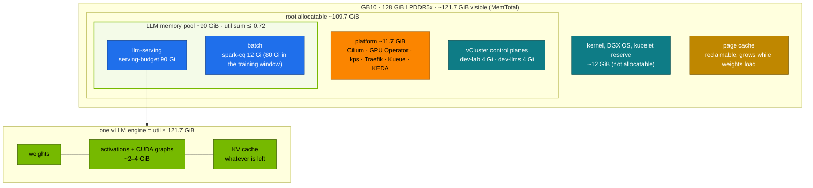
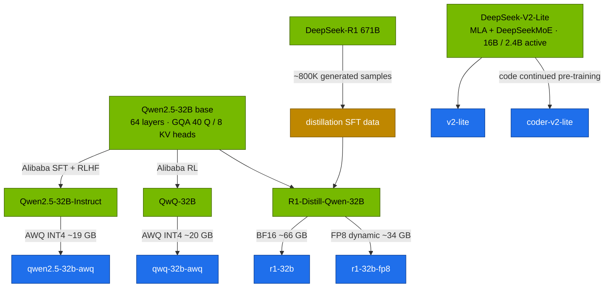

# Chapter 05 · Model Catalog & Memory Math on GB10

> **03-DeepSeek · Part II — Models on a Spark · Chapter 05 of 19** · ← [Chapter 04 · Scaling beyond one Spark](04-scaling-beyond-one-spark.md) · [All chapters](00-deepseek-step-by-step-guide.md) · [Chapter 06 · Serving DeepSeek with vLLM](06-vllm-serving.md) →

| | |
|---|---|
| **You will build** | A repeatable method, and a tool, that turns any model's `config.json` into weight memory, KV bytes per token, a `--gpu-memory-utilization` value, a pod memory size and a concurrency estimate — checked against what vLLM and the host report. With it you read the lab's model catalog, decide which models can run side by side in the ~90 GiB LLM memory pool, compare the two 32B models (R1-Distill-Qwen-32B and Qwen2.5-32B-Instruct) and the 16B MoE coder (DeepSeek-Coder-V2-Lite) on the same tests |
| **Hardware** | Any laptop for §5.1–5.2 (CPU only). dgx-spark-1 for §5.3–5.6 |
| **Time** | 2.5 h (mostly downloads and evaluation runs) |
| **Risk** | Low. The code suite executes model-written Python; it runs in a sandboxed Job, never on your laptop. The BF16 32B (Task 5.5, optional) uses most of the pool and needs everything else parked |
| **Clusters** | `spark-root` (namespace `llm-serving`: the vLLM Deployment, the eval Job, the `serving-budget` quota) · optionally `dev-llms` (try a tiny model in `llm-sandbox` first) |
| **Lab files** | [`models.yaml`](lab/models.yaml), [`tools/model_math.py`](lab/tools/model_math.py), [`tools/eval_harness.py`](lab/tools/eval_harness.py), [`scripts/serve-model.sh`](lab/scripts/serve-model.sh), [`k8s/jobs/eval.yaml`](lab/k8s/jobs/eval.yaml), [`data/code_tasks.jsonl`](lab/data/code_tasks.jsonl), [`data/math_word.jsonl`](lab/data/math_word.jsonl), [`02-Kubernetes/lab/scripts/uma-watch.sh`](../02-Kubernetes/lab/scripts/uma-watch.sh) |

---

## 1. Why this matters on a Spark

A discrete GPU has its own memory, and the question "does the model fit?" has one answer. The GB10 has **128 GiB of LPDDR5x shared by everything**: DGX OS, the kubeadm control plane, both vCluster control planes, the page cache, every pod and every inference engine. CUDA reports **~121.7 GiB** (`MemTotal`), and `nvidia-smi` shows memory as N/A because there is no separate pool to show. So every model decision has three parts, and all three must hold:

1. **Does the engine fit its own fraction?** vLLM's `--gpu-memory-utilization` is a fraction of the *whole* 121.7 GiB: weights + activations + CUDA graphs + KV cache must fit `util × 121.7 GiB`.
2. **Do all running engines fit the LLM memory pool?** Of the root's ~109.7 GiB allocatable, the platform and the vCluster control planes take ~19.7 GiB, which leaves an **LLM memory pool of about 90 GiB** shared by `llm-serving` and `batch`. In util terms that is 90 / 121.7 ≈ 0.75; with headroom the lab rule is: **the sum of `--gpu-memory-utilization` over all models running at the same time ≲ 0.72**.
3. **Does the pod fit the cluster's books?** Every GPU container sets **memory request = limit**, sized to cover what the engine really holds. The scheduler then places a model only where its full size is still free in the pool, and `serving-budget` (90 Gi of limits in `llm-serving`) admits it. A model that doesn't fit waits Pending; it never squeezes a running one.

This chapter gives you the math for part 1, the catalog values that satisfy parts 2 and 3, and the measurements that tell you whether your predictions hold. It also covers the models you will serve most: the R1 distills, Qwen2.5 as the instruction-tuned baseline, and DeepSeek-Coder-V2-Lite for code.

| Model class | Example in the catalog | Fits how |
|---|---|---|
| 1.5B–8B dense, BF16 | `r1-1.5b`, `r1-7b`, `qwen2.5-7b-tools`, `llama-3.1-8b` | small util; two or three run together |
| 16B MoE with MLA, BF16 | `v2-lite`, `coder-v2-lite` | ~30 GiB weights, tiny KV (MLA); one plus a small model |
| 32B dense, FP8 or INT4 | `r1-32b-fp8`, `qwen2.5-32b-awq`, `qwq-32b-awq` | the 32B quality class at half the pool; one plus a small model |
| 32B dense, BF16 | `r1-32b` | ~61 GiB weights; runs alone, everything else parked |
| 47B MoE, FP8 | `mixtral-8x7b-fp8` | ~44 GiB weights; next to RAG, or next to a 1.5B |
| 70B+ or 671B | not in the catalog | two Sparks or very low bit-width ([Chapter 04](04-scaling-beyond-one-spark.md)) |

---

## 2. Architecture — HLD

### 2.1 Where the memory goes



The page cache is the trap that catches most people. Reading 60 GB of safetensors fills the page cache with 60 GB of file data, the kernel reclaims it lazily, and vLLM measures free memory at start-up. A model that fits on paper then fails to start. Drop the page cache on dgx-spark-1 before a big load (`sudo sh -c 'sync; echo 3 > /proc/sys/vm/drop_caches'`). `scripts/serve-model.sh` tries this too, but only works when it runs on the Spark itself; from the MacBook it can't reach the Spark's page cache.

### 2.2 Where the catalog's models come from



R1-Distill-Qwen-32B, Qwen2.5-32B-Instruct and QwQ-32B share architecture, tokenizer and memory math; only their post-training differs. That makes them a clean experiment: same bytes, different behaviour.

---

## 3. LLD

### 3.1 The formulas (what `model_math.py` computes)

| Quantity | Formula | Example: R1-Distill-Qwen-32B |
|---|---|---|
| Parameters (dense GQA) | `vocab·d·(1 or 2) + L·(attn + 3·d·inter)`, `attn = d·h·hd + 2·d·kv·hd + h·hd·d (+ bias)` | 32.76 B |
| Weight bytes | params × bytes/param (BF16 2, FP8 1, INT4 ≈ 0.5 + scales, Q4_K_M ≈ 0.61) | 61.0 GiB BF16 · 30.5 FP8 · ~15–18 INT4 |
| KV per token (GQA) | `2 · L · kv_heads · head_dim · bytes` | 2·64·8·128·2 = **256 KiB** |
| KV per token (MLA) | `L · (kv_lora_rank + rope_dim) · bytes` | V2-Lite: 27·576·2 = 30.4 KiB; V3: 61·576·2 = 68.6 KiB |
| Engine budget | `util × 121.7 GiB` | 0.70 → 85.2 GiB |
| KV budget | engine budget − weights − overhead (activations + CUDA graphs, ~3 GiB) | 85.2 − 61.0 − 3 = 21.2 GiB |
| Tokens in cache | KV budget ÷ KV per token | 21.2 GiB ÷ 256 KiB ≈ 86.8K |
| Concurrency at context C | tokens ÷ C (worst case: every sequence at full length) | 5 at 16K, 2 at 32K |
| Decode ceiling (one stream) | bandwidth ÷ bytes read per token (active weights + KV) | 273 GB/s ÷ ~66 GB ≈ 4 tok/s |

The last line is why the Spark rewards small active parameter counts: decode reads every active weight once per token, and ~273 GB/s is the limit. A 2.4B-active MoE decodes like a 3B dense model even though it holds 16B parameters.

### 3.2 The 32B in every format

R1-Distill-Qwen-32B (and every other Qwen2.5-32B derivative), ~3 GiB overhead, 121.7 GiB pool:

| Format | Weights | util 0.70, alone: KV / tokens / seqs at 16K | util 0.45, the everyday 32B slot: KV / tokens / seqs at 16K |
|---|---|---|---|
| BF16 | 61.0 GiB | 21.2 GiB / 87K / 5 | does not fit |
| FP8 (W8A8 dynamic) | 30.5 GiB | 51.7 GiB / 212K / 12 | 21.3 GiB / 87K / 5 |
| FP8 weights + FP8 KV (128 KiB/token) | 30.5 GiB | 51.7 GiB / 423K / 25 | 21.3 GiB / 174K / 10 (5 at 32K) |
| AWQ INT4 (embeddings stay BF16) | ~17.7 GiB | 64.5 GiB / 264K / 16 | 34.1 GiB / 140K / 8 |
| GGUF Q4_K_M (llama.cpp, [Chapter 07](07-alternative-engines-sglang-llamacpp-trtllm.md)) | 18.5 GiB | 63.7 GiB / 261K / 15 | 33.3 GiB / 136K / 8 |

Real concurrency is higher than the "full-length" column, because most requests don't use the whole window and vLLM allocates KV blocks on demand (PagedAttention). R1 traffic is the exception: a reasoning model writes thousands of thinking tokens, so its sequences do get long.

### 3.3 The catalog (`models.yaml`)

`models.yaml` holds one entry per model. `scripts/gen_overlays.py` turns each into a kustomize overlay of the 02 vLLM Deployment ([Chapter 06](06-vllm-serving.md)), and the overlay sets both memory numbers: `--gpu-memory-utilization` (engine) and the pod's memory **request = limit** (scheduler and quota). The table derives the KV budget from the catalog's values, using on-disk weight sizes (what really loads) and 3 GiB overhead:

| Name | Weights (disk → GiB) | KV/token | util | util × 121.7 GiB | KV budget | KV tokens | Full-length seqs at max len | Pod memory (request = limit) |
|---|---|---|---|---|---|---|---|---|
| `r1-1.5b` | 3.6 GB → 3.4 | 28.0 KiB | 0.10 | 12.2 GiB | 5.8 GiB | 218K | 13.3 at 16K | 14Gi |
| `r1-7b` | 15 GB → 14.0 | 56.0 KiB | 0.20 | 24.3 GiB | 7.4 GiB | 138K | 4.2 at 32K | 28Gi |
| `r1-32b` | 66 GB → 61.5 | 256.0 KiB | 0.70 | 85.2 GiB | 20.7 GiB | 85K | 5.2 at 16K | 87Gi |
| `r1-32b-fp8` | 34 GB → 31.7 | 256.0 KiB | 0.45 | 54.8 GiB | 20.1 GiB | 82K | 2.5 at 32K | 58Gi |
| `v2-lite` | 32 GB → 29.8 | 30.4 KiB | 0.45 | 54.8 GiB | 22.0 GiB | 758K | 46.3 at 16K | 58Gi |
| `coder-v2-lite` | 32 GB → 29.8 | 30.4 KiB | 0.45 | 54.8 GiB | 22.0 GiB | 758K | 23.1 at 32K | 58Gi |
| `qwen2.5-7b-tools` | 15 GB → 14.0 | 56.0 KiB | 0.20 | 24.3 GiB | 7.4 GiB | 138K | 4.2 at 32K | 28Gi |
| `qwen2.5-32b-awq` | 19 GB → 17.7 | 256.0 KiB | 0.30 | 36.5 GiB | 15.8 GiB | 65K | 2.0 at 32K | 40Gi |
| `qwq-32b-awq` | 20 GB → 18.6 | 256.0 KiB | 0.30 | 36.5 GiB | 14.9 GiB | 61K | 1.9 at 32K | 40Gi |
| `llama-3.1-8b` | 16 GB → 14.9 | 128.0 KiB | 0.20 | 24.3 GiB | 6.4 GiB | 53K | 1.6 at 32K | 28Gi |
| `r1-llama-8b` | 16 GB → 14.9 | 128.0 KiB | 0.20 | 24.3 GiB | 6.4 GiB | 53K | 1.6 at 32K | 28Gi |
| `mistral-7b` | 15 GB → 14.0 | 128.0 KiB | 0.20 | 24.3 GiB | 7.4 GiB | 60K | 1.8 at 32K | 28Gi |
| `mixtral-8x7b-fp8` | 47 GB → 43.8 | 128.0 KiB | 0.55 | 66.9 GiB | 20.2 GiB | 165K | 5.0 at 32K | 70Gi |
| `nemotron-nano-8b` | 16 GB → 14.9 | 128.0 KiB | 0.20 | 24.3 GiB | 6.4 GiB | 53K | 1.6 at 32K | 28Gi |

Two patterns stand out. MLA (`v2-lite`, `coder-v2-lite`) holds 5–8× more tokens than a GQA model with the same KV budget. And at 32K, the 7–8B models at util 0.20 and every 32B get only a few full-length sequences: GQA KV at 128–256 KiB per token is expensive. That is fine for interactive use, where most requests are far shorter; for long-context batch work raise util (within §3.4) or use FP8 KV (`--kv-cache-dtype fp8`), the cheapest way to double the token count.

### 3.4 What runs together

`serve-model.sh` swaps the single `vllm` Deployment, so the main slot holds one catalog model at a time. A second or third model beside it (`k8s/multi/<name>`, used in [Chapter 18](18-choosing-models-deepseek-vs-others.md)), the embedding server or another engine has to pass both checks:

| Check | Rule | Where it bites |
|---|---|---|
| util sum | Σ util of all engines running at once ≲ 0.72, **including bge-m3** (0.06) when RAG is deployed | the GB10 itself: vLLM refuses to start, or the node goes into MemoryPressure |
| pod memory | Σ pod memory (request = limit) of everything in `llm-serving` ≤ 90 Gi `serving-budget`, and ≤ what is still free in the pool on the node (batch shares it) | admission (`exceeded quota`) or scheduling (`Insufficient memory`, Pending) |

What else lives in `llm-serving` and counts against the 90 Gi (limits, as the quota counts them):

| Always there | Memory | util |
|---|---|---|
| 02 platform: `mock-llm` ×2 + canary, `qdrant` | ~2.4 Gi | – |
| application stack ([Chapter 12](12-open-webui-and-litellm-gateway.md)): Open WebUI 4 Gi, LiteLLM 2 Gi, its database 1 Gi, plus the above | ~9 Gi in total ("apps") | – |
| `bge-m3` embeddings for RAG ([Chapter 13](13-rag-with-qdrant-and-bge.md)) | 9 Gi | 0.06 |

The sets the catalog is sized for (also listed at the top of `models.yaml`):

| Set running together | Σ util | Σ pod memory | Fits? |
|---|---|---|---|
| `r1-7b` + bge-m3 + apps (the everyday default) | 0.26 | 28 + 9 + 9 = 46 Gi | yes, room for two more small models |
| `r1-7b` + `qwen2.5-7b-tools` + `r1-1.5b` + bge-m3 + apps | 0.56 | 28 + 28 + 14 + 9 + 9 = 88 Gi | yes, at the quota edge |
| `r1-32b-fp8` (or `v2-lite`, `coder-v2-lite`) + bge-m3 + apps | 0.51 | 58 + 9 + 9 = 76 Gi | yes |
| `r1-32b-fp8` + `r1-7b`, no app stack | 0.65 | 58 + 28 + 2.4 = 88.4 Gi | yes, but nothing else |
| `r1-32b-fp8` + `r1-7b` + bge-m3 + apps | 0.71 | 104 Gi | **no**: quota |
| `mixtral-8x7b-fp8` + bge-m3 + apps | 0.61 | 70 + 9 + 9 = 88 Gi | yes |
| `r1-32b` (BF16) alone | 0.70 | 87 + 2 (Qdrant) = 89 Gi | only with every other model server and the app stack parked, and no batch job running |

`r1-32b` is the one catalog entry marked `alone: true`. Its util 0.70 takes almost all of the 0.72, and its pod memory almost all of the quota. Treat it as an exclusive run: park the app stack, bge-m3 and any second model, check `kubectl --context spark-root -n batch get pods` is empty, then serve it. For everyday 32B work, `r1-32b-fp8` gives the same model at roughly half the memory and leaves room for RAG.

### 3.5 The 32B pair: reasoning vs instruction

| | R1-Distill-Qwen-32B | Qwen2.5-32B-Instruct |
|---|---|---|
| Training | SFT on ~800K samples generated by DeepSeek-R1, no RL | Alibaba SFT + RLHF |
| Licence | MIT (base Apache 2.0) | Apache 2.0 |
| Strength | maths, code, multi-step reasoning | instruction following, tool calling, structured output, multilingual |
| temperature / top_p | 0.6 / 0.95 | 0.7 / 0.8 (Qwen's `generation_config`) |
| System prompt | avoid; put instructions in the user turn | normal |
| `max_tokens` | 4K–32K (thinking) | 512–2K |
| vLLM flags | `--reasoning-parser=deepseek_r1` | `--enable-auto-tool-choice --tool-call-parser=hermes` for tools |
| Output length | long: thinking in `reasoning_content`, answer in `content` | short |

The distill wins on multi-step problems and costs tokens and latency; the instruct model wins on extraction, JSON and tools. You turn this into a routing rule (Task 5.5) that the gateway applies ([Chapter 12](12-open-webui-and-litellm-gateway.md)).

### 3.6 DeepSeek-Coder-V2-Lite: code completion and fill-in-the-middle

| Setting | Value | Note |
|---|---|---|
| Architecture | MLA + DeepSeekMoE, 16B total, ~2.4B active | decodes like a ~3B dense model |
| catalog name / util / context | `coder-v2-lite` / 0.45 / 32K | MLA keeps KV at ~30 KiB/token |
| `--trust-remote-code` | on | DeepSeek-V2 architecture code |
| Chat | `/v1/chat/completions` | chat template from the tokenizer |
| Fill-in-the-middle (FIM) | `/v1/completions` with a raw FIM prompt | no chat template |
| FIM prompt | `<｜fim▁begin｜>` prefix `<｜fim▁hole｜>` suffix `<｜fim▁end｜>` | full-width `｜` and `▁`, exactly as in the tokenizer config |
| Sampling | temperature 0–0.2 for completion, ~0.3 for chat | editors want determinism |

For maths, DeepSeek-Math-7B (where GRPO was introduced, [Chapter 03](03-r1-reasoning-and-grpo.md)) has been overtaken by the R1 distills; serve those for maths.

The lab's code suite (`data/code_tasks.jsonl`) has 12 original tasks, each a function spec plus `assert` tests, for example `parse_quantity('6Gi') == 6 * 2**30` or `kv_cache_bytes(28, 4, 128, 1) == 57344`. The harness extracts the fenced code block, runs it with its tests in an isolated subprocess (10 s timeout) and counts passes. The maths suite (`data/math_word.jsonl`) has 40 word problems with numeric answers.

---

## 4. Integrations

- **[Chapter 06](06-vllm-serving.md)** generates the vLLM overlays from this catalog and switches models with `serve-model.sh`.
- **[02-Kubernetes Chapter 20](../02-Kubernetes/20-vllm-high-throughput-llm-serving.md) §9** is the platform side of §3.4: what each engine charges to `serving-budget`, and how to park one without fighting KEDA. [Chapter 14](../02-Kubernetes/14-multi-tenancy-resource-quotas-and-cgroups.md) §5.5 measures whether CUDA allocations are charged to the pod's cgroup; the catalog sizes request = limit as if they are.
- **[Chapter 04](04-scaling-beyond-one-spark.md)** uses the same tool for two-Spark and 671B planning (`--sparks 2`, `--dtype iq1_s`).
- **[Chapter 10](10-lora-qlora-unsloth-and-llama-factory.md)** sizes fine-tuning the same way (`tools/lora_calc.py`), against the training window's 80 Gi instead of the serving pool.
- **[Chapter 12](12-open-webui-and-litellm-gateway.md)** puts the routing rule from Task 5.5 and the `coder` alias from Task 5.6 behind LiteLLM.
- **[Chapter 18](18-choosing-models-deepseek-vs-others.md)** extends the 32B comparison to Llama, Mistral, Qwen's own reasoner and closed models.

---

## 5. Lab

All commands run from `03-DeepSeek/lab` on your MacBook with the lab kubeconfig. `serve-model.sh` and the other lab scripts already use `--context spark-root` (through `02-Kubernetes/lab/scripts/lib.sh`).

```bash
# ▶ MacBook · 03-DeepSeek/lab
export KUBECONFIG="$PWD/../../01-Ansible/lab/.cache/kubeconfig-spark-lab.yaml"
kubectl --context spark-root -n llm-serving describe resourcequota serving-budget
kubectl --context spark-root apply -k .        # tools, eval data and the catalog as ConfigMaps
mkdir -p results
```

### Task 5.1 · Size a model from its config (CPU)

#### What this lab does (script `lab/tools/model_math.py`)

- **Where:** on the MacBook, standard library only. Read-only.
- **Three preset runs:** lists the models the tool knows, sizes R1-Distill-Qwen-32B at util 0.70 and 16K context, and compares KV per token for four models.
- **From a real config:** copies `config.json` of R1-Distill-Qwen-7B out of the running vLLM pod's model cache to `/tmp/r1-7b-config.json` and sizes the model from that file at the catalog's util 0.20 and 32K context. Needs a vLLM pod that has served `r1-7b` before.

#### What to look for

1. **Command exit:** 0 for every run.
2. **The 32B sizing:**

   | Line | Healthy value |
   |---|---|
   | `budget` | `0.70 × 121.7 GiB × 1 Spark(s) = 85.2 GiB (− 3.0 GiB activations/graphs)` |
   | `KV cache` | `21.2 GiB → 86,686 tokens = 5 concurrent sequences at 16,384 context` |
   | `verdict` | `✓ fits (set --gpu-memory-utilization 0.70)` |
3. **From config:** the 7B's numbers match the preset `deepseek-r1-distill-qwen-7b` (56 KiB per token).

**If something's off:** the `kubectl exec … cat` finds no file → that model was never downloaded into `model-cache`; run `scripts/serve-model.sh r1-7b` once. More in §7.

#### Run it

```bash
# ▶ MacBook · 03-DeepSeek/lab
python3 tools/model_math.py --list
python3 tools/model_math.py deepseek-r1-distill-qwen-32b --util 0.70 --ctx 16384
python3 tools/model_math.py --compare deepseek-r1-distill-qwen-7b deepseek-v2-lite llama-3.1-8b deepseek-r1-distill-qwen-32b
```

Check that the tool's pool size is 121.7 GiB (the `budget` line prints `util × <pool> GiB`). Then size a model from a downloaded config instead of a preset (after any `serve-model.sh` run has filled the cache):

```bash
# ▶ MacBook · 03-DeepSeek/lab
kubectl --context spark-root -n llm-serving exec deploy/vllm -- sh -c \
  'cat /models/hf/models--deepseek-ai--DeepSeek-R1-Distill-Qwen-7B/snapshots/*/config.json' > /tmp/r1-7b-config.json
python3 tools/model_math.py --config /tmp/r1-7b-config.json --util 0.20 --ctx 32768
```

### Task 5.2 · Sweep formats and contexts (CPU)

#### What this lab does (script `lab/tools/model_math.py`, format sweep)

- **Where:** on the MacBook. Read-only.
- **What it sizes:** the 32B distill at util 0.45 and 16K in four formats (BF16, FP8, AWQ, Q4_K_M), the FP8 32B with FP8 KV at 32K, Qwen2.5-32B in AWQ at util 0.30, and Coder-V2-Lite at util 0.45 and 32K.

#### What to look for

1. **Command exit:** 0 for every run.
2. **The format loop** (util 0.45, 16K):

   | Format | Healthy value |
   |---|---|
   | bf16 | `✗ does not fit — weights alone need 61.0 GiB > 54.8 GiB` |
   | fp8 | 30.5 GiB weights, 21.3 GiB KV → ~87K tokens, 5 sequences |
   | awq | about 15 GiB weights (§3.2 says ~17.7 with BF16 embeddings), ~150K tokens |
   | q4_k_m | 18.5 GiB weights, ~136K tokens, 8 sequences |
3. **FP8 KV** doubles the token count compared with BF16 KV at the same util.
4. **Your answer:** which 32B formats fit next to `r1-7b` (0.20) and bge-m3 (0.06) within Σ util ≲ 0.72, and which of those then fails the 90 Gi pod-memory quota with the app stack (§3.4).

**If something's off:** a different `budget` pool than 121.7 GiB → an older copy of `model_math.py`. More in §7.

#### Run it

```bash
# ▶ MacBook · 03-DeepSeek/lab
for d in bf16 fp8 awq q4_k_m; do
  echo "== $d"
  python3 tools/model_math.py deepseek-r1-distill-qwen-32b --dtype $d --util 0.45 --ctx 16384 | grep -E 'weights|KV cache|verdict'
done
python3 tools/model_math.py deepseek-r1-distill-qwen-32b --dtype fp8 --kv-dtype fp8 --util 0.45 --ctx 32768
python3 tools/model_math.py qwen2.5-32b --dtype awq --util 0.30 --ctx 32768
python3 tools/model_math.py deepseek-coder-v2-lite --util 0.45 --ctx 32768
```

Compare the output with §3.2. Then answer, before you download anything: which formats let a 32B model run next to `r1-7b` and bge-m3 within Σ util ≲ 0.72? (FP8 at 0.45 or AWQ at 0.30, plus 0.20 and 0.06; then check the pod memory against §3.4, where FP8 fails the quota with the app stack.)

### Task 5.3 · Prediction vs vLLM vs host

#### What this lab does (script `lab/scripts/serve-model.sh r1-32b-fp8`)

- **Serves `r1-32b-fp8`** in Deployment `vllm` (`llm-serving`): util **0.45**, **58 Gi** (request = limit), 32K context, from `models.yaml`. First run downloads ~34 GB.
- **Reads three views of memory:** what vLLM logs (weights, KV memory, KV tokens), what the Spark's kernel reports (`free -g`, `/proc/meminfo`), and what Kubernetes charged (pod resources, node allocation, quota).
- **Read-only** apart from the model switch.

#### What to look for

1. **`serve-model.sh`:** `[PASS] answer: 144 …` and `0 failed`.
2. **vLLM log vs prediction:**

   | Line | Healthy value |
   |---|---|
   | `Model loading took … GiB` | about 31 GiB |
   | `Available KV cache memory` | about 20 GiB, usually a little less |
   | `GPU KV cache size: … tokens` | about 82K, within ~15 % once `--overhead-gib` is calibrated |
3. **Host:** `MemTotal` about 121.7 GiB; `MemAvailable` well below the idle ~119 GiB while the model is loaded.
4. **Cluster:** the Deployment's `resources` show `requests.memory` and `limits.memory` both `58Gi`; the node's `Allocated resources` and the `serving-budget` quota include those 58 Gi.

**If something's off:** pod `Pending` with `exceeded quota` → other servers in `llm-serving` use more than 32 Gi; see §3.4 for what fits. More in §7.

#### Run it

```bash
# ▶ MacBook · 03-DeepSeek/lab
scripts/serve-model.sh r1-32b-fp8
kubectl --context spark-root -n llm-serving logs deploy/vllm \
  | grep -E 'Model loading took|Available KV cache memory|GPU KV cache size|Maximum concurrency'
```

```bash
# ▶ dgx-spark-1 (ssh dgx-spark-1)
free -g
grep -E 'MemTotal|MemAvailable|^Cached' /proc/meminfo
```

| | Predicted (§3.3) | vLLM log | Host |
|---|---|---|---|
| weights | ~31 GiB | `Model loading took … GiB` | — |
| KV memory | ~20 GiB (util 0.45, 3 GiB overhead) | `Available KV cache memory` | — |
| KV tokens | ~82K at BF16 KV | `GPU KV cache size: … tokens` | — |
| used memory | — | — | `free -g` used |

**Record yours.** If vLLM reports less KV than predicted, the difference is the activation peak during profiling plus CUDA graphs. Raise `--overhead-gib` until `model_math.py` matches, and your next predictions improve.

Then check the cluster's view: the pod's memory request and limit are the catalog's `mem`, and the scheduler subtracted it from the node.

```bash
# ▶ MacBook · 03-DeepSeek/lab
kubectl --context spark-root -n llm-serving get deploy vllm \
  -o jsonpath='{.spec.template.spec.containers[0].resources}{"\n"}'
kubectl --context spark-root describe node dgx-spark-1 | grep -A9 'Allocated resources'
kubectl --context spark-root -n llm-serving describe resourcequota serving-budget | grep -E 'memory'
```

### Task 5.4 · Watch the pool during a load

#### What this lab does (script `02-Kubernetes/lab/scripts/uma-watch.sh`, run on the Spark)

- **Where:** the watcher runs on dgx-spark-1 from a repo checkout there; the restart is sent from the MacBook.
- **What it shows** every 2 s: host `MemAvailable`, page cache (`Cached`), the vLLM pod's cgroup `memory.current` and its `memory.max`.
- **The restart** (`rollout restart deploy/vllm`) reloads the served model (`r1-32b-fp8` from Task 5.3). Nothing else changes.

#### What to look for

1. **Header:** `time MemAvailable Cached pod.mem.current pod.mem.max`; `pod.mem.max` is the pod's limit in bytes (58 Gi for `r1-32b-fp8`).
2. **During the load:** `MemAvailable` falls in two steps (weights, then KV pre-allocation) and `Cached` rises as the safetensors files are read.
3. **The key reading:** whether `pod.mem.current` climbs towards the limit with the GPU allocations (CUDA memory charged to the pod) or stays small (it isn't). Write down which.

**If something's off:** the watcher points at the old pod after the restart → stop it and start it again with the new pod name. `find` returns nothing → run it on the Spark, not the MacBook. More in §7.

#### Run it

The watcher reads the pod's cgroup on the Spark; start it there, then restart the model from the MacBook.

```bash
# ▶ dgx-spark-1 (ssh dgx-spark-1)
cd technical-depth/02-Kubernetes/lab        # wherever the repo is checked out on the Spark (02 Chapter 20 §5.3)
scripts/uma-watch.sh llm-serving "$(kubectl --context spark-root -n llm-serving get pod -l app=vllm -o jsonpath='{.items[0].metadata.name}')" spark-root 2
```

```bash
# ▶ MacBook · 03-DeepSeek/lab
kubectl --context spark-root -n llm-serving rollout restart deploy/vllm
```

Restart `uma-watch.sh` on the new pod. Watch `MemAvailable` fall in two steps (weights, then KV pre-allocation) and the page cache rise as the safetensors files are read. Compare the pod's cgroup usage with its 58 Gi limit: that is the measurement that tells you whether CUDA memory is charged to the pod.

### Task 5.5 · Compare the two 32B models on the same tests

#### What this lab does (`serve-model.sh` + `lab/tools/eval_harness.py`)

- **Serves two models in turn** in Deployment `vllm`: `r1-32b-fp8` (util 0.45, 58 Gi) and `qwen2.5-32b-awq` (util 0.30, 40 Gi). First runs download ~34 GB and ~19 GB.
- **Runs the math and JSON suites** on each with its recommended temperature (0.6 for R1, 0.7 for Qwen), 8 requests in flight, up to 8,192 output tokens. Writes `results/r1-32b-fp8.json` and `results/qwen2.5-32b-awq.json` and prints a report.
- **Optional BF16 run:** parks the app stack and every other server, then serves `r1-32b` (util 0.70, **87 Gi**). Afterwards you serve `r1-7b` again and scale the parked workloads back.

#### What to look for

1. **Both `serve-model.sh` runs** end with `0 failed`.
2. **Report:** R1 higher on maths with a reasoning share above 0.5 and many more output tokens; Qwen at least as good on JSON, with shorter answers and lower latency. Fill in the table.
3. **Optional run, before `serve-model.sh r1-32b`:** `kubectl --context spark-root -n batch get pods` is empty and `serving-budget` shows no more than the current `vllm` pod (40 Gi for `qwen2.5-32b-awq`) plus about 3 Gi of `limits.memory` used. The `Recreate` rollout removes the old `vllm` pod before the 87 Gi one is admitted.

**If something's off:** `r1-32b` `Pending` with `exceeded quota: serving-budget` → something in `llm-serving` is still running; `kubectl --context spark-root -n llm-serving get deploy,statefulset`. More in §7.

#### Run it

```bash
# ▶ MacBook · 03-DeepSeek/lab
for m in r1-32b-fp8 qwen2.5-32b-awq; do
  scripts/serve-model.sh $m
  kubectl --context spark-root -n llm-serving port-forward svc/vllm 8000 >/dev/null & pf=$!; sleep 3
  temp=$([ $m = r1-32b-fp8 ] && echo 0.6 || echo 0.7)
  python3 tools/eval_harness.py --url http://localhost:8000 --model $m --temperature $temp \
    --suites math json --max-tokens 8192 --concurrency 8 --out results/$m.json
  kill $pf
done
python3 tools/eval_harness.py --report results/r1-32b-fp8.json results/qwen2.5-32b-awq.json
```

Fill in (**record yours**):

| | r1-32b-fp8 | qwen2.5-32b-awq |
|---|---|---|
| math accuracy | | |
| JSON accuracy | | |
| mean output tokens | | |
| reasoning share of output | | |
| p50 latency per math item | | |
| aggregate tok/s | | |

Turn the table into a routing rule, for example: *multi-step maths and code → R1; extraction, JSON, tools, chit-chat → Qwen*. [Chapter 12](12-open-webui-and-litellm-gateway.md) implements it as LiteLLM aliases.

**Optional: BF16 vs FP8 of the same model.** `r1-32b` is an exclusive run (§3.4). Park everything else first:

```bash
# ▶ MacBook · 03-DeepSeek/lab
kubectl --context spark-root -n batch get pods                                   # must be empty
kubectl --context spark-root -n llm-serving get deploy,statefulset               # note what runs
kubectl --context spark-root -n llm-serving scale deploy bge-m3 litellm --replicas=0      # if the app stack is deployed
kubectl --context spark-root -n llm-serving scale statefulset open-webui litellm-db --replicas=0
# any second model or other engine you started (k8s/multi/*, sglang, trtllm, llama-server): scale it to 0 as well
kubectl --context spark-root -n llm-serving describe resourcequota serving-budget | grep limits.memory   # ≤ the vllm pod + ~3 Gi used
scripts/serve-model.sh r1-32b
```

Re-run the maths suite and compare with `r1-32b-fp8`. [Chapter 02](02-fp8-training-and-kernels.md) explains what FP8 W8A8 changes numerically. Afterwards serve `r1-7b` again and scale the parked workloads back to the replica counts you noted. Qdrant and the mock LLM stay up throughout: 87 + ~2.4 Gi fits the quota.

### Task 5.6 · Coder-V2-Lite: FIM, then a sandboxed code and maths evaluation

#### What this lab does (`serve-model.sh coder-v2-lite`, Job `lab/k8s/jobs/eval.yaml`)

- **Serves `coder-v2-lite`** (util 0.45, 58 Gi, 32K, `--trust-remote-code`) and sends one fill-in-the-middle prompt to `/v1/completions` from the MacBook.
- **Evaluates three models** in turn (`coder-v2-lite`, `r1-7b`, `qwen2.5-7b-tools`) on the code (12 tasks) and maths (40 items) suites.
- **The eval runs in the cluster** as Job `eval` in `llm-serving`, because the code suite executes model-written Python: `python:3.12-slim`, user 65534, no capabilities, read-only root filesystem, no ServiceAccount token, 1 Gi limit. The command uses `yq` on the MacBook to set the model name.

#### What to look for

1. **FIM:** `FIM middle ->` prints a one-line body like `return 2 * layers * kv_heads * head_dim * tokens * bytes_per_elem`. With that body the suffix's `print` would output `57344`.
2. **Each Job** reaches `condition met`, and its log has a `code  N/12` line, a `math  N/40` line and a `tok/s aggregate` line.
3. **Pattern to expect:** the coder is fastest with solid code scores; `r1-7b` is strongest on maths and slowest; `qwen2.5-7b-tools` sits in between. Record yours.
4. **Sandbox:** `kubectl --context spark-root -n llm-serving get pod -l job-name=eval -o jsonpath='{.items[0].spec.automountServiceAccountToken}'` → `false`.

**If something's off:** `yq: command not found` → install yq on the MacBook. FIM returns chat-style text → the prompt went to `/v1/chat/completions` or the `｜` and `▁` characters were retyped as ASCII. More in §7.

#### Run it

```bash
# ▶ MacBook · 03-DeepSeek/lab
scripts/serve-model.sh coder-v2-lite
kubectl --context spark-root -n llm-serving port-forward svc/vllm 8000 >/dev/null &
python3 - <<'PY'
import json, urllib.request
def post(path, body):
    r = urllib.request.Request("http://localhost:8000" + path, json.dumps(body).encode(),
                               {"Content-Type": "application/json"})
    return json.load(urllib.request.urlopen(r, timeout=300))
prefix = "def kv_cache_bytes(layers, kv_heads, head_dim, tokens, bytes_per_elem=2):\n    \"\"\"KV cache size of a GQA model.\"\"\"\n"
suffix = "\n\nprint(kv_cache_bytes(28, 4, 128, 1))\n"
fim = "<｜fim▁begin｜>" + prefix + "<｜fim▁hole｜>" + suffix + "<｜fim▁end｜>"
out = post("/v1/completions", {"model": "coder-v2-lite", "prompt": fim, "max_tokens": 64, "temperature": 0})
print("FIM middle ->", repr(out["choices"][0]["text"]))
PY
kill %1
```

Expected: a middle like `    return 2 * layers * kv_heads * head_dim * tokens * bytes_per_elem`. The model fills the hole using both the prefix and the suffix.

Now evaluate three model types on code and maths. The code suite executes model-written Python, so it runs as the sandboxed Job `eval` (non-root, no capabilities, read-only root filesystem, no ServiceAccount token, 1 Gi limit):

```bash
# ▶ MacBook · 03-DeepSeek/lab
for m in coder-v2-lite r1-7b qwen2.5-7b-tools; do
  scripts/serve-model.sh $m
  kubectl --context spark-root -n llm-serving delete job eval --ignore-not-found
  yq "(.spec.template.spec.containers[0].args) = [\"--url\",\"http://vllm.llm-serving:8000\",\"--model\",\"$m\",\"--suites\",\"code\",\"math\",\"--concurrency\",\"8\",\"--max-tokens\",\"8192\"]" \
    k8s/jobs/eval.yaml | kubectl --context spark-root apply -f -
  kubectl --context spark-root -n llm-serving wait --for=condition=complete job/eval --timeout=60m
  echo "== $m"; kubectl --context spark-root -n llm-serving logs job/eval | grep -E '^(math|code)|tok/s'
done
```

| Model | code (/12) | math (/40) | mean output tokens | tok/s |
|---|---|---|---|---|
| coder-v2-lite | | | | |
| r1-7b | | | | |
| qwen2.5-7b-tools | | | | |

**Record yours.** A common pattern: the coder model is fastest with solid code scores, the reasoning model is strongest on maths and slowest, the instruct model sits in between.

### Task 5.7 · Use the coder from an editor

#### What this lab does (LiteLLM alias `coder`, editor settings)

- **Adds one model alias** `coder` to the LiteLLM config, pointing at `coder-v2-lite` on `vllm.llm-serving:8000`. Chapter 12 has the full config and the apply step; this needs the app stack deployed.
- **Configures your editor** (Continue, Cline, …) on the MacBook to use `http://api.lab.local/v1` (the LiteLLM HTTPRoute) through Traefik on 192.168.0.115, with model `coder` and your LiteLLM key. Nothing on the Spark changes.

#### What to look for

1. **Gateway:** `GET http://api.lab.local/v1/models` with your LiteLLM key lists `coder`.
2. **Editor chat** answers (it uses `/v1/chat/completions`).
3. **Autocomplete** fills code between the cursor and the following lines (it uses `/v1/completions` with the FIM prompt).

**If something's off:** `404 model not found` → the alias isn't in the applied LiteLLM config, or `coder-v2-lite` isn't the model currently served. `api.lab.local` doesn't resolve → add it for 192.168.0.115 to your MacBook's `/etc/hosts`. (`llm.lab.local` is 02's Ingress to the mock LLM, not LiteLLM.) More in §7.

#### Run it

Add a `coder` alias to LiteLLM ([Chapter 12](12-open-webui-and-litellm-gateway.md) has the full config and the apply step):

```yaml
- model_name: coder
  litellm_params: {model: hosted_vllm/coder-v2-lite, api_base: http://vllm.llm-serving:8000/v1, api_key: none}
```

Then configure your editor's OpenAI-compatible provider (Continue, Cline, …): base URL `http://api.lab.local/v1` (LiteLLM's HTTPRoute on Traefik, `192.168.0.115`), model `coder`, and your LiteLLM key. Chat goes to `/v1/chat/completions`, autocomplete to `/v1/completions` with the FIM prompt.

---

## 6. Verify

| Check | Expected |
|---|---|
| `model_math.py` budget line | `× 121.7 GiB` |
| prediction vs vLLM (Task 5.3) | weights within a few %, KV tokens within ~15 % after calibrating `--overhead-gib` |
| pod resources | `requests.memory` = `limits.memory` = the catalog's `mem` |
| catalog sanity | for every set you run together, Σ util ≲ 0.72 (bge-m3 included) and Σ pod memory in `llm-serving` ≤ 90 Gi |
| 32B comparison | table filled in, routing rule written down with the numbers that justify it |
| FIM | a plausible one-line body; the `print` would output 57344 |
| eval sandbox | `kubectl --context spark-root -n llm-serving get pod -l job-name=eval -o jsonpath='{.items[0].spec.automountServiceAccountToken}'` → `false` |

---

## 7. Troubleshooting

| You see | Cause | Fix |
|---|---|---|
| `insufficient memory … gpu_memory_utilization` at start (drill D02) | the fraction asks for memory others hold: another engine, a batch job, or the page cache | lower util; drop the page cache on dgx-spark-1; park other engines |
| KV tokens much lower than predicted | large `--max-num-seqs` × `--max-num-batched-tokens` activation peak | lower those, or account for them in `--overhead-gib` |
| vLLM pod `OOMKilled` (137) | pod limit below the CPU-side peak (tokenizer, CUDA graphs, host buffers, CUDA memory if charged) | raise request and limit together to measured peak + 20 %, then re-check §3.4 |
| Pod Pending, `Insufficient memory` | the pool is taken by other engines and batch pods (all request = limit) | `kubectl --context spark-root describe node dgx-spark-1 \| grep -A9 'Allocated resources'`; park an engine or wait for the batch job |
| `exceeded quota: serving-budget` | Σ pod memory in `llm-serving` over 90 Gi (typically `r1-32b` next to the app stack, or a 32B plus a 7B plus RAG) | park a model, bge-m3 or the app stack (§3.4, Task 5.5) |
| Node `MemoryPressure` although every pod fits | Σ util over 0.72, a sandbox model in dev-llms, a `docker run` on the host, or the page cache | `free -g` on the Spark; keep the util sum ≲ 0.72 yourself (no quota sees host processes) |
| AWQ model fails: `awq_marlin not supported` | kernel not built for sm_121 in this image | `--quantization=awq`, or an FP8 variant of the model |
| R1 scores low on JSON | reasoning leaks into `content`, or it wraps JSON in prose | reasoning parser on (drill D01); route JSON to Qwen |
| R1 maths items time out | long chains at concurrency 8 | raise `--max-tokens`; lower concurrency |
| FIM returns chat-style prose | sent to `/v1/chat/completions`, or the special tokens were mangled (ASCII `\|` instead of `｜`) | raw `/v1/completions` with the exact tokens from the tokenizer config |
| code accuracy 0 for one model | it doesn't fence code, so the extractor uses the whole reply | check `errors` in the result JSON; adjust the prompt |
| eval Job `OOMKilled` | runaway model-written code | the Job's 1 Gi limit did its job; that item counts as failed |
| `trust_remote_code` errors | transformers/vLLM mismatch for the DeepSeek-V2 code | use the pinned NGC vLLM image (`versions.env`) |

---

## 8. Scale-out path

| One Spark | Two Sparks (dgx-spark-2) | Datacenter |
|---|---|---|
| Σ util ≲ 0.72 of one 121.7 GiB pool | one pool per Spark: a 32B BF16 on one, the everyday models on the other, LiteLLM routes | per-GPU budgets from the same formulas; HBM is not shared with the OS |
| 32B is the largest comfortable dense model | 70B FP8 with tensor parallelism over the CX-7 fabric: weights halve per Spark, KV budget doubles ([Chapter 04](04-scaling-beyond-one-spark.md)) | V3/R1 671B with EP + DP attention |
| worst-case concurrency | measured length distributions → realistic concurrency | SLO-driven admission and KV-aware routing |
| manual evaluation | continuous evaluation on every catalog change ([Chapter 15](15-automation-secrets-and-day2.md)) | eval gates in the GitOps pipeline |

---

## 9. Checklist

- [ ] I can compute weights, KV per token and concurrency for any GQA or MLA model from `config.json`, against 121.7 GiB.
- [ ] I compared my prediction with vLLM's log and the host, and calibrated the overhead.
- [ ] I can tell from §3.4 whether two models fit together: Σ util ≲ 0.72 and Σ pod memory (request = limit) within the 90 Gi pool and quota.
- [ ] I know why the BF16 32B is an exclusive run and how to park everything for it.
- [ ] I measured R1-Distill-Qwen-32B against Qwen2.5-32B-Instruct and wrote a routing rule from my numbers.
- [ ] I served Coder-V2-Lite with chat and FIM and evaluated it in a sandboxed Job.
