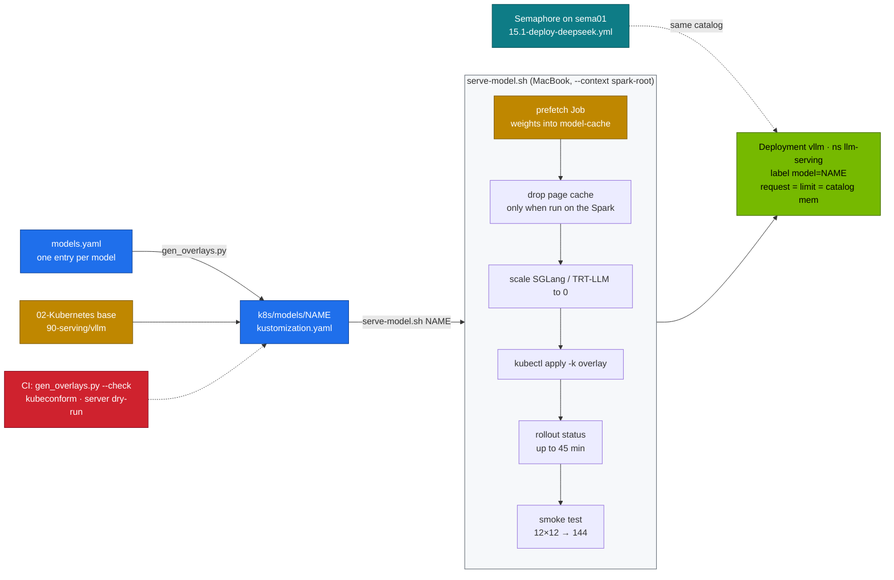
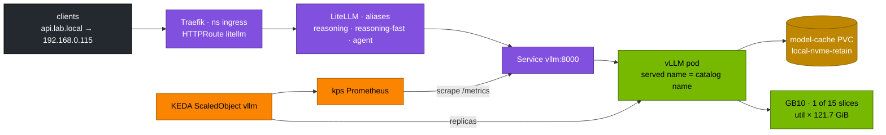
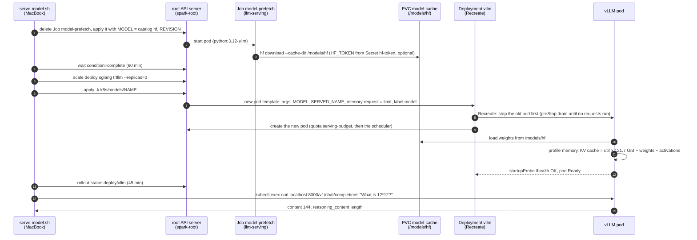

# Chapter 06 · Serving DeepSeek with vLLM

> **03-DeepSeek · Part III — Serving · Chapter 06 of 20** · ← [Chapter 05 · Model catalog & memory math](05-model-catalog-and-memory-math.md) · [All chapters](00-deepseek-step-by-step-guide.md) · [Chapter 07 · Alternative engines](07-alternative-engines-sglang-llamacpp-trtllm.md) →

| | |
|---|---|
| **You will build** | A model catalog that drives every vLLM deployment on the root: one YAML entry per model generates a kustomize overlay of the 02 platform's vLLM Deployment, a one-command model switch with prefetch and smoke test, the parsers that make R1 reasoning and tool calling work, a per-model benchmark, and three serving drills |
| **Hardware** | dgx-spark-1 |
| **Time** | 90 min (plus downloads) |
| **Risk** | Low. Switching models replaces the running one; clients see a few minutes of 503 while the new model loads |
| **Clusters** | `spark-root` (namespace `llm-serving`: Deployment `vllm`, Service `vllm:8000`, ScaledObject `vllm`, quota `serving-budget`) · `dev-llms` (namespace `llm-sandbox`, to try a manifest change first) |
| **Lab files** | [`models.yaml`](lab/models.yaml), [`scripts/gen_overlays.py`](lab/scripts/gen_overlays.py), [`k8s/models/`](lab/k8s/models/), [`scripts/serve-model.sh`](lab/scripts/serve-model.sh), [`scripts/breakfix.sh`](lab/scripts/breakfix.sh) with [`breakfix/`](lab/breakfix/) D01–D03, [`scripts/verify.sh`](lab/scripts/verify.sh), [`ansible/15.1-deploy-deepseek.yml`](lab/ansible/15.1-deploy-deepseek.yml), [`02 … 90-serving/vllm/vllm.yaml`](../02-Kubernetes/lab/manifests/root-llms/90-serving/vllm/vllm.yaml), [`02 … 60-storage/model-prefetch-job.yaml`](../02-Kubernetes/lab/manifests/root-llms/60-storage/model-prefetch-job.yaml) |

---

## 1. Why this matters on a Spark

Every model needs slightly different flags: memory fraction, context length, parsers, `--trust-remote-code`, quantisation, tokenizer mode. Hand-editing a Deployment per model drifts within a week, and on a Spark a wrong `--gpu-memory-utilization` doesn't just fail one pod, it can starve the whole machine. The lab therefore keeps:

- **one source of truth**: `models.yaml`, whose util and pod memory values come from [Chapter 05](05-model-catalog-and-memory-math.md);
- **generated overlays**: `gen_overlays.py` writes `k8s/models/<name>/kustomization.yaml`, a JSON patch on top of the 02 base Deployment;
- **a CI check**: `gen_overlays.py --check` fails when a committed overlay no longer matches the catalog.

The base Deployment ([02-Kubernetes Chapter 20](../02-Kubernetes/20-vllm-high-throughput-llm-serving.md)) already carries everything that is the same for every model: startup/readiness/liveness probes, `preStop` drain, `Recreate` strategy, `/dev/shm`, the `model-cache` PVC, `priorityClassName: spark-serving`, metrics, and memory request = limit. The overlay changes only what differs per model. The Deployment lives on the root (`spark-root`), where the LLMs run, under the root's admission rules: pinned image tags, a readinessProbe, no `NVIDIA_VISIBLE_DEVICES`, PSA baseline.

---

## 2. Architecture — HLD





The gateway path in the second diagram exists from [Chapter 12](12-open-webui-and-litellm-gateway.md) on (`llm.lab.local` is 02's Ingress to the mock LLM, not to vLLM). The labs in this chapter reach vLLM with `kubectl port-forward svc/vllm 8000` or `kubectl exec`. Clients never talk to a Hugging Face repo id. They use the catalog name (`r1-7b`) as the model, or better, a LiteLLM alias ([Chapter 12](12-open-webui-and-litellm-gateway.md)) that maps a task to whichever catalog model currently serves it.

### 2.1 A model switch, step by step



- **Steps 1–4** print `[PASS] weights cached`. A failure here is a download problem: `kubectl --context spark-root -n llm-serving logs job/model-prefetch` (a gated model without a token is drill D05).
- **Steps 6–7 are the only change to the Deployment.** KEDA's ScaledObject `vllm` is not touched, so replicas stay at 1 (§3.4). The overlay carries no Secret: `HF_TOKEN` comes from `hf-token` if it exists (§4).
- **Steps 8–9** are the few minutes of 503 in the Risk line. A refused pod shows as a ReplicaSet event `exceeded quota: serving-budget`, a pod that doesn't fit the node as `Pending` with `Insufficient memory` (§7).
- **Step 11** writes `Available KV cache memory` and `GPU KV cache size` to the vLLM log (Task 5.3). Drills D02 and D03 fail here.
- **Steps 14–15** print `[PASS] answer: 144  (reasoning chars: N)`. With drill D01 injected, N is 0.

---

## 3. LLD

### 3.1 The catalog

The values are explained and derived in [Chapter 05 §3.3](05-model-catalog-and-memory-math.md); here is what each entry adds to the vLLM command line. `r1-32b` also carries `alone: true` in the catalog: it needs nearly the whole pool, so everything else is parked before it starts.

| Name | HF repo | util | max len | pod mem | Extra args | Use |
|---|---|---|---|---|---|---|
| `r1-1.5b` | deepseek-ai/DeepSeek-R1-Distill-Qwen-1.5B | 0.10 | 16K | 14Gi | reasoning parser | fastest reasoner; speculative-decoding draft |
| `r1-7b` | deepseek-ai/DeepSeek-R1-Distill-Qwen-7B | 0.20 | 32K | 28Gi | reasoning parser | everyday reasoning (lab default) |
| `r1-32b` | deepseek-ai/DeepSeek-R1-Distill-Qwen-32B | 0.70 | 16K | 87Gi | reasoning parser, 16 seqs | best single-Spark quality, BF16, exclusive run |
| `r1-32b-fp8` | RedHatAI/DeepSeek-R1-Distill-Qwen-32B-FP8-dynamic | 0.45 | 32K | 58Gi | reasoning parser, 32 seqs | 32B at half the memory |
| `v2-lite` | deepseek-ai/DeepSeek-V2-Lite-Chat | 0.45 | 16K | 58Gi | `--trust-remote-code`, 32 seqs | MLA + DeepSeekMoE on one Spark |
| `coder-v2-lite` | deepseek-ai/DeepSeek-Coder-V2-Lite-Instruct | 0.45 | 32K | 58Gi | `--trust-remote-code`, 32 seqs | code, FIM |
| `qwen2.5-7b-tools` | Qwen/Qwen2.5-7B-Instruct | 0.20 | 32K | 28Gi | auto tool choice, `hermes` parser | agents, JSON |
| `qwen2.5-32b-awq` | Qwen/Qwen2.5-32B-Instruct-AWQ | 0.30 | 32K | 40Gi | `awq_marlin`, 32 seqs | dense 32B instruct baseline |
| `qwq-32b-awq` | Qwen/QwQ-32B-AWQ | 0.30 | 32K | 40Gi | `awq_marlin`, reasoning parser | Qwen's RL-trained reasoner |
| `llama-3.1-8b` | meta-llama/Llama-3.1-8B-Instruct | 0.20 | 32K | 28Gi | auto tool choice, `llama3_json` parser | Meta baseline (gated: needs `hf-token`) |
| `r1-llama-8b` | deepseek-ai/DeepSeek-R1-Distill-Llama-8B | 0.20 | 32K | 28Gi | reasoning parser | R1 distilled into Llama-3.1-8B |
| `mistral-7b` | mistralai/Mistral-7B-Instruct-v0.3 | 0.20 | 32K | 28Gi | `mistral` tokenizer, config and load formats | Mistral baseline |
| `mixtral-8x7b-fp8` | RedHatAI/Mixtral-8x7B-Instruct-v0.1-FP8 | 0.55 | 32K | 70Gi | 32 seqs | Mistral's sparse MoE |
| `nemotron-nano-8b` | nvidia/Llama-3.1-Nemotron-Nano-8B-v1 | 0.20 | 32K | 28Gi | — | NVIDIA reasoning model |

### 3.2 What the generated overlay patches

| JSON patch path | Value | Why |
|---|---|---|
| `containers/0/args` | `$(MODEL) --served-model-name=$(SERVED_NAME) --host=0.0.0.0 --port=8000 --gpu-memory-utilization=<util> --max-model-len=<max_len> --enable-prefix-caching --download-dir=/models/hf` + the entry's `args` | the engine flags |
| `containers/0/env/0` (`MODEL`) | the HF repo | what vLLM loads |
| `containers/0/env/1` (`SERVED_NAME`) | the catalog name | what clients send as `model` (drill D08) |
| `resources.requests.memory` and `resources.limits.memory` | the entry's `mem`, both | request = limit: the scheduler reserves the real size in the shared LLM memory pool |
| `metadata.labels.model`, pod template `labels.model` | the catalog name | dashboards and alerts key on it ([Chapter 16](16-telemetry.md)) |
| `--revision` / `--tokenizer-revision` | the entry's `revision`, when set | pinned weights ([Chapter 15](15-automation-secrets-and-day2.md)) |

Everything else (image tag from the base, `nvidia.com/gpu: 1`, probes, PVC, priority class) comes from the 02 base unchanged. Because the overlay replaces the whole `args` list, a model that needs `--max-num-seqs` or a quantisation flag carries it in its catalog `args`.

### 3.3 Parsers

| Parser | Flag | Effect | Without it |
|---|---|---|---|
| reasoning (R1, QwQ) | `--reasoning-parser=deepseek_r1` | `<think>…</think>` goes to `message.reasoning_content`, the answer to `content`; streaming deltas split the same way | the whole chain of thought arrives as the answer (drill D01) |
| tool calls (Qwen2.5) | `--enable-auto-tool-choice --tool-call-parser=hermes` | `<tool_call>{…}</tool_call>` becomes OpenAI `tool_calls` | `tool_choice: auto` is rejected with 400, or tools come back as prose (drill D07) |
| tool calls (Llama 3.1) | `--enable-auto-tool-choice --tool-call-parser=llama3_json` | JSON function calls become `tool_calls` | same |

R1-style models also need the right sampling from the client: temperature 0.6, top_p 0.95, no system prompt, generous `max_tokens`. At temperature 0 they tend to loop inside `<think>` until `max_tokens` (drill D06, [Chapter 17](17-troubleshooting-playbook.md)).

### 3.4 KEDA and the model switch

KEDA's ScaledObject `vllm` owns the Deployment's replica count (`minReplicaCount: 1`, `maxReplicaCount: 1` on one Spark). A model switch does not touch replicas: `kubectl apply -k` changes the pod template, and `Recreate` stops the old pod before the new one starts, so two models never hold memory at the same time. To take vLLM down completely (for another engine in [Chapter 07](07-alternative-engines-sglang-llamacpp-trtllm.md), or for the training window in [Chapter 11](11-distributed-training-and-rl.md)), park it with the pause annotation, never with `kubectl scale`, which KEDA undoes at its next poll:

```bash
# ▶ MacBook · 03-DeepSeek/lab
kubectl --context spark-root -n llm-serving annotate scaledobject vllm autoscaling.keda.sh/paused-replicas=0 --overwrite   # park
kubectl --context spark-root -n llm-serving annotate scaledobject vllm autoscaling.keda.sh/paused-replicas-               # resume
```

---

## 4. Integrations

- **02-Kubernetes**: the base Deployment and benchmark Job ([Chapter 20](../02-Kubernetes/20-vllm-high-throughput-llm-serving.md)), the `model-cache` PVC ([Chapter 13](../02-Kubernetes/13-storage-csi-and-high-performance-volumes.md)), the `serving-budget` quota and the LLM memory pool ([Chapter 14](../02-Kubernetes/14-multi-tenancy-resource-quotas-and-cgroups.md)), the `dev-llms` sandbox ([Chapter 04](../02-Kubernetes/04-nested-clusters-with-vcluster.md)).
- **Secrets**: the Hugging Face token lives in Vault on vault01 at `kv/spark-lab/hf` (field `token`) and is synced into the Secret `hf-token` in `llm-serving` ([Chapter 15](15-automation-secrets-and-day2.md)); never in a file in the repo. The 02 base ships no `hf-token` Secret and reads it as optional, so an `apply -k` of an overlay never touches the token. Without the Secret, public models still work; gated ones need it (Task 5.2).
- **Automation**: [`ansible/15.1-deploy-deepseek.yml`](lab/ansible/15.1-deploy-deepseek.yml) reads the same `models.yaml`, so the Semaphore template on sema01 and a manual `serve-model.sh` deploy the same thing ([Chapter 15](15-automation-secrets-and-day2.md)).
- **Kubernetes packaging**: [Chapter 08](08-kubernetes-deployment-storage-and-streaming.md) covers weight caching and streaming through Traefik; [Chapter 09](09-autoscaling-and-queueing.md) covers KEDA, KServe and Kueue.
- **Telemetry**: [Chapter 16](16-telemetry.md) dashboards and alerts select on the pod label `model`.

---

## 5. Lab

```bash
# ▶ MacBook · 03-DeepSeek/lab
export KUBECONFIG="$PWD/../../01-Ansible/lab/.cache/kubeconfig-spark-lab.yaml"
kubectl config get-contexts -o name                      # spark-root, dev-lab, dev-llms
kubectl --context spark-root -n llm-serving get deploy,svc,scaledobject,pvc
scripts/verify.sh platform
```

### Task 5.1 · Generate and inspect the overlays

#### What this lab does (script `lab/scripts/gen_overlays.py --check`, then a server-side dry run)

- **Checks the overlays:** `gen_overlays.py --check` regenerates every `k8s/models/<name>/` overlay from `models.yaml` in memory and compares it with the committed files. It writes nothing.
- **Lists the catalog** (`serve-model.sh list`): name, util, pod memory, weight size and Hugging Face repo per model.
- **Renders one overlay** (`r1-7b`) locally with `kubectl kustomize` and shows its args and resources.
- **Dry-runs `r1-32b-fp8`** against the root's API server: admission policies run, nothing is created.

#### What to look for

1. **Overlay check:** `14 overlays checked, 0 drifted`, and no `DRIFT` lines.
2. **Rendered `r1-7b`:**

   | Field | Healthy value |
   |---|---|
   | args | include `--gpu-memory-utilization=0.20` and `--max-model-len=32768`; the list ends with `--reasoning-parser=deepseek_r1` |
   | `resources.requests.memory` / `limits.memory` | both `28Gi` |
3. **Dry run:** every object ends with `(server dry run)`; no admission error.

**If something's off:** `DRIFT k8s/models/…` → an overlay was edited by hand or `models.yaml` changed without regenerating; run `python3 scripts/gen_overlays.py`. An admission denial → read the policy message (pinned tag, readinessProbe, no `NVIDIA_VISIBLE_DEVICES`). More in §7.

#### Run it

```bash
# ▶ MacBook · 03-DeepSeek/lab
python3 scripts/gen_overlays.py --check          # "14 overlays checked, 0 drifted"
scripts/serve-model.sh list
kubectl kustomize k8s/models/r1-7b | yq 'select(.kind=="Deployment") | .spec.template.spec.containers[0].args'
kubectl kustomize k8s/models/r1-7b | yq 'select(.kind=="Deployment") | .spec.template.spec.containers[0].resources'
```

Expected: the args list ends with `--reasoning-parser=deepseek_r1`, and `requests.memory` equals `limits.memory` (28Gi).

Then let the root's admission check an overlay without creating anything (server-side dry run runs the admission policies: pinned tag, readinessProbe, no `NVIDIA_VISIBLE_DEVICES`):

```bash
# ▶ MacBook · 03-DeepSeek/lab
kubectl kustomize k8s/models/r1-32b-fp8 | kubectl --context spark-root apply --dry-run=server -f -
```

If you change the base or write your own overlay, try it in the sandbox first. `dev-llms` has 2 CPU · 4 Gi · 2 slices in `llm-sandbox`, enough for the 02 smoke model (Qwen2.5-0.5B at a tiny util) but not for a catalog model; there you test the manifest's shape, not the model.

### Task 5.2 · Hugging Face token from Vault

#### What this lab does (Vault `kv/spark-lab/hf` → Secret `hf-token`)

- **On vault01:** stores your Hugging Face token at `kv/spark-lab/hf`, field `token`.
- **On the MacBook:** reads it back with the Vault CLI and writes it into the Secret `hf-token` in `llm-serving` on the root (create or update). The token goes through a pipe, not a file.
- **Who uses it:** the `model-prefetch` Job and vLLM read `hf-token` (optional). Only gated models (`llama-3.1-8b`) need it.

#### What to look for

1. **vault01:** `vault kv put` prints the new version's metadata (`version` 1 or higher).
2. **MacBook:** `secret/hf-token configured` (or `created`).
3. **Content check** without printing the token:
   ```bash
   # ▶ MacBook · 03-DeepSeek/lab
   kubectl --context spark-root -n llm-serving get secret hf-token -o jsonpath='{.data.token}' | base64 -d | cut -c1-3   # hf_
   ```

**If something's off:** `permission denied` from Vault → your token lacks the lab policy, or `VAULT_ADDR` is wrong. The check prints something other than `hf_` → the value in Vault is wrong; fix it there and re-run the sync. More in §7.

#### Run it

Public models (all R1 distills, Qwen) work without a token. Gated ones (`llama-3.1-8b`) need it. Store the token once in Vault:

```bash
# ▶ vault01 (ssh vault01)
vault kv put kv/spark-lab/hf token="hf_…"        # read access is granted by the lab policy (01-Ansible Chapter 18)
```

Sync it into the Secret. The automated way is the `vault-sync` CronJob ([Chapter 15](15-automation-secrets-and-day2.md)); by hand:

```bash
# ▶ MacBook · 03-DeepSeek/lab
export VAULT_ADDR=https://192.168.0.211:8200
kubectl --context spark-root -n llm-serving create secret generic hf-token \
  --from-literal=token="$(vault kv get -field=token kv/spark-lab/hf)" --dry-run=client -o yaml \
  | kubectl --context spark-root apply -f -
```

### Task 5.3 · Switch models with the smoke test

#### What this lab does (script `lab/scripts/serve-model.sh r1-7b`, or template `15.1 Deploy DeepSeek` with `--tags serve`)

- **Prefetch:** Job `model-prefetch` in `llm-serving` downloads the weights into the `model-cache` PVC (~15 GB for `r1-7b` on a first run).
- **Page cache:** dropped only if the script can use `sudo` locally, so not from the MacBook; do it on the Spark before a large model.
- **Switch:** applies `k8s/models/r1-7b`, so Deployment `vllm` gets util 0.20, 32K context, the reasoning parser and **28 Gi** (request = limit). The rollout stops the old pod before starting the new one.
- **Smoke test:** asks the model for 12 × 12 inside the pod.
- **The Semaphore template** runs the same overlay through `15.1-deploy-deepseek.yml`; with `--tags serve` it skips prefetch, apps and RAG, but first asserts the model fits the util budget and `serving-budget`.

#### What to look for

1. **Script output:** the five lines shown below, ending with `[PASS] answer: 144  (reasoning chars: N)`, then `3 passed, 0 warnings, 0 failed`.
2. **Cluster charge:**

   | Command | Healthy value |
   |---|---|
   | `get pod -l app=vllm -L model` | one pod `Running`, `MODEL` column `r1-7b` |
   | `serving-budget` | `requests.memory` and `limits.memory` used include the 28Gi |
   | vLLM log | an `Available KV cache memory` line and a `GPU KV cache size` of roughly 130K tokens (Chapter 05 §3.3 predicts ~138K) |
3. **Semaphore run:** `failed=0`; the `Show the change` task prints `vLLM: <old> → r1-7b` and the rollback command. Re-running it with the same model shows `changed=0` on the serve task.

**If something's off:** `[FAIL] prefetch failed` → `kubectl --context spark-root -n llm-serving logs job/model-prefetch` (network, or a gated model without a token). `[FAIL] rollout failed` → `logs deploy/vllm`. More in §7.

#### Run it

```bash
# ▶ MacBook · 03-DeepSeek/lab
scripts/serve-model.sh r1-7b
```

```text
[....] prefetching deepseek-ai/DeepSeek-R1-Distill-Qwen-7B into model-cache
[PASS] weights cached
[....] waiting for vLLM (r1-7b) — first start compiles CUDA graphs
[PASS] vLLM ready with r1-7b
[PASS] answer: 144  (reasoning chars: 412)
```

(Your reasoning length will differ.) The script drops the page cache only when it runs on the Spark itself, and then prints `[....] page cache dropped (UMA headroom for the load)` after `weights cached`. From the MacBook it can't, so do it on the Spark before a large model:

```bash
# ▶ dgx-spark-1 (ssh dgx-spark-1)
sudo sh -c 'sync; echo 3 > /proc/sys/vm/drop_caches'; free -g
```

Look at what the cluster charged for the new model:

```bash
# ▶ MacBook · 03-DeepSeek/lab
kubectl --context spark-root -n llm-serving get pod -l app=vllm -L model
kubectl --context spark-root -n llm-serving describe resourcequota serving-budget | grep -E 'memory|gpu'
kubectl --context spark-root -n llm-serving logs deploy/vllm | grep -E 'Available KV cache memory|GPU KV cache size'
```

**Semaphore UI:** the same switch from the management plane is the template that runs `03-DeepSeek/lab/ansible/15.1-deploy-deepseek.yml` with `--tags serve` and the extra variable `deepseek_model=r1-7b`. Run it once and compare the result with the manual switch: same overlay, same pod, same smoke test.

### Task 5.4 · Reasoning and tool calls through the parsers

#### What this lab does (curl through a port-forward to `svc/vllm`)

- **Reasoning parser:** one normal and one streamed request to `r1-7b`. Read-only.
- **Tool parser:** switches the served model to `qwen2.5-7b-tools` (util 0.20, 28 Gi, `--enable-auto-tool-choice --tool-call-parser=hermes`) and sends one request with a tool definition. The tool isn't executed; you only look at the call the model asks for.

#### What to look for

1. **Non-streamed R1:** `answer` holds only the number (about 24.3); `thinking_chars` is in the hundreds or more.
2. **Streamed R1:** a line of dots (thinking tokens), then the answer text.
3. **Tool call:** one `tool_calls` entry, `function.name` `get_pod_resources`, `arguments` a JSON string with `namespace` `llm-serving` and a pod name like `vllm`.

**If something's off:** `thinking_chars` 0 and `<think>` in `answer` → the reasoning parser is missing (drill D01). `tool_calls` is `null` or a 400 → the tool parser flags are missing (drill D07). More in §7.

#### Run it

```bash
# ▶ MacBook · 03-DeepSeek/lab
pkill -f 'port-forward svc/vllm 8000'; kubectl --context spark-root -n llm-serving port-forward svc/vllm 8000 >/dev/null & sleep 2
curl -s localhost:8000/v1/chat/completions -H 'Content-Type: application/json' -d '{
  "model":"r1-7b","temperature":0.6,"top_p":0.95,"max_tokens":2048,
  "messages":[{"role":"user","content":"A GB10 has 121.7 GiB. How many GiB is 0.20 of that? Answer with one number."}]}' \
  | jq '{answer: .choices[0].message.content, thinking_chars: (.choices[0].message.reasoning_content | length)}'
```

Expected: `answer` holds only the result (about 24.3) and `thinking_chars` is in the hundreds or more. Now stream it and watch the two fields arrive separately:

```bash
# ▶ MacBook · 03-DeepSeek/lab
curl -sN localhost:8000/v1/chat/completions -H 'Content-Type: application/json' -d '{
  "model":"r1-7b","stream":true,"temperature":0.6,"max_tokens":1024,
  "messages":[{"role":"user","content":"Name one reason MLA saves memory."}]}' \
  | sed -n 's/^data: //p' | grep -v DONE \
  | jq -rj '.choices[0].delta | if .reasoning_content then "." else (.content // "") end'; echo
kill %1
```

Dots are thinking tokens, then the answer follows. For tool calls switch to `qwen2.5-7b-tools` and run the lab's agent check ([Chapter 14](14-tool-calling-and-agents.md) goes deeper):

```bash
# ▶ MacBook · 03-DeepSeek/lab
scripts/serve-model.sh qwen2.5-7b-tools
pkill -f 'port-forward svc/vllm 8000'; kubectl --context spark-root -n llm-serving port-forward svc/vllm 8000 >/dev/null & sleep 2
curl -s localhost:8000/v1/chat/completions -H 'Content-Type: application/json' -d '{
  "model":"qwen2.5-7b-tools","tool_choice":"auto","max_tokens":256,
  "messages":[{"role":"user","content":"How much memory does the vllm pod in llm-serving request?"}],
  "tools":[{"type":"function","function":{"name":"get_pod_resources","description":"Resources of a pod",
    "parameters":{"type":"object","properties":{"namespace":{"type":"string"},"pod":{"type":"string"}},"required":["namespace","pod"]}}}]}' \
  | jq '.choices[0].message.tool_calls'
kill %1
```

Expected: one `tool_calls` entry naming `get_pod_resources` with `{"namespace":"llm-serving","pod":"vllm"}` (or similar) as JSON arguments.

### Task 5.5 · Add a model to the catalog

#### What this lab does (edit `lab/models.yaml`, run `gen_overlays.py`, serve `r1-14b`)

- **Sizes** R1-Distill-Qwen-14B with `model_math.py` at util 0.35 and 32K.
- **Adds one catalog entry** `r1-14b` (util 0.35, **46 Gi**, reasoning parser, 16 sequences) to `models.yaml` on the MacBook.
- **Writes a new overlay** `k8s/models/r1-14b/` with `gen_overlays.py`, then serves it. First run downloads about 30 GB.
- **Clean-up** is yours: remove the entry and regenerate, or commit both files on purpose.

#### What to look for

1. **Sizing:** ~27.5 GiB of BF16 weights, 192 KiB per token, about 66K tokens of KV (two 32K sequences), `✓ fits`.
2. **Generation:** `15 overlays written, 0 drifted`; `git diff --stat k8s/models` shows only the new `r1-14b` directory; `--check` then reports `15 overlays checked, 0 drifted`.
3. **Serving:** `serve-model.sh r1-14b` ends with `[PASS] answer: 144 …` and `0 failed`; the pod has 46Gi request = limit.

**If something's off:** pod refused with `exceeded quota` → add up pod memory in `llm-serving` (Chapter 05 §3.4). `unknown model r1-14b` from `serve-model.sh` → the entry's indentation in `models.yaml` is off. More in §7.

#### Run it

Add an entry for `deepseek-ai/DeepSeek-R1-Distill-Qwen-14B`. Size it first:

```bash
# ▶ MacBook · 03-DeepSeek/lab
python3 tools/model_math.py deepseek-r1-distill-qwen-14b --util 0.35 --ctx 32768
```

~27.5 GiB BF16 weights and 192 KiB/token KV: util 0.35 (≈ 42.6 GiB) leaves ~12 GiB of KV, about 66K tokens — two full 32K sequences. Pod memory must cover util × 121.7 GiB plus a few GiB for the CPU side, the same rule the catalog uses (0.20 → 28Gi, 0.45 → 58Gi), so 46Gi. The entry:

```yaml
  - name: r1-14b
    hf: deepseek-ai/DeepSeek-R1-Distill-Qwen-14B
    util: 0.35
    max_len: 32768
    mem: 46Gi
    weights: 30GB
    args: [--reasoning-parser=deepseek_r1, --max-num-seqs=16]
    use: middle reasoning size between the 7B and the 32B
```

```bash
# ▶ MacBook · 03-DeepSeek/lab
python3 scripts/gen_overlays.py && git diff --stat k8s/models
python3 scripts/gen_overlays.py --check
scripts/serve-model.sh r1-14b
```

Check it against [Chapter 05 §3.4](05-model-catalog-and-memory-math.md): with bge-m3 and the app stack it is 0.41 and 46 + 9 + 9 = 64 Gi, which fits; adding `r1-7b` (0.20, 28Gi) makes 0.61 and 92 Gi, which fits the util rule but not the quota. Remove the entry and regenerate when you are done, or commit it deliberately.

### Task 5.6 · Benchmark each model the same way

#### What this lab does (`eval_harness.py` sweep, then Job `vllm-bench` from 02-Kubernetes)

- **Quick sweep:** the 40 maths problems at 1, 8 and 32 requests in flight against the served `r1-7b` through a port-forward. Nothing is written to disk (no `--out`). (The `json` suite has only 8 items, so it can never put 32 requests in flight.)
- **Deeper load test:** Job `vllm-bench` in `llm-serving` runs `vllm bench serve` in the NGC vLLM image against `http://vllm:8000` with 128 random prompts (1,024 tokens in, 256 out) at concurrency 1, 8 and 32. It reads the tokenizer from `model-cache` and uses 1.5 Gi at most. The `sed` points it at `r1-7b`.
- Repeat for each model you serve and fill one row per model.

#### What to look for

1. **Sweep:** three `tok/s aggregate` lines; aggregate tok/s rises with concurrency.
2. **Bench Job:** for each `=== max-concurrency` block a `Successful requests: 128` line, output-token throughput, and TTFT, TPOT, ITL and E2EL percentiles.
3. **Across models:** single-stream tok/s roughly follows 273 GB/s ÷ active weight bytes, so `coder-v2-lite` can beat `r1-7b` per stream.

**If something's off:** `Successful requests` below 128 → requests timed out or the model name is wrong (`--model` must be the served name). The bench pod `Pending` with `exceeded quota` → the quota is full; it needs 1.5 Gi. More in §7.

#### Run it

```bash
# ▶ MacBook · 03-DeepSeek/lab
scripts/serve-model.sh r1-7b
pkill -f 'port-forward svc/vllm 8000'; kubectl --context spark-root -n llm-serving port-forward svc/vllm 8000 >/dev/null & sleep 2
sleep 2
for c in 1 8 32; do
  echo "concurrency $c:"
  python3 tools/eval_harness.py --url http://localhost:8000 --model r1-7b --suites math --limit 40 \
    --concurrency $c --max-tokens 2048 | grep 'tok/s'
done
kill %1
```

For a deeper load test use 02's benchmark Job with the catalog model:

```bash
# ▶ MacBook · 03-DeepSeek/lab
kubectl --context spark-root -n llm-serving delete job vllm-bench --ignore-not-found
sed -e 's|--model qwen2.5-0.5b|--model r1-7b|' \
    -e 's|value: Qwen/Qwen2.5-0.5B-Instruct|value: deepseek-ai/DeepSeek-R1-Distill-Qwen-7B|' \
  ../../02-Kubernetes/lab/manifests/root-llms/90-serving/vllm/vllm-bench.yaml \
  | kubectl --context spark-root apply -f -
kubectl --context spark-root -n llm-serving logs -f job/vllm-bench
```

Keep one table per model you serve (**record yours**):

| Model | tok/s c=1 | tok/s c=8 | tok/s c=32 | p50 TTFT | p50 latency | KV cache tokens (log) |
|---|---|---|---|---|---|---|
| r1-7b (measured 2026-10-24, vLLM 25.09) | 13 | 108 | 238 | | | ~134K |
| r1-32b-fp8 | | | | | | |
| coder-v2-lite | | | | | | |

Decode on a GB10 is bandwidth-bound: single-stream tok/s should be roughly proportional to 273 GB/s divided by active weight bytes ([Chapter 05 §3.1](05-model-catalog-and-memory-math.md)), which is why `coder-v2-lite` (2.4B active) can be faster per stream than `r1-7b` despite holding twice the weights.

### Task 5.7 · Three serving drills

#### What this lab does (script `lab/scripts/breakfix.sh`, overlays `lab/breakfix/D01…D03`)

- **Each `inject`** applies a broken copy of a catalog overlay to Deployment `vllm`:

  | Drill | What it applies |
  |---|---|
  | D01 | `r1-7b` without `--reasoning-parser` |
  | D02 | `r1-7b` with `--gpu-memory-utilization=0.95` |
  | D03 | `r1-32b` (87 Gi) with `--max-model-len=131072` |
- **`hint` and `answer`** only print text. **`reset`** re-applies the clean catalog overlay of the drill's model.
- **D03 is an exclusive run:** park bge-m3, the app stack and any second model first, or the quota refuses the pod before the real symptom appears.

#### What to look for

1. **D01:** the pod runs; responses carry the `<think>` text in `content` and an empty `reasoning_content`.
2. **D02:** the new pod fails at startup; `logs deploy/vllm` complains that free memory is below what 0.95 × 121.7 GiB requires.
3. **D03:** startup fails with a `max_model_len … larger than the maximum number of tokens that can be stored in KV cache` style error.
4. **After each `reset`:** `kubectl --context spark-root -n llm-serving get deploy vllm` back to `1/1`.

**If something's off:** D03 pod `Pending` with `exceeded quota: serving-budget` → you didn't park the rest; that's the quota, not the drill. More in §7.

#### Run it

```bash
# ▶ MacBook · 03-DeepSeek/lab
scripts/breakfix.sh list
scripts/breakfix.sh inject D01     # reasoning parser missing
```

Diagnose from the response JSON and `kubectl --context spark-root -n llm-serving logs deploy/vllm`. Use `scripts/breakfix.sh hint D01` if stuck, then `answer` and `reset`. Repeat for:

| Drill | What is injected | Symptom to find |
|---|---|---|
| D01 | `r1-7b` without `--reasoning-parser` | the chain of thought is in `content`; `reasoning_content` is empty |
| D02 | `r1-7b` at `--gpu-memory-utilization=0.95` | vLLM refuses to start: free memory is less than 0.95 × 121.7 GiB, because the OS, the platform and other pods use the same pool |
| D03 | `r1-32b` with `--max-model-len=131072` | start-up fails: one 128K sequence needs 32 GiB of KV, only ~21 GiB is left after BF16 weights at 0.70 |

D03 uses the BF16 32B, an exclusive run: park bge-m3, the app stack and any second model first as in [Chapter 05 Task 5.5](05-model-catalog-and-memory-math.md), or the pod is refused by the quota before it can show the symptom you are looking for.

---

### Task 5.8 · A newer vLLM image (moved)

Trying a newer NGC vLLM image (NVFP4 kernels, multi-token prediction) next to the current engine is step 3 of [Chapter 20 · The fast lane](20-fast-lane-more-tokens-per-second.md); the overlay is `k8s/upgrade/vllm-next`.

## 6. Verify

```bash
# ▶ MacBook · 03-DeepSeek/lab
scripts/serve-model.sh r1-7b
scripts/verify.sh platform serving
```

| Check | Expected |
|---|---|
| overlays | `14 overlays checked, 0 drifted` (15 if you kept `r1-14b`) |
| serving | `vLLM serving 'r1-7b'`, `/v1/models` lists `r1-7b`, metrics exposed |
| pod | label `model=r1-7b`; memory request = limit = 28Gi; counted in `serving-budget` |
| parsers | `reasoning_content` filled for R1; `tool_calls` for `qwen2.5-7b-tools` |
| benchmark | one row per model you serve, at c = 1/8/32 |
| drills | D01–D03 each diagnosed from logs or responses in under 10 minutes |

---

## 7. Troubleshooting

| You see | Cause | Fix |
|---|---|---|
| `Model architectures [...] are not supported` | model newer than the image's vLLM | a newer NGC vLLM image with arm64/sm_121 support; pin it in `versions.env` and the base |
| Pod stuck in startup > 30 min, then restarted | first download inside the pod, or slow CUDA-graph compile | prefetch first (`serve-model.sh` does it); the startupProbe allows 30 min |
| Deployment 0/1, ReplicaSet event `exceeded quota: serving-budget` | Σ pod memory in `llm-serving` over 90 Gi | park another engine (§3.4); for `r1-32b` park bge-m3 and the app stack too ([Chapter 05 §3.4](05-model-catalog-and-memory-math.md)) |
| Pod Pending, `Insufficient memory` | a batch job or other engines hold the pool (request = limit everywhere) | `kubectl --context spark-root describe node dgx-spark-1 \| sed -n '/Allocated resources/,/Events/p'`; wait for the batch job or park an engine |
| Apply refused by an admission policy | `:latest` tag, missing readinessProbe, or an `NVIDIA_VISIBLE_DEVICES` env in a custom overlay | pinned tag; keep the base's probes; let the device plugin assign the GPU |
| `kubectl scale deploy vllm --replicas=0` doesn't stick | KEDA scales it back | pause annotation (§3.4) |
| `KeyError: 'reasoning_content'` in a client | parser off, or the client reads the wrong field | parser on; read `reasoning_content` for thinking, `content` for the answer |
| Fine with curl, garbage through a client | client sends a system prompt and `temperature: 0` to an R1 model | R1 sampling (§3.3) |
| `403 … gated repo` in the prefetch Job (drill D05) | no `hf-token` Secret, or a token without the licence | Task 5.2; accept the licence on Hugging Face |
| 404 `model … does not exist` (drill D08) | client uses the HF repo id | use the catalog name or a LiteLLM alias |
| `DRIFT k8s/models/…` in CI | someone edited an overlay by hand, or the catalog without regenerating | edit `models.yaml`, run `gen_overlays.py`, commit both |

---

## 8. Scale-out path

| One Spark | Two Sparks | Fleet |
|---|---|---|
| one catalog model in `deploy/vllm`, others parked | one model per Spark, both in the catalog; `maxReplicaCount: 2` or two Deployments pinned by node, LiteLLM routes by alias | catalog → many Deployments, scheduled by GPU type, same YAML |
| `serve-model.sh` / Semaphore template | same, with `nodeSelector` per entry | GitOps: catalog change → PR → CI (`--check`, dry-run) → Argo CD sync → post-sync eval gate ([Chapter 15](15-automation-secrets-and-day2.md)) |
| models up to 32B BF16 | 70B FP8 with `--tensor-parallel-size 2` over the CX-7 fabric ([Chapter 04](04-scaling-beyond-one-spark.md)) | TP inside NVLink domains, EP/DP attention for V3/R1 |

---

## 9. Checklist

- [ ] I can add a model to the catalog, size its util and pod memory, regenerate the overlays and deploy it with one command.
- [ ] I can show that every generated overlay sets memory request = limit to the catalog's `mem`.
- [ ] I know which parser each model family needs, and what breaks without it.
- [ ] I park vLLM with the KEDA pause annotation, not with `kubectl scale`.
- [ ] The Hugging Face token comes from Vault (`kv/spark-lab/hf`), not from a file.
- [ ] I have a benchmark table per model I serve.
- [ ] I solved D01–D03 from symptoms.
