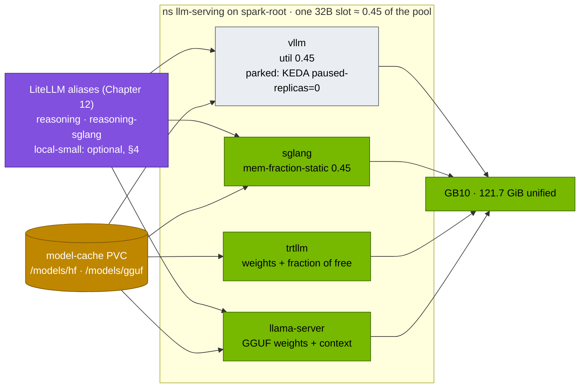
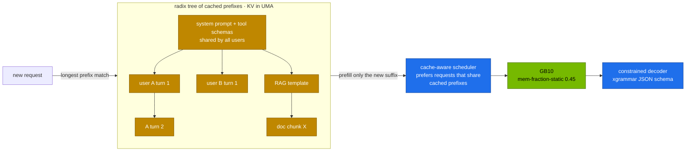
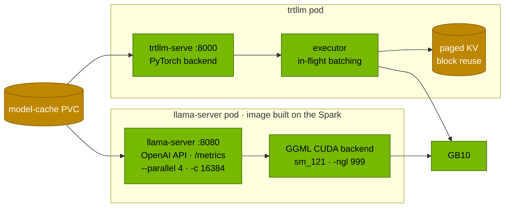
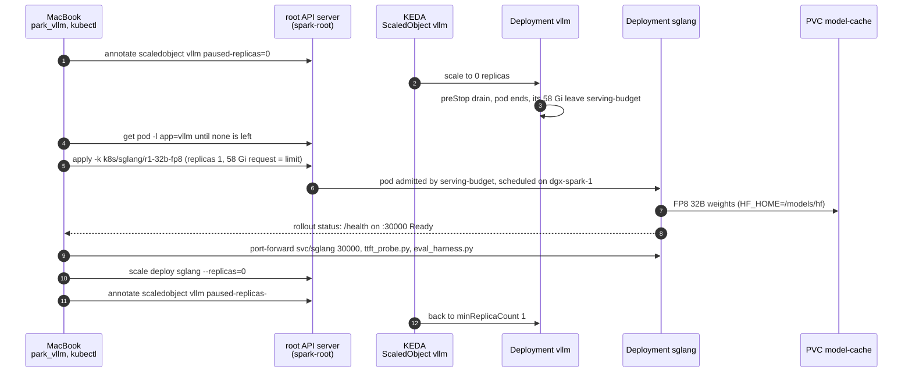

# Chapter 07 · Alternative Engines: SGLang, llama.cpp & TensorRT-LLM

> **03-DeepSeek · Part III — Serving · Chapter 07 of 20** · ← [Chapter 06 · Serving DeepSeek with vLLM](06-vllm-serving.md) · [All chapters](00-deepseek-step-by-step-guide.md) · [Chapter 08 · Kubernetes deployment, weight caching & streaming](08-kubernetes-deployment-storage-and-streaming.md) →

| | |
|---|---|
| **You will build** | The same R1 distill served by four engines on the root, one at a time, in the same memory budget: SGLang with RadixAttention and schema-constrained JSON, llama.cpp built for sm_121 serving GGUF (plus a quantisation sweep and Ollama as the zero-config variant), and TensorRT-LLM's `trtllm-serve` with its PyTorch backend. One comparison table across vLLM, SGLang and TRT-LLM on identical weights and prompts, and a written engine choice |
| **Hardware** | dgx-spark-1 |
| **Time** | 3.5 h (the llama.cpp build takes ~15 min, each 32B load several minutes) |
| **Risk** | Low. One engine at a time: vLLM is parked with the KEDA pause annotation while another engine runs. Image tags for DGX Spark move quickly; confirm arm64/sm_121 support before pulling |
| **Clusters** | `spark-root` (namespace `llm-serving`: Deployments `sglang`, `llama-server`, `trtllm`, the parked `vllm`) |
| **Lab files** | [`k8s/sglang/r1-32b-fp8`](lab/k8s/sglang/r1-32b-fp8/kustomization.yaml), [`02 … 90-serving/sglang/sglang.yaml`](../02-Kubernetes/lab/manifests/root-llms/90-serving/sglang/sglang.yaml), [`k8s/llamacpp/Dockerfile`](lab/k8s/llamacpp/Dockerfile), [`k8s/llamacpp/llama-server.yaml`](lab/k8s/llamacpp/llama-server.yaml), [`k8s/trtllm/trtllm-serve.yaml`](lab/k8s/trtllm/trtllm-serve.yaml), [`versions.env`](lab/versions.env), [`tools/eval_harness.py`](lab/tools/eval_harness.py), [`02 … scripts/ttft_probe.py`](../02-Kubernetes/lab/scripts/ttft_probe.py) |

---

## 1. Why this matters on a Spark

vLLM is the lab's default engine because it is the broadest: most architectures, parsers for R1 and tools, a mature OpenAI API. But it is not the best at everything, and on a single GB10 the differences show:

| | vLLM | SGLang | llama.cpp / Ollama | TensorRT-LLM |
|---|---|---|---|---|
| Built for | high-concurrency API | agent and multi-turn traffic, structured output | one or a few users, small footprint | maximum performance on NVIDIA GPUs |
| KV reuse | automatic prefix caching (block hashes) | **RadixAttention**: radix tree of all cached prefixes, cache-aware scheduling | per-slot prompt cache | paged KV with block reuse |
| Formats | safetensors BF16, FP8, AWQ, GPTQ, NVFP4 | same family | **GGUF**, 1.5–8 bits (Q8_0 … IQ1_S, imatrix) | BF16, FP8, NVFP4, INT4 AWQ |
| Memory knob | `--gpu-memory-utilization` (fraction of total) | `--mem-fraction-static` (fraction of total) | none: weights + `-c` context + buffers | `free_gpu_memory_fraction` (fraction of **free** memory after weights) |
| Start-up | minutes (CUDA graphs) | minutes | seconds | minutes (PyTorch backend), longer with engine build |
| Reasoning split | `--reasoning-parser deepseek_r1` | `--reasoning-parser deepseek-r1` | `--reasoning-format` in recent builds, else client-side | check your release; else client-side |
| Multi-node | TP/PP with NCCL | TP, DP attention, EP | RPC backend | TP/PP/EP, disaggregated serving |
| Where DeepSeek uses it | day-one V3/R1 support | day-one V3/R1 support, DP attention + EP | community dynamic GGUF of R1 671B | MTP speculative decoding for V3/R1 |

The Spark-specific question is always the same: **how much of the 121.7 GiB pool does the engine take, and how do I make it take exactly what the budget allows?** Each engine answers that differently, and that is the main thing this chapter teaches.

---

## 2. Architecture — HLD

### 2.1 One budget, one engine at a time



LiteLLM arrives in [Chapter 12](12-open-webui-and-litellm-gateway.md); the tasks here reach each engine with `kubectl port-forward`. All four engines read weights from the same `model-cache` PVC, so switching engines costs a load, not a download. Every engine container sets memory request = limit and runs at `priorityClassName: spark-serving`, like vLLM.

### 2.2 RadixAttention



Agents resend the same system prompt, tool schemas and growing conversation on every turn. RadixAttention keeps the KV for all recent prefixes and evicts least-recently-used leaves; a request that shares a prefix prefills only its new suffix. vLLM's automatic prefix caching covers much of the same ground with block hashes; Task 5.2 measures how they compare on your traffic.

### 2.3 llama.cpp and TensorRT-LLM



### 2.4 Swapping engines, step by step

Every task in this chapter repeats the same swap: park vLLM, start the other engine in the freed slot, test it, scale it back to 0, resume vLLM. Here with SGLang (Tasks 5.2–5.3):



- **Steps 1–3** are why the lab never uses `kubectl scale` on `vllm`: KEDA owns its replicas and would bring it back next to SGLang (§7, last row).
- **Step 4** is the `while` loop in `park_vllm`. It ends only when the vLLM pod is gone, so step 6 finds its memory free.
- **Step 6** fails with `exceeded quota: serving-budget` or `Pending` / `Insufficient memory` if another engine still holds its share (§7).
- **Step 8** can take long on the first start: the image pull plus the load. The task waits up to 45 min.
- **Step 9** gives the TTFT lines and `sglang:cache_hit_rate` of Task 5.2. TensorRT-LLM (Task 5.8) and llama.cpp (Task 5.6) use the same steps with their own Deployments; Task 5.9 is steps 10–12.

---

## 3. LLD

### 3.1 Memory: making every engine fit the same slot

The comparison is only fair if every engine gets the same share of the pool. The lab uses the `r1-32b-fp8` slot from [Chapter 05](05-model-catalog-and-memory-math.md): util 0.45 ≈ 54.8 GiB, pod memory 58Gi (request = limit).

| Engine | Knob | Meaning | Value in the lab | Result on the GB10 |
|---|---|---|---|---|
| vLLM | `--gpu-memory-utilization` | weights + activations + KV ≤ fraction × total | 0.45 | ≈ 54.8 GiB, deterministic |
| SGLang | `--mem-fraction-static` | weights + KV pool ≤ fraction × total (activations come on top) | 0.45 | ≈ 54.8 GiB + a few GiB of activations |
| TRT-LLM | `kv_cache_config.free_gpu_memory_fraction` | KV = fraction × memory **still free after the weights load** | 0.30 | depends on what else runs: with ~65 GiB free after ~32 GiB of weights, KV ≈ 20 GiB, total ≈ 52 GiB inside the 58Gi pod. Cap it with `kv_cache_config.max_tokens` |
| llama.cpp | `-c` × `--parallel`, `-ngl` | weights + KV for `-c` tokens + compute buffers | Q4_K_M 7B, `-c 16384` | ~4.7 GiB + ~0.9 GiB KV + buffers, under 8 GiB; the 12Gi pod (request = limit) is the ceiling |
| Ollama (host Docker) | `OLLAMA_NUM_PARALLEL`, context per model | like llama.cpp | defaults | invisible to the scheduler and to every quota |

Two consequences:

1. **TRT-LLM's fraction is relative.** The same manifest takes more memory when it starts on an idle Spark than next to another engine, which is why the lab sets it to 0.30 rather than 0.45. Start it only after the other engines are parked, set `max_tokens` (for example 81920 tokens × 256 KiB = 20 GiB of KV for the 32B) if you need a hard number, and read `free -g` afterwards.
2. **Engines without a fraction count by their pod limit.** For the util-sum rule (Σ ≲ 0.72), count llama.cpp as pod limit ÷ 121.7 GiB (12 Gi ≈ 0.10). A `docker run` on the host (Ollama, `llama-bench`) has no pod at all: park vLLM before you start one, and stop it afterwards.

### 3.2 SGLang overlay (`k8s/sglang/r1-32b-fp8`)

| Arg | Value | vLLM equivalent |
|---|---|---|
| `--model-path` | RedHatAI/DeepSeek-R1-Distill-Qwen-32B-FP8-dynamic | positional model |
| `--served-model-name` | `r1-32b-fp8` | same |
| `--mem-fraction-static` | 0.45 | `--gpu-memory-utilization 0.45` |
| `--context-length` | 32768 | `--max-model-len` |
| `--reasoning-parser` | `deepseek-r1` | `deepseek_r1` |
| `--enable-metrics` | on | always on |
| port | 30000 | 8000 |
| memory request = limit | 58Gi | 58Gi |
| image | `SGLANG_IMAGE` in `versions.env` (`lmsysorg/sglang:spark`, the DGX Spark build) | `VLLM_IMAGE` |

SGLang metrics to watch:

| Metric | Meaning |
|---|---|
| `sglang:cache_hit_rate` | fraction of prompt tokens served from the radix cache |
| `sglang:num_running_reqs` / `sglang:num_queue_reqs` | batch size and queue |
| `sglang:gen_throughput` | output tokens/s |
| `sglang:time_to_first_token_seconds` | TTFT histogram |

### 3.3 llama.cpp build and serve settings

| Setting | Value | Why |
|---|---|---|
| `CMAKE_CUDA_ARCHITECTURES` | 121 | native SASS for the GB10; prebuilt `server-cuda` images may lack it |
| `GGML_RPC=ON` | on | two-Spark offload with `rpc-server` ([Chapter 04](04-scaling-beyond-one-spark.md)) |
| `LLAMACPP_REF` | a release tag (`bNNNN`) | pin it; newer tags carry newer model support |
| `-ngl 999` | every layer on the GPU | UMA: there is no separate "CPU RAM" to save |
| `--parallel 4 -c 16384` | 4 slots sharing 16K (4K each) | llama.cpp splits `-c` across slots |
| `--jinja` | the model's own chat template | correct R1/Qwen formatting |
| `--metrics` | Prometheus endpoint | [Chapter 16](16-telemetry.md) |
| `imagePullPolicy: Never` | the image is imported into the node's containerd | it is built locally, never pulled |

GGUF quantisation types (approximate bits per weight):

| Type | ≈ bits/weight | R1-Distill-Qwen-7B size | Typical use |
|---|---|---|---|
| Q8_0 | 8.5 | ~8.1 GB | near-lossless reference |
| Q6_K | 6.6 | ~6.3 GB | high quality |
| **Q4_K_M** | 4.85 | ~4.7 GB | the default sweet spot |
| IQ4_XS | 4.25 | ~4.2 GB | smaller, needs an importance matrix |
| Q3_K_M | 3.9 | ~3.8 GB | memory-starved devices |
| IQ1_S (dynamic, mixed per layer) | ~1.6 average | R1 671B: ~131 GB | giant MoE models over two Sparks ([Chapter 04](04-scaling-beyond-one-spark.md)) |

### 3.4 TensorRT-LLM settings (`k8s/trtllm/trtllm-serve.yaml`)

| Workflow | How | Pros | Cons |
|---|---|---|---|
| **PyTorch backend** (lab default) | `trtllm-serve <hf-model> --backend pytorch` | no build step, any HF checkpoint | slightly behind the engine path on some models |
| TensorRT engines | `trtllm-build` per model × GPU × max shapes, then serve | maximum performance, fixed graph | rebuild on every change; engines are not portable across GPU types |

| Setting | Value | vLLM equivalent |
|---|---|---|
| `--backend pytorch` | PyTorch flow | — |
| `--max_seq_len` | 32768 | `--max-model-len` |
| `--max_batch_size` | 32 | `--max-num-seqs` |
| `kv_cache_config.free_gpu_memory_fraction` | 0.30 of free memory after weights | different semantics (§3.1) |
| `kv_cache_config.enable_block_reuse` | true | `--enable-prefix-caching` |
| `replicas` | 0 by default | scale to 1 after parking vLLM |
| image | `TRTLLM_IMAGE` in `versions.env` | confirm the tag has an arm64 manifest with sm_121 support |

`trtllm-serve` names the model after its path or repo, so clients send `RedHatAI/DeepSeek-R1-Distill-Qwen-32B-FP8-dynamic`, not `r1-32b-fp8` (drill D08).

---

## 4. Integrations

- **LiteLLM** ([Chapter 12](12-open-webui-and-litellm-gateway.md)) already lists `reasoning-sglang` (SGLang on port 30000) as a fallback for `reasoning`; clients don't change when you swap engines. A `local-small` alias can point at `llama-server:8080/v1`.
- **`serve-model.sh`** ([Chapter 06](06-vllm-serving.md)) scales SGLang and TRT-LLM to 0 when it switches vLLM models; this chapter does the reverse.
- **KEDA** owns vLLM's replica count; park it with the pause annotation, as in [Chapter 06 §3.4](06-vllm-serving.md).
- **02-Kubernetes** [Chapter 22](../02-Kubernetes/22-llm-inference-alternatives-and-kserve.md) introduces SGLang and KServe on the platform; [Chapter 21](../02-Kubernetes/21-nvidia-triton-inference-server.md) runs TRT-LLM inside Triton next to non-LLM models.
- **[Chapter 14](14-tool-calling-and-agents.md)** uses SGLang's constrained decoding for agents; **[Chapter 04](04-scaling-beyond-one-spark.md)** reuses the llama.cpp image for R1 671B over RPC.
- **NVIDIA NIM** packages TRT-LLM or vLLM per model; check the NIM catalogue for DGX Spark support of the model you want.

---

## 5. Lab

```bash
# ▶ MacBook · 03-DeepSeek/lab
export KUBECONFIG="$PWD/../../01-Ansible/lab/.cache/kubeconfig-spark-lab.yaml"
grep -E 'SGLANG|TRTLLM|LLAMACPP|VLLM' versions.env
mkdir -p results
```

Two helpers you will use between tasks:

```bash
# ▶ MacBook · 03-DeepSeek/lab
# With KEDA's ScaledObject (02 Chapter 20 §5.7) a plain `scale --replicas=0` is undone within seconds, so pause it;
# without one, scale the Deployment. Define these in every new terminal (they vanish with it).
park_vllm()  { if kubectl --context spark-root -n llm-serving get scaledobject vllm >/dev/null 2>&1; then
                 kubectl --context spark-root -n llm-serving annotate scaledobject vllm autoscaling.keda.sh/paused-replicas=0 --overwrite
               else kubectl --context spark-root -n llm-serving scale deploy vllm --replicas=0; fi
               while kubectl --context spark-root -n llm-serving get pod -l app=vllm -o name | grep -q .; do sleep 5; done; echo "vllm parked"; }
resume_vllm(){ if kubectl --context spark-root -n llm-serving get scaledobject vllm >/dev/null 2>&1; then
                 kubectl --context spark-root -n llm-serving annotate scaledobject vllm autoscaling.keda.sh/paused-replicas-
               else kubectl --context spark-root -n llm-serving scale deploy vllm --replicas=1; fi; }
```

### Task 5.1 · vLLM baseline on the same model

#### What this lab does (`serve-model.sh r1-32b-fp8`, `ttft_probe.py`, `eval_harness.py`)

- **Serves `r1-32b-fp8`** in Deployment `vllm`: util **0.45**, **58 Gi** (request = limit), 32K context. This is the slot every engine in this chapter gets.
- **TTFT probe** (`02-Kubernetes/lab/scripts/ttft_probe.py`): 10 requests sharing one long prefix and 10 with unique prefixes, through a port-forward.
- **Eval:** JSON and math suites at 8 requests in flight; writes `results/vllm-32b-fp8.json`, the baseline for Tasks 5.2 and 5.8.

#### What to look for

1. **`serve-model.sh`:** `[PASS] answer: 144 …` and `0 failed`.
2. **TTFT probe:**

   | Line | Healthy value |
   |---|---|
   | `shared prefix  median TTFT` | clearly below the unique-prefix value |
   | `speed-up from prefix cache` | above 1×; record it |
3. **Eval:** an `acc=` line per suite and `tok/s aggregate`; record them for the three-engine table.

**If something's off:** speed-up near 1× → prefix caching is off; the overlay sets `--enable-prefix-caching`, so check you are talking to `vllm` on :8000. More in §7.

#### Run it

```bash
# ▶ MacBook · 03-DeepSeek/lab
scripts/serve-model.sh r1-32b-fp8
pkill -f 'port-forward svc/vllm 8000'; kubectl --context spark-root -n llm-serving port-forward svc/vllm 8000 >/dev/null & sleep 2
python3 ../../02-Kubernetes/lab/scripts/ttft_probe.py --url http://localhost:8000 --model r1-32b-fp8 -n 10 --max-tokens 16
python3 tools/eval_harness.py --url http://localhost:8000 --model r1-32b-fp8 --suites json math \
  --concurrency 8 --out results/vllm-32b-fp8.json
kill %1
```

### Task 5.2 · SGLang: prefix reuse and the same tests

#### What this lab does (overlay `lab/k8s/sglang/r1-32b-fp8`)

- **Parks vLLM:** `park_vllm` pauses the ScaledObject at 0 and waits until the vLLM pod is gone.
- **Starts SGLang** as Deployment `sglang` in `llm-serving` (from the 02-Kubernetes base) with the same FP8 32B weights: `--mem-fraction-static 0.45`, 32K context, `deepseek-r1` reasoning parser, metrics on, port **30000**, **58 Gi** (request = limit). First start pulls the SGLang image.
- **Same tests as Task 5.1:** TTFT probe and eval (`results/sglang-32b-fp8.json`), then a report of both engines and SGLang's cache-hit and throughput metrics.

#### What to look for

1. **Resources:** the jsonpath shows `requests.memory` and `limits.memory` both `58Gi`.
2. **Rollout:** `deployment "sglang" successfully rolled out`.
3. **Report:** maths and JSON accuracy within noise of vLLM (same weights); TTFT and tok/s are where the engines differ.
4. **Metrics:** `sglang:cache_hit_rate` above 0 after the shared-prefix probe; `sglang:gen_throughput` present.

**If something's off:** SGLang OOM or `Pending` → vLLM is still there (pause not applied) or the page cache is full. `--reasoning-parser` unknown → an older SGLang image. More in §7.

#### Run it

```bash
# ▶ MacBook · 03-DeepSeek/lab
park_vllm
kubectl --context spark-root apply -k k8s/sglang/r1-32b-fp8
kubectl --context spark-root -n llm-serving get deploy sglang \
  -o jsonpath='{.spec.template.spec.containers[0].resources}{"\n"}'          # request = limit
kubectl --context spark-root -n llm-serving rollout status deploy/sglang --timeout=45m
kubectl --context spark-root -n llm-serving port-forward svc/sglang 30000 >/dev/null &
python3 ../../02-Kubernetes/lab/scripts/ttft_probe.py --url http://localhost:30000 --model r1-32b-fp8 -n 10 --max-tokens 16
python3 tools/eval_harness.py --url http://localhost:30000 --model r1-32b-fp8 --suites json math \
  --concurrency 8 --out results/sglang-32b-fp8.json
python3 tools/eval_harness.py --report results/vllm-32b-fp8.json results/sglang-32b-fp8.json
curl -s localhost:30000/metrics | grep -E '^sglang:(cache_hit_rate|gen_throughput)'
```

`ttft_probe.py` sends requests with a shared prefix and with unique prefixes; the difference is what prefix reuse saves. Accuracy should match vLLM within noise (same weights); differences in TTFT and tok/s are the engine.

### Task 5.3 · Schema-valid JSON from a reasoning model

#### What this lab does (curl to SGLang with `response_format`)

- **One request** to SGLang on :30000 with a JSON schema (ticket, namespace, reason, severity). SGLang constrains the answer to the schema; the thinking stays outside it.
- **Then without the schema** you repeat it 10 times by hand and count broken outputs.
- **Clean-up:** stops the port-forward and scales `sglang` to 0. vLLM stays parked for the next tasks.

#### What to look for

1. **With the schema:** the second `jq .` parses the answer and shows exactly four keys: `"ticket": 4821`, `"namespace": "llm-serving"`, a `reason` string mentioning OOMKilled, `"severity": "high"`.
2. **Without the schema:** some of the 10 answers don't parse, or add prose or extra keys. Record how many.
3. **After clean-up:** `kubectl --context spark-root -n llm-serving get deploy sglang` shows `0/0`.

**If something's off:** `jq: parse error` with the schema → this SGLang version expects another `response_format` shape; try `{"type":"json_object"}`. More in §7.

#### Run it

```bash
# ▶ MacBook · 03-DeepSeek/lab
curl -s localhost:30000/v1/chat/completions -H 'Content-Type: application/json' -d '{
 "model":"r1-32b-fp8","temperature":0.6,"max_tokens":4096,
 "messages":[{"role":"user","content":"Ticket 4821: the vLLM pod in llm-serving was OOMKilled; severity high. Extract the fields."}],
 "response_format":{"type":"json_schema","json_schema":{"name":"ticket","schema":{"type":"object",
   "properties":{"ticket":{"type":"integer"},"namespace":{"type":"string"},"reason":{"type":"string"},
     "severity":{"type":"string","enum":["low","medium","high"]}},
   "required":["ticket","namespace","reason","severity"],"additionalProperties":false}}}}' \
 | jq -r '.choices[0].message.content' | jq .
```

The thinking stays in `reasoning_content`; the constrained part is the answer. Remove `response_format`, run it 10 times, and count how often free-form output would break a parser. Then clean up:

```bash
# ▶ MacBook · 03-DeepSeek/lab
kill %1
kubectl --context spark-root -n llm-serving scale deploy sglang --replicas=0
```

### Task 5.4 · Build llama.cpp for sm_121 and import it into the node's containerd

#### What this lab does (Dockerfile `lab/k8s/llamacpp/Dockerfile`)

- **On dgx-spark-1, with Docker:** builds llama.cpp at the pinned `LLAMACPP_REF` for CUDA architecture 121 (the GB10) with RPC support, as image `spark-local/llama.cpp:server-sm121`. A from-source CUDA build takes a while.
- **Imports it** into containerd namespace `k8s.io`, where the kubeadm node looks for images. The pod uses `imagePullPolicy: Never`, so it is never pulled from a registry.
- **Not changed:** nothing in Kubernetes yet.

#### What to look for

1. **Build:** ends with the image tagged `spark-local/llama.cpp:server-sm121`.
2. **Import:** `ctr … images import` prints the image reference without errors.
3. **`crictl images`** lists `spark-local/llama.cpp` with tag `server-sm121`.

**If something's off:** the build fails on the `LLAMACPP_REF` checkout → that tag doesn't exist; pick a current release tag. More in §7.

#### Run it

On the Spark (Docker is part of DGX OS; the kubeadm node runs containerd, namespace `k8s.io`):

```bash
# ▶ dgx-spark-1 (ssh dgx-spark-1)
cd technical-depth/03-DeepSeek/lab/k8s/llamacpp          # wherever the repo is checked out on the Spark
docker build -t spark-local/llama.cpp:server-sm121 --build-arg LLAMACPP_REF=b6500 .
docker save spark-local/llama.cpp:server-sm121 | sudo ctr -n k8s.io images import -
sudo crictl images | grep llama.cpp
```

Pin `LLAMACPP_REF` to a recent release tag (check the current release); the tag `server-sm121` is fixed, which satisfies the root's no-`:latest` admission rule. With dgx-spark-2 joined, import the image there too.

### Task 5.5 · Quantisation sweep with `llama-bench`

#### What this lab does (`llama-bench` in a host container)

- **Parks vLLM** so the benchmark has the pool to itself.
- **Downloads three GGUF files** of R1-Distill-Qwen-7B (Q8_0, Q4_K_M, Q3_K_M; about 8, 4.7 and 3.8 GB) into `~/gguf` on dgx-spark-1.
- **Runs `llama-bench`** with `docker run --gpus all` directly on the host: all layers on the GPU, 512-token prompt processing (`pp512`) and 128 generated tokens (`tg128`) per file. No pod, so no quota sees it.

#### What to look for

1. **Table:** three rows per test, one per quant, with tokens/s and a ± spread.
2. **`tg128`:** rises as the file shrinks (Q3_K_M fastest, Q8_0 slowest): generation is bandwidth-bound.
3. **`pp512`:** changes much less between quants: prompt processing is compute-bound.

**If something's off:** `no kernel image is available` → the image was built without arch 121. `hf: command not found` on the Spark → `python3 -m pip install --user "huggingface_hub[cli]"` and use `~/.local/bin/hf`. More in §7.

#### Run it

`llama-bench` runs as a host container, outside Kubernetes. Park vLLM first so the two don't compete for the pool.

```bash
# ▶ MacBook · 03-DeepSeek/lab
park_vllm
```

```bash
# ▶ dgx-spark-1 (ssh dgx-spark-1)
mkdir -p ~/gguf && cd ~/gguf
for q in Q8_0 Q4_K_M Q3_K_M; do
  hf download unsloth/DeepSeek-R1-Distill-Qwen-7B-GGUF --include "*${q}.gguf" --local-dir .
done
docker run --rm --gpus all -v ~/gguf:/m --entrypoint llama-bench spark-local/llama.cpp:server-sm121 \
  -m /m/DeepSeek-R1-Distill-Qwen-7B-Q8_0.gguf,/m/DeepSeek-R1-Distill-Qwen-7B-Q4_K_M.gguf,/m/DeepSeek-R1-Distill-Qwen-7B-Q3_K_M.gguf \
  -ngl 999 -p 512 -n 128
```

**Record yours:** `pp512` (prompt tokens/s) and `tg128` (generated tokens/s) per quant. On a bandwidth-bound GPU, `tg` rises roughly in proportion to the shrinking file size; `pp` is compute-bound and changes less.

### Task 5.6 · Serve GGUF in Kubernetes and compare with vLLM

#### What this lab does (Deployment `lab/k8s/llamacpp/llama-server.yaml`)

- **Starts `llama-server`** in `llm-serving` with the image from Task 5.4: Q4_K_M of R1-Distill-Qwen-7B (downloaded on first start into `model-cache` under `/models/gguf`), alias `r1-7b-q4`, all layers on the GPU, 4 slots sharing 16K context, metrics on. **12 Gi** (request = limit), one GPU slice.
- **Evaluates it** at concurrency 1 and 16 (`results/llamacpp-q4-c*.json`), scales it to 0, resumes vLLM, serves `r1-7b` (BF16, util 0.20, 28 Gi) and runs the same evals (`results/vllm-bf16-c*.json`). Then one report over all four files.

#### What to look for

1. **llama-server log:** `offloaded 29/29 layers to GPU`, a model size of about 4.7 GB, and `listening`.
2. **Report:** llama.cpp competitive or faster at c=1; vLLM ahead at c=16; Q4 maths accuracy a little below BF16. Fill in the table.
3. **Back to vLLM:** `serve-model.sh r1-7b` ends with `0 failed`, and `llama-server` shows `0/0`.

**If something's off:** `ErrImageNeverPull` → the image wasn't imported on this node (Task 5.4). `offloaded 0/29 layers` → `-ngl` missing or no GPU in the pod. Truncated R1 answers → 4K per slot is too small for long thinking. More in §7.

#### Run it

```bash
# ▶ MacBook · 03-DeepSeek/lab
kubectl --context spark-root apply -f k8s/llamacpp/llama-server.yaml
kubectl --context spark-root -n llm-serving logs -f deploy/llama-server | grep -m3 -E 'offloaded|model size|listening'
kubectl --context spark-root -n llm-serving port-forward svc/llama-server 8080 >/dev/null &
for c in 1 16; do
  python3 tools/eval_harness.py --url http://localhost:8080 --model r1-7b-q4 --suites math json \
    --concurrency $c --out results/llamacpp-q4-c$c.json
done
kill %1
kubectl --context spark-root -n llm-serving scale deploy llama-server --replicas=0
resume_vllm
scripts/serve-model.sh r1-7b
pkill -f 'port-forward svc/vllm 8000'; kubectl --context spark-root -n llm-serving port-forward svc/vllm 8000 >/dev/null & sleep 2
for c in 1 16; do
  python3 tools/eval_harness.py --url http://localhost:8000 --model r1-7b --suites math json \
    --concurrency $c --out results/vllm-bf16-c$c.json
done
kill %1
python3 tools/eval_harness.py --report results/llamacpp-q4-c*.json results/vllm-bf16-c*.json
```

| | llama.cpp Q4_K_M | vLLM BF16 |
|---|---|---|
| tok/s at c=1 | | |
| tok/s at c=16 | | |
| maths accuracy | | |
| memory (`free -g` delta on the Spark) | | |

A common pattern: llama.cpp is competitive or faster at c=1 (fewer bytes to read per token), vLLM pulls ahead at c=16 (continuous batching). Note the accuracy column too: Q4 is not free.

### Task 5.6b · The fast lane (moved)

The fast-lane work, gpt-oss-20b on this llama.cpp image next to r1-7b and the steps after it, is one story and lives in [Chapter 20 · The fast lane](20-fast-lane-more-tokens-per-second.md), step 1. The Task 5.4 image built here is what it runs on.

### Task 5.7 · Ollama in two commands (optional)

#### What this lab does (`ollama/ollama` in a host container)

- **Starts Ollama** on dgx-spark-1 with Docker, bound to `127.0.0.1:11434` only, with a Docker volume `ollama` for its models.
- **Pulls and runs** `deepseek-r1:7b` from Ollama's registry, then asks one question through its OpenAI-compatible API.
- **Removes the container** at the end. The `ollama` volume with the downloaded model stays until you `docker volume rm ollama`.
- Outside Kubernetes: park vLLM first; no quota or scheduler sees this.

#### What to look for

1. **`ollama run`** prints a one-sentence answer about MLA after the model download.
2. **The curl** returns an answer containing 144.
3. **Afterwards:** `docker ps` on the Spark no longer lists `ollama`.

**If something's off:** `port is already allocated` → an earlier `ollama` container is still running; `docker rm -f ollama`. More in §7.

#### Run it

Ollama wraps llama.cpp with a model registry. It is convenient on a laptop; on the Spark it runs outside Kubernetes, so no quota or scheduler sees it. Park vLLM first and remove the container afterwards.

```bash
# ▶ dgx-spark-1 (ssh dgx-spark-1)
docker run -d --gpus=all -p 127.0.0.1:11434:11434 -v ollama:/root/.ollama --name ollama ollama/ollama:0.12.3
docker exec ollama ollama run deepseek-r1:7b "In one sentence, what is MLA?"
curl -s localhost:11434/v1/chat/completions -H 'Content-Type: application/json' \
  -d '{"model":"deepseek-r1:7b","messages":[{"role":"user","content":"12*12?"}]}' | jq -r '.choices[0].message.content'
docker rm -f ollama
```

The Ollama tag is an example; check the current release and pin it.

### Task 5.8 · TensorRT-LLM on the same FP8 32B

#### What this lab does (Deployment `lab/k8s/trtllm/trtllm-serve.yaml`)

- **Checks the image** (`TRTLLM_IMAGE` in `versions.env`) has an arm64 build, from the Spark.
- **Parks vLLM** and confirms no engine pods are left in `llm-serving`.
- **Starts `trtllm`** (created with 0 replicas, then scaled to 1): `trtllm-serve` with the PyTorch backend on the same FP8 32B weights, max 32 sequences of 32K, block reuse on, KV = **0.30 of the memory still free after the weights load**. **58 Gi** (request = limit). First start pulls a large image.
- **Same tests:** TTFT probe and eval (`results/trtllm-32b-fp8.json`) with the model name `RedHatAI/DeepSeek-R1-Distill-Qwen-32B-FP8-dynamic`, then a three-engine report.

#### What to look for

1. **Manifest check:** an `"architecture": "arm64"` entry is printed.
2. **Rollout and log:** `successfully rolled out`; the log names the KV-cache size, `max_batch_size` 32 and FP8.
3. **Report:** accuracy within noise of vLLM and SGLang; fill in TTFT, tok/s and memory for all three.
4. **`free -g` delta:** shows how much "0.30 of free" really took on top of ~32 GiB of weights. Compare with the 58 Gi pod limit.
5. **Reasoning:** check whether `reasoning_content` is filled or the `<think>` text is in `content`; note it in the table.

**If something's off:** `no matching manifest for linux/arm64` → x86-only tag. OOM during KV allocation → something else held memory; park it or set `kv_cache_config.max_tokens`. 404 on the model → use the repo id, not `r1-32b-fp8`. More in §7.

#### Run it

Confirm the image first (on the Spark, so the manifest check sees arm64):

```bash
# ▶ dgx-spark-1 (ssh dgx-spark-1)
docker manifest inspect nvcr.io/nvidia/tensorrt-llm/release:1.1.0 | grep -A2 '"architecture": "arm64"'
```

If there is no arm64 entry, pick the newest tag that has one (NGC lists DGX Spark support in the release notes) and update both `versions.env` and the manifest. Then, with every other engine parked and `free -g` noted:

**Start TensorRT-LLM (once).** Run this block only when `trtllm` isn't already running: the manifest sets `replicas: 0`, so re-applying it stops a warmed-up pod and the next `scale` starts a fresh one that loads the 32B again.

```bash
# ▶ MacBook · 03-DeepSeek/lab
park_vllm                                                                             # prints "vllm parked"
kubectl --context spark-root -n llm-serving get pods                                  # no engine pods left
kubectl --context spark-root apply -f k8s/trtllm/trtllm-serve.yaml
kubectl --context spark-root -n llm-serving scale deploy trtllm --replicas=1
kubectl --context spark-root -n llm-serving rollout status deploy/trtllm --timeout=45m
until kubectl --context spark-root -n llm-serving exec deploy/trtllm -- python3 -c "import urllib.request as u; u.urlopen('http://localhost:8000/health', timeout=5)" 2>/dev/null; do sleep 10; done; echo "trtllm serving"
kubectl --context spark-root -n llm-serving exec deploy/trtllm -- python3 -c "import json, urllib.request as u
r = u.Request('http://localhost:8000/v1/chat/completions', json.dumps({'model': 'RedHatAI/DeepSeek-R1-Distill-Qwen-32B-FP8-dynamic', 'max_tokens': 32, 'messages': [{'role': 'user', 'content': 'Say OK.'}]}).encode(), {'Content-Type': 'application/json'})
u.urlopen(r, timeout=600).read(); print('warm-up done')"
kubectl --context spark-root -n llm-serving logs deploy/trtllm | grep -iE 'kv cache|max_batch|fp8|listening|Uvicorn' | head
```

The `until` loop waits for the server itself (a Ready pod can still be finishing its load), and the warm-up request takes the first-request cost out of the measurements.

**Test (repeat as often as you like).** Nothing here restarts the engine.

```bash
# ▶ MacBook · 03-DeepSeek/lab
pkill -f 'port-forward svc/(vllm|trtllm|sglang)'; kubectl --context spark-root -n llm-serving port-forward svc/trtllm 8000 >/dev/null & sleep 2
M=RedHatAI/DeepSeek-R1-Distill-Qwen-32B-FP8-dynamic
python3 ../../02-Kubernetes/lab/scripts/ttft_probe.py --url http://localhost:8000 --model $M -n 10 --max-tokens 16
python3 tools/eval_harness.py --url http://localhost:8000 --model $M --suites json math --concurrency 8 \
  --out results/trtllm-32b-fp8.json
kill %1
ls results/*32b-fp8.json                                                             # report only the engines you have results for
python3 tools/eval_harness.py --report results/vllm-32b-fp8.json results/sglang-32b-fp8.json results/trtllm-32b-fp8.json
```

```bash
# ▶ dgx-spark-1 (ssh dgx-spark-1)
free -g        # compare with the value before: how much did "0.30 of free" really take?
```

Fill in the three-engine table (**record yours**):

| | vLLM | SGLang | TRT-LLM |
|---|---|---|---|
| shared-prefix TTFT (ms) | | | |
| unique-prefix TTFT (ms) | | | |
| aggregate tok/s at c=8 | | | |
| maths / JSON accuracy | | | |
| memory taken (`free -g` delta) | | | |
| reasoning separated? | yes (parser) | yes (parser) | check; if not, parse `<think>` client-side |

### Task 5.9 · Back to the default and write the decision

#### What this lab does (scale the other engines to 0, resume vLLM)

- **Scales** `trtllm`, `sglang` and `llama-server` to 0 replicas.
- **Un-pauses** the vLLM ScaledObject and serves the everyday default `r1-7b` (util 0.20, 28 Gi).
- **Your output:** one paragraph per engine with your numbers.

#### What to look for

1. **`serve-model.sh r1-7b`** ends with `0 failed`.
2. **Clean state:** `kubectl --context spark-root -n llm-serving get deploy` shows only `vllm` at `1/1` among the engines; `trtllm`, `sglang` and `llama-server` at `0/0`.
3. **No pause left:** `kubectl --context spark-root -n llm-serving get scaledobject vllm -o jsonpath='{.metadata.annotations}'` has no `paused-replicas`.

**If something's off:** vLLM stays `0/0` → `resume_vllm` was defined in an earlier shell; run the `annotate … paused-replicas-` line directly. More in §7.

#### Run it

```bash
# ▶ MacBook · 03-DeepSeek/lab
kubectl --context spark-root -n llm-serving scale deploy trtllm sglang llama-server --replicas=0
resume_vllm
scripts/serve-model.sh r1-7b
```

Write one paragraph per engine: for this model, on one Spark, which would you run, for which traffic, and why — with your numbers.

---

## 6. Verify

| Check | Expected |
|---|---|
| SGLang ready | `/health` 200, `/v1/models` lists `r1-32b-fp8`; memory request = limit 58Gi |
| prefix reuse | shared-prefix TTFT clearly below unique-prefix TTFT on vLLM and SGLang |
| JSON | output parses and matches the schema on every try with `response_format` |
| llama.cpp image | in `crictl images`; `llama-server` logs `offloaded 29/29 layers` (all of them) |
| llama-bench | `tg128` rises as the quant shrinks |
| TRT-LLM ready | `/health` 200; `/v1/models` lists the repo id |
| results | accuracy within noise across vLLM, SGLang and TRT-LLM (same weights) |
| clean state | only `vllm` runs (`r1-7b`); the ScaledObject `vllm` has no `paused-replicas` annotation |

---

## 7. Troubleshooting

| You see | Cause | Fix |
|---|---|---|
| `bind: address already in use` for port 8000, then `lost connection to pod` / `RemoteDisconnected`, and the harness prints `0/8 … 0.0 tok/s` | an older `port-forward` (from a previous run) still holds port 8000 and pointed at the pod `serve-model.sh` just replaced | `pkill -f 'port-forward svc/vllm 8000'` (every lab line now starts with it), re-run; delete the empty `results/*.json` it saved |
| TRT-LLM: `/health` answers 200 but every request hangs until it times out; log has `CUDA error: device-side assert triggered` … `AssertionError: Sampling failed` | a GPU kernel asserted during sampling; after that the CUDA context is dead, the executor loop has stopped, and only the web server is left answering `/health` (probes can't see it) | `kubectl … rollout restart deploy/trtllm` (not `apply`); warm up with `temperature: 0` to tell a sampling-kernel fault from a load fault. Greedy output like `瑚!!!!!!!!` means the logits are NaN (`!` is token 0 in the Qwen vocabulary, what argmax returns over NaNs): the model's arithmetic is broken, not the sampler, often a quantised-checkpoint format the engine reads wrongly (RedHatAI's FP8-dynamic is compressed-tensors; TRT-LLM's own path is ModelOpt checkpoints). If it asserts or prints `!!!` again, the image tag lacks working GB10 kernels for this model: try a newer NGC TensorRT-LLM tag with DGX Spark in its release notes, or a model NVIDIA benchmarks on the Spark (e.g. Llama 3.1 8B NVFP4), and record the failure in Task 5.9 |
| `exec format error` / no sm_121 kernels (any engine) | x86 or pre-Blackwell image | the DGX Spark/arm64 tag from `versions.env`; check the current release |
| `rollout status deploy/trtllm` (or `sglang`) stays at `0 out of 1 new replicas have been updated` until it times out | no pod was ever created: `serving-budget` refused it (`describe rs -l app=trtllm` → `exceeded quota`), usually because vLLM is still up: `park_vllm` wasn't defined in this terminal (`command not found`), or a plain `scale` was undone by KEDA | define the helpers (top of §5), `park_vllm` until it prints `vllm parked`, check `describe quota serving-budget`; park bge-m3 too if `requests.cpu` is the limit |
| SGLang OOM at start | vLLM still running (pause not applied), or page cache full | `park_vllm`; drop the page cache on the Spark |
| `--reasoning-parser` unknown (SGLang) | older SGLang | upgrade, or parse `<think>` client-side |
| JSON schema ignored | `response_format` shape differs by version | `{"type":"json_object"}`, or SGLang's native `json_schema`/`regex` sampling params |
| `ErrImageNeverPull` for `llama-server` | image not imported into the node's containerd | `docker save … \| sudo ctr -n k8s.io images import -` on that node |
| `no kernel image is available` (llama.cpp) | built without arch 121, or a prebuilt image | build from the Dockerfile on the Spark |
| `offloaded 0/29 layers` | `-ngl` missing, or CUDA not visible in the container | `-ngl 999`; the pod must request `nvidia.com/gpu: 1` |
| truncated R1 answers from llama.cpp | per-slot context `-c / --parallel` too small for thinking | raise `-c` or lower `--parallel` (and re-check the pod limit) |
| TRT-LLM pull: `no matching manifest for linux/arm64` | x86-only tag | an arm64/DGX Spark tag |
| TRT-LLM OOM during KV allocation, or the node in MemoryPressure | fraction of *free* memory taken while something else still held memory, or too much on an idle box | park everything first; lower `free_gpu_memory_fraction` or set `kv_cache_config.max_tokens` |
| TRT-LLM flags rejected | CLI changed between releases | `trtllm-serve --help` in your image; extra options go in the YAML file |
| Pod Pending, `Insufficient memory` | another engine or a batch job holds the pool (request = limit) | park the other engine; `kubectl --context spark-root -n batch get pods` |
| vLLM comes back while SGLang runs | someone removed the pause, or `kubectl scale` was used instead | pause annotation (Chapter 06 §3.4) |

---

## 8. Scale-out path

| One Spark | Two Sparks | Datacenter |
|---|---|---|
| one engine at a time in one 0.45 slot | a different engine per Spark, LiteLLM routes by alias and falls back across engines | per-model engine choice in the catalog, benchmarked in CI on every image update |
| SGLang single GPU | SGLang TP=2 over the CX-7 fabric | DP attention + EP for V3/R1, prefill/decode disaggregation, the SGLang router for cache-aware load balancing |
| llama.cpp 7B Q4 for one user | llama.cpp RPC for models over one Spark's pool (R1 671B IQ1_S, [Chapter 04](04-scaling-beyond-one-spark.md)) | llama.cpp for edge and laptops; fleet APIs on vLLM/SGLang/TRT-LLM |
| TRT-LLM PyTorch backend | TP=2 | TP/EP, MTP speculative decoding, FP8/NVFP4, disaggregated serving, or NIM |

---

## 9. Checklist

- [ ] I can explain how each engine's memory knob maps onto the 121.7 GiB pool, and why TRT-LLM's fraction of free memory needs care on UMA.
- [ ] I park vLLM with the KEDA pause annotation before starting another engine, and resume it afterwards.
- [ ] I can explain RadixAttention and how it differs from block-hash prefix caching, with my own TTFT numbers.
- [ ] I forced schema-valid JSON from a reasoning model.
- [ ] I built llama.cpp for sm_121, imported it into the node's containerd and served GGUF from Kubernetes.
- [ ] I measured how quantisation level changes speed on a bandwidth-bound GPU, and when llama.cpp beats vLLM.
- [ ] I served the same FP8 model on vLLM, SGLang and TRT-LLM, compared them on identical tests, and wrote down which engine I would run and why.
