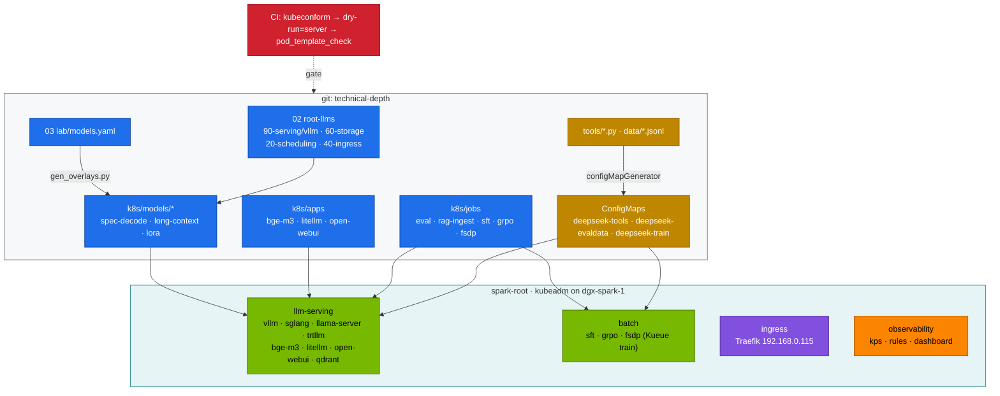
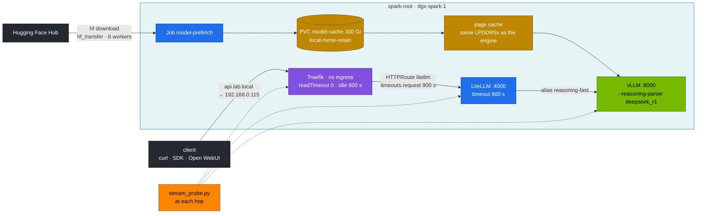
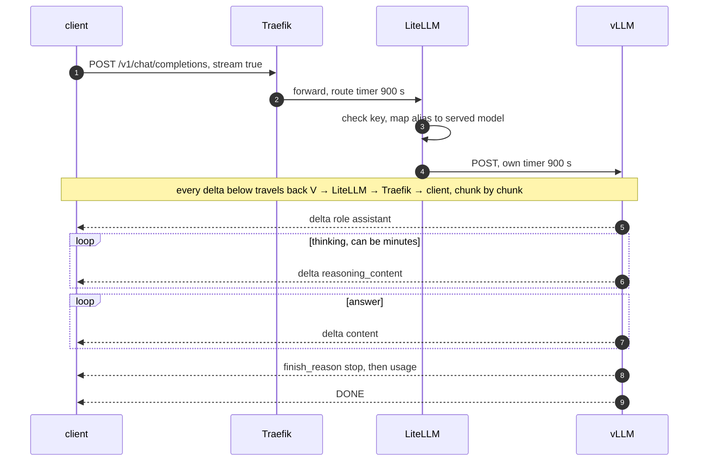

# Chapter 08 · Kubernetes deployment, weight caching & streaming

> **03-DeepSeek · Part III — Serving · Chapter 08 of 19** · ← [Chapter 07 · Alternative engines](07-alternative-engines-sglang-llamacpp-trtllm.md) · [All chapters](00-deepseek-step-by-step-guide.md) · [Chapter 09 · Autoscaling & queueing](09-autoscaling-and-queueing.md) →

| | |
|---|---|
| **You will build** | Ownership of every manifest the DeepSeek lab ships: how 02's single vLLM Deployment becomes fourteen model overlays, how tools reach Jobs without custom images, and how three validation layers catch a broken pod template before a ReplicaSet does. Then the weights: where they live on the NVMe, what a cold and a warm load cost, and why the page cache matters more on unified memory. Finally the request path, client → Traefik (192.168.0.115) → LiteLLM → vLLM, with server-sent events that survive a ten-minute chain of thought, measured hop by hop |
| **Hardware** | dgx-spark-1 (dgx-spark-2 optional for Task 5.10) |
| **Time** | 2.5 h |
| **Risk** | Low. Read-only until Task 5.3. Task 5.5 drops the page cache (harmless, the next read is slower). Drill D04 lowers LiteLLM's timeout; `scripts/breakfix.sh reset D04` restores it |
| **Clusters** | `spark-root` (namespaces `llm-serving`, `batch`, `ingress`, `observability`) · optionally `dev-llms` (try a changed manifest in `llm-sandbox` first) |
| **Lab files** | [`lab/kustomization.yaml`](lab/kustomization.yaml), [`lab/k8s/`](lab/k8s/), [`lab/scripts/gen_overlays.py`](lab/scripts/gen_overlays.py), [`lab/scripts/serve-model.sh`](lab/scripts/serve-model.sh), [`lab/tools/stream_probe.py`](lab/tools/stream_probe.py), [`lab/k8s/apps/litellm.yaml`](lab/k8s/apps/litellm.yaml), [`lab/k8s/ops/weights-verify.yaml`](lab/k8s/ops/weights-verify.yaml), [`lab/tests/run-local-checks.sh`](lab/tests/run-local-checks.sh), 02: [`vllm.yaml`](../02-Kubernetes/lab/manifests/root-llms/90-serving/vllm/vllm.yaml), [`60-storage/`](../02-Kubernetes/lab/manifests/root-llms/60-storage/), [`40-ingress/`](../02-Kubernetes/lab/manifests/root-llms/40-ingress/), [`traefik-values.yaml`](../02-Kubernetes/lab/addons/traefik-values.yaml), [`pod_template_check.py`](../02-Kubernetes/lab/tests/pod_template_check.py) |

---

## 1. Why this matters on a Spark

Chapters 05–07 started models with one command. To run them for real you have to own three things that the one-liner hides.

**The manifests.** Somebody has to review them, patch them and explain every field. The lab keeps that manageable with three rules:

| Rule | How the lab applies it |
|---|---|
| **One base, many overlays** | 02's `vllm.yaml` is the only hand-written vLLM Deployment. Every model in `models.yaml` is a generated JSON-patch overlay |
| **No custom images for tools** | Python tools, eval data and training scripts ship as ConfigMaps (`kubectl --context spark-root apply -k 03-DeepSeek/lab`) and mount into pinned NGC/stock images |
| **Admission is tested, not hoped for** | `kubeconform` (schemas) → server-side dry-run (API objects) → `pod_template_check.py` (Pod Security, CEL policies and quotas on the *pods*) |

**The weights.** A DeepSeek-R1-Distill-Qwen-32B checkpoint in BF16 is ~66 GB. Every restart, model switch or reboot reads it again. On a GB10 the page cache that holds those bytes after the read lives in the *same* ~121.7 GiB as the model's KV cache, so storage is a memory question too:

| Factor | Bad | Good |
|---|---|---|
| Where weights come from | Hugging Face on each start (minutes to hours, rate limits) | `model-cache` PVC on the local NVMe, prefetched once |
| Who downloads | every replica races for the same files | one `model-prefetch` Job, then servers start read-only |
| Memory during load | page cache full of old checkpoints competing with the engine for UMA | page cache dropped before a big load |

**The stream.** A chat model answers in seconds; R1 can think for minutes before the first answer token. Every hop has its own idea of how long a request may live and whether to pass bytes on at once, and the *shortest* timeout on the path wins:

| Property | Typical default | What R1 needs |
|---|---|---|
| request/read timeout | 30–60 s on many proxies | ≥ 900 s end to end |
| response buffering | some middlewares buffer whole responses | none: SSE chunks flush as they arrive |
| idle timeout | 60–180 s | covered by the token stream, as long as nothing buffers |
| client timeout | OpenAI Python SDK: 600 s | ≥ the server's longest generation |

---

## 2. Architecture — HLD

### 2.1 From the repo to the root's namespaces



### 2.2 Weights and the request path



### 2.3 One streamed R1 request



---

## 3. LLD

### 3.1 The base vLLM Deployment, field by field

| Field | Value | Why it's there |
|---|---|---|
| `strategy.type` | `Recreate` | a rolling update runs two copies and doubles the UMA used. Plan ~1–5 min downtime per switch |
| `priorityClassName` | `spark-serving` (50000) | serving outranks `spark-batch` (10000); training never preempts a model |
| `terminationGracePeriodSeconds` | 120 | longer than most generations, so streams finish on rollout |
| `lifecycle.preStop` | drain: 5 s, then until `vllm:num_requests_running` + `_waiting` = 0 (≤ 100 s) | the pod leaves the EndpointSlice first, then open streams finish before SIGTERM (vLLM aborts open requests on SIGTERM) |
| `startupProbe` | `/health`, 10 s × 180 | up to 30 min for first load and CUDA-graph capture without liveness killing it |
| `readinessProbe` / `livenessProbe` | `/health` 5 s / 15 s × 4 | traffic only when the engine is up. The readiness probe is required in `llm-serving` by the CEL policy `spark-serving-needs-readiness` |
| `resources` | cpu 1500m · memory 32Gi **request = limit** (patched per model) · `nvidia.com/gpu: 1` | 1 of 15 time-slices. Memory request = limit so the scheduler reserves the size the engine can really reach in the shared ~90 GiB pool |
| `--gpu-memory-utilization` | 0.20 in the base, per model in the overlay | a fraction of ~121.7 GiB. Sum over running models ≲ 0.72 (Chapter 05) |
| `/dev/shm` | `emptyDir: Memory`, 8Gi | NCCL and PyTorch IPC. The 64 MiB default breaks them |
| `env.MODEL`, `env.SERVED_NAME` | overlay-patched | args use `$(MODEL)`, so overlays touch env values, not the whole arg list |
| `HF_TOKEN` | Secret `hf-token` | gated models. Synced from vault01 `kv/spark-lab/hf` (Chapter 15), never stored in the repo |
| volume `models` | PVC `model-cache` (300Gi, `local-nvme-retain`) | weights survive pod and PVC deletion |
| image | `nvcr.io/nvidia/vllm:25.09-py3` (`lab/versions.env`) | pinned tag. `:latest` is rejected by admission in `llm-serving` and `batch` |

QoS class is `Burstable`: memory request equals limit, but CPU has a request and no limit, so the engine can use idle cores during load.

### 3.2 What an overlay changes

`gen_overlays.py` reads `models.yaml` and writes seven JSON-patch operations per model: `args`, `env[0]` (MODEL), `env[1]` (SERVED_NAME), `limits.memory`, `requests.memory` (always the same value) and the `model` label on the Deployment and on the pod template. Nothing else changes, so a security fix in 02's base reaches all fourteen models at once.

| Overlay | util | Pod memory (request = limit) | Runs with |
|---|---|---|---|
| r1-1.5b | 0.10 | 14Gi | anything that fits the pool |
| r1-7b, qwen2.5-7b-tools, llama-3.1-8b, r1-llama-8b, mistral-7b, nemotron-nano-8b | 0.20 | 28Gi | one or two more engines |
| qwen2.5-32b-awq, qwq-32b-awq | 0.30 | 40Gi | a 7B beside it |
| r1-32b-fp8, v2-lite, coder-v2-lite | 0.45 | 58Gi | a 7B at 0.20, or bge-m3 |
| mixtral-8x7b-fp8 | 0.55 | 70Gi | bge-m3 at most |
| r1-32b (BF16) | 0.70 | 87Gi | nothing: park every other engine, bge-m3 and the apps first |

Each generated overlay carries this budget as a comment, and `gen_overlays.py` refuses a catalog entry above 0.70. bge-m3 (Chapter 13) takes 0.06 and a 9 Gi pod whenever RAG is up, so count it in the sum.

### 3.3 Namespaces, Pod Security and who runs where

| Namespace | PSA enforce | Lab workloads | Notes |
|---|---|---|---|
| `llm-serving` | baseline | engines, apps, eval, rag-ingest, vault-sync, weights-verify | eval runs model-written code: non-root, no SA token, read-only root FS, all caps dropped |
| `batch` | privileged (warn baseline) | sft, unsloth, llamafactory, grpo, fsdp, zero3 | fsdp needs `hostNetwork` + `IPC_LOCK` for RoCE |
| `llm-multinode` | privileged | LWS 70B, llama.cpp RPC | two Sparks only (Chapter 04) |
| `ingress` | baseline | Traefik | watches only `llm-serving` and `ingress` |
| `observability` | — | PrometheusRule, dashboard ConfigMap | label `release: kps` |

### 3.4 Three layers of validation

| Layer | Tool | Catches | Misses |
|---|---|---|---|
| Schema | `kubeconform -strict` + CRD catalog | typos, wrong types, unknown fields | anything cluster-specific |
| API | `kubectl apply --dry-run=server` | missing namespaces/CRDs, webhook rejections, immutable fields | pod-level admission for controllers' pods |
| Pod | `pod_template_check.py` | PSA, ValidatingAdmissionPolicy (pinned tags, readiness probe, no `NVIDIA_VISIBLE_DEVICES`), ResourceQuota and LimitRange on the *pod* | runtime faults (OOM, image pull) |

### 3.5 Storage classes and the cache layout

| Class | Reclaim | Host path on dgx-spark-1 | Used for |
|---|---|---|---|
| `local-nvme` | Delete | `/data/k8s/<ns>/<pvc>` | scratch (`ds-swap`), fio |
| `local-nvme-retain` | **Retain** | `/data/k8s/retain/<ns>/<pvc>` | `model-cache`, Qdrant, Open WebUI, `deepseek-ckpt` |

Both are `WaitForFirstConsumer`: the volume binds when the first pod schedules. local-path does not enforce the requested size; the NVMe's free space does. The size still counts against `serving-budget` (`requests.storage: 1Ti`), so keep it honest.

```text
/models/hf/
  models--deepseek-ai--DeepSeek-R1-Distill-Qwen-7B/
    refs/main                      → commit hash
    blobs/<sha256>                 ← the bytes, deduplicated
    snapshots/<commit>/            ← symlinks into blobs/, what engines open
/models/manifests/<repo>@<commit>.json   ← weights-verify (Chapter 15)
/models/adapters/<name>/                 ← published LoRA adapters and fine-tunes (Chapter 10)
/models/gguf/                            ← llama.cpp (Chapter 07)
```

### 3.6 Load-time math

```text
cold load ≈ checkpoint bytes / NVMe sequential read  + engine init (graph capture, KV allocation)
warm load ≈ checkpoint bytes / memory copy rate      + engine init   (pages already cached)
```

| Model | Bytes on disk | Cold read at 5 GB/s (example) | Your NVMe (**record yours**, Task 5.4) |
|---|---|---|---|
| r1-7b BF16 | ~15 GB | ~3 s | |
| r1-32b-fp8 | ~34 GB | ~7 s | |
| r1-32b BF16 | ~66 GB | ~13 s | |

Once the read is local, engine init dominates. What prefetching buys is avoiding the *download*, which runs at WAN speed.

### 3.7 Page cache on unified memory

On a discrete-GPU server the page cache uses host RAM and VRAM is separate. On the GB10 they are **the same ~121.7 GiB**. After reading a 66 GB checkpoint the kernel keeps those pages; vLLM then asks for `util × 121.7 GiB`. The kernel can reclaim clean page cache, but under pressure that is slow and can push other pods into OOM. The page cache belongs to no pod, so no quota and no request sees it. Drop it before a big load:

```bash
# ▶ dgx-spark-1 (ssh dgx-spark-1)
sudo sh -c 'sync; echo 3 > /proc/sys/vm/drop_caches'
```

`serve-model.sh` does this itself only when it runs on the Spark with passwordless sudo; from the MacBook, run the command above over ssh first.

### 3.8 Disk budget for the catalog

| Group | Models | Approx. |
|---|---|---|
| reasoning | r1-1.5b, r1-7b, r1-32b, r1-32b-fp8 | ~119 GB |
| MoE | v2-lite, coder-v2-lite | ~64 GB |
| comparison | qwen2.5-7b-tools, qwen2.5-32b-awq, qwq-32b-awq, llama-3.1-8b, r1-llama-8b, mistral-7b, mixtral-8x7b-fp8, nemotron-nano-8b | ~164 GB |
| **whole catalog** | | **~347 GB: more than the 300 Gi PVC** |

Keep a working set, not the catalog: the reasoning group plus the two or three comparison models you are using, plus BGE-M3 and adapters, is well under 300 Gi. Delete what you no longer serve with `hf cache delete` (Task 5.3).

### 3.9 Timeouts per hop

| Hop | Setting | Lab value | Where |
|---|---|---|---|
| client | SDK `timeout`, curl `--max-time` | ≥ 900 s | your code |
| Traefik entrypoint `web` | `readTimeout` / `writeTimeout` / `idleTimeout` | 0 / 0 / 600 s | [`traefik-values.yaml`](../02-Kubernetes/lab/addons/traefik-values.yaml) |
| HTTPRoute `litellm`, `open-webui` | `rules[].timeouts.request` | 900 s | `k8s/apps/*.yaml` |
| LiteLLM | `router_settings.timeout`, `litellm_settings.request_timeout` | 900 s | ConfigMap `litellm-config` |
| Open WebUI → LiteLLM | `AIOHTTP_CLIENT_TIMEOUT` | 900 s | env in `k8s/apps/open-webui.yaml` |
| vLLM | none on the server; bounded by `max_tokens` × inter-token latency | — | — |
| vLLM shutdown | `preStop` drain (≤ ~105 s) + grace 120 s | — | 02 base Deployment |

### 3.10 The SSE wire format with the reasoning parser

```text
data: {"choices":[{"index":0,"delta":{"role":"assistant","content":""}}]}
data: {"choices":[{"index":0,"delta":{"reasoning_content":"The trip runs from 09:40"}}]}
…
data: {"choices":[{"index":0,"delta":{"content":"205 minutes."}}]}
data: {"choices":[{"index":0,"delta":{},"finish_reason":"stop"}]}
data: {"choices":[],"usage":{"prompt_tokens":38,"completion_tokens":611}}
data: [DONE]
```

`stream_options.include_usage` adds the usage chunk. LiteLLM passes `reasoning_content` through for `hosted_vllm/` models. What `stream_probe.py` prints:

| Field | Meaning | Healthy (**record yours**) |
|---|---|---|
| `ttfb` | first byte of the response | ≈ queue + prefill |
| `first reasoning` | first thinking token | ≈ TTFT |
| `first answer` | first token after `</think>` | seconds to minutes. This is what users feel |
| `ITL p50 / p99` | gap between chunks | p50 ≈ 1 / decode tok/s. Gateways add < 1 ms |
| `BUFFERED` | all chunks arrived in one burst at the end | must never appear |
| `TRUNCATED` | `finish_reason=length` | `max_tokens` too small for the chain of thought |

---

## 4. Integrations

- **02 platform**: namespaces, PriorityClasses, quotas, Kueue, the admission policies, the `model-cache` PVC and Traefik come from `02-Kubernetes/lab/scripts/apply-lab.sh root` ([02 Chapter 20](../02-Kubernetes/20-vllm-high-throughput-llm-serving.md), [Chapter 11](../02-Kubernetes/11-ingress-controllers-and-gateway-api.md), [Chapter 13](../02-Kubernetes/13-storage-csi-and-high-performance-volumes.md), [Chapter 14](../02-Kubernetes/14-multi-tenancy-resource-quotas-and-cgroups.md)).
- **Chapter 05** gives the util value and pod size of every overlay; **Chapter 06** the vLLM flags inside them.
- **Chapter 09** scales these Deployments with KEDA and queues the `batch` Jobs with Kueue.
- **Chapter 12** owns LiteLLM's keys, aliases and fallbacks and puts Open WebUI on the same path.
- **Chapter 15** applies exactly these kustomizations from Semaphore (`lab/ansible/15.1-deploy-deepseek.yml`), syncs `hf-token` from vault01 and pins every snapshot with sha256 manifests.
- **Chapter 16**: alert `ReasoningTruncated` fires when more than 20 % of requests end with `finish_reason=length`.
- **CI**: `.github/workflows/deepseek-lab-ci.yml` runs the three validation layers on a kind cluster with a fake GPU node.
- **01-Ansible [Chapter 15](../01-Ansible/15-nfs-rdma-and-parallel-file-systems.md)** exports the model share over NFS/RDMA for dgx-spark-2 (Task 5.10).

---

## 5. Lab

All commands run on the MacBook from `03-DeepSeek/lab` with the lab kubeconfig, unless the location line says otherwise:

```bash
# ▶ MacBook · 03-DeepSeek/lab
export KUBECONFIG="$PWD/../../01-Ansible/lab/.cache/kubeconfig-spark-lab.yaml"
kubectl --context spark-root get ns llm-serving batch ingress observability
```

### Task 5.1 · Render everything and diff two models

#### What this lab does (`kubectl kustomize`, `gen_overlays.py --check`)

- **Where:** on the MacBook only. Rendering is local; nothing is sent to the cluster.
- **Renders** the root kustomization (the tool, eval-data and catalog ConfigMaps), counts the objects in every model overlay and in `k8s/apps`, and diffs the rendered `r1-7b` against `r1-32b-fp8`.
- **Checks** that the committed overlays match `models.yaml`.

#### What to look for

1. **Root kustomization:** `ConfigMap/deepseek-tools`, `ConfigMap/deepseek-evaldata`, `ConfigMap/deepseek-catalog` and `ConfigMap/deepseek-train`.
2. **Per overlay:** `2 objects` (Deployment, Service) for every `k8s/models/*`. No Secret: `hf-token` comes from Vault (Chapter 15). The ServiceMonitor `llm-workloads` that scrapes vLLM is not in the overlay: it lives in `observability` (02 `root/95-observability`).
3. **The diff** touches only args, the `MODEL`/`SERVED_NAME` env values, memory request and limit (`28Gi` vs `58Gi`) and the `model` labels.
4. **Overlay check:** `14 overlays checked, 0 drifted`.

**If something's off:** `accumulating resources … no such file` → run from `03-DeepSeek/lab`; the overlays find 02's base by relative path. Extra lines in the diff → a generated file was edited by hand; `--check` names it. More in §7.

#### Run it

```bash
# ▶ MacBook · 03-DeepSeek/lab
kubectl kustomize . | yq -N '.kind + "/" + .metadata.name'
for d in k8s/models/* k8s/apps; do printf '%-28s %s objects\n' "$d" "$(kubectl kustomize "$d" | grep -c '^kind:')"; done
diff <(kubectl kustomize k8s/models/r1-7b) <(kubectl kustomize k8s/models/r1-32b-fp8)
python3 scripts/gen_overlays.py --check
```

Expected: four ConfigMaps from the root kustomization (three in `llm-serving`, `deepseek-train` in `batch`); two objects per model overlay (Deployment and Service from the base). The diff shows only args, env values, memory request and limit, and `model` labels. Anything else means somebody edited a generated file, and `--check` reports it.

### Task 5.2 · The three validation layers, and a failure only the third one catches

#### What this lab does (script `lab/tests/run-local-checks.sh`, `02-Kubernetes/lab/tests/pod_template_check.py`)

- **Without `API=1`:** everything CI runs, on the MacBook: yamllint, overlay sync, budget checks, kustomize + kubeconform, promtool rules and alert tests, shellcheck, and the tools against local mocks. Needs python3 with CPU torch and pyyaml, kubectl, kubeconform, promtool and shellcheck.
- **With `API=1`:** additionally a server-side dry run of every manifest against `spark-root`, and a pod-level check of every pod template (PSA, the CEL policies, quotas). **It re-applies 02's `00-platform`, `10-tenancy` and `20-scheduling`, briefly applies the training window for the training Jobs, then puts the everyday quotas back.** Don't run it while a training window is open.
- **The single `pod_template_check.py` call** checks two pod templates: the `r1-7b` Deployment and the `eval` Job.
- **The two broken edits** (`hostNetwork: true` in `eval.yaml`, a `:latest` image in a copy of an overlay) are yours to make and revert.

#### What to look for

1. **Local run:** ends with `ALL LOCAL CHECKS PASSED`.
2. **`API=1` run:** the same last line, with `… pod templates checked, 0 rejected` for both the serving and the training sections.
3. **Single check:** `2 pod templates checked, 0 rejected`.
4. **With `hostNetwork: true`:** a `REJECTED … :: Job/eval …` line naming PodSecurity `baseline` and host namespaces, though `--dry-run=server` on the Job alone passes.
5. **With `:latest`:** a `REJECTED` line from the CEL policy for pinned tags.
6. **After reverting:** `git status` shows `eval.yaml` unchanged.

**If something's off:** `kubeconform: command not found` (or promtool, shellcheck) → install it on the MacBook. A training window you had open is closed after `API=1` → that's the script's last step; re-apply the window. More in §7.

#### Run it

```bash
# ▶ MacBook · 03-DeepSeek/lab
tests/run-local-checks.sh                     # schema + tool tests, no cluster needed
API=1 tests/run-local-checks.sh               # + server-side dry-run + pod templates against spark-root
python3 ../../02-Kubernetes/lab/tests/pod_template_check.py k8s/models/r1-7b k8s/jobs/eval.yaml
```

```text
2 pod templates checked, 0 rejected
```

Now add `hostNetwork: true` to the pod spec in `k8s/jobs/eval.yaml` and run the last command again. The Job object passes `--dry-run=server`, but the pod check rejects it (`violates PodSecurity "baseline:latest": host namespaces`). Without that layer you would find out from a Job stuck at 0 pods. Repeat with `image: …:latest` in a copy of an overlay: the CEL policy rejects it. Revert both.

### Task 5.3 · Serve a model and inspect the live objects

#### What this lab does (`kubectl apply -k .`, `serve-model.sh r1-7b`)

- **Applies the ConfigMaps** (`deepseek-tools`, `deepseek-evaldata`, `deepseek-catalog` in `llm-serving`; `deepseek-train` in `batch`).
- **Serves `r1-7b`:** prefetch into `model-cache`, apply the overlay (util 0.20, **28 Gi** request = limit, one GPU slice), wait, smoke test.
- **Inspects** the Deployment, Service and PVC, the ServiceMonitor `llm-workloads` in `observability` that scrapes them, the pod's args, priority, QoS and resources, and the quota; then the cache directory and free space on the Spark. All read-only.

#### What to look for

1. **`serve-model.sh`:** `0 failed`.
2. **Pod and quota:**

   | Field | Healthy value |
   |---|---|
   | `Priority` | `50000` (`spark-serving`) |
   | `QoS Class` | `Burstable` |
   | `Requests` / `Limits` memory | `28Gi` / `28Gi` |
   | `nvidia.com/gpu` | `1` |
   | PVC `model-cache` | `Bound`, class `local-nvme-retain` |
   | `serving-budget` used memory | includes the 28 Gi |
3. **On the Spark:** `du` lists one `models--…` directory per model you've served (r1-7b about 15G); `df -h /data` leaves room for the working set (§3.8).

**If something's off:** `du` finds nothing → the PVC's host path differs; `kubectl --context spark-root get pv` shows it. More in §7.

#### Run it

```bash
# ▶ MacBook · 03-DeepSeek/lab
kubectl --context spark-root apply -k .                              # ConfigMaps
scripts/serve-model.sh r1-7b                                         # prefetch → apply overlay → wait → smoke test
kubectl --context spark-root -n llm-serving get deploy,svc,pvc -o wide
kubectl --context spark-root -n observability get servicemonitor llm-workloads
kubectl --context spark-root -n llm-serving get pod -l app=vllm -o jsonpath='{.items[0].spec.containers[0].args}' | tr ',' '\n'
kubectl --context spark-root -n llm-serving describe pod -l app=vllm | grep -E 'Priority|QoS|Limits|Requests' -A2
kubectl --context spark-root -n llm-serving describe resourcequota serving-budget | grep -E 'memory|gpu'
```

Expected: `Priority: 50000`, `QoS Class: Burstable`, memory `28Gi` in both requests and limits (the r1-7b overlay), `nvidia.com/gpu: 1`, and the 28 Gi charged to `serving-budget`. If you only want to try a changed manifest, render it with the namespace switched to `llm-sandbox` and apply it to `--context dev-llms` with a ~0.5B model at util 0.02 (02 Chapter 04) before it touches the running models.

Then look at the cache on the host and how much space the catalog leaves:

```bash
# ▶ dgx-spark-1 (ssh dgx-spark-1)
sudo du -sh /data/k8s/retain/llm-serving/model-cache/hf/models--* | sort -h
df -h /data
```

### Task 5.4 · Measure the NVMe, then cold vs warm loads

#### What this lab does (Job `02-Kubernetes/lab/manifests/root/60-storage/fio-job.yaml`, then vLLM restarts)

- **fio:** a 64 Gi `local-nvme` scratch PVC and Job `fio-ai` in `platform-tools`: four 45-second profiles on a 16 GB file (sequential 1M read and write, random 128k read, random 4k read).
- **A raw read of the checkpoint** inside the vLLM pod, cold (page cache dropped) and warm: what the disk and the page cache deliver without vLLM.
- **Restarts vLLM twice:** once with the weights in page cache (warm), once right after dropping it (cold), timing `rollout status` and reading the loader's log lines. The model stays `r1-7b`.
- **Separates the disk from the loader:** if the raw read takes seconds and the loader a minute, warm or cold, the loader is the bottleneck.

#### What to look for

1. **fio:** a `weights-seqread-1m: (groupid=…)` block and its `READ:` bandwidth line; record it for §3.6's formula.
2. **Raw read and restarts:**

   | Row | Healthy value | Seen on a Spark (nvcr vLLM 25.09 = vLLM 0.10.1.1, r1-7b, 15 GB) |
   |---|---|---|
   | raw `cat`, cold | 15 GB ÷ NVMe speed: a few seconds | 6.1 s (≈ 2.5 GB/s) |
   | raw `cat`, warm | well under a second | 0.6 s (≈ 25 GB/s) |
   | `Loading weights took`, warm | §3.6 says seconds; on the GB10 about a minute | 73.7 s, retest 81.2 s |
   | `Loading weights took`, cold | about the same as warm | 76.0 s, retest 75.9 s |
   | `Graph capturing finished` | seconds | 7 s |
   | `rollout status` wall time | 2–3 min | 2:18 warm, 2:28 cold |

   Warm and cold restarts differ by noise, while the raw read is 10–100× faster than the loader. The disk and the page cache are not what sets the load time: vLLM's weight loader moves the checkpoint at about 190 MB/s whatever the source (the FP8 32B in Chapter 05 Task 5.3 took 187 s for 32 GiB, the same rate). §3.6's formula is the floor the hardware allows; the loader path (safetensors parsed tensor by tensor, each copied into GPU allocations) is the real cost, and the rest of the wall time is pod start, KV allocation and the readiness probe. Restart cost on this Spark: about 2.5 min for a 7B, 4 min for a 32B.
3. **`rollout status`** ends with `successfully rolled out` within the 30 min timeout.
4. **No faster loader in this image:** vLLM 0.10.1.1 has no `--safetensors-load-strategy`, and neither `fastsafetensors` nor `runai_model_streamer` is installed, so `--load-format` offers nothing quicker than the default.

**If something's off:** warm `cat` as slow as cold → the page cache was evicted between the two reads; check `free -g` on the Spark. A fio Job or `vllm-load` still running skews every number: run the pre-check first. More in §7.

#### Run it

**Pre-check: nothing else on the disk or the engine.**

```bash
# ▶ MacBook · any folder
kubectl --context spark-root -n platform-tools get job,pvc | grep -i fio                  # empty, unless you're about to run fio
kubectl --context spark-root -n llm-serving get pods -l app=vllm                          # one vllm pod, 1/1 Running, serving r1-7b
kubectl --context spark-root get pods -A | grep -E 'prefetch|eval|fio|bench|load' | grep -v Completed   # empty: no downloads, evals or load generator
```

If the last line shows `vllm-load` (02 Chapter 20 §5.6), delete it from `02-Kubernetes/lab`: `kubectl --context spark-root delete -f manifests/root-llms/90-serving/vllm/vllm-load.yaml`.

**Step 1 · fio: the NVMe on its own.**

```bash
# ▶ MacBook · 02-Kubernetes/lab
kubectl --context spark-root apply -f manifests/root/60-storage/fio-job.yaml
kubectl --context spark-root -n platform-tools logs -f job/fio-ai | grep -E '^\S+:|READ:|WRITE:'
kubectl --context spark-root delete -f manifests/root/60-storage/fio-job.yaml             # clean up: Job + 64 Gi scratch PVC
```

Record the `weights-seqread-1m` bandwidth: it is the denominator of the cold-load estimate in §3.6. Delete the Job before the restarts so fio doesn't compete for the NVMe.

**Step 2 · three shortcuts for this terminal.** `drop` empties the Spark's page cache over ssh and asks for your sudo password there.

```bash
# ▶ MacBook · 03-DeepSeek/lab
k() { kubectl --context spark-root -n llm-serving "$@"; }
drop() { ssh -t dgx-spark-1 "sudo sh -c 'sync; echo 3 > /proc/sys/vm/drop_caches' && free -g | awk 'NR==1||/Mem/'"; }
W='/models/hf/models--deepseek-ai--DeepSeek-R1-Distill-Qwen-7B/snapshots/*/*.safetensors'
```

**Step 3 · raw read: disk and page cache without vLLM.**

```bash
# ▶ MacBook · 03-DeepSeek/lab
drop                                                    # buff/cache drops to a few GiB
k exec deploy/vllm -- sh -c "time cat $W >/dev/null"    # cold: from the NVMe
k exec deploy/vllm -- sh -c "time cat $W >/dev/null"    # warm: from the page cache
```

**Step 4 · warm restart** (the cache is full from step 3's second read).

```bash
# ▶ MacBook · 03-DeepSeek/lab
k rollout restart deploy/vllm
time k rollout status deploy/vllm --timeout=30m
k logs deploy/vllm | grep -E 'Loading weights took|Model loading took|Graph capturing finished'
```

**Step 5 · cold restart.**

```bash
# ▶ MacBook · 03-DeepSeek/lab
drop
k rollout restart deploy/vllm
time k rollout status deploy/vllm --timeout=30m
k logs deploy/vllm | grep -E 'Loading weights took|Model loading took|Graph capturing finished'
```

Optional, while step 4 or 5 is loading: `top -b -d 5 -n 12 | grep -E 'VLLM|python' | head -24` on the Spark shows what the loader process does with the CPU.

**Step 6 · is a faster loader available in this image?**

```bash
# ▶ MacBook · 03-DeepSeek/lab
k exec deploy/vllm -- python3 -c "import vllm; print('vllm', vllm.__version__)"
k exec deploy/vllm -- vllm serve --help 2>/dev/null | grep -E 'safetensors-load-strategy|load-format'
k exec deploy/vllm -- python3 -c "import importlib.util as u; [print(m, 'yes' if u.find_spec(m) else 'no') for m in ('fastsafetensors','runai_model_streamer')]"
```

With `--safetensors-load-strategy` listed (newer vLLM) or either library `yes`, test it with one extra arg in the model's overlay (`--safetensors-load-strategy=eager`, `--load-format=fastsafetensors` or `--load-format=runai_streamer`) and repeat steps 4–5. With none of them, as on 25.09, the load time is a fixed cost of the image.

**Retest:** steps 3–5 again, in the same terminal (or redefine step 2's shortcuts in a new one). One run of each is noisy by ±5 s; two runs show the pattern.

**Clean up:** the fio Job and PVC are already gone after step 1 (`kubectl --context spark-root -n platform-tools get job,pvc | grep -i fio` prints nothing). The restarts leave `r1-7b` serving as before; nothing else to undo. The shortcuts disappear with the terminal.

| | Raw `cat` | Wall time | Weight load (log) | Graph capture (log) |
|---|---|---|---|---|
| cold | | | | |
| warm | | | | |

**Record yours.**

#### What each command does

| Command | What it does | Why |
|---|---|---|
| `get … \| grep -E 'prefetch\|eval\|fio\|bench\|load'` | lists anything else reading the disk or calling the engine | other traffic skews both the raw read and the load time |
| `apply -f fio-job.yaml` · `logs -f job/fio-ai` | runs four fio profiles on a scratch PVC on the same NVMe | the disk's own speed, the floor for any load |
| `delete -f fio-job.yaml` | removes the Job and its 64 Gi PVC | fio must not run during the restarts |
| `k()` · `drop()` · `W=` | shorthand for the namespace, the cache drop over ssh, and the checkpoint files | keeps the test lines short and identical between runs |
| `drop` | `sync; echo 3 > /proc/sys/vm/drop_caches` on the Spark, then `free -g` | empties the page cache: the next read comes from the NVMe |
| `exec … time cat $W >/dev/null` | reads the 15 GB checkpoint inside the pod and throws it away | disk (cold) and RAM (warm) speed with vLLM out of the picture |
| `rollout restart` · `time rollout status` | replaces the vLLM pod and times until it is Ready | the restart cost a user sees |
| `logs … grep 'Loading weights took\|…'` | vLLM's own timings for the weight load, total model load and graph capture | splits the restart into loader, model and engine-init time |
| `vllm.__version__` · `serve --help` · `find_spec` | version, loader flags, fast-loader libraries | whether a faster loading path exists in this image |

### Task 5.5 · Watch the page cache compete for UMA

#### What this lab does (shell on dgx-spark-1)

- **Reads the `r1-7b` safetensors files** from the model-cache host path into nothing, so the kernel keeps them in page cache.
- **Drops the page cache** with `drop_caches` and shows memory again. Nothing in Kubernetes changes; the running vLLM pod keeps its memory.

#### What to look for

1. **`free -g` `buff/cache`:** grows by about 15 after the `cat`, then falls back after `drop_caches`.
2. **`available`:** falls by the same amount while the pages are cached, although no pod requested anything.
3. **Totals:** `total` stays at 121 (GiB) throughout.

**If something's off:** `No such file or directory` on the `cat` → `r1-7b` isn't in the cache yet, or the path differs (Task 5.3's `du`). More in §7.

#### Run it

```bash
# ▶ dgx-spark-1 (ssh dgx-spark-1)
free -g                                           # note buff/cache
cat /data/k8s/retain/llm-serving/model-cache/hf/models--deepseek-ai--DeepSeek-R1-Distill-Qwen-7B/snapshots/*/*.safetensors > /dev/null
free -g                                           # buff/cache grows by ~15 GB
sudo sh -c 'sync; echo 3 > /proc/sys/vm/drop_caches'
free -g                                           # back down
```

None of those 15 GB appeared in any quota or pod request. That is the gap between the declared ~90 GiB pool and real bytes (02 Chapter 20 §9).

### Task 5.6 · Pin what you downloaded

#### What this lab does (CronJob `lab/k8s/ops/weights-verify.yaml`)

- **Creates CronJob `weights-verify`** in `llm-serving` (nightly at 03:17) and starts one run now as Job `wv-now`.
- **Trust on first use:** for every cached snapshot without a manifest, it hashes the files and writes `/models/manifests/<repo>@<commit>.json`. Later runs verify against those manifests and fail on any change.
- Reads the weights from `model-cache`; only the manifests directory is written.

#### What to look for

1. **First run:** one `== NEW  <org>--<repo>@<commit>` line per cached snapshot, each with `N files, X GiB hashed in …s`.
2. **A second run** (`create job --from=cronjob/weights-verify wv-2`): `== CHECK … ` with `✓ weights match manifest` for each snapshot.
3. **Job status:** `wv-now` `Complete`.

**If something's off:** `MISSING`, `CHANGED` or `EXTRA` lines → the cached bytes differ from the manifest; re-download that snapshot. Hashing large models takes minutes. More in §7.

#### Run it

```bash
# ▶ MacBook · 03-DeepSeek/lab
kubectl --context spark-root apply -f k8s/ops/weights-verify.yaml
kubectl --context spark-root -n llm-serving create job --from=cronjob/weights-verify wv-now
kubectl --context spark-root -n llm-serving logs -f job/wv-now
```

Expected: `== NEW  deepseek-ai--DeepSeek-R1-Distill-Qwen-7B@<commit>` for each snapshot on the first run, `== CHECK …` followed by `✓ weights match manifest` later. Chapter 15 runs it nightly.

### Task 5.7 · Stream through every hop

#### What this lab does (script `lab/tools/stream_probe.py`)

- **Needs the app stack** (`k8s/apps`, Chapter 12) and `192.168.0.115 api.lab.local webui.lab.local` in the MacBook's `/etc/hosts`.
- **Reads the LiteLLM master key** from Secret `litellm-master-key` into `$KEY` (not printed).
- **Streams one R1 request** four times: straight to vLLM (port-forward :8000), through LiteLLM (port-forward :4000, alias `reasoning-fast`), and through Traefik on 192.168.0.115 by name and by IP. Read-only.

#### What to look for

1. **Each probe** prints `ttfb`, `first reasoning`, `first answer`, chunk counts, `ITL p50/p99` and `finish_reason=stop`.
2. **Across hops:** `ttfb` grows by a few ms per hop; `ITL p50` stays within about 1 ms; `first answer` is set by the thinking length.
3. **Never:** a `BUFFERED`, `TRUNCATED` or `REASONING IN CONTENT` line.
4. **Raw curl:** `data:` lines with `reasoning_content` deltas first, then `content` deltas.

**If something's off:** `401` at LiteLLM or Traefik → `$KEY` is empty or the header is missing. `404` from Traefik → the Host header doesn't match the HTTPRoute (`api.lab.local`). More in §7.

#### Run it

Prerequisites: `kubectl --context spark-root apply -k k8s/apps` (Chapter 12), and on the MacBook `/etc/hosts` contains `192.168.0.115 api.lab.local webui.lab.local` (Traefik's MetalLB address on the root).

```bash
# ▶ MacBook · 03-DeepSeek/lab
KEY=$(kubectl --context spark-root -n llm-serving get secret litellm-master-key -o jsonpath='{.data.key}' | base64 -d)
pkill -f 'port-forward svc/vllm 8000'; kubectl --context spark-root -n llm-serving port-forward svc/vllm 8000 & sleep 2
kubectl --context spark-root -n llm-serving port-forward svc/litellm 4000 &
python3 tools/stream_probe.py --url http://localhost:8000 --model r1-7b                                  # hop 1: vLLM
python3 tools/stream_probe.py --url http://localhost:4000 --api-key "$KEY" --model reasoning-fast         # hop 2: + LiteLLM
python3 tools/stream_probe.py --url http://api.lab.local --api-key "$KEY" --model reasoning-fast         # hop 3: + Traefik
python3 tools/stream_probe.py --url http://192.168.0.115 --host api.lab.local --api-key "$KEY" --model reasoning-fast   # same, by IP
```

Output shape (numbers illustrative; one BF16 7B stream can't beat the bandwidth ceiling `model_math.py` prints):

```text
http://localhost:8000  model=r1-7b
  ttfb      41 ms | first reasoning      41 ms | first answer   36930 ms | total 39.70 s
  chunks 642 (reasoning 598, answer 44) | ITL p50 61.5 ms p99 70.3 ms | ≈16 chunks/s
  finish_reason=stop  usage={'prompt_tokens': 38, 'completion_tokens': 643, …}
```

| Hop | ttfb (ms) | first answer (s) | ITL p50 (ms) | ITL p99 (ms) |
|---|---|---|---|---|
| vLLM | | | | |
| + LiteLLM | | | | |
| + Traefik | | | | |

Expected: each hop adds a few ms to `ttfb` and almost nothing to ITL. `first answer` is set by the model's thinking length, not the network. To see the raw events:

```bash
# ▶ MacBook · 03-DeepSeek/lab
curl -sN http://api.lab.local/v1/chat/completions -H "Authorization: Bearer $KEY" -H 'Content-Type: application/json' \
  -d '{"model":"reasoning-fast","stream":true,"messages":[{"role":"user","content":"Is 221 prime?"}]}' | head -20
```

### Task 5.8 · Drill D04 — the 30-second gateway, and D08 — 404 model not found

#### What this lab does (script `lab/scripts/breakfix.sh`, drills D04 and D08)

- **D04 inject:** rewrites `timeout` and `request_timeout` in ConfigMap `litellm-config` from 900 to 30 s and restarts Deployment `litellm`. **`reset D04`** re-applies `k8s/apps/litellm.yaml` and restarts it again.
- **D04 test:** one long proof request with up to 16,384 tokens through Traefik and LiteLLM.
- **D08:** changes nothing; it prints a harness command that uses the Hugging Face repo id as the model name, which you run against vLLM.

#### What to look for

1. **D04:** the stream stops at about 30 s with an error, while the same request straight to vLLM (hop 1) completes. The LiteLLM log shows a timeout.
2. **After `reset D04`:** a long request through `api.lab.local` completes again.
3. **D08:** the harness gets `404` (model does not exist); `/v1/models` lists `r1-7b`, the served name.

**If something's off:** D04 doesn't cut at 30 s → the request finished in under 30 s; use a longer prompt or larger `--max-tokens`. More in §7.

#### Run it

```bash
# ▶ MacBook · 03-DeepSeek/lab
scripts/breakfix.sh inject D04
python3 tools/stream_probe.py --url http://api.lab.local --api-key "$KEY" --model reasoning-fast --max-tokens 16384 \
  --prompt "Prove that there are infinitely many primes of the form 4k+3, step by step."
scripts/breakfix.sh hint D04
```

Expected: the stream dies at ~30 s, while hop 1 straight to vLLM completes. Find which hop gave up (`kubectl --context spark-root -n llm-serving logs deploy/litellm | grep -i timeout`), then `scripts/breakfix.sh answer D04` and `scripts/breakfix.sh reset D04`.

```bash
# ▶ MacBook · 03-DeepSeek/lab
scripts/breakfix.sh inject D08     # prints a command that uses the HF repo id as the model name
python3 tools/eval_harness.py --url http://localhost:8000 --model deepseek-ai/DeepSeek-R1-Distill-Qwen-7B --suites json --limit 2
curl -s localhost:8000/v1/models | jq -r '.data[].id'
scripts/breakfix.sh answer D08
```

### Task 5.9 · Make a hop buffer, then catch it

#### What this lab does (patch on HTTPRoute `litellm`)

- **Adds 02's `llm-body-limit` middleware** (Traefik `buffering`) as a filter on the LiteLLM HTTPRoute in `llm-serving`.
- **Probes the stream** through Traefik once.
- **Removes the filter** by re-applying `k8s/apps/litellm.yaml`.

#### What to look for

1. **Patch:** `httproute.gateway.networking.k8s.io/litellm patched`.
2. **Probe:** a `BUFFERED` line and `first answer` ≈ `total`: Traefik's `buffering` middleware holds the response even with only request limits set (measured on this lab's Traefik, 02 Chapter 11 §5.5).
3. **After re-apply:** a new probe shows no `BUFFERED` line.

**If something's off:** the patch fails with `filters` already present → the route was patched before; re-apply `k8s/apps/litellm.yaml` and try again. More in §7.

#### Run it

Attach 02's `llm-body-limit` middleware (Traefik `buffering`) to the LiteLLM route:

```bash
# ▶ MacBook · 03-DeepSeek/lab
kubectl --context spark-root -n llm-serving patch httproute litellm --type json -p '[{"op":"add","path":"/spec/rules/0/filters","value":[
  {"type":"ExtensionRef","extensionRef":{"group":"traefik.io","kind":"Middleware","name":"llm-body-limit"}}]}]'
python3 tools/stream_probe.py --url http://api.lab.local --api-key "$KEY" --model reasoning-fast
kubectl --context spark-root apply -f k8s/apps/litellm.yaml          # remove the filter
```

Expected: the probe prints `BUFFERED` and `first answer ≈ total`; users see nothing until the answer is complete. Put request-size limits on a separate non-streaming route, or enforce them in LiteLLM.

### Task 5.10 · (2×) Share the cache with dgx-spark-2 over NFS/RDMA

#### What this lab does (read-only checks of the NFS/RDMA share)

- **Needs dgx-spark-2** and 01-Ansible `15.1-nfs-rdma.yml` already run. With only dgx-spark-1, skip it.
- **On dgx-spark-1:** lists the NFS exports.
- **On dgx-spark-2:** checks the mount options and reads one large weight blob over the share with `dd` to measure throughput. Nothing is written.
- **What the share holds:** `/srv/models` on dgx-spark-1 is its own directory, not the `model-cache` PVC (`/data/k8s/retain/llm-serving/model-cache`). It holds what the two-Spark workloads put there, such as the 70B of [Chapter 04](04-scaling-beyond-one-spark.md) Task 8 in `/srv/models/hf`.

#### What to look for

| Check | Healthy value |
|---|---|
| `showmount -e localhost` | `/srv/models 192.168.100.0/24` |
| `mount \| grep /mnt/models` | `proto=rdma,port=20049` |
| `dd` | a GB/s figure; compare it with Task 5.4's local seq read |

**If something's off:** `proto=tcp` → `rpcrdma` isn't loaded or the port is wrong. `find` prints nothing → no weights are on the share yet; download one model into `/srv/models/hf` on dgx-spark-1 (Chapter 04 Task 8). More in §7.

#### Run it

01-Ansible `15.1-nfs-rdma.yml` (run from Semaphore) exports `/srv/models` from dgx-spark-1 to the CX-7 subnet and mounts it on dgx-spark-2 at `/mnt/models`.

```bash
# ▶ dgx-spark-1 (ssh dgx-spark-1)
showmount -e localhost                             # /srv/models 192.168.100.0/24
```

```bash
# ▶ dgx-spark-2 (ssh dgx-spark-2)
mount | grep /mnt/models                           # proto=rdma,port=20049
f=$(find /mnt/models/hf -path '*/blobs/*' -size +1G | head -1); echo "$f"
dd if="$f" of=/dev/null bs=16M status=progress
```

Compare with the local NVMe read from Task 5.4 (**record yours**).

---

## 6. Verify

| Check | Command | Expected |
|---|---|---|
| overlays in sync | `python3 scripts/gen_overlays.py --check` | `14 overlays checked, 0 drifted` |
| admission | `API=1 tests/run-local-checks.sh` | `0 rejected`. PodSecurity *warnings* in `batch` are advisory |
| live serving | `scripts/verify.sh platform serving` | all `PASS` |
| PVC | `kubectl --context spark-root -n llm-serving get pvc model-cache` | `Bound`, class `local-nvme-retain` |
| warm restart | vLLM log | weight-load line in seconds, not minutes |
| manifests | `/models/manifests` | one JSON per snapshot |
| three hops | `stream_probe.py` | all `finish_reason=stop`, no `BUFFERED`, ITL p50 within ~1 ms of each other |
| long reasoning | a 5-minute generation through `api.lab.local` | completes |

---

## 7. Troubleshooting

| You see | Cause | Fix |
|---|---|---|
| `kubectl kustomize`: `accumulating resources … no such file` | overlays find 02's base by relative path | keep the repo layout; run from `03-DeepSeek/lab` |
| `error: … is immutable` on a Job | Job templates can't be patched | `kubectl --context spark-root -n <ns> delete job <name>`, then apply |
| Deployment `0/1`, `FailedCreate … violates PodSecurity` | pod-level admission | run `pod_template_check.py` on it; fix securityContext or move namespace |
| `exceeded quota: serving-budget` on the ReplicaSet | other engines hold most of the 90 Gi | `describe resourcequota serving-budget`; park an engine (02 Chapter 20 §9) |
| pod `Pending`, `Insufficient memory` | the LLM pool is taken (engines plus batch pods, all request = limit) | `kubectl --context spark-root describe node dgx-spark-1 \| sed -n '/Allocated resources/,/Events/p'` |
| a ConfigMap change doesn't reach a Job | ConfigMaps mount at pod start | re-run the Job (`disableNameSuffixHash` keeps names stable) |
| PVC `Pending` | `WaitForFirstConsumer`, no pod yet | normal; it binds with the first pod |
| two pods downloading, `.incomplete` files | servers started before the prefetch | always prefetch first (`serve-model.sh` does) |
| `No space left on device` during prefetch | working set grew past the PVC or the NVMe | `hf cache scan --dir /models/hf`, `hf cache delete`; keep a working set (§3.8) |
| vLLM OOM at load right after a big download | page cache holding the checkpoint | drop caches (§3.7); lower util |
| deleted the PVC, weights gone? | no: `Retain` | the PV is `Released`; clear `claimRef` to re-bind or copy from `/data/k8s/retain/…` |
| NFS mount falls back to TCP | `rpcrdma` missing or wrong port | `modprobe rpcrdma`; `proto=rdma,port=20049` (01-Ansible Chapter 15) |
| `504` after exactly N seconds | shortest timeout on the path | probe each hop; raise that hop to ≥ 900 s |
| stream cut at 600 s from Python | OpenAI SDK default | `OpenAI(timeout=900)` |
| nothing for minutes, then the whole answer | a hop buffers SSE | remove buffering/compression middleware from streaming routes |
| `finish_reason=length`, empty answer | thinking used up `max_tokens` | raise `max_tokens` (R1: 8K–32K) |
| thinking inside `content` | no reasoning parser (D01) | `--reasoning-parser=deepseek_r1` |
| `401` at the gateway, `200` at vLLM | LiteLLM needs the key | `Authorization: Bearer $KEY` |
| `404` from Traefik | Host header doesn't match the HTTPRoute | `192.168.0.115 api.lab.local` in `/etc/hosts`, or `--host` |
| streams break during a model switch | `Recreate` stops the old pod | expected; switch models in a quiet window |

---

## 8. Scale-out path (2×)

| One Spark | Two Sparks | Datacenter |
|---|---|---|
| kustomize overlays applied by script or Semaphore | same overlays; `maxReplicaCount: 2`, one replica per Spark | Argo CD ApplicationSets per cluster/GPU type |
| pod-template check in CI | same | the same policies enforced by ValidatingAdmissionPolicy/Kyverno, tested in CI |
| `model-cache` on local NVMe, prefetch Job | NFS/RDMA share from dgx-spark-1 over the CX-7 | node-local NVMe filled from an object store or internal HF mirror; parallel FS or 3FS (Chapter 04); GPUDirect Storage |
| `drop_caches` before a load | on both | dedicated host RAM; page cache doesn't compete with HBM |
| Traefik + LiteLLM, 900 s everywhere | Traefik spreads over two replicas | L7 gateway with per-route timeouts plus an LLM-aware router (Gateway API Inference Extension) |
| `Recreate` downtime | `RollingUpdate` with `maxSurge: 1` | rolling updates, drain on `num_requests_running == 0` |

---

## 9. Checklist

- [ ] I can explain every field of the base vLLM Deployment and why memory request = limit.
- [ ] I can show that overlays differ only in model-specific fields.
- [ ] I've seen a pod-level admission failure that server-side dry-run missed.
- [ ] I know where every model's bytes live, how much of the 300 Gi PVC is left, and which models are my working set.
- [ ] I measured cold and warm load times and know what dominates each.
- [ ] I can explain why the page cache matters more on UMA, and that no quota sees it.
- [ ] I measured TTFT, time-to-first-answer and ITL at every hop through Traefik at 192.168.0.115.
- [ ] I know every timeout on the path, can recognise a buffering hop from the probe output, and solved D04 and D08.
