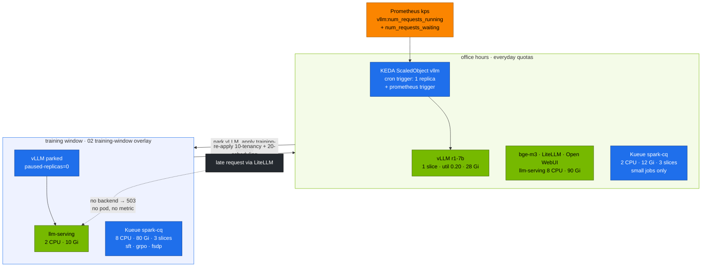
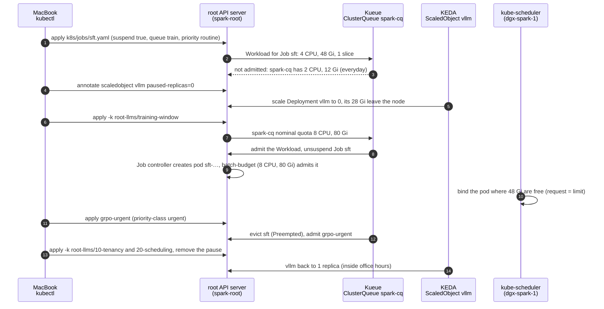

# Chapter 09 · Autoscaling & queueing: KEDA, KServe & Kueue

> **03-DeepSeek · Part III — Serving · Chapter 09 of 20** · ← [Chapter 08 · Kubernetes deployment, weight caching & streaming](08-kubernetes-deployment-storage-and-streaming.md) · [All chapters](00-deepseek-step-by-step-guide.md) · [Chapter 10 · LoRA/QLoRA, Unsloth & LLaMA-Factory](10-lora-qlora-unsloth-and-llama-factory.md) →

| | |
|---|---|
| **You will build** | A capacity plan that shares one GB10 between serving and training over time. KEDA keeps vLLM up in office hours and scales it to zero outside them; the 02 **training window** moves the LLM memory pool from `llm-serving` to `batch`; Kueue admits fine-tuning Jobs inside that quota, gang-style, and lets an urgent run preempt a routine one. KServe serves the same R1 distill through an `InferenceService`, so you can compare the two serving APIs |
| **Hardware** | dgx-spark-1 (dgx-spark-2 raises `maxReplicaCount` to 2) |
| **Time** | 90 min |
| **Risk** | Medium. Scaling vLLM to 0 and opening the training window make the chat API unavailable until you end the window. Do it outside your own working hours, or shift the cron window |
| **Clusters** | `spark-root` (KEDA, Kueue, KServe, the quotas `serving-budget` and `batch-budget`, ClusterQueue `spark-cq`) |
| **Lab files** | [`k8s/autoscale/vllm-office-hours.yaml`](lab/k8s/autoscale/vllm-office-hours.yaml), [`k8s/kserve/r1-1.5b.yaml`](lab/k8s/kserve/r1-1.5b.yaml), [`k8s/jobs/sft.yaml`](lab/k8s/jobs/sft.yaml), [`k8s/jobs/grpo.yaml`](lab/k8s/jobs/grpo.yaml), [`k8s/jobs/train-common.yaml`](lab/k8s/jobs/train-common.yaml), 02: [`20-scheduling/kueue.yaml`](../02-Kubernetes/lab/manifests/root-llms/20-scheduling/kueue.yaml), [`10-tenancy/quotas.yaml`](../02-Kubernetes/lab/manifests/root-llms/10-tenancy/quotas.yaml), [`training-window/`](../02-Kubernetes/lab/manifests/root-llms/training-window/kustomization.yaml), [`90-serving/autoscaling.yaml`](../02-Kubernetes/lab/manifests/root-llms/90-serving/autoscaling.yaml), [`90-serving/kserve/`](../02-Kubernetes/lab/manifests/root-llms/90-serving/kserve/inferenceservice.yaml) |

---

## 1. Why this matters on a Spark

In a datacenter, autoscaling adds replicas on more GPUs. One DGX Spark has one GB10 and an LLM memory pool of about 90 GiB, shared by `llm-serving` and `batch`. You can't add capacity; you can only **move it between workloads over time**:

| Lever | What it does here | Tool |
|---|---|---|
| Scale serving to zero when idle | frees the engine's slice and its whole memory request (14–87 Gi) | KEDA (cron + Prometheus triggers) |
| Move the quota | `batch` gets 8 CPU · 80 Gi of the pool, `llm-serving` keeps 2 CPU · 10 Gi | 02 training window (kustomize overlay of the quotas and `spark-cq`) |
| Queue training until it fits | Jobs wait suspended instead of being OOM-killed or squeezing a model | Kueue (quota + gang admission) |
| Priority | urgent runs preempt routine ones; serving outranks batch | PriorityClass (pods) + WorkloadPriorityClass (Kueue) |
| Standard serving API | one CRD for any model server, HPA built in | KServe `InferenceService` (RawDeployment) |

Time-slicing shares **compute**; it does not partition memory. The guards against running the unified pool dry are memory request = limit on every GPU container (the scheduler reserves real sizes), the quotas, and Kueue's admission. The same YAML scales out when dgx-spark-2 joins: raise `maxReplicaCount`, and the policies stay the same.

---

## 2. Architecture — HLD



The dotted arrow is the main limitation of scale-to-zero: with vLLM at 0 there is no pod to queue requests, so the Prometheus trigger never fires. Something in front would have to hold the request and signal demand (KEDA's HTTP add-on, or a gateway-side queue). The lab uses a **schedule** instead, because it is predictable and the GB10 is shared with training anyway. The training window is a deliberate step, not a trigger, because it changes quotas.

### 2.1 A training Job through the window, step by step

Tasks 5.3–5.6 walk one Job, `sft`, through Kueue and the training window:



- **Steps 1–3** are Task 5.3: `kubectl --context spark-root -n batch describe workloads` names `cpu` and `memory`, and no `sft-…` pod exists.
- **Steps 4–5** park vLLM through KEDA. A plain `kubectl scale` would be undone at KEDA's next poll (§3.2).
- **Steps 6–10** are Task 5.4. `spark-cq`'s `flavorsUsage` shows 4 CPU and 48Gi. If a model server still holds memory, step 10 stops at `Pending` with `Insufficient memory`.
- **Steps 11–12** are Task 5.5: an event with reason `Preempted` on the `sft` workload. `sft` starts again from the beginning when it is re-admitted.
- **Steps 13–14** are Task 5.6. Close the window after the training pods are done: vLLM's pod waits `Pending` while their memory is still in use.

---

## 3. LLD

### 3.1 Capacity on the root

| Consumer | CPU | Memory | Slices | Who decides |
|---|---|---|---|---|
| platform (Cilium, MetalLB, GPU Operator, kps, Traefik, Kueue, KEDA, platform-tools) | 3 | ~11.7 GiB | 2 | — |
| vClusters dev-lab + dev-llms | 2 + 2 | 4 + 4 Gi | 2 + 2 | 02 Chapter 04 |
| `llm-serving` everyday / window | 8 / 2 | up to 90 / 10 Gi | 6 | quota `serving-budget` |
| `batch` = Kueue `spark-cq` everyday / window | 2 / 8 | up to 12 / 80 Gi | 3 | quota `batch-budget` + Kueue |
| **LLM memory pool** | | **~90 GiB shared** | | the scheduler (request = limit) |

Allocatable is 17 CPU · ~109.7 GiB · 15 slices. Serving may use the whole pool while nothing trains; in the window, batch may use 80 Gi of it. GPU memory isn't a Kubernetes resource on the GB10, so a training pod's CUDA allocations are bounded only by its memory limit and the node's free memory, which is why every Job sets request = limit and fits ≤ 8 CPU · ≤ 80 Gi · 1 slice per pod.

### 3.2 The office-hours ScaledObject (`k8s/autoscale/vllm-office-hours.yaml`)

| Field | Value | Why |
|---|---|---|
| name | `vllm` | replaces 02's ScaledObject on the same Deployment (one ScaledObject per target) |
| `minReplicaCount` / `maxReplicaCount` | 0 / 1 | 2 when dgx-spark-2 joins |
| cron trigger | Mon–Fri 08:00–20:00, `desiredReplicas: 1` | predictable availability; set your timezone |
| prometheus trigger | running + waiting, threshold 16, `activationThreshold: 0` | an in-flight request keeps the pod past 20:00 |
| `serverAddress` | `http://kps-prometheus.observability.svc:9090` | the root's Prometheus, queried directly |
| `cooldownPeriod` | 900 s | a model reload costs minutes; don't flap |
| `ignoreNullValues` | true | with 0 pods there is no series: treat it as 0, not an error |

KEDA takes the **maximum** across triggers: inside the window the cron trigger holds 1, outside it the Prometheus trigger decides. The annotation `autoscaling.keda.sh/paused-replicas=0` overrides both. That is how the training window parks vLLM, and it stops the 08:00 cron from trying to start a 28 Gi pod into a 10 Gi quota.

### 3.3 Kueue objects (from 02)

| Object | Name | Key settings |
|---|---|---|
| ResourceFlavor | `gb10` | nodes labelled `spark.lab/gpu: gb10` |
| ClusterQueue | `spark-cq` | everyday cpu 2 · memory 12Gi · `nvidia.com/gpu` 3; window cpu 8 · memory 80Gi · gpu 3. `BestEffortFIFO`. Preempts `LowerPriority` within the queue |
| LocalQueue | `batch/train` | where every lab Job submits (label `kueue.x-k8s.io/queue-name: train`) |
| WorkloadPriorityClass | `urgent` (1000), `routine` (100) | set per Job with label `kueue.x-k8s.io/priority-class`. The lab's training Jobs carry `routine` |

Without that label Kueue uses the pod's PriorityClass (`spark-batch` = 10000) as the workload priority, which would outrank `urgent`. Always set the label when you rely on Kueue preemption. Jobs are created suspended; Kueue unsuspends one only when **all** its pods fit the queue (gang admission). Kueue admits on requests; the namespace quota `batch-budget` (same numbers) then admits the pods, and the scheduler still needs free node memory, so training waits for serving, never the reverse.

### 3.4 The training window

| | everyday | training window |
|---|---|---|
| `llm-serving` / `serving-budget` | 8 CPU · 90 Gi · 6 slices | 2 CPU · 10 Gi · 6 slices (mock LLM, Qdrant, one tiny model) |
| `batch` / `batch-budget` = `spark-cq` | 2 CPU · 12 Gi · 3 slices | **8 CPU · 80 Gi · 3 slices** |
| vLLM | ScaledObject active | `paused-replicas=0` |

```text
open   1. park vLLM (pause annotation) and every other engine in llm-serving
       2. kubectl --context spark-root apply -k manifests/root-llms/training-window   (02-Kubernetes/lab)
       3. submit Jobs → Kueue admits within 8 CPU · 80 Gi
close  4. kubectl --context spark-root apply -k manifests/root-llms/10-tenancy
       5. kubectl --context spark-root apply -k manifests/root-llms/20-scheduling
       6. remove the pause annotation → vLLM comes back
```

A window quota below what is already in use doesn't evict anything: park the model servers first, or new serving pods are refused while the old ones keep holding memory the training pods need. With Argo CD (02 Chapter 28), disable self-heal on the tenancy and scheduling apps for the window, or Argo CD puts the everyday numbers back.

### 3.5 KServe vs the lab's Deployment

| | Lab Deployment (Chapters 06, 08) | KServe `InferenceService` |
|---|---|---|
| Object | kustomize overlay of 02's base | one CRD per model; runtime `vllm-spark` shared |
| Weights | prefetch Job → `model-cache` PVC | `storageUri` (`hf://`, `s3://`, `pvc://`) → storage-initializer init container |
| Autoscaling | KEDA ScaledObject | HPA (RawDeployment) or Knative (serverless) |
| Endpoint | `svc/vllm:8000` | `svc/<name>-predictor:80` |
| Pod size | per overlay (request = limit) | the runtime's 32 Gi request = limit, or the InferenceService's own `resources` (the lab's r1-1-5b: 14 Gi) |
| Best for | one box, full control over every flag | many models and teams, one standard API |

---

## 4. Integrations

- **02 [Chapter 07](../02-Kubernetes/07-kube-scheduler-and-ai-batch-scheduling.md)** (Kueue, PriorityClasses), **[Chapter 14](../02-Kubernetes/14-multi-tenancy-resource-quotas-and-cgroups.md)** (quotas, the shared pool), **[Chapter 20](../02-Kubernetes/20-vllm-high-throughput-llm-serving.md)** (KEDA on queue depth, parking engines), **[Chapter 22](../02-Kubernetes/22-llm-inference-alternatives-and-kserve.md)** (KServe and the `vllm-spark` runtime) installed everything this chapter uses.
- **Chapters 10–11** submit their training Jobs to `batch/train` inside the training window. This chapter is what makes them safe on the box that also serves.
- **Chapter 16** graphs `kube_deployment_status_replicas{deployment="vllm"}` next to Kueue's `kueue_admitted_active_workloads`.

---

## 5. Lab

```bash
# ▶ MacBook · 02-Kubernetes/lab
export KUBECONFIG="$PWD/../../01-Ansible/lab/.cache/kubeconfig-spark-lab.yaml"
scripts/install-addons.sh keda                         # on the root
scripts/install-addons.sh kserve                       # cert-manager + KServe, RawDeployment mode
kubectl --context spark-root get clusterqueue spark-cq
kubectl --context spark-root -n batch get localqueue train
```

### Task 5.1 · Office hours for vLLM

#### What this lab does (ScaledObject `lab/k8s/autoscale/vllm-office-hours.yaml`)

- **Serves `r1-7b`** (util 0.20, **28 Gi** request = limit) with `serve-model.sh`.
- **Replaces 02's ScaledObject `vllm`** in `llm-serving` (same name) with one that allows 0 replicas: a cron trigger holds 1 replica Mon–Fri 08:00–20:00 in the timezone you set (the file says `Europe/London`), and a Prometheus trigger on running + waiting requests keeps or brings back one replica while requests are in flight. Cooldown 900 s.
- **Outside the window**, after 15 quiet minutes, vLLM scales to 0 and its 28 Gi go back to the LLM pool. Nothing else changes.

#### What to look for

1. **ScaledObject:** `get scaledobject vllm` shows `READY True`, and `ACTIVE True` inside the window.
2. **HPA:** `keda-hpa-vllm` exists with min 1 (KEDA handles 0 ↔ 1 itself).
3. **After the window ends** (set `end` a few minutes ahead to see it): 15 min later `get deploy vllm` shows `0/0`, and the node's `Allocated resources` memory drops by 28 Gi.

**If something's off:** vLLM never scales to 0 → a request is still running, something probes it, or the timezone puts you inside the window. `already managed by ScaledObject` → a second ScaledObject targets `vllm`. More in §7.

#### Run it

Edit the timezone and window in `k8s/autoscale/vllm-office-hours.yaml` first. To see the scale-down now, set `start`/`end` to a window that ends a few minutes from now.

```bash
# ▶ MacBook · 03-DeepSeek/lab
export KUBECONFIG="$PWD/../../01-Ansible/lab/.cache/kubeconfig-spark-lab.yaml"
scripts/serve-model.sh r1-7b
kubectl --context spark-root apply -f k8s/autoscale/vllm-office-hours.yaml
kubectl --context spark-root -n llm-serving get scaledobject vllm
kubectl --context spark-root -n llm-serving get hpa keda-hpa-vllm -w   # Ctrl-C to stop
```

Expected: `READY True`, `ACTIVE True` inside the window. After it ends and 15 min pass with no requests, the Deployment goes to `0/0` and its 28 Gi (the `r1-7b` pod's request = limit) leave the node's allocated memory:

```bash
# ▶ MacBook · 03-DeepSeek/lab
kubectl --context spark-root -n llm-serving get deploy vllm -w   # Ctrl-C to stop
kubectl --context spark-root describe node dgx-spark-1 | sed -n '/Allocated resources/,/Events/p'
```

### Task 5.2 · Measure the cold start you just paid for

#### What this lab does (patch `minReplicaCount` on the ScaledObject)

- **Brings vLLM back** from 0 by setting the ScaledObject's `minReplicaCount` to 1, and times the rollout to Ready.
- **Restores** `minReplicaCount: 0` afterwards. The model is whatever the Deployment holds (`r1-7b` after Task 5.1); switch with `serve-model.sh` to time the others.

#### What to look for

1. **`time … rollout status`:** ends with `successfully rolled out`; the `real` time is your cold start. Fill in one row per model.
2. **Order of magnitude:** minutes, not seconds. Weights come from page cache or NVMe; most of the time is engine init and CUDA-graph capture (Chapter 08 §3.6).
3. **After the second patch:** `get scaledobject vllm -o jsonpath='{.spec.minReplicaCount}'` prints `0`.

**If something's off:** the pod stays `Pending` → the pool is full (a training Job or another engine); `kubectl --context spark-root describe node dgx-spark-1 | sed -n '/Allocated resources/,/Events/p'`. More in §7.

#### Run it

```bash
# ▶ MacBook · 03-DeepSeek/lab
kubectl --context spark-root -n llm-serving patch scaledobject vllm --type merge -p '{"spec":{"minReplicaCount":1}}'
time kubectl --context spark-root -n llm-serving rollout status deploy/vllm --timeout=30m
kubectl --context spark-root -n llm-serving patch scaledobject vllm --type merge -p '{"spec":{"minReplicaCount":0}}'
```

(`kubectl scale` alone is undone by KEDA at its next poll; change the ScaledObject instead.)

| Model | Cold start to Ready (**record yours**) |
|---|---|
| r1-1.5b | |
| r1-7b | |
| r1-32b-fp8 | |

That is the latency the first morning user would see if you scaled to zero on demand instead of on a schedule.

### Task 5.3 · Everyday quota: a training Job waits

#### What this lab does (Job `lab/k8s/jobs/sft.yaml`)

- **Applies** the `deepseek-train` ConfigMap and the `deepseek-ckpt` PVC (90 Gi, `local-nvme-retain`) in `batch`.
- **Submits Job `sft`** (LoRA SFT of R1-Distill-Qwen-1.5B) suspended to LocalQueue `train` with priority `routine`. Its pod asks for **4 CPU · 48 Gi** (request = limit) and 1 slice.
- **Everyday quota** for `spark-cq` is 2 CPU · 12 Gi, so Kueue does not admit it. Nothing is evicted; serving is untouched. Leave it queued for Task 5.4.

#### What to look for

1. **Workload:** `get workloads -o wide` lists the `sft` workload in queue `train` with `ADMITTED` empty or false.
2. **Message:** the workload condition says it couldn't assign flavors, naming `cpu` and/or `memory` as insufficient in `spark-cq`.
3. **No pod:** `kubectl --context spark-root -n batch get pods` shows no `sft-…` pod.

**If something's off:** the workload is admitted → the training window is still open from an earlier chapter; check `batch-budget`. More in §7.

#### Run it

```bash
# ▶ MacBook · 03-DeepSeek/lab
kubectl --context spark-root apply -k .                                  # deepseek-train ConfigMap in batch
kubectl --context spark-root apply -f k8s/jobs/train-common.yaml -f k8s/jobs/sft.yaml
kubectl --context spark-root -n batch get workloads -o wide
kubectl --context spark-root -n batch describe workloads | grep -iE -A3 'message|insufficient'
```

Expected: the workload is **not admitted**. The `sft` pod asks for 4 CPU · 48 Gi (request = limit) · 1 slice, more than `spark-cq`'s everyday 2 CPU · 12 Gi, so Kueue keeps the Job suspended with a message naming the resource. Nothing was evicted and vLLM never noticed. Leave the Job queued.

### Task 5.4 · Open the training window

#### What this lab does (manifests `02-Kubernetes/lab/manifests/root-llms/training-window`)

- **Parks serving:** pauses the vLLM ScaledObject at 0, scales `sglang`, `trtllm`, `llama-server` and `bge-m3` to 0 if they exist, and waits until the vLLM pod is gone.
- **Applies the window:** `serving-budget` 8 CPU · 90 Gi → 2 CPU · 10 Gi; `batch-budget` and ClusterQueue `spark-cq` 2 CPU · 12 Gi → 8 CPU · 80 Gi. GPU slices unchanged.
- **Kueue reacts on its own:** the queued `sft` from Task 5.3 is admitted and its pod starts.

#### What to look for

1. **`serving-budget`:** hard `requests.cpu` `2` and `limits.memory` `10Gi`, with used below hard (mock LLM, Qdrant, LiteLLM, Open WebUI). If used is above 10Gi, park more.
2. **`spark-cq`:** `cpu` `8`, `memory` `80Gi`, `nvidia.com/gpu` `3`.
3. **Admission:** within seconds `sft` is `ADMITTED`; `flavorsUsage` shows 4 CPU and 48Gi used.
4. **Pod:** `kubectl --context spark-root -n batch get pods` shows an `sft-…` pod `Running` (it first pip-installs and downloads the 1.5B model).

**If something's off:** `sft` admitted but its pod `Pending` with `Insufficient memory` → a model server still holds memory on the node. More in §7.

#### Run it

```bash
# ▶ MacBook · 02-Kubernetes/lab
kubectl --context spark-root -n llm-serving annotate scaledobject vllm autoscaling.keda.sh/paused-replicas=0 --overwrite
for d in sglang trtllm llama-server bge-m3; do
  kubectl --context spark-root -n llm-serving scale deploy "$d" --replicas=0 2>/dev/null || true
done
while kubectl --context spark-root -n llm-serving get pod -l app=vllm -o name | grep -q .; do sleep 5; done
kubectl --context spark-root apply -k manifests/root-llms/training-window
kubectl --context spark-root -n llm-serving describe resourcequota serving-budget | grep -E 'requests.cpu|limits.memory'
kubectl --context spark-root get clusterqueue spark-cq -o jsonpath='{.spec.resourceGroups[0].flavors[0].resources}' | jq
```

Expected: `serving-budget` shows 2 CPU · 10Gi hard, with what is still running (mock LLM, Qdrant, LiteLLM, Open WebUI) below it; if `limits.memory` used is above 10Gi, park more until it isn't. `spark-cq` shows cpu 8, memory 80Gi, gpu 3. Within seconds the waiting `sft` workload is admitted:

```bash
# ▶ MacBook · 03-DeepSeek/lab
kubectl --context spark-root -n batch get workloads -o wide
kubectl --context spark-root get clusterqueue spark-cq -o jsonpath='{.status.flavorsUsage}' | jq
```

### Task 5.5 · An urgent run preempts routine work

#### What this lab does (Jobs `grpo` and `grpo-urgent` in `batch`)

- **Submits `grpo`** (routine, 4 CPU · 48 Gi). With `sft` holding 48 Gi of the window's 80 Gi, it waits.
- **Submits `grpo-urgent`:** the same Job renamed, labelled `kueue.x-k8s.io/priority-class: urgent` and cut to 20 steps (rendered with `yq` on the MacBook).
- **Kueue preempts:** it evicts `sft` back to pending and admits `grpo-urgent`; the routine Jobs then run one after the other. An evicted Job restarts from the beginning.
- **Clean-up:** deletes `sft`, `grpo` and `grpo-urgent`.

#### What to look for

1. **Before the urgent Job:** `sft` admitted, `grpo` pending.
2. **After:** an event with reason `Preempted` on the `sft` workload, `grpo-urgent` admitted and its pod `Running`.
3. **Later:** `grpo-urgent` `Complete`, then `sft` or `grpo` admitted again, never two at once.
4. **Clean-up:** `kubectl --context spark-root -n batch get jobs` empty.

**If something's off:** no preemption → the `priority-class` label is missing on the copy; without it Kueue uses the pod PriorityClass and every lab Job looks equal. More in §7.

#### Run it

```bash
# ▶ MacBook · 03-DeepSeek/lab
kubectl --context spark-root apply -f k8s/jobs/grpo.yaml
kubectl --context spark-root -n batch get workloads -o wide             # sft admitted, grpo pending: 48 + 48 Gi > 80 Gi
yq '.metadata.name = "grpo-urgent" | .metadata.labels."kueue.x-k8s.io/priority-class" = "urgent"
    | .spec.template.spec.containers[0].args[0] |= sub("--steps 200"; "--steps 20")' k8s/jobs/grpo.yaml \
  | kubectl --context spark-root apply -f -
kubectl --context spark-root -n batch get workloads -w   # Ctrl-C to stop
kubectl --context spark-root -n batch get events --field-selector reason=Preempted
```

Expected: every lab training Job asks for 4 CPU · 48 Gi, so only one fits the window's 80 Gi at a time. `grpo` waits behind `sft`; `grpo-urgent` doesn't wait: Kueue evicts `sft` (`Preempted`, back to pending), admits `grpo-urgent`, and runs the routine Jobs one after the other once it finishes. The evicted Job starts again from the beginning, which is why Chapter 11's training scripts checkpoint. Clean up: `kubectl --context spark-root -n batch delete job sft grpo grpo-urgent`.

### Task 5.6 · End the window

#### What this lab does (re-apply `root-llms/10-tenancy` and `20-scheduling`)

- **Puts the everyday quotas back:** `serving-budget` 8 CPU · 90 Gi, `batch-budget` and `spark-cq` 2 CPU · 12 Gi.
- **Brings serving back:** removes the pause from the vLLM ScaledObject and scales `bge-m3` to 1 if it exists. vLLM starts only inside office hours (or while a request waits).
- **Not changed:** Jobs, PVCs and checkpoints in `batch`. Running training pods aren't evicted, but vLLM waits `Pending` until their memory is free.

#### What to look for

1. **Before:** `get jobs` in `batch` shows nothing running you still need.
2. **Quotas:** `serving-budget` hard `8` CPU and `90Gi`; `spark-cq` back to `2` and `12Gi`.
3. **vLLM:** `rollout status` ends with `successfully rolled out` (inside office hours).

**If something's off:** vLLM stays `0/0` inside office hours → the pause annotation is still there; check it with `kubectl --context spark-root -n llm-serving get scaledobject vllm -o yaml | grep paused`. More in §7.

#### Run it

```bash
# ▶ MacBook · 02-Kubernetes/lab
kubectl --context spark-root -n batch get jobs                          # nothing still running that you need
kubectl --context spark-root apply -k manifests/root-llms/10-tenancy
kubectl --context spark-root apply -k manifests/root-llms/20-scheduling
kubectl --context spark-root -n llm-serving annotate scaledobject vllm autoscaling.keda.sh/paused-replicas-
kubectl --context spark-root -n llm-serving scale deploy bge-m3 --replicas=1 2>/dev/null || true
kubectl --context spark-root -n llm-serving rollout status deploy/vllm --timeout=30m
```

Expected: `serving-budget` back at 8 CPU · 90Gi, `spark-cq` at 2 CPU · 12Gi, vLLM Ready (inside office hours). End the window *after* the training pods have finished: lowering `batch-budget` under what is in use doesn't evict them, but vLLM's pod waits Pending until their memory is free.

### Task 5.7 · The same model through KServe

#### What this lab does (InferenceService `lab/k8s/kserve/r1-1.5b.yaml`)

- **Installs 02's `vllm-spark` ServingRuntime** and deletes 02's demo InferenceService `qwen-small` (32 Gi) so the new one fits the quota.
- **Creates InferenceService `r1-1-5b`** in `llm-serving` (RawDeployment): R1-Distill-Qwen-1.5B from `hf://`, util 0.10, 16K context, the reasoning parser, **14 Gi** (request = limit), one slice. A `storage-initializer` init container downloads the weights.
- **Streams one request** through a port-forward to `svc/r1-1-5b-predictor` and lists the Deployment, Service and HPA that KServe generated.
- **Budget:** next to vLLM `r1-7b` (0.20) and bge-m3 (0.06) the util sum is 0.36.
- **Clean-up:** deletes the InferenceService.

#### What to look for

1. **`get isvc r1-1-5b`:** `READY True` after download and load.
2. **Stream probe:** `first reasoning` before `first answer`, `finish_reason=stop`, and no `REASONING IN CONTENT` line.
3. **Generated objects:** a Deployment, Service and HPA labelled `serving.kserve.io/inferenceservice=r1-1-5b`; the init container name is `storage-initializer`.

**If something's off:** InferenceService not ready with `exceeded quota` → `qwen-small` or another engine still holds memory. `no matches for kind "InferenceService"` → run `scripts/install-addons.sh kserve` in 02-Kubernetes/lab first. More in §7.

#### Run it

The lab's InferenceService overrides the runtime's 32 Gi with 14 Gi request = limit and util 0.10, the same budget as the `r1-1.5b` overlay. Next to vLLM r1-7b (28 Gi), bge-m3 (9 Gi) and the apps it fits `serving-budget`; 02's demo `qwen-small` (32 Gi) on top would not, so delete it first.

```bash
# ▶ MacBook · 03-DeepSeek/lab
kubectl --context spark-root apply -k ../../02-Kubernetes/lab/manifests/root-llms/90-serving/kserve
kubectl --context spark-root -n llm-serving delete isvc qwen-small
kubectl --context spark-root apply -f k8s/kserve/r1-1.5b.yaml
kubectl --context spark-root -n llm-serving get isvc r1-1-5b -w           # READY True after download + load · Ctrl-C to stop
kubectl --context spark-root -n llm-serving port-forward svc/r1-1-5b-predictor 8080:80 &
python3 tools/stream_probe.py --url http://localhost:8080 --model r1-1-5b
```

Expected: reasoning and answer split correctly, because KServe appends `--reasoning-parser=deepseek_r1` to the runtime's args (the later flag wins). Util: vLLM r1-7b 0.20 + r1-1-5b 0.10 + bge-m3 0.06 = 0.36 ≲ 0.72. Look at what KServe generated:

```bash
# ▶ MacBook · 03-DeepSeek/lab
kubectl --context spark-root -n llm-serving get deploy,svc,hpa -l serving.kserve.io/inferenceservice=r1-1-5b
kubectl --context spark-root -n llm-serving get pod -l serving.kserve.io/inferenceservice=r1-1-5b \
  -o jsonpath='{.items[0].spec.initContainers[0].name}{"\n"}'                # storage-initializer
```

Clean up: `kubectl --context spark-root -n llm-serving delete isvc r1-1-5b`.

---

## 6. Verify

| Check | Command | Expected |
|---|---|---|
| ScaledObject | `kubectl --context spark-root -n llm-serving get so vllm` | `READY True` |
| scale to zero | `… get deploy vllm` outside office hours | `0/0` |
| everyday queue | Task 5.3 | `sft` not admitted, message names cpu/memory |
| window | `… get clusterqueue spark-cq -o yaml` | nominal 8 CPU · 80Gi; usage never above it |
| preemption | `… -n batch get events` | `Preempted` on a routine Job when `urgent` arrives |
| window closed | `… -n llm-serving describe resourcequota serving-budget` | 8 · 90Gi again, vLLM Ready |
| KServe | `… get isvc r1-1-5b` | `READY True`, answers with `reasoning_content` |

---

## 7. Troubleshooting

| You see | Cause | Fix |
|---|---|---|
| `ScaledObject … already managed by ScaledObject` | another ScaledObject targets `vllm` | one per Deployment; this lab's file reuses 02's name `vllm` |
| vLLM never scales to 0 | open request, a probe sending traffic, or still in the cron window | check `vllm:num_requests_running`; check the timezone |
| first morning request fails with 503 | scaled to 0 and nothing holds requests | open the cron window ~15 min before people arrive; LiteLLM retries |
| `kubectl scale deploy vllm` doesn't stick | KEDA owns the replica count | pause annotation or edit `minReplicaCount` |
| Job stays suspended, workload `Pending` | quota full, or the Job asks for more than the whole queue (everyday 2 CPU · 12 Gi) | `kubectl --context spark-root -n batch describe workload <name>`; open the training window |
| admitted, pod `Pending` with `Insufficient memory` | serving pods still hold the pool (all request = limit) | park the engines (Task 5.4); `describe node dgx-spark-1` |
| admitted, pod `FailedCreate … exceeded quota: batch-budget` | `10-tenancy` re-applied while `20-scheduling` still has window numbers (or Argo CD self-heal) | apply both overlays of the same mode |
| vLLM `FailedCreate … exceeded quota: serving-budget` at 08:00 | cron fired while the window is open | keep the pause annotation for the whole window |
| OOM-killed training pod | its limit is below the real peak | resize with `lora_calc.py` (Chapter 10); never above 80 Gi |
| `isvc` stuck in `storage-initializer` | gated repo, no HF token for KServe | use a public model, or wire `hf-token` into KServe's service account |

---

## 8. Scale-out path (2×)

| One Spark | Two Sparks | Fleet |
|---|---|---|
| schedule-based 0↔1 | `maxReplicaCount: 2`, `RollingUpdate` | request-driven scaling behind an inference gateway that queues during cold start |
| training window moves one pool between namespaces | dgx-spark-2 adds its own ~90 GiB pool; serving on one Spark, training on the other, no window needed | Kueue cohorts across teams, borrowing and fair sharing; MultiKueue across clusters |
| one ResourceFlavor `gb10` | same flavor, two nodes | flavors per GPU type |
| KServe RawDeployment | same | KServe serverless (Knative) or llm-d, with scale-to-zero and model caching |

---

## 9. Checklist

- [ ] I can explain why time-slicing doesn't protect memory, and what does.
- [ ] I scaled vLLM to zero on a schedule and measured the cold start.
- [ ] I watched a Job wait under the everyday quota, opened the training window, and saw Kueue admit and preempt.
- [ ] I closed the window in the right order and vLLM came back.
- [ ] I served the same model through KServe and know when each API fits.
