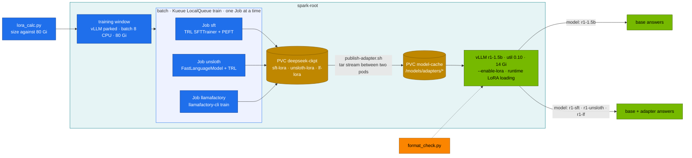
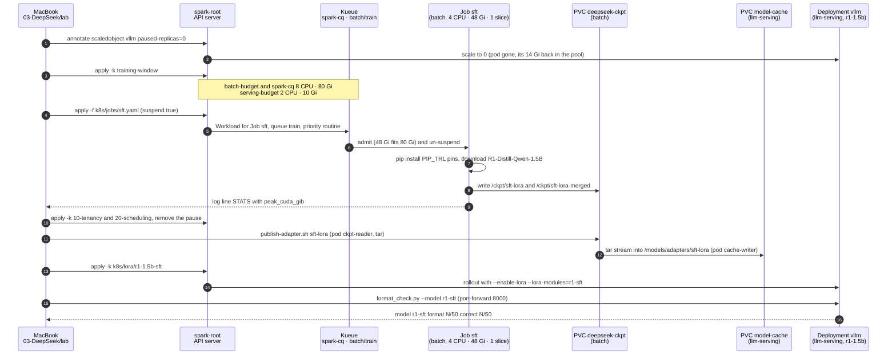

# Chapter 10 · LoRA/QLoRA sizing, Unsloth & LLaMA-Factory

> **03-DeepSeek · Part IV — Fine-tuning · Chapter 10 of 19** · ← [Chapter 09 · Autoscaling & queueing](09-autoscaling-and-queueing.md) · [All chapters](00-deepseek-step-by-step-guide.md) · [Chapter 11 · Distributed training & RL](11-distributed-training-and-rl.md) →

| | |
|---|---|
| **You will build** | A sizing habit and a full adapter lifecycle. You predict memory for LoRA, QLoRA and full fine-tuning with `lora_calc.py` against the training window's 80 Gi, train the same rank-16 LoRA on R1-Distill-Qwen-1.5B three ways — TRL + PEFT, Unsloth and LLaMA-Factory — as Kueue Jobs inside the training window, publish the adapters into the model cache, serve base and adapters from one vLLM, and measure what each adapter changed with `format_check.py` |
| **Hardware** | dgx-spark-1 |
| **Time** | 3.5 h (three 20–40 min training runs) |
| **Risk** | Low to medium. Training runs in `batch` under Kueue. The training window parks the chat models: the API is down from Task 5.4 to Task 5.8 |
| **Clusters** | `spark-root` (`batch` for the Jobs, `llm-serving` for the base model and adapters) |
| **Lab files** | [`tools/lora_calc.py`](lab/tools/lora_calc.py), [`tools/sft_lora.py`](lab/tools/sft_lora.py), [`tools/unsloth_sft.py`](lab/tools/unsloth_sft.py), [`tools/format_check.py`](lab/tools/format_check.py), [`k8s/jobs/train-common.yaml`](lab/k8s/jobs/train-common.yaml), [`k8s/jobs/sft.yaml`](lab/k8s/jobs/sft.yaml), [`k8s/jobs/unsloth.yaml`](lab/k8s/jobs/unsloth.yaml), [`k8s/jobs/llamafactory.yaml`](lab/k8s/jobs/llamafactory.yaml), [`scripts/publish-adapter.sh`](lab/scripts/publish-adapter.sh), [`k8s/lora/r1-1.5b-sft`](lab/k8s/lora/r1-1.5b-sft/kustomization.yaml), 02: [`training-window/`](../02-Kubernetes/lab/manifests/root-llms/training-window/kustomization.yaml) |

---

## 1. Why this matters on a Spark

Full fine-tuning updates every weight. With mixed-precision AdamW that costs about **16 bytes per parameter** (bf16 weights + bf16 grads + fp32 master weights + two fp32 Adam moments) before activations. For a 7B model that is ~114 GiB: the whole GB10, and far more than the 80 Gi a training pod may hold in the training window.

LoRA freezes the base model and learns a low-rank update for selected matrices:

```text
W' = W + (α / r) · B · A        A: r × d_in,  B: d_out × r,  r ≪ d
trainable params per matrix = r · (d_in + d_out)
```

QLoRA also stores the frozen base in 4-bit NF4, so a 32B or 70B model fits for training on one Spark. What you trade:

| Method | Trainable | Frozen base | Quality vs full FT | Typical use |
|---|---|---|---|---|
| Full | 100 % | — | reference | new domain, continued pre-training (Chapter 11) |
| LoRA | 0.3–2 % | bf16 | close for format, style, narrow tasks | most instruction/format tuning |
| QLoRA | same as LoRA | 4-bit NF4 | slightly lower; slower steps (dequantisation) | large models in little memory |

On a Spark the budget is not the 121.7 GiB the GPU reports. Training runs in the `batch` namespace, which gets **8 CPU · 80 Gi · 3 slices** only while the training window is open and serving is parked; every training pod sets memory request = limit and must fit ≤ 8 CPU · ≤ 80 Gi · 1 slice. Sizing first is what keeps a Job from being admitted and then OOM-killed.

Three tools produce the same adapter, so you can choose by workflow rather than by output:

| Tool | What it is | Strength | Watch out for |
|---|---|---|---|
| **TRL + PEFT** | Hugging Face's trainer and adapter libraries | the reference; every other tool builds on them | you write the Python |
| **Unsloth** | patches HF models with hand-written Triton kernels (RoPE, RMSNorm, fused cross-entropy, LoRA matmuls) and its own gradient checkpointing | less memory, faster steps on one GPU; easy QLoRA; GGUF export | monkey-patching: import it first. Versions are tightly coupled to transformers/trl |
| **LLaMA-Factory** | a CLI/web UI that turns one YAML file into an SFT, DPO, KTO, PPO or reward-model run | 100+ chat templates, dataset registry, no code | the template must match the model. Its pins can lag the ecosystem |

All three write the **same PEFT adapter format** (`adapter_config.json` + `adapter_model.safetensors`), so publishing and serving don't change.

---

## 2. Architecture — HLD



### 2.1 One adapter, step by step



- **Steps 1–3 are Task 5.4.** The window quotas evict nothing, so the vLLM pod must be gone first. While it runs, its memory is still held and a training pod waits `Pending` with `Insufficient memory`.
- **Steps 4–6 are Kueue.** `kubectl -n batch get workloads` shows the Workload `ADMITTED`; a second 48 Gi Job stays queued before step 6 (48 + 48 Gi > 80 Gi).
- **Steps 7–9 are the training log** (Tasks 5.5–5.6): `trainable params`, falling `'loss'`, `merged model →`, then `STATS {…}`. `unsloth` and `llamafactory` repeat steps 4–9 and write `/ckpt/unsloth-lora` and `/ckpt/lf-lora`. Step 10 closes the window (Task 5.7).
- **Steps 11–12 cross namespaces.** PVCs belong to one namespace, so `publish-adapter.sh` runs one pod on each side and pipes a tar between them (Task 5.8, `[PASS] published …`).
- **Steps 13–16 are Tasks 5.8–5.9.** The two other adapters are loaded at runtime with `/v1/load_lora_adapter` instead of a rollout.

---

## 3. LLD

### 3.1 Sizing results (`lora_calc.py`, seq 2048, batch 1, gradient checkpointing on)

| Model | LoRA r16 | QLoRA r16 | Full FT | Trainable (r16) |
|---|---|---|---|---|
| R1-Distill-Qwen-1.5B | 5.1 GiB ✓ | 2.7 GiB ✓ | 28.0 GiB ✓ | 18.5 M (1.04 %) |
| R1-Distill-Qwen-7B | 16.7 GiB ✓ | 6.4 GiB ✓ | 115.4 GiB ✗ (Chapter 11) | 40.4 M (0.53 %) |
| R1-Distill-Qwen-32B | 66.7 GiB ✓ (tight) | 22.4 GiB ✓ | 491.9 GiB ✗ | 134.2 M (0.41 %) |
| Llama-3.3-70B | — | 45.2 GiB ✓ | ✗ | 207 M |

`lora_calc.py` marks ✓ when the estimate is within 90 % of the 80 Gi window pod (≈ 72 GiB), leaving room for the CUDA context, allocator fragmentation and the dataloader. These are estimates: **record yours** from the Job's `STATS` line (`peak_cuda_gib`) and `free -g` on the Spark during the run. A 32B LoRA at seq 2048 batch 1 is the practical ceiling of one Spark; anything longer goes QLoRA.

### 3.2 What drives the numbers (7B, LoRA)

| Knob | Change | Memory | Notes |
|---|---|---|---|
| rank 8 → 256 | 20 M → 646 M trainable | 16.4 → 25.7 GiB | adapter file 38 MiB → 1.2 GiB |
| seq 2048 → 8192, batch 1 → 4 | 16× tokens per step | 16.7 → 45.6 GiB | logits (vocab 152K) become a major term |
| gradient checkpointing off | (seq 8192, batch 4) | 45.6 → 131.3 GiB | recomputation trades ~30 % speed for memory |

### 3.3 The lab's SFT recipe (held constant across the three tools)

| Setting | Value |
|---|---|
| Base | `deepseek-ai/DeepSeek-R1-Distill-Qwen-1.5B`, bf16 |
| Data | 5,000 synthetic GPU-arithmetic problems with explicit reasoning, `<think>…</think><answer>N</answer>` (`sft_lora.py`, seed 1) |
| Target modules | `q,k,v,o,gate,up,down_proj` (all linear layers) |
| r / α / dropout | 16 / 32 / 0.05 |
| Optimiser | AdamW, lr 2e-4, cosine, warmup 5 %, 300 steps |
| Batch | 8 × grad-accum 2 = 16 sequences/step, max length 512, gradient checkpointing |
| Image | `nvcr.io/nvidia/pytorch:25.09-py3` (`lab/versions.env`) |
| Pod | **4 CPU · 48 Gi request = limit · 1 slice**, priority `spark-batch`, Kueue `train`, workload priority `routine` |
| Outputs | `/ckpt/sft-lora` (adapter), `/ckpt/sft-lora-merged` (`--merge`), `/ckpt/unsloth-lora`, `/ckpt/lf-lora` |

48 Gi is ~10× the 1.5B LoRA estimate: it leaves room to raise rank, sequence length or the model to 7B without editing the Job. Two of these Jobs don't fit the window together (96 Gi > 80 Gi), so Kueue runs them one after the other, which is also what fair timing needs.

### 3.4 Version pins and why

| Job | Pins (check the current releases; the lab pins these) | Reason |
|---|---|---|
| `sft` | trl 0.23.0, peft 0.17.1, transformers 4.56.2, accelerate 1.10.1, datasets 4.1.1 (`PIP_TRL` in `versions.env`) | the lab baseline |
| `unsloth` | baseline + unsloth 2025.9.11, unsloth_zoo 2025.9.14 (`--no-deps`), bitsandbytes 0.48.1 | that unsloth supports transformers ≤ 4.56.2 and trl ≤ 0.23.0; `--no-deps` keeps NVIDIA's torch/triton; bitsandbytes 0.48.1 ships an aarch64 wheel |
| `llamafactory` | llamafactory 0.9.4 + baseline, but **datasets 4.0.0** | 0.9.4 requires `datasets<=4.0.0` |

When you bump versions, read each package's declared requirements first (`pip download --no-deps pkg==X`, then `METADATA`). Never `pip install torch` or `vllm` on top of an NGC image.

### 3.5 LLaMA-Factory recipe essentials

| Key | Value | Note |
|---|---|---|
| `stage` / `finetuning_type` | `sft` / `lora` | `dpo`, `kto`, `ppo`, `rm` are the other stages |
| `lora_target` | `all` | every linear layer, same as the other two runs |
| `template` | `deepseekr1` | must match the base model's chat format; a wrong template trains on the wrong prompt layout |
| `dataset` / `dataset_dir` | `gpu_math` / `/ckpt/data` | resolved through `dataset_info.json` (ShareGPT form with OpenAI-style `role`/`content`) |
| `max_steps` | 300 | overrides epochs |

### 3.6 Serving adapters: merge or attach?

| | Merge (`merge_and_unload`) | Attach (`--enable-lora`) |
|---|---|---|
| Serving cost | a full model copy per variant | one base + N small adapters inside the same util/KV budget |
| Speed | base speed | a few % slower (extra low-rank matmuls) |
| Switching | redeploy | per request: `model: r1-sft` |
| Use when | one variant, maximum speed | many tenants or tasks on one GPU |

The `k8s/lora/r1-1.5b-sft` overlay keeps the `r1-1.5b` budget (util 0.10, 14 Gi request = limit) and adds `--enable-lora --lora-modules=r1-sft=/models/adapters/sft-lora --max-lora-rank=16 --max-loras=4`.

---

## 4. Integrations

- **Chapter 09**: the training window, Kueue's gang admission and priorities. 02 [Chapter 07](../02-Kubernetes/07-kube-scheduler-and-ai-batch-scheduling.md) and [Chapter 14](../02-Kubernetes/14-multi-tenancy-resource-quotas-and-cgroups.md) explain the quotas it moves.
- **Chapter 08**: the `model-cache` layout (`/models/adapters/…`) and the overlay pattern the LoRA overlay follows.
- **Chapter 11**: GRPO starts from this SFT checkpoint (SFT for format, RL for correctness), and full fine-tuning picks up where §3.1 says ✗.
- **Chapter 12**: LiteLLM can expose `r1-sft` as a tenant-specific alias; keep runtime LoRA loading behind it.
- **Chapter 07**: Unsloth can export GGUF (`model.save_pretrained_gguf`) for llama.cpp; that needs a llama.cpp build in the image.

---

## 5. Lab

```bash
# ▶ MacBook · 03-DeepSeek/lab
export KUBECONFIG="$PWD/../../01-Ansible/lab/.cache/kubeconfig-spark-lab.yaml"
kubectl --context spark-root get clusterqueue spark-cq -o jsonpath='{.spec.resourceGroups[0].flavors[0].resources}{"\n"}'
```

### Task 5.1 · Size it before you submit

#### What this lab does (script `lab/tools/lora_calc.py`)

- **Where:** on the MacBook, standard library only. Read-only.
- **Four estimates** of training memory (weights, gradients, optimiser, activations, logits): 1.5B LoRA r16, 7B full fine-tune, 32B QLoRA at 4K sequence, and 7B LoRA at 8K × batch 4 with gradient checkpointing off.
- **The verdict** compares each total with the training window's 80 Gi pod (✓ when within ~90 % of it).

#### What to look for

1. **Command exit:** 0 for all four.
2. **The `total` lines:**

   | Run | Healthy value |
   |---|---|
   | 1.5B LoRA r16 | `total ≈ 5.1 GiB` … `✓ fits one training-window pod (80 Gi request = limit)`, adapter ~35 MiB |
   | 7B full | `total ≈ 115.4 GiB` … `✗ needs 2 Sparks (FSDP/ZeRO-3) or a lighter method` |
   | 32B QLoRA, seq 4096 | `total ≈ 26.1 GiB` … `✓ fits one training-window pod` |
   | 7B LoRA, seq 8192 × 4, no checkpointing | `total ≈ 131.3 GiB` … `✗` |

**If something's off:** a `KeyError` traceback → a misspelled model name; the names are `model_math.py`'s presets (`python3 tools/model_math.py --list`). More in §7.

#### Run it

```bash
# ▶ MacBook · 03-DeepSeek/lab
python3 tools/lora_calc.py deepseek-r1-distill-qwen-1.5b --method lora --rank 16
python3 tools/lora_calc.py deepseek-r1-distill-qwen-7b --method full
python3 tools/lora_calc.py deepseek-r1-distill-qwen-32b --method qlora --seq 4096
python3 tools/lora_calc.py deepseek-r1-distill-qwen-7b --method lora --seq 8192 --batch 4 --no-grad-ckpt
```

Expected (7B full):

```text
  total ≈ 115.4 GiB of 121.7 GiB unified memory → ✗ needs 2 Sparks (FSDP/ZeRO-3) or a lighter method
```

and `✓ fits one training-window pod (80 Gi request = limit)` for the 1.5B LoRA and the 32B QLoRA. The last line shows how quickly sequence length and switching off checkpointing blow the budget.

### Task 5.2 · Look at the training data

#### What this lab does (script `lab/tools/sft_lora.py --dry-run`)

- **Where:** on the MacBook. No GPU, no TRL, no download.
- **What it prints:** a few samples from the synthetic SFT dataset (seed 1, so the same every run): a GPU-arithmetic question and the target answer with explicit reasoning in `<think>` and the number in `<answer>`.

#### What to look for

1. **Command exit:** 0.
2. **Shape of each sample:** a question line, then `→ <think>…</think><answer>N</answer>`, with arithmetic that checks out (as in the example below).

**If something's off:** nothing here touches the cluster or needs extra packages; a traceback means the script was changed locally (`git diff tools/sft_lora.py`). More in §7.

#### Run it

```bash
# ▶ MacBook · 03-DeepSeek/lab
python3 tools/sft_lora.py --dry-run
```

```text
A cluster has 10 nodes with 3 GPUs each. 10 GPUs are drained for maintenance. How many GPUs are available?
  → <think>Total GPUs = 10 × 3 = 30. Drained = 10. Available = 30 − 10 = 20.</think><answer>20</answer>
```

### Task 5.3 · Baseline: how well does the base model follow the format?

#### What this lab does (`serve-model.sh r1-1.5b`, script `lab/tools/format_check.py`)

- **Serves `r1-1.5b`** in Deployment `vllm` (util **0.10**, **14 Gi** request = limit, 16K, reasoning parser). Do it before the window: the everyday quota has room.
- **Sends 50 generated problems** with the `<think>…</think><answer>N</answer>` instruction through a port-forward, and counts how many replies match the format and how many have the right number. Read-only.

#### What to look for

1. **`serve-model.sh`:** `[PASS] answer: 144 …` and `0 failed`.
2. **`format_check.py`:** one `sample:` reply, then `model r1-1.5b: format N/50 (P%)  correct N/50 (P%)`. Expect a low format % (the base model rarely uses `<answer>` tags) and a higher correct %. Record both.

**If something's off:** `Connection refused` → the port-forward isn't running or vLLM is still starting. More in §7.

#### Run it

Do this before the window, while serving has its everyday quota.

```bash
# ▶ MacBook · 03-DeepSeek/lab
scripts/serve-model.sh r1-1.5b
kubectl --context spark-root -n llm-serving port-forward svc/vllm 8000 &
python3 tools/format_check.py --url http://localhost:8000 --model r1-1.5b -n 50
```

Record format % and correct %. The base model reasons well but rarely wraps its answer in `<answer>` tags.

### Task 5.4 · Open the training window

#### What this lab does (manifests `02-Kubernetes/lab/manifests/root-llms/training-window`)

- **Parks serving:** pauses the vLLM ScaledObject at 0, scales `sglang`, `trtllm`, `llama-server` and `bge-m3` to 0 where they exist, and waits until the vLLM pod is gone. The Task 5.3 port-forward dies with it.
- **Moves the pool:** `serving-budget` 8 CPU · 90 Gi → 2 CPU · 10 Gi; `batch-budget` and `spark-cq` 2 CPU · 12 Gi → **8 CPU · 80 Gi**. GPU slices unchanged; nothing is evicted.

#### What to look for

1. **`batch-budget`:** hard `requests.cpu` `8` and `limits.memory` `80Gi`.
2. **Serving:** `kubectl --context spark-root -n llm-serving get pods` shows no vLLM or other engine pod.

**If something's off:** the quota still shows 2 / 12Gi → the apply ran in the wrong folder (run it from `02-Kubernetes/lab`), or Argo CD put the everyday numbers back. More in §7.

#### Run it

Park every model server, then move the pool to `batch` (Chapter 09 §3.4):

```bash
# ▶ MacBook · 02-Kubernetes/lab
kubectl --context spark-root -n llm-serving annotate scaledobject vllm autoscaling.keda.sh/paused-replicas=0 --overwrite
for d in sglang trtllm llama-server bge-m3; do
  kubectl --context spark-root -n llm-serving scale deploy "$d" --replicas=0 2>/dev/null || true
done
while kubectl --context spark-root -n llm-serving get pod -l app=vllm -o name | grep -q .; do sleep 5; done
kubectl --context spark-root apply -k manifests/root-llms/training-window
kubectl --context spark-root -n batch describe resourcequota batch-budget | grep -E 'requests.cpu|limits.memory'
```

Expected: `batch-budget` hard `requests.cpu 8`, `limits.memory 80Gi`. The port-forward from Task 5.3 dies with the vLLM pod; that is expected.

### Task 5.5 · Run 1 — TRL + PEFT

#### What this lab does (Job `lab/k8s/jobs/sft.yaml`)

- **Ships the code and volume:** ConfigMap `deepseek-train` and PVC `deepseek-ckpt` (90 Gi, `local-nvme-retain`) in `batch`.
- **Submits Job `sft`** (any old one is deleted first) to Kueue queue `train`, priority `routine`: NGC PyTorch image, **4 CPU · 48 Gi** (request = limit), 1 slice. It pip-installs the pinned TRL stack, downloads R1-Distill-Qwen-1.5B, and trains a rank-16 LoRA for 300 steps with the §3.3 recipe.
- **Writes** the adapter to `/ckpt/sft-lora` and a merged model to `/ckpt/sft-lora-merged`.

#### What to look for

1. **Admission:** `get workloads` shows the `sft` workload `ADMITTED`.
2. **Log lines:**

   | Line | Healthy value |
   |---|---|
   | `trainable params` | ≈ 18.5 M of ≈ 1.8 B (≈ 1.03 %) |
   | `'loss'` | from ~1.5 at the start to below 0.1 by step 300 |
   | `merged model →` | `/ckpt/sft-lora-merged` |
   | `STATS {…}` | last line, with `peak_cuda_gib`; record it and compare with Task 5.1's 5.1 GiB |
3. **On the Spark:** `free -g` `used` higher while the Job runs; `nvidia-smi` lists a python process (memory columns read `N/A` on the GB10).
4. **Job:** `kubectl --context spark-root -n batch get job sft` reaches `COMPLETIONS 1/1`.

**If something's off:** workload never admitted → the window isn't open (Task 5.4). Pod `Pending` with `Insufficient memory` → a model server still holds the pool. `OOMKilled` → you raised rank, sequence or model beyond 48 Gi. More in §7.

#### Run it

```bash
# ▶ MacBook · 03-DeepSeek/lab
kubectl --context spark-root apply -k .                                   # deepseek-train ConfigMap (sft_lora.py, unsloth_sft.py)
kubectl --context spark-root apply -f k8s/jobs/train-common.yaml          # PVC deepseek-ckpt
kubectl --context spark-root -n batch delete job sft --ignore-not-found
kubectl --context spark-root apply -f k8s/jobs/sft.yaml
kubectl --context spark-root -n batch get workloads -w                    # ADMITTED · Ctrl-C to stop
kubectl --context spark-root -n batch logs -f job/sft | grep -E "trainable params|'loss'|merged|STATS"
```

Expected: `print_trainable_parameters` reports ≈ 18.5 M trainable of ≈ 1.8 B (≈ 1.03 %, as §3.1 predicted), the loss falls from ~1.5 to below 0.1 over 300 steps, and the last line is `STATS {…, "peak_cuda_gib": …}`. While it runs, look at the real footprint on the Spark:

```bash
# ▶ dgx-spark-1 (ssh dgx-spark-1)
free -g; nvidia-smi --query-compute-apps=pid,process_name --format=csv     # memory columns read N/A on the GB10
```

### Task 5.6 · Run 2 — Unsloth, and Run 3 — LLaMA-Factory

#### What this lab does (Jobs `lab/k8s/jobs/unsloth.yaml` and `lab/k8s/jobs/llamafactory.yaml`)

- **Runs one at a time** after `sft` completes, each with the same pod size (**4 CPU · 48 Gi**, 1 slice), queue and recipe (§3.3).
- **`unsloth`:** installs the TRL baseline, then Unsloth and unsloth_zoo with `--no-deps` (keeps NVIDIA's torch), trains the same LoRA and writes `/ckpt/unsloth-lora`.
- **`llamafactory`:** installs LLaMA-Factory 0.9.4 with its pins, writes `/ckpt/data/gpu_math.json` and `dataset_info.json` from the same generator, trains with template `deepseekr1` and writes `/ckpt/lf-lora`.
- If you submit them together, Kueue admits one and queues the others (48 + 48 Gi > 80 Gi).

#### What to look for

1. **Unsloth log:** a banner naming the GPU and the patched model, `Trainable` parameters close to run 1, a falling loss, and a final `STATS {…}` line.
2. **LLaMA-Factory log:** `wrote 5000 examples → /ckpt/data/gpu_math.json`, `trainable params` close to run 1, a falling loss, and `train_runtime`.
3. **Both Jobs** `Complete`. Fill in the comparison table from the `STATS` lines and `/ckpt/lf-lora/all_results.json`.

**If something's off:** pip pulls a new `torch-…-aarch64.whl` → a dependency overrode NVIDIA's torch; check the `--no-deps` pins. LLaMA-Factory `Cannot find dataset gpu_math` → `dataset_info.json` isn't in `/ckpt/data`. Unsloth kernel errors on sm_121 → fall back to TRL. More in §7.

#### Run it

```bash
# ▶ MacBook · 03-DeepSeek/lab
kubectl --context spark-root -n batch wait --for=condition=complete job/sft --timeout=2h
kubectl --context spark-root apply -f k8s/jobs/unsloth.yaml
kubectl --context spark-root -n batch logs -f job/unsloth | grep -E 'Unsloth|Trainable|loss|STATS'
kubectl --context spark-root -n batch wait --for=condition=complete job/unsloth --timeout=2h
kubectl --context spark-root apply -f k8s/jobs/llamafactory.yaml
kubectl --context spark-root -n batch logs -f job/llamafactory | grep -E 'wrote|trainable params|loss|train_runtime'
```

Expected: an Unsloth banner naming the GPU and the patched model, then the same loss-curve shape as run 1. LLaMA-Factory writes `/ckpt/data/gpu_math.json` with the same generator, then trains from the recipe. If you submit all three at once, Kueue admits one and queues the others (48 + 48 Gi > 80 Gi). Fill in:

| | TRL + PEFT | Unsloth | LLaMA-Factory |
|---|---|---|---|
| wall time for 300 steps | | | |
| steps/s | | | |
| peak CUDA memory (GiB) | | | |
| final train loss | | | |

Where to read them: the `STATS {…}` line at the end of the `sft` and `unsloth` logs; `train_runtime`, `train_steps_per_second` in `/ckpt/lf-lora/all_results.json`.

### Task 5.7 · End the window

#### What this lab does (re-apply `root-llms/10-tenancy` and `20-scheduling`)

- **Puts the everyday quotas back:** `serving-budget` 8 CPU · 90 Gi; `batch-budget` and `spark-cq` 2 CPU · 12 Gi.
- **Un-pauses vLLM** (it comes back with the last model it had, `r1-1.5b`) and scales `bge-m3` to 1 if it exists.
- **Not changed:** the three Jobs and the adapters on `deepseek-ckpt`.

#### What to look for

1. **Before:** `get jobs` in `batch` lists `sft`, `unsloth`, `llamafactory` all `Complete`.
2. **After:** `kubectl --context spark-root -n batch describe resourcequota batch-budget` shows hard `2` CPU and `12Gi`.
3. **Serving:** `kubectl --context spark-root -n llm-serving get deploy vllm` returns to `1/1` inside office hours. Outside them Chapter 09's office-hours ScaledObject `vllm` keeps it at `0/0` and scales it back to 0 after the cooldown, so run Tasks 5.8–5.10 inside office hours or patch `minReplicaCount` to 1 as in Chapter 09.

**If something's off:** vLLM `exceeded quota: serving-budget` → the window is still applied; re-run the two `apply -k` lines. More in §7.

#### Run it

```bash
# ▶ MacBook · 02-Kubernetes/lab
kubectl --context spark-root -n batch get jobs                            # all three Complete
kubectl --context spark-root apply -k manifests/root-llms/10-tenancy
kubectl --context spark-root apply -k manifests/root-llms/20-scheduling
kubectl --context spark-root -n llm-serving annotate scaledobject vllm autoscaling.keda.sh/paused-replicas-
kubectl --context spark-root -n llm-serving scale deploy bge-m3 --replicas=1 2>/dev/null || true
```

### Task 5.8 · Publish all three and serve them from one vLLM

#### What this lab does (script `lab/scripts/publish-adapter.sh`, overlay `lab/k8s/lora/r1-1.5b-sft`)

- **Publishes each adapter:** two short-lived pods (`ckpt-reader` in `batch`, `cache-writer` in `llm-serving`) stream a tar from `deepseek-ckpt:/ckpt/<name>` to `model-cache:/models/adapters/<name>`, then are deleted.
- **Serves the base with LoRA on:** the overlay keeps `r1-1.5b`'s budget (util 0.10, **14 Gi** request = limit) and adds `--enable-lora`, adapter `r1-sft` at start-up, max rank 16, up to 4 adapters.
- **Loads two more adapters at runtime** (`r1-unsloth`, `r1-lf`) after setting `VLLM_ALLOW_RUNTIME_LORA_UPDATING=True` on the Deployment. That endpoint has no authentication; keep it to the lab.

#### What to look for

1. **Each publish:** `[PASS] published /ckpt/<name> → model-cache:/models/adapters/<name>`, with a directory listing that includes `adapter_config.json`.
2. **Rollout:** `successfully rolled out`.
3. **Runtime loads:** each `load_lora_adapter` call returns a success message.
4. **`/v1/models`:** `r1-1.5b`, `r1-sft`, `r1-unsloth`, `r1-lf`.

**If something's off:** `has no adapter_config.json or config.json — did the Job finish?` → the Job didn't write that directory. `load_lora_adapter` 404 → the env variable isn't set or the rollout hasn't finished. `LoRA rank … greater than max_lora_rank` → raise `--max-lora-rank`. More in §7.

#### Run it

```bash
# ▶ MacBook · 03-DeepSeek/lab
for a in sft-lora unsloth-lora lf-lora; do scripts/publish-adapter.sh "$a"; done
kubectl --context spark-root apply -k k8s/lora/r1-1.5b-sft                 # base + r1-sft
kubectl --context spark-root -n llm-serving set env deploy/vllm VLLM_ALLOW_RUNTIME_LORA_UPDATING=True
kubectl --context spark-root -n llm-serving rollout status deploy/vllm --timeout=20m
kubectl --context spark-root -n llm-serving port-forward svc/vllm 8000 &
for n in unsloth lf; do
  curl -s localhost:8000/v1/load_lora_adapter -H 'Content-Type: application/json' \
    -d "{\"lora_name\":\"r1-$n\",\"lora_path\":\"/models/adapters/$n-lora\"}"; echo
done
curl -s localhost:8000/v1/models | jq -r '.data[].id'                      # r1-1.5b r1-sft r1-unsloth r1-lf
```

Runtime loading is convenient but unauthenticated on the vLLM port. Keep that variable off outside the lab, or expose vLLM only behind LiteLLM (Chapter 12). The adapters live inside the 0.10 util budget of the base, so serving four variants costs no more pool than serving one.

### Task 5.9 · Measure the change

#### What this lab does (script `lab/tools/format_check.py`)

- **Runs the Task 5.3 check** (50 problems) against the base and each adapter on the same vLLM, through the port-forward from Task 5.8. Read-only.

#### What to look for

1. **One line per model:** `model <name>: format N/50 (P%)  correct N/50 (P%)`.
2. **Pattern:** format % jumps towards 100 % for all three adapters versus the base; correct % moves much less. The three adapters land within a few points of each other.

**If something's off:** one adapter far below the others → suspect the chat template (LLaMA-Factory) or a version issue (Unsloth) before the method. An adapter scores like the base → `base_model_name_or_path` in its `adapter_config.json` is a different model. More in §7.

#### Run it

```bash
# ▶ MacBook · 03-DeepSeek/lab
for m in r1-1.5b r1-sft r1-unsloth r1-lf; do
  python3 tools/format_check.py --url http://localhost:8000 --model "$m" -n 50 --show 0
done
```

| Model | format % | correct % |
|---|---|---|
| r1-1.5b (base) | | |
| r1-sft (TRL + PEFT) | | |
| r1-unsloth | | |
| r1-lf (LLaMA-Factory) | | |

Expected pattern: format jumps towards 100 % with any adapter, correctness changes much less. SFT teaches the *shape* of the answer; Chapter 11 uses RL to push correctness. The three adapters should land within a few points of each other; if one is far off, suspect the chat template (LLaMA-Factory) or a patching/version issue (Unsloth) before the method.

### Task 5.10 · (Optional) Merged weights

#### What this lab does (`publish-adapter.sh sft-lora-merged`, then `kubectl set env`)

- **Publishes** the merged 1.5B model from `/ckpt/sft-lora-merged` to `model-cache:/models/adapters/sft-lora-merged`.
- **Re-applies the plain `r1-1.5b` overlay** (util 0.10, 14 Gi) and points it at the merged weights by setting `MODEL=/models/adapters/sft-lora-merged` and `SERVED_NAME=r1-sft-merged` on the Deployment. No LoRA flags.
- `serve-model.sh r1-1.5b` afterwards puts the catalog model back.

#### What to look for

1. **Rollout:** `successfully rolled out`; restart the port-forward after it.
2. **`format_check.py`:** scores within noise of `r1-sft` from Task 5.9.
3. **Speed:** replies come back at base-model speed (no low-rank matmuls).

**If something's off:** vLLM can't find the model → the publish didn't include `config.json`; check `kubectl --context spark-root -n llm-serving exec deploy/vllm -- ls /models/adapters/sft-lora-merged`. More in §7.

#### Run it

The `sft` Job also wrote `/ckpt/sft-lora-merged`. Serve it as its own model when you need base-model speed:

```bash
# ▶ MacBook · 03-DeepSeek/lab
scripts/publish-adapter.sh sft-lora-merged
kubectl --context spark-root apply -k k8s/models/r1-1.5b
kubectl --context spark-root -n llm-serving set env deploy/vllm MODEL=/models/adapters/sft-lora-merged SERVED_NAME=r1-sft-merged
kubectl --context spark-root -n llm-serving rollout status deploy/vllm --timeout=20m
pkill -f 'port-forward svc/vllm 8000'; kubectl --context spark-root -n llm-serving port-forward svc/vllm 8000 &   # the old one died with the pod
python3 tools/format_check.py --url http://localhost:8000 --model r1-sft-merged -n 50   # same scores, base speed
```

The rollout replaces the pod, so the port-forward from Task 5.8 dies; the block starts a new one. `scripts/serve-model.sh r1-1.5b` puts the catalog model back.

---

## 6. Verify

| Check | Expected |
|---|---|
| sizing | your prediction within ~20 % of the `peak_cuda_gib` in `STATS` |
| window | `batch-budget` 8 CPU · 80Gi during the runs, back to 2 CPU · 12Gi after Task 5.7 |
| Jobs | `sft`, `unsloth`, `llamafactory` `Complete`; each wrote `adapter_config.json` |
| comparison | the table in Task 5.6 filled in |
| serving | `/v1/models` lists `r1-1.5b`, `r1-sft`, `r1-unsloth`, `r1-lf` on one vLLM |
| effect | format % clearly higher for every adapter; adapters within noise of each other |

---

## 7. Troubleshooting

| You see | Cause | Fix |
|---|---|---|
| workload never admitted | the window isn't open (everyday `spark-cq` is 2 CPU · 12 Gi) | Task 5.4; `kubectl --context spark-root -n batch describe workloads` names the resource |
| admitted, pod `Pending`, `Insufficient memory` | a model server still holds the pool | park it; `kubectl --context spark-root describe node dgx-spark-1 \| sed -n '/Allocated resources/,/Events/p'` |
| Job `OOMKilled` | 48 Gi below the real footprint (you raised rank, seq or model) | re-run `lora_calc.py` with your settings; lower batch and raise grad-accum; never above 80 Gi |
| loss is NaN | fp16 overflow or lr too high | bf16 (default); lr 1e-4 |
| `pip` downloads `torch-…-aarch64.whl` | a dependency pulled a new torch over NVIDIA's | `--no-deps` for unsloth/unsloth_zoo; pin as in §3.4 |
| `Unsloth: Please import unsloth before transformers`, no speed-up | import order | `from unsloth import FastLanguageModel` first (the script does) |
| Unsloth kernel errors on sm_121 | Triton/kernel support lagging new GPUs | newer NGC PyTorch image + newer unsloth, or fall back to TRL |
| LLaMA-Factory `… version mismatch` and exits | its dependency check | pin as in §3.4; the Job sets `DISABLE_VERSION_CHECK=1` after the pins were checked |
| LLaMA-Factory `Cannot find dataset gpu_math` | `dataset_info.json` not next to the data | the Job writes both to `/ckpt/data`; check `ls /ckpt/data` |
| adapter answers in the wrong format | wrong `template` | `deepseekr1` for R1 distills, `qwen` for Qwen2.5 instruct |
| `bitsandbytes` CUDA setup error | wheel without aarch64/your CUDA | bitsandbytes ≥ 0.48 aarch64 wheel, or skip QLoRA |
| `LoRA rank 32 is greater than max_lora_rank 16` | adapter rank > `--max-lora-rank` | raise `--max-lora-rank` to the adapter's `r` |
| `r1-sft` 404 | adapter path wrong, or vLLM started before publishing | `kubectl --context spark-root -n llm-serving exec deploy/vllm -- ls /models/adapters/sft-lora`; restart vLLM |
| `load_lora_adapter` 404 | variable not set, or older vLLM | `VLLM_ALLOW_RUNTIME_LORA_UPDATING=True`, then roll out |
| adapter loads but answers look like the base | wrong `target_modules`, or trained on another base | check `base_model_name_or_path` in `adapter_config.json` |
| QLoRA step much slower than LoRA | 4-bit dequantisation every forward | expected; use LoRA when bf16 weights fit |
| vLLM `exceeded quota: serving-budget` after the runs | the window is still open | Task 5.7 |

---

## 8. Scale-out path (2×)

| One Spark | Two Sparks | Datacenter |
|---|---|---|
| LoRA to 32B, QLoRA to 70B inside the 80 Gi window | serving stays on dgx-spark-1, training gets dgx-spark-2's pool: no window needed | dedicated training pools |
| one Job at a time (48 Gi each) | two in parallel, one per Spark | Kueue cohorts and fair sharing |
| single-GPU LoRA with any of the three tools | LLaMA-Factory/accelerate with FSDP across both (Chapter 11) | LLaMA-Factory or NeMo with DeepSpeed/FSDP; Unsloth for single-GPU experiments |
| adapters on the `model-cache` PVC, runtime loading by hand | NFS/RDMA share (Chapter 08) | adapter registry (object store + metadata), gated promotion, per-request loading |
| `format_check.py` by hand | same | eval gate in CI before an adapter is promoted (Chapter 15) |

---

## 9. Checklist

- [ ] I size every training run against the 80 Gi window pod before submitting it.
- [ ] I can explain the 16 bytes per parameter of full fine-tuning and what LoRA and QLoRA remove.
- [ ] I opened the training window, ran the same fine-tune with TRL, Unsloth and LLaMA-Factory, filled in the comparison, and closed the window.
- [ ] I can install Unsloth and LLaMA-Factory on an NGC image without replacing its torch.
- [ ] I served several adapters on one base and measured what each changed.
