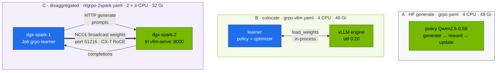
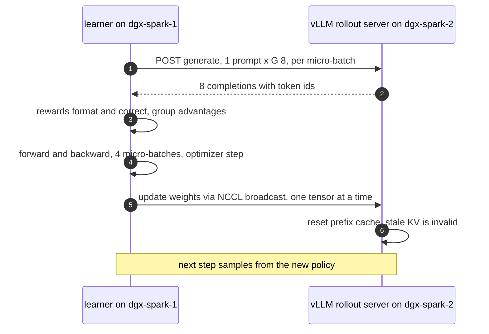

# Chapter 11 · Distributed training & RL: FSDP, ZeRO-3 & GRPO rollouts

> **03-DeepSeek · Part IV — Fine-tuning · Chapter 11 of 19** · ← [Chapter 10 · LoRA/QLoRA, Unsloth & LLaMA-Factory](10-lora-qlora-unsloth-and-llama-factory.md) · [All chapters](00-deepseek-step-by-step-guide.md) · [Chapter 12 · Open WebUI & the LiteLLM gateway](12-open-webui-and-litellm-gateway.md) →

| | |
|---|---|
| **You will build** | The two kinds of training that outgrow Chapter 10. First, the R1-style GRPO loop (Chapter 03) run three ways: rollouts from Hugging Face `generate`, from vLLM inside the trainer (colocate), and from a separate vLLM server on dgx-spark-2 that receives fresh weights over NCCL after every step (disaggregated). Second, a full-parameter fine-tune of R1-Distill-Qwen-7B (~114 GiB of training state) two ways: DeepSpeed ZeRO-3 with the optimizer offloaded to NVMe on one Spark, and FSDP2 sharded across two Sparks over the CX-7 link. You measure where each step's time goes and why "CPU offload" buys nothing on unified memory |
| **Hardware** | dgx-spark-1. dgx-spark-2 + the QSFP cable for Tasks 5.5 and 5.8 |
| **Time** | 4 h |
| **Risk** | Medium. Every Task runs in the training window (chat API down). Task 5.7 writes ~180 GB per step to the NVMe: fine for 30 steps, don't leave it running for days. Tasks 5.5 and 5.8 raise the `batch` quota beyond the window; ending the window puts it back |
| **Clusters** | `spark-root` (`batch`, Kueue `spark-cq`; dgx-spark-2 as a second root node for the 2× Tasks) |
| **Lab files** | [`tools/grpo_tiny.py`](lab/tools/grpo_tiny.py), [`tools/fsdp_finetune.py`](lab/tools/fsdp_finetune.py), [`tools/sft_lora.py`](lab/tools/sft_lora.py) (`--full --deepspeed`), [`tools/lora_calc.py`](lab/tools/lora_calc.py), [`tools/format_check.py`](lab/tools/format_check.py), [`k8s/jobs/grpo.yaml`](lab/k8s/jobs/grpo.yaml), [`k8s/jobs/grpo-vllm.yaml`](lab/k8s/jobs/grpo-vllm.yaml), [`k8s/rl/grpo-2spark.yaml`](lab/k8s/rl/grpo-2spark.yaml), [`k8s/jobs/fsdp-1spark.yaml`](lab/k8s/jobs/fsdp-1spark.yaml), [`k8s/jobs/zero3-nvme.yaml`](lab/k8s/jobs/zero3-nvme.yaml), [`k8s/jobs/fsdp-2spark.yaml`](lab/k8s/jobs/fsdp-2spark.yaml), 02: [`training-window/`](../02-Kubernetes/lab/manifests/root-llms/training-window/kustomization.yaml) |

---

## 1. Why this matters on a Spark

**RL generates its own data.** Supervised fine-tuning reads a fixed dataset. GRPO (Chapter 03) samples completions from the *current* policy every step, scores them and learns from them:

```text
per step:  for each prompt → sample G completions with the CURRENT weights   (rollout: inference)
           score each completion with rule-based rewards                     (reward: CPU, cheap)
           advantage_i = (r_i − mean(r)) / std(r) within the group            (no value network)
           policy-gradient update                                            (learner: training)
           push the new weights to whatever generates rollouts               (weight sync)
```

Rollout usually dominates: completions are long and decoding is memory-bandwidth-bound, which on a ~273 GB/s GB10 matters even more than on HBM. So RL frameworks put an inference engine in the loop, and the design question is **where it runs**:

| Layout | Rollout engine | Weight sync | Fits |
|---|---|---|---|
| HF `generate` | the training model itself | none | tiny experiments |
| **Colocate** | vLLM in the trainer process, same GPU, time-shared | in-process copy | one GPU, if learner + engine fit one pod |
| **Disaggregated** | vLLM server(s) on other GPUs or nodes | NCCL broadcast learner → servers | when rollout and training need different scale |

**Full fine-tuning doesn't fit one pod.** Mixed-precision AdamW keeps 16 bytes per parameter:

| State | Bytes |
|---|---|
| bf16 weights (forward/backward) | 2 |
| bf16 gradients | 2 |
| fp32 master weights | 4 |
| fp32 Adam first moment (m) | 4 |
| fp32 Adam second moment (v) | 4 |
| **total** | **16** |

7.6 B parameters × 16 B ≈ **114 GiB** before activations: the whole GB10, and well beyond the 80 Gi a training pod may hold in the window. Three ways out:

| Technique | Idea | Cost |
|---|---|---|
| **LoRA** (Chapter 10) | don't train most weights | not a full fine-tune |
| **Shard** (FSDP2, ZeRO-3) | each of N ranks keeps 1/N of params, grads and optimizer state; weights are all-gathered just in time per layer | network traffic every layer, every step |
| **Offload** (ZeRO-Offload/Infinity) | put optimizer state in a bigger, slower tier | bandwidth to that tier every step |

On a Spark there is a twist: "CPU memory" and "GPU memory" are the same LPDDR5x, so offloading to the CPU moves bytes without adding capacity. Only NVMe (one Spark) or a second Spark adds room.

Every Job in this chapter runs in the **training window** (02's `training-window` overlay, Chapter 09 §3.4): `batch` gets 8 CPU · 80 Gi · 3 slices while serving is parked, and each pod sets request = limit within ≤ 8 CPU · ≤ 80 Gi · 1 slice.

---

## 2. Architecture — HLD

### 2.1 Three GRPO layouts



### 2.2 One disaggregated step



### 2.3 Full fine-tuning of a 7B: offload on one Spark, shard on two

```mermaid
flowchart TB
  subgraph Z["A · ZeRO-3 + NVMe offload · zero3-nvme.yaml · one pod 8 CPU · 80 Gi"]
    direction LR
    G["GB10 (UMA)<br/>bf16 params 14 GiB<br/>bf16 grads 14 GiB<br/>activations + pinned buffers"]
    C["Grace CPU · 20 cores<br/>DeepSpeedCPUAdam"]
    N[("NVMe · /swap · PVC ds-swap<br/>fp32 master + m + v ≈ 91 GiB")]
    G -->|"grads"| C
    C <-->|"libaio · ≈ 180 GB per step"| N
    C -->|"updated bf16 params"| G
  end
  subgraph F["B · FSDP2 across two Sparks · fsdp-2spark.yaml · 2 × 8 CPU · 80 Gi"]
    direction LR
    R0["dgx-spark-1 · rank 0<br/>½ params · ½ grads · ½ Adam<br/>≈ 57 GiB + activations"]
    R1["dgx-spark-2 · rank 1<br/>½ params · ½ grads · ½ Adam<br/>≈ 57 GiB + activations"]
    R0 <==>|"per layer: all-gather weights<br/>reduce-scatter grads<br/>NCCL · RoCE · 200 GbE"| R1
  end
  classDef gpu fill:#76b900,stroke:#3d6000,color:#000
  classDef ctrl fill:#1f6feb,stroke:#0b3d91,color:#fff
  classDef store fill:#bf8700,stroke:#7a5600,color:#fff
  class R0,R1,G gpu
  class C ctrl
  class N store
  style F fill:#f3effc,stroke:#8250df
  style Z fill:#fff8e6,stroke:#bf8700
```



---

## 3. LLD

### 3.1 The lab's Jobs and what they take from the window

| Job | Image | Pod (request = limit) | Pods | Kueue | Fits the window (8 CPU · 80 Gi · 3 slices)? |
|---|---|---|---|---|---|
| `grpo` (HF generate) | NGC PyTorch | 4 CPU · 48 Gi · 1 slice | 1 | `train`, `routine` | yes, one at a time |
| `grpo-vllm` (colocate) | NGC vLLM | 4 CPU · 48 Gi · 1 slice | 1 | `train`, `routine` | yes |
| `grpo-rollout` + `grpo-learner` (2×) | NGC vLLM | 4 CPU · 32 Gi · 1 slice each | 2 (one per Spark) | not queued; counted by `batch-budget` | yes: 8 CPU · 64 Gi |
| `fsdp-1spark` (1.5B, world 1) | NGC PyTorch | 4 CPU · 64 Gi · 1 slice | 1 | `train`, `routine` | yes |
| `zero3-nvme` (7B full) | NGC PyTorch | 8 CPU · 80 Gi · 1 slice | 1 | `train`, `routine` | yes: takes all of it |
| `fsdp` (7B full, 2×) | NGC PyTorch | 8 CPU · 80 Gi · 1 slice per rank | 2 (one per Spark) | `train`, `routine` | **no**: 16 CPU · 160 Gi. Raise `batch-budget` and `spark-cq` to count dgx-spark-2 (Task 5.8) |

The window is sized for one Spark's pool. dgx-spark-2 brings its own ~90 GiB pool and 15 slices to the root's nodes, but not to the budgets, so a gang that spans both Sparks needs the budgets raised for the run.

### 3.2 The lab's GRPO configuration (`grpo_tiny.py`)

| Setting | Value | Effect |
|---|---|---|
| model | Qwen2.5-0.5B-Instruct (or an SFT checkpoint) | small enough that all three layouts fit |
| `num_generations` (G) | 8 | completions per prompt; the group the advantage is computed over |
| batch × grad-accum | 8 × 4 | 32 completions (4 prompts) per optimizer step |
| `max_completion_length` | 256 | ≤ 8,192 generated tokens per step |
| `temperature` | 0.9 | diversity within a group; with none, std = 0 and there is no signal |
| `beta` (KL) | 0.0 | no reference model in memory |
| rewards | format 1.0, correct 2.0 | verifiable, no reward model |
| lr | 1e-6 | RL updates are small |
| `vllm_gpu_memory_utilization` | 0.20 | ≈ 24 GiB of the pool, inside the 48 Gi pod (colocate) or the 32 Gi rollout pod |

| Logged metric (TRL) | Healthy trend |
|---|---|
| `reward` | rises from ~0–0.5 towards 2–3 |
| `rewards/reward_format/mean` | rises first: the model learns the tags |
| `rewards/reward_correct/mean` | rises later and more slowly |
| `reward_std` | stays above 0; at 0 the groups are identical and the gradient is zero |
| `frac_reward_zero_std` | fraction of groups with no signal; lower is better |
| `completions/mean_length` | stable or slowly growing; pinned at the maximum means truncation |

### 3.3 Memory: colocate on one GB10 (0.5B)

| Component | Approx. |
|---|---|
| policy bf16 + grads + AdamW fp32 states | ~8 GiB |
| vLLM engine (`vllm_gpu_memory_utilization` 0.20) | ~24 GiB (weights + KV) |
| activations for 8 × (160 + 256) tokens | ~2 GiB |
| **total** | **~34 GiB of the 48 Gi pod** |

Colocate works when learner state + rollout engine fit one pod. For R1-32B that is impossible on one Spark; that is where disaggregation, and in a datacenter separate pools, come in.

### 3.4 Weight-sync budget

| Policy (bf16) | Bytes per sync | Over 200 GbE RoCE (~20 GB/s; **record yours** with 02 Chapter 18's all-reduce test) | Colocate |
|---|---|---|---|
| 0.5B | ~1 GB | ~0.05 s | in-process |
| 7B | ~15 GB | ~0.8 s | in-process |
| 32B | ~65 GB | ~3.3 s | doesn't fit with optimizer state on one GB10 |

With LoRA only the adapter would need syncing (MBs), one reason LoRA-GRPO is popular. TRL merges the adapter before syncing to vLLM.

### 3.5 Full fine-tune memory per layout (7B, seq 512, batch 8, gradient checkpointing)

| Layout | Per-GB10 state | Where the rest is | Fits an 80 Gi pod? |
|---|---|---|---|
| plain AdamW, 1 Spark | ~114 GiB + activations | — | ✗ (`lora_calc.py … --method full`) |
| ZeRO-3 + optimizer → NVMe, 1 Spark | ~28 GiB + activations + pinned buffers | ~91 GiB on NVMe | ✓, slowly |
| ZeRO-3 + optimizer → "CPU", 1 Spark | ~114 GiB | the same LPDDR5x | ✗: on UMA "CPU memory" *is* GPU memory |
| FSDP2, world 2 | ~57 GiB + activations per rank | the other Spark | ✓, one 80 Gi pod per Spark |

### 3.6 Traffic per optimizer step

| Layout | What moves | Approx. volume (7B) | Link |
|---|---|---|---|
| ZeRO-3 NVMe ×1 | read and write m, v, master weights | ≈ 2 × 91 GB ≈ 182 GB | NVMe (**record** sequential read/write from Chapter 08 Task 5.4) |
| FSDP2 ×2 | all-gather params forward + backward, reduce-scatter grads | ≈ 3 × 15 GB ≈ 45 GB total, half per rank | CX-7 RoCE (**record** NCCL bus bandwidth, 02 Chapter 18) |

Rough step-time floor = volume ÷ bandwidth, plus compute. With ~5 GB/s NVMe and ~20 GB/s RoCE the floors are ≈ 35–40 s for NVMe offload and ≈ 1–2 s for FSDP. Offload is a capacity tool, not a speed tool.

### 3.7 FSDP2 in `fsdp_finetune.py` and the DeepSpeed config

| Piece | Purpose |
|---|---|
| `fully_shard(layer, mp_policy=mp)` per decoder block, then the root | each block is its own all-gather/free unit, so only ~one block is unsharded at a time |
| `MixedPrecisionPolicy(param_dtype=bf16, reduce_dtype=fp32)` | compute in bf16, reduce gradients in fp32 |
| `gradient_checkpointing_enable()` | recompute activations in backward |
| per-rank `max_memory_allocated` print | evidence that each rank holds ~half |
| `zero_optimization.stage: 3` | shard (or offload) params, grads and optimizer state |
| `offload_optimizer: {device: nvme, nvme_path: /swap}` | ZeRO-Infinity: optimizer state on disk (PVC `ds-swap`, 110 Gi, `local-nvme`) |
| `aio`: 1 MiB blocks, queue depth 16 | async I/O via libaio (`libaio-dev` installed in the Job) |
| `optimizer: AdamW` with `"auto"` | DeepSpeed builds DeepSpeedCPUAdam, vectorised on the Grace cores |
| `stage3_gather_16bit_weights_on_model_save: true` | `save_model` writes a normal HF checkpoint |

---

## 4. Integrations

- **Chapter 03**: the GRPO algorithm and reward design. This chapter is the infrastructure.
- **Chapter 09**: the training window and Kueue. **Chapter 10**: SFT first, then GRPO from the merged SFT checkpoint (Task 5.4); `lora_calc.py` predicts the single-Spark failure of a 7B full fine-tune.
- **Chapter 08**: the NVMe bandwidth you measured bounds Task 5.7's step time; `publish-adapter.sh` and the model cache serve the results.
- **02 [Chapter 18](../02-Kubernetes/18-distributed-ai-training-and-nccl.md)** and **01-Ansible [Chapter 14](../01-Ansible/14-rocev2-qos-and-nccl.md)**: NCCL over the CX-7 (`NCCL_SOCKET_IFNAME=enp1s0f1np1`, `NCCL_IB_HCA=rocep1s0f1,roceP2p1s0f1`, `NCCL_IB_GID_INDEX=3`, hostNetwork). The 2× Jobs use the same variables.
- **Chapter 04**: what the same patterns look like at DeepSeek-V3 scale.

---

## 5. Lab

Every Task runs inside the training window. Open it once at the start, end it once at the end (Task 5.10).

```bash
# ▶ MacBook · 02-Kubernetes/lab
export KUBECONFIG="$PWD/../../01-Ansible/lab/.cache/kubeconfig-spark-lab.yaml"
kubectl --context spark-root -n llm-serving annotate scaledobject vllm autoscaling.keda.sh/paused-replicas=0 --overwrite
for d in sglang trtllm llama-server bge-m3; do
  kubectl --context spark-root -n llm-serving scale deploy "$d" --replicas=0 2>/dev/null || true
done
while kubectl --context spark-root -n llm-serving get pod -l app=vllm -o name | grep -q .; do sleep 5; done
kubectl --context spark-root apply -k manifests/root-llms/training-window
```

```bash
# ▶ MacBook · 03-DeepSeek/lab
export KUBECONFIG="$PWD/../../01-Ansible/lab/.cache/kubeconfig-spark-lab.yaml"
kubectl --context spark-root apply -k . && kubectl --context spark-root apply -f k8s/jobs/train-common.yaml
python3 tools/grpo_tiny.py --dry-run
```

### Task 5.1 · GRPO layout A — HF generate

```bash
# ▶ MacBook · 03-DeepSeek/lab
kubectl --context spark-root apply -f k8s/jobs/grpo.yaml
kubectl --context spark-root -n batch logs -f job/grpo | grep -E "'reward'|it/s|s/it"
```

Record seconds per step and the reward at steps 20, 100 and 200.

### Task 5.2 · GRPO layout B — colocated vLLM

```bash
# ▶ MacBook · 03-DeepSeek/lab
kubectl --context spark-root -n batch wait --for=condition=complete job/grpo --timeout=3h
kubectl --context spark-root apply -f k8s/jobs/grpo-vllm.yaml
kubectl --context spark-root -n batch logs -f job/grpo-vllm | grep -E "vLLM|KV cache|'reward'|s/it"
```

| Layout | s/step (**record yours**) | reward @200 | peak `free -g` used |
|---|---|---|---|
| A · HF generate | | | |
| B · colocate vLLM | | | |
| C · disaggregated (2×, Task 5.5) | | | |

Expected: B's step is several times shorter than A's, because generation dominates and vLLM batches the 8 completions with paged KV. The reward curves look alike: same algorithm, same data. Both Jobs ask for 48 Gi; if you submit them together, Kueue runs them one after the other.

### Task 5.3 · Check the learned behaviour

`/ckpt/grpo-vllm` is a full model. Serving it needs the everyday quota (the `r1-1.5b` overlay asks for 14 Gi; the window leaves `llm-serving` 10 Gi), so run these commands after Task 5.10:

```bash
# ▶ MacBook · 03-DeepSeek/lab
scripts/publish-adapter.sh grpo-vllm
kubectl --context spark-root apply -k k8s/models/r1-1.5b                        # any small base overlay
kubectl --context spark-root -n llm-serving set env deploy/vllm MODEL=/models/adapters/grpo-vllm SERVED_NAME=grpo-0.5b
kubectl --context spark-root -n llm-serving rollout status deploy/vllm --timeout=20m
kubectl --context spark-root -n llm-serving port-forward svc/vllm 8000 &
python3 tools/format_check.py --url http://localhost:8000 --model grpo-0.5b -n 50
```

Compare with the untrained Qwen2.5-0.5B (format ≈ 0 %). The overlay keeps `--reasoning-parser=deepseek_r1`; `format_check.py` re-assembles the thinking either way.

### Task 5.4 · The R1 recipe in miniature: SFT, then GRPO

```bash
# ▶ MacBook · 03-DeepSeek/lab
# /ckpt/sft-lora-merged comes from Chapter 10 (R1-Distill-Qwen-1.5B taught the format)
yq '.metadata.name = "grpo-from-sft"
    | .spec.template.spec.containers[0].args[0] |= sub("--model Qwen/Qwen2.5-0.5B-Instruct"; "--model /ckpt/sft-lora-merged --max-len 512")
    | .spec.template.spec.containers[0].args[0] |= sub("/ckpt/grpo-vllm"; "/ckpt/grpo-from-sft")' k8s/jobs/grpo-vllm.yaml \
  | kubectl --context spark-root apply -f -
kubectl --context spark-root -n batch logs -f job/grpo-from-sft | grep -E "reward_format|reward_correct"
```

Expected: `reward_format` starts near its maximum (SFT already taught the tags), so the RL signal goes into `reward_correct`. That is why R1 used a cold-start SFT before RL. A 1.5B policy plus a 0.20 engine stays inside the 48 Gi pod; check `STATS`/`free -g` if you raise `--max-len`.

### Task 5.5 · (2×) GRPO layout C — disaggregated across two Sparks

Prerequisites: dgx-spark-2 is a root node (`kubectl --context spark-root get nodes`), the CX-7 link passes 02 Chapter 18 §5.5. The rollout Deployment and the learner Job take 8 CPU · 64 Gi of the window together, one 32 Gi pod per Spark.

```bash
# ▶ MacBook · 03-DeepSeek/lab
kubectl --context spark-root apply -f k8s/rl/grpo-2spark.yaml
kubectl --context spark-root -n batch rollout status deploy/grpo-rollout --timeout=30m
kubectl --context spark-root -n batch get pods -o wide                       # grpo-rollout on dgx-spark-2
kubectl --context spark-root -n batch patch job grpo-learner -p '{"spec":{"suspend":false}}'
kubectl --context spark-root -n batch logs -f job/grpo-learner | grep -E "NCCL|communicator|'reward'|s/it"
```

```bash
# ▶ dgx-spark-2 (ssh dgx-spark-2)
curl -s http://192.168.100.12:8000/health/ && echo " rollout server up"
watch -n1 "ethtool -S enp1s0f1np1 | grep -E 'rx_bytes_phy|tx_bytes_phy'"
```

Expected: NCCL selects `NET/IB` on the RoCE devices, and a ~1 GB burst crosses the link after every optimizer step (§3.4). Clean up with `kubectl --context spark-root delete -f k8s/rl/grpo-2spark.yaml`.

### Task 5.6 · Full fine-tune baseline: FSDP on one Spark (no actual sharding)

```bash
# ▶ MacBook · 03-DeepSeek/lab
python3 tools/lora_calc.py deepseek-r1-distill-qwen-7b --method full          # ✗ needs 2 Sparks (FSDP/ZeRO-3) …
kubectl --context spark-root apply -f k8s/jobs/fsdp-1spark.yaml
kubectl --context spark-root -n batch logs -f job/fsdp-1spark | grep -E 'rank|done'
```

```text
rank 0/1 step 0 loss 1.9… peak mem 2x.x GiB
…
done in …s
```

World size 1 means each "shard" is the whole model: peak ≈ the 1.5B full-FT estimate (~28 GiB) inside the 64 Gi pod. **Record yours.**

### Task 5.7 · ZeRO-3 + NVMe offload on one Spark

The Job takes the whole window (8 CPU · 80 Gi), so nothing else may run in `batch`. Its scratch PVC `ds-swap` (110 Gi: ~91 GiB of optimizer state plus buffers) and `deepseek-ckpt` (90 Gi) together fill `batch-budget`'s 200 Gi of `requests.storage` exactly, so no other PVC fits in `batch` while `ds-swap` exists:

```bash
# ▶ MacBook · 03-DeepSeek/lab
kubectl --context spark-root -n batch get jobs                                # nothing else running
kubectl --context spark-root apply -f k8s/jobs/zero3-nvme.yaml
kubectl --context spark-root -n batch logs -f job/zero3-nvme | grep -E 'async_io|cpu_adam|ZeRO|nvme|loss|STATS'
```

Expected: `ds_report` shows `async_io … [OKAY]` and `cpu_adam` buildable, then DeepSpeed logs the swap path `/swap`. On the Spark:

```bash
# ▶ dgx-spark-1 (ssh dgx-spark-1)
iostat -xm 2 | grep -E 'Device|nvme'          # sustained read+write during each optimizer step
free -g                                       # well under the pod's 80 Gi
```

| | GB10 peak (GiB) | s/step | NVMe MB/s during step |
|---|---|---|---|
| ZeRO-3 NVMe ×1, 7B (**record yours**) | | | |

Optional, to see why CPU offload doesn't help: copy `zero3-nvme.json` with `"device": "cpu"` and run it. The pod is OOM-killed at its 80 Gi limit: the "offloaded" ~91 GiB land in the same LPDDR5x. On a discrete-GPU server the same config would move them into host RAM and succeed.

`/ckpt/r1-7b-full-zero3` is a normal HF checkpoint. After the window, publish and evaluate it like Chapter 10's merged model (`scripts/publish-adapter.sh r1-7b-full-zero3`, the `r1-7b` overlay, `MODEL=/models/adapters/r1-7b-full-zero3`).

### Task 5.8 · (2×) FSDP2 across two Sparks

Each rank asks for 8 CPU · 80 Gi · 1 slice, one per Spark: 16 CPU · 160 Gi for the gang, twice the window. dgx-spark-2 adds the memory to the root's nodes; add it to the budgets for the run:

```bash
# ▶ MacBook · 03-DeepSeek/lab
kubectl --context spark-root -n batch patch resourcequota batch-budget --type merge \
  -p '{"spec":{"hard":{"requests.cpu":"16","requests.memory":"160Gi","limits.memory":"160Gi"}}}'
kubectl --context spark-root patch clusterqueue spark-cq --type json -p '[
  {"op":"replace","path":"/spec/resourceGroups/0/flavors/0/resources/0/nominalQuota","value":"16"},
  {"op":"replace","path":"/spec/resourceGroups/0/flavors/0/resources/1/nominalQuota","value":"160Gi"}]'
kubectl --context spark-root apply -f k8s/jobs/fsdp-2spark.yaml
kubectl --context spark-root -n batch get pods -l job-name=fsdp -o wide       # one pod per Spark
kubectl --context spark-root -n batch logs -f -l job-name=fsdp --prefix | grep -E 'NCCL INFO.*NET|rank|done'
```

Expected: Kueue admits the pair only now (gang admission: both or neither). `rank 0/2` and `rank 1/2` each report a peak around half the 7B training state plus activations (≈ 60–70 GiB); neither Spark could hold the whole thing. NCCL logs `NET/IB`. While it runs:

```bash
# ▶ dgx-spark-1 (ssh dgx-spark-1)
watch -n1 "ethtool -S enp1s0f1np1 | grep -E 'rx_bytes_phy|tx_bytes_phy'"
```

| | per-rank peak (GiB) | s/step | link GB/s during step |
|---|---|---|---|
| FSDP2 ×2, 7B (**record yours**) | | | |

Compare with Task 5.7: same model and data, a fraction of the memory per box with both, many times faster per step with FSDP. The ratio should roughly match RoCE vs NVMe bandwidth (§3.6).

### Task 5.9 · Use the results

| Checkpoint | Publish as | Serve with |
|---|---|---|
| `/ckpt/grpo-vllm` | `grpo-vllm` | `k8s/models/r1-1.5b` + `MODEL=/models/adapters/grpo-vllm` (Task 5.3) |
| `/ckpt/grpo-from-sft` | `grpo-from-sft` | same, `SERVED_NAME=r1-grpo` |
| `/ckpt/r1-7b-full-zero3` | `r1-7b-full-zero3` | `k8s/models/r1-7b` + `MODEL=/models/adapters/r1-7b-full-zero3` |

`fsdp` (2×) writes to an `emptyDir` on each rank: it is a measurement run, not a checkpoint you keep.

### Task 5.10 · End the window

```bash
# ▶ MacBook · 02-Kubernetes/lab
kubectl --context spark-root -n batch get jobs,deploy                         # all Complete, grpo-rollout deleted
kubectl --context spark-root apply -k manifests/root-llms/10-tenancy             # also undoes the Task 5.7/5.8 patches
kubectl --context spark-root apply -k manifests/root-llms/20-scheduling
kubectl --context spark-root -n llm-serving annotate scaledobject vllm autoscaling.keda.sh/paused-replicas-
kubectl --context spark-root -n llm-serving scale deploy bge-m3 --replicas=1 2>/dev/null || true
kubectl --context spark-root -n batch describe resourcequota batch-budget | grep -E 'requests.cpu|limits.memory|requests.storage'
```

Expected: `batch-budget` back at 2 CPU · 12Gi · 200Gi storage, `spark-cq` at 2 CPU · 12Gi, vLLM Ready. Delete `ds-swap` (`kubectl --context spark-root -n batch delete pvc ds-swap`) to free its 110 Gi of `batch` storage for the next job.

---

## 6. Verify

| Check | Expected |
|---|---|
| A and B complete | `reward` trending up, `reward_std` > 0 |
| speed-up | B faster per step than A |
| learned format | `format_check.py` format % ≫ the base model |
| (2×) sync | NCCL init logs on both sides; a link burst once per step |
| prediction | `lora_calc.py` says a full 7B doesn't fit one Spark |
| ZeRO-3 NVMe | 30 steps complete; GB10 peak far below 80 Gi; NVMe busy during optimizer steps |
| (2×) FSDP | two ranks, each ≈ half the state, loss falling |
| window | closed; budgets at everyday values; `ds-swap` deleted |

---

## 7. Troubleshooting

| You see | Cause | Fix |
|---|---|---|
| workload not admitted | window not open, or another 48–80 Gi Job holds it | `kubectl --context spark-root -n batch describe workloads`; wait, or open the window |
| `fsdp` workload never admitted, even in the window | the gang needs 16 CPU · 160 Gi | Task 5.8's quota and ClusterQueue patch |
| `ds-swap` `exceeded quota … requests.storage` | another PVC in `batch` (110 Gi + 90 Gi already fill the 200 Gi) | delete the stray PVC, or `ds-swap` from an earlier run |
| `reward_std` ≈ 0, reward flat | every completion in a group gets the same reward | raise `temperature` or G; change task difficulty so rewards differ |
| reward rises, then collapses | lr too high, or reward hacking | lower lr; read completions for exploits (empty think); tighten the regex |
| `completions/mean_length` pinned at max | truncation | raise `--max-len`; check for repetition loops |
| colocate: CUDA OOM at vLLM init | learner + engine exceed the pod | lower `vllm_gpu_memory_utilization`; smaller model or LoRA |
| learner hangs at "Initializing communicator" | port 51216 blocked, or NCCL picked the wrong NIC | hostNetwork on both; `NCCL_SOCKET_IFNAME=enp1s0f1np1`; `NCCL_DEBUG=INFO` |
| server mode: rewards don't improve | weights not reaching the server | `kubectl --context spark-root -n batch logs deploy/grpo-rollout \| grep update_named_param` after every step; start the server before the learner |
| FSDP ranks hang at init | rendezvous on the wrong IP, or a firewall | `--master-addr 192.168.100.11` (dgx-spark-1's CX-7), port 29500 open |
| NCCL uses `NET/Socket`, slow | RDMA not picked | `NCCL_IB_HCA`, `NCCL_IB_GID_INDEX=3`, `IPC_LOCK`; `ibv_devices` |
| `fsdp` pod Pending on anti-affinity | only one node | needs dgx-spark-2 joined |
| `async_io … [NO]` in `ds_report` | libaio missing | the Job installs `libaio-dev`; check its log |
| ZeRO-3 step ≫ estimate | NVMe shared with model loads or another Job | run alone; confirm the `ds-swap` PV is on the NVMe |
| OOM with NVMe offload | pinned buffers + activations at the 80 Gi limit | lower batch; `buffer_count` 2 |
| `save_model` writes shards, not HF weights | ZeRO-3 gather disabled | `stage3_gather_16bit_weights_on_model_save: true` |
| `pip` replaced vLLM's torch | dependency resolution | install only the pins listed; never `pip install vllm` on the NGC image |

---

## 8. Scale-out path (2×)

| One Spark | Two Sparks | Datacenter |
|---|---|---|
| colocate GRPO up to ~1.5B full or LoRA 7B | learner on one Spark, rollout on the other | rollout pool (many vLLM/SGLang replicas) + learner pool (FSDP/Megatron); async off-policy rollouts; verl, OpenRLHF, NeMo-RL |
| sync every step | same | sync every N steps; partial rollouts for long chains |
| ZeRO-3 NVMe for capacity, LoRA for speed | FSDP2 full fine-tune of 7B, budgets raised to count both pools | FSDP2/ZeRO-3 within a node + TP/PP across nodes, HSDP |
| training window on one pool | serving on one Spark, training on the other | dedicated training clusters; checkpoints on a parallel file system |

---

## 9. Checklist

- [ ] I can draw the GRPO step and say which part dominates time.
- [ ] I ran HF-generate and colocated-vLLM rollouts in the training window and compared step time.
- [ ] I can estimate weight-sync cost for a model size and link speed.
- [ ] I can derive the 16 bytes per parameter of mixed-precision AdamW, and explain why CPU offload adds no capacity on unified memory.
- [ ] I ran a full 7B fine-tune on one Spark with NVMe offload and know its cost.
- [ ] (2×) I ran disaggregated rollouts and FSDP2 across two Sparks, with the budgets raised for the run and restored afterwards.
