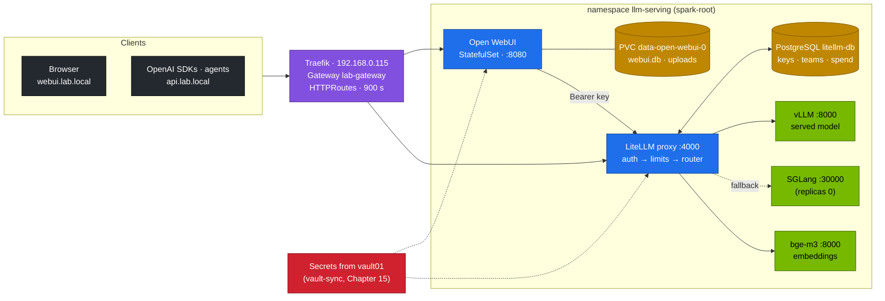
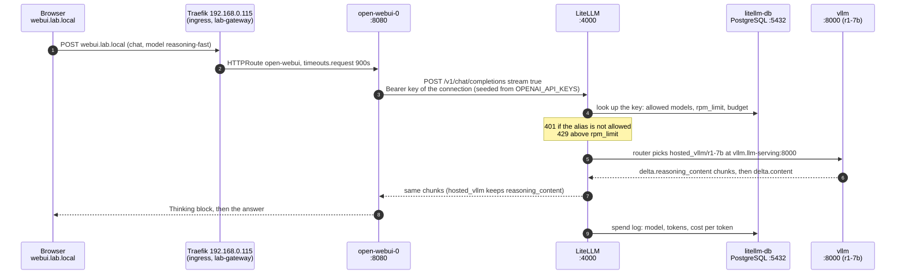

# Chapter 12 · Open WebUI & the LiteLLM Gateway

> **03-DeepSeek · Part V — Applications · Chapter 12 of 19** · ← [Chapter 11 · Distributed training & RL](11-distributed-training-and-rl.md) · [All chapters](00-deepseek-step-by-step-guide.md) · [Chapter 13 · RAG with Qdrant & BGE-M3](13-rag-with-qdrant-and-bge.md) →

| | |
|---|---|
| **You will build** | One OpenAI-compatible endpoint, `api.lab.local`, in front of every engine on the Spark: LiteLLM with stable aliases (`reasoning`, `reasoning-fast`, `agent`, `embeddings`), virtual keys with model allow-lists, budgets and rate limits in PostgreSQL, retries and fallbacks. Behind `webui.lab.local`, Open WebUI as the team's chat front end: it talks only to LiteLLM, shows R1's thinking as a collapsible block, admits new users only after approval, keeps sessions across restarts, embeds uploads with the lab's bge-m3, and has a nightly backup you restore in a drill |
| **Hardware** | dgx-spark-1 (the load-balancing pool in Task 5.9 needs dgx-spark-2) |
| **Time** | 2.5 h |
| **Risk** | Low. The restore drill replaces the chat database with last night's copy; Task 5.8 takes a fresh backup first |
| **Clusters** | `spark-root` only: everything runs in `llm-serving` (serving-budget), behind Traefik in `ingress` at 192.168.0.115 |
| **Lab files** | [`k8s/apps/litellm.yaml`](lab/k8s/apps/litellm.yaml), [`k8s/apps/litellm-db.yaml`](lab/k8s/apps/litellm-db.yaml), [`k8s/apps/open-webui.yaml`](lab/k8s/apps/open-webui.yaml), [`k8s/apps/bge-m3.yaml`](lab/k8s/apps/bge-m3.yaml), [`k8s/ops/webui-backup.yaml`](lab/k8s/ops/webui-backup.yaml), [`k8s/ops/litellm-db-backup.yaml`](lab/k8s/ops/litellm-db-backup.yaml), [`tools/stream_probe.py`](lab/tools/stream_probe.py), [`scripts/breakfix.sh`](lab/scripts/breakfix.sh) (D04, D08) |

Prerequisites: a chat model is serving (Chapter 06, `scripts/serve-model.sh r1-7b`), the Gateway path from [02-Kubernetes Chapter 11](../02-Kubernetes/11-ingress-controllers-and-gateway-api.md) works, and the streaming hops from [Chapter 08](08-kubernetes-deployment-storage-and-streaming.md) are set to 900 s.

---

## 1. Why this matters on a Spark

A Spark serves one or two chat models at a time, and which ones changes often: r1-7b during the day, r1-32b-fp8 for a comparison, qwen2.5-7b-tools for agents. Without a gateway, every client hard-codes `http://vllm.llm-serving:8000` and a served model name; switching the model breaks every client (drill D08), and nothing stops one script from taking the whole GPU. And a chat UI started with defaults is an open sign-up page that forgets its signing key on restart and keeps every chat in one unbacked SQLite file.

The two applications in this chapter solve both problems:

| Concern | Without | With this chapter |
|---|---|---|
| Model naming | `r1-32b-fp8` at `vllm:8000` | alias `reasoning` at `api.lab.local`; operators remap it in one ConfigMap |
| Access control | anyone who reaches the port | a virtual key per tenant: allowed models, expiry |
| Fair use of one GPU | first come, first served | per-key and per-team RPM/TPM limits and budgets |
| Resilience | the client sees the error | retries, cooldown of failing deployments, fallbacks to other aliases |
| Accounting | none | spend per key from token usage × your own cost per token |
| Who may chat | first user is admin, anyone may sign up | `DEFAULT_USER_ROLE=pending`: an admin approves every account |
| Sessions | signing key generated at start | `WEBUI_SECRET_KEY` from a Secret (synced from vault01, Chapter 15): logins survive restarts |
| Long answers | client timeouts of 300 s | 900 s on every hop (Chapter 08) |
| Data | one SQLite file | `local-nvme-retain` PVC, nightly online backup with integrity check, restore drill |
| Embeddings for uploads | a CPU model inside the UI pod | bge-m3 on the GB10 through the `embeddings` alias |

The gateway also matters for memory. The util sum of all engines running at the same time must stay ≲ 0.72 (Chapter 05). With aliases, you can move `reasoning` from a 32B to a 7B model to make room for a training window, and no client notices.

---

## 2. Architecture (HLD)



Two rules shape the design:

1. **Clients talk only to LiteLLM.** Open WebUI has `ENABLE_OLLAMA_API=false` and a single OpenAI connection to `http://litellm.llm-serving:4000/v1`. Agents (Chapter 14) and RAG (Chapter 13) use the same endpoint in production. Nothing outside `llm-serving` addresses vLLM directly.
2. **Only the engines use the GPU.** LiteLLM, PostgreSQL and Open WebUI are CPU pods; they count against `serving-budget` (8 CPU · 90 Gi) but not against the util sum. bge-m3 is a vLLM engine with `--gpu-memory-utilization=0.06` (≈ 7.3 GiB of the ~121.7 GiB) and one time-slice.

### 2.1 One chat message, step by step



- **Steps 1–2** are the Gateway path from 02 Chapter 11. `api.lab.local` takes the same path with HTTPRoute `litellm` and skips Open WebUI (Tasks 5.2–5.5).
- **Step 4** is Task 5.3: the `401` for `reasoning` and the `429` burst come from LiteLLM before any GPU work.
- **Step 5** is where retries and fallbacks happen. When `reasoning` has no backend, LiteLLM tries `reasoning-sglang`, then `reasoning-fast`; the `x-litellm-attempted-fallbacks` header shows it (Task 5.5).
- **Steps 6–8** are the thinking stream of Task 5.7. With an `openai/` prefix or no reasoning parser, the reasoning arrives inside `content` instead.
- **Step 9** is what `spend/logs` and `key/info` read in Task 5.4.

---

## 3. LLD

### 3.1 LiteLLM model list (`litellm-config`)

| Alias | Deployment(s) | Notes |
|---|---|---|
| `reasoning` | `hosted_vllm/r1-32b-fp8` at `vllm:8000` | falls back to `reasoning-sglang`, then `reasoning-fast` |
| `reasoning-fast` | `hosted_vllm/r1-7b` at `vllm:8000` | the everyday model |
| `reasoning-sglang` | `openai/r1-32b-fp8` at `sglang:30000` | fallback target (Chapter 07) |
| `agent` | `hosted_vllm/qwen2.5-7b-tools` at `vllm:8000` | tool calling, hermes parser (Chapter 14) |
| `embeddings` | `hosted_vllm/bge-m3` at `bge-m3:8000` | Open WebUI uploads, RAG (Chapter 13) |
| `reasoning-pool` | **two** deployments (vLLM, SGLang), `rpm: 60` each, cost per token set | load balancing, Task 5.9 |

`reasoning`, `reasoning-fast` and `agent` all point at the same Service `vllm:8000` with different model names. Only the alias whose model is being served answers; the others get a 404 from vLLM, which is what triggers the fallback in Task 5.5. The `hosted_vllm/` prefix tells LiteLLM the backend is vLLM, so vLLM-specific fields such as `reasoning_content` pass through. `openai/` treats the backend as a generic OpenAI-compatible server.

### 3.2 Router and reliability settings

| Setting | Value | Behaviour |
|---|---|---|
| `routing_strategy` | `least-busy` | the deployment with the fewest in-flight requests wins |
| `num_retries` | 2 | retry transient errors on the same alias |
| `allowed_fails` / `cooldown_time` | 3 / 60 s | a deployment failing 3 times in a minute is skipped for 60 s |
| `fallbacks` | `reasoning → [reasoning-sglang, reasoning-fast]` | tried in order once retries are used up |
| `timeout` / `request_timeout` | 900 s | long reasoning chains; drill D04 lowers it to 30 s |
| `drop_params` | true | drop OpenAI parameters a backend doesn't support instead of failing |
| `STORE_MODEL_IN_DB` | `False` | models come from the ConfigMap (Git), not the admin UI |

### 3.3 Keys, teams and limits (in PostgreSQL)

| Object | Created with | Limits you can set |
|---|---|---|
| master key | Secret `litellm-master-key` (vault01 → vault-sync) | admin only; never hand it to an application |
| team | `POST /team/new` | `max_budget`, `budget_duration`, `models`, `rpm_limit`, `tpm_limit` |
| virtual key | `POST /key/generate` | the same, plus `team_id`, `key_alias`, `duration` (expiry) |

Without the database LiteLLM only knows the master key. The cost per token (`model_info.input_cost_per_token`, `output_cost_per_token`) is yours to set for self-hosted models: take the local $/1M output tokens from Chapter 18's comparison (power plus amortised hardware), divide by 10⁶ and enter it, and spend per key becomes meaningful.

Status codes a client should handle:

| Code | Meaning |
|---|---|
| 401 | missing or invalid key, or model not in the key's allow-list ("key not allowed to access model") |
| 429 | RPM/TPM limit hit: back off and retry |
| 400 "Budget has been exceeded" | budget used up for the period |
| 500/502 with fallbacks exhausted | every candidate deployment failed |

### 3.4 Open WebUI environment

| Variable | Value | Purpose |
|---|---|---|
| `OPENAI_API_BASE_URLS` / `OPENAI_API_KEYS` | `http://litellm.llm-serving:4000/v1` / a LiteLLM key | the only backend |
| `ENABLE_OLLAMA_API` | `false` | no direct path that bypasses LiteLLM |
| `WEBUI_URL` | `http://webui.lab.local` | links and OAuth callbacks |
| `RAG_EMBEDDING_ENGINE` / `RAG_OPENAI_API_BASE_URL` / `RAG_EMBEDDING_MODEL` | `openai` / LiteLLM / `embeddings` | document embeddings on the GB10 |
| `DEFAULT_USER_ROLE` | `pending` | approval workflow |
| `AIOHTTP_CLIENT_TIMEOUT` | `900` | long reasoning streams |
| `WEBUI_SECRET_KEY` | Secret `open-webui-secret` | stable session signing |

Env values only **seed** a fresh install. After the first start Open WebUI keeps connection settings in its database, so later changes (a new key, a new URL) also go into **Admin Panel → Settings → Connections**.

### 3.5 Why a StatefulSet, and how thinking is shown

Open WebUI runs as a one-replica StatefulSet: a stable pod name (`open-webui-0`) and a `volumeClaimTemplate` whose PVC (`data-open-webui-0`, `local-nvme-retain`) outlives the pod and even the StatefulSet. SQLite doesn't support several writers; more than one replica needs PostgreSQL (`DATABASE_URL`) and Redis for websockets (§8).

vLLM's reasoning parser streams `delta.reasoning_content` before `delta.content` (Chapter 06). LiteLLM passes it through with the `hosted_vllm/` prefix, and Open WebUI renders it as a collapsible **Thought for N seconds** block above the answer. A backend without the parser sends raw `<think>…</think>` in the content; Open WebUI recognises that too, but every other client then sees the thinking as answer text (drill D01).

### 3.6 Backups

| Data | Job (schedule, UTC) | Method | Restore |
|---|---|---|---|
| Open WebUI `webui.db` | `webui-backup` (02:41) | SQLite online backup API, source opened `mode=ro`, `PRAGMA integrity_check` on the copy, 14 kept on a Retain PVC | scale to 0, copy the file back (Task 5.8) |
| LiteLLM PostgreSQL | `litellm-db-backup` (02:51) | `pg_dump -Fc`, 14 kept | `pg_restore --clean` (Chapter 15) |

The online backup API, not `cp`, because a file copy taken while the app writes can capture a half-written page. A backup that hasn't been integrity-checked and restored once isn't a backup.

---

## 4. Integrations

| With | How |
|---|---|
| Chapter 06 · vLLM | the served model's `--served-model-name` must match the alias's `hosted_vllm/<name>`; the reasoning parser feeds the thinking block |
| Chapter 07 · SGLang | `reasoning-sglang` and the second `reasoning-pool` deployment |
| Chapter 08 · streaming | the HTTPRoutes carry `timeouts.request: 900s`; `stream_probe.py` times each hop |
| Chapter 13 · RAG | the `embeddings` alias; the shared corpus lives in Qdrant, Open WebUI's own RAG is for ad-hoc uploads |
| Chapter 14 · agents | the `agent` alias passes `tools` and `tool_calls` through with a scoped key |
| Chapter 15 · secrets | `litellm-master-key` and `open-webui-secret` come from vault01 via `vault-sync`, which rolls LiteLLM and Open WebUI after a rotation |
| Chapter 16 · telemetry | spend per key from LiteLLM's API; latency per model from vLLM's metrics |
| [02-Kubernetes Chapter 11](../02-Kubernetes/11-ingress-controllers-and-gateway-api.md) | Gateway `lab-gateway` in `ingress`; Traefik watches `llm-serving` |

---

## 5. Lab

### Task 5.1 · Deploy the apps

#### What this lab does (manifests `lab/k8s/apps`)

- **LiteLLM + PostgreSQL:** StatefulSet `litellm-db` (`postgres:16.10-alpine`, 5 Gi PVC on `local-nvme-retain`) and Deployment `litellm` (`v1.77.5-stable`, port **4000**). The model list from §3.1 comes from the ConfigMap `litellm-config`. The first start runs database migrations.
- **bge-m3:** a vLLM embedding server (util 0.06, 1 CPU · 9 Gi · 1 slice). The first start downloads the model into `model-cache`.
- **Open WebUI:** StatefulSet `open-webui` (`v0.6.30`, port **8080**, 10 Gi PVC `data-open-webui-0`), with LiteLLM as its only backend.
- **HTTPRoutes** on `lab-gateway`: `api.lab.local` → LiteLLM, `webui.lab.local` → Open WebUI, both through Traefik on 192.168.0.115. All in `llm-serving`.
- **Placeholder Secrets** (`sk-lab-change-me`, `change-me-…`) until Chapter 15's `vault-sync` replaces them.

#### What to look for

1. **Rollouts:** each `rollout status` ends with `successfully rolled out` (bge-m3 can take many minutes on its first start).
2. **Quota:** `describe quota serving-budget` shows CPU and memory used below 8 / 90Gi.
3. **Health:** `curl -s http://webui.lab.local/health` prints `{"status":true}`.
4. **Memory budget:** the two `gpu-memory-utilization` values add up to ≲ 0.72. With r1-7b that is 0.20 + 0.06 = 0.26.

**If something's off:** LiteLLM in CrashLoop with Prisma errors on first start usually means PostgreSQL wasn't ready yet; wait for the startupProbe. bge-m3 Pending or OOM means the util sum or `serving-budget` is full. More in §7.

#### Run it

The manifests carry placeholder Secrets (`sk-lab-change-me`, `change-me-…`). That's acceptable for the first start; Chapter 15 replaces them from vault01. If you've done Chapter 15 already, run the sync right after the apply (last line).

```bash
# ▶ MacBook · 03-DeepSeek/lab
export KUBECONFIG="$PWD/../../01-Ansible/lab/.cache/kubeconfig-spark-lab.yaml"
kubectl --context spark-root apply -k k8s/apps                                    # bge-m3, LiteLLM + PostgreSQL, Open WebUI, HTTPRoutes
kubectl --context spark-root -n llm-serving rollout status sts/litellm-db --timeout=5m
kubectl --context spark-root -n llm-serving rollout status deploy/litellm --timeout=10m   # DB migrations on first start
kubectl --context spark-root -n llm-serving rollout status deploy/bge-m3 --timeout=20m    # first start downloads bge-m3
kubectl --context spark-root -n llm-serving rollout status sts/open-webui --timeout=10m
kubectl --context spark-root -n llm-serving describe quota serving-budget         # CPU and memory used vs 8 / 90Gi
kubectl --context spark-root -n llm-serving create job --from=cronjob/vault-sync vs-apps 2>/dev/null || true   # only if Chapter 15 is done
```

Add the names to the MacBook's `/etc/hosts` once. Run this block **on its own**: `sudo` asks for your **MacBook login password** (not the Spark's), and lines pasted after it would be read as password attempts. The `grep` skips it if the names are already there.

```bash
# ▶ MacBook · any folder
grep -q ' api.lab.local' /etc/hosts || echo "192.168.0.115 api.lab.local webui.lab.local" | sudo tee -a /etc/hosts
```

```bash
# ▶ MacBook · any folder
curl -s http://webui.lab.local/health                                              # {"status":true}
```

Check the memory side before you go on: the chat model's util plus bge-m3's 0.06 must stay ≲ 0.72.

```bash
# ▶ MacBook · 03-DeepSeek/lab
for d in vllm bge-m3; do
  echo "$d $(kubectl --context spark-root -n llm-serving get deploy $d -o jsonpath='{.spec.template.spec.containers[0].args}' | grep -o 'gpu-memory-utilization=[0-9.]*')"
done                                                                               # add the two values: ≲ 0.72
```

### Task 5.2 · The gateway answers

#### What this lab does (commands against `api.lab.local`)

- **Read-only:** reads the master key from the Secret `litellm-master-key`, lists the aliases and sends one chat request to `reasoning-fast`. Nothing is created or changed.
- **Prerequisite:** r1-7b is the model `deploy/vllm` serves (`scripts/serve-model.sh r1-7b`).

#### What to look for

1. **Alias list:** `reasoning`, `reasoning-fast`, `reasoning-sglang`, `agent`, `embeddings`, `reasoning-pool`.
2. **The answer JSON:** `model` names r1-7b, `answer` says 91 is not prime (7 × 13), and `thinking_chars` is above 0: the reasoning arrived in its own field.

**If something's off:** `Could not resolve host` means the `/etc/hosts` line from Task 5.1 is missing. `thinking_chars: 0` with `<think>` in the answer means the backend has no reasoning parser, or the alias uses `openai/` instead of `hosted_vllm/`. More in §7.

#### Run it

```bash
# ▶ MacBook · 03-DeepSeek/lab
KEY=$(kubectl --context spark-root -n llm-serving get secret litellm-master-key -o jsonpath='{.data.key}' | base64 -d)
API=http://api.lab.local
H=(-H "Authorization: Bearer $KEY" -H 'Content-Type: application/json')
curl -s $API/v1/models "${H[@]}" | jq -r '.data[].id'
curl -s $API/v1/chat/completions "${H[@]}" \
  -d '{"model":"reasoning-fast","max_tokens":512,"messages":[{"role":"user","content":"Is 91 prime? One line."}]}' \
  | jq '{model, answer: .choices[0].message.content, thinking_chars: (.choices[0].message.reasoning_content // "" | length)}'
```

Expected: the alias list from §3.1, then an answer from r1-7b with a non-zero `thinking_chars`: the reasoning arrived separately.

### Task 5.3 · A team and a scoped key

#### What this lab does (LiteLLM API, stored in `litellm-db`)

- **Creates a team** `tenant-alpha` with a 5-dollar budget per 30 days.
- **Creates a virtual key** `alpha-dev` in that team: only `reasoning-fast` and `embeddings`, 5 requests per minute, 1-dollar budget, valid 30 days.
- **Tests the limits:** one normal request, one request for a model outside the allow-list, then 8 quick requests to hit the RPM limit.

#### What to look for

1. **The first request** prints an answer (4).
2. **`401`** for `reasoning`: not in the key's allow-list.
3. **The burst:** something like `200 200 200 200 200 429 429 429`. The 429s start once 5 requests fall in one minute, counting the first one.

**If something's off:** `/team/new` or `/key/generate` saying a database is required means `DATABASE_URL` is unset or `litellm-db` is down. 429 too early means the key is shared with earlier tries; wait a minute. More in §7.

#### Run it

```bash
# ▶ MacBook · 03-DeepSeek/lab
TEAM=$(curl -s $API/team/new "${H[@]}" -d '{"team_alias":"tenant-alpha","max_budget":5,"budget_duration":"30d"}' | jq -r .team_id)
ALPHA=$(curl -s $API/key/generate "${H[@]}" -d "{\"team_id\":\"$TEAM\",\"key_alias\":\"alpha-dev\",
  \"models\":[\"reasoning-fast\",\"embeddings\"],\"rpm_limit\":5,\"max_budget\":1,\"duration\":\"30d\"}" | jq -r .key)
A=(-H "Authorization: Bearer $ALPHA" -H 'Content-Type: application/json')
curl -s $API/v1/chat/completions "${A[@]}" -d '{"model":"reasoning-fast","max_tokens":512,"messages":[{"role":"user","content":"2+2?"}]}' | jq -r '.choices[0].message.content'
curl -s -o /dev/null -w '%{http_code}\n' $API/v1/chat/completions "${A[@]}" -d '{"model":"reasoning","messages":[{"role":"user","content":"hi"}]}'
for i in $(seq 8); do curl -s -o /dev/null -w '%{http_code} ' $API/v1/chat/completions "${A[@]}" \
  -d '{"model":"reasoning-fast","max_tokens":8,"messages":[{"role":"user","content":"hi"}]}'; done; echo
```

Expected: an answer; `401` for `reasoning` (not in the allow-list); then something like `200 200 200 200 200 429 429 429` (the first request already used one of the five).

### Task 5.4 · Spend per key

#### What this lab does (LiteLLM API)

- **Reads** the `alpha-dev` key's settings and its latest spend log entry. Read-only.
- **Optional change:** you add a cost per token for `reasoning-fast` in `litellm-config` and restart LiteLLM, so spend gets a value.

#### What to look for

1. **`key/info`:** `key_alias` `alpha-dev`, `max_budget` 1, `rpm_limit` 5, `models` with the two aliases.
2. **`spend/logs`:** the latest request with its `model` and `total_tokens` above 0.
3. **`spend`:** 0 until a cost per token is set; above 0 after the restart and one more request.

**If something's off:** a config change with no effect means LiteLLM wasn't restarted (the ConfigMap is read at start). More in §7.

#### Run it

```bash
# ▶ MacBook · 03-DeepSeek/lab
curl -s "$API/key/info?key=$ALPHA" "${H[@]}" | jq '.info | {key_alias, spend, max_budget, rpm_limit, models}'
curl -s "$API/spend/logs?api_key=$ALPHA" "${H[@]}" | jq '.[0] | {model, total_tokens, spend, startTime}'
```

`spend` stays 0 until the model has a cost per token (§3.3). Set one in `litellm-config`, `kubectl --context spark-root -n llm-serving rollout restart deploy/litellm`, send a request, and read it again.

### Task 5.5 · A fallback rescues a request

#### What this lab does (script `lab/scripts/serve-model.sh`, LiteLLM fallbacks)

- **Makes sure r1-7b is served:** `serve-model.sh` prefetches the weights, applies the `r1-7b` overlay and runs a smoke test. If r1-7b already serves, nothing changes.
- **Asks for `reasoning`** (r1-32b-fp8), which has no backend: vLLM serves another name and SGLang is at 0 replicas. LiteLLM retries, then falls back `reasoning-sglang` → `reasoning-fast`.

#### What to look for

1. **`serve-model.sh`** ends with `[PASS] answer: 144 …` and `0 failed`.
2. **The headers:** `x-litellm-attempted-fallbacks` above 0; `x-litellm-model-api-base` is the vLLM Service (`vllm.llm-serving:8000`).
3. **The body:** `"model"` is r1-7b. The request succeeded. Record the extra latency the failed attempts added.

**If something's off:** a 500 with fallbacks exhausted means r1-7b isn't Ready either. No fallback at all means the error isn't one LiteLLM falls back on; read the LiteLLM log for the exception. More in §7.

#### Run it

Only r1-7b is served, SGLang is at 0 replicas, so `reasoning` (r1-32b-fp8) has no backend:

```bash
# ▶ MacBook · 03-DeepSeek/lab
scripts/serve-model.sh r1-7b                                       # no-op if it is already serving
curl -si $API/v1/chat/completions "${H[@]}" -d '{"model":"reasoning","max_tokens":256,"messages":[{"role":"user","content":"Is 91 prime?"}]}' \
  | grep -iE '^x-litellm-(model-id|model-api-base|attempted-retries|attempted-fallbacks)|"model"'
```

Expected: the request succeeds, the headers show attempted fallbacks, and the response `model` is r1-7b. The client never knew. Record how much latency the failed attempts added.

### Task 5.6 · Give Open WebUI its own key, then sign in

#### What this lab does (LiteLLM API, StatefulSet `open-webui`, browser)

- **New key `open-webui`:** only `reasoning`, `reasoning-fast` and `embeddings`, 120 requests per minute.
- **Secret `webui-litellm-key`** in `llm-serving`, and a patch of the StatefulSet so `OPENAI_API_KEYS` reads it instead of the master key. `open-webui-0` restarts; its PVC and data stay.
- **In the browser:** first account (admin), the key in Settings → Connections, a second user who must be approved.
- **Not permanent:** a later `kubectl apply -k k8s/apps` puts the master key back.

#### What to look for

1. **Rollout:** `rollout status sts/open-webui` succeeds.
2. **Models in the picker:** `reasoning`, `reasoning-fast` (and `embeddings` until you hide it), nothing else.
3. **Second user:** sees "account activation pending" until you set the role to *user*.

**If something's off:** an empty model picker means the old key is still in Admin Panel → Settings → Connections (env values only seed the first start). A signed-in non-admin user with no models at all means the models are still private: step 6. No **Sign up** link in the private window means new sign-ups are off: Open WebUI disables them after the first account; switch them on in Admin Panel → Settings → General. More in §7.

#### Run it

The master key in Open WebUI is a shortcut for the first start. Give it a key that can only reach the chat aliases and embeddings:

```bash
# ▶ MacBook · 03-DeepSeek/lab
WEBUI=$(curl -s $API/key/generate "${H[@]}" -d '{"key_alias":"open-webui","models":["reasoning","reasoning-fast","embeddings"],"rpm_limit":120}' | jq -r .key)
kubectl --context spark-root -n llm-serving create secret generic webui-litellm-key --from-literal=key="$WEBUI"
kubectl --context spark-root -n llm-serving patch sts open-webui --type json \
  -p '[{"op":"replace","path":"/spec/template/spec/containers/0/env/1/valueFrom/secretKeyRef","value":{"name":"webui-litellm-key","key":"key"}}]'
kubectl --context spark-root -n llm-serving rollout status sts/open-webui
```

Then in the browser:

1. Open `http://webui.lab.local` and sign up. The first account becomes **admin**.
2. **Admin Panel → Settings → Connections**: paste the new key into the LiteLLM connection (env values only seeded the first start).
3. **Admin Panel → Settings → General → Authentication**: switch **Enable New Sign Ups** on (Open WebUI turns it off by itself once the first account exists) and check **Default User Role** is `pending`; **Save**.
4. In a private window, sign up a second user. Expected: an "account activation pending" screen.
5. As admin: **Admin Panel → Users** → set the new user to *user*.
6. **Admin Panel → Settings → Models**: models from a connection are **private** (admins only) until you open them, so a new user sees an empty picker. Edit `reasoning-fast` and `reasoning` → visibility **Public** (or give a group such as `lab-users` access), **Save & Update**; switch `embeddings` off for chat. To ration the 32B, keep `reasoning` restricted to a group and `reasoning-fast` public.

A `kubectl apply -k k8s/apps` later puts the master key back in the StatefulSet; keep the patch in an overlay of your own, or in Git if you run the apps through Argo CD (Chapter 15).

### Task 5.7 · Watch the thinking stream

#### What this lab does (Open WebUI in the browser, `deploy/bge-m3`)

- **A chat** with `reasoning-fast`: vLLM streams `reasoning_content`, LiteLLM passes it through, Open WebUI draws it as a collapsible block.
- **A knowledge collection** "DeepSeek lab" with Chapter 08 uploaded. Open WebUI embeds it through the `embeddings` alias, so bge-m3 on the GB10 does the work.
- **One read-only command:** counts embedding calls in the bge-m3 log.

#### What to look for

1. **The thinking block** streams, collapses to **Thought for N seconds**, then the answer **14**.
2. **The cited answer:** **900 s**, with a citation of the uploaded file.
3. **The bge-m3 count** is above 0.

**If something's off:** thinking shown as answer text means the backend has no reasoning parser (drill D01). An upload that fails with an `embedding` error means bge-m3 isn't Ready or the alias is missing. More in §7.

#### Run it


In Open WebUI pick `reasoning-fast` and ask: *"A training run saves a checkpoint every 7 steps. How many checkpoints exist after 100 steps? Explain briefly."* Expected: a **Thinking…** block that streams, collapses to **Thought for N seconds**, then the answer **14**. Time the same request through the gateway hop by hop with `stream_probe.py` (Chapter 08).

Upload a document: **Workspace → Knowledge → +**, create "DeepSeek lab", upload [Chapter 08](08-kubernetes-deployment-storage-and-streaming.md), then in a new chat type `#`, pick the collection and ask *"What request timeout does the LiteLLM HTTPRoute use?"* Expected: **900 s**, with a citation. Confirm the embeddings ran on the GB10:

```bash
# ▶ MacBook · 03-DeepSeek/lab
kubectl --context spark-root -n llm-serving logs deploy/bge-m3 | grep -c 'POST /v1/embeddings'
```

### Task 5.8 · Back up, then restore

#### What this lab does (manifest `lab/k8s/ops/webui-backup.yaml`, an inline restore Job)

- **Backup:** creates the 5 Gi PVC `webui-backups` and the CronJob `webui-backup` (02:41 UTC). A one-off Job `webui-backup-now` copies `webui.db` with SQLite's online backup API (source opened read-only), runs `PRAGMA integrity_check` on the copy and keeps the newest 14.
- **Restore drill:** scales `open-webui` to 0, a Job `webui-restore` saves the current file as `webui.db.before-restore` and copies the backup over it, then Open WebUI scales back to 1.
- **Session check:** deletes `open-webui-0` and checks you stay logged in.

#### What to look for

1. **The backup log:** `webui-<timestamp>.db <size> bytes, integrity: ok`.
2. **The restore Job:** `condition met`, and its `ls -l /data` shows both `webui.db` and `webui.db.before-restore`.
3. **In the UI:** the deleted chat is back. Record the time from `scale … 0` to a working login.
4. **After the pod delete:** still logged in.

**If something's off:** an empty `$B` means the backup Job's log has no `integrity: ok` line; read it. Everyone logged out after a restart means `WEBUI_SECRET_KEY` changed. More in §7.

#### Run it

```bash
# ▶ MacBook · 03-DeepSeek/lab
kubectl --context spark-root apply -f k8s/ops/webui-backup.yaml
kubectl --context spark-root -n llm-serving create job --from=cronjob/webui-backup webui-backup-now
kubectl --context spark-root -n llm-serving logs -f job/webui-backup-now          # webui-<timestamp>.db … integrity: ok
```

Restore drill: delete a chat in the UI, then roll the database back.

```bash
# ▶ MacBook · 03-DeepSeek/lab
B=$(kubectl --context spark-root -n llm-serving logs job/webui-backup-now | awk '/integrity: ok/{print $1}')
kubectl --context spark-root -n llm-serving scale sts open-webui --replicas=0
kubectl --context spark-root apply -f - <<EOF
apiVersion: batch/v1
kind: Job
metadata: {name: webui-restore, namespace: llm-serving}
spec:
  backoffLimit: 0
  template:
    spec:
      restartPolicy: Never
      containers:
        - name: restore
          image: python:3.12-slim
          command: ["sh", "-c", "cp /data/webui.db /data/webui.db.before-restore && cp /backups/$B /data/webui.db && ls -l /data"]
          resources: {requests: {cpu: 100m, memory: 128Mi}, limits: {memory: 128Mi}}
          volumeMounts: [{name: data, mountPath: /data}, {name: backups, mountPath: /backups, readOnly: true}]
      volumes:
        - {name: data, persistentVolumeClaim: {claimName: data-open-webui-0}}
        - {name: backups, persistentVolumeClaim: {claimName: webui-backups}}
EOF
kubectl --context spark-root -n llm-serving wait --for=condition=complete job/webui-restore --timeout=2m
kubectl --context spark-root -n llm-serving logs job/webui-restore                # webui.db and webui.db.before-restore
kubectl --context spark-root -n llm-serving scale sts open-webui --replicas=1
```

Expected: after logging in again, the deleted chat is back. The time from `scale … 0` to a working login is your recovery time for the chat service: record it.

Then prove sessions survive a restart: stay logged in, `kubectl --context spark-root -n llm-serving delete pod open-webui-0`, refresh when it's back. You're still logged in, because the signing key comes from the Secret.

### Task 5.9 · (2×) Load balancing a pool

#### What this lab does (script `lab/scripts/serve-model.sh`, overlay `lab/k8s/sglang/r1-32b-fp8`)

- **vLLM** switches to r1-32b-fp8 on dgx-spark-1.
- **SGLang** serves the same model on dgx-spark-2. The overlay has no node pin and mounts `model-cache`, a `local-nvme-retain` volume that lives on dgx-spark-1, so the commands pin the pod to dgx-spark-2 and give it an `emptyDir` for the weights (downloaded again there). The second `reasoning-pool` entry already points at the Service `sglang:30000`, so LiteLLM needs no change.
- **Raises `serving-budget` memory to 180 Gi for the run:** two 58 Gi engines plus bge-m3 and the apps don't fit 90 Gi. Re-applying 02's `10-tenancy` puts it back.
- **20 concurrent requests** to `reasoning-pool`; LiteLLM's least-busy routing spreads them.
- **With only one Spark:** skip this Task; both engines don't fit the util budget and `serving-budget` together.

#### What to look for

1. **`serve-model.sh`** ends with `[PASS] answer: 144 …`, and `get pod -l app=sglang -o wide` shows the SGLang pod Ready on dgx-spark-2.
2. **The count** lists both `pool-vllm` and `pool-sglang` in `x-litellm-model-id`.

**If something's off:** only `pool-vllm` appears when SGLang isn't Ready (it is then cooled down for 60 s after 3 failures). SGLang `Pending` with `exceeded quota: serving-budget` → the quota patch didn't apply; with `volume node affinity conflict` → the `emptyDir` patch didn't apply. More in §7.

#### Run it

`reasoning-pool` puts vLLM and SGLang, both serving r1-32b-fp8, behind one name. On one Spark this doesn't fit: two 32B FP8 engines need 2 × 0.45 of util (0.90 > 0.72) and two 58 Gi pods (116 Gi > 90 Gi `serving-budget`). With dgx-spark-2, run SGLang there (Chapter 07). The quota is per namespace, not per node, so raise it for the run:

```bash
# ▶ MacBook · 03-DeepSeek/lab
scripts/serve-model.sh r1-32b-fp8
kubectl --context spark-root -n llm-serving patch resourcequota serving-budget --type merge \
  -p '{"spec":{"hard":{"requests.memory":"180Gi","limits.memory":"180Gi"}}}'
kubectl --context spark-root apply -k k8s/sglang/r1-32b-fp8
kubectl --context spark-root -n llm-serving patch deploy sglang --type json -p '[
  {"op":"add","path":"/spec/template/spec/nodeSelector","value":{"kubernetes.io/hostname":"dgx-spark-2"}},
  {"op":"replace","path":"/spec/template/spec/volumes/0","value":{"name":"models","emptyDir":{}}}]'
kubectl --context spark-root -n llm-serving rollout status deploy/sglang --timeout=60m   # downloads ~34 GB on dgx-spark-2
kubectl --context spark-root -n llm-serving get pod -l app=sglang -o wide               # NODE dgx-spark-2
{ for i in $(seq 20); do curl -si $API/v1/chat/completions "${H[@]}" \
    -d '{"model":"reasoning-pool","max_tokens":64,"messages":[{"role":"user","content":"hi"}]}' \
    | grep -i '^x-litellm-model-id' & done; wait; } | sort | uniq -c
```

Expected: both `pool-vllm` and `pool-sglang` appear; with concurrent requests least-busy spreads them. Clean up: `kubectl --context spark-root -n llm-serving scale deploy sglang --replicas=0` and `kubectl --context spark-root apply -k ../../02-Kubernetes/lab/manifests/root-llms/10-tenancy` (quota back to 90 Gi).

### Task 5.10 · Drills

#### What this lab does (script `lab/scripts/breakfix.sh`)

- **D04:** rewrites `timeout` and `request_timeout` in `litellm-config` from 900 to 30 s and restarts LiteLLM. `reset D04` re-applies `k8s/apps/litellm.yaml` and restarts it again.
- **D08:** changes nothing in the cluster. It prints an `eval_harness.py` command that asks for the Hugging Face repo id instead of the served name.

#### What to look for

1. **After `inject D04`:** `Injected D04: Long reasoning answers cut off at the gateway`; a long `reasoning-fast` request through `api.lab.local` fails after about 30 s, while the same request straight to vLLM finishes.
2. **After `reset D04`:** the same long request completes again.
3. **D08:** the printed command gets `404` model not found; `/v1/models` shows the served name it should have used.

**If something's off:** `reset D04` also re-applies the Secret `litellm-master-key` from `litellm.yaml` with its placeholder value. If Chapter 15's vault-sync is set up, run it again afterwards (`create job --from=cronjob/vault-sync`). More in §7.

#### Run it

The direct-to-vLLM comparison and the D08 command use `localhost:8000`, so start a port-forward first.

```bash
# ▶ MacBook · 03-DeepSeek/lab
kubectl --context spark-root -n llm-serving port-forward svc/vllm 8000 &
scripts/breakfix.sh inject D04      # LiteLLM timeout lowered to 30 s: long answers cut off
scripts/breakfix.sh hint D04
scripts/breakfix.sh reset D04
scripts/breakfix.sh inject D08      # a client uses the HF repo id instead of the served name
scripts/breakfix.sh answer D08      # then explain how the aliases prevent it
```

---

## 6. Verify

```bash
# ▶ MacBook · 03-DeepSeek/lab
scripts/verify.sh apps
```

| Check | Expected |
|---|---|
| pods | `litellm-db`, `litellm`, `bge-m3`, `open-webui` Ready; `serving-budget` not exceeded |
| health | `/health` on `webui.lab.local` → `{"status":true}`; `/v1/models` on `api.lab.local` lists the aliases |
| limits | 401 for a model outside the allow-list, 429 above the RPM |
| spend | `key/info` shows non-zero spend once a cost per token is set |
| fallback | `reasoning` answers while its primary has no backend |
| sign-up | a second user stays `pending` until approved |
| thinking | collapsible block, then the answer |
| uploads | answer cites the uploaded file; bge-m3 log shows embedding calls |
| backup / restore | `integrity: ok`; the deleted chat is back; recovery time recorded |
| sessions | still logged in after the pod is deleted |

---

## 7. Troubleshooting

| You see | Cause | Fix |
|---|---|---|
| `/key/generate` says a database is required | `DATABASE_URL` unset or `litellm-db` unreachable | `kubectl --context spark-root -n llm-serving get sts litellm-db`; check the env in the pod |
| LiteLLM CrashLoop with Prisma errors on first start | database not ready yet, or wrong password | the startupProbe allows 5 min; check the `litellm-db` Secret matches what PostgreSQL was initialised with |
| `reasoning_content` missing through LiteLLM | `openai/` prefix used for a vLLM backend | `hosted_vllm/` for vLLM |
| 429 although traffic is low | `rpm_limit` on the team **and** the key, or a shared key | read `key/info` and `team/info` |
| fallback never happens | the error class isn't one LiteLLM falls back on, or retries keep succeeding slowly | check `allowed_fails`/`cooldown_time`; read the LiteLLM log for the exception |
| spend always 0 | no cost per token for self-hosted models | set `model_info` costs (§3.3) |
| config change has no effect | ConfigMap is mounted, process not restarted | `kubectl --context spark-root -n llm-serving rollout restart deploy/litellm` |
| no models in Open WebUI's picker | wrong key in the connection, or LiteLLM down | fix the key in **Settings → Connections**; `kubectl --context spark-root -n llm-serving logs sts/open-webui \| grep -i openai` |
| answer stops after ~5 min | a hop with a shorter timeout | 900 s on the HTTPRoute, LiteLLM and `AIOHTTP_CLIENT_TIMEOUT` (Chapter 08) |
| thinking shown as answer text | backend without a reasoning parser | `--reasoning-parser=deepseek_r1` in the catalog entry (drill D01) |
| everyone logged out after a restart | `WEBUI_SECRET_KEY` unset or rotated | take it from the Secret; rotate only deliberately (Chapter 15) |
| upload fails with an `embedding` error | `embeddings` alias missing or bge-m3 not Ready | `kubectl --context spark-root -n llm-serving get deploy bge-m3`; check the alias list |
| bge-m3 Pending or OOM at start | memory: util sum or `serving-budget` full | `describe quota serving-budget`; park a model (Chapter 05) |
| `database is locked` | two Open WebUI replicas on SQLite | one replica, or PostgreSQL |
| `curl: Could not resolve host: api.lab.local` | no `/etc/hosts` entry | Task 5.1 |

---

## 8. Scale-out path (2×)

| One Spark | Two Sparks / production |
|---|---|
| one LiteLLM, PostgreSQL on local NVMe | 2+ LiteLLM replicas with Redis (shared rate-limit counters and router state), managed or replicated PostgreSQL |
| `reasoning-pool` doesn't fit | SGLang or a second vLLM on dgx-spark-2 behind the same alias; least-busy across both |
| static model list in a ConfigMap | the model list in Git (Argo CD, Chapter 15); model access tied to SSO groups |
| Open WebUI on SQLite + nightly backup | PostgreSQL with PITR, uploads in object storage, Redis for websockets, several replicas |
| local accounts with approval | SSO via OIDC (`ENABLE_OAUTH_SIGNUP`, `OAUTH_*`) with group mapping from the IdP |
| least-busy routing | KV-cache- and queue-aware routing under the gateway (Gateway API Inference Extension) |

With a second Spark, the PVCs stay where they were bound (`local-nvme` is node-local): the Open WebUI and PostgreSQL pods, and their backup Jobs, must run on the node that holds their volumes.

---

## 9. Checklist

- [ ] Clients use aliases; I can change the model behind `reasoning` without touching a client.
- [ ] Each tenant has a scoped key with limits, and I've seen the 401 and the 429.
- [ ] I can show spend per key.
- [ ] I watched a fallback rescue a request whose primary had no backend.
- [ ] New users can't reach the GPU until an admin approves them; Open WebUI uses its own key, not the master key.
- [ ] Thinking renders separately from the answer; uploads are embedded on the GB10.
- [ ] I restored the chat database from a backup and know how long it took.
