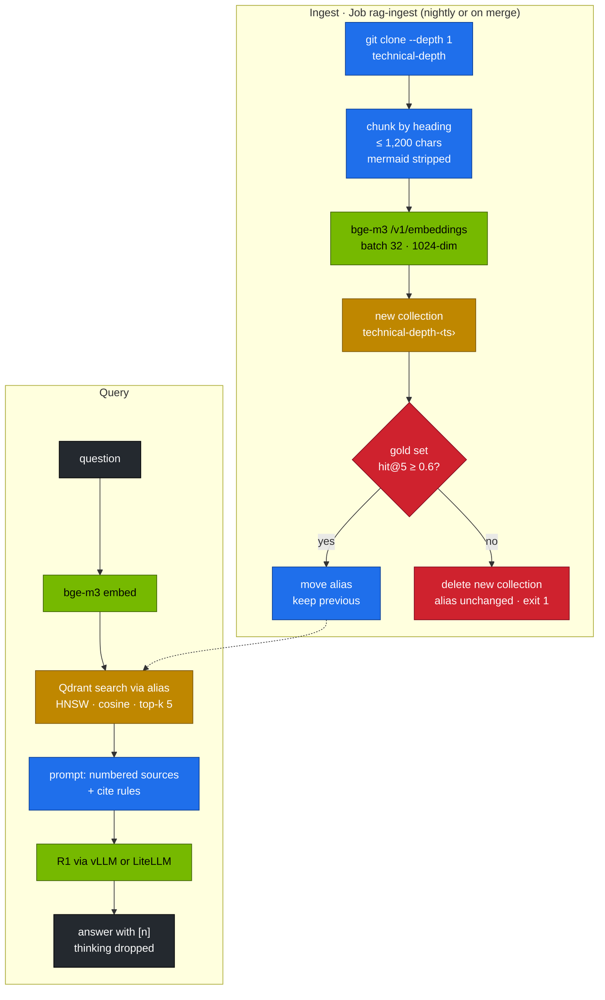

# Chapter 13 · RAG with Qdrant & BGE-M3

> **03-DeepSeek · Part V — Applications · Chapter 13 of 19** · ← [Chapter 12 · Open WebUI & the LiteLLM gateway](12-open-webui-and-litellm-gateway.md) · [All chapters](00-deepseek-step-by-step-guide.md) · [Chapter 14 · Tool calling & agents](14-tool-calling-and-agents.md) →

| | |
|---|---|
| **You will build** | Retrieval-augmented generation over this repository, run like a production service. bge-m3 embeds on the GB10 next to the chat model. Qdrant stores the vectors behind an alias, so a re-index builds a new collection, is scored against a gold question set, and only then goes live; a rollback is one command. Answers come from R1 with numbered citations, and refuse when the sources are silent |
| **Hardware** | dgx-spark-1 |
| **Time** | 90 min |
| **Risk** | Low. Re-indexing never touches the live collection until the new one passes the gate |
| **Clusters** | `spark-root`: Qdrant, bge-m3, the chat model and the ingest Job in `llm-serving` |
| **Lab files** | [`tools/rag_demo.py`](lab/tools/rag_demo.py), [`data/rag_gold.jsonl`](lab/data/rag_gold.jsonl), [`k8s/jobs/rag-ingest.yaml`](lab/k8s/jobs/rag-ingest.yaml), [`k8s/apps/bge-m3.yaml`](lab/k8s/apps/bge-m3.yaml), [`qdrant-statefulset.yaml`](../02-Kubernetes/lab/manifests/root-llms/50-workloads/qdrant-statefulset.yaml) (02) |

Prerequisites: Chapter 12's apps are deployed (bge-m3 Ready, `embeddings` alias), a chat model is serving (`scripts/serve-model.sh r1-7b`).

---

## 1. Why this matters on a Spark

A model only knows what it was trained on. RAG retrieves passages at question time and asks the model to answer *from them*, with citations. A demo stops at "it found something". A service needs more, and the Spark adds one constraint of its own: everything, including the embedder, shares the ~121.7 GiB unified pool with the chat model.

| Concern | Demo | This lab |
|---|---|---|
| Re-indexing | drop and rebuild the collection; queries fail meanwhile | build `technical-depth-<timestamp>`, then move the alias `technical-depth` atomically |
| Quality | "looks right" | `rag_demo.py eval`: hit@1, hit@k and MRR on 16 gold questions |
| Bad index | discovered by users | **gate**: a new index below hit@5 0.6 is deleted and never goes live |
| Rollback | re-run the ingest and hope | `rag_demo.py rollback` points the alias back at the previous collection |
| Where embeddings run | a hosted API | bge-m3 on the GB10 at util 0.06 (≈ 7.3 GiB); no data leaves the box |
| Answers | free text | numbered sources, `[n]` citations, "say so" when the answer isn't in them |

Memory: bge-m3's 0.06 counts in the util sum with the chat model (≲ 0.72 together, Chapter 05). r1-7b plus bge-m3 fits with plenty of room; r1-32b BF16 at 0.70 doesn't leave room for the embedder, so a RAG demo with the 32B uses r1-32b-fp8.

---

## 2. Architecture (HLD)



Where the pieces run:

| Piece | Kind | Namespace | GPU |
|---|---|---|---|
| Qdrant | StatefulSet from 02 (`root-llms/50-workloads`), PVC on `local-nvme-retain` | `llm-serving` | no |
| bge-m3 | vLLM Deployment `--task=embed` (Chapter 12) | `llm-serving` | util 0.06, 1 slice |
| chat model | the vLLM Deployment (Chapter 06) | `llm-serving` | as served |
| ingest | Job `rag-ingest`: init container clones the repo, `rag_demo.py ingest` runs from the tools ConfigMap | `llm-serving` | no |
| eval / ask | `rag_demo.py` on the MacBook through port-forwards, or in-cluster | — | no |

---

## 3. LLD

### 3.1 Components and footprints

| Component | Setting | Footprint |
|---|---|---|
| bge-m3 | 1024-dim dense, max 8,192 tokens, multilingual | util 0.06 ≈ 7.3 GiB, 1 time-slice |
| Qdrant | REST :6333, `local-nvme-retain` PVC | 1–2 GiB RAM for this corpus |
| collection | cosine distance, HNSW defaults (m 16, ef_construct 100) | ~1,400 points × 1024 × 4 B ≈ 6 MB of vectors |
| chat | r1-7b or r1-32b-fp8 | as served |

The vectors are tiny. Retrieval is a few milliseconds; the chat model's reasoning dominates every RAG request (Task 5.7).

### 3.2 Chunking rules (`rag_demo.py`)

| Rule | Why |
|---|---|
| split at `#`, `##` and `###` headings; keep the heading as payload | sections are semantic units, and the heading becomes the citation label |
| ≤ 1,200 characters per chunk; drop pieces < 80 characters | fits bge-m3's window with room to spare; no empty fragments |
| strip Mermaid blocks | diagram syntax embeds as noise |
| embed `heading + text` | the heading adds the context short chunks lack |
| deterministic point IDs (sha1 of path, heading, text) | the same content gives the same ID, so upserts are idempotent |

### 3.3 Blue/green collections

```text
technical-depth            → alias (what every reader queries)
technical-depth-20261010…  → previous (kept for rollback)
technical-depth-20261011…  → live
```

Qdrant applies alias changes atomically: one `POST /collections/aliases` carries `delete_alias` and `create_alias`. Searches and point counts work through the alias name, so no reader ever sees a half-built index. A fresh collection per ingest also means you can never mix vectors from two embedders in one collection.

### 3.4 Retrieval metrics

| Metric | Definition | Tells you |
|---|---|---|
| hit@1 | expected file is the top result | precision of the first source |
| hit@k | expected file is in the top k | does the context contain the answer at all |
| MRR | mean of 1/rank of the expected file | rewards ranking it higher |

The gold set ([`data/rag_gold.jsonl`](lab/data/rag_gold.jsonl)) holds 16 questions with the file that answers each. Add a line every time a user reports a bad answer: it is your regression suite for retrieval.

### 3.5 The answer prompt

```text
system: Answer only from the numbered sources. Cite them like [1].
        If the sources do not contain the answer, say so.
user:   Sources:
        [1] (02-Kubernetes/20-…md § 3. LLD) …
        [2] …
        Question: …
```

`temperature 0.3` for grounded answers. For R1 models the thinking is dropped before display: the reasoning parser puts it in `reasoning_content`, and the tool also strips any leading `…</think>` in case the parser is missing.

### 3.6 The gate in the ingest Job

[`k8s/jobs/rag-ingest.yaml`](lab/k8s/jobs/rag-ingest.yaml) runs `rag_demo.py ingest --dirs 01-Ansible 02-Kubernetes 03-DeepSeek --gate 0.6` as UID 65534 with all capabilities dropped. The init container clones the repository from GitHub, so the Job indexes what is on `main`, not your working copy. Exit codes:

| Result | Collection | Alias | Job |
|---|---|---|---|
| hit@5 ≥ gate | kept | moved to the new collection | Complete |
| hit@5 < gate | deleted | unchanged | Failed (raises `KubeJobFailed`, Chapter 16) |

---

## 4. Integrations

| With | How |
|---|---|
| [02-Kubernetes Chapter 12](../02-Kubernetes/12-advanced-workload-controllers.md) | Qdrant's StatefulSet, headless Service and PVC |
| Chapter 12 | Open WebUI's built-in RAG is for ad-hoc uploads; this index covers the shared corpus. Both embed with bge-m3 |
| Chapter 12 · LiteLLM | in production, call `embeddings` and `reasoning` through the gateway with a scoped key, not the Services directly |
| Chapter 14 | the agent's `search_docs` tool queries the `technical-depth` alias |
| Chapter 15 | the playbook's `rag` tag runs the gated ingest; schedule it nightly as a day-2 job |
| Chapter 16 | a failed ingest Job alerts through `KubeJobFailed` |

---

## 5. Lab

### Task 5.1 · Prerequisites

```bash
# ▶ MacBook · 02-Kubernetes/lab
export KUBECONFIG=~/technical-depth/01-Ansible/lab/.cache/kubeconfig-spark-lab.yaml
kubectl --context spark-root apply -k manifests/root-llms/50-workloads              # Qdrant (no-op if already there)
kubectl --context spark-root -n llm-serving rollout status sts/qdrant --timeout=5m
```

```bash
# ▶ MacBook · 03-DeepSeek/lab
kubectl --context spark-root apply -k .                                             # tools + eval data ConfigMaps
kubectl --context spark-root apply -k k8s/apps                                      # bge-m3 (Chapter 12)
kubectl --context spark-root -n llm-serving rollout status deploy/bge-m3 --timeout=20m
scripts/serve-model.sh r1-7b
```

### Task 5.2 · Index with the gate

```bash
# ▶ MacBook · 03-DeepSeek/lab
kubectl --context spark-root -n llm-serving delete job rag-ingest --ignore-not-found
kubectl --context spark-root apply -f k8s/jobs/rag-ingest.yaml
kubectl --context spark-root -n llm-serving logs -f job/rag-ingest -c ingest
```

```text
…  files → 1,4xx chunks
collection technical-depth-2026101115….: 1,4xx points, dim 1024
16 questions  hit@1 0.xx  hit@5 0.xx  MRR 0.xx
gate passed
alias technical-depth: (none) → technical-depth-2026101115…
```

Record your numbers. With bge-m3, hit@5 should sit well above the gate.

### Task 5.3 · Measure retrieval at several k

```bash
# ▶ MacBook · 03-DeepSeek/lab
kubectl --context spark-root -n llm-serving port-forward svc/qdrant 6333 >/dev/null &
kubectl --context spark-root -n llm-serving port-forward svc/bge-m3 8001:8000 >/dev/null &
E="--qdrant http://localhost:6333 --embed-url http://localhost:8001"
for k in 1 3 5 10; do python3 tools/rag_demo.py eval $E -k $k | tail -1; done
```

| k | hit@k | MRR |
|---|---|---|
| 1 | | |
| 3 | | |
| 5 | | |
| 10 | | |

Each `MISS` line names the question, the expected file and what ranked first. Read two misses and decide whether the fix belongs in the chunking, the question or the document.

### Task 5.4 · Ask with citations, and a refusal

```bash
# ▶ MacBook · 03-DeepSeek/lab
kubectl --context spark-root -n llm-serving port-forward svc/vllm 8000 >/dev/null &
python3 tools/rag_demo.py ask "Why does the vLLM Deployment use Recreate and a preStop sleep?" $E \
  --chat-url http://localhost:8000 --chat-model r1-7b --show-context | tail -15
python3 tools/rag_demo.py ask "What is the capital of Australia?" $E \
  --chat-url http://localhost:8000 --chat-model r1-7b | head -3
```

Expected: the first answer cites sources from [02-Kubernetes Chapter 20](../02-Kubernetes/20-vllm-high-throughput-llm-serving.md); the second says the sources don't contain the answer, which is the refusal the system prompt asks for. `--chat-model` is the served model name; through LiteLLM you'd pass `--chat-url http://api.lab.local --chat-model reasoning-fast` and a key.

### Task 5.5 · Rollback drill

Build a second, newer index from your working copy, then roll back:

```bash
# ▶ MacBook · 03-DeepSeek/lab
python3 tools/rag_demo.py ingest --repo ../.. --dirs "02-Kubernetes" "03-DeepSeek" $E
curl -s localhost:6333/aliases | jq '.result.aliases'
python3 tools/rag_demo.py rollback $E
curl -s localhost:6333/aliases | jq '.result.aliases'
```

Expected: the alias points at the older collection again. Run `eval` in a loop in a second terminal during both switches: no query fails.

### Task 5.6 · Gate drill

```bash
# ▶ MacBook · 03-DeepSeek/lab
python3 tools/rag_demo.py ingest --repo ../.. --dirs "02-Kubernetes" "03-DeepSeek" $E --gate 0.99; echo "exit $?"
```

Expected: `GATE FAILED … alias technical-depth unchanged` and exit 1. Nothing users see has changed, and the failed collection is gone (`curl -s localhost:6333/collections | jq`).

### Task 5.7 · Latency budget

```bash
# ▶ MacBook · 03-DeepSeek/lab
time python3 tools/rag_demo.py ask "How does GRPO compute advantages?" $E \
  --chat-url http://localhost:8000 --chat-model r1-7b >/dev/null
```

| Stage | Record yours |
|---|---|
| embed the question (bge-m3) | |
| Qdrant search, top 5 | |
| R1 generation | |

For the retrieval share, time the eval alone: `time python3 tools/rag_demo.py eval $E -k 5` embeds and searches all 16 gold questions, so divide by 16. Retrieval is almost never the bottleneck; reasoning length is. If RAG answers are slow, look at `max_tokens` and the model, not at Qdrant.

### Task 5.8 · Embeddings through the gateway

Production clients use the gateway with a scoped key. Check that the `embeddings` alias returns the same 1024-dim vectors as bge-m3 directly:

```bash
# ▶ MacBook · 03-DeepSeek/lab
KEY=$(kubectl --context spark-root -n llm-serving get secret litellm-master-key -o jsonpath='{.data.key}' | base64 -d)
curl -s http://api.lab.local/v1/embeddings -H "Authorization: Bearer $KEY" -H 'Content-Type: application/json' \
  -d '{"model":"embeddings","input":["unified memory on the GB10"]}' | jq '.data[0].embedding | length'
curl -s localhost:8001/v1/embeddings -H 'Content-Type: application/json' \
  -d '{"model":"bge-m3","input":["unified memory on the GB10"]}' | jq '.data[0].embedding | length'
```

Expected: `1024` twice.

---

## 6. Verify

```bash
# ▶ MacBook · 03-DeepSeek/lab
scripts/verify.sh rag
```

| Check | Expected |
|---|---|
| alias | `technical-depth` resolves; `points/count` > 100 |
| quality | hit@5 ≥ 0.6 on the gold set; your k table filled in |
| citations | answers cite `[n]`, and the sources list matches |
| refusal | a question outside the corpus gets "the sources don't contain this" |
| rollback | the alias moves to the previous collection without failed queries |
| gate | a failing index is deleted; exit code 1 |
| memory | chat util + 0.06 ≲ 0.72 |

---

## 7. Troubleshooting

| You see | Cause | Fix |
|---|---|---|
| `Wrong input: Vector dimension error` | collection created with another embedder's dimension | the alias scheme creates a fresh collection per ingest; never mix embedders in one |
| hit@5 low everywhere | query embedded with a different model than the corpus | the same `--embed-model` for ingest and query; check `/v1/models` on bge-m3 |
| hit@5 fine, answers wrong | the chat model ignores the sources, or the context is cut | lower k, raise `--max-tokens`; read `--show-context` |
| answers without citations | prompt or model drift | keep the system prompt; r1-32b-fp8 follows it better than r1-7b |
| `409 Conflict` creating an alias | a plain collection carries the alias's name | `rag_demo.py` migrates it on the next ingest |
| ingest Job slow | bge-m3 shares its time-slice with busy chat traffic | run the ingest off-hours; raise `--batch` |
| ingest init container fails `could not resolve host` | no egress to GitHub from the pod | check the NetworkPolicy/egress of `llm-serving` (02-Kubernetes Chapter 08) or ingest from the MacBook (Task 5.5) |
| bge-m3 Pending | `serving-budget` memory or the node's allocatable memory full | `kubectl --context spark-root -n llm-serving describe quota serving-budget`; park a model |
| bge-m3 OOM or CUDA OOM at start | util sum above ~0.72 with a big chat model | keep 0.06; serve a smaller chat model (Chapter 05) |

---

## 8. Scale-out path (2×)

| One Spark | Two Sparks / production |
|---|---|
| dense bge-m3, top-k | hybrid search (bge-m3 sparse + dense, or BM25), plus a cross-encoder reranker (bge-reranker) over the top 50; on 2× the reranker gets dgx-spark-2's GPU |
| one Qdrant node | Qdrant cluster with replication and sharding; snapshots to object storage |
| embedder next to the chat model | embeddings and ingest on dgx-spark-2, chat on dgx-spark-1: no time-slice sharing during a re-index |
| gold set of 16 | hundreds of graded questions; answer-level eval (faithfulness, citation accuracy) in CI |
| repository Markdown | connectors to wikis and tickets; document ACLs as payload filters per user |

---

## 9. Checklist

- [ ] I can re-index without downtime and roll back in one command.
- [ ] I measure retrieval with hit@k and MRR, not by eye.
- [ ] A bad index can't go live, because the gate deletes it.
- [ ] Answers cite their sources and refuse when the sources are silent.
- [ ] I know what share of a RAG request's latency is retrieval and what share is reasoning.
