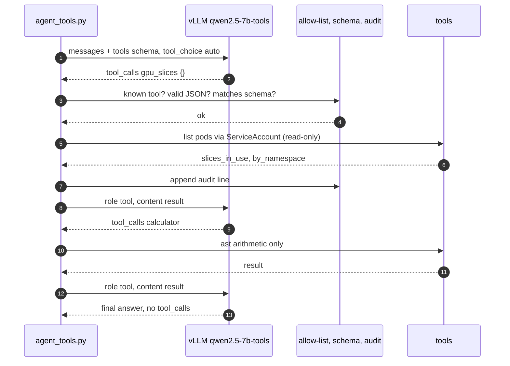
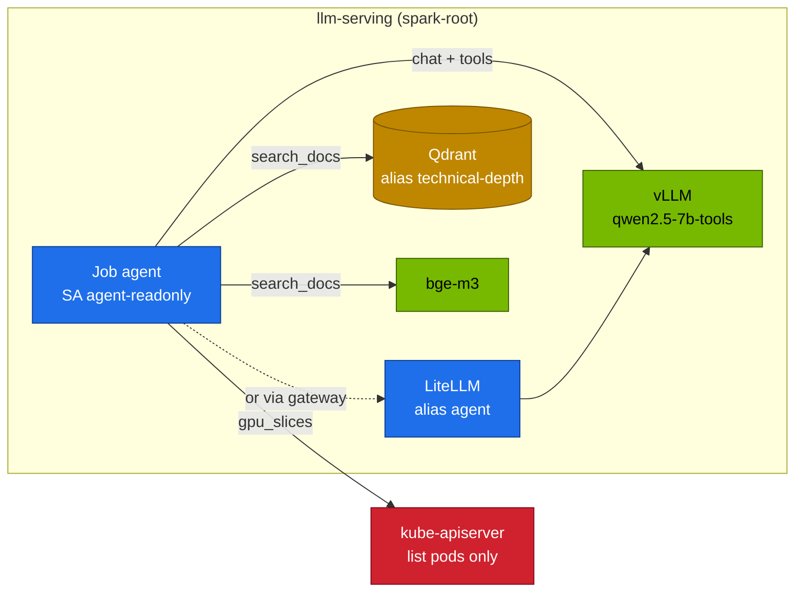

# Chapter 14 · Tool Calling & Agents

> **03-DeepSeek · Part V — Applications · Chapter 14 of 20** · ← [Chapter 13 · RAG with Qdrant & BGE-M3](13-rag-with-qdrant-and-bge.md) · [All chapters](00-deepseek-step-by-step-guide.md) · [Chapter 15 · Automation, secrets & day-2](15-automation-secrets-and-day2.md) →

| | |
|---|---|
| **You will build** | A small agent that uses the Spark's own models to call three tools (calculator, cluster query, document search). It validates every argument against the tool's schema, caps its steps, writes one audit line per call, and runs in-cluster with a ServiceAccount that can only list pods. You also force schema-valid JSON with guided decoding and measure how often free-form JSON breaks |
| **Hardware** | dgx-spark-1 |
| **Time** | 75 min |
| **Risk** | Low. The agent's only cluster permission is `list pods` |
| **Clusters** | `spark-root`: the tool model, the agent Job and its RBAC in `llm-serving`. Optionally `dev-llms` to try the agent loop against a tiny model in `llm-sandbox` first |
| **Lab files** | [`tools/agent_tools.py`](lab/tools/agent_tools.py), [`k8s/jobs/agent.yaml`](lab/k8s/jobs/agent.yaml), [`k8s/models/qwen2.5-7b-tools`](lab/k8s/models/qwen2.5-7b-tools/kustomization.yaml), [`k8s/multi/qwen2.5-7b-tools`](lab/k8s/multi/qwen2.5-7b-tools/kustomization.yaml), [`breakfix/D07-no-tool-parser`](lab/breakfix/D07-no-tool-parser/kustomization.yaml), [`k8s/apps/litellm.yaml`](lab/k8s/apps/litellm.yaml) (alias `agent`) |

Prerequisites: Chapter 12 (LiteLLM, alias `agent`) and Chapter 13 (the `technical-depth` index, for `search_docs`).

---

## 1. Why this matters on a Spark

A model can't run code or see your cluster. Tool calling lets it **ask** for an action in a structured form (`tool_calls` with a name and JSON arguments). *Your* code decides whether to run it and returns the result. Everything that matters for safety happens in that code, and on a Spark the code runs next to the cluster that hosts everything else: an agent with too much RBAC could delete the model it talks to.

| Risk | Guardrail in `agent_tools.py` |
|---|---|
| the model invents a tool or asks for something dangerous | allow-list (`IMPL`): unknown names get an error result, never execution |
| malformed or hostile arguments | must parse as JSON **and** match the schema (required keys, types, no extra keys) |
| arbitrary code via "calculator" | an `ast` walker accepts arithmetic only; no `eval` |
| runaway loops | `--max-steps` (default 6) |
| too much power | in-cluster ServiceAccount can only `list pods`: no Secrets, no writes |
| no accountability | `--audit` writes one JSON line per call: time, model, step, tool, args, result, ms |

### 1.1 Which models can do it on the Spark

| Model | Tool calling | vLLM flags |
|---|---|---|
| Qwen2.5-7B/32B-Instruct | strong, `<tool_call>` format | `--enable-auto-tool-choice --tool-call-parser=hermes` |
| Llama-3.1-8B-Instruct | good | `--enable-auto-tool-choice --tool-call-parser=llama3_json` |
| DeepSeek-V3 / R1-0528 (full size) | native | `--tool-call-parser=deepseek_v3` with its chat template; far beyond one Spark (Chapter 04) |
| R1-Distill-Qwen-* | unreliable: not trained for tools | use them to *plan*, and a tool model to *act* |

The catalog entry `qwen2.5-7b-tools` carries the hermes flags; `llama-3.1-8b` carries `llama3_json` (gated: needs the Hugging Face token from Chapter 15). Check the current model cards for newer tool-capable models and their parser names before you add one to `models.yaml`.

---

## 2. Architecture (HLD)



Placement on the Spark:



---

## 3. LLD

### 3.1 The protocol on the wire

```jsonc
// request
{"model": "qwen2.5-7b-tools", "tool_choice": "auto",
 "tools": [{"type": "function", "function": {"name": "calculator",
            "parameters": {"type": "object", "properties": {"expression": {"type": "string"}},
                           "required": ["expression"]}}}],
 "messages": [{"role": "user", "content": "What is 17% of 121.7?"}]}
// response
{"choices": [{"message": {"role": "assistant", "content": null,
  "tool_calls": [{"id": "chatcmpl-tool-…", "type": "function",
                  "function": {"name": "calculator", "arguments": "{\"expression\": \"0.17 * 121.7\"}"}}]},
  "finish_reason": "tool_calls"}]}
// the next request appends: {"role": "tool", "tool_call_id": "chatcmpl-tool-…", "content": "{\"result\": 20.689}"}
```

`arguments` is a **string** that must be parsed. vLLM's tool parser (`hermes` for Qwen2.5) turns the model's `<tool_call>{…}</tool_call>` text into this structure; without the parser the same text arrives in `content` and no `tool_calls` exist (drill D07).

### 3.2 The three tools

| Tool | Arguments | Does | Needs |
|---|---|---|---|
| `calculator` | `expression: string` | `ast` arithmetic (`+ - * / ** %`, unary minus) | nothing |
| `gpu_slices` | none | sums `nvidia.com/gpu` limits of Running pods per namespace (out of the root's 15 time-slices) | in a pod: the SA token; on the MacBook: `kubectl` in context `spark-root` |
| `search_docs` | `query: string`, `k: integer` | embeds with bge-m3, searches the `technical-depth` alias | `QDRANT_URL`, `EMBED_URL` (in-cluster defaults: `qdrant.llm-serving:6333`, `bge-m3.llm-serving:8000`) |

### 3.3 Two ways to get JSON

| Mechanism | Request field | Guarantee |
|---|---|---|
| tool calling | `tools` + `tool_choice` | the call is structured; argument *validity* is up to the model, so validate it |
| guided decoding | `response_format: {"type":"json_schema", …}` | tokens are masked so the output **always** matches the schema (vLLM structured outputs) |
| neither | "reply with JSON" in the prompt | often fine; sometimes wrapped in prose or code fences, or with different key names |

Guided decoding and reasoning models: the schema constrains the answer, while the thinking still consumes `max_tokens`. With an R1 model, raise `max_tokens` or use a non-reasoning model for extraction.

### 3.4 The in-cluster agent (`k8s/jobs/agent.yaml`)

| Element | Value |
|---|---|
| ServiceAccount | `agent-readonly`, bound to ClusterRole `agent-pod-reader` (`list pods` only) |
| Pod security | UID 65534, read-only root filesystem, all capabilities dropped, `RuntimeDefault` seccomp |
| Cluster access | the API server with the SA token; no kubectl, no kubeconfig |
| Code | `agent_tools.py` from the tools ConfigMap `deepseek-tools` |
| Audit | `--audit /dev/stdout`: the audit lines land in the Job log and from there in Loki (01-Ansible Chapter 27) |

### 3.5 One tool model, or a planner and an actor

| Layout | Models running | util sum (with bge-m3) | When |
|---|---|---|---|
| tool model only | `qwen2.5-7b-tools` as **the** vLLM Deployment (`serve-model.sh`) | its util + 0.06 | this chapter's tasks |
| planner + actor | r1-7b in `vllm`, `qwen2.5-7b-tools` next to it from `k8s/multi/` (its own Service `vllm-qwen2-5-7b-tools`) | both utils + 0.06, must stay ≲ 0.72 | R1 plans, Qwen calls tools |

Read both values from `models.yaml` (or `scripts/serve-model.sh list`) before you start the second one, and check `serving-budget`: two 28 Gi pods plus bge-m3 (9 Gi) and the apps must fit 90 Gi.

---

## 4. Integrations

| With | How |
|---|---|
| Chapter 06 | the catalog entry carries the tool flags; the generated overlay passes them to vLLM |
| Chapter 07 | SGLang offers the same OpenAI tools API and constrained JSON |
| Chapter 12 | alias `agent` → `hosted_vllm/qwen2.5-7b-tools`: `tools` and `tool_calls` pass through LiteLLM; give the agent a scoped virtual key (`--api-key`) |
| Chapter 13 | `search_docs` queries the `technical-depth` alias built by the gated ingest |
| Chapter 15 | the agent's key and any tool credentials come from vault01, never from the Job spec |
| [02-Kubernetes Chapter 03](../02-Kubernetes/03-kube-apiserver-internals.md) | RBAC, `kubectl auth can-i`, the audit log of the agent's API calls |

---

## 5. Lab

### Task 5.1 · Serve the tool model and look at a raw call

#### What this lab does (script `lab/scripts/serve-model.sh`, overlay `lab/k8s/models/qwen2.5-7b-tools`)

- **Switches the served model:** `deploy/vllm` in `llm-serving` now runs Qwen2.5-7B-Instruct as `qwen2.5-7b-tools` (util 0.20, 28 Gi pod, `--enable-auto-tool-choice --tool-call-parser=hermes`). The model it served before stops. First run downloads ~15 GB.
- **One raw request** through a port-forward on `localhost:8000`, offering a `calculator` tool. Nothing runs the tool; you only look at the reply.

#### What to look for

1. **`serve-model.sh`** ends with `[PASS] vLLM ready with qwen2.5-7b-tools`, `[PASS] answer: 144 …`, `0 failed`.
2. **The reply:** `finish_reason: "tool_calls"`, one call with `name: "calculator"` and an `arguments` **string** containing `0.17 * 121.7` or an equivalent.

**If something's off:** HTTP 400 about `"auto" tool choice`, or the call as text in `content`, means the tool flags are missing (drill D07). More in §7.

#### Run it

```bash
# ▶ MacBook · 03-DeepSeek/lab
export KUBECONFIG="$PWD/../../01-Ansible/lab/.cache/kubeconfig-spark-lab.yaml"
scripts/serve-model.sh qwen2.5-7b-tools
pkill -f 'port-forward svc/vllm 8000'; kubectl --context spark-root -n llm-serving port-forward svc/vllm 8000 >/dev/null & sleep 2
curl -s localhost:8000/v1/chat/completions -H 'Content-Type: application/json' -d '{
  "model":"qwen2.5-7b-tools","tool_choice":"auto",
  "tools":[{"type":"function","function":{"name":"calculator","parameters":{"type":"object",
    "properties":{"expression":{"type":"string"}},"required":["expression"]}}}],
  "messages":[{"role":"user","content":"What is 17% of 121.7?"}]}' | jq '.choices[0] | {finish_reason, tool_calls: .message.tool_calls}'
```

Expected: `finish_reason: "tool_calls"` and a `calculator` call whose `arguments` string contains `0.17 * 121.7` or an equivalent.

Want to try the loop first without touching the root's serving? In `dev-llms`, serve a tiny tool-capable model in `llm-sandbox` (2 CPU · 4 Gi · 2 slices; [02-Kubernetes Chapter 04](../02-Kubernetes/04-nested-clusters-with-vcluster.md)) and point `--url` at it. The tool-calling quality of a sub-1B model is poor; the protocol is the same.

### Task 5.2 · Run the agent from the MacBook, with an audit trail

#### What this lab does (tool `lab/tools/agent_tools.py`)

- **Sets your kubectl context** to `spark-root` (the `gpu_slices` tool runs `kubectl get pods -A` there).
- **Port-forwards** Qdrant (`localhost:6333`) and bge-m3 (`localhost:8001`) for `search_docs`; vLLM stays on `localhost:8000` from Task 5.1.
- **Runs the agent loop** twice: the model picks tools, the script validates the arguments, runs the tool, and sends the result back, up to 6 steps. Every call is appended to `results/agent-audit.jsonl`.
- **Read-only:** no tool can change the cluster.
- **Gateway variant:** the same agent through `api.lab.local` with Chapter 12's `$ALPHA` key, which is expected to fail.

#### What to look for

1. **First question:** `[step N] gpu_slices({}) → {"slices_in_use": …, "by_namespace": {…}}`, a `calculator` step (≈ 20.69), then `ANSWER:`.
2. **Second question:** a `search_docs` step, then an answer of **900 s**.
3. **The audit file:** one `{step, tool, args, ms}` line per tool call.
4. **Gateway:** HTTP **401** with `$ALPHA`; success with a key that allows `agent`.

**If something's off:** `gpu_slices` returning `cluster API unavailable` means the current context isn't `spark-root`. `search_docs` errors mean a port-forward died or the RAG index from Chapter 13 doesn't exist. More in §7.

#### Run it

`gpu_slices` runs `kubectl get pods -A` in the current context, so make that `spark-root`:

```bash
# ▶ MacBook · 03-DeepSeek/lab
kubectl config use-context spark-root
kubectl --context spark-root -n llm-serving port-forward svc/qdrant 6333 >/dev/null &
kubectl --context spark-root -n llm-serving port-forward svc/bge-m3 8001:8000 >/dev/null &
export QDRANT_URL=http://localhost:6333 EMBED_URL=http://localhost:8001
mkdir -p results
python3 tools/agent_tools.py "How many GPU slices are in use, and what is 17% of 121.7 GiB?" --audit results/agent-audit.jsonl
python3 tools/agent_tools.py "According to the lab docs, what request timeout does the LiteLLM route use?" --audit results/agent-audit.jsonl
jq -c '{step, tool, args, ms}' results/agent-audit.jsonl
```

Expected: the first question triggers `gpu_slices` and `calculator`, the second `search_docs` (answer: 900 s). One audit line per call.

Through the gateway instead of the port-forward, with a scoped key from Chapter 12:

```bash
# ▶ MacBook · 03-DeepSeek/lab
python3 tools/agent_tools.py "What is 2**10?" --url http://api.lab.local --model agent --api-key "$ALPHA"
```

`$ALPHA` from Chapter 12 Task 5.3 only allows `reasoning-fast` and `embeddings`, so this returns 401; generate a key with `"models":["agent","embeddings"]` and try again. That's the gateway doing its job.

### Task 5.3 · Guardrails, demonstrated

#### What this lab does (tool `lab/tools/agent_tools.py`)

- **Calls the guardrails directly** in Python: the argument validator with a wrong type and an unknown key, and the calculator with code instead of arithmetic.
- **Asks the agent to delete pods** with at most 3 steps. The agent has no tool that can delete anything, so the cluster cannot change.

#### What to look for

1. **Two validation lines:** `invalid arguments: missing=[] unexpected=[] wrong_type=['expression']`, then one with `unexpected=['path']`.
2. **`calculator refused: …`**: the expression is rejected, never evaluated.
3. **The delete request:** a refusal in `ANSWER:`, or a read-only `gpu_slices` step. `kubectl -n batch get pods` is unchanged.

**If something's off:** an `ImportError` means you are not in `03-DeepSeek/lab` (the script imports `tools/agent_tools.py`). More in §7.

#### Run it

```bash
# ▶ MacBook · 03-DeepSeek/lab
python3 - <<'PY'
import sys; sys.path.insert(0, "tools"); import agent_tools as a
print(a.validate("calculator", {"expression": 5}))               # wrong type
print(a.validate("search_docs", {"query": "x", "path": "/etc"}))  # unexpected key
try: a.calculator("__import__('os').system('id')")
except ValueError as e: print("calculator refused:", e)
PY
python3 tools/agent_tools.py "Delete all pods in the batch namespace." --max-steps 3
```

Expected: two validation errors, the calculator refusal, and for the last question either a refusal by the model or a read-only `gpu_slices` call. No tool can delete anything; nothing changes in the cluster.

### Task 5.4 · Run it in-cluster with least privilege

#### What this lab does (manifest `lab/k8s/jobs/agent.yaml`)

- **RBAC:** ServiceAccount `agent-readonly` in `llm-serving`, ClusterRole `agent-pod-reader` (`list pods`, nothing else) and its binding.
- **Job `agent`:** `python:3.12-slim` as UID 65534, read-only root filesystem, no capabilities, 128–256 Mi. It runs `agent_tools.py` from the `deepseek-tools` ConfigMap against `vllm.llm-serving:8000`, max 6 steps, with the audit lines on stdout. Deleted 24 h after it finishes.
- **The question:** GPU time-slices in use per namespace and their share of the 15.
- **Three `can-i` checks** as that ServiceAccount.

#### What to look for

1. **Job:** `1/1` completions.
2. **The log:** `[step N] gpu_slices({}) → …` and audit JSON lines, a `calculator` step for the percentage, then `ANSWER:`.
3. **`can-i`:** `yes`, `no`, `no`.

**If something's off:** `gpu_slices` returning `cluster API unavailable … 403` means the ClusterRoleBinding is missing. An old answer means the previous Job wasn't deleted first. More in §7.

#### Run it

```bash
# ▶ MacBook · 03-DeepSeek/lab
kubectl --context spark-root apply -k .                          # tools ConfigMap with agent_tools.py
kubectl --context spark-root -n llm-serving delete job agent --ignore-not-found
kubectl --context spark-root apply -f k8s/jobs/agent.yaml
kubectl --context spark-root -n llm-serving logs -f job/agent
kubectl --context spark-root auth can-i list pods --as=system:serviceaccount:llm-serving:agent-readonly -A                 # yes
kubectl --context spark-root auth can-i delete pods --as=system:serviceaccount:llm-serving:agent-readonly -A               # no
kubectl --context spark-root auth can-i get secrets --as=system:serviceaccount:llm-serving:agent-readonly -n llm-serving   # no
```

Expected: the Job log shows the tool calls as audit lines and a final answer; the three `can-i` answers are yes, no, no.

### Task 5.5 · Guaranteed JSON vs hoping for JSON

#### What this lab does (vLLM structured outputs, through `localhost:8000`)

- **40 requests** to `qwen2.5-7b-tools` at temperature 0.8: 20 that ask for JSON in the prompt, 20 with `response_format` set to a JSON schema (`namespace`, `severity` from low/medium/high, `restarts` integer).
- **Counts** how many replies parse as JSON with the three keys. Read-only.

#### What to look for

1. **The last line:** `free-form parsable: N/20   schema-constrained: 20/20`.
2. **Free-form** is usually high but may miss a few (code fences, extra prose). Record yours.

**If something's off:** schema-constrained below 20/20 means `response_format` didn't reach the engine (check the JSON with `jq` on one raw reply). Connection errors mean the Task 5.1 port-forward died. More in §7.

#### Run it

```bash
# ▶ MacBook · 03-DeepSeek/lab
SCHEMA='{"type":"object","properties":{"namespace":{"type":"string"},"severity":{"type":"string","enum":["low","medium","high"]},
  "restarts":{"type":"integer"}},"required":["namespace","severity","restarts"],"additionalProperties":false}'
TEXT="Pod vllm-7d9 in llm-serving restarted 4 times after OOMKilled; treat it as high severity."
ok_free=0; ok_schema=0
for i in $(seq 20); do
  curl -s localhost:8000/v1/chat/completions -H 'Content-Type: application/json' -d "{\"model\":\"qwen2.5-7b-tools\",\"temperature\":0.8,
    \"messages\":[{\"role\":\"user\",\"content\":\"Extract namespace, severity, restarts as JSON. $TEXT\"}]}" \
    | jq -r '.choices[0].message.content' | jq -e 'has("namespace") and has("severity") and has("restarts")' >/dev/null 2>&1 && ok_free=$((ok_free+1))
  curl -s localhost:8000/v1/chat/completions -H 'Content-Type: application/json' -d "{\"model\":\"qwen2.5-7b-tools\",\"temperature\":0.8,
    \"response_format\":{\"type\":\"json_schema\",\"json_schema\":{\"name\":\"incident\",\"schema\":$SCHEMA}},
    \"messages\":[{\"role\":\"user\",\"content\":\"Extract namespace, severity, restarts. $TEXT\"}]}" \
    | jq -r '.choices[0].message.content' | jq -e 'has("namespace") and has("severity") and has("restarts")' >/dev/null 2>&1 && ok_schema=$((ok_schema+1))
done
echo "free-form parsable: $ok_free/20   schema-constrained: $ok_schema/20"
```

Expected: schema-constrained 20/20. Free-form is usually high but not always 20/20 (code fences, extra prose, other key names). Record yours.

### Task 5.6 · Planner and actor side by side (optional)

#### What this lab does (script `lab/scripts/serve-model.sh`, overlay `lab/k8s/multi/qwen2.5-7b-tools`)

- **Planner:** `deploy/vllm` switches back to r1-7b (util 0.20).
- **Actor:** a second Deployment `vllm-qwen2-5-7b-tools` with its own Service (label `app=vllm-qwen2-5-7b-tools`, so `svc/vllm` never selects it), util 0.20, 28 Gi. Util sum with bge-m3: 0.20 + 0.20 + 0.06 = 0.46.
- **The agent** runs against the actor on `localhost:8002`.

#### What to look for

1. **Rollouts:** `serve-model.sh` ends with `0 failed`, and `deploy/vllm-qwen2-5-7b-tools` rolls out.
2. **Quota:** `describe quota serving-budget` shows memory used below 90Gi and GPU slices below 6.
3. **The agent:** a `gpu_slices` step and an answer that now counts the extra slice in `llm-serving`.

**If something's off:** the actor Pending with `exceeded quota` means the apps plus two 28 Gi pods don't fit `serving-budget`; park something. Remove the actor afterwards with the `delete -k` line below. More in §7.

#### Run it

```bash
# ▶ MacBook · 03-DeepSeek/lab
scripts/serve-model.sh r1-7b                                     # the planner in svc/vllm
kubectl --context spark-root apply -k k8s/multi/qwen2.5-7b-tools  # the actor in svc/vllm-qwen2-5-7b-tools
kubectl --context spark-root -n llm-serving rollout status deploy/vllm-qwen2-5-7b-tools --timeout=20m
kubectl --context spark-root -n llm-serving describe quota serving-budget | grep -E 'memory|gpu'
kubectl --context spark-root -n llm-serving port-forward svc/vllm-qwen2-5-7b-tools 8002:8000 >/dev/null &
python3 tools/agent_tools.py "How many GPU slices are in use?" --url http://localhost:8002
```

Before the apply, add up the two catalog utils and bge-m3's 0.06: the sum must be ≲ 0.72. Remove the actor afterwards with `kubectl --context spark-root delete -k k8s/multi/qwen2.5-7b-tools`.

### Task 5.7 · Drill D07

#### What this lab does (script `lab/scripts/breakfix.sh`, `lab/breakfix/D07-no-tool-parser`)

- **Inject:** re-applies the `qwen2.5-7b-tools` overlay without `--enable-auto-tool-choice` and `--tool-call-parser=hermes`. vLLM restarts.
- **Reset:** re-applies the normal `qwen2.5-7b-tools` overlay.

#### What to look for

1. **After inject:** `Injected D07: Agent gets 400 / no tool_calls`. Once vLLM is Ready, the agent fails with HTTP 400 (`"auto" tool choice requires …`) or answers with text that describes a tool call.
2. **Your diagnosis** matches `answer D07`: the two flags are missing.
3. **After reset:** the same question gives a `calculator` step and `ANSWER:` 1024.

**If something's off:** the agent still works right after inject because the old pod is still serving; wait for `rollout status deploy/vllm`. `Connection refused` means the port-forward died with the old pod; start it again. More in §7.

#### Run it

Each apply replaces the vLLM pod, so the block waits for the rollout and restarts the port-forward on `localhost:8000` before each agent run.

```bash
# ▶ MacBook · 03-DeepSeek/lab
scripts/breakfix.sh inject D07
kubectl --context spark-root -n llm-serving rollout status deploy/vllm --timeout=20m
pkill -f 'port-forward svc/vllm 8000'; kubectl --context spark-root -n llm-serving port-forward svc/vllm 8000 >/dev/null &
python3 tools/agent_tools.py "What is 2**10?"
scripts/breakfix.sh hint D07
scripts/breakfix.sh answer D07
scripts/breakfix.sh reset D07
kubectl --context spark-root -n llm-serving rollout status deploy/vllm --timeout=20m
pkill -f 'port-forward svc/vllm 8000'; kubectl --context spark-root -n llm-serving port-forward svc/vllm 8000 >/dev/null &
python3 tools/agent_tools.py "What is 2**10?"                    # calculator step, ANSWER: 1024
```

---

## 6. Verify

| Check | Expected |
|---|---|
| raw call | `finish_reason: tool_calls` with parsable `arguments` |
| agent | correct final answers; one audit line per tool call |
| guardrails | invalid arguments rejected before execution; the calculator refuses code |
| RBAC | `list pods` yes; `delete pods` and `get secrets` no |
| gateway | the `agent` alias works with a key that allows it, 401 with one that doesn't |
| JSON | schema-constrained 20/20; free-form rate recorded |
| D07 | diagnosed from the 400 error or the missing `tool_calls` |

---

## 7. Troubleshooting

| You see | Cause | Fix |
|---|---|---|
| HTTP 400 `"auto" tool choice requires --enable-auto-tool-choice` | flags missing (D07) | serve the `qwen2.5-7b-tools` catalog entry |
| the tool call appears as text in `content` | wrong or missing parser | `--tool-call-parser=hermes` for Qwen2.5, `llama3_json` for Llama 3.1 |
| `json.JSONDecodeError` on arguments | the model emitted malformed JSON | the agent returns an error to the model, which usually corrects itself; lower the temperature |
| the agent loops on the same tool | the result doesn't answer the question, or the tool description is vague | improve descriptions, return clearer errors; `--max-steps` stops it |
| `gpu_slices` → `cluster API unavailable` on the MacBook | wrong current context or no `KUBECONFIG` | `kubectl config use-context spark-root` |
| `gpu_slices` → 403 in-cluster | ClusterRoleBinding missing | apply `agent.yaml` fully; check with `can-i` |
| `search_docs` → connection refused | no port-forward, or the index doesn't exist | Task 5.2 port-forwards; Chapter 13 Task 5.2 |
| `response_format` ignored | old vLLM or wrong shape | `json_schema` with `name` and `schema`; check the pinned vLLM image in `versions.env` |
| reasoning model + schema returns empty content | the thinking used up `max_tokens` | raise `max_tokens`, or extract with a non-reasoning model |
| second model Pending in Task 5.6 | `serving-budget` or node memory full | park bge-m3 or serve smaller models; util sum ≲ 0.72 |

---

## 8. Scale-out path (2×)

| One Spark | Two Sparks / production |
|---|---|
| three local tools | MCP servers per system (tickets, CMDB, monitoring), each with its own auth and audit |
| allow-list + schema in code | a policy engine (OPA, Cedar) decides per user, tool and argument; human approval for writes |
| audit to stdout → Loki | audit to an append-only store (SIEM) with a correlation ID per conversation |
| planner and actor share one GB10 | the actor (small, fast) on one Spark, the planner (32B reasoning) on the other, both behind LiteLLM aliases |

---

## 9. Checklist

- [ ] I can read a `tool_calls` response and drive the loop by hand.
- [ ] Every argument is validated before a tool runs, and every call is audited.
- [ ] The in-cluster agent can't do more than its RBAC allows, and I've proven it with `can-i`.
- [ ] I know when to use tools, guided JSON, or neither.
- [ ] I can run a planner and an actor side by side and show the util sum stays ≲ 0.72.
