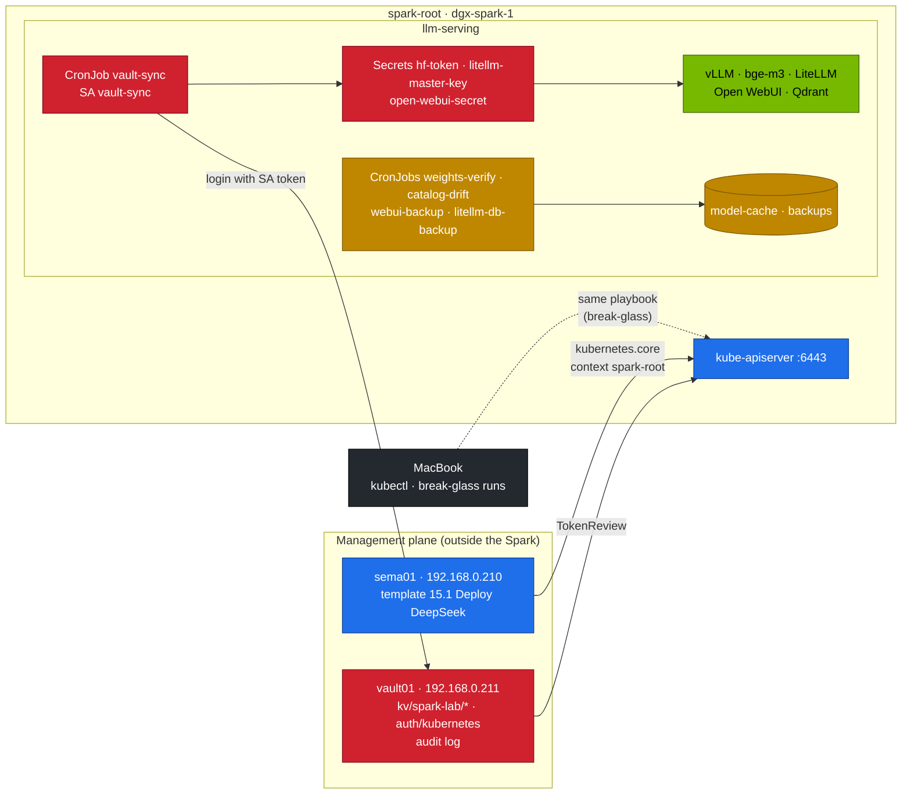
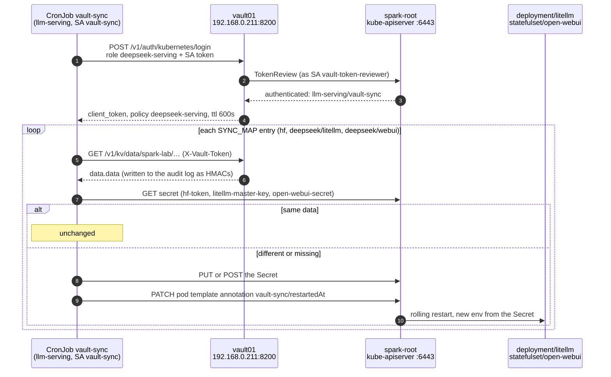

# Chapter 15 · Automation, Secrets & Day-2: Ansible, Vault, Weight Sync

> **03-DeepSeek · Part VI — Operations · Chapter 15 of 19** · ← [Chapter 14 · Tool calling & agents](14-tool-calling-and-agents.md) · [All chapters](00-deepseek-step-by-step-guide.md) · [Chapter 16 · Telemetry](16-telemetry.md) →

| | |
|---|---|
| **You will build** | The operations layer of the DeepSeek stack. One idempotent playbook, `15.1-deploy-deepseek.yml`, takes the 02 platform to a verified stack from the model catalog and runs as the Semaphore template `15.1 Deploy DeepSeek`. The stack's secrets live in vault01 under `kv/spark-lab/*`; a CronJob in `llm-serving` logs in to vault01 with its own ServiceAccount, writes only the Secrets it's allowed to, and rolls their consumers after a rotation. Day-2 jobs pin every model to a Hugging Face commit, detect upstream drift, prove the cached weights haven't changed by a byte, and back up the gateway and chat databases. Finally, Argo CD with an eval gate on every sync, for when the stack moves from "lab" to "service" |
| **Hardware** | dgx-spark-1; sema01 (192.168.0.210) and vault01 (192.168.0.211) outside the Spark |
| **Time** | 3 h (plus download time on the first playbook run) |
| **Risk** | Medium. A real playbook run replaces the served model (`Recreate`: minutes without a model). Rotating the LiteLLM master key invalidates the old one. Preview with `--check` first |
| **Clusters** | `spark-root`: everything in `llm-serving`. vault01 validates the CronJob's token against the root's API server |
| **Lab files** | [`ansible/15.1-deploy-deepseek.yml`](lab/ansible/15.1-deploy-deepseek.yml), [`models.yaml`](lab/models.yaml), [`scripts/verify.sh`](lab/scripts/verify.sh), [`scripts/vault-k8s-auth-setup.sh`](lab/scripts/vault-k8s-auth-setup.sh), [`k8s/ops/`](lab/k8s/ops/vault-sync.yaml) (`vault-sync`, `weights-verify`, `catalog-drift`, `webui-backup`, `litellm-db-backup`), [`tools/vault_sync.py`](lab/tools/vault_sync.py), [`tools/catalog_drift.py`](lab/tools/catalog_drift.py), [`tools/weights_verify.py`](lab/tools/weights_verify.py), [`gitops/applications.yaml`](lab/gitops/applications.yaml), [`k8s/serving/`](lab/k8s/serving/kustomization.yaml), [`deepseek-lab-ci.yml`](../.github/workflows/deepseek-lab-ci.yml) |

Prerequisites: the Semaphore project `spark-lab` and vault01's `kv/spark-lab/*` from [01-Ansible Chapter 04](../01-Ansible/04-dgx-spark-as-semaphore-target.md) §5 and §7; Chapters 06, 12 and 13 of this module.

---

## 1. Why this matters on a Spark

`serve-model.sh` is right for one person at a terminal. A stack that others rely on needs four more things, and on a single Spark each of them protects the one shared pool of unified memory and the one GPU:

| Need | Without it | This chapter |
|---|---|---|
| one repeatable deployment | a sequence of commands in someone's shell history | `15.1-deploy-deepseek.yml`: catalog-driven, refuses unknown models and over-budget memory before it touches the cluster, runs from Semaphore with a recorded log |
| secrets with an owner | `sk-lab-change-me` in a manifest, a Hugging Face token pasted into `kubectl create secret` | values only in vault01; a sync with three named Secrets and two named workloads it may touch |
| weights you can trust | `main` on Hugging Face moves; a disk error flips a byte | commit pins in `models.yaml`, a weekly drift report, a nightly sha256 check |
| a way back | "what was serving yesterday?" | the playbook prints the rollback command; backups with tested restores; GitOps with `git revert` |

The management plane stays outside the Spark (01-Ansible Chapter 04 §1): sema01 runs the playbook against the root's API server over the LAN, vault01 holds the secrets. Rebuilding the cluster or DGX OS doesn't take either of them with it.

---

## 2. Architecture (HLD)



The playbook's layers, each a tag:

```mermaid
flowchart LR
  PRE["always<br/>model in catalog?<br/>util + 0.06 ≤ 0.72?"] --> PF["preflight<br/>model-cache PVC<br/>record current model"]
  PF --> T["tools<br/>ConfigMaps"] --> P["prefetch<br/>Job → model-cache"]
  P --> S["serve<br/>k8s/models/‹name›<br/>wait Ready"] --> A["apps<br/>bge-m3 · LiteLLM · WebUI"]
  A --> R["rag<br/>gated ingest"] --> V["verify<br/>verify.sh rc ≠ 0 fails"]
  classDef sec fill:#cf222e,stroke:#82071e,color:#fff
  classDef ctrl fill:#1f6feb,stroke:#0b3d91,color:#fff
  classDef gpu fill:#76b900,stroke:#3d6000,color:#000
  classDef obs fill:#fb8500,stroke:#9a5000,color:#000
  class PRE sec
  class PF,T,P,R ctrl
  class S,A gpu
  class V obs
```



The day-2 schedule (UTC):

| Every 15 min | Nightly | Weekly | By hand |
|---|---|---|---|
| `vault-sync`: vault01 → Secrets → roll consumers | 02:41 `webui-backup` · 02:51 `litellm-db-backup` · 03:17 `weights-verify` | Mon 06:23 `catalog-drift` | restore drills (quarterly), the upgrade runbook (§3.6), cache clean-up |

A failed Job raises `KubeJobFailed` (Chapter 16); that is how a moved pin, a changed byte or a failed backup reaches you.

### 2.1 One vault-sync run, step by step



- **Steps 1–4** print `vault login ok: policies=['default', 'deepseek-serving'] ttl=600s` (Task 5.3). Steps 2–3 work only after `vault-k8s-auth-setup.sh` (Task 5.2) gave vault01 the root's API URL, CA and the reviewer token.
- **Steps 5–6** are the reads you find in `/var/log/vault_audit.log` on vault01 (Task 5.5).
- **Steps 7–10** print `synced …` and `restart …` lines. On the second run every entry takes the `unchanged` branch.
- **Step 10** is what Task 5.4 checks: LiteLLM reads `LITELLM_MASTER_KEY` only at start, so the old key gets `401` only after the restart.

---

## 3. LLD

### 3.1 The playbook

`hosts: localhost`, `connection: local`: everything goes through the Kubernetes API with `kubernetes.core.k8s`, `k8s_info` and the `kustomize` lookup. Nothing logs in to the Spark over SSH.

| Variable | Default | Meaning |
|---|---|---|
| `deepseek_model` | `r1-7b` | catalog name to serve |
| `deepseek_with_apps` | `true` | bge-m3, LiteLLM + PostgreSQL, Open WebUI (Chapter 12) |
| `deepseek_with_rag` | `true` | run the gated RAG ingest (Chapter 13; needs the apps) |
| `deepseek_skip_prefetch` | `false` | skip the download when the weights are known to be cached |
| `deepseek_util_budget` | `0.72` | max sum of `--gpu-memory-utilization` for the chat model + embeddings (Chapter 05) |
| `deepseek_embed_util` | `0.06` | bge-m3's share |
| `deepseek_apps_mem_gi` | `16` | pod memory the apps add next to the chat model (bge-m3 9, Open WebUI 4, LiteLLM 2, PostgreSQL 1; request = limit) |
| `kube_context` | `spark-root` | every `kubernetes.core` task names it |
| `kubeconfig` | `$KUBECONFIG`, else `$SPARK_LAB_CACHE/kubeconfig-spark-lab.yaml`, else `01-Ansible/lab/.cache/kubeconfig-spark-lab.yaml` | the defaults cover both Semaphore (sema01 forwards `SPARK_LAB_CACHE`, 01-Ansible Chapter 04 §4) and the MacBook |

| Task | Tag | Changes on a second identical run? |
|---|---|---|
| catalog and util-budget asserts | `always` | never (asserts) |
| `model-cache` PVC present | `preflight` | no (reads) |
| `serving-budget` holds the model's pod memory + the apps; record the current model | `preflight`, `serve` | no (reads, assert) |
| tools and eval-data ConfigMaps | `tools` | only if tool files changed |
| delete and recreate the prefetch Job | `prefetch` | **yes**: Job templates are immutable; fast when cached. `-e deepseek_skip_prefetch=true` skips it |
| apply `k8s/models/<name>`; wait for Ready with the right `model` label | `serve` | only if the model changed: the overlay carries no Secret, so it never touches the synced `hf-token`. The wait is skipped in check mode |
| apps | `apps` | after every sync: `k8s/apps` carries the placeholder `litellm-master-key` and `open-webui-secret` (§3.3) |
| RAG ingest | `rag` | **yes**: a new collection by design; a failed gate fails the play |
| `scripts/verify.sh` | `verify` | never (`changed_when: false`); any `[FAIL]` fails the play |

The two catalog guards are tagged `always`, so even `--tags serve` checks them before any API call:

```yaml
- assert: deepseek_model in catalog_names                      # typo → message listing the valid names
- assert: model.util + embed_util <= deepseek_util_budget      # r1-32b-fp8 0.45 + 0.06 ✓ · r1-32b 0.70 + 0.06 ✗
```

r1-32b in BF16 at 0.70 is meant to run alone (`alone: true` in `models.yaml`): deploy it with `-e deepseek_with_apps=false`, after parking bge-m3. A third guard reads `serving-budget` and checks that the model's pod memory (`mem` in the catalog) plus `deepseek_apps_mem_gi` fits its `limits.memory`: 90 Gi on an ordinary day, 10 Gi while the training window (Chapter 10) is applied, which is exactly the mistake it catches.

### 3.2 Where it runs: Semaphore or the MacBook

The playbook lives in this module but runs with 01-Ansible's configuration (`ansible.cfg`, collections, inventory), exactly like the 01 playbooks:

| Run from | How | Credentials | Use |
|---|---|---|---|
| sema01 (normal) | template `15.1 Deploy DeepSeek` in project `spark-lab` | the kubeconfig on sema01's state volume; task log kept in Semaphore | every deployment and model switch |
| MacBook (break-glass, development) | `ansible-playbook ../../03-DeepSeek/lab/ansible/15.1-deploy-deepseek.yml` from `01-Ansible/lab` | `01-Ansible/lab/.cache/kubeconfig-spark-lab.yaml` | sema01 down, or developing the playbook; re-run the template afterwards so the record is complete |

The template uses the same repository, inventory and variable group as every other lab template (01-Ansible Chapter 04 §8.1):

| Field | Value |
|---|---|
| Name | `15.1 Deploy DeepSeek` |
| Playbook filename | `03-DeepSeek/lab/ansible/15.1-deploy-deepseek.yml` |
| Inventory | `spark-lab` |
| Repository | `technical-depth` |
| Variable group | `vault-approle` |
| Extra variables | `{"deepseek_model": "r1-7b"}`. The kubeconfig needs nothing: the playbook finds it through `SPARK_LAB_CACHE`, which sema01 forwards to every task (01-Ansible Chapter 04 §4) |
| Survey | a variable `deepseek_model` (default `r1-7b`) makes the model a field on every run |
| CLI args | none; `["--tags", "serve", "-e", "deepseek_skip_prefetch=true"]` for a model switch, `["--check", "--diff"]` for a preview template |

The playbook reads no secret values itself. The Secrets its manifests need come from vault01 through `vault-sync` (§3.3), so the Semaphore task log contains model names and object names, never keys.

### 3.3 Secrets: vault01 → Kubernetes

What [`vault-sync.yaml`](lab/k8s/ops/vault-sync.yaml) and [`vault_sync.py`](lab/tools/vault_sync.py) actually do. There is **no Vault inside Kubernetes**: the only Vault is vault01, and the cluster reaches it over the LAN.

1. A CronJob `vault-sync` in `llm-serving` starts every 15 minutes (`concurrencyPolicy: Forbid`), as UID 65534 with a read-only root filesystem, running `vault_sync.py` from the tools ConfigMap (Python stdlib only, ~100 lines).
2. It logs in to vault01 at `https://192.168.0.211:8200` with Vault's **Kubernetes auth method**: it sends its own ServiceAccount token (`vault-sync`) and role `deepseek-serving`. vault01 checks the token with a TokenReview against the root's API server and returns a Vault token with policy `deepseek-serving`, TTL 10 minutes. TLS is verified against vault01's CA from the ConfigMap `vault-ca`. No static Vault credential exists in the cluster.
3. For each entry in `SYNC_MAP` it reads a KV v2 path and builds a Secret (labelled `app.kubernetes.io/managed-by: vault-sync`, annotated with the source path).
4. It compares the Secret's data with what is in the cluster: `unchanged` → nothing; different → `PUT`; missing → `POST`.
5. Only when a Secret changed does it patch the `restart` workloads' pod template with the annotation `vault-sync/restartedAt` (what `kubectl rollout restart` does), because env vars from Secrets are read only at container start.

| vault01 path (KV v2) | Field | Kubernetes Secret · key | Rolled on change |
|---|---|---|---|
| `kv/spark-lab/hf` | `token` | `hf-token` · `token` | none: prefetch Jobs and vLLM read it at start |
| `kv/spark-lab/deepseek/litellm` | `master_key` | `litellm-master-key` · `key` | `deployment/litellm`, `statefulset/open-webui` |
| `kv/spark-lab/deepseek/webui` | `secret_key` | `open-webui-secret` · `secret-key` | `statefulset/open-webui` |

The Hugging Face token sits at `kv/spark-lab/hf` because it isn't DeepSeek's: 04-Qwen syncs the same path. `SYNC_MAP` uses the API form `kv/data/<path>`.

The objects that make step 2 possible, created once by [`vault-k8s-auth-setup.sh`](lab/scripts/vault-k8s-auth-setup.sh) with an admin token:

| Where | Object | Value |
|---|---|---|
| vault01 | auth method | `kubernetes/`, configured with the root's API URL, its CA and a reviewer JWT |
| spark-root | ServiceAccount `vault-token-reviewer` + ClusterRoleBinding to `system:auth-delegator` | lets vault01 call TokenReview |
| vault01 | policy `deepseek-serving` | `read` on `kv/data/spark-lab/hf` and `kv/data/spark-lab/deepseek/*`, `list`/`read` on `kv/metadata/spark-lab/deepseek/*`; nothing else |
| vault01 | role `deepseek-serving` | bound to SA `vault-sync` in namespace `llm-serving` only; token TTL 10 min |
| spark-root | Role `vault-sync` | `get`/`update` on the three Secrets by name, `create` on Secrets, `patch` on `litellm` and `open-webui` by name |

This is a separate door from Semaphore's: the AppRole `semaphore` (01-Ansible Chapter 18) reads `kv/spark-lab/*` for playbooks; the Kubernetes role reads only what the LLM stack needs, and only from that one ServiceAccount.

**What the sync doesn't cover.** `k8s/apps` still carries placeholder Secrets: `litellm-master-key` and `open-webui-secret`. Every `apply` of it writes the placeholders back until the next sync, at most 15 minutes later; run the sync right after an apps deployment (Task 5.3 shows how). `hf-token` has no such problem: 02's `vllm.yaml` and the model overlays ship no Secret and read it as optional, and the sync creates it if it's missing. `litellm-db` (the PostgreSQL password) isn't synced at all: rotating it needs an `ALTER USER` in the database at the same moment, so in the lab it stays a namespace-internal value. Under Argo CD the placeholders become a real conflict (§3.7).

### 3.4 Alternatives to the CronJob

| Tool | Model | When |
|---|---|---|
| this CronJob | pull every 15 min, write Secrets, roll consumers | learning, small clusters, full transparency |
| Vault Secrets Operator (HashiCorp) | CRDs (`VaultStaticSecret`), event-driven refresh, rollout restarts built in | production with Vault |
| External Secrets Operator | CRDs, many backends (Vault, cloud KMS) | estates with several secret stores |
| Vault Agent injector / CSI provider | secrets as files in the pod, no Secret object in etcd | when Secrets must not exist in etcd at all |

### 3.5 Pinned and verified weights

| Where | What `revision: <sha>` changes |
|---|---|
| `models.yaml` | `revision:` under the model, written by `catalog_drift.py pin` |
| generated overlay | vLLM gets `--revision=<sha> --tokenizer-revision=<sha>` |
| prefetch Job | `REVISION=<sha>` (set by `serve-model.sh` and the playbook) |
| cache | `/models/hf/models--…/snapshots/<sha>/`: several revisions can coexist |

Unpinned entries keep working on `main`; the drift report lists them as `UNPINNED`.

`weights-verify` is trust-on-first-use: the first time it sees a `snapshots/<sha>/` directory it writes `/models/manifests/<repo>@<sha>.json` with a sha256 for every file; every later run recomputes, and any missing, extra or changed file fails the Job. Record the manifest right after a download you trust.

### 3.6 Backups and the upgrade runbook

| Data | Job | Format | Restore |
|---|---|---|---|
| Open WebUI `webui.db` | `webui-backup` | SQLite online backup + `integrity_check`, 14 kept | Chapter 12 Task 5.8 |
| LiteLLM PostgreSQL | `litellm-db-backup` | `pg_dump -Fc`, 14 kept | `pg_restore --clean` (Task 5.8) |
| Qdrant index | rebuildable | — | re-run `rag-ingest` (Chapter 13) |
| model weights | rebuildable | — | prefetch the pinned revision |
| vault01 | Raft snapshots | — | [01-Ansible Chapter 17](../01-Ansible/17-vault-server-deep-dive.md) |

Upgrade runbook, from "upstream moved" to "new revision serving, old one ready for rollback":

1. **Detect**: `catalog-drift` fails with `MOVED <name>`.
2. **Read upstream**: model card and commit diff. A changed chat template is the most common breaking change.
3. **Pin in a branch**: `catalog_drift.py pin --only <name>`, `gen_overlays.py`, a pull request; CI must be green.
4. **Stage**: serve the new revision (`serve-model.sh <name>` from the branch, or `dev-llms` for a small model).
5. **Gate**: `eval_harness.py` on the suites of the last accepted run (Chapter 19); accept if no suite drops by more than your tolerance.
6. **Promote**: merge; run `15.1 Deploy DeepSeek` with `--tags serve`; record the new manifest (`weights-verify`).
7. **Keep the way back**: leave the previous snapshot in the cache for at least one release. Rollback = the old pin and `--tags serve`.

### 3.7 GitOps: when the stack becomes a service

Ansible from Semaphore is the bootstrap and the lab tool. Once others depend on the stack, Git can become the only way to change what the Spark serves:

| Application ([`gitops/applications.yaml`](lab/gitops/applications.yaml)) | Wave | Path | Contents |
|---|---|---|---|
| `deepseek-00-tools` | 0 | `03-DeepSeek/lab` | tools, eval data, catalog ConfigMaps |
| `deepseek-10-serving` | 10 | `…/k8s/serving` | the served model's overlay + PostSync `eval-gate` hook |
| `deepseek-20-apps` | 20 | `…/k8s/apps` | bge-m3, LiteLLM + PostgreSQL, Open WebUI |
| `deepseek-30-ops` | 30 | `…/k8s/ops` | the day-2 CronJobs |
| `deepseek-40-observability` | 40 | `…/observability` | PrometheusRule + dashboard (Chapter 16) |

All use `automated: {prune: true, selfHeal: true}` and server-side apply; Argo CD itself and the 02 platform Applications come from [02-Kubernetes Chapter 28](../02-Kubernetes/28-production-mlops-and-gitops.md). The served model is one line in [`k8s/serving/kustomization.yaml`](lab/k8s/serving/kustomization.yaml). The PostSync hook asks vLLM which model it serves, runs the math and JSON suites, and compares them with the baseline in ConfigMap `deepseek-eval-baseline` (`--tolerance 0.05`); a regression fails the Job and the sync. A person accepts a new baseline, the gate never does.

Rules that keep the tools from fighting:

- **One tool per object.** With the Applications synced, don't run the playbook's `serve` or `apps` tags or `serve-model.sh` against the same objects: `selfHeal` reverts them. Pause the Application for drills (Task 5.9).
- **Secrets stay out of Git-driven sync.** With `selfHeal`, Argo CD would write the placeholder Secrets back over the values `vault-sync` wrote, every few minutes. `deepseek-10-serving` renders no Secret (the 02 base ships none). Before enabling `deepseek-20-apps`, remove its placeholder Secrets from what it renders (a `$patch: delete`) or add `ignoreDifferences` for their `data`.
- **Big models need their weights first.** Run the prefetch (playbook `--tags prefetch`) before merging a pointer change, or the sync waits on a download inside the pod.

---

## 4. Integrations

| With | How |
|---|---|
| [01-Ansible Chapter 04](../01-Ansible/04-dgx-spark-as-semaphore-target.md) | project `spark-lab`, inventory, variable group `vault-approle`, the kubeconfig on sema01's state volume, break-glass runs |
| [01-Ansible Chapters 17](../01-Ansible/17-vault-server-deep-dive.md) and [18](../01-Ansible/18-vault-approle-secrets-and-ssh-certificates.md) | vault01: KV v2 at `kv/`, audit device, unseal; AppRole for Semaphore next to this chapter's Kubernetes auth |
| [02-Kubernetes Chapter 28](../02-Kubernetes/28-production-mlops-and-gitops.md) | Argo CD and the platform Applications |
| Chapter 05 | the util budget the playbook's guard enforces |
| Chapter 06 | the catalog and overlay generator gained `revision` |
| Chapters 12–13 | consumers of the synced Secrets; the playbook's `apps` and `rag` tags |
| Chapter 16 | `KubeJobFailed` for every day-2 Job; Argo CD sync failures |
| Chapter 17 | drill D05: a gated model fails until the real token arrives through vault-sync |
| Chapter 19 | the eval harness behind the upgrade gate and the PostSync hook |

---

## 5. Lab

### Task 5.1 · Store the stack's secrets in vault01

#### What this lab does (Vault CLI on vault01)

- **Writes three KV v2 secrets** on vault01: your Hugging Face token at `kv/spark-lab/hf` (field `token`), a new LiteLLM master key at `kv/spark-lab/deepseek/litellm` (`master_key`, `sk-` + 32 hex characters) and an Open WebUI signing key at `kv/spark-lab/deepseek/webui` (`secret_key`, 64 hex characters).
- **No value on a command line or in a file:** the token is typed without echo, the two keys are generated and piped straight in.
- **Nothing changes in Kubernetes yet.** The cluster reads these in Task 5.3.

#### What to look for

1. **`vault status`:** `Sealed false`.
2. **`vault kv list kv/spark-lab`:** `deepseek/`, `hf` and `ngc`.
3. **The token check** prints `hf_`, and nothing more of the token.

**If something's off:** `Sealed true` → unseal first (01-Ansible Chapter 04 §2). `permission denied` on `kv put` → you are not logged in with the admin token. More in §7.

#### Run it

**Why:** the values must exist before anything reads them, and they must never pass through a command line or a file. `read -rsp` asks without echoing; `field=-` takes the value from the pipe.

```bash
# ▶ vault01 (ssh vault01)
export VAULT_ADDR=https://192.168.0.211:8200 VAULT_CACERT=$HOME/vault-ca.crt
vault status | grep Sealed                                            # false; otherwise unseal (01-Ansible Chapter 04 §2)
vault login                                                           # admin token (01-Ansible Chapter 04 Task 7.1)
read -rsp "HF token: " HF; echo
printf %s "$HF" | vault kv put kv/spark-lab/hf token=-                # read scope is enough; gated repos: accept the licence first
unset HF
openssl rand -hex 16 | sed 's/^/sk-/' | tr -d '\n' | vault kv put kv/spark-lab/deepseek/litellm master_key=-
openssl rand -hex 32 | tr -d '\n' | vault kv put kv/spark-lab/deepseek/webui secret_key=-
vault kv list kv/spark-lab                                            # deepseek/  hf  ngc
vault kv get -field=token kv/spark-lab/hf | cut -c1-3                 # hf_
```

### Task 5.2 · Let `vault-sync` log in with its ServiceAccount

#### What this lab does (script `lab/scripts/vault-k8s-auth-setup.sh`)

- **On spark-root:** ServiceAccount `vault-token-reviewer` in `llm-serving`, a long-lived token Secret for it, and a ClusterRoleBinding to `system:auth-delegator`, so vault01 may call TokenReview.
- **On vault01:** enables the `kubernetes/` auth method (if not already there) with the root's API URL, its CA and the reviewer token; writes the policy `deepseek-serving` (read `kv/data/spark-lab/hf` and `kv/data/spark-lab/deepseek/*`) and the role `deepseek-serving` bound to SA `vault-sync` in `llm-serving`, token TTL 10 min.
- **Safe to re-run:** every step is an apply or an overwrite.

#### What to look for

1. **The script ends** with `✓ Vault Kubernetes auth ready.` and three example `vault kv put` lines.
2. **`vault policy read deepseek-serving`:** only the three `path` blocks of the script, nothing broader.
3. **The role:** `bound_service_account_names [vault-sync]`, `bound_service_account_namespaces [llm-serving]`, `token_policies [deepseek-serving]`, `token_ttl 10m`.

**If something's off:** the script runs every `kubectl` call with `--context spark-root` (override with `ROOT_CTX`), and hands vault01 that context's API URL and CA; with `ROOT_CTX` set to another context, vault01 would validate tokens against the wrong cluster. `x509` errors from `vault` mean `VAULT_CACERT` points at the wrong file. More in §7.

#### Run it

The setup script uses `vault`, `kubectl` and `jq` on the same machine, so it runs on the MacBook (`brew install hashicorp/tap/vault` if you don't have the CLI). It reads the API server URL and CA from context `spark-root` in `$KUBECONFIG` (`ROOT_CTX` overrides the name), so vault01 must reach that URL.

```bash
# ▶ MacBook · 03-DeepSeek/lab
export KUBECONFIG="$PWD/../../01-Ansible/lab/.cache/kubeconfig-spark-lab.yaml"
kubectl config use-context spark-root
export VAULT_ADDR=https://192.168.0.211:8200 VAULT_CACERT="$PWD/../../01-Ansible/lab/.cache/vault-ca.crt"
read -s "VAULT_TOKEN?Vault admin token: "; export VAULT_TOKEN                  # zsh; bash: read -s -p "…" VAULT_TOKEN
scripts/vault-k8s-auth-setup.sh
vault policy read deepseek-serving
vault read auth/kubernetes/role/deepseek-serving | grep -E 'bound_service_account|token_ttl|policies'
unset VAULT_TOKEN
```

Expected: the policy lists only the paths of §3.3; the role is bound to `vault-sync` in `llm-serving` with a 10-minute TTL.

### Task 5.3 · Deploy the sync and run it now

#### What this lab does (manifest `lab/k8s/ops/vault-sync.yaml`, tool `lab/tools/vault_sync.py`)

- **ConfigMap `vault-ca`** in `llm-serving` with vault01's CA, so the sync verifies TLS.
- **ServiceAccount, Role and RoleBinding `vault-sync`:** `get`/`update` on the three Secrets by name, `create` on Secrets, `patch` on `litellm` and `open-webui` only.
- **CronJob `vault-sync`** every 15 min, plus a one-off Job `vs-now` from it. It logs in to vault01 with its SA token, writes `hf-token`, `litellm-master-key` and `open-webui-secret`, and rolls LiteLLM and Open WebUI when a Secret changed.

#### What to look for

1. **First line:** `vault login ok: policies=['default', 'deepseek-serving'] ttl=600s`.
2. **First run:** three `synced` lines and `restart` lines for `deployment/litellm` and `statefulset/open-webui`, ending `3 secret(s) updated`.
3. **Second run** (`vs-again`): three `unchanged` lines, no `restart`, `0 secret(s) updated`.

**If something's off:** `permission denied` at login → re-run Task 5.2 with context `spark-root`. `x509: certificate signed by unknown authority` → the `vault-ca` ConfigMap holds the wrong CA. More in §7.

#### Run it

```bash
# ▶ MacBook · 03-DeepSeek/lab
kubectl --context spark-root -n llm-serving create configmap vault-ca \
  --from-file=ca.crt="$PWD/../../01-Ansible/lab/.cache/vault-ca.crt" --dry-run=client -o yaml \
  | kubectl --context spark-root apply -f -
kubectl --context spark-root apply -k .                                 # tools ConfigMap (vault_sync.py)
kubectl --context spark-root apply -f k8s/ops/vault-sync.yaml
kubectl --context spark-root -n llm-serving create job --from=cronjob/vault-sync vs-now
kubectl --context spark-root -n llm-serving logs -f job/vs-now
```

```text
vault login ok: policies=['default', 'deepseek-serving'] ttl=600s
synced   kv/data/spark-lab/hf → secret/hf-token (token)
synced   kv/data/spark-lab/deepseek/litellm → secret/litellm-master-key (key)
restart  deployment/litellm (secret/litellm-master-key changed)
restart  statefulset/open-webui (secret/litellm-master-key changed)
synced   kv/data/spark-lab/deepseek/webui → secret/open-webui-secret (secret-key)
restart  statefulset/open-webui (secret/open-webui-secret changed)
3 secret(s) updated
```

Run it again (`create job … vs-again`): every line reads `unchanged`, nothing restarts. Use the same one-liner after every `apply` that carries placeholder Secrets (§3.3).

### Task 5.4 · Rotate the LiteLLM master key end to end

#### What this lab does (vault01, CronJob `vault-sync`)

- **On vault01:** writes a new version of `kv/spark-lab/deepseek/litellm` with a fresh key.
- **On the MacBook:** keeps the old key in `$OLD`, runs the sync as Job `vs-rotate`, waits for LiteLLM to roll, and tests both keys against `api.lab.local`.
- **Unchanged:** Chapter 12's virtual keys (they live in PostgreSQL) and the other two Secrets.

#### What to look for

1. **`current_version`** one higher than before.
2. **The sync log:** `synced … litellm-master-key`, `restart deployment/litellm`, `restart statefulset/open-webui`, `1 secret(s) updated`; the other two `unchanged`.
3. **The two curls:** `old key: 401`, `new key: 200`.

**If something's off:** both keys answering 200 means LiteLLM didn't restart (the env is read at start); check the `restart` line and `rollout status`. More in §7.

#### Run it

```bash
# ▶ vault01 (ssh vault01)
openssl rand -hex 16 | sed 's/^/sk-/' | tr -d '\n' | vault kv put kv/spark-lab/deepseek/litellm master_key=-
vault kv metadata get kv/spark-lab/deepseek/litellm | grep current_version
```

```bash
# ▶ MacBook · 03-DeepSeek/lab
OLD=$(kubectl --context spark-root -n llm-serving get secret litellm-master-key -o jsonpath='{.data.key}' | base64 -d)
kubectl --context spark-root -n llm-serving create job --from=cronjob/vault-sync vs-rotate
kubectl --context spark-root -n llm-serving logs -f job/vs-rotate
kubectl --context spark-root -n llm-serving rollout status deploy/litellm
NEW=$(kubectl --context spark-root -n llm-serving get secret litellm-master-key -o jsonpath='{.data.key}' | base64 -d)
curl -s -o /dev/null -w 'old key: %{http_code}\n' http://api.lab.local/v1/models -H "Authorization: Bearer $OLD"
curl -s -o /dev/null -w 'new key: %{http_code}\n' http://api.lab.local/v1/models -H "Authorization: Bearer $NEW"
```

Expected: `old key: 401`, `new key: 200`, LiteLLM and Open WebUI rolled. Virtual keys from Chapter 12 keep working: they live in PostgreSQL, not in the master key.

### Task 5.5 · Prove least privilege, and find the reads in the audit log

#### What this lab does (Vault login attempt, `kubectl auth can-i`, vault01 audit log)

- **Tries a Vault login** with a token for the `default` ServiceAccount instead of `vault-sync`.
- **Asks Kubernetes** whether `vault-sync` may read `litellm-db` or patch `deploy/vllm`.
- **Reads vault01's audit log** for the sync's reads. Everything here is read-only.

#### What to look for

1. **The login:** `permission denied` (the role is bound to `vault-sync` only).
2. **Both `can-i`:** `no`.
3. **The audit count** is above 0 and grows after every sync run (a request and a response entry per path); the last entry shows the path and `"service_account_name":"vault-sync"`, with values only as `hmac-sha256:…`.

**If something's off:** a successful login with the `default` SA means the role's `bound_service_account_names` is too wide; re-run Task 5.2. A count of 0 means the audit device isn't enabled on vault01 (01-Ansible Chapter 17). More in §7.

#### Run it

```bash
# ▶ MacBook · 03-DeepSeek/lab
export VAULT_ADDR=https://192.168.0.211:8200 VAULT_CACERT="$PWD/../../01-Ansible/lab/.cache/vault-ca.crt"
TOKEN=$(kubectl --context spark-root -n llm-serving create token default)
vault write auth/kubernetes/login role=deepseek-serving jwt="$TOKEN"                     # permission denied: wrong SA
kubectl --context spark-root auth can-i get secret/litellm-db -n llm-serving --as=system:serviceaccount:llm-serving:vault-sync   # no
kubectl --context spark-root auth can-i patch deploy/vllm -n llm-serving --as=system:serviceaccount:llm-serving:vault-sync       # no
```

```bash
# ▶ vault01 (ssh vault01)
sudo grep 'spark-lab/' /var/log/vault_audit.log | grep -c '"service_account_name":"vault-sync"'   # grows with every sync run
sudo grep 'spark-lab/' /var/log/vault_audit.log | grep vault-sync | tail -1 | cut -c1-400                # one entry: path, SA, no plain values
```

Expected: reads by `service_account_name: vault-sync`, a request and a response entry per path per run; the audit device stores the values only as HMACs.

### Task 5.6 · The playbook from the MacBook: lint, preview, guards

#### What this lab does (playbook `lab/ansible/15.1-deploy-deepseek.yml`)

- **Syntax check and `ansible-lint`:** nothing touches the cluster.
- **Check mode with `--diff`** for r1-32b-fp8: the playbook reads the cluster (PVC, quota, current model) and shows what it would apply, without applying it. The waits, the verify and the result tasks are skipped.
- **Two guard runs:** an unknown model and r1-32b (0.70 + 0.06 > 0.72). Both must stop at the first `always`-tagged assert.

#### What to look for

1. **Lint:** `Passed` with profile `production`.
2. **Check run:** `Show the change` prints `vLLM: <current> → r1-32b-fp8  (rollback: --tags serve -e deepseek_model=<current>)`; the recap shows `failed=0`.
3. **`r1-70b`:** fails at `Model is in the catalog` with `unknown model 'r1-70b'. Catalog: r1-1.5b, r1-7b, …`.
4. **`r1-32b`:** fails at `UMA budget allows the chat model next to the embedder` with `util 0.7 + embeddings 0.06 exceeds the LLM pool budget 0.72 …` and the hint to run it alone.

**If something's off:** `couldn't resolve module/action 'kubernetes.core.k8s'` → install the collections in `01-Ansible/lab`. A check run failing at the `serving-budget` assert means the training window is still applied. More in §7.

#### Run it

```bash
# ▶ MacBook · 01-Ansible/lab (venv active)
PB=../../03-DeepSeek/lab/ansible/15.1-deploy-deepseek.yml
ansible-playbook --syntax-check "$PB"
ansible-lint "$PB"                                                       # Passed … profile 'production'
ansible-playbook "$PB" --check --diff -e deepseek_model=r1-32b-fp8
ansible-playbook "$PB" --check -e deepseek_model=r1-70b                  # unknown → lists the catalog
ansible-playbook "$PB" --check -e deepseek_model=r1-32b                  # 0.70 + 0.06 > 0.72 → refused
```

Expected: the check run prints `Show the change` with the current model, the new one and the rollback command, and ends `failed=0` with the waits skipped. The two guard runs fail at their first task with a readable message, before any API call.

### Task 5.7 · Run it from Semaphore, switch and roll back

#### What this lab does (template `15.1 Deploy DeepSeek`)

- **Full run (r1-7b):** asserts, then tool ConfigMaps, a fresh `model-prefetch` Job (downloads the weights on the first run), the `r1-7b` overlay with a wait until vLLM is Ready with the right `model` label, the apps (bge-m3, LiteLLM + PostgreSQL, Open WebUI), the gated RAG ingest, and `scripts/verify.sh`. Everything goes through the Kubernetes API on spark-root; nothing logs in to the Spark over SSH.
- **No secret values:** the task log shows model and object names only. The `apps` apply writes the placeholder Secrets back, so run the sync afterwards. The model overlay carries no Secret.
- **Switch and rollback:** `--tags serve` changes only the served model.

#### What to look for

1. **Semaphore run:** `failed=0`; the `Result` task shows the last lines of `verify.sh`, ending `… passed, … warnings, 0 failed`.
2. **Second full run** with `deepseek_skip_prefetch=true` and `--skip-tags rag`: `changed=` 0 or 1. Prefetch and RAG, the tasks that change every time, are skipped; the `apps` task reports `changed` when it writes the placeholder Secrets back over the synced ones, so sync again. `serve` stays `ok`.
3. **Switch run:** `Show the change` prints `vLLM: r1-7b → r1-32b-fp8 (rollback: --tags serve -e deepseek_model=r1-7b)`, and `get deploy vllm -L model` shows `r1-32b-fp8`; after the rollback run, `r1-7b`.

**If something's off:** `Invalid kube-config file` → the kubeconfig isn't in sema01's state folder (run `19.1 Kubernetes` first). A run stuck at "Wait for vLLM to become Ready" for long → `describe pod -l app=vllm`; it gives up after 45 min. More in §7.

#### Run it

**Semaphore UI:** in project `spark-lab`, **Task Templates → New Template**, type *Ansible Playbook*, with the fields from §3.2 (name `15.1 Deploy DeepSeek`, playbook `03-DeepSeek/lab/ansible/15.1-deploy-deepseek.yml`, inventory `spark-lab`, repository `technical-depth`, variable group `vault-approle`). Add a survey variable `deepseek_model` (default `r1-7b`). Save, then **Run** with `r1-7b`.

Expected: the task log ends with the `Result` task showing the last lines of `verify.sh` and `failed=0`. Then run the sync (Task 5.3's one-liner), because the `apps` apply wrote placeholder Secrets. Record the wall time of the first run (download-bound) and of a second run with CLI args `["-e", "deepseek_skip_prefetch=true", "--skip-tags", "rag"]`:

| Run | Wall time (record yours) | `changed=` |
|---|---|---|
| first (downloads) | | |
| second (no prefetch, no rag) | | expect 0–1 |

Switch the model and back. **Semaphore UI:** run the template with survey value `r1-32b-fp8` and CLI args `["--tags", "serve", "-e", "deepseek_skip_prefetch=true"]`. `--tags serve` never runs the prefetch; if the weights aren't cached yet, use `["--tags", "prefetch,serve"]`. The log's `Show the change` line names the rollback; run it the same way with `r1-7b`.

```bash
# ▶ MacBook · 03-DeepSeek/lab
kubectl --context spark-root -n llm-serving get deploy vllm -L model             # the model label follows each run
```

### Task 5.8 · Day-2 jobs: pin, verify, tamper, back up, drift

#### What this lab does (manifests `lab/k8s/ops/`, tools `catalog_drift.py`, `weights_verify.py`, script `gen_overlays.py`)

- **Five CronJobs** in `llm-serving`: `catalog-drift` (Mondays 06:23 UTC), `litellm-db-backup` (02:51, PVC `litellm-db-backups` 5 Gi), `vault-sync` (every 15 min), `webui-backup` (02:41), `weights-verify` (03:17).
- **Pin r1-7b:** `catalog_drift.py pin` writes the current upstream sha into `models.yaml` (a change in your working copy); `gen_overlays.py` adds `--revision`/`--tokenizer-revision` to the overlay; `serve-model.sh` prefetches and serves that revision.
- **Weights manifest:** `weights-verify` hashes every new snapshot under `/models/hf` and records `/models/manifests/<repo>@<sha>.json`; known snapshots are re-checked.
- **Tamper drill:** a throwaway pod copies the 7B snapshot to its own `/tmp` (~15 GB of node disk), changes one byte of the copy and verifies it. The live snapshot is not touched.
- **LiteLLM DB restore:** a `pg_dump` backup, LiteLLM scaled to 0, `pg_restore --clean` from the dump, LiteLLM back to 1. Then a drift report in-cluster.

#### What to look for

1. **`get cronjobs`:** the five names above.
2. **Drift report:** one line per model with `UNPINNED`, `ok` or `MOVED`, `?` with `HTTP 401/403` for gated repos without a token, and `… models, N moved upstream since pinning`.
3. **Pin:** `pinned r1-7b → <sha>`; `git diff` shows `revision:` in `models.yaml` and the two `--…revision` args in `k8s/models/r1-7b`.
4. **Prefetch and manifest:** `downloaded deepseek-ai/DeepSeek-R1-Distill-Qwen-7B@<sha> in …s`; `wv-pin` prints `== NEW` with `… files, … GiB hashed` for new snapshots and `✓ weights match manifest` for known ones.
5. **Tamper:** `CHANGED  config.json`, `✗ 1 problem(s)`, `exit 1`.
6. **Backup and restore:** `tables in dump:` above 0 and the dump file listed; the restore pod exits cleanly; the deleted virtual key works again. `cd-now` ends like the drift report; any `MOVED` fails it.

**If something's off:** `Revision not found` in the prefetch → a sha typo or a gated repo without a token. `pg_dump: server version mismatch` → use the same major version (16) as the server. More in §7.

#### Run it

```bash
# ▶ MacBook · 03-DeepSeek/lab
kubectl --context spark-root apply -f k8s/ops/
kubectl --context spark-root -n llm-serving get cronjobs                  # catalog-drift, litellm-db-backup, vault-sync, webui-backup, weights-verify
python3 tools/catalog_drift.py report                                    # needs internet; HF_TOKEN for gated repos
python3 tools/catalog_drift.py pin --only r1-7b
python3 scripts/gen_overlays.py && git diff models.yaml k8s/models/r1-7b  # revision: + --revision/--tokenizer-revision
scripts/serve-model.sh r1-7b
kubectl --context spark-root -n llm-serving logs job/model-prefetch | tail -1           # downloaded …@<sha>
kubectl --context spark-root -n llm-serving create job --from=cronjob/weights-verify wv-pin
kubectl --context spark-root -n llm-serving logs -f job/wv-pin                         # manifest recorded
```

Tamper drill: corrupt one byte in a **copy** of the snapshot, never the live one, and verify the copy against the real manifest.

```bash
# ▶ MacBook · 03-DeepSeek/lab
kubectl --context spark-root -n llm-serving run tamper --rm -it --restart=Never --image=python:3.12-slim \
  --overrides '{"spec":{"containers":[{"name":"t","image":"python:3.12-slim","stdin":true,"tty":true,"command":["bash"],
    "resources":{"requests":{"cpu":"500m","memory":"2Gi"},"limits":{"memory":"2Gi"}},
    "volumeMounts":[{"name":"m","mountPath":"/models"},{"name":"t","mountPath":"/tools"}]}],
    "volumes":[{"name":"m","persistentVolumeClaim":{"claimName":"model-cache"}},{"name":"t","configMap":{"name":"deepseek-tools"}}]}}'
```

```bash
# ▶ tamper pod (the shell opened by kubectl run above)
S=$(ls -d /models/hf/models--deepseek-ai--DeepSeek-R1-Distill-Qwen-7B/snapshots/*/ | head -1)
M=/models/manifests/$(echo "$S" | sed 's|/models/hf/models--||; s|/snapshots/|@|; s|/$||; s|/|_|g').json
cp -rL "$S" /tmp/snap && printf '\x00' | dd of=/tmp/snap/config.json bs=1 seek=10 conv=notrunc
python3 /tools/weights_verify.py verify /tmp/snap "$M"; echo "exit $?"
```

Expected: a mismatch on `config.json` and exit 1. In production that is an incident: quarantine the snapshot, re-download the pinned revision, then find out how it changed. The copy lives in the pod's `/tmp` (the 7B snapshot is ~15 GB of node disk); it disappears with the pod.

LiteLLM database: back up, delete a virtual key (`POST /key/delete`), restore, check the key works again.

```bash
# ▶ MacBook · 03-DeepSeek/lab
kubectl --context spark-root -n llm-serving create job --from=cronjob/litellm-db-backup ldb-now
kubectl --context spark-root -n llm-serving logs -f job/ldb-now
F=$(kubectl --context spark-root -n llm-serving logs job/ldb-now | awk '/litellm-.*\.dump/{print $NF}' | tail -1)
kubectl --context spark-root -n llm-serving scale deploy litellm --replicas=0
kubectl --context spark-root -n llm-serving run ldb-restore --rm -i --restart=Never --image=postgres:16.10-alpine \
  --overrides '{"spec":{"securityContext":{"runAsUser":70},"containers":[{"name":"r","image":"postgres:16.10-alpine",
    "command":["sh","-c","pg_restore --clean --if-exists -h litellm-db -U litellm -d litellm '"$F"'"],
    "env":[{"name":"PGPASSWORD","valueFrom":{"secretKeyRef":{"name":"litellm-db","key":"password"}}}],
    "resources":{"requests":{"cpu":"200m","memory":"256Mi"},"limits":{"memory":"256Mi"}},
    "volumeMounts":[{"name":"b","mountPath":"/backups"}]}],
    "volumes":[{"name":"b","persistentVolumeClaim":{"claimName":"litellm-db-backups"}}]}}'
kubectl --context spark-root -n llm-serving scale deploy litellm --replicas=1
kubectl --context spark-root -n llm-serving create job --from=cronjob/catalog-drift cd-now
kubectl --context spark-root -n llm-serving logs -f job/cd-now                  # ok / UNPINNED; MOVED fails the Job
```

Record the restore time: it is your recovery time for gateway keys.

### Task 5.9 · (Optional) GitOps with the eval gate

#### What this lab does (manifests `lab/gitops/applications.yaml`, `lab/k8s/serving`)

- **Points the Applications at your fork** (a `sed` on your working copy) and creates the five `deepseek-*` Argo CD Applications in `argocd`, synced in waves 0–40 with prune and self-heal.
- **`deepseek-10-serving`** serves the model named in `k8s/serving/kustomization.yaml` (r1-7b) and runs the PostSync Job `eval-gate`: the math and JSON suites against vLLM, compared with ConfigMap `deepseek-eval-baseline` (tolerance 0.05).
- **Bootstrap:** with no baseline yet, the first gate run only records numbers; you save its last line as `results/baseline-r1-7b.json` and create the ConfigMap from it.
- **From now on** Argo CD owns these objects: `serve-model.sh` and the playbook's `serve`/`apps` tags get reverted unless you pause the Application.

#### What to look for

1. **Applications:** five `deepseek-*` rows, `Synced` and `Healthy` once the waves finish.
2. **First `eval-gate` log:** `serving: r1-7b`, `no baseline yet — this run is the bootstrap`, then `---- run (save as the next baseline when you accept it) ----` and one JSON line.
3. **The saved baseline** passes `json.tool`, and the ConfigMap is created.
4. **Later syncs:** `GATE PASSED` for an equal model; `GATE FAILED (… suite(s) regressed)` and phase `Failed` for `../models/r1-1.5b`.

**If something's off:** synced Secrets that keep reverting to placeholders → the Secrets weren't removed from what the Applications render (§3.7). An empty baseline file means the `sed` range didn't find the `---- run` line; read the whole log. More in §7.

#### Run it

Needs Argo CD from [02-Kubernetes Chapter 28](../02-Kubernetes/28-production-mlops-and-gitops.md) and a fork of the repository. First deal with the placeholder Secrets (§3.7), then:

```bash
# ▶ MacBook · 03-DeepSeek/lab
sed -i '' 's|github.com/cloudone365/technical-depth.git|github.com/<you>/technical-depth.git|' gitops/applications.yaml
kubectl --context spark-root apply -n argocd -f gitops/applications.yaml
kubectl --context spark-root -n argocd get applications | grep deepseek
kubectl --context spark-root -n llm-serving logs -f job/eval-gate                # first run: "no baseline yet — this run is the bootstrap"
mkdir -p results
kubectl --context spark-root -n llm-serving logs job/eval-gate | sed -n '/^---- run/,$p' | tail -n 1 > results/baseline-r1-7b.json
python3 -m json.tool results/baseline-r1-7b.json >/dev/null && \
  kubectl --context spark-root -n llm-serving create configmap deepseek-eval-baseline --from-file=baseline.json=results/baseline-r1-7b.json
```

A model change is now a pull request that edits the one line in `k8s/serving/kustomization.yaml`; after the merge, watch `kubectl --context spark-root -n argocd get application deepseek-10-serving -w` and the `eval-gate` log for `GATE PASSED`. A deliberately weaker model (`../models/r1-1.5b`) must end in `GATE FAILED` and operation phase `Failed`; `git revert HEAD && git push` restores the previous pointer. Pause before drills, resume after:

```bash
# ▶ MacBook · 03-DeepSeek/lab
kubectl --context spark-root -n argocd patch application deepseek-10-serving --type merge -p '{"spec":{"syncPolicy":{"automated":null}}}'
kubectl --context spark-root apply -n argocd -f gitops/applications.yaml          # resume
```

### Task 5.10 · Drill D05: a gated model

#### What this lab does (script `lab/scripts/breakfix.sh`, `lab/breakfix/D05-gated-no-token`)

- **Inject:** deletes Secret `hf-token` (the sync creates it again in the fix step) and applies the `llama-3.1-8b` overlay. Llama 3.1 is a gated repository, so the download fails without a valid token.
- **Fix:** accept the licence on huggingface.co, store a token with access in vault01, run the sync (`vs-d05`), then serve the model again.
- **Reset:** re-applies the `llama-3.1-8b` overlay, so Llama keeps serving. Switch back with `scripts/serve-model.sh r1-7b`.

#### What to look for

1. **After inject:** `Injected D05: Gated model never becomes Ready`; the vLLM pod never gets Ready, and its log shows `401` or `GatedRepoError`.
2. **The sync:** `synced kv/data/spark-lab/hf → secret/hf-token (token)`.
3. **`serve-model.sh llama-3.1-8b`:** `[PASS] weights cached`, `[PASS] vLLM ready with llama-3.1-8b`, `0 failed`.

**If something's off:** the pod gets Ready right after inject → the weights may already be in `model-cache` from an earlier run, so vLLM loaded them without asking the Hub. Still `401/403` after the sync → the token's account hasn't accepted the Meta licence; fix that, then restart `deploy/vllm`. More in §7.

#### Run it

```bash
# ▶ MacBook · 03-DeepSeek/lab
scripts/breakfix.sh inject D05        # deletes hf-token, serves llama-3.1-8b (gated): the download fails
scripts/breakfix.sh hint D05
```

Accept the Meta licence on huggingface.co with the account behind your token, put a token with access into `kv/spark-lab/hf` (Task 5.1), sync, retry:

```bash
# ▶ MacBook · 03-DeepSeek/lab
kubectl --context spark-root -n llm-serving create job --from=cronjob/vault-sync vs-d05
scripts/serve-model.sh llama-3.1-8b
scripts/breakfix.sh reset D05
```

---

## 6. Verify

| Check | Expected |
|---|---|
| secrets | `kv/spark-lab/hf`, `kv/spark-lab/deepseek/{litellm,webui}` exist; nothing secret in the repository or a task log |
| login | `policies=[… deepseek-serving]`, `ttl=600s` |
| idempotency | a second sync: all `unchanged`, no restarts |
| rotation | old key 401, new key 200, consumers rolled |
| least privilege | another SA's login denied; `can-i` no for unrelated Secrets and workloads |
| audit | vault01's audit log shows the reads by `vault-sync` |
| playbook | lint passes; check mode `failed=0`; both guards refuse before touching the cluster |
| Semaphore | `15.1 Deploy DeepSeek` ends `failed=0` with `verify.sh` all PASS; switch and rollback by `--tags serve` |
| day-2 | five CronJobs; overlay has `--revision`; real snapshot passes, tampered copy fails; both restores timed |
| GitOps (optional) | pointer PR → `GATE PASSED`; weaker model → `GATE FAILED` → revert restores |
| offline | `tests/run-local-checks.sh` covers the sync (create → unchanged → rotate → restart) and pin/drift against mocks |

---

## 7. Troubleshooting

| You see | Cause | Fix |
|---|---|---|
| `permission denied` at login from vault-sync | role bound to another SA or namespace, or the reviewer JWT is wrong | re-run `vault-k8s-auth-setup.sh` with context `spark-root`; `vault read auth/kubernetes/role/deepseek-serving` |
| `x509: certificate signed by unknown authority` in the sync log | `vault-ca` ConfigMap missing or holds the wrong CA | recreate it from `01-Ansible/lab/.cache/vault-ca.crt` |
| `connection refused` / timeout to 192.168.0.211:8200 | vault01 down or sealed | `vault status` on vault01; unseal with two keys (01-Ansible Chapter 04 §2) |
| login fails after a cluster rebuild | vault01 still has the old API CA and reviewer JWT | re-run `vault-k8s-auth-setup.sh` after `19.1 Kubernetes` |
| `403` updating a Secret | its name isn't in the Role's `resourceNames` | add it to the Role **and** `SYNC_MAP` |
| `403` on PATCH of a workload | workload not listed in the Role | add it to `resourceNames` |
| Secret updated, app still uses the old value | consumer not listed under `restart` | add it; or the app caches the value: restart it |
| `KeyError: 'master_key'` | the field has another name in vault01 | `vault kv get kv/spark-lab/deepseek/litellm`; match `SYNC_MAP` |
| gated model 401/403 right after a deployment | no `hf-token` Secret yet, or a token without the licence | run the sync now (Task 5.3); accept the licence on huggingface.co |
| `couldn't resolve module/action 'kubernetes.core.k8s'` | collection missing | `ansible-galaxy collection install -r requirements.yml -p ./collections` in `01-Ansible/lab`; in Semaphore, the image from 01-Ansible Chapter 04 §4 |
| `Invalid kube-config file` / `No such file` | kubeconfig not in the state folder | Semaphore: run `19.1 Kubernetes` / `20.2 vClusters` first; MacBook: `tools/fetch-kubeconfig.sh sema01` (01-Ansible Chapter 04 §8.4) |
| play hangs at "Wait for vLLM" | model too big, OOM loop, or a download inside the pod | `kubectl --context spark-root -n llm-serving describe pod -l app=vllm`; the task gives up after 45 min |
| `Job … field is immutable` | an old Job with the same name | the play deletes the prefetch and RAG Jobs first; others: `kubectl --context spark-root -n llm-serving delete job …` |
| RAG task fails | the quality gate failed (Chapter 13) | `kubectl --context spark-root -n llm-serving logs job/rag-ingest -c ingest`; the alias still points at the old index |
| `Revision not found` in the prefetch | sha typo, or a gated repo without a token | `catalog_drift.py report`; token via vault01 |
| tokenizer mismatch warnings after a pin | weights pinned but not the tokenizer | the generator pins both; regenerate the overlay |
| `weights-verify` fails after an intended upgrade | the old manifest reused for a new snapshot | manifests are keyed by sha; check the file name |
| `pg_dump: server version mismatch` | client older than the server | the same major version image as the server (16) |
| backup Jobs Pending on a 2× cluster | PVC bound to the other node | run them on the node that holds the PVC |
| `serve-model.sh` changes vanish | Argo CD `selfHeal` | pause the Application (Task 5.9) or make the change in Git |
| synced Secrets keep reverting to placeholders | Argo CD applies the placeholder Secrets | §3.7: delete them from the rendered manifests or `ignoreDifferences` |

---

## 8. Scale-out path (2×)

| One Spark | Two Sparks / fleet |
|---|---|
| `hosts: localhost`, one kubeconfig context | the same play per cluster with `serial` and a canary cluster; AWX job templates with approvals (01-Ansible Chapters 23–24) |
| CronJob every 15 min | Vault Secrets Operator with event-driven refresh and built-in rollout restarts |
| KV v2 static secrets | dynamic secrets where possible (database credentials with leases), PKI for service certificates |
| one vault01 | Vault HA (Raft) on three nodes, auto-unseal, DR replication; humans log in with OIDC, root token revoked |
| Hugging Face + local pins | an internal model registry or mirror with signed artifacts; admission that allows only signed revisions |
| sha256 manifests per node | dgx-spark-2 has its own `local-nvme` cache: each node gets its own `weights-verify` run and manifests (or a shared NFS-RDMA cache, 01-Ansible Chapter 15) |
| one pointer file, PostSync gate | an ApplicationSet per cluster; staged gates (smoke → full suite → human sign-off); Argo Rollouts with Prometheus analysis on TTFT and ITL |

---

## 9. Checklist

- [ ] One Semaphore template takes the 02 platform to a verified DeepSeek stack, and I can switch or roll back the model with `--tags serve`.
- [ ] Unknown models and over-budget memory are refused before anything changes.
- [ ] No secret value is in the repository, a manifest I applied, or a task log; vault01 is the only source.
- [ ] The sync can touch only its three Secrets and two workloads, and I've proven it; I can find its reads in vault01's audit log.
- [ ] Rotating a secret in vault01 reaches the running apps without manual steps.
- [ ] Every production model is pinned to a commit, and I'll hear when upstream moves or a cached byte changes.
- [ ] Chat history and gateway keys are backed up, and I've timed a restore of each.
- [ ] I know which tool owns which object: Ansible for bootstrap and break-glass, Argo CD once the stack is a service.
