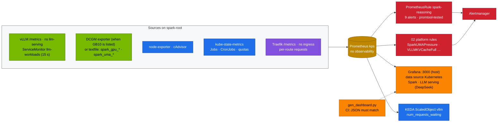
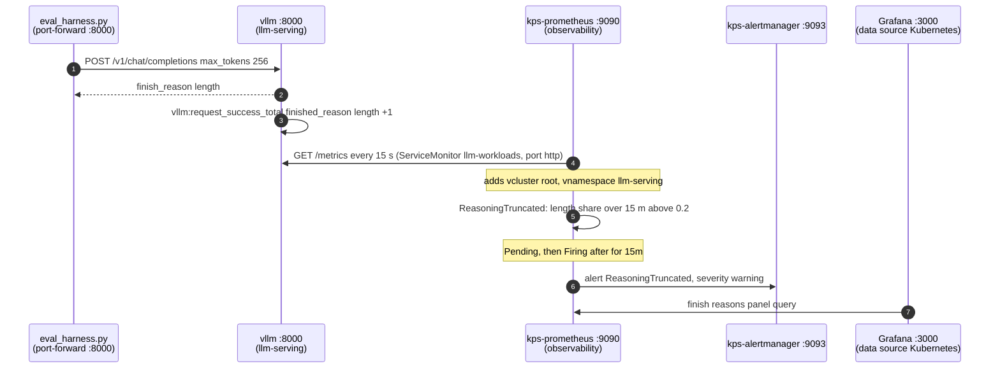

# Chapter 16 · Telemetry: DCGM, Prometheus & Grafana

> **03-DeepSeek · Part VI — Operations · Chapter 16 of 20** · ← [Chapter 15 · Automation, secrets & day-2](15-automation-secrets-and-day2.md) · [All chapters](00-deepseek-step-by-step-guide.md) · [Chapter 17 · Troubleshooting playbook](17-troubleshooting-playbook.md) →

| | |
|---|---|
| **You will build** | Observability for everything this module deploys on the root: vLLM's serving metrics (throughput, TTFT, inter-token latency, reasoning length, KV pressure, finish reasons), GB10 health and power from DCGM or the 01-Ansible textfile collector, unified-memory headroom, gateway traffic and the day-2 CronJobs. You get a Grafana dashboard (21 panels in 6 rows) generated from code, nine alerts with promtool unit tests, and a load test that moves every panel |
| **Hardware** | dgx-spark-1 |
| **Time** | 90 min |
| **Risk** | Low. Rules and a dashboard ConfigMap in `observability`; nothing touches the model servers |
| **Clusters** | `spark-root` (kube-prometheus-stack, the ServiceMonitor `llm-workloads`, the model servers in `llm-serving`) |
| **Lab files** | [`observability/rules.yaml`](lab/observability/rules.yaml), [`observability/rules.test.yaml`](lab/observability/rules.test.yaml), [`observability/gen_dashboard.py`](lab/observability/gen_dashboard.py), [`observability/deepseek-serving-dashboard.json`](lab/observability/deepseek-serving-dashboard.json), [`observability/kustomization.yaml`](lab/observability/kustomization.yaml), 02's [`95-observability/`](../02-Kubernetes/lab/manifests/root/95-observability/) and [`dcgm-exporter-values.md`](../02-Kubernetes/lab/addons/dcgm-exporter-values.md) |

---

## 1. Why this matters on a Spark

Classic API monitoring watches request rate, errors and latency. For reasoning models on a unified-memory box, those three hide the important facts:

| Question | Misleading signal | Right signal |
|---|---|---|
| "Is it slow?" | end-to-end latency (minutes is normal for R1) | TTFT (queue + prefill) and inter-token latency (decode health) |
| "Are answers complete?" | HTTP 200 | share of requests with `finished_reason="length"` (chains cut off at `max_tokens`) |
| "Do we have capacity?" | GPU utilisation (a time-sliced GB10 reads close to 100 % whenever anything runs) | `num_requests_waiting`, KV cache usage, preemptions |
| "How much memory is left?" | `nvidia-smi` memory (reads **N/A** on the GB10) or pod working sets alone | `MemAvailable` on the host vs page cache; the sum of `--gpu-memory-utilization` |
| "Is the box healthy?" | node Ready | Xid events, clock-event (throttle) reasons, temperature, power |
| "Is day-2 working?" | nothing (CronJobs fail silently) | failed Jobs, hours since the last successful run of each CronJob |
| "Is it efficient?" | tokens/s alone | output tokens per joule |

Two Spark-specific facts shape the whole chapter:

1. **There is no separate framebuffer.** CPU and GPU share ~121.7 GiB of LPDDR5x. The number that predicts an OOM is the host's `MemAvailable`, not a GPU memory gauge. The LLM pool (~90 GiB) is shared between `serving-budget` and the Kueue queue `spark-cq` ([02 Chapter 14](../02-Kubernetes/14-multi-tenancy-resource-quotas-and-cgroups.md)), so one dashboard has to show both.
2. **DCGM support for GB10 depends on the DGX OS / DCGM release.** The GPU Operator is installed with `dcgmExporter.enabled: false`. Until `dcgmi discovery -l` lists the GB10, the 01-Ansible textfile collector ([01-Ansible Chapter 12](../01-Ansible/12-gpu-telemetry-and-alerting.md)) feeds the same panels through `spark_gpu_*` and `spark_uma_*` metrics.

---

## 2. Architecture — HLD



Everything runs on the root cluster. The model servers live in `llm-serving`, so the platform team's ServiceMonitor `llm-workloads` (02's [`vcluster-workloads.yaml`](../02-Kubernetes/lab/manifests/root/95-observability/vcluster-workloads.yaml)) scrapes the port named `http` of the Services matching `vllm(-.*)?|sglang|.*-predictor` there (the main `vllm`, side engines such as Chapter 14's `vllm-qwen2-5-7b-tools`, P/D, SGLang and KServe predictors such as Chapter 09's `r1-1-5b-predictor`), and the port named `metrics` of `traefik-lab-metrics` in `ingress`. `bge-m3` is not scraped. Each series carries `vservice`, so filter `vservice="vllm"` for the main engine. It adds `vcluster="root"` and `vnamespace="llm-serving"` labels. A model you try in the `dev-llms` sandbox shows up in the same queries with `vcluster="dev-llms"`, so one dashboard covers both.

### 2.1 One truncated request to a firing alert, step by step



- **Steps 1–3** are Task 5.5's traffic: each cut-off answer adds one to the `length` series.
- **Step 4** only happens for Service names the `keep` regex of `llm-workloads` lists; a model under another Service name never reaches step 5.
- **Steps 5–6** are what `http://localhost:9090/alerts` shows: Pending for 15 minutes of sustained truncation, then Firing, and Alertmanager receives it. A silence (Task 5.7) stops the notification at step 6, not the rule.
- **Step 7** is the dashboard: Grafana reads the same series, so the **finish reasons** panel moves before the alert fires. KEDA's ScaledObject `vllm` queries the same Prometheus for `vllm:num_requests_*` (Chapter 09).

---

## 3. LLD

### 3.1 The vLLM metrics that matter

| Metric | Type | Use |
|---|---|---|
| `vllm:generation_tokens_total`, `vllm:prompt_tokens_total` | counter | output and input tokens/s |
| `vllm:time_to_first_token_seconds` | histogram | TTFT p50/p95: queueing + prefill. Thinking time is **not** in TTFT |
| `vllm:inter_token_latency_seconds` (older: `time_per_output_token_seconds`) | histogram | decode health. 1 / ITL ≈ tokens/s per stream |
| `vllm:e2e_request_latency_seconds` | histogram | the whole request; dominated by reasoning length |
| `vllm:request_generation_tokens` | histogram | reasoning length distribution |
| `vllm:num_requests_running` / `_waiting` | gauge | concurrency and queue (the KEDA trigger, [Chapter 09](09-autoscaling-and-queueing.md)) |
| `vllm:kv_cache_usage_perc` (older: `gpu_cache_usage_perc`) | gauge | KV pressure. Near 1.0 → preemptions |
| `vllm:num_preemptions_total` | counter | sequences evicted for lack of KV blocks |
| `vllm:request_success_total{finished_reason}` | counter | `stop` vs `length` (truncation) |
| `vllm:prefix_cache_hits_total` / `_queries_total` | counter | prefix-cache effectiveness ([Chapter 07](07-alternative-engines-sglang-llamacpp-trtllm.md)) |
| `vllm:spec_decode_num_accepted_tokens_total` / `_draft_tokens_total` | counter | speculative acceptance α ([Chapter 01](01-deepseek-architecture-mla-moe-mtp.md)) |

Metric names change between vLLM releases. The dashboard queries use `or` across the old and new names where needed; after an image bump, `curl …/metrics | grep vllm:` tells you whether a panel needs a new name.

### 3.2 GB10 and unified-memory signals

| Signal | DCGM (when supported) | 01-Ansible textfile collector |
|---|---|---|
| utilisation | `DCGM_FI_DEV_GPU_UTIL` | `spark_gpu_utilization_ratio` |
| power | `DCGM_FI_DEV_POWER_USAGE` | `spark_gpu_power_watts` |
| temperature | `DCGM_FI_DEV_GPU_TEMP` | `spark_gpu_temperature_celsius` |
| SM clock | `DCGM_FI_DEV_SM_CLOCK` | `spark_gpu_sm_clock_mhz` |
| clock events | — | `spark_gpu_throttle_reasons_bitmask` (bit 0 = idle, normal) |
| Xid errors | `DCGM_FI_DEV_XID_ERRORS` | `spark_gpu_xid_events_24h` |
| unified memory | — (no framebuffer on GB10) | `spark_uma_available_bytes`, `spark_uma_page_cache_bytes` |
| collector alive | `up{job=~".*dcgm.*"}` | `spark_gpu_up` |

The memory picture that matters, in one line:

```text
MemTotal ≈ 121.7 GiB = DGX OS + kubelet/etcd/control planes + platform pods (~11.7 GiB budget)
                     + Σ vLLM util × 121.7 GiB  (keep Σ util ≲ 0.72 ≈ 87.6 GiB)
                     + batch pods + page cache (reclaimable) + headroom
```

`spark_uma_available_bytes` falling towards ~8 GiB while page cache is small means real pressure (02's `SparkUMAPressure` fires). Falling while page cache is large usually means a model was just loaded: the weights sit in page cache and in the engine's allocation at the same time until the cache is reclaimed ([Chapter 08](08-kubernetes-deployment-storage-and-streaming.md)).

### 3.3 Alerts (`rules.yaml`)

| Alert | Group | Fires when | First action |
|---|---|---|---|
| `ReasoningTruncated` | spark-reasoning | > 20 % of requests end with `length` for 15 min | raise client `max_tokens`; check temperature (drill D06) |
| `VLLMDown` | spark-reasoning | no vLLM target up for 5 min | `kubectl --context spark-root -n llm-serving get pods -l app=vllm` |
| `PrefixCacheIneffective` | spark-reasoning | hit rate < 5 % with real traffic for 30 min | variable text before the shared prefix ([Chapter 07](07-alternative-engines-sglang-llamacpp-trtllm.md)) |
| `ReasoningTTFTSlow` | spark-reasoning | p95 TTFT > 10 s for 15 min | queue depth, prompt sizes, `--max-num-seqs`, scale out |
| `SparkGPUXid` | spark-gb10 | any Xid in 24 h | `journalctl -k \| grep -i xid`; [02 Chapter 26 §3.8](../02-Kubernetes/26-cluster-diagnostics-and-failure-scenarios.md) |
| `SparkGPUThrottling` | spark-gb10 | throttle bits beyond idle while > 50 % busy for 15 min | airflow, power supply, ambient temperature |
| `DayTwoJobFailed` | spark-day2 | a day-2 Job in `llm-serving` failed | its logs + the runbook in [Chapter 15](15-automation-secrets-and-day2.md) |
| `VaultSyncStale` | spark-day2 | no successful `vault-sync` for 1 h | vault01 sealed or Kubernetes auth broken ([Chapter 15](15-automation-secrets-and-day2.md)) |
| `BackupStale` | spark-day2 | no successful WebUI/LiteLLM DB backup for 2 days | backup CronJob logs, PVC space |

02's platform rules complement these: `SparkUMAPressure`, `SparkNodeMemoryPressureCondition`, `PodsPendingOnGPU`, `VLLMQueueBacklog`, `VLLMKVCacheFull`, the etcd and conntrack alerts.

**The training window and `VLLMDown`.** During a training window you park vLLM on purpose (`autoscaling.keda.sh/paused-replicas=0`, [Chapter 09](09-autoscaling-and-queueing.md)). `VLLMDown` then fires after five minutes. Add an Alertmanager silence for `alertname=VLLMDown` for the length of the window (Task 5.7) instead of weakening the rule.

### 3.4 Dashboard rows (21 panels in 6 rows)

| Row | Panels |
|---|---|
| Throughput | output tokens/s, prompt tokens/s |
| Latency | TTFT p50/p95, ITL p50/p95, e2e p95, generated tokens per request (reasoning length) |
| Capacity | running/waiting, KV usage, preemptions/s |
| Quality signals | finish reasons, prefix-cache hit rate, speculative acceptance, output tokens per joule |
| GB10 and unified memory | utilisation, power and temperature, throttle and Xid, UMA available vs page cache, pod working sets |
| Gateway and day-2 jobs | Traefik requests/s by route, failed day-2 Jobs, hours since each CronJob last succeeded |

The JSON is generated by `gen_dashboard.py` and committed. CI regenerates it and fails if the two differ, so nobody edits the JSON by hand and loses the change at the next generation.

### 3.5 Tokens per joule

```text
tokens/J = rate(vllm:generation_tokens_total[5m]) / avg(spark_gpu_power_watts)     # or DCGM_FI_DEV_POWER_USAGE
```

The power metric is the GPU's share only, so tokens/J is an upper bound for the whole box. For cost work ([Chapter 18](18-choosing-models-deepseek-vs-others.md)) read wall power from a PDU or smart plug.

---

## 4. Integrations

- **02-Kubernetes**: kube-prometheus-stack (`kps` in `observability`, its Prometheus on NodePort 30090 read by the host Grafana `:3000`, 02 Chapter 17 §5.4), the ServiceMonitors in `95-observability`, the host exporters and the platform dashboard. [02 Chapter 20](../02-Kubernetes/20-vllm-high-throughput-llm-serving.md) explains the `llm-workloads` labels.
- **01-Ansible**: installs the GPU textfile collector and turns on the DCGM exporter when `gpu_operator_dcgm_exporter=true` ([01-Ansible Chapter 12](../01-Ansible/12-gpu-telemetry-and-alerting.md), [Chapter 20](../01-Ansible/20-nvidia-gpu-operator-and-time-slicing.md)). Both run from Semaphore on sema01.
- **[Chapter 09](09-autoscaling-and-queueing.md)**: KEDA scales vLLM on the same `num_requests_*` series the dashboard shows, through `http://kps-prometheus.observability.svc:9090`.
- **[Chapter 15](15-automation-secrets-and-day2.md)**: the day-2 panels and alerts watch its CronJobs.
- **[Chapter 17](17-troubleshooting-playbook.md)**: each alert's first action leads into the playbook.

---

## 5. Lab

### Task 5.1 · Deploy the rules and the dashboard

#### What this lab does (manifests `lab/observability`)

- **Checks the dashboard JSON** against what `gen_dashboard.py` generates now, on the MacBook.
- **PrometheusRule `spark-reasoning`** in `observability` (label `release: kps`): nine alerts in three groups (§3.3).
- **ConfigMap `deepseek-serving-dashboard`** with the label `grafana_dashboard: "1"`; Grafana's sidecar loads it. Nothing in `llm-serving` changes.

#### What to look for

1. **`dashboard in sync`**.
2. **Groups:** `spark-reasoning spark-gb10 spark-day2`.
3. **Label:** `{"grafana_dashboard":"1"}`.
4. **Grafana** at `http://192.168.0.100:3000` → *Spark Lab* lists **Spark · LLM serving (DeepSeek)** (direct link `/d/spark-llm-serving`) with 21 panels in 6 rows (the JSON holds 27 entries: the 6 rows count as panels).

**If something's off:** a `diff` message instead of `dashboard in sync` means someone edited the JSON by hand; regenerate it. The dashboard missing in Grafana means the label didn't arrive or the sidecar watches another namespace. More in §7.

#### Run it

```bash
# ▶ MacBook · 03-DeepSeek/lab
python3 observability/gen_dashboard.py | diff -q - observability/deepseek-serving-dashboard.json && echo "dashboard in sync"
kubectl --context spark-root apply -k observability
kubectl --context spark-root -n observability get prometheusrule spark-reasoning -o jsonpath='{.spec.groups[*].name}'; echo
kubectl --context spark-root -n observability get cm deepseek-serving-dashboard -o jsonpath='{.metadata.labels}'; echo
```

Expected: `dashboard in sync`, groups `spark-reasoning spark-gb10 spark-day2`, and the label `grafana_dashboard: "1"` so the Grafana sidecar loads it. Open Grafana at `http://192.168.0.100:3000` → *Spark Lab* → **Spark · LLM serving (DeepSeek)**. The host copy comes from `01-Ansible/lab/roles/gpu_telemetry/files/spark-llm-serving-dashboard.json` (`gen_dashboard.py --host-grafana`); after changing the generator, regenerate both files and run `12.1 Telemetry`. The cluster Grafana `:32000` loads the ConfigMap as before.

### Task 5.2 · Check that every source is scraped

#### What this lab does (Prometheus API, host commands on dgx-spark-1)

- **Six instant queries** through a port-forward to `kps-prometheus` on `localhost:9090`, printing how many series each returns.
- **On the Spark:** `/proc/meminfo`, `nvidia-smi` and `dcgmi`, to compare the panels with what the host reports. Read-only.

#### What to look for

1. **The six counts:**

   | Query | Healthy value |
   |---|---|
   | `up{job="vllm"}` | 1 or more while a model is serving |
   | `spark_gpu_up`, `spark_uma_available_bytes` | 1 or more |
   | `DCGM_FI_DEV_GPU_UTIL` | 0 is fine with the textfile collector; above 0 with DCGM enabled |
   | `kube_cronjob_status_last_successful_time{…}` | one per CronJob that has succeeded |
   | `traefik_service_requests_total` | above 0 |

2. **On the Spark:** `MemTotal` ≈ 121.7 GiB (`/proc/meminfo` shows kB), `memory.used` `[N/A]`, and `MemAvailable` close to the **UMA available** panel (about 119 GiB on an idle Spark).

**If something's off:** 0 for `up{job="vllm"}` with a model serving → the ServiceMonitor `llm-workloads` isn't applied. 0 for `spark_gpu_up` → the 01-Ansible textfile collector isn't running (`systemctl status spark-gpu-metrics.timer`). More in §7.

#### Run it

```bash
# ▶ MacBook · 03-DeepSeek/lab
kubectl --context spark-root -n observability port-forward svc/kps-prometheus 9090 >/dev/null & pf=$!; sleep 2
for q in 'up{job="vllm"}' 'spark_gpu_up' 'DCGM_FI_DEV_GPU_UTIL' 'spark_uma_available_bytes' \
         'kube_cronjob_status_last_successful_time{namespace="llm-serving"}' 'traefik_service_requests_total'; do
  printf '%-75s %s\n' "$q" "$(curl -s localhost:9090/api/v1/query --data-urlencode "query=$q" | jq '.data.result | length')"
done
kill $pf
```

Expected: non-zero for vLLM (when a model is serving), `spark_gpu_up` and `spark_uma_available_bytes` (or DCGM when enabled), the CronJobs and Traefik. `DCGM_FI_DEV_GPU_UTIL` at 0 is fine while the textfile collector is in use.

Check what the host itself says, so you know the panels tell the truth:

```bash
# ▶ dgx-spark-1 (ssh dgx-spark-1)
grep -E 'MemTotal|MemAvailable|^Cached' /proc/meminfo
nvidia-smi --query-gpu=name,utilization.gpu,power.draw,temperature.gpu,clocks_event_reasons.active,memory.used --format=csv
dcgmi discovery -l 2>/dev/null | grep -i gb10 || echo "DCGM does not list the GB10: textfile collector is the source"
```

Expected: `MemTotal` ≈ 121.7 GiB, `memory.used` reads `[N/A]`, and `MemAvailable` matches the dashboard's **UMA available** panel within a scrape interval.

### Task 5.3 · Unit-test the alerts

#### What this lab does (`promtool test rules`, `lab/observability/rules.test.yaml`)

- **Extracts the rule groups** from the PrometheusRule into a temporary plain rules file, runs the unit tests with synthetic series, then deletes the temporary file. Runs only on the MacBook; no cluster needed.

#### What to look for

1. **`SUCCESS`** at the end, and the temporary `rules.extracted.yaml` is gone.

**If something's off:** `promtool: command not found` → install it (Prometheus release or `brew install prometheus`). `No module named yaml` → `pip install pyyaml`. A failing test prints the expected and the actual alerts; read which rule changed. More in §7.

#### Run it

```bash
# ▶ MacBook · 03-DeepSeek/lab
python3 -c "
import yaml; g=[x for d in yaml.safe_load_all(open('observability/rules.yaml')) for x in d['spec']['groups']]
open('observability/rules.extracted.yaml','w').write(yaml.safe_dump({'groups': g}))"
(cd observability && promtool test rules rules.test.yaml) && rm observability/rules.extracted.yaml
```

Expected: `SUCCESS`. The tests prove that 30 % truncation fires `ReasoningTruncated` and 5 % doesn't, that a failed `weights-verify` Job fires `DayTwoJobFailed`, and that an idle-only throttle bit stays quiet.

### Task 5.4 · Load it and watch the panels move

#### What this lab does (script `lab/scripts/serve-model.sh`, tool `lab/tools/eval_harness.py`)

- **Serves r1-7b** (a no-op apart from the smoke test if it already serves).
- **Sends the math suite** (40 word problems) with 16 requests in parallel and up to 8,192 tokens each, through a port-forward. Nothing is changed in the cluster.

#### What to look for

1. **The harness** prints `math  N/40 acc=… p50=…s mean_out_tokens=… reasoning_share=…` and a `run: … output tokens in …s = … tok/s aggregate` line.
2. **On the dashboard during the run:** output tokens/s and TTFT rise, the KV-cache usage climbs towards 1.0, the waiting gauge goes above 0, and UMA available stays well above ~8 GiB. Fill in the table.

**If something's off:** flat panels while the harness runs → the dashboard's data source or the vLLM scrape (Task 5.2). Some panels empty, others fine → a metric renamed in your vLLM image. More in §7.

#### Run it

```bash
# ▶ MacBook · 03-DeepSeek/lab
scripts/serve-model.sh r1-7b
pkill -f 'port-forward svc/vllm 8000'; kubectl --context spark-root -n llm-serving port-forward svc/vllm 8000 >/dev/null & pf=$!; sleep 2
python3 tools/eval_harness.py --url http://localhost:8000 --model r1-7b --suites math --concurrency 16 --max-tokens 8192
kill $pf
```

During the run, read the dashboard (**record yours**):

| Panel | Value under load |
|---|---|
| output tokens/s | |
| TTFT p95 | |
| ITL p50 | |
| generated tokens p95 | |
| KV cache usage peak | |
| preemptions/s | |
| tokens per joule | |
| UMA available (min) | |

With concurrency 16 and a 7B model at its catalog `util`, the KV cache fills and the waiting gauge rises. That is the signal KEDA scales on and the reason `--max-num-seqs` exists.

### Task 5.5 · Make an alert fire for real

#### What this lab does (tool `lab/tools/eval_harness.py`, alert `ReasoningTruncated`)

- **Three math runs** at temperature 0 with `max_tokens` 256: almost every R1 answer is cut off (`finish_reason=length`).
- **The rule** fires when more than 20 % of requests end with `length` for 15 minutes. Keep traffic going that long; three runs may be shorter, so repeat the loop if needed.

#### What to look for

1. **The harness:** accuracy near 0 and `mean_out_tokens` at about 256.
2. **The finish reasons panel:** `length` dominates.
3. **`http://localhost:9090/alerts`:** `ReasoningTruncated` goes Pending, then Firing, and shows in Alertmanager; after the traffic stops it resolves.

**If something's off:** the alert stays Pending and then clears → traffic stopped before 15 minutes; run the loop longer. More in §7.

#### Run it

```bash
# ▶ MacBook · 03-DeepSeek/lab
pkill -f 'port-forward svc/vllm 8000'; kubectl --context spark-root -n llm-serving port-forward svc/vllm 8000 >/dev/null & pf=$!; sleep 2
for i in 1 2 3; do
  python3 tools/eval_harness.py --url http://localhost:8000 --model r1-7b --suites math --concurrency 8 --max-tokens 256 --temperature 0
done
kill $pf
```

`max_tokens 256` truncates almost every R1 chain. With ~15 minutes of sustained traffic, `ReasoningTruncated` goes Pending, then Firing. Check `http://localhost:9090/alerts` (port-forward as in Task 5.2) and Alertmanager. The **finish reasons** panel shows `length` dominating. Stop the traffic and watch it resolve.

### Task 5.6 · Day-2 panels

#### What this lab does (CronJob `catalog-drift`)

- **Runs the drift report once** as Job `cd-test` in `llm-serving`. It fails on purpose when a catalog entry has moved upstream since pinning (Chapter 15).
- **Cleans up** by deleting the Job.

#### What to look for

1. **The last log lines:** one line per model (`ok`, `UNPINNED`, `MOVED`) and `… models, N moved upstream since pinning`.
2. **Failed day-2 Jobs** panel shows `cd-test` when it failed.
3. **Trap:** `DayTwoJobFailed` matches only Job names starting with `weights-verify`, `catalog-drift`, `vault-sync`, `webui-backup`, `litellm-db-backup` or `rag-ingest`. A Job named `cd-test` shows on the panel but does not fire the alert. To see the alert, create it as `catalog-drift-test` instead.
4. **After the delete,** the panel clears.

**If something's off:** the Job succeeds → no entry has moved, so nothing fails; the panel stays empty, which is correct. More in §7.

#### Run it

```bash
# ▶ MacBook · 03-DeepSeek/lab
kubectl --context spark-root -n llm-serving create job --from=cronjob/catalog-drift cd-test
kubectl --context spark-root -n llm-serving wait --for=condition=complete job/cd-test --timeout=10m || true
kubectl --context spark-root -n llm-serving logs job/cd-test | tail -5
```

With an unpinned or moved catalog entry the Job fails on purpose ([Chapter 15](15-automation-secrets-and-day2.md)). Watch **Failed day-2 Jobs** and `DayTwoJobFailed`, then clean up:

```bash
# ▶ MacBook · 03-DeepSeek/lab
kubectl --context spark-root -n llm-serving delete job cd-test
```

### Task 5.7 · Silence `VLLMDown` for a training window

#### What this lab does (Alertmanager API)

- **Creates one silence** in `kps-alertmanager` for `alertname=VLLMDown`, from now for 4 hours, commented "training window: vLLM parked". The rule itself is unchanged; other alerts still notify.

#### What to look for

1. **The reply:** `{"silenceID":"…"}`.
2. **Alertmanager UI → Silences:** the silence is active with your comment and end time.

**If something's off:** `endsAt` errors → both `date` variants failed; set the time by hand in RFC 3339 form. More in §7.

#### Run it

```bash
# ▶ MacBook · 03-DeepSeek/lab
kubectl --context spark-root -n observability port-forward svc/kps-alertmanager 9093 >/dev/null & pf=$!; sleep 2
end=$(date -u -d '+4 hours' +%Y-%m-%dT%H:%M:%SZ 2>/dev/null || date -u -v+4H +%Y-%m-%dT%H:%M:%SZ)
curl -s -XPOST localhost:9093/api/v2/silences -H 'Content-Type: application/json' -d "{
  \"matchers\":[{\"name\":\"alertname\",\"value\":\"VLLMDown\",\"isRegex\":false}],
  \"startsAt\":\"$(date -u +%Y-%m-%dT%H:%M:%SZ)\",\"endsAt\":\"$end\",
  \"createdBy\":\"dgxadmin\",\"comment\":\"training window: vLLM parked\"}"
kill $pf
```

Expected: a silence ID. Delete it from the Alertmanager UI if the window ends early.

---

## 6. Verify

| Check | Expected |
|---|---|
| rules loaded | PrometheusRule `spark-reasoning`: three groups, nine rules |
| dashboard | 21 panels in 6 rows; generated JSON matches the committed file (CI) |
| sources | vLLM, GPU (DCGM or textfile), UMA, kube-state-metrics and Traefik all return series |
| memory truth | dashboard UMA available ≈ `MemAvailable` on dgx-spark-1 |
| alert tests | `promtool test rules` SUCCESS |
| live alert | `ReasoningTruncated` fired in Task 5.5 and resolved afterwards |

---

## 7. Troubleshooting

| You see | Cause | Fix |
|---|---|---|
| no vLLM series | Service port not named `http`, a Service name outside the `keep` regex of `llm-workloads`, or that ServiceMonitor not applied | the base Deployment's Service uses `http`; `kubectl --context spark-root -n observability get servicemonitor llm-workloads` |
| some panels empty, others fine | metric renamed in your vLLM image | `kubectl --context spark-root -n llm-serving exec deploy/vllm -- curl -s localhost:8000/metrics \| grep vllm:` and adjust `gen_dashboard.py` |
| GPU panels empty | DCGM off and textfile collector not installed | run the 01-Ansible GPU telemetry playbook from Semaphore; check `spark_gpu_up` |
| GPU memory panel shows N/A or 0 | unified memory: there is no framebuffer metric | use the UMA row (`spark_uma_available_bytes`) |
| dashboard not in Grafana | sidecar label or namespace mismatch | label `grafana_dashboard: "1"`; 02 sets `searchNamespace: ALL` |
| `promtool test` fails after an edit | annotation text or labels changed | update `rules.test.yaml`. That is the test doing its job |
| tokens/J absurdly high | power series missing (division by empty) | check the power expression sources |
| `VLLMDown` firing during training | vLLM parked on purpose | silence it (Task 5.7) |

---

## 8. Scale-out path

| One Spark | Two Sparks | Fleet |
|---|---|---|
| one Prometheus on the root | same Prometheus; dgx-spark-2 as a second node adds per-node series | Prometheus per cluster + long-term store (Thanos/Mimir) |
| alerts to one channel | add per-node GPU alerts | SLOs (TTFT, ITL, truncation rate) with burn-rate alerts per tenant |
| GPU via textfile | DCGM once the GB10 is supported | DCGM everywhere; per-GPU and per-NVLink metrics on HGX/GB200 |
| request metrics | add CX-7 counters (RoCE, NCCL) | distributed tracing (OpenTelemetry) through gateway → LiteLLM → engine |

---

## 9. Checklist

- [ ] I watch TTFT, ITL, truncation and queue depth, not just latency and errors.
- [ ] I know which memory number is real headroom on a GB10, and that `nvidia-smi` memory reads N/A.
- [ ] Day-2 jobs can't fail silently.
- [ ] My alerts have unit tests, and I've seen one fire and resolve for real.
- [ ] I silence `VLLMDown` for training windows instead of weakening the rule.
