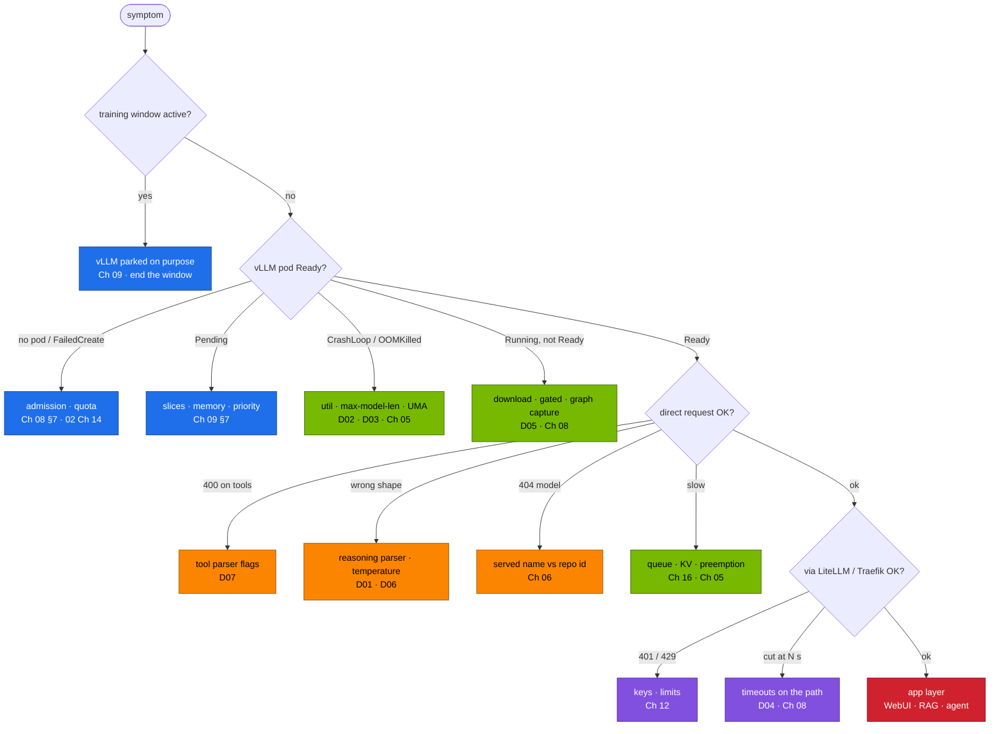

# Chapter 17 · Troubleshooting Playbook

> **03-DeepSeek · Part VI — Operations · Chapter 17 of 19** · ← [Chapter 16 · Telemetry](16-telemetry.md) · [All chapters](00-deepseek-step-by-step-guide.md) · [Chapter 18 · Choosing models](18-choosing-models-deepseek-vs-others.md) →

| | |
|---|---|
| **You will build** | One place to start when anything in the DeepSeek stack misbehaves: a five-step triage routine, a decision tree from symptom to layer, `llm-triage.sh` (a read-only live check that points at the drill or chapter with the fix), a symptom index across scheduling, admission, memory, correctness, performance, gateway, apps, training and day-2, a support bundle, and timed practice on the injected faults D01–D07 |
| **Hardware** | dgx-spark-1 |
| **Time** | 2 h (drills) |
| **Risk** | Low. Every drill is reversible with `scripts/breakfix.sh reset <ID>`. D03 loads the 32B BF16 model, which runs alone: park everything else first |
| **Clusters** | `spark-root` (all drills run in `llm-serving`) · `dev-llms` (try a suspect manifest in `llm-sandbox` before you change the root) |
| **Lab files** | [`scripts/llm-triage.sh`](lab/scripts/llm-triage.sh), [`scripts/breakfix.sh`](lab/scripts/breakfix.sh), [`breakfix/`](lab/breakfix/), [`scripts/verify.sh`](lab/scripts/verify.sh), [`tools/stream_probe.py`](lab/tools/stream_probe.py), [`tools/model_math.py`](lab/tools/model_math.py), 02's [`scripts/collect-diag.sh`](../02-Kubernetes/lab/scripts/collect-diag.sh) |

---

## 1. Why this matters on a Spark

LLM serving failures look alike from outside ("it's slow", "it's empty", "it hangs") and have causes in very different layers: client parameters, gateway timeouts, engine flags, unified memory, weights, quotas and admission on the root, the GPU itself. On a Spark the layers are also tightly coupled: one model's `--gpu-memory-utilization` is everybody's memory, the 15 time-slices are shared by serving and training, and a training window parks vLLM on purpose. Without a routine, people restart things until something changes and learn nothing. The routine:

1. **Observe** without changing anything: `llm-triage.sh`, the dashboard ([Chapter 16](16-telemetry.md)), logs, `stream_probe.py`.
2. **Locate** the layer with the decision tree (§2.1).
3. **Confirm** with one targeted command (§2.2, §3.2).
4. **Fix** the smallest thing, then **verify** with `verify.sh`.
5. **Record** symptom → cause → fix in your runbook, and add a test or alert if one would have caught it.

---

## 2. Architecture — HLD

### 2.1 Decision tree



### 2.2 Where the evidence lives

| Layer | First command | Deeper |
|---|---|---|
| scheduling, quota | `kubectl --context spark-root -n llm-serving get deploy,rs,pod -o wide` | `describe` events; `kubectl --context spark-root -n llm-serving describe resourcequota serving-budget` |
| admission | ReplicaSet events (`FailedCreate`) | the ValidatingAdmissionPolicies `spark-no-latest-tag`, `spark-serving-needs-readiness`, `spark-no-nvidia-env-bypass`, `spark-gpu-slice-limits`; PSA labels on the namespace |
| engine | `kubectl --context spark-root -n llm-serving logs deploy/vllm --tail=200` | `/metrics`, `/v1/models`, the container args |
| client view | `stream_probe.py` at each hop | raw `curl -N` SSE |
| unified memory | `grep MemAvailable /proc/meminfo` on dgx-spark-1, `llm-triage.sh` | dashboard UMA row, `model_math.py` |
| GPU | `nvidia-smi` (memory reads N/A), `sudo dmesg \| grep -i xid` | [02 Chapter 26 §3.8](../02-Kubernetes/26-cluster-diagnostics-and-failure-scenarios.md) Xid table |
| training | `kubectl --context spark-root -n batch get workloads,jobs` | `describe workload`, ClusterQueue `spark-cq` usage |
| day-2 | `kubectl --context spark-root -n llm-serving get cronjobs,jobs` | Job logs, [Chapter 15](15-automation-secrets-and-day2.md) runbook |
| secrets | Secret not a placeholder; `hf-token` present when a gated model serves (`llm-triage.sh secrets`) | `vault-sync` logs; vault01 `vault status` |

---

## 3. LLD

### 3.1 The drills

`scripts/breakfix.sh` injects each fault on `spark-root` in `llm-serving`. D01, D02, D03, D05 and D07 apply an overlay from [`breakfix/`](lab/breakfix/) on top of a catalog model; D04 patches the LiteLLM config; D06 prints the client command that reproduces it.

| ID | Inject | Symptom | Root cause | Fix | Chapter |
|---|---|---|---|---|---|
| D01 | overlay [`D01-no-reasoning-parser`](lab/breakfix/D01-no-reasoning-parser/kustomization.yaml) on `r1-7b` | `<think>…</think>` inside `content`; `reasoning_content` empty; Open WebUI shows raw thinking | no `--reasoning-parser=deepseek_r1` | catalog entry with the parser → `gen_overlays.py` | [03](03-r1-reasoning-and-grpo.md), [06](06-vllm-serving.md) |
| D02 | overlay [`D02-util-too-high`](lab/breakfix/D02-util-too-high/kustomization.yaml) on `r1-7b` | vLLM won't start (free memory below requested) or the pod is OOMKilled at its memory limit (28 Gi for `r1-7b`) | `--gpu-memory-utilization=0.95` on unified memory | util back to the catalog value; Σ util of all engines ≲ 0.72 | [05](05-model-catalog-and-memory-math.md), [06](06-vllm-serving.md) |
| D03 | overlay [`D03-context-too-long`](lab/breakfix/D03-context-too-long/kustomization.yaml) on `r1-32b` | startup fails: KV cache can't hold one maximum-length sequence | `--max-model-len=131072` on the BF16 32B at 0.70 | lower `--max-model-len`, FP8 weights or `--kv-cache-dtype fp8` | [05](05-model-catalog-and-memory-math.md) |
| D04 | LiteLLM `timeout`/`request_timeout` patched to 30 s | long answers through the gateway stop at ~30 s; direct to vLLM they finish | shortest timeout on the path wins | ≥ 900 s on every hop: LiteLLM, HTTPRoute `timeouts.request`, client | [08](08-kubernetes-deployment-storage-and-streaming.md), [12](12-open-webui-and-litellm-gateway.md) |
| D05 | overlay [`D05-gated-no-token`](lab/breakfix/D05-gated-no-token/kustomization.yaml) (`llama-3.1-8b`) | pod never Ready; prefetch Job / vLLM log shows 401 / `GatedRepoError` | no `hf-token` Secret (the 02 base ships none), or it holds a placeholder | accept the licence on Hugging Face, store the token at `kv/spark-lab/hf` (field `token`), let `vault-sync` update Secret `hf-token` | [15](15-automation-secrets-and-day2.md) |
| D06 | prints an `eval_harness.py` command with `--temperature 0` | R1 loops inside `<think>`, `finish_reason=length`, accuracy drops | greedy decoding on an R1-style model | temperature 0.6, top-p 0.95, fix the client default | [03](03-r1-reasoning-and-grpo.md), [18](18-choosing-models-deepseek-vs-others.md) |
| D07 | overlay [`D07-no-tool-parser`](lab/breakfix/D07-no-tool-parser/kustomization.yaml) on `qwen2.5-7b-tools` | agent gets HTTP 400 (`"auto" tool choice requires …`) or prose that describes a tool call | `--enable-auto-tool-choice` and `--tool-call-parser` removed | restore both flags (`hermes` for Qwen2.5, `llama3_json` for Llama 3.1) | [14](14-tool-calling-and-agents.md) |

`scripts/breakfix.sh hint <ID>` gives a nudge without the answer; `answer <ID>` explains it; `reset <ID>` re-applies the catalog overlay (or, for D04, the LiteLLM manifest).

### 3.2 Symptom index

| Area | You see | Likely cause | Confirm | Fix |
|---|---|---|---|---|
| **window** | `svc/vllm` has no endpoints; KEDA shows 0 replicas | training window: `paused-replicas=0` on the ScaledObject | `kubectl --context spark-root -n llm-serving get scaledobject vllm -o jsonpath='{.metadata.annotations}'` | end the window: re-apply `root-llms/10-tenancy` and `20-scheduling`, remove the annotation ([Chapter 09](09-autoscaling-and-queueing.md)) |
| **admission** | `FailedCreate … spark-no-latest-tag` | image without a pinned tag | ReplicaSet events | pin the tag from `lab/versions.env` |
| | `FailedCreate … spark-serving-needs-readiness` | serving Deployment without a readinessProbe | same | keep the base Deployment's probes in every overlay |
| | `FailedCreate … NVIDIA_*/CUDA_VISIBLE_DEVICES` | env var set to bypass the device plugin | same | request `nvidia.com/gpu: 1`, remove the env |
| | `FailedCreate … violates PodSecurity "baseline"` | privileged settings in `llm-serving` | `kubectl --context spark-root get ns llm-serving --show-labels` | privileged work belongs in `batch` |
| **quota** | `exceeded quota: serving-budget` | Σ requests in `llm-serving` over 8 CPU · 90 Gi · 6 slices, or the training-window quota (2 CPU · 10 Gi) still applied | `describe resourcequota serving-budget` | park another server or end the window |
| | memory request ≠ limit rejected / mis-scheduled | GPU container without request = limit | pod spec | request = limit on every GPU container |
| **scheduling** | Pending: `Insufficient nvidia.com/gpu` | all 15 slices requested (platform 2, serving up to 6, batch up to 3, plus tenants) | `kubectl --context spark-root describe node dgx-spark-1 \| grep -A8 Allocated` | scale something down |
| | Pending: `Insufficient memory` | the ~90 GiB LLM pool already requested by serving + batch | same | park a model or wait for the Job; a bigger model needs everything else parked |
| **load** | startup > 30 min, then restart | weights downloaded inside the pod, startupProbe expires | prefetch Job logs | prefetch into `model-cache` first ([Chapter 08](08-kubernetes-deployment-storage-and-streaming.md)) |
| | `no kernel image is available for execution` | image built without sm_121 | image tag | the NGC image pinned in `versions.env` |
| | `401` / `GatedRepoError` | D05 | prefetch log | Vault `kv/spark-lab/hf` → `hf-token` |
| **memory** | OOMKilled at the pod limit right after start | util × 121.7 GiB above the pod limit (0.30 ≈ 36.5 GiB > 28 Gi) | args vs `resources` | keep `util` and `mem` together as the catalog does (`mem` ≈ util × 121.7 GiB + a few GiB); request = limit |
| | OOMKilled after a model switch | page cache + new weights at the same time | `MemAvailable` before load | drop caches before loading ([Chapter 08](08-kubernetes-deployment-storage-and-streaming.md)); lower util |
| | preemptions climbing | KV too small for concurrency × length | KV usage panel | lower `--max-num-seqs`, FP8 KV, shorter `--max-model-len` |
| | node NotReady during a load | UMA exhausted, kubelet starved | `journalctl -u kubelet` on dgx-spark-1 | Σ util ≲ 0.72; system reservations ([02 Chapter 14](../02-Kubernetes/14-multi-tenancy-resource-quotas-and-cgroups.md)) |
| **correctness** | thinking in `content` | D01 | args | reasoning parser |
| | answers truncated | client `max_tokens` too small | `finish_reason` | 8K–32K for R1-style models |
| | loops, repetition | D06 | temperature in the request | 0.6 / top-p 0.95 |
| | `404 model … does not exist` | client used the Hugging Face repo id | `curl …/v1/models` | use the served name or a LiteLLM alias |
| | JSON breaks parsers | free-form output | [Chapter 14](14-tool-calling-and-agents.md) | `response_format` with a JSON schema |
| **performance** | TTFT high | queue or long prompts | waiting gauge, prompt tokens | concurrency limits, prefix caching, KEDA |
| | ITL far above the decode ceiling | another GPU workload in the same time-slices, or throttling | GPU row, throttle bits | park the neighbour; check airflow |
| | prefix cache ~0 % | dynamic text before the shared prefix | hit-rate panel | reorder the prompt |
| **gateway** | 401 / 429 | key or limit | LiteLLM logs, `/key/info` | key scope or limits ([Chapter 12](12-open-webui-and-litellm-gateway.md)) |
| | cut at a fixed number of seconds | D04 | `stream_probe.py` per hop | 900 s everywhere |
| | nothing, then the whole answer at once | a buffering hop | `BUFFERED` in the probe | remove buffering middleware on streaming routes |
| **apps** | Open WebUI shows no models | wrong LiteLLM key in its DB | Admin → Connections | update the key |
| | RAG answers off-topic | stale index or gate disabled | `rag_demo.py eval` | re-ingest with the gate ([Chapter 13](13-rag-with-qdrant-and-bge.md)) |
| | agent loops | unclear tool results | audit log | better errors, `--max-steps` |
| **training** | Workload stays `Pending`/suspended | `spark-cq` quota (everyday 2 CPU · 12 Gi) too small for the Job | `kubectl --context spark-root -n batch describe workload` | open the training window, or shrink the Job to fit |
| | Job rejected in the window | pod over 8 CPU · 80 Gi · 1 slice, or request ≠ limit | Job events | fit the window ([Chapter 10](10-lora-qlora-unsloth-and-llama-factory.md)) |
| | OOMKilled in SFT/FSDP | batch × sequence vs memory | `lora_calc.py` | smaller batch, LoRA, ZeRO-3 offload ([Chapter 11](11-distributed-training-and-rl.md)) |
| | NCCL hang (2×) | NIC, GID or RoCE settings | `NCCL_DEBUG=INFO` | CX-7 settings ([Chapter 11](11-distributed-training-and-rl.md)) |
| **day-2** | `weights-verify` failed | snapshot changed | Job log | quarantine, re-download |
| | secrets stale | vault01 sealed or auth broken | `vault-sync` log | unseal, re-run the auth setup |
| | backup missing | CronJob failing | `BackupStale` | Job log, PVC space |

### 3.3 What `llm-triage.sh` checks

| Section | Checks | Points at |
|---|---|---|
| `serving` | Deployment Ready, restarts and last termination reason, util and max-model-len from the args, reasoning parser on R1/QwQ models, tool flags on `*tools*` models, served names, running/waiting/preemptions/truncation from `/metrics`, recent errors in the log | D01, D02, D06, D07, [Chapter 05](05-model-catalog-and-memory-math.md) |
| `gateway` | LiteLLM Ready, router timeout ≥ 900 s, LiteLLM DB, HTTPRoute timeouts | D04, [Chapter 12](12-open-webui-and-litellm-gateway.md) |
| `secrets` | `litellm-master-key`, `open-webui-secret` present and not placeholders; `hf-token` not a placeholder (a missing one is only an info line: public models don't need it); managed by `vault-sync` | D05, [Chapter 15](15-automation-secrets-and-day2.md) |
| `day2` | failed Jobs, last success of each CronJob | [Chapter 15](15-automation-secrets-and-day2.md) |
| `host` | `MemAvailable`, page cache, GPU temperature/power/clock events, Xid lines (only when run on the Spark) | [Chapter 08](08-kubernetes-deployment-storage-and-streaming.md), 02 Chapter 26 |

It is read-only: it never restarts, scales or patches anything.

---

## 4. Integrations

- **[Chapter 16](16-telemetry.md)**: every alert's first action leads into §3.2.
- **[Chapter 19](19-hands-on-workbook.md)**: the capstone ends with an unannounced drill solved with this playbook.
- **02-Kubernetes**: [Chapter 26](../02-Kubernetes/26-cluster-diagnostics-and-failure-scenarios.md) covers the platform layers (API server, etcd, DNS, Xid, vClusters) and owns `collect-diag.sh`; 02's own drills use the same `breakfix.sh` workflow.
- **01-Ansible**: [Chapter 29](../01-Ansible/29-incident-response-and-emergency-drain.md) is the escalation path when the node itself has to be drained.

---

## 5. Lab

### Task 5.1 · Baseline: a healthy triage

#### What this lab does (scripts `lab/scripts/serve-model.sh`, `lab/scripts/llm-triage.sh`)

- **Puts the stack in a known state:** r1-7b in `deploy/vllm`, and the Chapter 12 apps applied (bge-m3, LiteLLM + PostgreSQL, Open WebUI). The apps apply writes placeholder Secrets (the model overlay carries none), so the block runs Chapter 15's `vault-sync` once before the triage.
- **Runs the triage once** and saves it to `results/triage-known-good.txt`. The triage is read-only: it never restarts, scales or patches anything.
- **On the Spark:** the host facts the triage's `host` section would read (it skips them on the MacBook).

#### What to look for

1. **The triage summary:** `… passed, … warnings, 0 failed`. Key lines:

   | Section | Healthy line |
   |---|---|
   | serving | `[PASS] vLLM Ready`, `[PASS] reasoning parser on`, `util 0.20   max-model-len …` |
   | gateway | `[PASS] LiteLLM Ready`, `[PASS] router timeout 900s`, `[PASS] LiteLLM DB present` |
   | secrets | `[PASS] secret … set` for the three Secrets and `[PASS] litellm-master-key managed by vault-sync` (if the sync didn't run: `[WARN] … placeholder` for the apps Secrets and `no hf-token Secret: fine for public models; gated ones need it (D05, Chapter 15)`) |
   | day-2 | `[PASS] no failed Jobs in llm-serving` |
   | host | `not on the Spark … skipped` from the MacBook |

2. **On the Spark:** `MemAvailable` high (about 119 GiB minus what the running engines hold), a GB10 line with real temperature and power, and an Xid count of `0`.

**If something's off:** `can't exec into vLLM` → the pod isn't Running; use logs and describe. Counters all 0 → a fresh pod with no traffic yet. More in §7.

#### Run it

```bash
# ▶ MacBook · 03-DeepSeek/lab
scripts/serve-model.sh r1-7b
kubectl --context spark-root apply -k k8s/apps
kubectl --context spark-root -n llm-serving delete job vs-triage --ignore-not-found
kubectl --context spark-root -n llm-serving create job --from=cronjob/vault-sync vs-triage   # the apps apply wrote placeholder Secrets
kubectl --context spark-root -n llm-serving wait --for=condition=complete job/vs-triage --timeout=5m
mkdir -p results
scripts/llm-triage.sh | tee results/triage-known-good.txt
```

Expected: every section PASS or info. Keep the file: it is your known good.

The `host` section only runs on the Spark. From the MacBook, read the same facts directly:

```bash
# ▶ dgx-spark-1 (ssh dgx-spark-1)
grep -E 'MemAvailable|^Cached' /proc/meminfo
nvidia-smi --query-gpu=name,temperature.gpu,power.draw,clocks_event_reasons.active --format=csv,noheader
sudo dmesg | grep -ci xid
```

### Task 5.2 · Run the drills, timed

#### What this lab does (script `lab/scripts/breakfix.sh`, `lab/breakfix/`, tools `stream_probe.py`, `model_math.py`)

- **Breaks the serving stack on purpose, one fault at a time** (§3.1): D01, D02, D03, D05, D07 replace `deploy/vllm` with a broken overlay; D04 lowers LiteLLM's timeouts to 30 s; D06 only prints a client command. `reset` re-applies the catalog overlay (D04: the LiteLLM manifest).
- **D03 serves r1-32b in BF16 at 0.70:** park bge-m3 and side models first. If its weights (~61 GiB) aren't cached yet, the pod downloads them itself; prefetch with `scripts/serve-model.sh r1-32b` beforehand.
- **`stream_probe.py`** times one streamed request directly to vLLM and one through Traefik → LiteLLM; **`model_math.py`** does the D03 arithmetic on the MacBook.

#### What to look for

1. **`list`:** D01–D08 with their titles.
2. **Signals per drill:**

   | Drill | Signal that gives it away |
   |---|---|
   | D01 | triage `[FAIL] R1-style model without --reasoning-parser`; `<think>` in `content` |
   | D02 | pod not Ready or `OOMKilled`; vLLM log about free memory |
   | D03 | startup error: KV cache can't hold one max-length sequence |
   | D04 | triage `[FAIL] router timeout 30s < 900`; the probe through LiteLLM ends with an error after about 30 s, the direct one finishes |
   | D05 | `401`/`GatedRepoError`; triage shows `no hf-token Secret …` or `[WARN] secret hf-token still holds the placeholder` if the token is the cause |
   | D06 | `finish_reason=length` and long completions at temperature 0 |
   | D07 | triage `[FAIL] tool model without --enable-auto-tool-choice` |

3. **The D03 arithmetic:** read the `KV cache` line, not `verdict`. At 131,072 it says `… tokens = 0 concurrent sequences at 131,072 context`; at 16,384 it says 5. (`verdict` reports ✓ for both: it only checks that the weights fit.)
4. **Times:** under 10 minutes each; fill in the table.

**If something's off:** `reset` doesn't restore because something else changed meanwhile → `scripts/serve-model.sh <name>`. After the loop, D05's reset leaves `llama-3.1-8b` serving and D04's reset re-applies the placeholder `litellm-master-key`: run `scripts/serve-model.sh r1-7b` and the vault-sync Job (Chapter 15 Task 5.3). D03 failing earlier than the KV error → another engine still holds memory. More in §7.

#### Run it

```bash
# ▶ MacBook · 03-DeepSeek/lab
scripts/breakfix.sh list
```

For each ID: inject, observe only with `llm-triage.sh`, the dashboard, logs and `stream_probe.py`, write your diagnosis, then read the answer and reset. D03 serves the BF16 32B at 0.70: park bge-m3 and any side model first, and restore them afterwards.

```bash
# ▶ MacBook · 03-DeepSeek/lab
for d in D01 D02 D03 D04 D05 D06 D07; do
  echo "=== $d"; scripts/breakfix.sh inject $d
  read -rp "diagnose, then press enter for the answer… " _
  scripts/breakfix.sh answer $d; scripts/breakfix.sh reset $d
done
```

| Drill | Your time to diagnosis | Which signal gave it away |
|---|---|---|
| D01 | | |
| D02 | | |
| D03 | | |
| D04 | | |
| D05 | | |
| D06 | | |
| D07 | | |

Target: under 10 minutes each. `llm-triage.sh` flags D01, D04, D05 and D07 directly. D04 needs `stream_probe.py` at two hops:

```bash
# ▶ MacBook · 03-DeepSeek/lab
KEY="sk-..."   # a LiteLLM virtual key allowed to use reasoning-fast (Chapter 12)
kubectl --context spark-root -n llm-serving port-forward svc/vllm 8000 >/dev/null & pf=$!; sleep 2
python3 tools/stream_probe.py --url http://localhost:8000 --model r1-7b --max-tokens 8192            # direct
python3 tools/stream_probe.py --url http://192.168.0.115 --host api.lab.local --api-key "$KEY" \
  --model reasoning-fast --max-tokens 8192                                                         # via Traefik → LiteLLM
kill $pf
```

D03 is best confirmed with arithmetic before you read a single log line:

```bash
# ▶ MacBook · 03-DeepSeek/lab
python3 tools/model_math.py deepseek-r1-distill-qwen-32b --util 0.70 --ctx 131072 | grep -E 'KV|verdict'
python3 tools/model_math.py deepseek-r1-distill-qwen-32b --util 0.70 --ctx 16384  | grep -E 'KV|verdict'
```

### Task 5.3 · Try the fix in the sandbox first

#### What this lab does (vCluster `dev-llms`, overlay `lab/k8s/models/r1-1.5b`)

- **Reads the sandbox quota** in `llm-sandbox` on `dev-llms`.
- **Server-side dry run** of the `r1-1.5b` overlay: the API server runs admission and validation, but nothing is created. The root cluster is not touched.

#### What to look for

1. **Quota:** `sandbox-budget` with `requests.cpu` 1500m, `requests.memory` 3Gi and 2 GPU slices: the namespace's share of the vCluster's 2 CPU · 4 Gi.
2. **Dry run:** each object reports `… (server dry run)`, with no `Error from server`. A Deployment dry run checks the object and admission webhooks; it creates no pod, so the quota is not tested here.
3. **Why the `sed`:** the overlay's objects carry `namespace: llm-serving`. `apply -n llm-sandbox -k …` would stop with `the namespace from the provided object "llm-serving" does not match the namespace "llm-sandbox"`, so the block renders the overlay and retargets it.

**If something's off:** `context "dev-llms" does not exist` → fetch the vCluster kubeconfig (02-Kubernetes Chapter 04). More in §7.

#### Run it

For a manifest-level fix (D01, D07), prove the corrected args on the small model in `dev-llms` before you touch the root:

```bash
# ▶ MacBook · 03-DeepSeek/lab
kubectl --context dev-llms -n llm-sandbox get resourcequota
kubectl kustomize k8s/models/r1-1.5b | sed 's/namespace: llm-serving/namespace: llm-sandbox/' \
  | kubectl --context dev-llms apply --dry-run=server -f -
```

The sandbox has 2 CPU · 4 Gi · 2 slices, so only a tiny model actually runs there; the server-side dry run still checks admission and the args.

### Task 5.4 · Collect a support bundle

#### What this lab does (script `02-Kubernetes/lab/scripts/collect-diag.sh`)

- **Collects logs, describes and events** from `llm-serving`, `batch`, `observability` and `ingress` on the root (and the vClusters it can reach) into `./diag-<timestamp>.tar.gz` in `02-Kubernetes/lab`. Read-only.

#### What to look for

1. **The script ends** with `[PASS] wrote diag-<timestamp>.tar.gz (<size>)`.
2. **`tar tzf`** lists files under `diag-<timestamp>/`, including the `llm-serving` pod logs and describes.

**If something's off:** a file named `<context>-UNREACHABLE.txt` in the bundle means that cluster's API didn't answer; the rest is still collected. More in §7.

#### Run it

```bash
# ▶ MacBook · 02-Kubernetes/lab
scripts/collect-diag.sh llm-serving batch observability ingress
tar tzf diag-*.tar.gz | head
```

Attach the bundle and the `llm-triage.sh` output to any escalation.

### Task 5.5 · Escalation template

```text
What:     <symptom as a user sees it>, since <time>, affecting <who>
Where:    model <catalog name>, engine <image tag from versions.env>, path <client → Traefik → LiteLLM → vLLM>
Window:   training window active? <yes/no>; Σ util of running engines <value>
Evidence: llm-triage.sh output; stream_probe at each hop; dashboard screenshot; diag bundle
Tried:    <commands and results>
Ask:      <decision or help needed>
```

---

## 6. Verify

| Check | Expected |
|---|---|
| healthy triage | no FAIL on a healthy stack; saved as known good |
| drills | D01–D07 diagnosed, times and signals recorded |
| sandbox | at least one fix proved with a server-side dry run in `dev-llms` |
| bundle | `diag-*.tar.gz` contains `llm-serving` pod logs and describes |
| runbook | one new line per drill in your own runbook |

```bash
# ▶ MacBook · 03-DeepSeek/lab
scripts/verify.sh && scripts/llm-triage.sh | diff - results/triage-known-good.txt | head
```

---

## 7. Troubleshooting

| You see | Cause | Fix |
|---|---|---|
| `llm-triage.sh` can't exec into vLLM | pod not Running, or RBAC | use logs and describe; run with the admin kubeconfig `01-Ansible/lab/.cache/kubeconfig-spark-lab.yaml` |
| metrics counters all 0 | fresh pod, no traffic yet | send one request first |
| host section skipped | not run on the Spark | read `/proc/meminfo` and `nvidia-smi` over SSH (Task 5.1) |
| `breakfix.sh reset` didn't restore | something else changed meanwhile | `scripts/serve-model.sh <name>` re-applies the catalog overlay |
| D03 never reaches the KV error | another engine holds memory, so vLLM fails earlier | park everything else and retry |
| inject refused by admission | the drill overlay is older than a policy | read the event: it is a lesson in admission, not a broken drill |

---

## 8. Scale-out path

| One Spark | Two Sparks | Production |
|---|---|---|
| a script and a table | `llm-triage.sh` per node; NCCL and CX-7 checks added | alert → runbook links in Alertmanager annotations; automated diagnostics on page |
| drills by hand | add multi-node drills (one rank down, wrong GID) | game days and chaos experiments on a schedule |
| one bundle | one bundle per node | centralised logs and traces with retention for post-incident review |

---

## 9. Checklist

- [ ] I follow observe → locate → confirm → fix → verify, without restarting first.
- [ ] I check for a training window before I debug a missing vLLM.
- [ ] I solved D01–D07, each in under 10 minutes.
- [ ] I can tell an admission, quota, scheduling and memory failure apart from the first event.
- [ ] I can produce a support bundle and a crisp escalation.
