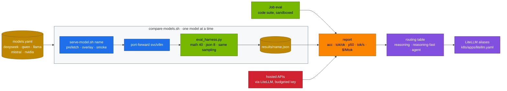
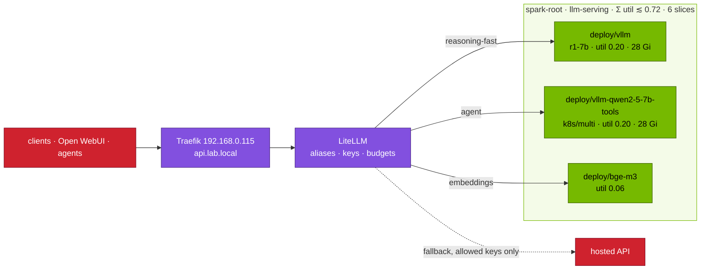

# Chapter 18 · Choosing Models: DeepSeek vs Llama, Qwen, Mistral, o1/Claude & Multi-Ecosystem

> **03-DeepSeek · Part VII — Choosing models · Chapter 18 of 19** · ← [Chapter 17 · Troubleshooting playbook](17-troubleshooting-playbook.md) · [All chapters](00-deepseek-step-by-step-guide.md) · [Chapter 19 · Hands-on workbook](19-hands-on-workbook.md) →

| | |
|---|---|
| **You will build** | Controlled comparisons that isolate one variable at a time, all served by the same vLLM on the same Spark and scored by the same harness: R1 distillation on a fixed Llama base, distilled vs RL-trained vs instruct on a fixed Qwen base, Mistral's coarse MoE vs DeepSeekMoE with bandwidth-predicted decode speed, and local reasoners vs hosted reasoning APIs through one LiteLLM gateway with real break-even economics. Then two model families at once on one GB10 with the interference measured, NVIDIA Nemotron's reasoning switch, and a routing table (LiteLLM aliases) backed by your numbers |
| **Hardware** | dgx-spark-1 (dgx-spark-2 for the optional 70B pair over the CX-7 fabric) |
| **Time** | 4–6 h, mostly unattended eval runs |
| **Risk** | Low on the Spark. **Task 5.8 sends prompts to hosted APIs**: data leaves your network and calls cost money. Use the lab's synthetic eval data only, and give the benchmark key a LiteLLM budget first. Llama repos are gated (drill D05) |
| **Clusters** | `spark-root` (every model server in `llm-serving`, eval Jobs, LiteLLM) · `dev-llms` (try a new catalog overlay with a server-side dry run in `llm-sandbox` first) |
| **Lab files** | [`models.yaml`](lab/models.yaml), [`scripts/compare-models.sh`](lab/scripts/compare-models.sh), [`tools/eval_harness.py`](lab/tools/eval_harness.py), [`tools/model_math.py`](lab/tools/model_math.py), [`tools/stream_probe.py`](lab/tools/stream_probe.py), [`tools/agent_tools.py`](lab/tools/agent_tools.py), [`tools/moe_router_demo.py`](lab/tools/moe_router_demo.py), [`k8s/multi/`](lab/k8s/multi/), [`k8s/apps/litellm.yaml`](lab/k8s/apps/litellm.yaml), [`k8s/jobs/eval.yaml`](lab/k8s/jobs/eval.yaml), [`k8s/ops/vault-sync.yaml`](lab/k8s/ops/vault-sync.yaml), [`k8s/multinode/lws-vllm-70b.yaml`](lab/k8s/multinode/lws-vllm-70b.yaml) |

---

## 1. Why this matters on a Spark

No single family wins everything. DeepSeek's R1 distills reason, Qwen calls tools reliably, Llama has the broadest ecosystem, Mistral is permissively licensed and efficient, Nemotron switches reasoning on and off per request, and hosted frontier APIs are usually ahead on the hardest problems. "Which model is best" has no answer; "which model for this workload, at what cost per correct answer, on this box" does.

A Spark adds three constraints that make the question concrete:

1. **Memory is one pool.** Everything that serves at the same time shares Σ util ≲ 0.72 of ~121.7 GiB and the 8 CPU · 90 Gi · 6 slices of `serving-budget`. A 32B BF16 model runs alone; two 7B models and an embedder fit together.
2. **Decode is bandwidth-bound.** At ~273 GB/s a single stream reads every active weight once per token, so active parameters × bytes per parameter predicts speed before you download anything.
3. **Reasoning costs tokens.** An R1-style model may be more accurate and spend ten times the output tokens. The unit that matters is **output tokens per correct answer** (`tok/ok`), not accuracy alone.

The method throughout: **hold everything constant except one variable**, predict with `model_math.py`, measure with the same harness, and record your numbers. The tables below have empty "record yours" columns on purpose.

---

## 2. Architecture — HLD



When the comparisons are done, the platform serves several families side by side behind one gateway:



---

## 3. LLD

### 3.1 The controlled pairs

| Comparison | Held constant | Varies | Answers |
|---|---|---|---|
| `llama-3.1-8b` vs `r1-llama-8b` | Llama-3.1-8B base, tokenizer, size | Meta SFT+RLHF vs SFT on ~800K R1 traces | what R1 distillation adds and costs |
| `r1-32b` vs `r1-32b-fp8` | model | weight format | the cost of FP8 (accuracy, speed): the control for every later gap |
| `r1-32b-fp8` vs `qwq-32b-awq` | Qwen2.5-32B base, "reasoning" | distillation vs large-scale RL (and FP8 vs AWQ) | which reasoning recipe wins on your tasks |
| `qwq-32b-awq` vs `qwen2.5-32b-awq` | base, AWQ | reasoning vs instruct | what thinking buys and costs |
| `r1-7b` vs `qwen2.5-7b-tools` | size class | reasoner vs instruct + tools | what sits behind `reasoning-fast` and `agent` |
| `mixtral-8x7b-fp8` vs `v2-lite` (+ `mistral-7b`, `r1-7b`) | serving stack | coarse MoE vs fine-grained MoE + MLA vs dense | bandwidth-predicted vs measured speed; MoE under batching |
| `r1-32b-fp8` vs hosted o-series / Claude | harness, prompts, grading | local vs hosted | accuracy gap, latency, $/Mtok, break-even |

### 3.2 The families, captured as catalog flags

| Family (catalog entries) | Output style | vLLM flags in `models.yaml` | Sampling | Licence / access |
|---|---|---|---|---|
| DeepSeek R1 distills (`r1-1.5b`, `r1-7b`, `r1-32b`, `r1-32b-fp8`, `r1-llama-8b`) | `<think>` then answer | `--reasoning-parser=deepseek_r1` | temperature 0.6, top-p 0.95, **no system prompt**, all instructions in the user turn | MIT, plus the base licence (Apache 2.0 for Qwen bases, Llama 3.1 licence for Llama bases) |
| DeepSeek V2-Lite / Coder-V2-Lite (`v2-lite`, `coder-v2-lite`) | chat; MLA + DeepSeekMoE | `--trust-remote-code` | model defaults | DeepSeek model licence |
| Qwen2.5 Instruct (`qwen2.5-7b-tools`, `qwen2.5-32b-awq`) | chat + `<tool_call>` | `--enable-auto-tool-choice --tool-call-parser=hermes`; AWQ: `--quantization=awq_marlin` | temperature 0.7 | Apache 2.0 for most sizes; check each card |
| Qwen QwQ (`qwq-32b-awq`) | `<think>` then answer | AWQ + `--reasoning-parser=deepseek_r1` | temperature 0.6; large token budgets | Apache 2.0 |
| Llama 3.1 (`llama-3.1-8b`) | chat + JSON tool calls | `--enable-auto-tool-choice --tool-call-parser=llama3_json` | temperature 0.6 | Llama 3.1 Community Licence, **gated** |
| Mistral (`mistral-7b`, `mixtral-8x7b-fp8`) | chat | 7B: `--tokenizer-mode=mistral --config-format=mistral --load-format=mistral` | temperature 0.7 | Apache 2.0 |
| NVIDIA Nemotron Nano (`nemotron-nano-8b`) | reasoning **switch**: system prompt `detailed thinking on` / `off` | none (Llama-3.1 architecture) | on: 0.6 / top-p 0.95; off: greedy | NVIDIA Open Model Licence + Llama 3.1 licence |

Model cards change between releases. Check the current card when you pin a revision ([Chapter 15](15-automation-secrets-and-day2.md)) and keep the catalog in step.

### 3.3 Architecture numbers on one GB10 (`model_math.py`)

KV per token decides how much context fits next to the weights; it depends only on architecture, not on weight format.

| Model | Params (total / active) | Attention | KV per token (bf16) |
|---|---|---|---|
| Llama-3.1-8B / R1-Distill-Llama-8B / Nemotron Nano 8B | 8.0 B | GQA 32 q / 8 kv heads, 32 layers | 128 KiB |
| Mistral-7B | 7.2 B | GQA 32 / 8, 32 layers | 128 KiB |
| Qwen2.5-7B / R1-Distill-Qwen-7B | 7.6 B | GQA 28 / 4, 28 layers | 56 KiB |
| Qwen2.5-32B / R1-Distill-Qwen-32B / QwQ-32B | 32.8 B | GQA 40 / 8, 64 layers | 256 KiB |
| Mixtral-8x7B | 46.7 B / 12.9 B | GQA 32 / 8, 32 layers | 128 KiB |
| DeepSeek-V2-Lite | 15.7 B / 2.7 B | **MLA**, 512-dim latent + 64 RoPE, 27 layers | 30.4 KiB |
| Llama-3.3-70B / R1-Distill-Llama-70B | 70.6 B | GQA 64 / 8, 80 layers | 320 KiB |

What the catalog's `util` leaves for KV (util × 121.7 GiB − weights − ~3 GiB activations and CUDA graphs):

| Entry | util · pod mem | Weights | KV left | Sequences at max length |
|---|---|---|---|---|
| `llama-3.1-8b`, `r1-llama-8b` | 0.20 · 28 Gi | 15.0 GiB | 6.4 GiB | 1 at 32K |
| `mistral-7b` | 0.20 · 28 Gi | 13.5 GiB | 7.8 GiB | 1 at 32K |
| `r1-7b`, `qwen2.5-7b-tools` | 0.20 · 28 Gi | 14.2 GiB | 7.2 GiB | 4 at 32K |
| `qwq-32b-awq`, `qwen2.5-32b-awq` | 0.30 · 40 Gi | ~15–18 GiB | ~16–18 GiB | 2 at 32K |
| `r1-32b-fp8` | 0.45 · 58 Gi | 30.5 GiB | 21.3 GiB | 2 at 32K |
| `mixtral-8x7b-fp8` | 0.55 · 70 Gi | 43.5 GiB | 20.4 GiB | 5 at 32K |
| `v2-lite` | 0.45 · 58 Gi | 29.3 GiB | 22.5 GiB | **47 at 16K** (MLA) |
| `r1-32b` (BF16, **alone**) | 0.70 · 87 Gi | 61.0 GiB | 21.2 GiB | 5 at 16K |

Two lessons are visible before any GPU work: at equal memory, the Qwen-based 7B holds four times the context of the Llama-based 8B (4 KV heads and 28 layers vs 8 and 32), and MLA lets V2-Lite hold ~47 long sequences where a GQA model of similar weight size holds 2.

### 3.4 The bandwidth model and MoE under batching

```text
tok/s (one stream) ≤ 273 GB/s ÷ (active_params × bytes_per_param + KV bytes of the context)
```

| Model (lab format) | Active weights per token | Ceiling (1 stream, 4K context) | Measured `1000 / ITL p50` (**record yours**) |
|---|---|---|---|
| Mistral-7B (BF16) | 14.5 GB | ≈ 18 tok/s | |
| R1-Distill-Qwen-7B (BF16) | 15.2 GB | ≈ 18 tok/s | |
| Llama-3.1-8B (BF16) | 16.1 GB | ≈ 16 tok/s | |
| Mixtral-8x7B (FP8) | 12.9 GB | ≈ 20 tok/s | |
| DeepSeek-V2-Lite (BF16) | 5.3 GB | ≈ 50 tok/s | |
| R1-Distill-Qwen-32B (FP8) | 32.8 GB | ≈ 8 tok/s | |
| R1-Distill-Qwen-32B (BF16) | 65.5 GB | ≈ 4 tok/s | |

Real numbers land below the ceiling (kernel efficiency, routing overhead, attention compute). The ranking should hold.

MoE's advantage is a batch-1 advantage. With one sequence, Mixtral reads 2 of 8 experts per layer. With 8 concurrent sequences, the union of experts touched per layer is close to all 8, so a step reads nearly the full 43.5 GiB, for 8 tokens at once. Dense and MoE models both become more compute-bound as the batch grows, and "fewer bytes per token" narrows:

| | batch 1 | batch 8 |
|---|---|---|
| Mixtral experts read per layer | 2 of 8 | ≈ 7–8 of 8 |
| V2-Lite experts read per layer | 6 of 64 + 2 shared | ≈ 30–40 of 64 + 2 shared |

Mixtral's experts are large (FFN width 14,336, top-2 of 8); DeepSeekMoE's are fine-grained (1,408 wide, top-6 of 64) with two shared experts that every token uses ([Chapter 01](01-deepseek-architecture-mla-moe-mtp.md)). At datacenter scale this is why expert placement matters ([Chapter 04](04-scaling-beyond-one-spark.md)).

### 3.5 Fair-comparison rules (built into `compare-models.sh`)

| Rule | Setting |
|---|---|
| same engine and image | the vLLM image pinned in `lab/versions.env` |
| one chat model at a time | `serve-model.sh` swaps the overlay; nothing else heavy runs during a measurement |
| same prompts | the harness suites; instructions in the user turn (right for R1, harmless for others) |
| same sampling | temperature 0.6 (harness default); `max_tokens` 8192 so R1 chains are not cut |
| same concurrency | 8 (`CONCURRENCY`) |
| same grading | exact integer (math), exact fields (json), executed unit tests (code, in the sandboxed eval Job) |
| report tokens, not just accuracy | `tok/ok` = output tokens per correct answer |
| control the format | measure BF16 vs FP8 of the same model before comparing models in different formats |
| several runs | 40 math items: one question is 2.5 points. Report the spread of ≥ 3 runs before you decide |

### 3.6 Reading the report

| Column | Meaning |
|---|---|
| `<suite> acc` | fraction correct |
| `out tok` | mean completion tokens (thinking + answer) |
| `reason%` | share of output that was thinking (`reasoning_content`) |
| `p50 s` | median request latency |
| `tok/ok` | total output tokens ÷ correct answers: the real cost of a right answer |
| `tok/s` | aggregate generation throughput at the run's concurrency |
| `$/Mtok` | local: power + amortised hardware per 1M output tokens; hosted: the price you pass |

### 3.7 Economics: local vs hosted

```text
local $/hour          = power_W / 1000 × $/kWh + hw_price / (hw_years × 8760 × duty)
local $/Mtok          = local $/hour ÷ (aggregate tok/s × 3600) × 10⁶
fixed $/month         = hw_price / (hw_years × 12) + power_W / 1000 × hours_used × $/kWh
break-even Mtok/month = fixed $/month ÷ API price per 1M output tokens
capacity Mtok/month   = aggregate tok/s × 3600 × hours_used ÷ 10⁶
```

If your monthly volume is above break-even and below capacity, local is cheaper. Above capacity you need dgx-spark-2 or a hybrid route. Hidden reasoning tokens of hosted models are billed as output; the harness reads `usage.completion_tokens`, so they are counted.

| Dimension | Local DeepSeek on the Spark | Hosted frontier reasoning API |
|---|---|---|
| quality on the hardest problems | strong for the size; distills trail the largest models | usually the state of the art |
| data governance | nothing leaves the box | prompts and outputs go to the provider (check retention terms) |
| cost | fixed; marginal cost ≈ 0 until capacity runs out | per token, reasoning tokens included |
| latency | no network hop; bounded by one GB10's decode | network + provider queueing; often faster decode |
| control | pinned weights and revisions, any sampling, offline | the provider changes models on its own schedule |
| visible reasoning | full `reasoning_content` | varies: summaries, nothing, or token counts only |

### 3.8 Two families at once: the budget

| Workload | util | ≈ GiB | Pod memory (request = limit) | Slices |
|---|---|---|---|---|
| main `vllm` (`r1-7b`) | 0.20 | 24.3 | 28 Gi | 1 |
| `vllm-qwen2-5-7b-tools` (`k8s/multi`) | 0.20 | 24.3 | 28 Gi | 1 |
| `bge-m3` | 0.06 | 7.3 | 9 Gi | 1 |
| Open WebUI, LiteLLM + Postgres, Qdrant | — | — | ~9 Gi | 0 |
| **sum** | **0.46** | **56** | **~74 Gi of 90** | **3 of 6** |

That fits the everyday split with room for `r1-1.5b` as a third model (0.10, 14 Gi). It does not leave room for a 32B: that is a swap, not an addition.

`k8s/multi` overlays avoid collisions with the main Deployment:

| Problem | Fix in the overlay |
|---|---|
| same Deployment name `vllm` | `nameSuffix: -qwen2-5-7b-tools` |
| `svc/vllm` (selector `app: vllm`) would pick up the new pods | label `app: vllm-qwen2-5-7b-tools` with `includeSelectors: true` |
| a second copy of the `hf-token` Secret | `$patch: delete`; both read the Vault-synced Secret |
| metrics | its own ServiceMonitor selector; the dashboard keys on `model_name`, so both appear |

**Time-slicing is not isolation.** Both engines submit kernels to the same GPU, which alternates between them, so one model's load raises the other's inter-token latency. Unified memory is shared too. The GB10 has no MIG. Task 5.6 measures the effect.

---

## 4. Integrations

- **[Chapter 05](05-model-catalog-and-memory-math.md)**: the catalog and the memory math behind §3.3. **[Chapter 06](06-vllm-serving.md)**: the generated overlays and parsers.
- **[Chapter 12](12-open-webui-and-litellm-gateway.md)**: the outcome becomes LiteLLM aliases. Clients don't change when the model behind an alias does. Keys can be restricted per model, which is how hosted fallback stays opt-in.
- **[Chapter 14](14-tool-calling-and-agents.md)**: `agent_tools.py` and the tool parsers.
- **[Chapter 15](15-automation-secrets-and-day2.md)**: Hugging Face and provider keys live in Vault on vault01 (`kv/spark-lab/hf`, `kv/spark-lab/providers`) and reach the cluster through `vault-sync`; the release gate decides whether a new model may replace the old one.
- **[Chapter 16](16-telemetry.md)**: the dashboard shows both side-by-side models by `model_name`.
- **[04-Qwen](../04-Qwen/README.md)**: the deeper dive into the Qwen family on the same platform, reusing this module's gateway, RAG and telemetry.

---

## 5. Lab

### Task 5.1 · Predict before you measure

#### What this lab does (tool `lab/tools/model_math.py`)

- **Arithmetic only, on the MacBook:** parameters, attention type and KV per token for nine models, then the KV space and the single-stream decode ceiling for four of them at their catalog `util`. No cluster, no GPU.

#### What to look for

1. **`--compare` table:** the `KV/token` column matches §3.3 (Llama/Mistral 128 KiB, Qwen-7B 56 KiB, Qwen-32B 256 KiB, V2-Lite about 30 KiB).
2. **The four detail runs:**

   | Model | `KV cache` line | `decode ceiling` |
   |---|---|---|
   | llama-3.1-8b, 0.20, 32K | 6.4 GiB → 1 sequence | ≈ 16 tok/s |
   | r1-distill-qwen-7b, 0.20, 32K | 7.2 GiB → 4 sequences | ≈ 18 tok/s |
   | mixtral-8x7b FP8, 0.55 | 20.4 GiB → 20 sequences at 8,192 | ≈ 20 tok/s |
   | v2-lite, 0.45, 16K | 22.5 GiB → 47 sequences | ≈ 50 tok/s |

3. **Your written predictions** for math accuracy, `tok/ok` and single-stream speed, before Task 5.2.

**If something's off:** `unknown model` → use the names `model_math.py` knows (the Hugging Face-style names above, not the catalog names). More in §7.

#### Run it

```bash
# ▶ MacBook · 03-DeepSeek/lab
python3 tools/model_math.py --compare llama-3.1-8b deepseek-r1-distill-llama-8b deepseek-r1-distill-qwen-7b \
  qwen2.5-32b deepseek-r1-distill-qwen-32b qwq-32b mistral-7b mixtral-8x7b deepseek-v2-lite
for a in "llama-3.1-8b --util 0.20 --ctx 32768" "deepseek-r1-distill-qwen-7b --util 0.20 --ctx 32768" \
         "mixtral-8x7b --dtype fp8 --util 0.55" "deepseek-v2-lite --util 0.45 --ctx 16384"; do
  python3 tools/model_math.py $a | grep -E '^model|KV cache|decode ceiling'
done
```

Write down, before running anything, which model you expect to win on math accuracy, on `tok/ok`, and on single-stream speed.

### Task 5.2 · R1 distillation on a fixed Llama base

#### What this lab does (script `lab/scripts/compare-models.sh`)

- **Token to the cluster:** stores your Hugging Face token at `kv/spark-lab/hf` and syncs it into Secret `hf-token` (Llama 3.1 is gated).
- **For each of `llama-3.1-8b`, `r1-llama-8b`, `r1-7b`:** `serve-model.sh` prefetches and swaps `deploy/vllm` to that model (one chat model at a time), then `eval_harness.py` runs the math (40) and JSON (8) suites at concurrency 8, `max_tokens` 8192, through a port-forward on `127.0.0.1:18000`. Results go to `results/<model>.json`.
- **Long run:** three model downloads (~15 GB each) and three full suite runs. The last model stays serving.

#### What to look for

1. **Each model** prints `[PASS] vLLM ready with <model>` and its two suite lines; none says `did not come up — skipped`.
2. **The final table** has one row per model with `json acc`, `math acc`, `out tok`, `reason%`, `p50 s`, `tok/ok`, `tok/s`, `$/Mtok`.
3. **Shape:** `reason%` about 0 for `llama-3.1-8b` and high for both distills; the distills spend many more `out tok` and `tok/ok`.

**If something's off:** `llama-3.1-8b did not come up` with `401`/`GatedRepoError` in the prefetch → the token's account hasn't accepted the licence, or the sync didn't run. A row with `tok/ok` `inf` → no correct answers (check `max_tokens`). More in §7.

#### Run it

The Llama repo is gated: accept the licence on Hugging Face and store the token in Vault first.

```bash
# ▶ vault01 (ssh vault01)
vault kv put kv/spark-lab/hf token="hf_..."
```

```bash
# ▶ MacBook · 03-DeepSeek/lab
kubectl --context spark-root -n llm-serving create job --from=cronjob/vault-sync vs-now
MAX_TOKENS=8192 POWER_W=200 scripts/compare-models.sh llama-3.1-8b r1-llama-8b r1-7b
```

Expected shape (**record yours**):

```text
model            json acc  math acc  out tok  reason%  p50 s  tok/ok   tok/s  $/Mtok
llama-3.1-8b       …         …          …       0%      …      …        …      …
r1-llama-8b        …         …          …      high     …      …        …      …
r1-7b              …         …          …      high     …      …        …      …
```

Answer from your table: how many points of math accuracy did distillation add to the same base? How many times more `tok/ok`? Did JSON extraction (a short, non-reasoning task) get better or worse? Qwen-based vs Llama-based distill: which wins on accuracy, and which on `tok/s` at equal memory?

### Task 5.3 · Sampling sensitivity: why temperature 0 is a trap for R1

#### What this lab does (tool `lab/tools/eval_harness.py`)

- **Serves `r1-llama-8b`** and runs 20 math items at temperature 0, 0.6 and 1.0. Read-only apart from the model swap.

#### What to look for

1. **Three `math` lines:** `math  N/20 acc=… p50=…s mean_out_tokens=… reasoning_share=…`.
2. **At temperature 0:** lower `acc` and higher `mean_out_tokens` than at 0.6 (some chains loop until 8192).
3. **With `llama-3.1-8b`** the three lines are much closer to each other.

**If something's off:** all three lines nearly equal for the R1 distill → only 20 items; repeat or drop `--limit`. More in §7.

#### Run it

```bash
# ▶ MacBook · 03-DeepSeek/lab
scripts/serve-model.sh r1-llama-8b
kubectl --context spark-root -n llm-serving port-forward svc/vllm 8000 >/dev/null & pf=$!; sleep 2
for t in 0 0.6 1.0; do
  python3 tools/eval_harness.py --url http://localhost:8000 --model r1-llama-8b --suites math --limit 20 \
    --temperature $t --max-tokens 8192 | grep -E '^math'
done
kill $pf
```

Expected: at temperature 0 some chains loop until `max_tokens` (drill D06), accuracy drops and output tokens spike; 0.6 is the setting DeepSeek recommends. Repeat with `llama-3.1-8b`: the instruct model is much less sensitive.

### Task 5.4 · The Qwen triangle, with the format control first

#### What this lab does (script `lab/scripts/compare-models.sh`)

- **Parks bge-m3**, then serves and evaluates four 32B models one after the other: `r1-32b` (BF16, util 0.70, 87 Gi pod, runs alone), `r1-32b-fp8` (0.45), `qwq-32b-awq` and `qwen2.5-32b-awq` (0.30). bge-m3 comes back at the end.
- **Long run:** four large downloads (the BF16 32B alone is ~61 GiB) and long reasoning chains at single-digit tok/s per stream. Plan hours.

#### What to look for

1. **Four rows** in the final table; no `skipped`.
2. **Format control first:** `r1-32b` vs `r1-32b-fp8` accuracy within a few points, `tok/s` higher for FP8.
3. **`qwen2.5-32b-awq`:** `reason%` about 0 and far fewer `out tok` than the three reasoners.

**If something's off:** `r1-32b did not come up` → something else still holds memory (side models, a `k8s/multi` Deployment, batch Jobs); `describe quota serving-budget`. More in §7.

#### Run it

`r1-32b` is the BF16 32B at util 0.70: it runs alone. Park the side models and bge-m3 before the run and bring them back afterwards.

```bash
# ▶ MacBook · 03-DeepSeek/lab
kubectl --context spark-root -n llm-serving scale deploy/bge-m3 --replicas=0
MAX_TOKENS=8192 scripts/compare-models.sh r1-32b r1-32b-fp8 qwq-32b-awq qwen2.5-32b-awq
kubectl --context spark-root -n llm-serving scale deploy/bge-m3 --replicas=1
```

This takes a while; the 32B models generate long chains at single-digit tok/s per stream. Fill in (**record yours**):

| model | math acc | json acc | out tok | reason% | p50 s | tok/ok | tok/s |
|---|---|---|---|---|---|---|---|
| `r1-32b` (BF16) | | | | | | | |
| `r1-32b-fp8` | | | | | | | |
| `qwq-32b-awq` | | | | | | | |
| `qwen2.5-32b-awq` | | | | | | | |

Read the format control first: `r1-32b` vs `r1-32b-fp8`. The accuracy difference is usually within noise for FP8 with dynamic activation scales; `tok/s` improves because decode reads half the bytes. Only a gap between R1 and QwQ **larger** than this one says something about the models rather than the formats.

### Task 5.5 · The 7B pair and tool calls

#### What this lab does (script `lab/scripts/compare-models.sh`, tool `lab/tools/agent_tools.py`)

- **Compares `r1-7b` and `qwen2.5-7b-tools`** on the same suites, then serves `qwen2.5-7b-tools` and runs the Chapter 14 agent once against it.
- **The agent is read-only:** `calculator` and `gpu_slices` (which needs your kubectl context on `spark-root`).

#### What to look for

1. **Table:** two rows; `qwen2.5-7b-tools` with `reason%` about 0 and far fewer `out tok`.
2. **Agent:** `[step N] calculator(…)` steps (40 % and ≈ 24.34 GiB), then `ANSWER:`.
3. **Same loop with `r1-7b` served:** fewer or no structured `[step N]` lines; the model often reasons about the tools in prose.

**If something's off:** HTTP 400 about `"auto" tool choice` from `r1-7b` is expected: its overlay has no tool flags. More in §7.

#### Run it

```bash
# ▶ MacBook · 03-DeepSeek/lab
MAX_TOKENS=8192 scripts/compare-models.sh r1-7b qwen2.5-7b-tools
scripts/serve-model.sh qwen2.5-7b-tools
kubectl --context spark-root -n llm-serving port-forward svc/vllm 8000 >/dev/null & pf=$!; sleep 2
python3 tools/agent_tools.py "What share of 15 GPU slices is 6, in percent, and what is 20% of 121.7 GiB?" \
  --url http://localhost:8000 --model qwen2.5-7b-tools
kill $pf
```

Expected: clean structured `tool_calls` from the instruct model. Serve `r1-7b` and run the same loop: the distill is not trained for tools and often reasons about them in prose instead.

### Task 5.6 · Two MoE designs: predicted vs measured speed, then batching

#### What this lab does (tools `lab/tools/stream_probe.py`, `eval_harness.py`, `moe_router_demo.py`)

- **Single stream:** serves `mistral-7b`, `mixtral-8x7b-fp8`, `v2-lite` and `r1-7b` in turn and streams one 512-token answer from each.
- **Batching:** for the two MoE models and `mistral-7b`, 8 JSON items at concurrency 1, 4 and 16.
- **Router demo:** a small simulation of expert routing on the MacBook. It needs PyTorch installed there (`pip install torch`).
- **Long run:** up to four model downloads; `mixtral-8x7b-fp8` alone is ~43.5 GiB.

#### What to look for

1. **Probe lines:** `… ITL p50 … ms p99 … ms …` and `… total … s` per model. `1000 / ITL p50` should rank V2-Lite clearly first, below its ≈ 50 tok/s ceiling, with Mixtral FP8 near the dense 7Bs.
2. **Batching lines:** `<model> c=N  run: … tok/s aggregate`, rising with N for all three; fill in the table and the `c16 / c1` ratio.
3. **Router demo:** two tables per run (`WITHOUT` and `WITH` aux-loss-free bias balancing) with `max/mean expert load` and `idle experts` per step. With 8 experts, idle experts are rare; with 64, many sit idle in a step unless the bias balances them.

**If something's off:** `REASONING IN CONTENT` or long thinking in a probe → that model is a reasoner; compare ITL, not total time. `No module named 'torch'` → install it on the MacBook. More in §7.

#### Run it

Single-stream speed for each model, compared with the ceiling in §3.4:

```bash
# ▶ MacBook · 03-DeepSeek/lab
for m in mistral-7b mixtral-8x7b-fp8 v2-lite r1-7b; do
  scripts/serve-model.sh $m
  kubectl --context spark-root -n llm-serving port-forward svc/vllm 8000 >/dev/null & pf=$!; sleep 3
  python3 tools/stream_probe.py --url http://localhost:8000 --model $m --max-tokens 512 \
    --prompt "Explain, in about 300 words, how a mixture-of-experts router chooses experts." | grep -E 'ITL|total'
  kill $pf
done
```

Fill in the "Measured" column of §3.4 with `1000 / ITL p50`. Expected ranking: V2-Lite clearly fastest, then Mixtral FP8 close to the dense 7Bs. Then throughput as concurrency rises:

```bash
# ▶ MacBook · 03-DeepSeek/lab
for m in mixtral-8x7b-fp8 v2-lite mistral-7b; do
  scripts/serve-model.sh $m
  kubectl --context spark-root -n llm-serving port-forward svc/vllm 8000 >/dev/null & pf=$!; sleep 3
  for c in 1 4 16; do
    python3 tools/eval_harness.py --url http://localhost:8000 --model $m --suites json --limit 8 \
      --concurrency $c --max-tokens 512 | grep 'tok/s aggregate' | sed "s/^/$m c=$c  /"
  done
  kill $pf
done
```

| model | c=1 tok/s | c=4 | c=16 | c16 / c1 |
|---|---|---|---|---|
| `mixtral-8x7b-fp8` | | | | |
| `v2-lite` | | | | |
| `mistral-7b` | | | | |

Expected: all three scale with concurrency; the dense model's relative gain is usually largest, because MoE pays the "touch more experts" tax as the batch grows. To see the routing difference itself on CPU:

```bash
# ▶ MacBook · 03-DeepSeek/lab
python3 tools/moe_router_demo.py --experts 8 --topk 2 --groups 1 --limited 1 --steps 40    # Mixtral-like
python3 tools/moe_router_demo.py --experts 64 --topk 6 --groups 1 --limited 1 --steps 40   # V2-Lite-like
```

### Task 5.7 · Two families at once, and the interference

#### What this lab does (overlay `lab/k8s/multi/qwen2.5-7b-tools`, `lab/k8s/apps/litellm.yaml`)

- **Budget check** from `models.yaml` on the MacBook.
- **Two models side by side:** `r1-7b` in `deploy/vllm` and `vllm-qwen2-5-7b-tools` with its own Service (util 0.20, 28 Gi each).
- **Repoints the `agent` alias:** a `sed` on your working copy of `k8s/apps/litellm.yaml`, re-applied, and LiteLLM restarted. That apply also writes the placeholder Secrets back; run the vault-sync Job afterwards (Chapter 15 Task 5.3).
- **Interference test:** streams one `r1-7b` answer alone, then again while Qwen serves 16 parallel requests.

#### What to look for

1. **Budget:** `['r1-7b', 'qwen2.5-7b-tools'] Σ util 0.46 (56 GiB) pods 74 Gi of 90 OK`.
2. **`get deploy -L model`:** `vllm` with `r1-7b` and `vllm-qwen2-5-7b-tools` with `qwen2.5-7b-tools`, both Ready.
3. **`MemAvailable`** on the Spark well above 8 GiB.
4. **ITL:** `r1-7b`'s `ITL p50`/`p99` higher with the busy neighbour than alone. Fill in the table.

**If something's off:** the second Deployment Pending with `exceeded quota` → something else is in `llm-serving` (a third model, the training window). Undo with `delete -k k8s/multi/qwen2.5-7b-tools` and `git checkout k8s/apps/litellm.yaml`. More in §7.

#### Run it

Plan the budget from the catalog, not from memory:

```bash
# ▶ MacBook · 03-DeepSeek/lab
python3 - <<'PY'
import yaml
cat = {m["name"]: m for m in yaml.safe_load(open("models.yaml"))["models"]}
plan = ["r1-7b", "qwen2.5-7b-tools"]
util = sum(cat[n]["util"] for n in plan) + 0.06                       # + bge-m3
mem = sum(int(cat[n]["mem"].rstrip("Gi")) for n in plan) + 9 + 9      # + bge-m3 + apps
print(plan, f"Σ util {util:.2f} ({util * 121.7:.0f} GiB)", f"pods {mem} Gi of 90",
      "OK" if util <= 0.72 and mem <= 90 else "OVER BUDGET")
PY
```

Deploy the second family next to the first and point the `agent` alias at it:

```bash
# ▶ MacBook · 03-DeepSeek/lab
scripts/serve-model.sh r1-7b
kubectl --context spark-root apply -k k8s/multi/qwen2.5-7b-tools
kubectl --context spark-root -n llm-serving rollout status deploy/vllm-qwen2-5-7b-tools --timeout=30m
kubectl --context spark-root -n llm-serving get deploy -L model
sed -i 's|model: hosted_vllm/qwen2.5-7b-tools, api_base: http://vllm.llm-serving:8000/v1|model: hosted_vllm/qwen2.5-7b-tools, api_base: http://vllm-qwen2-5-7b-tools.llm-serving:8000/v1|' k8s/apps/litellm.yaml
kubectl --context spark-root apply -k k8s/apps
kubectl --context spark-root -n llm-serving rollout restart deploy/litellm
```

```bash
# ▶ dgx-spark-1 (ssh dgx-spark-1)
grep -E 'MemAvailable|^Cached' /proc/meminfo
```

Now measure what the neighbour does to latency:

```bash
# ▶ MacBook · 03-DeepSeek/lab
kubectl --context spark-root -n llm-serving port-forward svc/vllm 8000 >/dev/null & pf1=$!
kubectl --context spark-root -n llm-serving port-forward svc/vllm-qwen2-5-7b-tools 8001:8000 >/dev/null & pf2=$!
sleep 3
python3 tools/stream_probe.py --url http://localhost:8000 --model r1-7b --max-tokens 512 | grep ITL     # alone
python3 tools/eval_harness.py --url http://localhost:8001 --model qwen2.5-7b-tools --suites json --limit 8 \
  --concurrency 16 --max-tokens 1024 >/dev/null & load=$!
sleep 5
python3 tools/stream_probe.py --url http://localhost:8000 --model r1-7b --max-tokens 512 | grep ITL     # neighbour busy
wait $load; kill $pf1 $pf2
```

| | `r1-7b` ITL p50 (ms) | ITL p99 (ms) |
|---|---|---|
| alone (**record yours**) | | |
| with Qwen at c=16 | | |

Decide whether the increase is acceptable for your users or whether the second model belongs on dgx-spark-2. Restore the alias with `git checkout k8s/apps/litellm.yaml` when you remove the side model.

### Task 5.8 · Local vs hosted reasoning APIs

#### What this lab does (LiteLLM hosted aliases, tools `eval_harness.py`, `stream_probe.py`)

- **Provider keys** at `kv/spark-lab/providers` on vault01, a new `SYNC_MAP` entry for Secret `provider-keys`, two hosted aliases in `litellm-config` and two env vars on LiteLLM. These are edits you make to your working copy.
- **Local run:** serves `r1-32b-fp8` and runs math and JSON at concurrency 8 with `max_tokens` 16384, with your measured watts for the cost.
- **Hosted runs:** the same suites through `api.lab.local` for each hosted alias. **The lab's synthetic eval data leaves your network and costs money**; use a key with `max_budget`.
- **Latency and break-even:** two streamed probes and a small cost calculation on the MacBook.
- **Hybrid route (optional):** a hosted alias as the last `reasoning` fallback, tested with vLLM parked.

#### What to look for

1. **Report:** three rows (local and two hosted) with `math acc`, `json acc`, `tok/ok`, `p50 s`, `$/Mtok`.
2. **Probes:** `ttfb`, `first reasoning`, `first answer` per alias; a hosted model may leave `first reasoning` empty.
3. **Break-even script:** `fixed cost $…/month`, `break-even … M output tokens/month`, `capacity … M output tokens/month`.
4. **Hybrid:** with vLLM parked, a `reasoning` request still answers, and the spend log shows the cost on the calling key. Remove the annotation afterwards.

**If something's off:** `401` from a hosted alias → `provider-keys` missing or not synced, or the env vars aren't on the Deployment. Timeouts only to the providers → a default-deny egress policy in `llm-serving`. More in §7.

#### Run it

**Data leaves your network in this task.** Use only the lab's synthetic eval data.

Store the provider keys in Vault and add an entry for Secret `provider-keys` to `vault-sync`'s `SYNC_MAP` ([Chapter 15](15-automation-secrets-and-day2.md)):

```bash
# ▶ vault01 (ssh vault01)
vault kv put kv/spark-lab/providers openai="sk-..." anthropic="sk-ant-..."
```

Add the hosted models to `litellm-config` in `k8s/apps/litellm.yaml`. Use the model IDs from each provider's current documentation; names change often:

```yaml
- model_name: api-reasoning-openai
  litellm_params: {model: openai/<o-series-model-id>, api_key: os.environ/OPENAI_API_KEY}
- model_name: api-reasoning-claude
  litellm_params: {model: anthropic/<claude-model-id>, api_key: os.environ/ANTHROPIC_API_KEY}
```

…and to the LiteLLM Deployment:

```yaml
env:
  - name: OPENAI_API_KEY
    valueFrom: {secretKeyRef: {name: provider-keys, key: openai}}
  - name: ANTHROPIC_API_KEY
    valueFrom: {secretKeyRef: {name: provider-keys, key: anthropic}}
```

If `llm-serving` has a default-deny egress policy, allow LiteLLM to reach only the providers' endpoints on 443 (a CiliumNetworkPolicy with `toFQDNs`). `drop_params: true` (already set) drops sampling parameters that some reasoning APIs reject. Create a virtual key with `max_budget` for the benchmark ([Chapter 12](12-open-webui-and-litellm-gateway.md)).

Measure wall power under load first (PDU or smart plug; `nvidia-smi --query-gpu=power.draw` is the GPU share only and underestimates):

```bash
# ▶ MacBook · 03-DeepSeek/lab
scripts/serve-model.sh r1-32b-fp8
kubectl --context spark-root -n llm-serving port-forward svc/vllm 8000 >/dev/null & pf=$!; sleep 2
python3 tools/eval_harness.py --url http://localhost:8000 --model r1-32b-fp8 --suites math json \
  --concurrency 8 --max-tokens 16384 --power-w 200 --out results/local-r1-32b-fp8.json
kill $pf
```

Replace `--power-w 200` with your measured watts, and set `--kwh-price`, `--hw-price`, `--hw-years`, `--duty` to your reality. Then the same suites through the gateway for each hosted alias:

```bash
# ▶ MacBook · 03-DeepSeek/lab
KEY="sk-..."; API=http://api.lab.local          # resolves to Traefik 192.168.0.115 (DNS or /etc/hosts)
for alias in api-reasoning-openai api-reasoning-claude; do
  python3 tools/eval_harness.py --url $API --api-key "$KEY" --model $alias --suites math json \
    --concurrency 4 --max-tokens 16384 --hosted --api-price-out 10 --out results/$alias.json
done
python3 tools/eval_harness.py --report results/local-r1-32b-fp8.json results/api-reasoning-*.json
```

`--api-price-out` is the provider's current price per 1M output tokens; look it up. The HTTPRoute matches on the host name `api.lab.local`, so the MacBook must resolve it to 192.168.0.115 (lab DNS or `/etc/hosts`).

| | math acc | json acc | tok/ok | p50 s | $/Mtok | $ for this run |
|---|---|---|---|---|---|---|
| `r1-32b-fp8` (local) | | | | | | power only |
| hosted o-series | | | | | | from the spend log |
| hosted Claude | | | | | | from the spend log |

Latency profile, and the break-even for your volume:

```bash
# ▶ MacBook · 03-DeepSeek/lab
python3 tools/stream_probe.py --url $API --api-key "$KEY" --model reasoning --max-tokens 8192
python3 tools/stream_probe.py --url $API --api-key "$KEY" --model api-reasoning-claude --max-tokens 8192
python3 - <<'PY'
hw, years, watts, kwh, hours = 4000, 3, 200, 0.15, 24 * 30      # your values
api_price = 10.0                                                # $ per 1M output tokens (your provider)
tok_s = 60                                                      # aggregate tok/s from your local report
fixed = hw / (years * 12) + watts / 1000 * hours * kwh
print(f"fixed cost   ${fixed:,.0f}/month")
print(f"break-even   {fixed / api_price:,.1f} M output tokens/month")
print(f"capacity     {tok_s * 3600 * hours / 1e6:,.1f} M output tokens/month (one Spark, 100 % busy)")
PY
```

Some hosted models don't stream their reasoning, so `first reasoning` may be empty while `first answer` arrives later.

**Hybrid route.** Add the hosted alias as the last fallback for `reasoning`:

```yaml
fallbacks: [{"reasoning": ["reasoning-sglang", "reasoning-fast", "api-reasoning-claude"]}]
```

Apply, park vLLM (`kubectl --context spark-root -n llm-serving annotate scaledobject vllm autoscaling.keda.sh/paused-replicas=0 --overwrite`), send a request to `reasoning`: the API answers and the spend log attributes the cost to the calling key. Remove the annotation afterwards. Decide per tenant whether governance allows this fallback, and restrict keys that must never leave the box.

### Task 5.9 · NVIDIA Nemotron: reasoning on demand

#### What this lab does (overlay `lab/k8s/models/nemotron-nano-8b`)

- **Removes the Task 5.7 side model** (if present) and serves `nemotron-nano-8b` (util 0.20) in `deploy/vllm`.
- **Two requests** with the same question, one with the system prompt `detailed thinking on` at temperature 0.6, one with `detailed thinking off` at 0.

#### What to look for

1. **`serve-model.sh`** ends with `[PASS] vLLM ready with nemotron-nano-8b`.
2. **Two lines:** `thinking on: N tokens → …` with many more tokens than `thinking off: N tokens → …`; both end with **14**.
3. **The "on" content** contains a `<think>` section (no reasoning parser is set for Nemotron).

**If something's off:** both modes equally short → the system prompt didn't arrive; check the request JSON. More in §7.

#### Run it

```bash
# ▶ MacBook · 03-DeepSeek/lab
kubectl --context spark-root delete -k k8s/multi/qwen2.5-7b-tools --ignore-not-found
scripts/serve-model.sh nemotron-nano-8b
kubectl --context spark-root -n llm-serving port-forward svc/vllm 8000 >/dev/null & pf=$!; sleep 2
for mode in on off; do
  temp=$([[ $mode == on ]] && echo 0.6 || echo 0)
  curl -s localhost:8000/v1/chat/completions -H 'Content-Type: application/json' -d "{\"model\":\"nemotron-nano-8b\",
    \"messages\":[{\"role\":\"system\",\"content\":\"detailed thinking $mode\"},
                  {\"role\":\"user\",\"content\":\"A run checkpoints every 7 steps. How many checkpoints after 100 steps?\"}],
    \"max_tokens\":2048,\"temperature\":$temp}" \
  | jq -r --arg m "$mode" '"thinking \($m): \(.usage.completion_tokens) tokens → \(.choices[0].message.content | .[-80:])"'
done
kill $pf
```

Expected: "on" produces a `<think>` section and many more tokens; "off" answers directly. One model, two cost and latency profiles, chosen per request. No reasoning parser is set for Nemotron, so the thinking stays in `content`; add `--reasoning-parser=deepseek_r1` to its catalog entry if your vLLM release handles its tags.

### Task 5.10 · All families, one table, one routing decision

#### What this lab does (script `lab/scripts/compare-models.sh`, then `lab/k8s/apps/litellm.yaml`)

- **Six 7–8B models** served and evaluated one after another, same suites and settings as Task 5.2. Models already in `model-cache` load without a download.
- **Your routing decision** goes into `k8s/apps/litellm.yaml` and is applied with `apply -k k8s/apps` (which also writes the placeholder Secrets back: run the vault-sync Job afterwards).

#### What to look for

1. **Six rows** in the final table, none skipped.
2. **The alias table** filled in from your numbers, one line of reason each.
3. **After the apply:** `/v1/models` on `api.lab.local` lists your aliases; an alias whose model isn't serving still answers through `fallbacks`.

**If something's off:** `llama-3.1-8b` skipped → gated repository, token or licence missing (Task 5.2). Any other model skipped → read its `serve-model.sh` lines for the prefetch or rollout error. More in §7.

#### Run it

```bash
# ▶ MacBook · 03-DeepSeek/lab
MAX_TOKENS=8192 scripts/compare-models.sh r1-7b r1-llama-8b qwen2.5-7b-tools llama-3.1-8b mistral-7b nemotron-nano-8b
```

Add the licence and access column from §3.2 by hand. Then turn the tables into routing. A typical single-Spark outcome, which your numbers should confirm or overturn:

| LiteLLM alias | Pick | Because |
|---|---|---|
| `reasoning` | the 32B reasoner with the best math accuracy at acceptable `p50` (usually `r1-32b-fp8` or `qwq-32b-awq`) | hard multi-step questions |
| `reasoning-fast` | `r1-7b` | most of the reasoning at a fraction of the latency; fits next to other models |
| `agent` | `qwen2.5-7b-tools` (or `llama-3.1-8b`) | reliable tool calls and JSON, few tokens |
| `chat` (optional) | `qwen2.5-32b-awq` | quality answers without long thinking |
| escalation (optional) | a hosted alias | only for keys and tenants whose data may leave |

Edit `k8s/apps/litellm.yaml` and apply with `kubectl --context spark-root apply -k k8s/apps`. Aliases that point at a model that isn't serving fail over through `fallbacks`.

### Task 5.11 · (2×) The 70B pair across two Sparks

#### What this lab does (manifests `lab/k8s/multinode`)

- **Namespace `llm-multinode`** (privileged Pod Security, for hostNetwork and `IPC_LOCK`).
- **LeaderWorkerSet `vllm-70b`:** a Ray head on dgx-spark-1 (`192.168.100.11`) and a worker on dgx-spark-2, tensor parallel 2 over the CX-7, NCCL on RoCE. Each pod 80 Gi, util 0.60, `--max-model-len 16384`. Weights from an NFS export (`/srv/models` on the leader, `/mnt/models` on the worker). Port **8000** on the leader. Needs the LWS controller installed first.
- **Then the Llama side:** the same manifest with the checkpoint and served name swapped.
- **With only one Spark:** skip this Task. The worker can't be placed and the leader waits for the second GPU.

#### What to look for

1. **Leader log:** the `waiting for the worker's GPU to join Ray` lines stop, then vLLM starts with TP 2.
2. **Serving:** `curl http://192.168.100.11:8000/v1/models` lists `r1-70b` (later `llama-3.3-70b`).
3. **Harness rows** for both, with the Task 5.2 settings.

**If something's off:** the leader loops on `waiting for the worker's GPU` → the worker can't reach `192.168.100.11:6379` or isn't scheduled. Both Sparks need their other model servers and batch parked. More in §7.

#### Run it

R1-Distill-Llama-70B vs Llama-3.3-70B-Instruct, both FP8 (~66 GiB of weights), split with tensor parallelism over dgx-spark-1 and dgx-spark-2 on the CX-7 fabric ([Chapter 04](04-scaling-beyond-one-spark.md)). On one Spark an FP8 70B only fits at util 0.70 with everything else parked, and leaves room for a single 32K sequence at about 4 tok/s (`model_math.py llama-3.3-70b --dtype fp8 --util 0.70`).

```bash
# ▶ MacBook · 03-DeepSeek/lab
kubectl --context spark-root apply -f k8s/multinode/namespace.yaml -f k8s/multinode/lws-vllm-70b.yaml        # r1-70b
# run the harness against it, then swap checkpoint and served name for the Llama side:
sed -e 's|RedHatAI/DeepSeek-R1-Distill-Llama-70B-FP8-dynamic|RedHatAI/Llama-3.3-70B-Instruct-FP8-dynamic|' \
    -e 's|--served-model-name r1-70b|--served-model-name llama-3.3-70b|' k8s/multinode/lws-vllm-70b.yaml \
  | kubectl --context spark-root apply -f -
```

Use the same harness settings as Task 5.2.

---

## 6. Verify

| Check | Expected |
|---|---|
| prediction | `model_math.py` numbers written down before any run |
| fairness | every run used the same suites, sampling, concurrency and `max_tokens`; one chat model at a time |
| format control | BF16 vs FP8 difference recorded before any model conclusion |
| tables | Tasks 5.2, 5.4, 5.6 filled in, including `tok/ok` and `p50 s` |
| sampling | temperature 0 visibly hurts the R1 distill |
| co-location | both Deployments Ready; `svc/vllm` endpoints contain only the main pod; ITL alone vs busy recorded |
| economics | local $/Mtok from measured watts; break-even and capacity computed |
| governance | hosted fallback enabled only for keys allowed to use it; a written note on what data may go where |
| decision | one alias table with a one-line reason per row, from your numbers |

```bash
# ▶ MacBook · 03-DeepSeek/lab
kubectl --context spark-root -n llm-serving get endpoints vllm -o jsonpath='{.subsets[*].addresses[*].targetRef.name}'; echo
python3 tools/eval_harness.py --report results/*.json
```

---

## 7. Troubleshooting

| You see | Cause | Fix |
|---|---|---|
| `401/403 … gated repo` on prefetch | licence not accepted, or placeholder token | accept on huggingface.co; `kv/spark-lab/hf` → `vault-sync` (drill D05) |
| R1 or QwQ thinking inside `content` | reasoning parser missing | catalog entry has `--reasoning-parser=deepseek_r1` (D01) |
| R1 accuracy suspiciously low, `out tok` ≈ `max_tokens` | truncation or loops | raise `MAX_TOKENS`; temperature 0.6 (D06) |
| `r1-32b` Pending or OOMKilled | not alone: bge-m3 or a side model still holds memory | park everything else; it needs util 0.70 and an 87 Gi pod |
| AWQ model fails: `awq_marlin` not supported | image or architecture support | `--quantization=awq` (slower kernel) or a newer vLLM image |
| Mistral-7B tokenizer/config errors | needs Mistral's native formats | the three `mistral` flags in the catalog |
| V2-Lite fails without `--trust-remote-code` | custom modelling code | the catalog sets it; review the code before trusting it in production |
| measured speed above the ceiling | prefix-cache hits or speculative decoding | unique prompts; no speculative decoding for this test |
| measured speed far below the ceiling | another workload in the same time-slices | park other GPU pods |
| main `svc/vllm` sometimes answers as Qwen | side overlay without the `app` relabel | use `k8s/multi/*` as provided; check endpoints |
| side model Pending: `exceeded quota: serving-budget` | Σ pod memory over 90 Gi, or training window active | fewer models, smaller ones, or end the window |
| identical scores across models | harness hit the wrong model | `curl …/v1/models` before each run; the smoke test in `serve-model.sh` checks it |
| `401` from a provider via LiteLLM | key missing in the pod env | `kubectl --context spark-root -n llm-serving exec deploy/litellm -- env \| grep -c API_KEY`; check `provider-keys` |
| `400 Unsupported parameter: temperature` | some reasoning APIs reject sampling params | `drop_params: true` |
| unexpected API spend | fallback firing during a local outage | spend logs per key; remove the API fallback for keys that must not use it |
| Nemotron ignores the switch | system prompt not exactly `detailed thinking on/off` | match the model card wording |

---

## 8. Scale-out path

| One Spark | Two Sparks | Datacenter / enterprise |
|---|---|---|
| one 32B at a time, or two 7B families sharing slices | one family per Spark, no interference; LiteLLM routes across both | dozens of models across GPU pools; per-model autoscaling; MIG isolation on datacenter GPUs |
| 60 original eval items | same, plus 70B pairs with TP=2 | standard suites (GSM8K, MATH-500, MMLU-Pro, IFEval) plus a domain set, several seeds, confidence intervals |
| manual benchmark | scheduled eval of local and hosted models | continuous eval with regression alerts |
| fallback on failure | steady load local, bursts to an API, sized by break-even | difficulty- or confidence-based routing per tenant; a central model registry with licence approvals |

---

## 9. Checklist

- [ ] I can explain what R1 distillation changes on a fixed base, and I measured its token cost.
- [ ] I measured the weight-format effect before comparing models in different formats.
- [ ] I can predict single-stream decode speed from active parameters and bandwidth, and explain why MoE's lead narrows with batch size.
- [ ] I know why R1-style models need temperature ~0.6 and no system prompt.
- [ ] I ran two families at once within Σ util ≲ 0.72 and measured the interference.
- [ ] My local $/Mtok comes from measured power; I know my break-even and capacity.
- [ ] Hosted fallback is enabled only where data policy allows it.
- [ ] Every LiteLLM alias points at a model I can justify with my own numbers.
