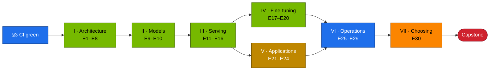

# Chapter 19 · Hands-on Workbook

> **03-DeepSeek · Part VII — Choosing models · Chapter 19 of 19** · ← [Chapter 18 · Choosing models](18-choosing-models-deepseek-vs-others.md) · [All chapters](00-deepseek-step-by-step-guide.md)

| | |
|---|---|
| **You will build** | Proof that you can do what this module teaches: 30 exercises with objective pass criteria (a command and its expected result), the accuracy release gate used for every model change, and a capstone that rebuilds the stack from Semaphore, upgrades a model through the gate, runs a training window and survives an unannounced fault |
| **Hardware** | dgx-spark-1 (exercises marked **2×** need dgx-spark-2) |
| **Time** | 3–5 days part-time; the capstone takes half a day |
| **Risk** | Low. Every exercise is reversible. Training exercises need the training window: vLLM is parked while it is open |
| **Clusters** | `spark-root` (serving, training, apps, telemetry) · `dev-llms` (sandbox for manifests and tiny models) |
| **Lab files** | the whole [`lab/`](lab/README.md), [`tests/run-local-checks.sh`](lab/tests/run-local-checks.sh), [`tools/eval_harness.py`](lab/tools/eval_harness.py) (`--gate`), [`scripts/verify.sh`](lab/scripts/verify.sh), [`scripts/llm-triage.sh`](lab/scripts/llm-triage.sh), [`scripts/breakfix.sh`](lab/scripts/breakfix.sh), [`ansible/15.1-deploy-deepseek.yml`](lab/ansible/15.1-deploy-deepseek.yml) |

---

## 1. Why this matters on a Spark

Reading about MLA or GRPO is not the same as watching the KV cache shrink, the reward rise, or a 32B model refuse to start because two other engines hold the memory. On a Spark every exercise also exercises the platform: Σ util ≲ 0.72, request = limit on every GPU container, 15 time-slices shared by serving and training, the training window that lends the LLM pool to `batch`, admission policies on the root, secrets from vault01, automation from sema01. Passing these exercises means you can operate the stack, not just deploy it once.

Keep a lab notebook (`results/notebook.md`) with every **record yours** number from the chapters. Later exercises compare against it.

---

## 2. Architecture — HLD (learning path)



---

## 3. LLD — toolchain, grading and the release gate

### 3.1 What "green" means

Everything in this module is checked twice: locally without a GPU, and in GitHub Actions on every pull request (`.github/workflows/deepseek-lab-ci.yml`).

```bash
# ▶ MacBook · 03-DeepSeek/lab
source versions.env
pip install yamllint shellcheck-py pyyaml torch $PIP_TRL
# kubectl, kubeconform, promtool and mikefarah yq: versions as in the CI workflow
tests/run-local-checks.sh                                   # static + tools + mocks
QDRANT=/path/to/qdrant API=1 tests/run-local-checks.sh      # + real Qdrant + server-side dry run + pod templates
```

| Stage | What it proves |
|---|---|
| yamllint, kubeconform, server-side dry run, pod-template admission | every manifest is valid and admissible on the root: pinned tags, readinessProbe, request = limit, no `NVIDIA_VISIBLE_DEVICES` ([Chapter 08](08-kubernetes-deployment-storage-and-streaming.md)) |
| overlays in sync, dashboard in sync | generated files match their sources ([Chapter 06](06-vllm-serving.md), [Chapter 16](16-telemetry.md)) |
| promtool check + `promtool test rules` | alerts parse, and fire or stay quiet as intended |
| architecture demos on CPU | MLA, MoE routing, FP8 scaling, ring attention, EPLB, grouped GEMM ([Chapters 01–04](01-deepseek-architecture-mla-moe-mtp.md)) |
| tool tests against mocks | eval harness and gate, stream probe, agent, RAG with blue/green and gate, vault-sync rotation, catalog drift, format check |
| Ansible job | `ansible-lint`, check-mode run, the budget guard refuses Σ util over 0.72 ([Chapter 15](15-automation-secrets-and-day2.md)) |

**Pass:** `ALL LOCAL CHECKS PASSED`, and the pull request's checks are green.

### 3.2 Rubric

| Grade | Requirement |
|---|---|
| Pass | every exercise's pass criterion met, numbers recorded in the notebook |
| Merit | Pass + drills D01–D07 each diagnosed in under 10 minutes (E29) + one comparison memo (E30) |
| Distinction | Merit + capstone inside the time box, with an operations report a colleague could act on |

### 3.3 The release gate

Every model change (new revision, quantisation, engine) must not reduce accuracy on your suites by more than a tolerance:

```bash
# ▶ MacBook · 03-DeepSeek/lab
kubectl --context spark-root -n llm-serving port-forward svc/vllm 8000 >/dev/null & pf=$!; sleep 2
# once, on the accepted version
python3 tools/eval_harness.py --url http://localhost:8000 --model r1-7b --suites math json --out results/baseline-r1-7b.json
# on every candidate
python3 tools/eval_harness.py --url http://localhost:8000 --model r1-7b --suites math json \
  --gate results/baseline-r1-7b.json --tolerance 0.02 --out results/candidate-r1-7b.json
kill $pf
```

```text
gate vs results/baseline-r1-7b.json (tolerance 0.02):
  json  baseline …  now …  PASS
  math  baseline …  now …  PASS
GATE PASSED
```

The exit code is non-zero on `GATE FAILED`, so the gate drops into CI, the Ansible playbook or an Argo CD PostSync hook ([Chapter 15](15-automation-secrets-and-day2.md)). With 40 math items one question is 2.5 points: choose the tolerance with that granularity in mind, or average several runs.

### 3.4 The training window, as used by E5, E17–E20

```bash
# ▶ MacBook · 02-Kubernetes/lab
# open: park vLLM, lend the LLM pool to batch (spark-cq 8 CPU · 80 Gi · 3 slices)
kubectl --context spark-root -n llm-serving annotate scaledobject vllm autoscaling.keda.sh/paused-replicas=0 --overwrite
kubectl --context spark-root apply -k manifests/root-llms/training-window
# … run the Job (≤ 8 CPU · ≤ 80 Gi · 1 slice per pod, request = limit) …
# close: everyday quotas back, vLLM back
kubectl --context spark-root apply -k manifests/root-llms/10-tenancy
kubectl --context spark-root apply -k manifests/root-llms/20-scheduling
kubectl --context spark-root -n llm-serving annotate scaledobject vllm autoscaling.keda.sh/paused-replicas-
```

Park bge-m3 and any side model too if the Job needs the whole 80 Gi. Silence `VLLMDown` for the window ([Chapter 16](16-telemetry.md) Task 5.7).

---

## 4. Integrations

The exercises reuse every lab file; nothing here is new infrastructure. The platform comes from [01-Ansible](../01-Ansible/README.md) (dgx-spark-1, sema01, vault01, GPU Operator with 15 time-slices) and [02-Kubernetes](../02-Kubernetes/README.md) (the kubeadm root, quotas, Kueue, KEDA, Traefik, Prometheus). The gate is used by the upgrade runbook in [Chapter 15](15-automation-secrets-and-day2.md) and by the capstone. 02 has its own workbook ([02 Chapter 27](../02-Kubernetes/27-hands-on-practice-exercises-workbook.md)) for the platform layers.

---

## 5. Lab — the exercises

### Part I — Architecture, proved in code (Chapters 01–04)

| # | Goal | Do | Pass when |
|---|---|---|---|
| E1 | Show that absorbed MLA decode is faster | `mla_attention_demo.py --decode-bench 8192 --batch 8 --device cuda` in `k8s/jobs/gpu-probes.yaml` ([Chapter 01](01-deepseek-architecture-mla-moe-mtp.md)) | outputs agree within tolerance and absorbed is faster; ratio recorded |
| E2 | Balance experts without an auxiliary loss | `moe_router_demo.py --steps 200` ([Chapter 01](01-deepseek-architecture-mla-moe-mtp.md)) | max/mean expert load with bias balancing < without |
| E3 | Predict, then measure, the speculative speed-up | `spec_decode_calc.py --alpha <measured α>` vs the `k8s/spec-decode/r1-7b-draft` overlay ([Chapter 01](01-deepseek-architecture-mla-moe-mtp.md)) | measured speed-up within ±25 % of the prediction; Σ util of target + draft ≲ 0.72 |
| E4 | Show why block scaling exists | `fp8_blockscale.py` ([Chapter 02](02-fp8-training-and-kernels.md)) | block-scaled error ≪ per-tensor error with outliers |
| E5 | Train GRPO and see the reward rise | `k8s/jobs/grpo.yaml` in the training window ([Chapter 03](03-r1-reasoning-and-grpo.md)) | `reward` at step 200 > step 10; format % up in `format_check.py`; window closed afterwards |
| E6 | Explain grouped GEMM | `grouped_gemm_bench.py` on the GPU ([Chapter 02](02-fp8-training-and-kernels.md)) | grouped ≥ padded ≥ loop in speed; explanation written |
| E7 | Prove 128K retrieval | `k8s/long-context/r1-7b-128k` + `needle_test.py` ([Chapter 04](04-scaling-beyond-one-spark.md)) | needles found at all depths up to 128K, or a written analysis of the misses |
| E8 | Size redundant experts | `eplb_sim.py --experts 256 --gpus 32 --redundant 32` ([Chapter 04](04-scaling-beyond-one-spark.md)) | max/mean GPU load improvement recorded |

### Part II — Models on a Spark (Chapter 05)

| # | Goal | Do | Pass when |
|---|---|---|---|
| E9 | Predict fit before deploying | `model_math.py` for three catalog models, then serve them ([Chapter 05](05-model-catalog-and-memory-math.md)) | each prediction (fits, sequences, decode ceiling) matches reality within ~20 %; `MemAvailable` on dgx-spark-1 recorded per model |
| E10 | Measure FP8's cost | `compare-models.sh r1-32b r1-32b-fp8`, with everything else parked for `r1-32b` ([Chapter 05](05-model-catalog-and-memory-math.md), [Chapter 18](18-choosing-models-deepseek-vs-others.md)) | accuracy delta and tok/s delta recorded |

### Part III — Serving (Chapters 06–09)

| # | Goal | Do | Pass when |
|---|---|---|---|
| E11 | Add a model to the catalog | new entry (for example R1-Distill-Qwen-14B) with `util` and `mem` sized by `model_math.py`, `gen_overlays.py`, server-side dry run in `dev-llms`, pull request ([Chapter 06](06-vllm-serving.md)) | CI green; `serve-model.sh` smoke test passes on `spark-root` |
| E12 | Engine bake-off | the same FP8 32B on vLLM, SGLang and TensorRT-LLM, one at a time ([Chapter 07](07-alternative-engines-sglang-llamacpp-trtllm.md)) | three-engine table filled; engine choice justified |
| E13 | Catch an admission failure before the cluster does | change an image to `:latest` (or remove the readinessProbe) in a model overlay, run `API=1 tests/run-local-checks.sh` ([Chapter 08](08-kubernetes-deployment-storage-and-streaming.md)) | the pod-template check rejects it with the policy name; change reverted |
| E14 | Cold vs warm load | [Chapter 08](08-kubernetes-deployment-storage-and-streaming.md) weight-caching task: download, warm cache, page-cache hit | table of three load times; you can say what dominates each |
| E15 | Timeouts end to end | `stream_probe.py` at three hops + drill D04 ([Chapter 08](08-kubernetes-deployment-storage-and-streaming.md)) | hop table filled; D04 solved |
| E16 | Serve by day, train by night | office-hours ScaledObject `k8s/autoscale/vllm-office-hours.yaml` + a training-window Job ([Chapter 09](09-autoscaling-and-queueing.md)) | vLLM goes 1 → 0 → 1 on schedule; the Job is admitted by `spark-cq` only while the window is open; everyday quotas restored |

### Part IV — Fine-tuning and RL (Chapters 10–11), all in the training window

| # | Goal | Do | Pass when |
|---|---|---|---|
| E17 | An adapter that changes behaviour | `k8s/jobs/sft.yaml` + `publish-adapter.sh` + `format_check.py` base vs adapter ([Chapter 10](10-lora-qlora-unsloth-and-llama-factory.md)) | format % with the adapter ≥ base + 30 points |
| E18 | Same fine-tune, three tools | TRL, Unsloth, LLaMA-Factory Jobs ([Chapter 10](10-lora-qlora-unsloth-and-llama-factory.md)) | table: wall time, peak memory, quality; every pod within 8 CPU · 80 Gi · 1 slice |
| E19 | Faster rollouts | `grpo.yaml` vs `grpo-vllm.yaml` ([Chapter 11](11-distributed-training-and-rl.md)) | s/step lower with vLLM rollouts; ratio recorded |
| E20 | Full 7B fine-tune | `zero3-nvme.yaml` (1×) **or** `fsdp-2spark.yaml` (**2×**) ([Chapter 11](11-distributed-training-and-rl.md)) | 30 steps complete; per-rank or GB10 peak memory recorded |

### Part V — Applications (Chapters 12–14)

| # | Goal | Do | Pass when |
|---|---|---|---|
| E21 | Restore chats | Open WebUI backup + restore drill ([Chapter 12](12-open-webui-and-litellm-gateway.md)) | a deleted chat reappears; restore time recorded |
| E22 | Tenant isolation at the gateway | team + key with a model list, RPM and budget ([Chapter 12](12-open-webui-and-litellm-gateway.md)) | 401 for a disallowed model, 429 above the RPM, spend > 0 |
| E23 | Safe re-index | RAG ingest with gate, rollback, failing gate ([Chapter 13](13-rag-with-qdrant-and-bge.md)) | hit@5 ≥ 0.6; rollback moves the alias; a gate failure leaves it unchanged |
| E24 | Least-privilege agent | in-cluster agent Job + `kubectl --context spark-root auth can-i` ([Chapter 14](14-tool-calling-and-agents.md)) | correct answer; `delete pods` and `get secrets` → no; audit lines present |

### Part VI — Operations (Chapters 15–17)

| # | Goal | Do | Pass when |
|---|---|---|---|
| E25 | One-click with rollback | `15.1-deploy-deepseek.yml` from Semaphore in check mode, then for real, then the `serve` tag back to the previous model ([Chapter 15](15-automation-secrets-and-day2.md)) | `verify.sh` 0 failed; previous model restored by one template run |
| E26 | Rotate a secret | LiteLLM master key rotated in vault01, `vault-sync` rolls the consumers ([Chapter 15](15-automation-secrets-and-day2.md)) | old key 401, new key 200, LiteLLM and Open WebUI restarted automatically |
| E27 | Gated upgrade | pin → bump → stage → `--gate` → promote ([Chapter 15](15-automation-secrets-and-day2.md)) | `GATE PASSED` before promotion; new sha256 manifest recorded |
| E28 | Alerts that work | `promtool test rules` + make `ReasoningTruncated` fire ([Chapter 16](16-telemetry.md)) | SUCCESS; alert Firing then Resolved |
| E29 | The drills | D01–D07 with `breakfix.sh` ([Chapter 17](17-troubleshooting-playbook.md)) | all seven diagnosed, each < 10 min, the giveaway signal recorded |

### Part VII — Choosing models (Chapter 18)

| # | Goal | Do | Pass when |
|---|---|---|---|
| E30 | A model recommendation | any one comparison from [Chapter 18](18-choosing-models-deepseek-vs-others.md) end to end | a one-page memo: table, cost per correct answer, latency, Σ util of the proposed serving set, governance, decision, LiteLLM alias change |

### Capstone (half a day, time-boxed)

1. **Rebuild.** **Semaphore UI:** run the template for `03-DeepSeek/lab/ansible/15.1-deploy-deepseek.yml` with `deepseek_model=r1-7b` against the platform from 02. Then `scripts/verify.sh` shows 0 failed.
2. **Baseline.** Record `results/baseline-r1-7b.json` with `eval_harness.py` (math + json; code via the sandboxed eval Job).
3. **Upgrade.** Move the `reasoning` alias to `r1-32b-fp8` through the gate against the 7B baseline (it should pass on math). Check Σ util with bge-m3 before applying. Promote with the `serve` tag, update the LiteLLM alias.
4. **Train.** Open the training window, run `k8s/jobs/sft.yaml`, close the window, and show vLLM serving again with the everyday quotas back.
5. **Operate.** A partner injects one drill (D01–D07) without telling you which. Diagnose and fix it with `llm-triage.sh` and [Chapter 17](17-troubleshooting-playbook.md), against the clock.
6. **Report.** One page: what is serving, measured performance (TTFT p95, ITL p50, tokens/J from the dashboard), cost per correct answer, memory headroom (Σ util, `MemAvailable`), open risks, and what you would change next (dgx-spark-2, a bigger model, a hosted fallback).

**Pass:** all six steps within four hours. The report has numbers from your dashboard and results files, not estimates.

### Notebook template

Start `results/notebook.md` before E1 and append to it as you go. One block per exercise keeps the evidence next to the claim:

```text
## E9 · Predict fit before deploying                       date: ____   chapter: 05
prediction   model_math.py r1-32b-fp8 --util 0.45 --ctx 32768 → KV ____ GiB, ____ seqs, ceiling ____ tok/s
reality      vLLM log "KV cache" ____ tokens; max concurrent at 32K ____; 1000/ITL p50 ____ tok/s
host         MemAvailable before ____ GiB, after load ____ GiB; Σ util of running engines ____
verdict      within 20 %?  yes / no   — why not: ____
```

Capture the settings that make a number reproducible: image tag from `versions.env`, catalog entry and revision, `util`, `max-model-len`, concurrency, `max_tokens`, temperature, and whether anything else was running.

### Capstone report template

```text
Serving        alias → model (revision) → engine image; Σ util ____ ; pod memory ____ Gi of 90
Performance    TTFT p95 ____ s · ITL p50 ____ ms · output tok/s ____ (c=8) · tokens/J ____
Quality        math ____ · json ____ · code ____ (gate baseline: results/baseline-r1-7b.json)
Cost           tok/ok ____ · local $/Mtok ____ (measured ____ W) · break-even vs API ____ Mtok/month
Headroom       MemAvailable at peak ____ GiB · KV usage peak ____ · preemptions ____
Training       window opened ____ closed ____ · Job ____ admitted by spark-cq · quotas restored: yes/no
Incident       drill ____ · time to diagnosis ____ min · signal ____ · fix ____
Risks          ____
Next           ____ (dgx-spark-2 / bigger model / hosted fallback / more eval data)
```

---

## 6. Verify

```bash
# ▶ MacBook · 03-DeepSeek/lab
tests/run-local-checks.sh && scripts/verify.sh && scripts/llm-triage.sh
ls results/*.json && wc -l results/notebook.md
kubectl --context spark-root -n batch get resourcequota,clusterqueue 2>/dev/null | head
```

| Check | Expected |
|---|---|
| CI | green on your pull request |
| notebook | every **record yours** filled in |
| gate | at least one PASS and one deliberate FAIL demonstrated |
| quotas | everyday values back after every training window (`spark-cq` 2 CPU · 12 Gi · 3 slices) |
| capstone | report saved next to the results |

---

## 7. Troubleshooting

| You see | Cause | Fix |
|---|---|---|
| `run-local-checks.sh` fails at kubeconform: "could not find schema" | offline, CRD catalog unreachable | run online; CI always has network |
| gate always passes | baseline taken from the same run | take the baseline from the accepted version only; keep it under `results/` |
| gate flaps between runs | sampling noise on 40 items | keep temperature 0.6, average three runs, or widen the tolerance knowingly |
| exercise blocked by memory | another engine or Job still holds the pool | `kubectl --context spark-root get pods -A -o wide \| grep -E 'vllm\|sglang\|trtllm\|bge'` and `-n batch get jobs`; park them |
| training Job stays Pending | window not open, or the pod asks for more than 8 CPU · 80 Gi · 1 slice | open the window ([§3.4](#34-the-training-window-as-used-by-e5-e17e20)); size the Job to fit |
| vLLM missing after a training exercise | the window was not closed | re-apply `10-tenancy` and `20-scheduling`, remove the pause annotation |
| Semaphore template fails at the budget guard | Σ util of the planned set over 0.72 | that is the guard working: pick a smaller set |

---

## 8. Scale-out path

| Here | Team setting |
|---|---|
| your notebook | a shared results repo; every model change is a pull request with harness output attached |
| gate by hand | the gate in CI on a GPU runner and as an Argo CD PostSync hook |
| training window by hand | a scheduled window (KEDA cron + Semaphore schedule) agreed with the users of the serving stack |
| one capstone | quarterly game days, rotating who injects and who responds |
| one Spark | dgx-spark-2 for the **2×** exercises: FSDP across the CX-7 fabric, RL rollouts on the second node, 70B with tensor parallelism |

---

## 9. Checklist

- [ ] CI is green and I know what each stage proves.
- [ ] All 30 exercises pass with recorded numbers.
- [ ] Every model change in my lab goes through the gate.
- [ ] I open and close the training window cleanly, every time.
- [ ] I completed the capstone and wrote the report.
