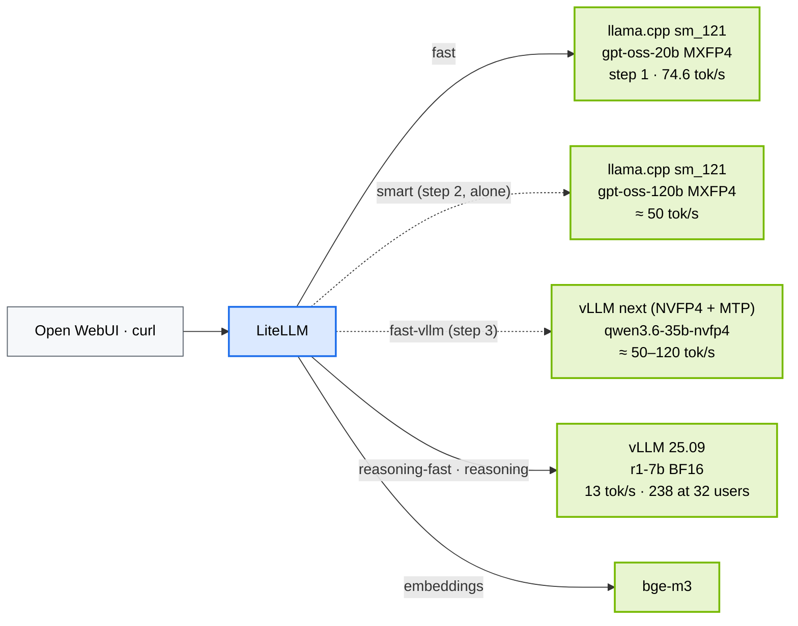

# Chapter 20 · The Fast Lane: More Tokens per Second on the Same Spark

> **03-DeepSeek · Part VIII — Going faster · Chapter 20 of 20** · ← [Chapter 19 · Hands-on workbook](19-hands-on-workbook.md) · [All chapters](00-deepseek-step-by-step-guide.md)

| | |
|---|---|
| **You will build** | Three steps, in order, that take one user from 13 tok/s to 75 and beyond without touching the Spark's hardware: a MoE + 4-bit model on llama.cpp next to the current vLLM (step 1, done: 74.6 tok/s), a 120B model that is still faster than the old 7B (step 2), and a newer vLLM with Blackwell-native NVFP4 kernels and multi-token prediction (step 3). Each step is measured with the same sweep, routed through LiteLLM, and leaves the rest of the lab as it was |
| **Hardware** | dgx-spark-1 |
| **Time** | step 1: 1 h (incl. the llama.cpp build) · step 2: 1.5 h (63 GB download) · step 3: 2 h |
| **Risk** | Low for steps 1–2 (new Deployments beside the existing ones; step 2 runs alone with a temporary quota change). Step 3's last part (promoting the image) changes the lab's engine and needs Chapters 05–08 retested |
| **Clusters** | `spark-root`, namespace `llm-serving` |
| **Lab files** | [`k8s/llamacpp/gpt-oss-20b.yaml`](lab/k8s/llamacpp/gpt-oss-20b.yaml), [`k8s/llamacpp/gpt-oss-120b.yaml`](lab/k8s/llamacpp/gpt-oss-120b.yaml), [`k8s/llamacpp/Dockerfile`](lab/k8s/llamacpp/Dockerfile), [`k8s/upgrade/vllm-next`](lab/k8s/upgrade/vllm-next/kustomization.yaml), [`models.yaml`](lab/models.yaml) (`qwen3.6-35b-nvfp4`), [`k8s/apps/litellm.yaml`](lab/k8s/apps/litellm.yaml) (alias `fast`), [`tools/eval_harness.py`](lab/tools/eval_harness.py) |

Prerequisites: [Chapter 06](06-vllm-serving.md) (r1-7b served, the Task 5.6 sweep run once, so you have a baseline), the llama.cpp image from [Chapter 07 Task 5.4](07-alternative-engines-sglang-llamacpp-trtllm.md), and [Chapter 12](12-open-webui-and-litellm-gateway.md) (LiteLLM and Open WebUI) if you want users to see the result.

---

## 1. Why this matters on a Spark

On a GB10, how fast one user gets tokens is set by one division: **273 GB/s of memory bandwidth ÷ the bytes the model reads per token**. Nothing in Kubernetes or in the hardware raises the numerator. The everyday setup of Chapters 05–08 sits at the slow end of the denominator: a dense 7B model in BF16 reads ~15 GB per token (18 tok/s ceiling, 13 measured) and spends ~90 % of its tokens thinking. This chapter moves the denominator, in three steps that each change one thing:

| Step | Lever | What changes | One user | Status |
|---|---|---|---|---|
| 1 | **the model's bytes** | MoE (reads ~3.6B of 21B parameters) in 4-bit MXFP4, on llama.cpp built for sm_121 | 13 → **74.6** (measured) | done |
| 2 | **quality at that speed** | the same recipe on a 120B MoE (~5B active), alone | ≈ 40–55 from a 120B model | to do |
| 3 | **the engine** | newer vLLM: NVFP4 kernels compute on 4-bit directly, MTP gives 2–3 tokens per weight read | ≈ 50–120 (published: 49 vLLM, 120 Atlas on the same model) | to do |

**How the steps relate.** They are independent experiments, not a pipeline: none needs the previous one's result, and each ends by restoring the lab. Do them in any order, or only one, but **one at a time**, because they compete for the same memory pool:

| | Needs | Runs beside | Must not run at the same time as |
|---|---|---|---|
| Step 1 | the Chapter 07 Task 5.4 llama.cpp image | `vllm` (r1-7b) and bge-m3 | step 2 |
| Step 2 | the same image | nothing: vLLM and the 20B parked, quota raised | steps 1 and 3 |
| Step 3 | a newer NGC vLLM tag that passes its step A | `vllm` (r1-7b) and bge-m3; the 20B paused for quota | step 2 |

Shared ground: the Chapter 06 sweep as the yardstick, LiteLLM aliases for whatever you keep, and `park_vllm` / `resume_vllm` from Chapter 07 §5. Keeping step 1's engine running is the recommended end state; steps 2 and 3 can be left running only if their table rows earn it, and step 3's promotion (its step D) is the one change that alters the rest of the lab.

Everything else in the lab is kept: the three memory walls (every new pod has request = limit inside `serving-budget`), the gateway (one alias per engine, with fallback), and the measuring method ([Chapter 06 Task 5.6](06-vllm-serving.md): the same c = 1 / 8 / 32 sweep on the same maths set, so engines compare fairly).

## 2. Architecture — HLD



Steps 1 and 3 run **next to** the current vLLM (two or three engines, Σ util ≲ 0.72, quota ≤ 90 Gi). Step 2 runs **alone**. The gateway decides who answers: `fast` for chat, `reasoning*` for hard problems and crowds (vLLM still batches best: 238 tok/s at 32 users against llama.cpp's 119).

## 3. LLD · the numbers behind each step

| | r1-7b · vLLM 25.09 | gpt-oss-20b · llama.cpp | gpt-oss-120b · llama.cpp | qwen3.6-35b-nvfp4 · vLLM next |
|---|---|---|---|---|
| parameters total / active | 7.6B / 7.6B | 21B / 3.6B | 117B / 5.1B | 35B / 3B |
| bytes per weight | 2 (BF16) | 0.5 (MXFP4) | 0.5 (MXFP4) | 0.5 (NVFP4) |
| read per token | ~15 GB | ~2 GB | ~3 GB | ~1.5–2 GB |
| ceiling 273 ÷ read | 18 | ~130 | ~90 | ~150 |
| measured / published, one user | **13** | **74.6** (57 % of ceiling) | 55 (NVIDIA) | 49 (vLLM) · 120 (Atlas, with MTP) |
| pod memory, request = limit | 28 Gi | 24 Gi | 80 Gi | 40 Gi |
| runs beside r1-7b? | — | yes | no | yes |

Two details that bite: llama.cpp's `-c` is the **total** context split across `--parallel` slots (the repo uses 8 × 8K), and llama.cpp batches less well than vLLM (16 slots gave 141 tok/s at c=8 but only 119 at c=32). Step 3's MTP needs a model trained with an MTP head (Qwen3.5/3.6, DeepSeek-V3); gpt-oss has none.

## 4. Integrations

| Chapter | Used here |
|---|---|
| [05](05-model-catalog-and-memory-math.md) | the walls: every new pod has request = limit; `models.yaml` + `gen_overlays.py` for the step-3 entry |
| [06](06-vllm-serving.md) | the Task 5.6 sweep is the yardstick for every engine |
| [07](07-alternative-engines-sglang-llamacpp-trtllm.md) | the llama.cpp image (Task 5.4), `park_vllm` / `resume_vllm` (§5) |
| [12](12-open-webui-and-litellm-gateway.md) | aliases `fast` (+ `smart`, `fast-vllm`), the Open WebUI key allow-list, model visibility |
| [16](16-telemetry.md) | `llama-server --metrics` and the vllm-next ServiceMonitor feed the same dashboard |

## 5. Lab

### Step 1 · gpt-oss-20b (MoE + MXFP4) on llama.cpp, next to r1-7b

#### What this lab does (Deployment `lab/k8s/llamacpp/gpt-oss-20b.yaml`, alias `fast`) · ✅ measured 2026-10-29

- **Why:** single-user speed on the GB10 is 273 GB/s ÷ bytes read per token. r1-7b in BF16 reads ~15 GB per token (≈ 13 tok/s measured). gpt-oss-20b is a mixture-of-experts model (~21B total, ~3.6B active) in its native MXFP4 4-bit format: ~2 GB per token, a ceiling around 130 tok/s. NVIDIA measured 82.7 tok/s for it with llama.cpp on DGX Spark.
- **Serves it with llama.cpp** built for sm_121 (the [Chapter 07 Task 5.4](07-alternative-engines-sglang-llamacpp-trtllm.md) image), as Deployment and Service `llama-gptoss` on port 8080, **next to** `vllm` (r1-7b): 24 Gi (request = limit), 4 CPU, one slice. Weights (~12 GB) download once into `model-cache` under `/models/gguf`.
- **Gateway:** LiteLLM's alias `fast` points at it (`k8s/apps/litellm.yaml`) and falls back to `reasoning-fast` while it isn't deployed.
- **Measures it the same way** as every engine: the c = 1 / 8 / 32 sweep.

#### What to look for

1. **Rollout:** `successfully rolled out`; the log shows the model loaded with all layers on the GPU.
2. **Sweep:** c=1 several times r1-7b's 13 tok/s; c=8 higher in total; c=32 no higher (llama.cpp batches less well than vLLM). Measured on a Spark (vLLM 25.09 era, llama.cpp b6500):

   | | r1-7b · vLLM | gpt-oss-20b · llama.cpp, 8 slots |
   |---|---|---|
   | tok/s, 1 user | 13 | **74.6** (p50 answer 1.8 s, ~155 tokens) |
   | tok/s total, 8 users | 108 | 115 (4 slots) · **141** (16 slots) |
   | tok/s total, 32 users | 238 | 119 (16 slots: queueing, accuracy fell 0.85 → 0.65) |

   `-c` is the **total** context, split across `--parallel` slots; 8 slots × 8K is the setting in the manifest. Use it as the fast lane for interactive users; vLLM still wins for many users at once.
3. **Quota:** `serving-budget` memory ≈ 47 + 24 ≈ 71 of 90 Gi.

**If something's off:** `ErrImageNeverPull` → the Chapter 07 Task 5.4 image isn't imported into containerd (build it on the Spark: `docker build -t spark-local/llama.cpp:server-sm121 --build-arg LLAMACPP_REF=b6500 k8s/llamacpp && docker save spark-local/llama.cpp:server-sm121 | sudo ctr -n k8s.io images import -`). `unknown model architecture` → the llama.cpp build is older than gpt-oss support: rebuild with a newer `LLAMACPP_REF`. Pending with `exceeded quota` → park bge-m3 or the mock LLMs.

#### Run it

```bash
# ▶ MacBook · 03-DeepSeek/lab
kubectl --context spark-root apply -f k8s/llamacpp/gpt-oss-20b.yaml
kubectl --context spark-root -n llm-serving rollout status deploy/llama-gptoss --timeout=30m   # first start downloads ~12 GB
kubectl --context spark-root -n llm-serving logs deploy/llama-gptoss | grep -iE 'offloaded|model size|listening' | head
pkill -f 'port-forward svc/llama-gptoss'; kubectl --context spark-root -n llm-serving port-forward svc/llama-gptoss 8080 >/dev/null & sleep 2
run() { python3 tools/eval_harness.py --url http://localhost:8080 --model gpt-oss-20b --suites math --limit $2 --concurrency $1 --max-tokens 2048 | grep -E 'math|tok/s'; }
echo "c=1";  run 1 8
echo "c=8";  run 8 40
echo "c=32"; run 32 40
kill %1
```

Through the gateway and in Open WebUI (after `kubectl --context spark-root apply -k k8s/apps` and `rollout restart deploy/litellm`; re-run the Task 5.6 key patch of Chapter 12 afterwards): model `fast`. Open WebUI sees only the models **its key** allows, so add the alias to that key first: `curl -s $API/key/update "${H[@]}" -d "{\"key\":\"$WEBUI\",\"models\":[\"reasoning\",\"reasoning-fast\",\"embeddings\",\"fast\"]}"`, then refresh the connection in Admin Panel → Settings → Connections and make `fast` Public under Settings → Models.

Remove: `kubectl --context spark-root delete -f k8s/llamacpp/gpt-oss-20b.yaml` (the GGUF stays in `model-cache`).

### Step 2 · gpt-oss-120b, alone: a 120B model faster than the old 7B

#### What this lab does (Deployment `lab/k8s/llamacpp/gpt-oss-120b.yaml`)

- **Quality, not more speed:** the same MoE + MXFP4 recipe on OpenAI's 120B model (~117B total, ~5.1B active): noticeably stronger on maths, code, tool use and long documents than the 20B. Each token reads ~3 GB, so one user should still see ≈ 40–55 tok/s (NVIDIA: 55 with llama.cpp), 3–4× the old r1-7b.
- **Runs alone:** ~63 GB of weights in an 80 Gi pod. vLLM and the 20B are parked, and `serving-budget` goes from 90 to 100 Gi for the run (80 + ~16 Gi of apps > 90). Σ util ≈ 0.58 + bge-m3 0.06 stays under 0.72.
- **Same measurements**, plus the eval suites, so the quality gain is a number, not a feeling.

#### What to look for

1. **Quota:** `describe quota serving-budget` shows 100Gi before the apply; the pod is created at once.
2. **Rollout:** `successfully rolled out` after the ~63 GB download (first time only; it stays in `model-cache`).
3. **Sweep:** c=1 ≈ 40–55 tok/s; the `math` / `json` accuracy at or above the 32B rows of Chapter 05 Task 5.5.

**If something's off:** `exceeded quota` → the quota patch didn't apply, or vllm / llama-gptoss are still up (`get deploy`). OOM-killed → lower `-c` to 32768 or `--parallel` to 4. Slow first answers → the GGUF is being paged in from the NVMe; the second request is the real number.

#### Run it

```bash
# ▶ MacBook · 03-DeepSeek/lab
park_vllm                                                                    # Chapter 07 §5 helper; or: kubectl --context spark-root -n llm-serving scale deploy vllm --replicas=0
kubectl --context spark-root -n llm-serving scale deploy llama-gptoss --replicas=0
kubectl --context spark-root -n llm-serving patch resourcequota serving-budget --type merge -p '{"spec":{"hard":{"limits.memory":"100Gi","requests.memory":"100Gi"}}}'
kubectl --context spark-root apply -f k8s/llamacpp/gpt-oss-120b.yaml
kubectl --context spark-root -n llm-serving rollout status deploy/llama-gptoss-120b --timeout=60m   # ~63 GB download the first time
pkill -f 'port-forward svc/'; kubectl --context spark-root -n llm-serving port-forward svc/llama-gptoss-120b 8080 >/dev/null & sleep 2
run() { python3 tools/eval_harness.py --url http://localhost:8080 --model gpt-oss-120b --suites math --limit $2 --concurrency $1 --max-tokens 2048 | grep -E 'math|tok/s'; }
echo "c=1";  run 1 8
echo "c=8";  run 8 40
python3 tools/eval_harness.py --url http://localhost:8080 --model gpt-oss-120b --suites math json --concurrency 4 --max-tokens 2048 --out results/gpt-oss-120b.json
pkill -f 'port-forward svc/llama-gptoss-120b'
python3 tools/eval_harness.py --report results/gpt-oss-120b.json results/gpt-oss-20b.json results/r1-32b-fp8.json
```

**Put the lab back** (the 120B's GGUF stays cached for next time):

```bash
# ▶ MacBook · 03-DeepSeek/lab
kubectl --context spark-root -n llm-serving scale deploy llama-gptoss-120b --replicas=0
kubectl --context spark-root -n llm-serving patch resourcequota serving-budget --type merge -p '{"spec":{"hard":{"limits.memory":"90Gi","requests.memory":"90Gi"}}}'
resume_vllm; scripts/serve-model.sh r1-7b
kubectl --context spark-root -n llm-serving scale deploy llama-gptoss --replicas=1
```

If the 120B earns a permanent place, give it an alias (`k8s/apps/litellm.yaml`, e.g. `smart` → `llama-gptoss-120b.llm-serving:8080`) and decide which engine is parked by default; the quota change then belongs in `02 … root-llms/10-tenancy/quotas.yaml`, not in a patch.

### Step 3 · a newer vLLM with NVFP4 and multi-token prediction

#### What this lab does (overlay `lab/k8s/upgrade/vllm-next`, catalog entry `qwen3.6-35b-nvfp4`)

- **Changes the engine, not the model's bytes:** steps 1–2 cut bytes per token with MoE + 4-bit models on llama.cpp. This step gives the GPU kernels that use those bytes better: **native NVFP4** tensor-core maths (no unpacking to 16-bit) and **multi-token prediction** (MTP: the model proposes 2–3 tokens per step, verified in one pass), plus a newer loader and FP8 KV. Published results on a Spark for the same model: 49 tok/s on an NVFP4-capable vLLM, 120 on a dedicated Rust engine; llama.cpp got 75 on a 20B MoE.
- **Runs the candidate image NEXT TO the current `vllm`** (r1-7b on 25.09) as Deployment and Service `vllm-next`, the `k8s/multi` pattern, on `RedHatAI/Qwen3.6-35B-A3B-NVFP4` (35B total, 3B active, MTP head): util 0.30, 40 Gi. Nothing in the lab changes until step D.
- **Measures it the same way** ([Chapter 06 Task 5.6](06-vllm-serving.md) sweep), first plain, then with MTP on.
- **Step D promotes the image** for the whole lab only once it has earned it: `VLLM_IMAGE` in both `versions.env` files and the 02 base; then the expected values of Chapters 05–08 need a retest.

#### What to look for

1. **Step A:** the tag has an `arm64` manifest, `vllm --version` prints a version newer than 0.10.1, and `--help` lists `--speculative-config` and an NVFP4 / `modelopt_fp4` quantization choice.
2. **Step B:** `vllm-next` rolls out; its log names the quantization (nvfp4 / modelopt) and the KV size; the smoke answer makes sense.
3. **Step C:** c=1 tok/s above llama.cpp's 75 for gpt-oss-20b, and higher again with MTP (acceptance rate in the log); c=8 / c=32 far above llama.cpp's 141 / 119 (vLLM batches better).
4. **Quota and pool:** `serving-budget` ≈ 87 of 90 Gi with llama-gptoss paused; Σ util 0.56.

**If something's off:** `no matching manifest for linux/arm64` → pick a newer tag from NGC's vLLM page (DGX Spark support is in the release notes) and change it in `versions.env` and the overlay. `Model architectures [...] are not supported` → the model is newer than this vLLM; try the next tag or an older Qwen3.5 NVFP4 build. `quantization method nvfp4 is not supported` → the image has no FP4 kernels for sm_121; this tag is not step 3 material. OOM at start → park `llama-gptoss` and bge-m3 for the test. MTP errors → run without `--speculative-config` first; the method name differs per model family (`mtp`, `qwen3_next_mtp`): the vLLM recipe page for the model gives the right one.

#### Run it

**Step A · verify the candidate image (on the Spark, where arm64 is native).**

```bash
# ▶ dgx-spark-1 (ssh dgx-spark-1)
IMG=nvcr.io/nvidia/vllm:26.01-py3                                   # VLLM_NEXT_IMAGE in versions.env; try the newest tag NGC lists if this one is gone
docker manifest inspect $IMG | grep -A2 '"architecture": "arm64"'   # must print an arm64 entry
docker pull $IMG                                                     # several GB; containerd pulls it again for the pod
docker run --rm --gpus all $IMG vllm --version
docker run --rm --gpus all $IMG vllm serve --help | grep -iE 'speculative-config|nvfp4|modelopt|load-format|safetensors-load' | head
```

**Step B · run it next to the current engine.**

```bash
# ▶ MacBook · 03-DeepSeek/lab
kubectl --context spark-root -n llm-serving scale deploy llama-gptoss --replicas=0        # free 24 Gi of quota for the test (back to 1 afterwards)
kubectl --context spark-root apply -k k8s/upgrade/vllm-next
kubectl --context spark-root -n llm-serving rollout status deploy/vllm-next --timeout=45m  # first start: ~20 GB download + load
kubectl --context spark-root -n llm-serving logs deploy/vllm-next | grep -iE 'version|quantization|Model loading took|KV cache size|not supported|error' | head
kubectl --context spark-root -n llm-serving exec deploy/vllm-next -- curl -s localhost:8000/v1/chat/completions -H 'Content-Type: application/json' \
  -d '{"model":"qwen3.6-35b-nvfp4","max_tokens":200,"messages":[{"role":"user","content":"Is 91 prime? One line."}]}' | jq '{model, answer: .choices[0].message.content}'
```

**Step C · measure: plain, then with MTP.**

```bash
# ▶ MacBook · 03-DeepSeek/lab
pkill -f 'port-forward svc/'; kubectl --context spark-root -n llm-serving port-forward svc/vllm-next 8000 >/dev/null & sleep 2
run() { python3 tools/eval_harness.py --url http://localhost:8000 --model qwen3.6-35b-nvfp4 --suites math --limit $2 --concurrency $1 --max-tokens 2048 | grep -E 'math|tok/s'; }
echo "c=1";  run 1 8
echo "c=8";  run 8 40
echo "c=32"; run 32 40
pkill -f 'port-forward svc/vllm-next'
```

Then MTP: add the speculative config to the catalog entry's `args` (`models.yaml`), regenerate, re-apply, and repeat the sweep:

```bash
# ▶ MacBook · 03-DeepSeek/lab
#   args: [--reasoning-parser=qwen3, --max-num-seqs=32, '--speculative-config={"method":"mtp","num_speculative_tokens":2}']
python3 scripts/gen_overlays.py && kubectl --context spark-root apply -k k8s/upgrade/vllm-next
kubectl --context spark-root -n llm-serving rollout status deploy/vllm-next --timeout=30m
kubectl --context spark-root -n llm-serving logs deploy/vllm-next | grep -iE 'spec|draft|accept' | head -5
# sweep again (same three lines as above); then, while it runs, the acceptance rate:
kubectl --context spark-root -n llm-serving logs deploy/vllm-next --since=2m | grep -oE 'Draft acceptance rate: [0-9.]+|Acceptance rate: [0-9.]+' | tail -3
```

Record (one line per engine, same sweep):

| Engine · model | c=1 | c=8 | c=32 | notes |
|---|---|---|---|---|
| vLLM 25.09 · r1-7b BF16 | 13 | 108 | 238 | baseline |
| llama.cpp b6500 · gpt-oss-20b MXFP4 | 74.6 | 141 | 119 | step 1 |
| vLLM next · qwen3.6-35b-nvfp4 | | | | step 3, plain |
| vLLM next · qwen3.6-35b-nvfp4 + MTP | | | | step 3, MTP |

**Step D · promote, or not.** If step C beats llama.cpp at c=1 and vLLM 25.09 at c=32, make it the lab's engine: set `VLLM_IMAGE` to the new tag in `02-Kubernetes/lab/versions.env` and `03-DeepSeek/lab/versions.env`, the `image:` in `02 …/90-serving/vllm/vllm.yaml`, delete the `images:` block from `k8s/upgrade/vllm-next/kustomization.yaml`, then `scripts/serve-model.sh r1-7b` and re-run [Chapter 05 Task 5.3](05-model-catalog-and-memory-math.md) and [Chapter 08 Task 5.4](08-kubernetes-deployment-storage-and-streaming.md): the loader time and overhead numbers in those chapters were measured on 25.09 and will change. Give LiteLLM an alias for the new model (`k8s/apps/litellm.yaml`, e.g. `fast-vllm` → `vllm-next.llm-serving:8000`) if you keep both engines. If it doesn't earn it: `kubectl --context spark-root delete -k k8s/upgrade/vllm-next`, `scale deploy llama-gptoss --replicas=1`, and note why in the table.

## 6. Verify

```bash
# ▶ MacBook · 03-DeepSeek/lab
kubectl --context spark-root -n llm-serving get deploy vllm llama-gptoss llama-gptoss-120b vllm-next 2>/dev/null     # which engines are up
kubectl --context spark-root -n llm-serving describe quota serving-budget | grep -E 'limits.memory|requests.cpu'
KEY=$(kubectl --context spark-root -n llm-serving get secret litellm-master-key -o jsonpath='{.data.key}' | base64 -d)
for a in fast reasoning-fast; do printf '%-16s' $a; curl -s -o /tmp/r.json -w '%{http_code} ' http://api.lab.local/v1/chat/completions -H "Authorization: Bearer $KEY" -H 'Content-Type: application/json' \
  -d "{\"model\":\"$a\",\"max_tokens\":100,\"messages\":[{\"role\":\"user\",\"content\":\"Say OK.\"}]}"; jq -r .model /tmp/r.json; done
```

✅ **Done when** the step-1 sweep is in the table (c=1 ≥ 60 tok/s), `fast` answers through the gateway and shows in Open WebUI, and the lab is back to its everyday state after each step (r1-7b serving, quota 90 Gi, no stray port-forwards).

## 7. Troubleshooting

| You see | Cause | Fix |
|---|---|---|
| llama.cpp build: `collect2: error: ld returned 1` after `libcuda.so.1 … not found` | no GPU driver inside `docker build` | the Dockerfile links with `--allow-shlib-undefined`; pull the repo and rebuild |
| `ErrImageNeverPull` on llama-gptoss | image not imported into containerd's `k8s.io` namespace | `docker save … \| sudo ctr -n k8s.io images import -` on the Spark |
| `fast` missing from Open WebUI | the `open-webui` key doesn't allow it | `POST /key/update` with the alias added, refresh the connection, make the model Public |
| c=32 lower than c=8 on llama.cpp | more slots than it batches well | keep 8 slots; send crowds to vLLM |
| step 2: `exceeded quota` | quota patch missing, or vllm / llama-gptoss still up | patch to 100Gi, `park_vllm`, scale the 20B to 0 |
| step 3: no arm64 manifest / `nvfp4 not supported` / `architectures not supported` | wrong tag for the GB10, or the model is newer than the image | newest NGC tag with DGX Spark in its notes; or an older NVFP4 model |

## 8. Scale-out path

A second Spark doubles total throughput (one engine per node behind `reasoning-pool`, [Chapter 12 Task 5.9](12-open-webui-and-litellm-gateway.md)) and, with tensor parallelism, raises single-user speed on the big models by about 1.6–1.8×. It does not change the per-token rule; the three steps here apply on every node.

## 9. Checklist

- [ ] Step 1: llama.cpp image built and imported; `llama-gptoss` beside `vllm`; sweep recorded; alias `fast` in LiteLLM, the Open WebUI key and the model list
- [ ] Step 2: 120B measured alone (sweep + `--report` against the 20B and the 32Bs); quota back to 90 Gi; lab restored
- [ ] Step 3: image verified on the Spark (step A); `vllm-next` beside `vllm` (B); plain and MTP sweeps (C); promote or remove (D), with Chapters 05–08 retested if promoted
- [ ] The table in §3 filled with your own numbers
