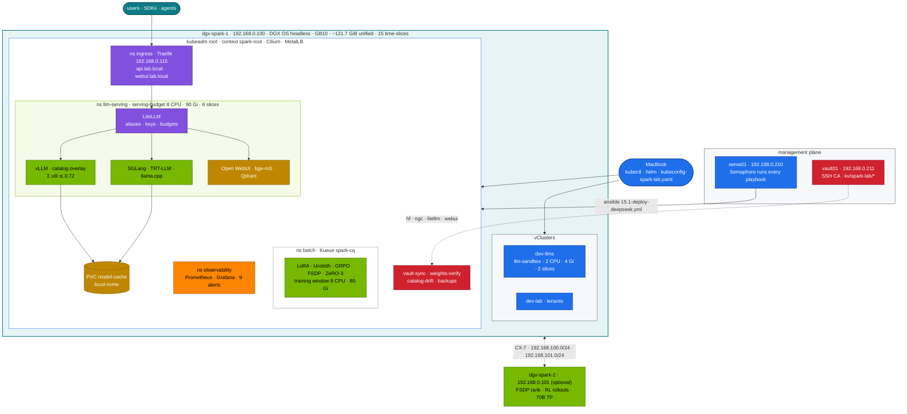
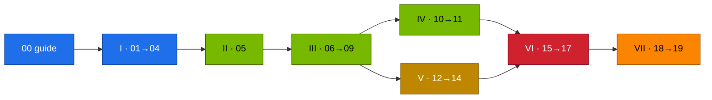

# 03-DeepSeek — DeepSeek on NVIDIA DGX Spark: Architecture Proved in Code, Served, Tuned, Operated

Nineteen chapters and a step-by-step guide that take DeepSeek from the research papers to a production-style service on one DGX Spark (a second is optional). You prove the architecture ideas (MLA, DeepSeekMoE, MTP, FP8, GRPO) with runnable code, size the models that fit a GB10's unified memory, serve them with vLLM and alternative engines on the kubeadm root cluster from [02-Kubernetes](../02-Kubernetes/README.md), fine-tune and RL-train them inside the training window, build the application stack around them (gateway, chat UI, RAG, agents), operate it (Semaphore automation, Vault secrets, day-2 jobs, telemetry, drills), and choose between DeepSeek and other model families with measured numbers.

Lab chapters share one shape: **why this matters on a Spark → architecture (HLD) → LLD → integrations → lab tasks → verify → troubleshooting → scale-out path → checklist**. Theory chapters prove their claims with CPU tools from the lab. Every command runs against [`lab/`](lab/README.md), on the platform built by [01-Ansible](../01-Ansible/README.md) and [02-Kubernetes](../02-Kubernetes/README.md).

**Start here:** [Chapter 00 · DeepSeek Step-by-Step Guide](00-deepseek-step-by-step-guide.md) (the shortest correct path through the module) · [`lab/README.md`](lab/README.md) (what every lab file does) · [Chapter 19 · Hands-on workbook](19-hands-on-workbook.md) (prove it)

---

## 1. The stack at a glance

**The rules the whole module follows.** The LLMs run on the root (`spark-root`) in `llm-serving` and `batch`. Every GPU container sets memory request = limit. The sum of `--gpu-memory-utilization` over models running at the same time stays ≲ 0.72 (0.20 ≈ 24 GiB); the BF16 32B at 0.70 runs alone. A training job fits the training window (≤ 8 CPU · ≤ 80 Gi · 1 slice per pod) and vLLM is parked while the window is open. Secrets come from vault01, never from files in the repo. Try a new manifest or a tiny model in `dev-llms` first.

**Diagram colour key** (all chapters): blue = control plane / automation · teal = host · green = GPU work · purple = network · amber = storage · orange = observability · red = security / policy.

---

## 2. Chapters

| Part | # | Chapter | You build |
|---|---|---|---|
| — | 00 | [DeepSeek Step-by-Step Guide](00-deepseek-step-by-step-guide.md) | the shortest correct path through the module, chapter by chapter |
| I · Architecture | 01 | [DeepSeek architecture: MLA, DeepSeekMoE & MTP](01-deepseek-architecture-mla-moe-mtp.md) | MHA vs MLA vs absorbed MLA with the same output; aux-loss-free MoE routing; speculative speed-up from acceptance rate |
| | 02 | [FP8 training, FlashMLA & DeepGEMM](02-fp8-training-and-kernels.md) | per-tensor vs 128×128 block FP8 scaling; what runs on sm_121; grouped-GEMM benchmark |
| | 03 | [R1 reasoning & GRPO](03-r1-reasoning-and-grpo.md) | GRPO on verifiable rewards; R1 sampling rules; the distills |
| | 04 | [Scaling beyond one Spark: long context, EPLB, 3FS & V3 671B](04-scaling-beyond-one-spark.md) | ring attention, 128K serving and a needle test; expert placement; storage design; 671B sharding math |
| II · Models on a Spark | 05 | [Model catalog & memory math on GB10](05-model-catalog-and-memory-math.md) | weights + KV + overhead → fits / sequences / decode ceiling; the catalog's `util` and `mem` |
| III · Serving | 06 | [Serving DeepSeek with vLLM](06-vllm-serving.md) | catalog → generated overlays of 02's vLLM Deployment; parsers; smoke tests |
| | 07 | [Alternative engines: SGLang, llama.cpp & TensorRT-LLM](07-alternative-engines-sglang-llamacpp-trtllm.md) | RadixAttention, GGUF on sm_121, `trtllm-serve`, a three-engine comparison |
| | 08 | [Kubernetes deployment, weight caching & streaming](08-kubernetes-deployment-storage-and-streaming.md) | the Deployment field by field, admission on the root, cold vs warm loads, SSE timing per hop |
| | 09 | [Autoscaling & queueing: KEDA, KServe & Kueue](09-autoscaling-and-queueing.md) | queue-depth scaling, office hours, the training window, an InferenceService |
| IV · Fine-tuning | 10 | [LoRA/QLoRA sizing, Unsloth & LLaMA-Factory](10-lora-qlora-unsloth-and-llama-factory.md) | sizing calculator; the same fine-tune three ways; adapters served next to their base |
| | 11 | [Distributed training & RL: FSDP, ZeRO-3 & GRPO rollouts](11-distributed-training-and-rl.md) | GRPO with HF generate vs vLLM rollouts; 7B full fine-tune with ZeRO-3 offload or FSDP over two Sparks |
| V · Applications | 12 | [Open WebUI & the LiteLLM gateway](12-open-webui-and-litellm-gateway.md) | aliases, virtual keys with budgets and limits, fallbacks; visible thinking; tested backups |
| | 13 | [RAG with Qdrant & BGE-M3](13-rag-with-qdrant-and-bge.md) | blue/green re-index, quality gate, hit@k/MRR, rollback |
| | 14 | [Tool calling & agents](14-tool-calling-and-agents.md) | schema-validated tools, audit log, least-privilege in-cluster agent |
| VI · Operations | 15 | [Automation, secrets & day-2: Ansible, Vault, weight sync](15-automation-secrets-and-day2.md) | `15.1-deploy-deepseek.yml` from Semaphore; Vault-synced secrets with rotation; revision pinning, integrity, backups, GitOps and the release gate |
| | 16 | [Telemetry: DCGM, Prometheus & Grafana](16-telemetry.md) | reasoning-aware metrics, GB10 and unified-memory signals, nine tested alerts, one generated dashboard |
| | 17 | [Troubleshooting playbook](17-troubleshooting-playbook.md) | decision tree, `llm-triage.sh`, symptom index, drills D01–D07, support bundle |
| VII · Choosing models | 18 | [DeepSeek vs Llama, Qwen, Mistral, o1/Claude & multi-ecosystem](18-choosing-models-deepseek-vs-others.md) | controlled comparisons, bandwidth-predicted speed, break-even vs hosted APIs, two families at once, a routing table |
| | 19 | [Hands-on workbook](19-hands-on-workbook.md) | 30 graded exercises, the release gate, a capstone |
| VIII · Going faster | 20 | [The fast lane: more tokens per second](20-fast-lane-more-tokens-per-second.md) | three measured steps from 13 to 75+ tok/s on the same Spark: MoE + 4-bit on llama.cpp beside vLLM, a 120B alone, a newer vLLM with NVFP4 and MTP |

### Learning order

Part I is theory with CPU proofs and can be read before the platform exists. From Part II on you need 02's root cluster with the `root-llms` layers applied.

---

## 3. Reference lab

| Item | Value |
|---|---|
| Nodes | dgx-spark-1 `192.168.0.100` (user `dgxadmin`, DGX OS headless); optional dgx-spark-2 `192.168.0.101` |
| Management | sema01 `192.168.0.210` (Semaphore), vault01 `192.168.0.211` (Vault: SSH CA, `kv/spark-lab/*` — `hf`, `ngc`, LiteLLM and WebUI keys) |
| CX-7 fabric | `192.168.100.0/24` + `192.168.101.0/24`, RoCE |
| GPU | GB10, sm_121, ~121.7 GiB unified memory visible (`nvidia-smi` memory reads N/A), ~273 GB/s, 15 time-slices, no MIG |
| Kubernetes | kubeadm root (`spark-root`), Cilium, MetalLB `192.168.0.110-119`, GPU Operator, kube-prometheus-stack, local-path (`local-nvme`, `local-nvme-retain`), Traefik `192.168.0.115`, Kueue, KEDA, KServe; vClusters `dev-llms` (LLM sandbox) and `dev-lab` |
| Namespaces | `llm-serving` (PSA baseline, `serving-budget`), `batch` (privileged, Kueue `train` → `spark-cq`), `ingress`, `observability`, `llm-multinode` (two-Spark) |
| Budgets | LLM pool ~90 GiB; everyday serving 8 CPU · 90 Gi · 6 slices, batch 2 CPU · 12 Gi · 3 slices; training window serving 2 CPU · 10 Gi, batch 8 CPU · 80 Gi ([02 Chapter 14](../02-Kubernetes/14-multi-tenancy-resource-quotas-and-cgroups.md)) |
| Entry points | `api.lab.local` (LiteLLM), `webui.lab.local` (Open WebUI), Grafana `http://192.168.0.100:3000` → *Spark Lab* |
| Versions | [`lab/versions.env`](lab/versions.env) (NGC vLLM and PyTorch images, SGLang, TensorRT-LLM, llama.cpp, LiteLLM, Open WebUI, Qdrant, TRL/PEFT/Transformers); platform versions from 02 |

## 4. How this module is verified

Without a Spark attached, every tool runs for real: architecture demos on CPU, and the eval harness, gate, stream probe, agent, format check, RAG (against a real Qdrant binary, with blue/green, gate and rollback), vault-sync rotation and catalog drift against mock servers. Every manifest passes kubeconform, a server-side dry run against a Kubernetes API server with the 02 platform applied, and a pod-template admission check (PodSecurity, the root's ValidatingAdmissionPolicies, quotas). Alerts pass `promtool test rules`. The Ansible playbook passes `ansible-lint` and a check-mode run, including the budget guard. Mermaid diagrams render. CI ([`deepseek-lab-ci.yml`](../.github/workflows/deepseek-lab-ci.yml), [`docs-ci.yml`](../.github/workflows/docs-ci.yml)) repeats this on every pull request. Results that need the GPU (throughput, TTFT, accuracy, power, NCCL bandwidth) are marked **record yours** in the chapters: those are the numbers to measure on your Spark.

---

Next module: [04-Qwen](../04-Qwen/README.md), which reuses this module's gateway, RAG and telemetry for the Qwen family.
