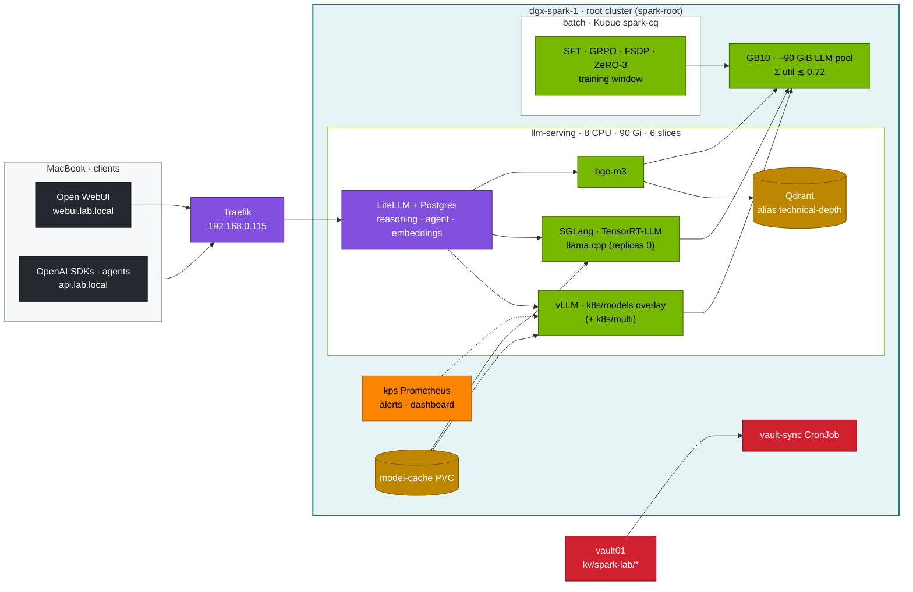

# DeepSeek Lab · Runnable Companion to Chapters 01–19

Everything the 19 chapters of the [DeepSeek step-by-step guide](../00-deepseek-step-by-step-guide.md) teach, as tools, manifests and drills. It runs on the platform that [01-Ansible](../../01-Ansible/lab/README.md) builds and [02-Kubernetes](../../02-Kubernetes/lab/README.md) configures:

- one DGX Spark **dgx-spark-1** (192.168.0.100, DGX OS headless; GB10, 20 Arm cores, 128 GB LPDDR5x of which **~121.7 GiB** is visible), optional **dgx-spark-2** (192.168.0.101) on the CX-7 fabric (192.168.100.0/24, 192.168.101.0/24);
- the **kubeadm root cluster** (Cilium, MetalLB, GPU Operator with **15 time-slices**, kube-prometheus-stack, Traefik at 192.168.0.115, Kueue, KEDA, KServe). The root **runs the LLMs**: model servers in namespace `llm-serving`, training in `batch` (Kueue LocalQueue `train` → ClusterQueue `spark-cq`);
- the management plane outside the Spark: **sema01** (192.168.0.210, Semaphore runs every lab playbook) and **vault01** (192.168.0.211, Vault: lab secrets under `kv/spark-lab/*`).

Three kubectl contexts in `01-Ansible/lab/.cache/kubeconfig-spark-lab.yaml`: **`spark-root`** (everything in this lab), `dev-lab` (tenants) and `dev-llms` (an LLM sandbox, namespace `llm-sandbox`, 2 CPU · 4 Gi · 2 slices — try a manifest there before the root). Every command in this lab names its context. The scripts use 02's `scripts/lib.sh`, so `k`/`kr` always mean `kubectl --context spark-root`.

## The budgets this lab is sized for

The root's LLM stack shares one **~90 GiB memory pool** ([02-Kubernetes Chapter 04](../../02-Kubernetes/04-nested-clusters-with-vcluster.md), [Chapter 14](../../02-Kubernetes/14-multi-tenancy-resource-quotas-and-cgroups.md)):

| | `llm-serving` (`serving-budget`) | `batch` (`batch-budget` = Kueue `spark-cq`) |
|---|---|---|
| everyday | 8 CPU · 90 Gi · 6 slices | 2 CPU · 12 Gi · 3 slices |
| training window | 2 CPU · 10 Gi · 6 slices | 8 CPU · 80 Gi · 3 slices |

Three rules follow, and `tests/budget_check.py` enforces them on every manifest here:

1. **Every GPU container sets memory request = limit.** The scheduler is what stops serving and training from overcommitting unified memory; it only can if requests are real.
2. **Σ `--gpu-memory-utilization` of the models running at the same time ≲ 0.72** (× ~121.7 GiB). 0.20 ≈ 24 GiB. One model never takes more than 0.70; `r1-32b` (BF16, 0.70 ≈ 85 GiB, pod 87 Gi) runs **alone**, with everything else parked. `models.yaml` lists the sets that fit together.
3. **Training jobs need the training window** (02's `manifests/root-llms/training-window`): each job in `batch` fits ≤ 8 CPU · ≤ 80 Gi · 1 slice per pod, and says so in its header comment.

```
lab/
├── versions.env            # images and Python packages pinned for this module (platform versions: 02's versions.env)
├── models.yaml             # model catalog: HF repo, util, pod memory, context, flags; sets that fit together (Chapters 05, 06, 08, 18)
├── kustomization.yaml      # ships tools/ + data/ into llm-serving and batch as ConfigMaps
├── tools/                  # Python, mostly stdlib; architecture demos run on CPU
│   ├── model_math.py           params (total/active), weight GiB, KV bytes/token, fit on 1–2 Sparks      (Chapters 01, 04, 05)
│   ├── mla_attention_demo.py   MHA vs MLA vs absorbed MLA: same output, KV cache 9.6× smaller             (Chapters 01, 02)
│   ├── moe_router_demo.py      DeepSeek-V3 router + aux-loss-free bias balancing on skewed traffic        (Chapter 01)
│   ├── moe_router_probe.py     hook the real router of DeepSeek-V2-Lite on the GB10                       (Chapters 01, 04)
│   ├── spec_decode_calc.py     MTP / speculative decoding speed-up from acceptance rate                   (Chapter 01)
│   ├── fp8_blockscale.py       per-tensor vs 128×128 block FP8 scaling; FP8 vs BF16 GEMM on GB10          (Chapter 02)
│   ├── grouped_gemm_bench.py   why MoE needs grouped GEMMs (padded vs grouped)                            (Chapter 02)
│   ├── ring_attention_demo.py  context parallelism with ring attention, verified vs full attention        (Chapter 04)
│   ├── eplb_sim.py             expert placement: naive vs replicate+pack vs DeepSeek's eplb.py            (Chapter 04)
│   ├── needle_test.py          needle-in-a-haystack long-context check                                    (Chapter 04)
│   ├── grpo_tiny.py            GRPO with rule-based rewards on verifiable arithmetic (TRL)                (Chapters 03, 11)
│   ├── sft_lora.py · lora_calc.py · fsdp_finetune.py   LoRA/full SFT (+DeepSpeed), sizing vs the window, FSDP2 (Chapters 10, 11)
│   ├── unsloth_sft.py          the LoRA SFT of sft_lora.py with Unsloth, same recipe, comparable stats     (Chapter 10)
│   ├── format_check.py         <think>/<answer> format + correctness on fresh problems                    (Chapters 10, 11)
│   ├── stream_probe.py         SSE timing per hop: TTFT, time-to-answer, ITL, buffering, truncation      (Chapter 08)
│   ├── rag_demo.py             chunk → bge-m3 → Qdrant (blue/green alias, quality gate) → cited answers   (Chapter 13)
│   ├── agent_tools.py          tool-calling loop: allow-list, schema validation, audit log                (Chapter 14)
│   ├── vault_sync.py           Vault KV (vault01) → Kubernetes Secrets via the Kubernetes auth method     (Chapter 15)
│   ├── catalog_drift.py        pin catalog models to HF commits; report upstream drift                   (Chapter 15)
│   ├── weights_verify.py       sha256 manifests for model snapshots                                        (Chapter 15)
│   └── eval_harness.py         math / code / JSON suites, tokens per correct answer, $/Mtok, --gate       (Chapters 18, 19)
├── data/                   # original eval sets: 40 math, 12 code (with tests), 8 JSON; 16 RAG gold questions
├── k8s/                    # everything → kubectl --context spark-root
│   ├── models/<name>/      # GENERATED vLLM overlays of 02's root-llms/90-serving/vllm, one per catalog entry (Chapters 06, 08)
│   ├── serving/            # GitOps pointer to the served model + PostSync eval gate                  (Chapter 15)
│   ├── multi/              # a second/third model side by side (renamed, relabelled)                   (Chapter 18)
│   ├── lora/ · spec-decode/ · long-context/   adapters, speculative decoding, 128K overlays       (Chapters 10, 01, 04)
│   ├── autoscale/ · kserve/   KEDA office hours (kps Prometheus), KServe InferenceService         (Chapter 09)
│   ├── sglang/ · trtllm/ · llamacpp/   other engines (SGLang FP8, TensorRT-LLM, llama.cpp + RPC)  (Chapter 07)
│   ├── multinode/          # LeaderWorkerSet + Ray: 70B with tensor parallelism over 2 Sparks           (Chapter 04)
│   ├── apps/               # bge-m3 embeddings, LiteLLM gateway (+ PostgreSQL), Open WebUI             (Chapters 12, 13)
│   ├── jobs/               # training in batch (SFT, Unsloth, LLaMA-Factory, GRPO, FSDP, ZeRO-3 — training window);
│   │                       #   eval, RAG ingest, agent, GPU probes in llm-serving                    (Chapters 10, 11, 13, 14, 19)
│   ├── rl/                 # disaggregated GRPO: rollout server on dgx-spark-2, learner on dgx-spark-1 (Chapter 11)
│   └── ops/                # vault-sync, weights-verify, catalog-drift, WebUI + LiteLLM DB backups      (Chapters 12, 15)
├── observability/          # 9 alerts (+ promtool unit tests) and the 27-panel dashboard (generated)    (Chapter 16)
├── gitops/                 # Argo CD Applications for the DeepSeek layers                             (Chapter 15)
├── ansible/15.1-deploy-deepseek.yml   # the whole stack in one playbook (Semaphore template 15.1)   (Chapter 15)
├── scripts/                # serve-model, compare-models, verify, llm-triage, breakfix (D01–D08), publish-adapter,
│                           #   gen_overlays, vault-k8s-auth-setup; lib.sh reuses 02's lib.sh      (Chapters 08, 17, 18)
├── breakfix/               # fault-injection overlays                                                 (Chapter 17)
└── tests/                  # run-local-checks.sh, budget_check.py, mock OpenAI/Vault/Hub servers (CI)  (Chapter 19)
```

## How the pieces fit



## Quick start

No Spark needed: the CPU tools, mocks, manifests and budgets.

```bash
# ▶ MacBook · 03-DeepSeek/lab
tests/run-local-checks.sh                       # yamllint, overlays, budgets, kubeconform, promtool, tool tests vs mocks
python3 tools/model_math.py deepseek-r1-distill-qwen-32b --dtype bf16 --util 0.70
```

On the platform. The 02 lab is applied on the root (`scripts/apply-lab.sh` in 02-Kubernetes/lab, add-ons from `scripts/install-addons.sh`), and the Hugging Face token is in Vault:

```bash
# ▶ vault01 (ssh vault01)
vault kv put kv/spark-lab/hf token=hf_xxx       # synced into Secret hf-token in llm-serving by k8s/ops/vault-sync.yaml
```

```bash
# ▶ MacBook · 03-DeepSeek/lab
export KUBECONFIG="$PWD/../../01-Ansible/lab/.cache/kubeconfig-spark-lab.yaml"
kubectl --context spark-root apply -k .         # tools + eval data as ConfigMaps (llm-serving, batch)
scripts/serve-model.sh list                     # catalog: util, pod memory, weights
scripts/serve-model.sh r1-7b                    # prefetch → drop page cache → vLLM overlay → smoke test
kubectl --context spark-root apply -k k8s/apps  # bge-m3, LiteLLM + PostgreSQL, Open WebUI
scripts/verify.sh                               # platform · serving · apps · rag
```

The whole stack in one run is playbook 15.1. **Semaphore UI:** in project `spark-lab`, run the task template `15.1 Deploy DeepSeek` (playbook `03-DeepSeek/lab/ansible/15.1-deploy-deepseek.yml`) with extra variables such as `{"deepseek_model": "r1-32b-fp8"}`. Break-glass from the MacBook:

```bash
# ▶ MacBook · 03-DeepSeek/lab
ansible-playbook ansible/15.1-deploy-deepseek.yml -e deepseek_model=r1-32b-fp8
ansible-playbook ansible/15.1-deploy-deepseek.yml --tags serve -e deepseek_model=r1-7b     # switch model / roll back
```

Its preflight refuses a model whose `util` plus bge-m3 (0.06) exceeds 0.72, or whose pod memory plus the apps does not fit the current `serving-budget` (for example while the training window is applied).

## Training: open and close the window

```bash
# ▶ MacBook · 02-Kubernetes/lab
kubectl --context spark-root -n llm-serving annotate scaledobject vllm autoscaling.keda.sh/paused-replicas=0 --overwrite
kubectl --context spark-root apply -k manifests/root-llms/training-window      # batch: 8 CPU · 80 Gi · 3 slices
```

```bash
# ▶ MacBook · 03-DeepSeek/lab
kubectl --context spark-root apply -f k8s/jobs/train-common.yaml -f k8s/jobs/sft.yaml
kubectl --context spark-root -n batch get workloads                            # Kueue admits it into spark-cq and unsuspends it
kubectl --context spark-root -n batch logs -f job/sft
```

```bash
# ▶ MacBook · 02-Kubernetes/lab
kubectl --context spark-root apply -k manifests/root-llms/10-tenancy           # end of the window: everyday quotas
kubectl --context spark-root apply -k manifests/root-llms/20-scheduling
kubectl --context spark-root -n llm-serving annotate scaledobject vllm autoscaling.keda.sh/paused-replicas-
```

## One Spark, many models

`k8s/models/<name>` replaces the model in Deployment `vllm`; `scripts/serve-model.sh` scales SGLang and TensorRT-LLM to 0 before it switches. `k8s/multi/` runs more models next to it, as long as the sum of their `util` stays ≲ 0.72 and their pods fit `serving-budget`; `models.yaml` lists sets that fit. Bigger models (70B FP8 with tensor parallelism, DeepSeek-R1 671B at 1.58 bit) need dgx-spark-2 as well: see `k8s/multinode/` and `k8s/llamacpp/rpc-2spark.yaml`; each of those pods takes most of its Spark's pool.

## What needs a real Spark

CI (`.github/workflows/deepseek-lab-ci.yml`) runs every tool on CPU against mock servers, RAG against a real Qdrant, the static budget check, and — on a kind cluster that plays the root with 02's layers applied — a server-side dry run of every manifest and pod template: serving templates against the everyday quotas, training jobs against the training window. Anything that loads model weights onto the GB10 is marked **record yours** in the chapters: throughput, TTFT, eval accuracy, FP8 GEMM speed, router histograms and NCCL bandwidth. Image tags in `versions.env` must have arm64 builds with sm_121 support; check the current release on NGC before a fresh build.
