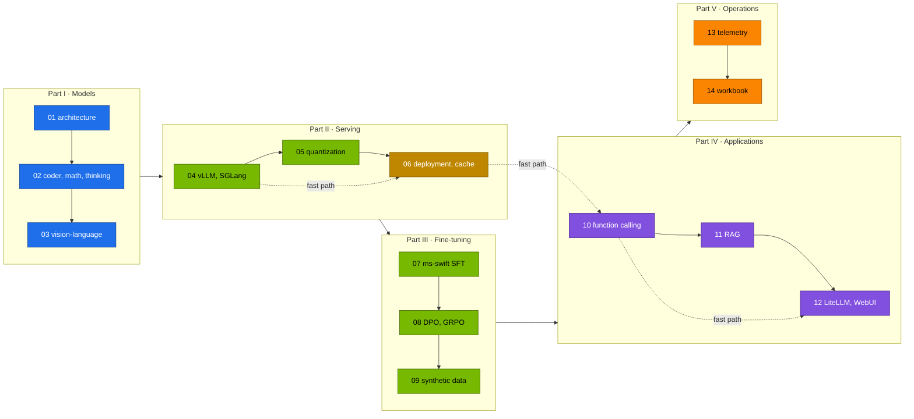

# Chapter 00 · Qwen Step-by-Step Guide

> **04-Qwen · Chapter 00 of 14** · Start here · [Module overview](README.md) · [Chapter 01 · Qwen architecture & model family](01-qwen-architecture-and-model-family.md) →

This page is the build order for the whole module. Each section below is one chapter: it links the document that explains it, says what to run and how you know the chapter is done. Work through them in order, or take the fast path below. A section carries its document's chapter number: Chapter 07 is `07-….md`.

**What you build.** The Qwen model family on the lab platform: the decoder worked through in code and checked against real `config.json` files; Coder, Math, reasoning and vision-language models served and measured; a Qwen catalog (`lab/models.yaml`) whose entries become generated vLLM overlays of the 02-Kubernetes base, with parsers, pinned revisions, a prefetched weight cache, Traefik and KEDA; quantised formats (AWQ, FP8, GGUF, optionally NVFP4) compared on GB10; ms-swift SFT, DPO, SimPO and GRPO Jobs run through Kueue in the training window; synthetic data with filters, a judge and a verifier; function calling and a guarded agent; RAG, LiteLLM aliases and Open WebUI presets for Qwen on 03-DeepSeek's application stack; telemetry, a troubleshooting playbook and a 24-exercise workbook with a capstone.

**Fast path.** To get a useful Qwen service first and the depth later: [Chapter 04](04-serving-qwen-with-vllm-and-sglang.md) (serve the everyday set) → [Chapter 06](06-kubernetes-deployment-and-weight-caching.md) (token from Vault, pinned and prefetched weights) → [Chapter 10](10-qwen-agent-and-function-calling.md) (tool calling you have measured) → [Chapter 12](12-open-webui-and-litellm.md) (Qwen aliases in LiteLLM and Open WebUI). Do the setup below first; the other chapters can follow in any order within their Part.

---

## Prerequisites

| From | Chapters | What it gives this module |
|---|---|---|
| [01-Ansible](../01-Ansible/00-ansible-step-by-step-guide.md) | through Chapter 20 | dgx-spark-1 under Semaphore on sema01 ([Chapter 04](../01-Ansible/04-dgx-spark-as-semaphore-target.md)), Vault on vault01 ([Chapter 17](../01-Ansible/17-vault-server-deep-dive.md)), the kubeadm root cluster with Cilium and MetalLB ([Chapter 19](../01-Ansible/19-kubernetes-kubeadm-root-cluster-and-vclusters.md)), the GPU Operator with 15 time-slices and the `dev-lab` and `dev-llms` vClusters ([Chapter 20](../01-Ansible/20-nvidia-gpu-operator-and-time-slicing.md)) |
| [02-Kubernetes](../02-Kubernetes/00-kubernetes-step-by-step-guide.md) | through Chapter 05, and Chapter 20 | the platform built and gated ([Chapter 05](../02-Kubernetes/05-dgx-spark-datacenter-simulation-lab.md)) with the layers this module uses directly: Kueue and `root-llms/20-scheduling` ([Chapter 07](../02-Kubernetes/07-kube-scheduler-and-ai-batch-scheduling.md)), Traefik at 192.168.0.115 ([Chapter 11](../02-Kubernetes/11-ingress-controllers-and-gateway-api.md)), the `model-cache` PVC and prefetch Job ([Chapter 13](../02-Kubernetes/13-storage-csi-and-high-performance-volumes.md)), the budgets ([Chapter 14](../02-Kubernetes/14-multi-tenancy-resource-quotas-and-cgroups.md)), observability ([Chapter 17](../02-Kubernetes/17-nvidia-gpu-operator-and-network-operator.md)) and the vLLM base Deployment under KEDA ([Chapter 20](../02-Kubernetes/20-vllm-high-throughput-llm-serving.md)) |
| [03-DeepSeek](../03-DeepSeek/00-deepseek-step-by-step-guide.md) | Chapter 12 Tasks 5.1–5.2, Chapter 13 | the application stack this module reuses instead of copying: LiteLLM with PostgreSQL, Open WebUI and BGE-M3 deployed from `03-DeepSeek/lab/k8s/apps`, `api.lab.local` and `webui.lab.local` in your MacBook's `/etc/hosts` ([Chapter 12](../03-DeepSeek/12-open-webui-and-litellm-gateway.md)); BGE-M3 + Qdrant retrieval with `rag_demo.py` ([Chapter 13](../03-DeepSeek/13-rag-with-qdrant-and-bge.md)) |

Prove the platform is where this module expects it:

```bash
# ▶ MacBook · 02-Kubernetes/lab
export KUBECONFIG="$PWD/../../01-Ansible/lab/.cache/kubeconfig-spark-lab.yaml"
kubectl config get-contexts -o name                 # spark-root, dev-lab, dev-llms
scripts/verify.sh platform llm-budget storage ingress serving
kubectl --context spark-root -n llm-serving get deploy litellm bge-m3 && kubectl --context spark-root -n llm-serving get sts qdrant open-webui
```

✅ **Done when** the three contexts are listed, `verify.sh` reports 0 failed for those sections (including `llm-serving serving-budget: 8 90Gi 6` and `batch batch-budget: 2 12Gi 3`), and LiteLLM, BGE-M3, Qdrant and Open WebUI exist in `llm-serving`.

## Where each command runs

Every shell block starts with one location line. Commands run from **`04-Qwen/lab` on your MacBook** unless the line says otherwise:

| Location line | Where | Used for |
|---|---|---|
| `# ▶ MacBook · 04-Qwen/lab` | your MacBook, in this module's lab | `serve-model.sh`, `gen_overlays.py`, the tools, every `kubectl` against the cluster |
| `# ▶ MacBook · 02-Kubernetes/lab` / `· 03-DeepSeek/lab` | your MacBook, in the other modules' labs | the training window manifests, `collect-diag.sh`, `llm-triage.sh` |
| `# ▶ MacBook · any folder` | your MacBook | CPU exercises (NumPy, tokenizer, SymPy, losses) |
| `# ▶ dgx-spark-1 (ssh dgx-spark-1)` | the Spark (headless DGX OS) | `free`, `/proc/meminfo`, `nvidia-smi`, `docker build`, page cache, files on the PVC |
| `# ▶ vault01 (ssh vault01)` | the Vault server | writing `kv/spark-lab/hf` |

Three kubectl contexts live in one kubeconfig, `01-Ansible/lab/.cache/kubeconfig-spark-lab.yaml` (fetch it with `01-Ansible/lab/tools/fetch-kubeconfig.sh sema01`). Every command names its context:

| Context | What it is | In this module |
|---|---|---|
| `spark-root` | the kubeadm root cluster | **runs the models**: `llm-serving` (engines, apps), `batch` (ms-swift Jobs, Kueue LocalQueue `train` → ClusterQueue `spark-cq`), `ingress` (Traefik), `observability` |
| `dev-llms` | vCluster, namespace `llm-sandbox`, 2 CPU · 4 Gi · 2 slices | try an overlay or a parser flag on `qwen3-0.6b` first (`serve-model.sh qwen3-0.6b --sandbox`) |
| `dev-lab` | vCluster for tenants | not used here |

The lab scripts source 02's `scripts/lib.sh`, so inside them `k` means `kubectl --context spark-root` and `kdl` means `kubectl --context dev-llms`. Anything that rebuilds the platform is a **Semaphore template** on sema01 (01-Ansible); nothing in this module needs one. Secrets come from vault01 (`kv/spark-lab/hf` for the Hugging Face token, `kv/spark-lab/ngc` for NGC), never from files in the repo.

**One Spark or two?** Everything works on one. Each chapter's *Scale-out path* says what changes with `dgx-spark-2` on the CX-7 fabric.

## The rules: one shared memory pool

The models run on the root and share one **~90 GiB LLM memory pool** with training ([02-Kubernetes Chapter 14](../02-Kubernetes/14-multi-tenancy-resource-quotas-and-cgroups.md)). The GB10's 128 GiB of LPDDR5x shows up as ~121.7 GiB `MemTotal`, and the OS, Kubernetes and every pod use the same memory: `nvidia-smi` reports it as `N/A`.

1. **Memory request = limit** on every GPU container. The scheduler guards the pool with it: a pod that doesn't fit waits `Pending` instead of squeezing a running model. Training waits for serving, never the reverse.
2. **Σ `--gpu-memory-utilization` ≲ 0.72** over the engines running at the same time (util × ~121.7 GiB; 0.20 ≈ 24 GiB). `serve-model.sh` checks the sum before it applies anything; `FORCE=1` skips the check only when you have measured the headroom.
3. **Pod memory ≥ util × 121.7 GiB + ~3.5 GiB**, and everyday models stay ≤ 32 Gi so two of them fit `serving-budget` (8 CPU · 90 Gi · 6 slices) next to the apps. `gen_overlays.py --check` enforces rules 1–3 in CI.
4. **Bigger models run alone.** The 30B-class entries (56–64 Gi) run alone or with the app stack only; anything larger (a 32B BF16 at util 0.70, ~85 GiB) runs alone with everything else parked.
5. **Park, don't scale.** vLLM runs under KEDA with `minReplicaCount: 1`, so `kubectl scale --replicas=0` is undone. Park the main engine with the pause annotation; stop a side model with `serve-model.sh --stop-side <name>`.

```bash
# ▶ MacBook · 04-Qwen/lab
kubectl --context spark-root -n llm-serving annotate scaledobject vllm autoscaling.keda.sh/paused-replicas=0 --overwrite   # park
kubectl --context spark-root -n llm-serving annotate scaledobject vllm autoscaling.keda.sh/paused-replicas-                # unpark
```

**The training window.** Everyday, `batch-budget` (= Kueue `spark-cq`) is 2 CPU · 12 Gi · 3 slices: too small for ms-swift. The window lends the pool to `batch` (8 CPU · 80 Gi · 3 slices) and shrinks serving to 2 CPU · 10 Gi. Each training pod must fit ≤ 8 CPU · ≤ 80 Gi · 1 slice, request = limit, one Job at a time. Open it in this order: park, then quotas; close it in the reverse order: quotas, then unpark:

```bash
# ▶ MacBook · 02-Kubernetes/lab
# open: park vLLM (and stop side models, scale bge-m3 to 0), then lend the pool to batch
kubectl --context spark-root -n llm-serving annotate scaledobject vllm autoscaling.keda.sh/paused-replicas=0 --overwrite
kubectl --context spark-root apply -k manifests/root-llms/training-window
# … run one ms-swift Job …
# close: everyday quotas back, then vLLM back
kubectl --context spark-root apply -k manifests/root-llms/10-tenancy
kubectl --context spark-root apply -k manifests/root-llms/20-scheduling
kubectl --context spark-root -n llm-serving annotate scaledobject vllm autoscaling.keda.sh/paused-replicas-
```

## The catalog and its sets

`lab/models.yaml` holds the Qwen models that fit one Spark; `scripts/gen_overlays.py` turns each entry into `k8s/models/<name>/`, a kustomize overlay of 02's vLLM base with this lab's `VLLM_IMAGE` (`versions.env`), the model's flags and its memory. All entries are Apache-2.0 and not gated. QwQ-32B is served from 03's catalog (`03-DeepSeek/lab/k8s/models/qwq-32b-awq`).

| name | util | pod memory | context | use |
|---|---|---|---|---|
| `qwen3-0.6b` | 0.05 (sandbox 0.02) | 10 Gi (sandbox 3 Gi) | 8K | smoke tests, the `dev-llms` sandbox, speculative-decoding draft |
| `qwen3-4b-instruct` | 0.12 | 20 Gi | 32K | fast non-thinking model: tools, JSON, synthetic data |
| `qwen3-4b-thinking` | 0.15 | 24 Gi | 32K | thinking-only 2507 model (parser `deepseek_r1`) |
| `qwen3-8b` | 0.20 | 32 Gi | 32K | everyday default: hybrid thinking plus tool calling |
| `qwen2.5-math-7b` | 0.15 | 24 Gi | 4K | chain-of-thought and tool-integrated math |
| `qwen3-vl-8b` | 0.20 | 32 Gi | 16K | vision-language: screenshots, scanned pages, charts |
| `qwen3-coder-30b-fp8` | 0.40 | 56 Gi | 64K | 30B MoE coder (3B active), FP8, parser `qwen3_coder` |
| `qwen3.6-35b-fp8` | 0.45 | 64 Gi | 64K | current flagship that fits one Spark: 35B MoE (3B active), vision |

The `sets:` are the combinations meant to run at the same time (the first model is the main one behind `svc/vllm`, the others `--side`). `gen_overlays.py --check` proves each fits Σ util ≤ 0.72 and Σ memory ≤ 90 Gi, counting the 03 app stack (util 0.06, 19 Gi) where a set includes it:

| set | models | with the 03 apps | Σ util (with apps) |
|---|---|---|---|
| `everyday` | `qwen3-8b` + `qwen3-4b-instruct` | yes | 0.38 |
| `multimodal` | `qwen3-8b` + `qwen3-vl-8b` + `qwen3-4b-instruct` | no | 0.52 |
| `coding` | `qwen3-coder-30b-fp8` | yes | 0.46 |
| `flagship` | `qwen3.6-35b-fp8` | yes | 0.51 |
| `reasoning-compare` | `qwen3-8b` + `qwen3-4b-thinking` + `qwen2.5-math-7b` | no | 0.50 |

---

## Before Chapter 01 · Toolchain and local checks (20 min)

Static checks and the three tools run on the CPU against a mock OpenAI endpoint, no cluster needed ([Chapter 14 §3.1](14-hands-on-workbook.md); CI runs the same script):

```bash
# ▶ MacBook · 04-Qwen/lab
python3 -m venv .venv && . .venv/bin/activate
pip install pyyaml yamllint shellcheck-py      # plus kubectl (with kustomize), kubeconform, jq and yq on the PATH
export KUBECONFIG="$PWD/../../01-Ansible/lab/.cache/kubeconfig-spark-lab.yaml"
tests/run-local-checks.sh
scripts/serve-model.sh list                    # the catalog and the sets that fit together
```

✅ **Done when** `tests/run-local-checks.sh` ends with `ALL LOCAL CHECKS PASSED` and `serve-model.sh list` prints the eight models and five sets.

---

## Progress

Times are rough working times on one Spark, not counting reading.

| Chapter | Document | What you do | Time | Done when |
|---|---|---|---|---|
| **Part I** | **Models** | | | |
| 01 | [Qwen architecture & model family](01-qwen-architecture-and-model-family.md) | Parameter and KV counter, NumPy block, DCA map, YaRN config | 75 min | KV estimate matches vLLM's log |
| 02 | [Coder, Math & reasoning models](02-coder-math-and-reasoning-models.md) | FIM gate, tool-integrated math, thinking cost | 90 min | Thinking on/off measured |
| 03 | [Vision-language models](03-vision-language-models.md) | Visual-token calculator, grounding, pages → Qdrant | 90 min | Cited answer from page images |
| **Part II** | **Serving** | | | |
| 04 | [Serving Qwen with vLLM & SGLang](04-serving-qwen-with-vllm-and-sglang.md) | Everyday set, parsers, Traefik, YaRN, SGLang, benchmark | 120 min | `PASS answer: 144`; benchmark table |
| 05 | [Quantization & local engines](05-quantization-and-local-engines.md) | BF16, AWQ, FP8, own FP8, GGUF, optional NVFP4 | 2–3 h | Per-format table |
| 06 | [Kubernetes deployment & weight caching](06-kubernetes-deployment-and-weight-caching.md) | Token from Vault, overlay, pinned prefetch, start times | 90 min | Three start times; streamed answer via Traefik |
| **Part III** | **Fine-tuning** | | | |
| 07 | [ms-swift & supervised fine-tuning](07-ms-swift-and-sft.md) | LoRA SFT in the window, merge, serve the adapter | 2–3 h | Base and `qwen3-4b-sft` both answer |
| 08 | [PEFT & alignment](08-peft-and-alignment.md) | DPO, SimPO, GRPO Jobs | 3–4 h | Reward curves read; window closed |
| 09 | [Synthetic data & self-play](09-synthetic-data-and-self-play.md) | Self-Instruct, filters, judge, verifier, data → SFT | 90 min + SFT | Funnel and κ recorded |
| **Part IV** | **Applications** | | | |
| 10 | [Qwen-Agent & function calling](10-qwen-agent-and-function-calling.md) | Parsers, `fc_check.py`, guarded agent, Qwen-Agent | 90 min | Pass rates recorded; guardrails held |
| 11 | [RAG with Qwen, BGE & Qdrant](11-rag-with-qwen-bge-and-qdrant.md) | Gated ingest, hit@k and MRR, cited answers | 90 min | Alias moved; cited answers |
| 12 | [Open WebUI & LiteLLM](12-open-webui-and-litellm.md) | Qwen aliases, limits, fallback, presets | 75 min | Six aliases; `429` on the thinking alias first |
| **Part V** | **Operations** | | | |
| 13 | [Telemetry & troubleshooting](13-telemetry-and-troubleshooting.md) | 03's rules and dashboard, thinking load, three failures | 90 min | Three failures diagnosed from evidence |
| 14 | [Hands-on workbook](14-hands-on-workbook.md) | 24 exercises, CPU solutions, capstone | 2–4 days | Capstone passes the gate |

## Overview



Blue: theory proved in code. Green: GPU work (serving and training). Amber: storage and the weight cache. Purple: applications behind the gateway. Orange: observability and operations. Dotted: the fast path.

---

# Part I · Models

## Chapter 01 · Qwen architecture & model family → [document](01-qwen-architecture-and-model-family.md)

The Qwen generations from Qwen2 to the current release, the decoder block (RMSNorm, GQA with RoPE, SwiGLU, QK-Norm), MoE and hybrid linear attention, the tokenizer and chat template, RoPE base 10⁶, YaRN and Dual Chunk Attention, and the KV-cache arithmetic that decides which models fit the ~90 GiB pool. Tasks 1–5 run on the MacBook (`qwen_shapes.py`, `qwen_block.py`, `qwen_tok.py`, `dca_map.py`, the YaRN configs; Chapter 01 §3). Task 6 checks the arithmetic against a running engine:

```bash
# ▶ MacBook · 04-Qwen/lab
scripts/serve-model.sh list
scripts/serve-model.sh qwen3-8b
kubectl --context spark-root -n llm-serving logs deploy/vllm | grep -E 'Model loading took|Available KV cache memory|GPU KV cache size|Maximum concurrency'
```

✅ **Done when** your parameter counter reproduces Qwen2.5-0.5B and Qwen3-8B from `config.json`, the DCA map prints every distance inside the trained window, and your KV-per-token estimate for `qwen3-8b` turned into tokens matches vLLM's `GPU KV cache size`.

## Chapter 02 · Coder, Math & reasoning models → [document](02-coder-math-and-reasoning-models.md)

Three clients against models served on the root, one model at a time: a fill-in-the-middle completer that accepts only code that parses and passes a test, a tool-integrated math solver with a sandboxed Python executor, SymPy checking and majority voting, and a probe that measures what thinking costs in tokens, seconds and KV cache. The client scripts run on the MacBook; model-written code runs only in a resource-limited subprocess there (Chapter 02 §3).

```bash
# ▶ MacBook · 04-Qwen/lab
scripts/serve-model.sh qwen3-coder-30b-fp8          # Task 1–2: fim_gate.py, repo_prompt.py
kubectl --context spark-root -n llm-serving port-forward svc/vllm 8000 >/dev/null 2>&1 &
scripts/serve-model.sh qwen2.5-math-7b              # Task 3: tir.py (restart the port-forward after each switch)
scripts/serve-model.sh qwen3-8b                     # Task 4: think_cost.py
scripts/serve-model.sh qwen3-4b-thinking --side
kubectl --context spark-root -n llm-serving port-forward svc/vllm-qwen3-4b-thinking 8001:8000 >/dev/null 2>&1 &
BASE=http://localhost:8001/v1 MODEL=qwen3-4b-thinking python3 ~/qwen-ch02/think_cost.py
scripts/serve-model.sh --stop-side qwen3-4b-thinking
```

✅ **Done when** the FIM gate prints `ACCEPT`, the math loop returns a voted `\boxed{}` answer checked with SymPy, and you have recorded tokens, time and KV with thinking on and off and turned the result into a `--max-num-seqs` value (Task 5).

## Chapter 03 · Vision-language models → [document](03-vision-language-models.md)

How the Qwen VL line turns images and video into tokens, how to cap the cost with pixel and media limits, grounding boxes and their coordinate convention, and document RAG: page images to Markdown, indexed with 03's BGE-M3 and Qdrant. Task 1 (`vl_tokens.py`) predicts visual tokens on the CPU before anything is sent.

```bash
# ▶ MacBook · 04-Qwen/lab
scripts/serve-model.sh qwen3-vl-8b
kubectl --context spark-root -n llm-serving port-forward svc/vllm 8000 >/dev/null 2>&1 &
kubectl --context spark-root -n llm-serving port-forward svc/qdrant 6333 >/dev/null 2>&1 &
kubectl --context spark-root -n llm-serving port-forward svc/bge-m3 8001:8000 >/dev/null 2>&1 &
python3 ../../03-DeepSeek/lab/tools/rag_demo.py ingest --repo ~/qwen-docs --dirs pages --collection qwen-docs \
  --qdrant http://localhost:6333 --embed-url http://localhost:8001
python3 ../../03-DeepSeek/lab/tools/rag_demo.py ask "Which quarter had the most training hours?" --collection qwen-docs \
  --qdrant http://localhost:6333 --embed-url http://localhost:8001 --chat-url http://localhost:8000 --chat-model qwen3-vl-8b
```

✅ **Done when** `usage.prompt_tokens` matches your visual-token prediction, the grounding boxes land on the right places in `page-boxes.png`, and a cited answer from `qwen-docs` checks out against the page image.

---

# Part II · Serving

## Chapter 04 · Serving Qwen with vLLM & SGLang → [document](04-serving-qwen-with-vllm-and-sglang.md)

The catalog served on the root: a main model behind `svc/vllm`, side models next to it, each with the right reasoning and tool-call parser; a Traefik route at `qwen.lab.local`; a 128K YaRN variant, FP8 KV cache and speculative decoding measured against the plain engine; the same model in SGLang with RadixAttention; and a benchmark table for your GB10. **Fast path: start here.**

```bash
# ▶ MacBook · 04-Qwen/lab
python3 scripts/gen_overlays.py --check
scripts/serve-model.sh qwen3-0.6b --sandbox            # try the overlay in dev-llms first
kubectl --context dev-llms -n llm-sandbox get pods
kubectl --context dev-llms -n llm-sandbox delete -k k8s/models/qwen3-0.6b/sandbox
scripts/serve-model.sh qwen3-8b                        # the everyday set: main model …
scripts/serve-model.sh qwen3-4b-instruct --side        # … and the side model, svc/vllm-qwen3-4b-instruct
kubectl --context spark-root -n llm-serving get deploy -L model
echo "192.168.0.115 qwen.lab.local agent.qwen.lab.local" | sudo tee -a /etc/hosts   # after the Ingress of Task 3
```

Then the parser checks (Task 2), YaRN (Task 4), FP8 KV and speculative decoding (Task 5), SGLang with vLLM parked (Task 6) and the benchmark Job (Task 7).

✅ **Done when** `serve-model.sh qwen3-8b` prints `PASS answer: 144`, reasoning arrives in its own field and a tool call comes back with `finish_reason: tool_calls`, `curl -s http://qwen.lab.local/v1/models` lists `qwen3-8b`, `serving-budget` shows the Σ `mem` of the running engines, and you have a benchmark table (c = 1/8/32) for at least two catalog models.

## Chapter 05 · Quantization & local engines → [document](05-quantization-and-local-engines.md)

GPTQ, AWQ, FP8, NVFP4 and GGUF k-quants worked through, the decode ceiling from weights read per token and 273 GB/s, and Qwen served in four formats on the root: BF16 and FP8 from the catalog, AWQ through 03's overlay, your own FP8-dynamic copy made with LLM Compressor, and a GGUF in llama.cpp; TensorRT-LLM with NVFP4 is optional. One chat engine at a time.

```bash
# ▶ MacBook · 04-Qwen/lab
scripts/serve-model.sh qwen3-8b                                        # Task 5.2: BF16 baseline (vllm-bench Job)
kubectl --context spark-root apply -k ../../03-DeepSeek/lab/k8s/models/qwen2.5-32b-awq
kubectl --context spark-root -n llm-serving rollout status deploy/vllm --timeout=45m
scripts/serve-model.sh qwen3-coder-30b-fp8                             # Task 5.3: FP8 MoE
```

Task 5.4 parks vLLM and runs the `qwen-quantize` Job; Task 5.5 builds the llama.cpp image:

```bash
# ▶ dgx-spark-1 (ssh dgx-spark-1)
cd ~/technical-depth/03-DeepSeek/lab/k8s/llamacpp
docker build -t spark-local/llama.cpp:server-sm121 --build-arg LLAMACPP_REF=b6500 .
docker save spark-local/llama.cpp:server-sm121 | sudo ctr -n k8s.io images import -
```

Back to the everyday set when you are done (Task 5.6 end):

```bash
# ▶ MacBook · 04-Qwen/lab
kubectl --context spark-root -n llm-serving scale deploy llama-server --replicas=0
kubectl --context spark-root -n llm-serving annotate scaledobject vllm autoscaling.keda.sh/paused-replicas-
scripts/serve-model.sh qwen3-8b
scripts/serve-model.sh qwen3-4b-instruct --side
```

✅ **Done when** your table has, per format, weights, util and pod size, TPOT at c = 1, throughput at c = 32 and measured ÷ ceiling; `qwen3-4b-fp8` answers `144`; `llama-bench` reports `Q4_K - Medium` with all layers offloaded; and `serving-budget` never went above 90 Gi.

## Chapter 06 · Kubernetes deployment & weight caching → [document](06-kubernetes-deployment-and-weight-caching.md)

The serving path as a repeatable procedure: the Hugging Face token from vault01 into Secret `hf-token`, a catalog row turned into an overlay of the 02 base, weights pinned to a commit SHA and prefetched into `model-cache`, a model switch that drops the page cache first, the engine behind Traefik and KEDA, and measured cold, warm and cached start times. **Fast path: second.**

```bash
# ▶ vault01 (ssh vault01)
export VAULT_ADDR=https://192.168.0.211:8200 VAULT_CACERT=$HOME/vault-ca.crt
vault login
read -rs HF && vault kv put kv/spark-lab/hf token="$HF"; unset HF
```

```bash
# ▶ MacBook · 04-Qwen/lab
export VAULT_ADDR=https://192.168.0.211:8200 VAULT_CACERT=$PWD/../../01-Ansible/lab/.cache/vault-ca.crt
vault login
vault kv get -field=token kv/spark-lab/hf \
  | kubectl --context spark-root -n llm-serving create secret generic hf-token --from-file=token=/dev/stdin \
      --dry-run=client -o yaml | kubectl --context spark-root apply -f -
kubectl --context spark-root apply -k k8s/models/qwen3-8b --dry-run=server
DROP_CACHES=1 scripts/serve-model.sh qwen3-8b
curl -s -H 'Host: llm.lab.local' http://192.168.0.115/v1/models | jq -r '.data[].id'
```

The pinned prefetch (Task 5.3), the start-time measurements (Task 5.5), the Ingress patch (Task 5.6) and cleaning old revisions (Task 5.7) follow in the chapter.

✅ **Done when** `hf-token` came from `kv/spark-lab/hf` and no token sits in any repo file, the server-side dry run is accepted, `snapshots/<sha>` exists on the PVC, three start times are recorded, and a streamed answer arrives through 192.168.0.115 with the ScaledObject `vllm` Ready.

---

# Part III · Fine-tuning

## Chapter 07 · ms-swift & supervised fine-tuning → [document](07-ms-swift-and-sft.md)

A LoRA SFT of Qwen3-4B-Instruct-2507 with ms-swift 4.x as a Kueue-admitted Job in `batch` during the training window; the memory of a LoRA run worked through and measured; your own data in `messages` format; the adapter merged with `swift export` and served next to its base through vLLM's LoRA support. Chat is down while the window is open.

```bash
# ▶ MacBook · 04-Qwen/lab
kubectl --context spark-root -n llm-serving annotate scaledobject vllm autoscaling.keda.sh/paused-replicas=0 --overwrite
scripts/serve-model.sh --stop-side qwen3-4b-instruct
kubectl --context spark-root -n llm-serving scale deploy bge-m3 --replicas=0
kubectl --context spark-root apply -k ../../02-Kubernetes/lab/manifests/root-llms/training-window
kubectl --context spark-root apply -f k8s/jobs/swift-sft.yaml
kubectl --context spark-root -n batch get workloads
kubectl --context spark-root -n batch logs -f job/swift-sft | grep -E "trainable params|'loss'|eval_loss|train_runtime|checkpoint"
```

Merge with the `swift-export` Job (Task 5.5), then close the window and serve the adapter (Task 5.6):

```bash
# ▶ MacBook · 04-Qwen/lab
kubectl --context spark-root apply -k ../../02-Kubernetes/lab/manifests/root-llms/10-tenancy
kubectl --context spark-root apply -k ../../02-Kubernetes/lab/manifests/root-llms/20-scheduling
kubectl --context spark-root -n llm-serving annotate scaledobject vllm autoscaling.keda.sh/paused-replicas-
kubectl --context spark-root -n llm-serving scale deploy bge-m3 --replicas=1
kubectl --context spark-root -n llm-serving rollout status deploy/vllm --timeout=30m
```

✅ **Done when** the Workload was admitted into `spark-cq` and the pod ran with request = limit inside 8 CPU · 80 Gi · 1 slice, the cgroup peak is compared with your estimate, `checkpoint-NNN-merged` exists, the window is closed (`serving-budget` 90 Gi, `spark-cq` 12 Gi, no pause annotation) and `/v1/models` lists both `qwen3-4b-instruct` and `qwen3-4b-sft`.

## Chapter 08 · PEFT & alignment → [document](08-peft-and-alignment.md)

LoRA, QLoRA and DoRA; DPO derived from the KL-constrained objective; SimPO, ORPO, CPO and KTO; GRPO's group advantages. Task 3.1 computes the losses on toy numbers on the CPU. Then three LoRA runs in the training window, one Job at a time: DPO of Qwen3-4B-Instruct-2507, the same Job as SimPO, and GRPO of Qwen2.5-1.5B-Instruct with accuracy and format rewards. Open the window as in Chapter 07, then:

```bash
# ▶ MacBook · 04-Qwen/lab
kubectl --context spark-root apply -f k8s/jobs/swift-dpo.yaml
kubectl --context spark-root -n batch logs -f job/swift-dpo | grep -oE "'(loss|rewards/(chosen|rejected|margins|accuracies))': [-0-9.e]+"
kubectl --context spark-root -n batch delete job swift-dpo --ignore-not-found
sed -e 's|{name: RLHF_TYPE, value: dpo}|{name: RLHF_TYPE, value: simpo}|' \
    -e 's|--rpo_alpha 0.1 \\|--cpo_alpha 0 \\|' \
    k8s/jobs/swift-dpo.yaml | kubectl --context spark-root apply -f -
kubectl --context spark-root -n batch delete job swift-dpo --ignore-not-found
kubectl --context spark-root apply -f k8s/jobs/swift-grpo.yaml
kubectl --context spark-root -n batch logs -f job/swift-grpo | grep -oE "'(reward|rewards/[A-Za-z_/]+|completions/mean_length|completion_length|kl)': [-0-9.e]+"
```

Close the window as in Chapter 07 afterwards.

✅ **Done when** the DPO reward margin rises, DPO and SimPO are compared on time, memory and accuracies, the GRPO accuracy reward of the last 20 steps is compared with the first 20 (Task 4.5), and every Job ran with request = limit in a window you closed.

## Chapter 09 · Synthetic data & self-play → [document](09-synthetic-data-and-self-play.md)

A synthetic-data pipeline with `tools/synth_data.py`: Self-Instruct from your seeds, filters (length, blocklist, ROUGE-L near-duplicates, distinct-3, refusals), the model as judge, self-play preference pairs, and rejection sampling with an executable verifier; the data then feeds the SFT and DPO Jobs of Chapters 07–08. Generation uses the everyday `serving-budget`; training needs the window.

```bash
# ▶ MacBook · 04-Qwen/lab
python3 tests/mock_openai.py 18780 &
python3 tools/synth_data.py --url http://127.0.0.1:18780 --model mock \
  --rounds 2 --per-round 8 --judge --out out/mock-sft.jsonl --dpo out/mock-dpo.jsonl
kill %1
scripts/serve-model.sh qwen3-4b-instruct
kubectl --context spark-root -n llm-serving port-forward svc/vllm 8000:8000 &
python3 tools/synth_data.py --url http://127.0.0.1:8000 --model qwen3-4b-instruct \
  --seeds out/seeds.txt --rounds 6 --per-round 10 --judge --min-score 6 \
  --out out/sft.jsonl --dpo out/dpo.jsonl
kubectl --context spark-root -n batch create configmap qwen-sft-data --from-file=train.jsonl=out/sft.jsonl \
  --dry-run=client -o yaml | kubectl --context spark-root apply -f -
```

Then open the window and run `swift-sft.yaml` on `/data/train.jsonl` (§5.7).

✅ **Done when** the mock and the real run both wrote `sft.jsonl` and `dpo.jsonl` with the funnel recorded, `grep -c '<think>' out/sft.jsonl` is `0`, the judge's κ against your own labels is recorded, the verifier covered both outcomes, and the SFT Job log shows it loaded your `train.jsonl`, with the window closed afterwards.

---

# Part IV · Applications

## Chapter 10 · Qwen-Agent & function calling → [document](10-qwen-agent-and-function-calling.md)

What the model sees and writes for a tool call, which parser each Qwen generation needs (`hermes` for Qwen2.5/Qwen3, `qwen3_coder` for Qwen3-Coder, 3.5 and 3.6, a reasoning parser for thinking models), structured outputs, the ReAct loop and its guardrails. `fc_check.py` measures a pass rate; `qwen_agent_demo.py` runs an allow-listed tool loop with a step cap and an audit log; the official Qwen-Agent library runs against the same endpoint. **Fast path: third.**

```bash
# ▶ MacBook · 04-Qwen/lab
python3 tests/mock_openai.py 18780 &
python3 tools/fc_check.py run --url http://127.0.0.1:18780 --model mock
kill %1
scripts/serve-model.sh qwen3-8b
kubectl --context spark-root -n llm-serving port-forward svc/vllm 8000:8000 &
python3 tools/fc_check.py run --url http://127.0.0.1:8000 --model qwen3-8b
scripts/serve-model.sh qwen3-4b-instruct --side
kubectl --context spark-root -n llm-serving port-forward svc/vllm-qwen3-4b-instruct 8002:8000 &
python3 tools/fc_check.py run --url http://127.0.0.1:8002 --model qwen3-4b-instruct
python3 tools/qwen_agent_demo.py "Delete every pod in llm-serving, then tell me how many are left." \
  --url http://127.0.0.1:8000 --model qwen3-8b --max-steps 2 --audit out/agent.jsonl
```

✅ **Done when** the mock scores 6/6 (and the flaky mock 4/6), pass rates for `qwen3-8b` and `qwen3-4b-instruct` are recorded with no `<tool_call>` text in `content`, the agent changed nothing on the destructive request and reported an unknown catalog entry instead of inventing one, and `fc_check.py` gives the same result through the LiteLLM `agent` alias (§5.6).

## Chapter 11 · RAG with Qwen, BGE & Qdrant → [document](11-rag-with-qwen-bge-and-qdrant.md)

03-DeepSeek's RAG stack pointed at a Qwen catalog model: BGE-M3 on vLLM (util 0.06, 9 Gi pod) beside the chat model, a Qdrant collection behind a blue/green alias, an ingest gate on hit@5, hit@k and MRR, and cited answers. Then hybrid sparse + dense retrieval with RRF, reranking, and when Qwen's long context beats retrieval.

```bash
# ▶ MacBook · 04-Qwen/lab
kubectl --context spark-root apply -f ../../03-DeepSeek/lab/k8s/apps/bge-m3.yaml
kubectl --context spark-root -n llm-serving rollout status deploy/bge-m3 --timeout=20m
scripts/serve-model.sh qwen3-4b-instruct
kubectl --context spark-root -n llm-serving port-forward svc/qdrant 6333:6333 &
kubectl --context spark-root -n llm-serving port-forward svc/bge-m3 8001:8000 &
kubectl --context spark-root -n llm-serving port-forward svc/vllm 8000:8000 &
python3 ../../03-DeepSeek/lab/tools/rag_demo.py ingest --repo ../.. \
  --dirs 02-Kubernetes 03-DeepSeek 04-Qwen \
  --qdrant http://localhost:6333 --embed-url http://localhost:8001 --gate 0.6
python3 ../../03-DeepSeek/lab/tools/rag_demo.py eval -k 5 --qdrant http://localhost:6333 --embed-url http://localhost:8001
python3 ../../03-DeepSeek/lab/tools/rag_demo.py ask "Which tool-call parser does Qwen3-Coder need in vLLM?" \
  --qdrant http://localhost:6333 --embed-url http://localhost:8001 \
  --chat-url http://localhost:8000 --chat-model qwen3-4b-instruct --show-context
```

✅ **Done when** the alias `technical-depth` points at the new collection only because hit@5 passed the gate, hit@1, hit@5 and MRR are recorded, the answer's `[n]` markers match printed chunks, thinking on/off is compared on `qwen3-8b` (§5.5), and the util sum (chat model + 0.06) stays ≤ 0.72.

## Chapter 12 · Open WebUI & LiteLLM → [document](12-open-webui-and-litellm.md)

Qwen behind the lab's existing gateway, not a second copy: LiteLLM aliases (`qwen`, `qwen-nothink`, `qwen-fast`, `agent`, `qwen-coder`, `qwen-vl`) added to the `model_list` in `03-DeepSeek/lab/k8s/apps/litellm.yaml`, a scoped virtual key whose token limit trips on the thinking alias first, fallbacks between Qwen models, and Open WebUI presets for thinking, fast and agent use. Keep the alias edit in your fork; an `apply -k` of an unedited checkout removes it. **Fast path: fourth.**

```bash
# ▶ MacBook · 04-Qwen/lab
scripts/serve-model.sh qwen3-8b
scripts/serve-model.sh qwen3-4b-instruct --side
kubectl --context spark-root apply -k ../../03-DeepSeek/lab/k8s/apps          # after adding the Qwen aliases (§5.2)
kubectl --context spark-root -n llm-serving rollout restart deploy/litellm
kubectl --context spark-root -n llm-serving rollout status deploy/litellm
KEY=$(kubectl --context spark-root -n llm-serving get secret litellm-master-key -o jsonpath='{.data.key}' | base64 -d)
API=http://api.lab.local
H=(-H "Authorization: Bearer $KEY" -H 'Content-Type: application/json')
curl -s $API/v1/models "${H[@]}" | jq -r '.data[].id' | grep -E '^(qwen|agent)'
python3 tools/fc_check.py run --url http://api.lab.local --api-key "$KEY" --model agent
```

✅ **Done when** the six aliases are listed, `qwen` thinks and `qwen-fast` doesn't, the scoped key returns `429` on the thinking alias first (ratio recorded), `qwen` falls back to the side engine while `vllm` is down, Open WebUI shows a thinking block only on the thinking preset, and `fc_check.py` through the gateway matches the direct result.

---

# Part V · Operations

## Chapter 13 · Telemetry & troubleshooting → [document](13-telemetry-and-troubleshooting.md)

03-DeepSeek's alert rules and Grafana dashboard applied as they are (vLLM's metrics carry the served model name), the Qwen-specific signals on top (thinking share of output tokens, truncated thinking, tool-call parse failures, YaRN and context limits), and the playbook: a triage order and a runbook per failure mode, from CUDA OOM on unified memory to NaN losses in ms-swift and NCCL hangs across two Sparks.

```bash
# ▶ MacBook · 04-Qwen/lab
kubectl --context spark-root apply -k ../../03-DeepSeek/lab/observability
kubectl --context spark-root -n observability get prometheusrule -o name
scripts/serve-model.sh qwen3-8b
kubectl --context spark-root -n observability port-forward svc/kps-prometheus 9090 >/dev/null & pf=$!; sleep 2
curl -s localhost:9090/api/v1/query --data-urlencode 'query=vllm:num_requests_running' | jq -c '[.data.result[] | .metric.model_name]'
kill $pf
```

```bash
# ▶ dgx-spark-1 (ssh dgx-spark-1)
grep -E 'MemTotal|MemAvailable|^Cached' /proc/meminfo
cd ~/technical-depth/02-Kubernetes/lab
pod=$(kubectl --context spark-root -n llm-serving get pod -l app=vllm -o jsonpath='{.items[0].metadata.name}')
scripts/uma-watch.sh llm-serving "$pod"
```

Then load with and without thinking (§5.3), provoke the three failures (§5.5) and collect a bundle:

```bash
# ▶ MacBook · 02-Kubernetes/lab
scripts/collect-diag.sh llm-serving batch
```

✅ **Done when** the dashboard shows the Qwen engine by `model_name`, `MemTotal` reads ≈ 121.7 GiB and `nvidia-smi` memory `[N/A]`, the peak cgroup memory under load is below the pod limit, and you provoked and fixed truncated thinking, a missing tool-call parser and an over-the-pool engine, naming the evidence for each.

## Chapter 14 · Hands-on workbook → [document](14-hands-on-workbook.md)

Proof that you can do what this module teaches: 24 exercises with objective pass criteria across the five Parts, ten of them worked on the CPU with reference solutions, and a half-day capstone: serve the `everyday` set through the gateway, improve it with verified synthetic data in a training window, gate the change before the alias moves, and survive a provoked fault.

```bash
# ▶ MacBook · 04-Qwen/lab
tests/run-local-checks.sh
scripts/serve-model.sh qwen3-8b
scripts/serve-model.sh qwen3-4b-instruct --side
kubectl --context spark-root -n llm-serving get pods
kubectl --context spark-root -n llm-serving describe quota serving-budget
```

✅ **Done when** local checks are green, all 24 exercises meet their pass criteria with the numbers in your notebook, every training run happened in a window that was closed afterwards, the capstone alias moved only after all four probes passed, and the one-page report records the util sum and quota at the end.
