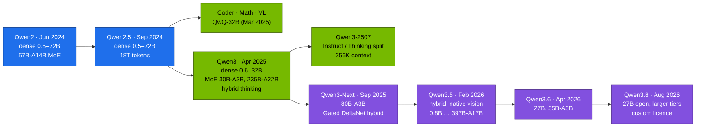
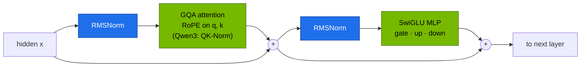

# Chapter 01 · Qwen Architecture & Model Family

> **04-Qwen · Part I — Models · Chapter 01 of 14** · ← [All chapters](00-qwen-step-by-step-guide.md) · [Chapter 02 · Coder, Math & reasoning models](02-coder-math-and-reasoning-models.md) →

| | |
|---|---|
| **You will build** | A working model of the Qwen decoder (RMSNorm, GQA with RoPE, SwiGLU, QK-Norm, MoE, hybrid linear attention) that you can check against real `config.json` files: a parameter counter, a KV-cache calculator, a RoPE/GQA block in NumPy, a Dual Chunk Attention position map — and the numbers that decide which Qwen models fit the Spark's ~90 GiB LLM memory pool |
| **Hardware** | Your MacBook (all CPU tasks) · dgx-spark-1 for the last task (one catalog model served on the root) |
| **Time** | 75 min |
| **Risk** | None. Read-only apart from switching the served model in `llm-serving` |
| **Clusters** | `spark-root` (Task 6 only: the served model's startup log) |
| **Lab files** | [`lab/models.yaml`](lab/models.yaml) (the Qwen catalog), [`lab/scripts/serve-model.sh`](lab/scripts/serve-model.sh), [`lab/versions.env`](lab/versions.env), 02-Kubernetes [`vllm.yaml`](../02-Kubernetes/lab/manifests/root-llms/90-serving/vllm/vllm.yaml) |

---

## 1. Why this matters on a Spark

On a discrete GPU you pick a model by "does it fit in VRAM". On a DGX Spark the question has three parts, and the architecture answers all of them:

1. **Weights** — parameters × bytes per parameter. A 32B dense model is ~65 GB in BF16, ~33 GB in FP8. An MoE model keeps *all* experts in memory even though each token uses a few.
2. **KV cache** — bytes per token × context × concurrent sequences. This depends on layers, KV heads and head dimension, not on parameter count: Qwen3-0.6B stores *more* KV per token than Qwen2.5-7B.
3. **Decode speed** — the GB10 reads memory at ~273 GB/s. Every generated token reads the active weights once, so the bytes of *active* parameters set a hard ceiling on tokens per second.

All three are charged against one pool. On the root, the LLM memory pool is ~90 GiB, shared by `llm-serving` and `batch`; every vLLM `--gpu-memory-utilization` value is a fraction of the ~121.7 GiB the GPU reports, and the values of all models running together must add up to **≲ 0.72** (02-Kubernetes [Chapter 20 §2](../02-Kubernetes/20-vllm-high-throughput-llm-serving.md)). The 04 catalog ([`lab/models.yaml`](lab/models.yaml)) records a util value per model; this chapter is where those values come from.

Qwen is a good family to learn this on: the same team has shipped dense models from 0.5B to 72B, three generations of MoE, and a hybrid linear-attention design, all with open weights, mostly under Apache 2.0, and all served by the same vLLM and SGLang code paths.

---

## 2. Concepts

### 2.1 The family, generation by generation



| Generation | Open-weight models | What changed in the architecture |
|---|---|---|
| **Qwen2.5** (Sep 2024) | 0.5B, 1.5B, 3B, 7B, 14B, 32B, 72B (base + Instruct); specialists Coder, Math, VL | Same block as Qwen2 (GQA, RoPE θ = 10⁶, SwiGLU, RMSNorm, QKV bias); 18T training tokens; 128K context through YaRN on 7B+ |
| **Qwen3** (Apr 2025) | dense 0.6B, 1.7B, 4B, 8B, 14B, 32B; MoE 30B-A3B, 235B-A22B | QKV bias removed, **QK-Norm** added; MoE without shared experts (128 experts, 8 active); one checkpoint with **thinking and non-thinking modes**; ~36T tokens, 119 languages |
| **Qwen3-2507** (Jul–Aug 2025) | 235B-A22B, 30B-A3B, 4B as separate `-Instruct-2507` and `-Thinking-2507` | same block; modes split into separate checkpoints; 262,144-token native context, ~1M with DCA + sparse attention |
| **Qwen3-Next** (Sep 2025) | 80B-A3B Instruct / Thinking | **hybrid attention**: 3 Gated DeltaNet (linear) layers per 1 gated full-attention layer; 512 experts (10 routed + 1 shared); multi-token-prediction head |
| **Qwen3.5** (Feb–Mar 2026) | 397B-A17B, 122B-A10B, 35B-A3B, 27B, 9B, 4B, 2B, 0.8B | the Qwen3-Next hybrid becomes the default, every model carries a vision encoder, 262K native context, MTP head |
| **Qwen3.6 / 3.8** (Apr / Aug 2026) | 3.6: 27B, 35B-A3B; 3.8: 27B (Apache 2.0), very large tiers under a custom licence | same hybrid family; coding and agent focus |

Model names, sizes and licences change every few months — check the current release on the Qwen Hugging Face organisation and pin what the lab pins ([`lab/versions.env`](lab/versions.env), [`lab/models.yaml`](lab/models.yaml)). The lab catalog spans the generations: Qwen3-0.6B, Qwen3-4B-Instruct/Thinking-2507 and Qwen3-8B (dense), Qwen2.5-Math-7B, Qwen3-VL-8B, Qwen3-Coder-30B-A3B in FP8 and Qwen3.6-35B-A3B in FP8 (hybrid). The hybrid models need vLLM 0.17 or later, which is why every 04 overlay replaces the 02 base image (vLLM 0.10) with the newer NGC tag in `versions.env`.

Some flagship tiers are API-only (Qwen2.5-Max, Qwen3-Max, the `-Plus` models). They are out of scope: nothing in this module depends on them.

### 2.2 The decoder block

Every Qwen dense model from Qwen2 to Qwen3 is a stack of identical pre-norm decoder blocks:



**RMSNorm** drops LayerNorm's mean subtraction and bias:

$$\text{RMSNorm}(x) = \frac{x}{\sqrt{\tfrac{1}{d}\sum_{i=1}^{d} x_i^2 + \epsilon}} \odot \gamma, \qquad \epsilon = 10^{-6}$$

It is cheaper (one reduction instead of two) and trains as stably as LayerNorm in pre-norm stacks.

**SwiGLU** replaces the two-matrix GELU MLP with three matrices and a gate:

$$\text{MLP}(x) = W_{\text{down}}\big(\text{SiLU}(W_{\text{gate}}x) \odot W_{\text{up}}x\big), \qquad \text{SiLU}(z) = \frac{z}{1+e^{-z}}$$

With three matrices instead of two, an intermediate size of about $\tfrac{8}{3}d$ keeps the parameter count of a classic $4d$ MLP. Qwen sizes it more generously: Qwen2.5-7B has $d = 3584$ and an intermediate size of 18,944 (5.3 d). The MLP holds most of each block's parameters — about 87 % in Qwen2.5-7B, 78 % in Qwen3-8B (Task 1 prints the split per layer).

**Attention** is grouped-query attention with rotary position embeddings (§2.4, §2.5). Two details differ by generation:

| Detail | Qwen2 / Qwen2.5 | Qwen3 | Why it matters |
|---|---|---|---|
| bias on q, k, v projections | yes | no | checkpoint conversion and LoRA target lists differ |
| QK-Norm (RMSNorm on each q and k head before RoPE) | no | yes | bounds attention logits, steadier training at scale |
| tied input/output embeddings | 0.5B, 1.5B, 3B | 0.6B, 1.7B, 4B | in small models the 151,936 × d embedding is a large share of all weights |
| `head_dim` | `hidden_size / num_heads` | set explicitly to 128 | Qwen3-0.6B has 8 KV heads of 128 → large KV per token for its size |

### 2.3 Configurations you will use

Qwen2.5 dense (from each model's `config.json`; context = native / with YaRN):

| Model | Params | Layers | Hidden | FFN | Q heads | KV heads | head_dim | vocab_size | Context |
|---|---|---|---|---|---|---|---|---|---|
| 0.5B | 0.49B | 24 | 896 | 4,864 | 14 | 2 | 64 | 151,936 | 32K |
| 1.5B | 1.54B | 28 | 1,536 | 8,960 | 12 | 2 | 128 | 151,936 | 32K |
| 3B | 3.09B | 36 | 2,048 | 11,008 | 16 | 2 | 128 | 151,936 | 32K |
| 7B | 7.61B | 28 | 3,584 | 18,944 | 28 | 4 | 128 | 152,064 | 32K / 128K |
| 14B | 14.7B | 48 | 5,120 | 13,824 | 40 | 8 | 128 | 152,064 | 32K / 128K |
| 32B | 32.5B | 64 | 5,120 | 27,648 | 40 | 8 | 128 | 152,064 | 32K / 128K |
| 72B | 72.7B | 80 | 8,192 | 29,568 | 64 | 8 | 128 | 152,064 | 32K / 128K |

Qwen3 (dense and MoE; all with `head_dim` 128):

| Model | Params (total / active) | Layers | Q / KV heads | Experts | Context |
|---|---|---|---|---|---|
| 0.6B | 0.6B | 28 | 16 / 8 | – | 32K |
| 1.7B | 1.7B | 28 | 16 / 8 | – | 32K |
| 4B | 4.0B | 36 | 32 / 8 | – | 32K / 128K |
| 8B | 8.2B | 36 | 32 / 8 | – | 32K / 128K |
| 14B | 14.8B | 40 | 40 / 8 | – | 32K / 128K |
| 32B | 32.8B | 64 | 64 / 8 | – | 32K / 128K |
| 30B-A3B | 30.5B / 3.3B | 48 | 32 / 4 | 128, 8 active | 32K / 128K (2507: 256K) |
| 235B-A22B | 235B / 22B | 94 | 64 / 4 | 128, 8 active | 32K / 128K (2507: 256K) |

Two corrections to figures that circulate widely: Qwen2.5's *native* window is 32,768 tokens on every size — 128K needs YaRN (§2.6) — and the small models (0.5B–3B) stop at 32K. Qwen3's `config.json` says `max_position_embeddings: 40960` (32K prompt + 8K generation); the pretraining window is 32,768.

The older **Qwen2-57B-A14B** MoE (64 routed experts, 8 active, plus shared experts; 28 layers; 64K context) is the only MoE of the Qwen2 generation; Qwen2.5 shipped no open MoE.

### 2.4 Tokenizer and chat template

All generations up to Qwen3 share one byte-level BPE vocabulary: **151,643 regular tokens** plus a few dozen control tokens. The embedding matrix is padded beyond that for efficient GPU tiling, which is why `vocab_size` reads 151,936 or 152,064 — the padding rows are never produced by the tokenizer. Byte-level BPE means there is no unknown token: any UTF-8 string, code or emoji encodes.

The chat format is ChatML:

```text
<|im_start|>system
You are a helpful assistant.<|im_end|>
<|im_start|>user
Hello<|im_end|>
<|im_start|>assistant
```

`<|im_end|>` ends a turn and `<|endoftext|>` ends a document; both are stop tokens for the Instruct models (vLLM reads them from `generation_config.json`). Qwen3 adds `<think>`/`</think>` for reasoning and keeps `<tool_call>`/`</tool_call>` for function calls (Chapter 02, Chapter 10). Qwen2.5-Coder adds fill-in-the-middle and repository tokens (Chapter 02).

A larger vocabulary encodes many languages and code in fewer tokens than a smaller one, which reduces both decode steps and KV cache for the same text. How much depends entirely on the text: measure it on yours (Task 3) rather than trusting a percentage.

### 2.5 Grouped-query attention and the KV cache

In multi-head attention every query head has its own key and value head. In **grouped-query attention** (GQA) $H_q$ query heads share $H_{kv}$ key/value heads in groups of $H_q / H_{kv}$:

```text
MHA  (H_kv = H_q):  q0→kv0  q1→kv1  …  q63→kv63
GQA  (H_kv = 8):    q0…q7→kv0   q8…q15→kv1   …   q56…q63→kv7
MQA  (H_kv = 1):    q0…q63→kv0
```

Only K and V are cached, so the KV cache shrinks by $H_{kv}/H_q$. For Qwen2.5-72B, 8 / 64 = 1/8 of the MHA size. The cache per token, per sequence, is

$$\text{KV bytes/token} = 2 \times L \times H_{kv} \times d_{\text{head}} \times b$$

with $L$ layers and $b$ bytes per element (2 for BF16, 1 for an FP8 KV cache). For a whole batch, multiply by tokens per sequence and by the number of sequences.

| Model | L | H_kv | d_head | KV / token (BF16) | 32K tokens, 1 sequence |
|---|---|---|---|---|---|
| Qwen2.5-0.5B | 24 | 2 | 64 | 12 KiB | 384 MiB |
| Qwen2.5-7B | 28 | 4 | 128 | 56 KiB | 1.75 GiB |
| Qwen2.5-32B | 64 | 8 | 128 | 256 KiB | 8 GiB |
| Qwen3-0.6B | 28 | 8 | 128 | 112 KiB | 3.5 GiB |
| Qwen3-8B | 36 | 8 | 128 | 144 KiB | 4.5 GiB |
| Qwen3-32B | 64 | 8 | 128 | 256 KiB | 8 GiB |
| Qwen3-30B-A3B | 48 | 4 | 128 | 96 KiB | 3 GiB |
| Qwen3-Next-80B-A3B (12 attention layers) | 12 | 2 | 256 | 24 KiB + fixed state | 0.75 GiB + state |

GQA is also why decode is cheaper: each new token reads the whole cached K and V of its sequence, and fewer KV heads means fewer bytes to read. With 8 KV heads, tensor parallelism up to 8 splits the heads evenly; above that, KV heads are replicated.

### 2.6 RoPE, the base frequency and context extension

**Rotary position embeddings** rotate each pair of dimensions $(2i, 2i{+}1)$ of a query or key at position $m$ by the angle $m\theta_i$ with

$$\theta_i = b^{-2i/d}, \qquad i = 0,\dots,\tfrac{d}{2}-1 .$$

Because rotations compose, the score between a query at $m$ and a key at $n$ depends only on the distance:

$$\langle R_m q,\; R_n k\rangle = q^\top R_m^\top R_n k = q^\top R_{n-m}\, k .$$

Low $i$ rotate fast and resolve neighbouring tokens; high $i$ rotate slowly and carry long-range position. The slowest pair has wavelength $2\pi\, b^{(d-2)/d}$. For $d = 128$:

| Base $b$ | Slowest wavelength | Used by |
|---|---|---|
| 10,000 | ≈ 54,000 tokens | original RoPE, many 4K–8K models |
| 1,000,000 | ≈ 5.1 million tokens | Qwen2, Qwen2.5, Qwen3 (`rope_theta: 1000000.0`) |

With $b = 10^4$ the slowest dimension has already wrapped around once inside a 64K window, so positions far apart become harder to tell apart. A larger base keeps every dimension below one turn for far longer. It does not make a model understand positions it never trained on — that still takes training at long lengths or one of the two extension methods below.

**YaRN** rescales the rotation frequencies by band (high-frequency pairs untouched, low-frequency pairs interpolated by a factor $s$) and adds a small attention temperature. Qwen2.5-7B+ and Qwen3 use it to go from the 32K training window to 128K with $s = 4$. The engines implement it statically: the scaling applies to every request, including short ones, and can cost a little quality on short prompts. Enable it only on a model instance that needs long context:

```text
# vLLM ≥ 0.12 (rope_parameters); vLLM ≤ 0.11 used --rope-scaling '{"rope_type":"yarn",…}'
--hf-overrides '{"rope_parameters": {"rope_type": "yarn", "factor": 4.0, "original_max_position_embeddings": 32768, "rope_theta": 1000000}}'
--max-model-len 131072
# SGLang
--json-model-override-args '{"rope_scaling": {"rope_type": "yarn", "factor": 4.0, "original_max_position_embeddings": 32768}}'
--context-length 131072
```

The lab's pinned image is a vLLM release after 0.12, so the catalog uses the `--hf-overrides` form with `rope_parameters` (Chapter 04 §3.3); confirm with `vllm serve --help=all | grep -A2 hf-overrides` when you change the image.

**Dual Chunk Attention (DCA)** is a training-free way to run past the trained window by *remapping* relative positions so that no query–key distance ever exceeds what the model saw in training. The sequence is cut into chunks of size $s$ (smaller than the trained window $c$), and each query–key pair gets one of three relative positions:

| Pair | Relative position used | Effect |
|---|---|---|
| same chunk (intra) | true distance $(i \bmod s) - (j \bmod s)$ | exact local attention |
| next-door chunk (successive) | query index $s + (i \bmod s)$ for the first $w$ tokens of the chunk, else $c-1$, against $j \bmod s$ | neighbouring tokens stay close |
| distant chunk (inter) | query index fixed near $c-1$ against $j \bmod s$ | far keys look "far but in range" |

Every value stays below $c$, so RoPE is only ever evaluated at distances it was trained on. Qwen uses DCA together with sparse attention (MInference) in the `-1M` models (Qwen2.5-7B/14B-Instruct-1M) and in the 2507 releases to reach about a million tokens. In vLLM it is a separate attention backend (`VLLM_ATTENTION_BACKEND=DUAL_CHUNK_FLASH_ATTN`) driven by a `dual_chunk_attention_config` block in those checkpoints' `config.json`. DCA is *not* the same as chunked prefill: chunked prefill splits a long prompt into scheduler-sized pieces to keep decode latency smooth; it changes no positions. Task 4 computes a DCA position map and checks the bound.

On one Spark, the limit on long context is memory, not positions: 1M tokens of Qwen2.5-7B KV cache is ~53 GiB in BF16 for a single sequence (§4).

### 2.7 Mixture of experts

An MoE layer replaces the single MLP with $E$ expert MLPs and a router that sends each token to the top $k$:

$$y = \sum_{e \in \text{TopK}(g(x))} p_e(x)\, \text{MLP}_e(x), \qquad p = \text{softmax}(W_r x)$$

| Model | Experts | Active per token | Shared expert | Load balancing |
|---|---|---|---|---|
| Qwen2-57B-A14B | 64 | 8 | yes | auxiliary loss |
| Qwen3-30B-A3B / 235B-A22B | 128 | 8 | no | global-batch auxiliary loss |
| Qwen3-Next-80B-A3B, Qwen3.5 MoE | 512 (Next) | 10 routed + 1 shared | yes | global-batch auxiliary loss |

What this means on a GB10:

- **Memory is the total.** All experts must be resident: Qwen3-30B-A3B is ~61 GB in BF16, ~31 GB in FP8, the same as a 30B dense model.
- **Decode bandwidth is the active part.** Each token reads only the routed experts plus attention and embeddings. A first-order ceiling is

  $$\text{tokens/s per sequence} \;\lesssim\; \frac{\text{memory bandwidth}}{\text{bytes of active weights}}$$

  At ~273 GB/s: Qwen3-8B in BF16 (~16 GB read per token) is capped near 17 tokens/s; Qwen3-30B-A3B in BF16 (~6.6 GB active) near 40 tokens/s. Real numbers are lower (KV reads, kernels, scheduling) — record yours with the benchmark in Chapter 04 — but the ratio explains why small-active MoE models are the Spark's best fit for interactive use.
- **Batching helps MoE less than dense.** With many sequences in a batch, different tokens route to different experts, so the bytes read per step approach the total weights.

### 2.8 Hybrid linear attention: Qwen3-Next and Qwen3.5+

Full attention keeps a KV cache that grows with every token. **Gated DeltaNet** is a linear-attention layer that instead keeps a fixed-size state matrix per head and updates it with a gated delta rule at each token. Its memory per sequence is constant, and its compute per token does not grow with context.

Qwen3-Next and the Qwen3.5 family interleave the two: **three Gated DeltaNet layers, then one gated full-attention layer**, repeated (48 layers = 12 × (3 + 1) in Qwen3-Next). Consequences:

- KV cache only for one layer in four (24 KiB per token for Qwen3-Next, §2.5), plus a fixed recurrent state per running sequence that the engine allocates up front. Long contexts become far cheaper.
- A **multi-token-prediction** head ships in the checkpoint; vLLM and SGLang use it for speculative decoding without a separate draft model (Chapter 04).
- From Qwen3.5 on, every model includes a vision encoder (`*ForConditionalGeneration` in `config.json`); serving text-only still loads it unless the engine is told otherwise (Chapter 03).
- Engines need explicit support for the recurrent state (vLLM treats it like a Mamba cache). Use the engine version the model card names.

---

## 3. Prove it in code

All tasks except the last run on your MacBook's CPU. Create a scratch environment once:

```bash
# ▶ MacBook · any folder
python3 -m venv ~/.venvs/qwen-arch && source ~/.venvs/qwen-arch/bin/activate
pip install -q numpy huggingface_hub "transformers>=4.51"
mkdir -p ~/qwen-arch && cd ~/qwen-arch
```

### Task 1 · Count parameters and KV bytes from `config.json`

The script downloads only `config.json` (a few KB) and recomputes the totals from the shapes in §2.2. If your count matches the published size, you have understood every matrix in the block.

```bash
# ▶ MacBook · any folder
cat > ~/qwen-arch/qwen_shapes.py <<'PY'
import json, sys
from huggingface_hub import hf_hub_download

def shapes(repo):
    c = json.load(open(hf_hub_download(repo, "config.json")))
    c = c.get("text_config", c)                      # VL / ConditionalGeneration checkpoints nest it
    d, L, V = c["hidden_size"], c["num_hidden_layers"], c["vocab_size"]
    hq, hkv = c["num_attention_heads"], c["num_key_value_heads"]
    hd = c.get("head_dim") or d // hq
    qkv_bias = c.get("model_type", "").startswith("qwen2")   # Qwen2/2.5 have q,k,v bias; Qwen3 has QK-Norm
    attn = d * hq * hd + 2 * d * hkv * hd + hq * hd * d
    attn += (hq * hd + 2 * hkv * hd) if qkv_bias else 2 * hd   # biases, or q_norm + k_norm weights
    if c.get("num_experts"):
        e, fi = c["num_experts"], c["moe_intermediate_size"]
        mlp = e * 3 * d * fi + d * e                           # experts + router
        mlp += 3 * d * c.get("shared_expert_intermediate_size", 0)
        active = c["num_experts_per_tok"] * 3 * d * fi + d * e + 3 * d * c.get("shared_expert_intermediate_size", 0)
    else:
        mlp = active = 3 * d * c["intermediate_size"]
    block = attn + mlp + 2 * d
    emb = V * d * (1 if c.get("tie_word_embeddings") else 2)
    total = emb + L * block + d
    act = emb + L * (attn + active + 2 * d) + d
    kv = 2 * L * hkv * hd * 2
    print(f"{repo:34} total {total/1e9:6.2f}B  active {act/1e9:6.2f}B  "
          f"attn/mlp per layer {attn/1e6:7.1f}M/{mlp/1e6:8.1f}M  KV {kv/1024:5.0f} KiB/token (BF16)")

for r in sys.argv[1:]:
    shapes(r)
PY
python3 ~/qwen-arch/qwen_shapes.py Qwen/Qwen2.5-0.5B-Instruct Qwen/Qwen2.5-7B-Instruct \
  Qwen/Qwen2.5-32B-Instruct Qwen/Qwen3-0.6B Qwen/Qwen3-8B Qwen/Qwen3-32B Qwen/Qwen3-30B-A3B
```

Expected (rounded; MoE `active` counts embeddings and the output head too):

```text
Qwen/Qwen2.5-0.5B-Instruct         total   0.49B  active   0.49B  ...  KV    12 KiB/token (BF16)
Qwen/Qwen2.5-7B-Instruct           total   7.62B  active   7.62B  ...  KV    56 KiB/token (BF16)
Qwen/Qwen2.5-32B-Instruct          total  32.76B  ...                  KV   256 KiB/token (BF16)
Qwen/Qwen3-0.6B                    total   0.60B  ...                  KV   112 KiB/token (BF16)
Qwen/Qwen3-8B                      total   8.19B  ...                  KV   144 KiB/token (BF16)
Qwen/Qwen3-30B-A3B                 total  30.53B  active   3.35B  ...  KV    96 KiB/token (BF16)
```

The Qwen2.5-0.5B count works out exactly: 136.1M of tied embeddings (151,936 × 896) plus 24 × 14.9M per block. The embedding is over a quarter of the whole model — that is why small Qwen models tie input and output embeddings. Small differences from the model card (for example 32.76B vs "32.5B") come from how the card rounds and whether it counts the padded vocabulary rows.

### Task 2 · One decoder block in NumPy: RoPE, GQA, SwiGLU, QK-Norm

```bash
# ▶ MacBook · any folder
cat > ~/qwen-arch/qwen_block.py <<'PY'
import numpy as np
rng = np.random.default_rng(0)

def rmsnorm(x, w, eps=1e-6):
    return x / np.sqrt((x * x).mean(-1, keepdims=True) + eps) * w

def rope(x, pos, base=1e6):                       # x: [heads, seq, hd], rotate-half layout (as in HF Qwen)
    hd = x.shape[-1]
    inv = base ** (-np.arange(0, hd, 2) / hd)
    ang = np.outer(pos, inv)                      # [seq, hd/2]
    cos, sin = np.cos(np.concatenate([ang, ang], -1)), np.sin(np.concatenate([ang, ang], -1))
    x1, x2 = x[..., : hd // 2], x[..., hd // 2 :]
    return x * cos + np.concatenate([-x2, x1], -1) * sin

def block(x, P, hq, hkv, hd, qk_norm):
    s, d = x.shape
    h = rmsnorm(x, P["ln1"])
    q = (h @ P["wq"] + P["bq"]).reshape(s, hq, hd).transpose(1, 0, 2)
    k = (h @ P["wk"] + P["bk"]).reshape(s, hkv, hd).transpose(1, 0, 2)
    v = (h @ P["wv"] + P["bv"]).reshape(s, hkv, hd).transpose(1, 0, 2)
    if qk_norm:                                   # Qwen3: RMSNorm per head on q and k, before RoPE
        q, k = rmsnorm(q, P["qn"]), rmsnorm(k, P["kn"])
    pos = np.arange(s)
    q, k = rope(q, pos), rope(k, pos)
    g = hq // hkv                                 # GQA: each KV head serves g query heads
    k, v = np.repeat(k, g, 0), np.repeat(v, g, 0)
    att = q @ k.transpose(0, 2, 1) / np.sqrt(hd)
    att += np.triu(np.full((s, s), -np.inf), 1)   # causal mask
    att = np.exp(att - att.max(-1, keepdims=True)); att /= att.sum(-1, keepdims=True)
    o = (att @ v).transpose(1, 0, 2).reshape(s, hq * hd) @ P["wo"]
    x = x + o
    h = rmsnorm(x, P["ln2"])
    gate = h @ P["wg"]
    return x + ((gate / (1 + np.exp(-gate))) * (h @ P["wu"])) @ P["wd"]

d, hq, hkv, hd, ffn, s = 512, 8, 2, 64, 1408, 32
P = {n: rng.normal(0, 0.02, sh) for n, sh in {
    "wq": (d, hq*hd), "wk": (d, hkv*hd), "wv": (d, hkv*hd), "wo": (hq*hd, d),
    "wg": (d, ffn), "wu": (d, ffn), "wd": (ffn, d)}.items()}
P.update(bq=np.zeros(hq*hd), bk=np.zeros(hkv*hd), bv=np.zeros(hkv*hd),
         ln1=np.ones(d), ln2=np.ones(d), qn=np.ones(hd), kn=np.ones(hd))
x = rng.normal(size=(s, d))
for qk in (False, True):
    y = block(x, P, hq, hkv, hd, qk)
    print(f"QK-Norm={qk!s:5} out {y.shape} finite={np.isfinite(y).all()}")

# RoPE depends only on distance: (10,5) and (50,45) give the same score
qv, kv = rng.normal(size=(1, 1, hd)), rng.normal(size=(1, 1, hd))
sc = lambda m, n: float((rope(qv, np.array([m])) * rope(kv, np.array([n]))).sum())
print(f"score(10,5)={sc(10,5):.6f}  score(50,45)={sc(50,45):.6f}  score(10,0)={sc(10,0):.6f}")

attn = sum(P[n].size for n in ("wq", "wk", "wv", "wo")); mlp = sum(P[n].size for n in ("wg", "wu", "wd"))
print(f"attention {attn:,} params, MLP {mlp:,} params ({mlp/(attn+mlp):.0%} in the MLP)")
print(f"KV cache per token: {2*hkv*hd} values vs {2*hq*hd} with MHA ({hkv/hq:.0%})")
PY
python3 ~/qwen-arch/qwen_block.py
```

Expected: both outputs finite with shape `(32, 512)`; `score(10,5)` equals `score(50,45)` to six decimals and differs from `score(10,0)`; 77 % of the toy block's parameters in the MLP; KV per token 25 % of MHA (2 of 8 heads). Change `hkv` to 8 and to 1 to see MHA and MQA.

### Task 3 · Tokenizer and chat template

```bash
# ▶ MacBook · any folder
cat > ~/qwen-arch/qwen_tok.py <<'PY'
from transformers import AutoTokenizer
q = AutoTokenizer.from_pretrained("Qwen/Qwen3-8B")
print("len(tokenizer) =", len(q), " regular BPE =", q.vocab_size)
for t in ("<|endoftext|>", "<|im_start|>", "<|im_end|>", "<think>", "</think>", "<tool_call>"):
    print(f"  {t:15} id {q.convert_tokens_to_ids(t)}")
samples = {
  "english": "Concurrent asynchronous database connection pool with exponential backoff.",
  "code": "def inv(m: list[list[float]]) -> list[list[float]]:\n    return numpy.linalg.inv(m).tolist()",
  "german": "Die Verbindung zum Datenbankserver wurde nach drei Versuchen abgebrochen.",
  "chinese": "计算矩阵的逆，并检查条件数是否过大。",
}
for k, s in samples.items():
    n = len(q(s)["input_ids"]); print(f"  {k:8} {len(s.encode()):3} bytes -> {n:3} tokens ({len(s.encode())/n:.1f} bytes/token)")
msgs = [{"role": "user", "content": "Hello"}]
print(q.apply_chat_template(msgs, tokenize=False, add_generation_prompt=True, enable_thinking=False))
PY
python3 ~/qwen-arch/qwen_tok.py
```

Record your bytes-per-token figures; compare with another tokenizer you use (for example `meta-llama/Llama-3.1-8B-Instruct` if you have access). With `enable_thinking=False` the Qwen3 template appends an empty `<think>\n\n</think>` block to the generation prompt — that is how non-thinking mode is implemented (Chapter 02).

### Task 4 · Dual Chunk Attention keeps distances inside the trained window

```bash
# ▶ MacBook · any folder
cat > ~/qwen-arch/dca_map.py <<'PY'
import numpy as np

def dca_rows(i, n, chunk, local, c):
    """Relative positions DCA uses for query rows i (array) against keys 0..n-1."""
    i = i[:, None]; j = np.arange(n)[None, :]
    ci, cj, pi, pj = i // chunk, j // chunk, i % chunk, j % chunk
    succ_q = np.where(pi < local, chunk + pi, c - 1)        # successive chunk: keep the first `local` tokens close
    rel = np.where(ci == cj, pi - pj,                        # same chunk: true distance
          np.where(ci == cj + 1, succ_q - pj,                # neighbouring chunk
                   (c - 1) - pj))                            # distant chunk: query pinned at c-1
    return np.where(j <= i, rel, 0)                          # causal: future keys are masked anyway

c, chunk, local, n = 4096, 3072, 1024, 16384                 # trained window c; sequence 4x longer
worst, smallest = 0, 0
for start in range(0, n, 512):                               # row blocks keep memory small
    r = dca_rows(np.arange(start, min(start + 512, n)), n, chunk, local, c)
    worst, smallest = max(worst, int(r.max())), min(smallest, int(r.min()))
print(f"max true distance {n-1:,}   max DCA distance {worst:,}   min {smallest}   (trained window {c:,})")
assert 0 <= smallest and worst < c
print("every DCA distance lies in [0, c): RoPE is only evaluated where it was trained")
PY
python3 ~/qwen-arch/dca_map.py
```

Expected: a true maximum of 16,383 against a DCA maximum of 4,095 and no negative distance. The mapping follows the DCA paper (the neighbouring chunk needs `chunk + local ≤ c`); the production kernels add the softmax merging of the three parts. The point to keep: positions are remapped, memory is not reduced.

### Task 5 · YaRN in the config

```bash
# ▶ MacBook · any folder
python3 - <<'PY'
import json
from huggingface_hub import hf_hub_download
for r in ("Qwen/Qwen2.5-7B-Instruct", "Qwen/Qwen3-8B", "Qwen/Qwen3-30B-A3B-Instruct-2507"):
    c = json.load(open(hf_hub_download(r, "config.json")))
    print(f"{r:34} rope_theta={c.get('rope_theta')}  max_pos={c.get('max_position_embeddings')}  "
          f"rope_scaling={c.get('rope_scaling') or c.get('rope_parameters')}")
PY
```

Expected: `rope_scaling` is `None` in the shipped configs (YaRN is opt-in at serve time), `max_position_embeddings` 32,768 / 40,960 for the older models and 262,144 for the 2507 release. Compare the 2507 model's `rope_theta` with Qwen3-8B's: a longer native window usually comes with a larger base.

### Task 6 · Check the arithmetic against a running engine

Serve one catalog model on the root and compare vLLM's own KV figure with yours (`serve-model.sh` prefetches into `model-cache`, applies the generated overlay of the 02 vLLM base and waits for readiness; Chapter 04 explains it):

```bash
# ▶ MacBook · 04-Qwen/lab
export KUBECONFIG="$PWD/../../01-Ansible/lab/.cache/kubeconfig-spark-lab.yaml"
scripts/serve-model.sh list
scripts/serve-model.sh qwen3-8b
kubectl --context spark-root -n llm-serving logs deploy/vllm | grep -E 'Model loading took|Available KV cache memory|GPU KV cache size|Maximum concurrency'
```

Compute what you expect: util × 121.7 GiB − weights (≈16.4 GB for Qwen3-8B in BF16) − activations and CUDA graphs (≈1–3 GiB) = KV memory; KV memory / 144 KiB = tokens. Your figure and vLLM's `GPU KV cache size` should agree within a few percent. Note both.

---

## 4. What it means on a Spark

Memory rule from 02-Kubernetes Chapter 20: util × 121.7 GiB is what an engine may take, and the sum over models running at once stays ≲ 0.72. Applied to Qwen:

| Model (precision) | Weights | KV / token | Util that works | What the rest buys | Runs |
|---|---|---|---|---|---|
| Qwen3-0.6B (BF16) | ~1.5 GB | 112 KiB | 0.05 (catalog), 0.02 in `dev-llms` | smoke tests, speculative draft | anywhere, also the sandbox |
| Qwen3-8B / Qwen3-VL-8B (BF16) | ~16–18 GB | 144 KiB | 0.20 (catalog) | ~6 GiB KV ≈ 45K tokens | beside two others |
| Qwen3-4B-Instruct-2507 (BF16) | ~8 GB | 144 KiB | 0.12 (catalog) | ~6 GiB KV ≈ 45K tokens | beside 0.20 + apps |
| Qwen3-Coder-30B-A3B (FP8) | ~32 GB | 96 KiB | 0.40 (catalog) | ~14 GiB KV ≈ 150K tokens, ~3B active → fast decode | beside one 0.20 model or the apps |
| Qwen3.6-35B-A3B (FP8, hybrid) | ~38 GB | KV on 1 layer in 4 + state | 0.45 (catalog) | long context at little KV per token | with the apps, little else |
| Qwen3-32B / QwQ-32B (FP8 or AWQ) | 19–33 GB | 256 KiB | 0.40–0.45 (03 catalog: `qwq-32b-awq`) | 32K context at modest concurrency | beside one 0.20 model |
| Qwen3-32B (BF16) | ~66 GB | 256 KiB | 0.70 | ~19 GiB KV ≈ 75K tokens | alone, everything else parked |
| Qwen2.5-72B (AWQ 4-bit) | ~41 GB | 320 KiB | ~0.50 | only short contexts: 320 KiB per token eats the rest quickly | alone, everything else parked |
| Qwen3-235B-A22B | ~470 GB BF16, ~118 GB at 4 bits | 188 KiB | – | does not fit one Spark's ~90 GiB pool even at 4 bits | two Sparks (Chapter 04 §8) or not at all |

Lessons that carry into every later chapter:

- **Prefer FP8 weights for 30B-class models** (Chapter 05): they halve the weights with little quality loss, and the freed memory is KV cache.
- **Size `--max-model-len` for the work, not the model card.** A thinking model at 32K tokens per sequence × 16 sequences of Qwen3-8B is 72 GiB of KV — more than the whole pool. Lower `--max-num-seqs` when you raise the length.
- **FP8 KV cache** (`--kv-cache-dtype fp8`) halves every KV figure above; measure the quality impact on your prompts before keeping it.
- **MoE with few active parameters** (30B-A3B, 35B-A3B, 80B-A3B) is the best interactive fit for a bandwidth-bound GB10, if the total fits.
- **Hybrid attention** (Qwen3-Next, Qwen3.5+) changes the long-context arithmetic: KV for one layer in four plus a fixed state per sequence. Use it when the pinned engine supports it.

---

## 5. Checklist

- [ ] I can name the Qwen generations from Qwen2.5 to the current release and say which architectural change each brought (QK-Norm, MoE without shared experts, hybrid Gated DeltaNet, native vision).
- [ ] My parameter counter reproduces the published size of Qwen2.5-0.5B and Qwen3-8B from `config.json`.
- [ ] I can compute KV bytes per token for any Qwen model, including GQA, FP8 KV and hybrid layers, and turn it into tokens for a given util value.
- [ ] I can explain why RoPE base 10⁶ helps long context, what YaRN and DCA each do, and why neither is chunked prefill.
- [ ] I can estimate a decode-speed ceiling from active parameters and 273 GB/s, and explain why that favours small-active MoE on a Spark.
- [ ] I compared my KV estimate with vLLM's startup log for one served catalog model.
