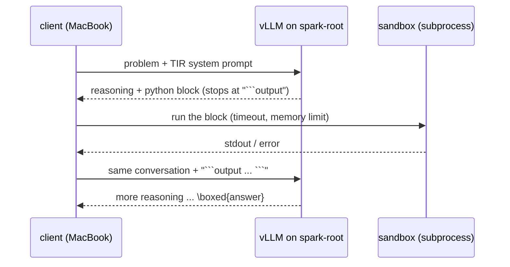
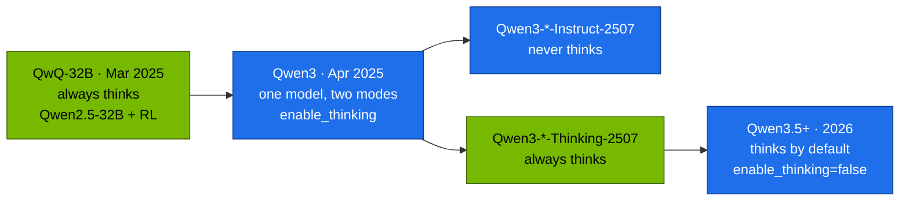

# Chapter 02 · Coder, Math & Reasoning Models

> **04-Qwen · Part I — Models · Chapter 02 of 14** · ← [Chapter 01 · Qwen architecture & model family](01-qwen-architecture-and-model-family.md) · [All chapters](00-qwen-step-by-step-guide.md) · [Chapter 03 · Vision-language models](03-vision-language-models.md) →

| | |
|---|---|
| **You will build** | Three working clients against the Qwen models served on the root: a fill-in-the-middle completer that only accepts code that parses and passes a test, a tool-integrated math solver with a sandboxed Python executor, SymPy answer checking and majority voting, and a thinking-mode probe that measures what reasoning costs in tokens, seconds and KV cache on a GB10 |
| **Hardware** | dgx-spark-1 (one model at a time in `llm-serving`) · your MacBook (clients, sandbox) |
| **Time** | 90 min |
| **Risk** | Low. Switches the served model in `llm-serving`; generated code runs only in a resource-limited subprocess on your MacBook |
| **Clusters** | `spark-root` (the served models, `serving-budget`) · optionally `dev-llms` (the client scripts work against the Qwen3-0.6B sandbox model too) |
| **Lab files** | [`lab/models.yaml`](lab/models.yaml), [`lab/scripts/serve-model.sh`](lab/scripts/serve-model.sh), [`lab/tests/mock_openai.py`](lab/tests/mock_openai.py) (offline rehearsal), 02-Kubernetes [`vllm.yaml`](../02-Kubernetes/lab/manifests/root-llms/90-serving/vllm/vllm.yaml) |

---

## 1. Why this matters on a Spark

A general chat model answers most questions. Three kinds of work justify a specialised Qwen model, and each changes the serving contract:

| Work | Model line | What changes for the server |
|---|---|---|
| Code completion in an editor, repository edits, agentic coding | Qwen2.5-Coder, Qwen3-Coder, Qwen3-Coder-Next, Qwen3.6 | FIM prompts (raw on `/v1/completions` or wrapped in chat, by generation), low latency per request, tool-call parser for agents |
| Exact arithmetic and symbolic math | Qwen2.5-Math (CoT and tool-integrated reasoning) | a code sandbox *outside* the model, short 4K context, many samples per question |
| Multi-step reasoning | QwQ-32B, Qwen3 thinking mode, Qwen3-*-Thinking-2507, Qwen3.5+ | reasoning parser, thousands of hidden tokens per answer, long `max_tokens` |

On a GB10, the third row dominates the cost. A reasoning answer is often 2,000–10,000 generated tokens. At the bandwidth-bound decode rates of Chapter 01 §2.7 that is minutes for a dense 32B model, and every one of those tokens stays in the KV cache until the answer finishes. Knowing when thinking pays — and turning it off when it doesn't — is the single largest lever on latency and memory in this module.

---

## 2. Concepts

### 2.1 The coder line

| Release | Open models | Context | Notes |
|---|---|---|---|
| **Qwen2.5-Coder** (Nov 2024) | 0.5B, 1.5B, 3B, 7B, 14B, 32B; base and Instruct | 32K native; 128K with YaRN on 7B+ | Qwen2.5 architecture, continued pretraining on 5.5T tokens (source code across 92 languages, code-related text, synthetic data, math); FIM and repository-level training. 3B under the Qwen Research licence, others Apache 2.0 |
| **Qwen3-Coder** (Jul 2025) | 480B-A35B-Instruct, 30B-A3B-Instruct | 256K native, ~1M with YaRN | MoE, non-thinking, trained for agentic coding (multi-turn tool use against real repositories); own XML-style tool-call format |
| **Qwen3-Coder-Next** (Feb 2026) | 80B-A3B | 256K | Qwen3-Next hybrid (Gated DeltaNet), non-thinking, agentic coding |
| **Qwen3.6-27B / 35B-A3B** (Apr 2026) | dense 27B, MoE 35B-A3B | 256K | general models with a strong coding focus; hybrid architecture |

For a single Spark the practical choices are Qwen3-Coder-30B-A3B in FP8 (the catalog's `qwen3-coder-30b-fp8`: ~32 GB, ~3B active, util 0.40), the Qwen3.6-35B-A3B hybrid in FP8 (`qwen3.6-35b-fp8`, util 0.45) and, for latency-critical editor completion, a Qwen2.5-Coder-7B base model you add to the catalog. Benchmark tables on the model cards change with every release; evaluate on your own repository instead (Task 2 shows the shape of such a check).

### 2.2 Fill-in-the-middle

Editors need the code *between* what is above the cursor (prefix) and what is below it (suffix). Plain left-to-right training can't use the suffix. FIM training cuts documents into $(P, M, S)$ and reorders them so the model learns to generate the middle after seeing both sides. Qwen2.5-Coder uses the prefix-suffix-middle order with three special tokens:

```text
<|fim_prefix|>{code before the cursor}<|fim_suffix|>{code after the cursor}<|fim_middle|>
```

The model then generates the middle and stops with `<|endoftext|>` (or `<|fim_pad|>`). The training loss covers only the middle tokens:

$$\mathcal{L}_{\text{FIM}} = -\sum_{t \in M} \log p_\theta\big(x_t \mid P, S, x_{<t}\big)$$

How the prompt reaches the model depends on the generation:

| Model | Endpoint | Prompt |
|---|---|---|
| Qwen2.5-Coder **base** (the documented FIM checkpoints) | `/v1/completions` | the raw FIM string above — a chat template would wrap it in ChatML and break it |
| Qwen3-Coder (every version, per its repository) | `/v1/chat/completions` | system `You are a code completion assistant.`, the FIM string as the user message |

In both cases: stop on the FIM and end tokens (`<|fim_prefix|>`, `<|fim_suffix|>`, `<|fim_pad|>`, `<|repo_name|>`, `<|file_sep|>`, `<|endoftext|>`, `<|im_end|>` — vLLM accepts them as `stop_token_ids` 151659, 151661–151664, 151643, 151645), keep `max_tokens` small (32–128 for line completion) and `temperature` at 0–0.2.

### 2.3 Repository-level context

Qwen2.5-Coder was also trained on whole repositories formatted as one long document:

```text
<|repo_name|>{repository name}
<|file_sep|>{path/to/config.py}
{file contents}
<|file_sep|>{path/to/models.py}
{file contents}
<|file_sep|>{path/to/the/file/being/edited.py}
{prefix of the current file …}
```

Cross-file completion works when the files the cursor depends on are in the prompt. Order them so that definitions come before uses (a topological order of the import graph), put the edited file last, and combine with FIM tokens for the current file. Every extra file is prefill work and KV cache: at Qwen3-Coder-30B-A3B's 96 KiB per token, 32K tokens of repository context cost 3 GiB per request. Prefix caching (Chapter 04) makes the repeated part cheap when consecutive requests share the same leading files — keep the stable files first and the edited file last.

### 2.4 The math line: chain of thought and tool-integrated reasoning

**Qwen2.5-Math** (1.5B, 7B, 72B; base and Instruct; Sep 2024) is a Qwen2.5 model further trained on math corpora and with reward-model-guided RL. Its Instruct models support two prompting modes and have a **4K context** — enough for a problem and its solution, not for documents. Companion models score solutions: `Qwen2.5-Math-RM-72B` (outcome reward) and `Qwen2.5-Math-PRM-7B/72B` (process reward per step).

| Mode | System prompt (exact text from the model card) | Strength |
|---|---|---|
| Chain of thought (CoT) | `Please reason step by step, and put your final answer within \boxed{}.` | proofs, short derivations, no tools needed |
| Tool-integrated reasoning (TIR) | `Please integrate natural language reasoning with programs to solve the problem above, and put your final answer within \boxed{}.` | exact arithmetic, combinatorics, numeric search, symbolic algebra |

In TIR the model alternates text and Python. The serving engine doesn't run the code; the client does:



As a loop, with state $s_t$, model output $a_t$ (text plus code $c_t$) and observation $o_t$:

$$a_t \sim \pi_\theta(\cdot \mid s_{t-1}), \qquad o_t = \text{exec}(c_t), \qquad s_t = s_{t-1} \circ a_t \circ o_t$$

until the model emits `\boxed{…}` without new code. The two practical details are the stop string (`` ```output ``, so generation pauses where the model expects the result) and the sandbox: generated code is untrusted. Run it in a separate process with a wall-clock timeout, a memory limit and no network — never with `exec()` in the client process.

### 2.5 Checking answers: symbolic equality and majority voting

String comparison rejects `1/2` against `0.5` or `\frac{\sqrt2}{2}` against `1/\sqrt2`. Compare symbolically:

$$\text{SymEq}(a, b) \iff \text{simplify}(a - b) = 0$$

Sampling several solutions at temperature > 0 and voting improves accuracy on hard problems (self-consistency):

$$\hat{y} = \arg\max_{y} \sum_{k=1}^{K} \mathbb{1}\big[\text{SymEq}(y_k, y)\big]$$

Each extra sample costs a full generation. Send the $K$ samples as one request with `"n": K` — the engine shares the prompt's KV blocks across the samples (prefix caching) and decodes them in one batch, which is far cheaper on a GB10 than $K$ separate requests.

### 2.6 Reasoning models: QwQ, Qwen3 thinking, 2507 and later



A reasoning model writes its working between `<think>` and `</think>`, then the answer. The engine's **reasoning parser** splits the two, so clients get the answer in `content` and the working in a separate field: `reasoning` in current vLLM releases (the lab's pinned image), `reasoning_content` in older vLLM releases and in SGLang. Write clients that read both (the lab tools do).

| Model | Thinking control | vLLM `--reasoning-parser` | SGLang `--reasoning-parser` |
|---|---|---|---|
| QwQ-32B (03 catalog: `qwq-32b-awq`) | always on (template opens `<think>`) | `deepseek_r1` | `deepseek-r1` |
| Qwen3 (Apr 2025; catalog: `qwen3-8b`) | `chat_template_kwargs: {"enable_thinking": false}` per request; `/think` and `/no_think` in a message switch turn by turn | `qwen3` | `qwen3` |
| Qwen3-*-Instruct-2507 | never thinks | none | none |
| Qwen3-*-Thinking-2507 (catalog: `qwen3-4b-thinking`) | always thinks; the output lacks the opening `<think>` because the template adds it | `deepseek_r1` (as on the model cards; the catalog uses it) | `deepseek-r1` |
| Qwen3.5 and later (catalog: `qwen3.6-35b-fp8`) | thinks by default; `enable_thinking: false` per request, or `--default-chat-template-kwargs '{"enable_thinking": false}'` server-wide | `qwen3` | `qwen3` |

Mechanically, non-thinking mode in Qwen3 is a template trick: with `enable_thinking=False` the template appends an empty `<think>\n\n</think>\n\n` block to the generation prompt, so the model goes straight to the answer (Chapter 01 Task 3 printed it). The template also strips earlier turns' reasoning from the history, so multi-turn conversations don't accumulate old thinking.

Recommended sampling (from the Qwen model cards — greedy decoding causes repetition loops in thinking mode):

| Mode | temperature | top_p | top_k | Other |
|---|---|---|---|---|
| thinking (Qwen3, QwQ, Thinking-2507) | 0.6 | 0.95 | 20 | `max_tokens` up to 32,768 (more for competition math) |
| non-thinking (Qwen3, Instruct-2507) | 0.7 | 0.8 | 20 | `presence_penalty` 0–1.5 against repetition |
| code completion / FIM | 0–0.2 | 0.95 | – | short `max_tokens` |

vLLM applies `generation_config.json` defaults when a request leaves them out; send them explicitly so behaviour doesn't change when you switch models.

**Thinking budget.** Recent vLLM releases can cap the reasoning part: start the server with `--reasoning-parser qwen3 --reasoning-config '{"reasoning_start_str": "<think>", "reasoning_end_str": "</think>"}'` and pass `"thinking_token_budget": N` per request; when the budget is used up the engine forces `</think>` and the model answers. Older releases only have `max_tokens`, which cuts the answer off instead; check what your image offers with `vllm serve --help=all | grep -i reasoning`.

### 2.7 What thinking costs on a GB10

For one request with $p$ prompt tokens and $g$ generated tokens (reasoning + answer):

$$\text{KV peak} = (p + g)\times \text{KV bytes/token}, \qquad t \approx \text{TTFT} + \frac{g}{\text{decode rate}}$$

| Model | KV / token | 8K-token reasoning answer | 16 such answers in flight |
|---|---|---|---|
| Qwen3-8B (BF16) | 144 KiB | 1.1 GiB | 18 GiB — more than a 0.20 engine has for KV |
| Qwen3-30B-A3B (FP8 weights, BF16 KV) | 96 KiB | 0.75 GiB | 12 GiB |
| QwQ-32B / Qwen3-32B | 256 KiB | 2 GiB | 32 GiB |

When the KV cache fills, vLLM preempts running sequences and recomputes them later (`vllm:num_preemptions` rises, latency jumps). For reasoning models on a Spark: lower `--max-num-seqs` (8–16) when you raise `max_tokens`, prefer a small-active MoE or FP8 weights to leave room for KV, consider `--kv-cache-dtype fp8`, and turn thinking off for requests that don't need it (lookups, formatting, extraction, tool routing). Task 4 measures the difference on your hardware.

---

## 3. Prove it in code

All clients run on your MacBook against a port-forward to the engine on the root. Prepare once:

```bash
# ▶ MacBook · 04-Qwen/lab
export KUBECONFIG="$PWD/../../01-Ansible/lab/.cache/kubeconfig-spark-lab.yaml"
python3 -m venv ~/.venvs/qwen-ch02 && source ~/.venvs/qwen-ch02/bin/activate
pip install -q sympy
mkdir -p ~/qwen-ch02
scripts/serve-model.sh list
```

Each task starts with `scripts/serve-model.sh <name>`: it checks the util budget, prefetches the weights into `model-cache`, replaces the main model behind `svc/vllm` with the model's overlay of the 02 vLLM base and waits for readiness (Chapter 04 §3.2). One model runs at a time here, so every measurement has the GB10 to itself. To rehearse a client without the Spark, start [`tests/mock_openai.py`](lab/tests/mock_openai.py) (`python3 tests/mock_openai.py 18780`) and set `BASE=http://localhost:18780/v1`: it implements `/v1/chat/completions` with rule-based answers, so the plumbing of Tasks 1 (chat mode), 3 and 4 runs while the answers are wrong by design; the raw `/v1/completions` path needs a real engine.

### Task 1 · Fill-in-the-middle with a parse-and-test gate

#### What this lab does (script `lab/scripts/serve-model.sh qwen3-coder-30b-fp8` + client `~/qwen-ch02/fim_gate.py`)

- **Serve:** replaces the main `deploy/vllm` on `spark-root` with Qwen3-Coder-30B-A3B in FP8 (util 0.40, 56 Gi request = limit, `--max-model-len=65536`, `qwen3_coder` tool parser). The first run downloads ~32 GB into `model-cache`.
- **Port-forward:** `svc/vllm` to `localhost:8000` on the MacBook.
- **Client:** sends a FIM prompt (prefix and suffix of a `fib()` function), assembles the file, rejects it if it doesn't parse, and runs its unit test in a separate Python process on the MacBook. Generated code never runs inside the client process.

#### What to look for

1. **`serve-model.sh`:** `[PASS] budget: running … + qwen3-coder-30b-fp8 0.4 ≤ 0.72`, `[PASS] weights cached`, `[PASS] vllm ready with qwen3-coder-30b-fp8`, `[PASS] answer: 144` and `0 failed`. Reasoning chars are `0`: the Coder model doesn't think.
2. **`/v1/models`:** `['qwen3-coder-30b-fp8']`.
3. **`fim_gate.py`:** a short loop as the middle (`a, b = 0, 1` … `for _ in range(…)`), then `ACCEPT tests passed`. Note the token count and seconds in the `--- middle (…) ---` header.

**If something's off:** rollout waits with no new pod and a `FailedCreate … exceeded quota: serving-budget` event → a side model plus the apps leave less than 56 Gi; stop the side model. `REJECT: does not parse` with fences or a repeated suffix → wrong prompt form, see Troubleshooting in §4.

#### Run it

Serve the Coder model and open a port-forward:

```bash
# ▶ MacBook · 04-Qwen/lab
scripts/serve-model.sh qwen3-coder-30b-fp8
kubectl --context spark-root -n llm-serving port-forward svc/vllm 8000 >/dev/null 2>&1 &
curl -s localhost:8000/v1/models | python3 -c 'import json,sys; print([m["id"] for m in json.load(sys.stdin)["data"]])'
```

The client asks for the middle of a function, assembles the file, rejects anything that doesn't parse, and runs a unit test in a subprocess:

```bash
# ▶ MacBook · any folder
cat > ~/qwen-ch02/fim_gate.py <<'PY'
import ast, json, os, subprocess, sys, tempfile, time, urllib.request
BASE = os.environ.get("BASE", "http://localhost:8000/v1")
MODEL = os.environ.get("MODEL", "qwen3-coder-30b-fp8")

prefix = '''def fib(n: int) -> int:
    """Return the n-th Fibonacci number (fib(0)=0, fib(1)=1) in O(n)."""
    if n < 2:
        return n
'''
suffix = '''
    return b


def test():
    assert [fib(i) for i in range(10)] == [0, 1, 1, 2, 3, 5, 8, 13, 21, 34]
    assert fib(50) == 12586269025

test()
print("tests passed")
'''
MODE = os.environ.get("MODE", "chat")              # chat: Qwen3-Coder · raw: Qwen2.5-Coder base via /v1/completions
fim = f"<|fim_prefix|>{prefix}<|fim_suffix|>{suffix}<|fim_middle|>"
common = {"model": MODEL, "max_tokens": 96, "temperature": 0.1,
          "stop_token_ids": [151659, 151661, 151662, 151663, 151664, 151643, 151645]}
if MODE == "raw":
    path, body = "completions", {**common, "prompt": fim}
else:
    path, body = "chat/completions", {**common, "messages": [
        {"role": "system", "content": "You are a code completion assistant."}, {"role": "user", "content": fim}]}
t0 = time.time()
req = urllib.request.Request(f"{BASE}/{path}", json.dumps(body).encode(), {"Content-Type": "application/json"})
out = json.load(urllib.request.urlopen(req, timeout=120))
ch = out["choices"][0]
middle = ch["text"] if MODE == "raw" else ch["message"]["content"]
middle = middle.removeprefix("```python\n").removesuffix("```")     # tolerate a fenced answer
print(f"--- middle ({out['usage']['completion_tokens']} tokens, {time.time()-t0:.2f}s) ---\n{middle}")
source = prefix + middle + suffix
try:
    ast.parse(source)
except SyntaxError as e:
    sys.exit(f"REJECT: does not parse: {e}")
with tempfile.NamedTemporaryFile("w", suffix=".py", delete=False) as f:
    f.write(source)
r = subprocess.run([sys.executable, "-I", f.name], capture_output=True, text=True, timeout=10)
print("ACCEPT" if r.returncode == 0 else "REJECT: test failed", r.stdout.strip(), r.stderr.strip()[-300:])
PY
python3 ~/qwen-ch02/fim_gate.py
```

Run it again with `MODE=raw`: the same FIM string sent to `/v1/completions` without the chat wrapper — compare the middles; for Qwen3-Coder the chat form is the documented one. Then drop the system message and compare again. If the middle repeats the suffix or rewrites the whole function, add a base Coder model to [`models.yaml`](lab/models.yaml) (for example `Qwen/Qwen2.5-Coder-7B`, util 0.20, `mem: 32Gi`, no parser flags), run `python3 scripts/gen_overlays.py`, serve it and compare with `MODE=raw MODEL=<its name>`.

### Task 2 · Repository context: measure the prefill cost

#### What this lab does (script `~/qwen-ch02/repo_prompt.py`)

- **Builds a repository prompt** from up to 20 `*.py` files of `02-Kubernetes/lab` in the Qwen2.5-Coder repository format, with the last file cut in half as a FIM target.
- **Sends it twice** to the raw `/v1/completions` endpoint of the Coder model from Task 1 (still served, port-forward still open), asking for only 32 tokens, so the time is almost all prefill.
- **Nothing is changed** on the cluster; the second call only reuses KV blocks the first one left in vLLM's prefix cache.

#### What to look for

1. **Command exit:** two lines, `call 1:` and `call 2:`, with the same prompt token count.
2. **Prefill vs cache:** call 2 much faster than call 1. The KV estimate is prompt tokens × 96 KiB.
3. **Cache miss on purpose:** after you change one character in the first file, call 1 of the next run is slow again.

**If something's off:** both calls equally slow → prefix caching is off; check that the served args contain `--enable-prefix-caching`. A 400 about the context length → fewer files (the model allows 65,536 tokens).

#### Run it

The prompt uses the Qwen2.5-Coder repository format (§2.3) on the raw endpoint; what you measure here — prefill time and prefix-cache reuse — is the same for any model and prompt form.

```bash
# ▶ MacBook · 04-Qwen/lab
cat > ~/qwen-ch02/repo_prompt.py <<'PY'
import json, os, pathlib, sys, time, urllib.request
BASE, MODEL = os.environ.get("BASE", "http://localhost:8000/v1"), os.environ.get("MODEL", "qwen3-coder-30b-fp8")
root = pathlib.Path(sys.argv[1])
files = sorted(root.rglob("*.py"))[:20]                           # stable files first, edited file last
target = files[-1]
parts = [f"<|repo_name|>{root.name}"] + [f"<|file_sep|>{p.relative_to(root)}\n{p.read_text()}" for p in files[:-1]]
src = target.read_text(); cut = len(src) // 2
prompt = "\n".join(parts) + f"\n<|file_sep|>{target.relative_to(root)}\n<|fim_prefix|>{src[:cut]}<|fim_suffix|>{src[cut:]}<|fim_middle|>"
for attempt in (1, 2):                                            # 2nd call: same prefix → prefix-cache hit
    t0 = time.time()
    body = {"model": MODEL, "prompt": prompt, "max_tokens": 32, "temperature": 0,
            "stop": ["<|endoftext|>", "<|fim_pad|>", "<|file_sep|>"]}
    req = urllib.request.Request(f"{BASE}/completions", json.dumps(body).encode(), {"Content-Type": "application/json"})
    u = json.load(urllib.request.urlopen(req, timeout=300))["usage"]
    print(f"call {attempt}: prompt {u['prompt_tokens']:6} tokens  {time.time()-t0:5.2f}s  KV ≈ {u['prompt_tokens']*96/1024:.0f} MiB (30B-A3B)")
PY
python3 ~/qwen-ch02/repo_prompt.py ../../02-Kubernetes/lab
```

The first call's time grows with the prompt (prefill); the second is faster because `--enable-prefix-caching` (on in the 02 base) reuses the KV blocks. Change one character in the *first* file and run again: the cache misses from that point on. That is the rule for repository prompts — stable content first.

### Task 3 · Tool-integrated math with a sandbox, SymPy and voting

#### What this lab does (script `lab/scripts/serve-model.sh qwen2.5-math-7b` + client `~/qwen-ch02/tir.py`)

- **Serve:** replaces the main model with Qwen2.5-Math-7B-Instruct (util 0.15, 24 Gi, 4K context). The first run downloads ~15.2 GB.
- **TIR loop:** the model writes Python, the client runs it in a separate, resource-limited process on the MacBook (5 s CPU, 10 s wall clock, empty environment) and feeds the output back, for up to 4 rounds.
- **Checks:** extracts the `\boxed{}` answer, compares it with the brute-force gold answer `55252` using SymPy, then samples 8 plain chain-of-thought answers and takes a majority vote.

#### What to look for

1. **`serve-model.sh`:** four `[PASS]` lines ending with `vllm ready with qwen2.5-math-7b` and `answer: 144`.
2. **Gold check:** the brute-force one-liner below prints `55252`.
3. **`tir.py` output:**

   | Line | Healthy value |
   |---|---|
   | trace | at least one Python code block, each followed by an `output` block with its result |
   | `single run:` | `55252 correct` (a `WRONG` is a result to record, not a failure of the lab) |
   | `CoT samples: … -> vote:` | eight answers (some may be `None`) and the most frequent one with its count |

**If something's off:** `TimeoutError` or `CPU or memory limit reached` in the trace → the model wrote a brute-force loop; that is the sandbox doing its job. A 400 about context length → lower `max_tokens`; this model has a 4K window.

#### Run it

```bash
# ▶ MacBook · 04-Qwen/lab
scripts/serve-model.sh qwen2.5-math-7b
pkill -f 'port-forward svc/vllm 8000' || true       # the Task 1 forward was bound to the replaced pod
kubectl --context spark-root -n llm-serving port-forward svc/vllm 8000 >/dev/null 2>&1 &
```

```bash
# ▶ MacBook · any folder
cat > ~/qwen-ch02/tir.py <<'PY'
import json, os, re, subprocess, sys, urllib.request
from collections import Counter
import sympy as sp
BASE, MODEL = os.environ.get("BASE", "http://localhost:8000/v1"), os.environ.get("MODEL", "qwen2.5-math-7b")
TIR = ("Please integrate natural language reasoning with programs to solve the problem above, "
       "and put your final answer within \\boxed{}.")

def chat(messages, n=1, max_tokens=1024):
    cont = messages[-1]["role"] == "assistant"   # resume a partial assistant turn instead of opening a new one
    body = {"model": MODEL, "messages": messages, "n": n, "temperature": 0.7 if n > 1 else 0.0,
            "top_p": 0.8, "max_tokens": max_tokens, "stop": ["```output"],
            "continue_final_message": cont, "add_generation_prompt": not cont}
    req = urllib.request.Request(f"{BASE}/chat/completions", json.dumps(body).encode(), {"Content-Type": "application/json"})
    return [c["message"]["content"] for c in json.load(urllib.request.urlopen(req, timeout=600))["choices"]]

SANDBOX = """import resource, sys
for lim, val in ((resource.RLIMIT_CPU, 5), (resource.RLIMIT_AS, 1 << 30)):   # 5 s CPU, 1 GiB (AS is not enforced on macOS)
    try: resource.setrlimit(lim, (val, val))
    except (ValueError, OSError): pass
exec(compile(sys.stdin.read(), "<model>", "exec"), {})
"""
def run(code):                                  # untrusted: separate process, limits, no inherited env
    try:
        r = subprocess.run([sys.executable, "-I", "-c", SANDBOX], input=code, capture_output=True,
                           text=True, timeout=10, env={})
        out = (r.stdout + r.stderr)[-1500:]
        if r.returncode != 0 and not out:
            out = f"Error: exit code {r.returncode} (CPU or memory limit reached)"
        return out or "(no output)"
    except subprocess.TimeoutExpired:
        return "TimeoutError: 10 s wall clock exceeded"

def solve(problem, max_rounds=4):
    msgs = [{"role": "system", "content": TIR}, {"role": "user", "content": problem}]
    text = ""
    for _ in range(max_rounds):
        part = chat(msgs + ([{"role": "assistant", "content": text}] if text else []))[0]
        text += part
        code = re.findall(r"```python\n(.*?)```", part, re.S)
        if "\\boxed" in part or not code:
            break
        text += "```output\n" + run(code[-1]) + "\n```\n"
    return text

def boxed(t):
    m = re.findall(r"\\boxed\{((?:[^{}]|\{[^{}]*\})*)\}", t)
    return m[-1].strip() if m else None

def sym_eq(a, b):
    try:
        return sp.simplify(sp.sympify(a) - sp.sympify(b)) == 0
    except Exception:
        return a.replace(" ", "") == b.replace(" ", "")

def vote(answers):
    groups = []                                  # [(representative, count)]
    for a in filter(None, answers):
        for i, (rep, n) in enumerate(groups):
            if sym_eq(a, rep):
                groups[i] = (rep, n + 1); break
        else:
            groups.append((a, 1))
    return max(groups, key=lambda g: g[1]) if groups else (None, 0)

problem, gold = "How many positive integers below 10^6 have digits that sum to 27?", "55252"
trace = solve(problem)
print(trace[-1200:])
print("single run:", boxed(trace), "correct" if boxed(trace) and sym_eq(boxed(trace), gold) else "WRONG")
cot = [{"role": "system", "content": "Please reason step by step, and put your final answer within \\boxed{}."},
       {"role": "user", "content": problem}]
samples = [boxed(t) for t in chat(cot, n=8, max_tokens=2048)]
print("CoT samples:", samples, "-> vote:", vote(samples))
PY
python3 ~/qwen-ch02/tir.py
```

The gold answer comes from a brute-force count — check it yourself before trusting any score: `python3 -c "print(sum(sum(map(int,str(i)))==27 for i in range(1,10**6)))"`. Record: did TIR get it in one run, how many of the eight CoT samples were right, and did the vote fix a wrong single answer? Then try a problem that has no computational shortcut (a short proof) and see TIR fall back to plain reasoning. Never replace the subprocess with `exec()` in the client.

### Task 4 · Thinking on and off: tokens, time and KV

#### What this lab does (script `lab/scripts/serve-model.sh qwen3-8b`, then `--side qwen3-4b-thinking`, client `~/qwen-ch02/think_cost.py`)

- **Serve:** Qwen3-8B as the main model (util 0.20, 32 Gi). Later, Qwen3-4B-Thinking-2507 as a side engine `deploy/svc vllm-qwen3-4b-thinking` (util 0.15, 24 Gi, ~8.1 GB download), forwarded to `localhost:8001`.
- **Measure:** three questions (lookup, format, puzzle), each with thinking on and off, recording generated tokens, wall time, reasoning length and a KV peak estimate (144 KiB per token).
- **Clean up:** `--stop-side` deletes the side Deployment and Service at the end.

#### What to look for

1. **Budget line for the side model:** `[PASS] budget: running 0.20 + qwen3-4b-thinking 0.15 ≤ 0.72` (more if BGE-M3 runs).
2. **Six rows per model.** On Qwen3-8B, `think=True` rows have far more tokens, seconds and `reasoning` characters than `think=False` rows; the `think=False` rows have `reasoning 0 chars`. The puzzle answer is 4 h (14:05 − 09:40 = 4 h 25 min, minus the 25-minute stop).
3. **On the 4B-Thinking model:** `think=False` rows still show reasoning characters. That is expected: a Thinking-2507 model ignores `enable_thinking`.
4. **After `--stop-side`:** `[PASS] vllm-qwen3-4b-thinking removed`.

**If something's off:** `reasoning 0 chars` with thinking on and `<think>` inside the answer → the served overlay lacks the reasoning parser (command below). Very long or endless rows → greedy settings; see Troubleshooting in §4.

#### Run it

```bash
# ▶ MacBook · 04-Qwen/lab
scripts/serve-model.sh qwen3-8b
pkill -f 'port-forward svc/vllm 8000' || true       # bound to the replaced pod
kubectl --context spark-root -n llm-serving port-forward svc/vllm 8000 >/dev/null 2>&1 &
```

```bash
# ▶ MacBook · any folder
cat > ~/qwen-ch02/think_cost.py <<'PY'
import json, os, time, urllib.request
BASE, MODEL = os.environ.get("BASE", "http://localhost:8000/v1"), os.environ.get("MODEL", "qwen3-8b")
KV_KIB = float(os.environ.get("KV_KIB", 144))          # Qwen3-8B, BF16 KV (Chapter 01 §2.5)
Q = [("lookup", "What is the capital of Australia?"),
     ("format", "Turn 'b=2, a=1, c=3' into JSON with sorted keys. Output only JSON."),
     ("puzzle", "A train leaves at 09:40 and arrives at 14:05 the same day, with a 25-minute stop. How long was it moving?")]
for label, q in Q:
    for think in (True, False):
        s = dict(temperature=0.6, top_p=0.95) if think else dict(temperature=0.7, top_p=0.8)
        body = {"model": MODEL, "messages": [{"role": "user", "content": q}], "max_tokens": 8192, "top_k": 20,
                "chat_template_kwargs": {"enable_thinking": think}, **s}
        t0 = time.time()
        req = urllib.request.Request(f"{BASE}/chat/completions", json.dumps(body).encode(), {"Content-Type": "application/json"})
        r = json.load(urllib.request.urlopen(req, timeout=900))
        m, u = r["choices"][0]["message"], r["usage"]
        reasoning = m.get("reasoning") or m.get("reasoning_content") or ""
        kv = (u["prompt_tokens"] + u["completion_tokens"]) * KV_KIB / 1024
        print(f"{label:7} think={think!s:5} {u['completion_tokens']:5} tok  {time.time()-t0:6.1f}s  "
              f"reasoning {len(reasoning):5} chars  KV peak ≈ {kv:5.1f} MiB  answer: {(m['content'] or '').strip()[:60]!r}")
PY
python3 ~/qwen-ch02/think_cost.py
```

Your numbers will differ; record them. Thinking multiplies generated tokens and wall time for all three, and only the puzzle benefits. If `reasoning` stays empty with thinking on, the served overlay lacks `--reasoning-parser qwen3` and the `<think>` block sits inside `content` — check with `kubectl --context spark-root -n llm-serving get deploy vllm -o jsonpath='{.spec.template.spec.containers[0].args}'`.

Try the soft switch too: thinking on, and append ` /no_think` to the user message. Then repeat with a thinking budget if your engine supports it (§2.6).

Now compare the thinking-only 2507 model next to the hybrid one (the catalog's `reasoning-compare` set keeps both within the 0.72 budget):

```bash
# ▶ MacBook · 04-Qwen/lab
scripts/serve-model.sh qwen3-4b-thinking --side
kubectl --context spark-root -n llm-serving port-forward svc/vllm-qwen3-4b-thinking 8001:8000 >/dev/null 2>&1 &
BASE=http://localhost:8001/v1 MODEL=qwen3-4b-thinking python3 ~/qwen-ch02/think_cost.py
scripts/serve-model.sh --stop-side qwen3-4b-thinking
```

The `think=False` rows think anyway and the 4B model's traces are long. Note whether its puzzle answer matches the 8B's.

### Task 5 · Turn the measurement into an engine setting

#### What this lab does (log read + arithmetic)

- **Reads** vLLM's KV capacity from the startup log of the main engine (Qwen3-8B from Task 4). Nothing is changed.
- **Computes** how many reasoning requests fit at once: KV tokens ÷ (prompt + longest thinking answer).

#### What to look for

1. **The log lines:** `GPU KV cache size: … tokens` (about 45K for Qwen3-8B at util 0.20, Chapter 01 Task 6) and `Maximum concurrency for 32,768 tokens per request`.
2. **Your result** compared with the overlay's `--max-num-seqs=32`: with thinking answers of several thousand tokens, the number that fits is far below 32. Write down the value you would set.

**If something's off:** no lines from `grep` → the pod restarted and the log rotated; restart it with `scripts/serve-model.sh qwen3-8b` and grep again.

#### Run it

From Task 4 take the longest thinking answer, $g_{\max}$ tokens, and the KV memory from the engine's startup log (Chapter 01 Task 6):

```bash
# ▶ MacBook · 04-Qwen/lab
kubectl --context spark-root -n llm-serving logs deploy/vllm | grep -E 'GPU KV cache size|Maximum concurrency'
```

Concurrent reasoning requests that fit without preemption ≈ KV tokens / $(p + g_{\max})$. Compare with the overlay's `--max-num-seqs`. If the overlay allows more sequences than fit, a burst of reasoning requests will preempt; the remedy is a lower `--max-num-seqs` for that model, FP8 KV, or a model with less KV per token. Note the value you would set; Chapter 04 shows where it goes in the catalog.

---

## 4. What it means on a Spark

| Use | First choice on one Spark | Why | Avoid |
|---|---|---|---|
| Editor completion (FIM) | `qwen3-coder-30b-fp8` (FIM in chat form); for the lowest latency add a Qwen2.5-Coder-7B base model at util 0.20 | ~3B active decodes fast; the 7B base has small KV (56 KiB/token) and raw FIM | thinking models (seconds of hidden tokens per keystroke) |
| Agentic coding (tools, multi-file) | `qwen3-coder-30b-fp8`, util 0.40, or `qwen3.6-35b-fp8` (util 0.45) | ~3B active → fast decode; 256K context; `qwen3_coder` tool parser | dense 32B BF16 (slow decode, no room for a second model) |
| Exact math | `qwen2.5-math-7b` + TIR sandbox, or `qwen3-8b` thinking + a Python tool | computation moved out of the model | asking any model to multiply large numbers in its head |
| General reasoning | `qwen3-8b` thinking, `qwen3-4b-thinking`, or `qwen3.6-35b-fp8` | thinking quality with KV and decode the Spark can afford | QwQ-32B BF16 at high concurrency (256 KiB/token + long outputs) |
| Lookups, extraction, routing | the same model with `enable_thinking: false`, or `qwen3-4b-instruct` | 10–100× fewer generated tokens | leaving thinking on by default for everything |

### Troubleshooting

| You see | Cause | Fix |
|---|---|---|
| FIM output repeats the suffix or adds Markdown fences | wrong prompt form for the model (§2.2), missing system message for Qwen3-Coder, or missing `<|fim_middle|>` | Qwen3-Coder: chat form with the completion-assistant system message; Qwen2.5-Coder base: raw `/v1/completions`; stop token IDs from Task 1 |
| `<think>…</think>` text inside `content` | no `--reasoning-parser` on the served overlay | add `--reasoning-parser=qwen3` (QwQ: `deepseek_r1`) to the model's `args` in `models.yaml`, regenerate, re-serve |
| `reasoning_content` is empty but the answer is good | newer vLLM returns the field as `reasoning` | read both fields |
| `enable_thinking: false` ignored | model is a Thinking-2507 or QwQ (always thinks), or an old engine/parser combination | use the Instruct-2507 / hybrid model; upgrade per Chapter 04 |
| Endless repetition in thinking mode | greedy decoding | temperature 0.6, top_p 0.95, top_k 20; `presence_penalty` up to 1.5 |
| Latency jumps under load, `vllm:num_preemptions` rising | KV full: long reasoning × too many sequences | lower `--max-num-seqs`, FP8 KV, smaller `max_tokens`, thinking off where not needed |
| Qwen2.5-Math errors past ~4K tokens | its context is 4K | keep problems short; use a Qwen3 model for long inputs |
| TIR loop never ends | model keeps writing code | cap rounds (Task 3 uses 4) and total tokens; return errors as observations |

---

## 5. Checklist

- [ ] I can format a FIM prompt and a repository prompt, and know which endpoint and wrapper each Coder generation expects.
- [ ] My FIM client accepts only code that parses and passes a test in a separate process.
- [ ] I ran a tool-integrated math loop with a resource-limited sandbox and checked answers with SymPy and majority voting.
- [ ] I know which reasoning parser each Qwen reasoning model needs and how to switch thinking off per request and server-wide.
- [ ] I measured generated tokens, time and KV with thinking on and off for three kinds of question on my Spark.
- [ ] I can compute how many reasoning requests fit a model's KV cache and set `--max-num-seqs` from it.
