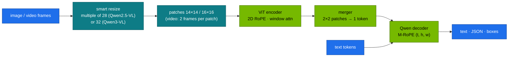
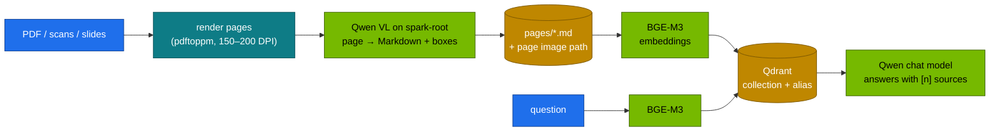

# Chapter 03 · Vision-Language Models & Multimodal Documents

> **04-Qwen · Part I — Models · Chapter 03 of 14** · ← [Chapter 02 · Coder, Math & reasoning models](02-coder-math-and-reasoning-models.md) · [All chapters](00-qwen-step-by-step-guide.md) · [Chapter 04 · Serving Qwen with vLLM & SGLang](04-serving-qwen-with-vllm-and-sglang.md) →

| | |
|---|---|
| **You will build** | A visual-token calculator that predicts what an image or video costs before you send it, a Qwen vision-language model served on the root with explicit pixel and media limits, grounding output drawn back onto the image to check the coordinate convention, and a document pipeline that turns page images into Markdown and indexes them with the 03 RAG stack (BGE-M3 + Qdrant) |
| **Hardware** | dgx-spark-1 · your MacBook (calculator, clients, test images) |
| **Time** | 90 min |
| **Risk** | Low. Switches the served model in `llm-serving`. A large image or video with no pixel limit can exhaust the engine's KV cache and stall other requests — §2.3 sets the limits |
| **Clusters** | `spark-root` (the VL model in `llm-serving`, Qdrant, BGE-M3) |
| **Lab files** | [`lab/models.yaml`](lab/models.yaml), [`lab/scripts/serve-model.sh`](lab/scripts/serve-model.sh), 03-DeepSeek [`tools/rag_demo.py`](../03-DeepSeek/lab/tools/rag_demo.py) and [`k8s/apps/bge-m3.yaml`](../03-DeepSeek/lab/k8s/apps/bge-m3.yaml), 02-Kubernetes [`qdrant-statefulset.yaml`](../02-Kubernetes/lab/manifests/root-llms/50-workloads/qdrant-statefulset.yaml) |

---

## 1. Why this matters on a Spark

Scanned contracts, slide decks, dashboards, invoices and screen recordings carry their meaning in layout. A text-only pipeline loses it at the first step: OCR flattens tables, drops charts and scrambles multi-column reading order. A vision-language model (VLM) reads the page image directly.

On a Spark the price is paid in tokens. An image becomes hundreds to tens of thousands of visual tokens, and every one of them goes through prefill and sits in the KV cache like text. A 300-DPI A4 scan at full resolution is about 8,600 tokens for Qwen3-VL — 1.2 GiB of KV in the 8B model, per page, per request. A one-minute video at default sampling can be larger than the whole context window. So the two skills of this chapter are: predict the token count of a visual input, and cap it at the server so no single request can take the engine's memory.

---

## 2. Concepts

### 2.1 The Qwen VL line

| Release | Open models | Key ideas |
|---|---|---|
| **Qwen2-VL** (Aug–Sep 2024) | 2B, 7B, 72B | **naive dynamic resolution** (any aspect ratio, variable token count), **M-RoPE** (separate rotary positions for time, height, width), images and video in one model |
| **Qwen2.5-VL** (Jan–Mar 2025) | 3B, 7B, 32B, 72B | ViT with **window attention** (only a few full-attention layers) for cheaper high-resolution encoding; M-RoPE time IDs aligned to **absolute time**, dynamic FPS; grounding in **absolute pixel coordinates** (JSON `bbox_2d`); document parsing to an HTML-like format; GUI agent skills |
| **Qwen3-VL** (Sep–Oct 2025) | dense 2B, 4B, 8B, 32B; MoE 30B-A3B, 235B-A22B; Instruct and Thinking | **interleaved M-RoPE** (t, h, w frequencies interleaved across the head dimension), **DeepStack** (features from several ViT layers injected into the LLM), **text timestamps** for video instead of temporal position IDs; 256K native context |
| **Qwen3.5 and later** (2026) | every model of the family | natively multimodal: the vision encoder is part of each model; no separate VL line needed |

Licences differ by size (some 3B and 72B checkpoints use the Qwen Research or Qwen licence); check the card. For one Spark the practical VL models are the 7B/8B dense models in BF16 at util 0.20–0.30 and the 30B-A3B MoE in FP8.

### 2.2 Architecture: one decoder, a vision encoder in front



**Dynamic resolution.** Instead of squashing every image to a fixed square, the processor resizes it to the nearest size whose sides are multiples of the *token factor* $f$ — patch size × merge size: 14 × 2 = 28 for Qwen2-VL and Qwen2.5-VL, 16 × 2 = 32 for Qwen3-VL — while keeping the aspect ratio and the total pixel count between `min_pixels` and `max_pixels`. Each $f \times f$ square of the resized image becomes one LLM token:

$$N_{\text{image}} = \frac{H'}{f}\cdot\frac{W'}{f}, \qquad H' = f\cdot\text{round}(H/f),\; W' = f\cdot\text{round}(W/f)$$

followed by a rescale if $H'W'$ falls outside $[\text{min\_pixels}, \text{max\_pixels}]$. The 2×2 merger is a small MLP that concatenates four neighbouring patch embeddings and projects them to the LLM's hidden size — a 4× reduction in tokens with the detail kept in the channels. Task 1 implements the exact resize rule.

**Video** is the same with a temporal patch of 2: two consecutive sampled frames share one set of tokens,

$$N_{\text{video}} \approx \frac{\text{frames}}{2}\cdot\frac{H'}{f}\cdot\frac{W'}{f}, \qquad \text{frames} = \text{fps}\times\text{seconds}\ (\text{capped})$$

At 2 fps and 448 × 448 per frame (16 × 16 = 256 tokens per frame pair, $f = 28$), one minute is 60 frame pairs × 256 = 15,360 tokens.

**M-RoPE.** Text has one position; an image patch has a row and a column, a video patch also a time. M-RoPE splits the rotary dimensions of each head into three groups and rotates each group by one coordinate. In Qwen2-VL and Qwen2.5-VL the 128-dim head is split 32 / 48 / 48 (time / height / width, `mrope_section: [16, 24, 24]` in rotation pairs):

$$\langle R_{(t_1,h_1,w_1)}q,\; R_{(t_2,h_2,w_2)}k\rangle = q_t^\top R_{t_2-t_1}k_t + q_h^\top R_{h_2-h_1}k_h + q_w^\top R_{w_2-w_1}k_w$$

so attention between two patches depends on their vertical, horizontal and temporal offsets separately. Text tokens use the same value for all three coordinates, which reduces to ordinary RoPE, and the text after an image continues from the largest position used by the image. Qwen2.5-VL ties the time coordinate to absolute time (so the model can answer "at what second…"); Qwen3-VL interleaves the three groups across frequencies (each coordinate gets both fast and slow frequencies) and moves video time into the text as explicit timestamps.

### 2.3 Controlling the cost

| Knob | Where | Effect |
|---|---|---|
| `max_pixels` / `min_pixels` | `--mm-processor-kwargs '{"max_pixels": …}'` at serve time, or `mm_processor_kwargs` per request | caps visual tokens per image: `max_pixels / f²`. 1024 × 32 × 32 → at most 1,024 Qwen3-VL tokens. Newer processors call it `size.longest_edge` |
| `--limit-mm-per-prompt '{"image": 4, "video": 1}'` | serve time | caps the number of media items per request; 0 disables a modality |
| `--max-model-len` | serve time | must hold visual + text tokens; long video needs a large value and therefore KV memory |
| video `fps` and frame cap | request (`video_url` options) or processor kwargs | fewer frames → proportionally fewer tokens |
| `--language-model-only` | serve time (Qwen3.5+ and other natively multimodal checkpoints) | skips loading the vision encoder when you only need text |

The defaults in the checkpoints' `preprocessor_config.json` are generous: up to 16,384 tokens per image (~12.8 megapixels for Qwen2.5-VL, ~16.8 for Qwen3-VL). Set an explicit `max_pixels` on every VL overlay. Text in documents stays readable at roughly 1,000–1,600 tokens per A4 page for normal font sizes; measure on your documents (Task 2).

### 2.4 Grounding: boxes and points

Qwen VL models can localise what they describe. The coordinate convention changed between generations, and getting it wrong draws boxes in the wrong place without any error:

| Model | Output format (typical) | Coordinates |
|---|---|---|
| Qwen2-VL | `<|box_start|>(x1,y1),(x2,y2)<|box_end|>` | normalised to 0–1000 |
| Qwen2.5-VL | JSON, e.g. `[{"bbox_2d": [x1, y1, x2, y2], "label": "table"}]` | absolute pixels **of the resized image** ($W' \times H'$ from §2.2) |
| Qwen3-VL | JSON as above | normalised to 0–1000 (check the model's grounding cookbook) |

For Qwen2.5-VL, rescale with $x = x' \cdot W / W'$ and $y = y' \cdot H / H'$ to get back to the original image. Task 3 draws the boxes so you can see which convention your served model uses.

### 2.5 Document and video RAG



Three ways to make visual documents searchable, in order of cost on a Spark:

| Approach | Index time | Query time | Strength | Weakness |
|---|---|---|---|---|
| **VL parse → text RAG** (this chapter) | one VL pass per page | text-only retrieval and answer | reuses the whole text stack (Chapter 11), cheap queries, citable | charts and diagrams survive only as the model described them |
| OCR → text RAG | fast, CPU | same | no GPU at index time | tables and reading order break |
| Visual retrieval (page-image embeddings such as ColPali/ColQwen, multi-vector in Qdrant) → VL answer over page images | one encoder pass per page | VL model reads the retrieved page images | keeps figures | every query pays visual prefill; more KV per request |

For **video**, sample keyframes or short clips, have the VL model write timestamped descriptions per segment, index those as text, and send the original clip to the VL model only when a question needs the pixels. Qwen2.5-VL and Qwen3-VL can localise events in time, which makes the timestamps reliable enough for citations.

---

## 3. Prove it in code

### Task 1 · Predict visual tokens before sending anything

The resize rule below follows the Qwen VL processors (`smart_resize`): $f = 28$ and a 3,136-pixel minimum for Qwen2-VL and Qwen2.5-VL, $f = 32$ and a 65,536-pixel minimum for Qwen3-VL (from each checkpoint's `preprocessor_config.json`).

```bash
# ▶ MacBook · any folder
mkdir -p ~/qwen-ch03 && cat > ~/qwen-ch03/vl_tokens.py <<'PY'
import math, sys

def smart_resize(h, w, f=28, min_pixels=4 * 28 * 28, max_pixels=16384 * 28 * 28):
    hb, wb = max(f, round(h / f) * f), max(f, round(w / f) * f)
    if hb * wb > max_pixels:
        beta = math.sqrt(h * w / max_pixels)
        hb, wb = max(f, math.floor(h / beta / f) * f), max(f, math.floor(w / beta / f) * f)
    elif hb * wb < min_pixels:
        beta = math.sqrt(min_pixels / (h * w))
        hb, wb = math.ceil(h * beta / f) * f, math.ceil(w * beta / f) * f
    return hb, wb

# family: token factor f, minimum pixels, KV KiB/token of the 7B/8B language model (Chapter 01 §2.5)
FAMILY = {"qwen2.5-vl": (28, 4 * 28 * 28, 56), "qwen3-vl": (32, 65536, 144)}

def image_tokens(h, w, family="qwen3-vl", max_tokens=16384):
    f, min_px, _ = FAMILY[family]
    hb, wb = smart_resize(h, w, f, min_pixels=min_px, max_pixels=max_tokens * f * f)
    return hb, wb, (hb // f) * (wb // f)

if __name__ == "__main__":
    cases = [("A4 @ 300 DPI", 3508, 2480), ("A4 @ 150 DPI", 1754, 1240), ("1080p screenshot", 1080, 1920),
             ("receipt 400×2400", 2400, 400), ("icon 64×64", 64, 64)]
    for fam, (f, _, kv) in FAMILY.items():
        print(f"--- {fam} (token factor {f}) ---")
        for cap in (16384, 1280):
            for label, h, w in cases:
                hb, wb, n = image_tokens(h, w, fam, cap)
                print(f"  cap {cap:5}  {label:17} {w}x{h} -> {wb}x{hb}  {n:6} tokens  ≈ {n*kv/1024:7.1f} MiB KV")
    fps, secs, side = 2, 60, 448
    pairs = fps * secs // 2
    print(f"video (qwen2.5-vl): {secs}s @ {fps} fps, {side}x{side}: {pairs} frame pairs × {(side//28)**2} = {pairs*(side//28)**2} tokens")
PY
python3 ~/qwen-ch03/vl_tokens.py
```

Expected with the default cap: the 300-DPI page resizes to 2496 × 3520 and costs 8,580 tokens for Qwen3-VL (~1.2 GiB of KV in the 8B model), 11,125 tokens for Qwen2.5-VL; capped at 1,280 tokens both shrink to 1,260 (30 × 42). The icon is raised to the minimum size (64 tokens for Qwen3-VL). Note how the receipt keeps its 1:6 aspect ratio — no squashing, no padding.

### Task 2 · Serve a VL model and check the prediction

The catalog entry `qwen3-vl-8b` runs at util 0.20 with `--max-model-len 16384`, `--max-num-seqs 16` and `--limit-mm-per-prompt {"image":2,"video":0}`; it leaves the pixel cap at the checkpoint default (16,384 tokens per image). Serve it and look at the flags:

```bash
# ▶ MacBook · 04-Qwen/lab
export KUBECONFIG="$PWD/../../01-Ansible/lab/.cache/kubeconfig-spark-lab.yaml"
grep -A9 'name: qwen3-vl-8b' models.yaml
scripts/serve-model.sh qwen3-vl-8b
kubectl --context spark-root -n llm-serving get deploy vllm -o jsonpath='{.spec.template.spec.containers[0].args}' | tr ',' '\n' | grep -E 'mm|max-model-len|utilization'
kubectl --context spark-root -n llm-serving port-forward svc/vllm 8000 >/dev/null 2>&1 &
```

Make a test page with a table and send it with the server default, then with smaller per-request caps:

```bash
# ▶ MacBook · any folder
pip install -q pillow
cat > ~/qwen-ch03/vl_probe.py <<'PY'
import base64, json, os, sys, time, urllib.request
from PIL import Image, ImageDraw
sys.path.insert(0, os.path.expanduser("~/qwen-ch03")); from vl_tokens import image_tokens, FAMILY
BASE, MODEL = os.environ.get("BASE", "http://localhost:8000/v1"), os.environ.get("MODEL", "qwen3-vl-8b")
FAM = os.environ.get("FAMILY", "qwen3-vl")
F, MIN_PX, _ = FAMILY[FAM]
W, H = 1240, 1754                                   # A4 at 150 DPI
PAGE = os.path.expanduser("~/qwen-ch03/page.png")
img = Image.new("RGB", (W, H), "white"); d = ImageDraw.Draw(img)
d.text((80, 80), "Quarterly GPU usage - dgx-spark-1", fill="black")
rows = [("Quarter", "Serving h", "Training h"), ("Q1", "1,820", "310"), ("Q2", "2,045", "455"), ("Q3", "2,310", "390")]
for r, row in enumerate(rows):
    for c, cell in enumerate(row):
        x, y = 80 + c * 300, 200 + r * 60
        d.rectangle([x, y, x + 300, y + 60], outline="black"); d.text((x + 12, y + 20), cell, fill="black")
img.save(PAGE)
url = "data:image/png;base64," + base64.b64encode(open(PAGE, "rb").read()).decode()

def ask(prompt, cap=None, max_tokens=512):
    body = {"model": MODEL, "max_tokens": max_tokens, "temperature": 0,
            "messages": [{"role": "user", "content": [{"type": "image_url", "image_url": {"url": url}},
                                                      {"type": "text", "text": prompt}]}]}
    if cap:                                         # older processors read max_pixels, newer ones size.longest_edge
        px = cap * F * F
        body["mm_processor_kwargs"] = {"max_pixels": px, "size": {"longest_edge": px, "shortest_edge": MIN_PX}}
    t0 = time.time()
    req = urllib.request.Request(f"{BASE}/chat/completions", json.dumps(body).encode(), {"Content-Type": "application/json"})
    r = json.load(urllib.request.urlopen(req, timeout=300))
    return r["choices"][0]["message"]["content"], r["usage"]["prompt_tokens"], time.time() - t0

if __name__ == "__main__":
    for cap in (None, 1024, 256):
        out, pt, dt = ask("Convert the table on this page to Markdown. Output only the table.", cap)
        pred = image_tokens(H, W, FAM, cap or 16384)[2]
        print(f"cap={cap or 'default'}: prompt_tokens={pt} (predicted image {pred} + text)  {dt:.1f}s\n{out}\n")
PY
python3 ~/qwen-ch03/vl_probe.py
```

Expected: `prompt_tokens` = the predicted image tokens plus a few dozen for the template, the vision start/end tokens and the prompt (2,145 + text for the default; about 1,000 and 250 + text for the caps). If the two capped runs report the same count as the default, your engine ignored the per-request kwargs — the cap must then be set at serve time (below). With enough tokens the table comes back intact; at 256 small digits start to fail. That trade-off, measured on your own documents, is how you choose the cap.

Make the cap you chose the server default, so no request can send a 16K-token image: add it to the entry's `args` in [`models.yaml`](lab/models.yaml) — for example `'--mm-processor-kwargs={"max_pixels": 1048576}'` (1,024 tokens at 32 × 32 pixels) — then regenerate, check and re-serve:

```bash
# ▶ MacBook · 04-Qwen/lab
python3 scripts/gen_overlays.py && python3 scripts/gen_overlays.py --check
scripts/serve-model.sh qwen3-vl-8b
```

Run the probe again: the default row now matches the cap. Then check the media limit: put three `image_url` parts in one request and read the 400 error — that is `--limit-mm-per-prompt` working.

### Task 3 · Grounding: draw the boxes back

```bash
# ▶ MacBook · any folder
cat > ~/qwen-ch03/ground.py <<'PY'
import json, os, re, sys
from PIL import Image, ImageDraw
sys.path.insert(0, os.path.expanduser("~/qwen-ch03"))
from vl_probe import ask, W, H, F, MIN_PX, PAGE      # reuses Task 2's page and client
from vl_tokens import smart_resize
CAP = int(os.environ.get("CAP", 16384))              # the image-token cap the server applies
out, _, _ = ask('Locate the table and the title. Answer only with JSON: [{"bbox_2d": [x1, y1, x2, y2], "label": "..."}]')
boxes = json.loads(re.search(r"\[.*\]", out, re.S).group(0))
hb, wb = smart_resize(H, W, F, min_pixels=MIN_PX, max_pixels=CAP * F * F)
img = Image.open(PAGE); d = ImageDraw.Draw(img)
for b in boxes:
    x1, y1, x2, y2 = b["bbox_2d"]
    abs_box = [x1 * W / wb, y1 * H / hb, x2 * W / wb, y2 * H / hb]          # Qwen2.5-VL: pixels of the resized image
    rel_box = [x1 * W / 1000, y1 * H / 1000, x2 * W / 1000, y2 * H / 1000]   # Qwen2-VL / Qwen3-VL: 0–1000
    d.rectangle(abs_box, outline="red", width=4); d.rectangle(rel_box, outline="blue", width=2)
    print(b["label"], "raw", b["bbox_2d"], "-> abs(red)", [round(v) for v in abs_box], "rel(blue)", [round(v) for v in rel_box])
img.save(os.path.expanduser("~/qwen-ch03/page-boxes.png")); print("open ~/qwen-ch03/page-boxes.png")
PY
CAP=1024 python3 ~/qwen-ch03/ground.py && open ~/qwen-ch03/page-boxes.png
```

Set `CAP` to the cap your overlay applies (16384 if you skipped the change in Task 2). Expected: one of the two colours frames the table and the title; the other is off. Blue (0–1000) fits Qwen3-VL; red fits Qwen2.5-VL. Record the convention next to the catalog entry — any downstream code that crops or highlights regions depends on it.

### Task 4 · Pages to Markdown to Qdrant

This task uses the 03 application stack on the root: Qdrant (02 `root-llms/50-workloads`) and BGE-M3 (`03-DeepSeek/lab/k8s/apps/bge-m3.yaml`, deployed in [Chapter 11](11-rag-with-qwen-bge-and-qdrant.md)). Check both are up and that the VL model plus the apps stay within the budget (the catalog counts the apps as util 0.06 and 19 Gi):

```bash
# ▶ MacBook · 04-Qwen/lab
kubectl --context spark-root -n llm-serving get pods -l 'app in (qdrant,bge-m3,vllm)' -o wide
kubectl --context spark-root -n llm-serving describe resourcequota serving-budget | grep -E 'limits.memory|requests.cpu'
kubectl --context spark-root -n llm-serving port-forward svc/qdrant 6333 >/dev/null 2>&1 &
kubectl --context spark-root -n llm-serving port-forward svc/bge-m3 8001:8000 >/dev/null 2>&1 &
```

Render a PDF you are allowed to index (any multi-page PDF on your laptop) and convert each page:

```bash
# ▶ MacBook · any folder
brew install poppler >/dev/null 2>&1 || true
mkdir -p ~/qwen-docs/pages ~/qwen-docs/img && pdftoppm -r 150 -png -l 10 ~/Downloads/your.pdf ~/qwen-docs/img/p
cat > ~/qwen-ch03/pages_to_md.py <<'PY'
import base64, glob, json, os, pathlib, urllib.request
BASE, MODEL = os.environ.get("BASE", "http://localhost:8000/v1"), os.environ.get("MODEL", "qwen3-vl-8b")
PROMPT = ("Transcribe this page to Markdown. Keep headings, lists and tables (as Markdown tables). "
          "Describe each chart or figure in one or two sentences in place. Output only Markdown.")
for png in sorted(glob.glob(os.path.expanduser("~/qwen-docs/img/*.png"))):
    url = "data:image/png;base64," + base64.b64encode(open(png, "rb").read()).decode()
    body = {"model": MODEL, "temperature": 0, "max_tokens": 3000,
            "messages": [{"role": "user", "content": [{"type": "image_url", "image_url": {"url": url}},
                                                      {"type": "text", "text": PROMPT}]}]}
    req = urllib.request.Request(f"{BASE}/chat/completions", json.dumps(body).encode(), {"Content-Type": "application/json"})
    r = json.load(urllib.request.urlopen(req, timeout=600))
    name = pathlib.Path(png).stem
    md = f"# {name}\n\nSource image: {png}\n\n" + r["choices"][0]["message"]["content"]
    pathlib.Path(os.path.expanduser(f"~/qwen-docs/pages/{name}.md")).write_text(md)
    print(f"{name}: {r['usage']['prompt_tokens']} prompt + {r['usage']['completion_tokens']} completion tokens")
PY
python3 ~/qwen-ch03/pages_to_md.py
```

Index the Markdown with the 03 RAG tool and ask a question. The chat model for the answer can be the VL model itself (it answers text questions too) or a text model such as `qwen3-8b` running beside it (`--side`, the catalog's `multimodal` set):

```bash
# ▶ MacBook · 04-Qwen/lab
python3 ../../03-DeepSeek/lab/tools/rag_demo.py ingest --repo ~/qwen-docs --dirs pages --collection qwen-docs \
  --qdrant http://localhost:6333 --embed-url http://localhost:8001
python3 ../../03-DeepSeek/lab/tools/rag_demo.py ask "Which quarter had the most training hours?" --collection qwen-docs \
  --qdrant http://localhost:6333 --embed-url http://localhost:8001 --chat-url http://localhost:8000 --chat-model qwen3-vl-8b
```

Expected: an answer with `[n]` citations pointing at page files; open the cited page image (its path is in the Markdown header) and check the claim. Pages whose tables came out wrong in `pages/*.md` produce wrong answers — the index is only as good as the parse, which is why the parse step keeps the source image path.

### Task 5 · Video, deliberately

The catalog disables video (`"video":0`): one clip can fill the whole 16K context. To try it, change the entry to `{"image":2,"video":1}`, raise `max_len` to 32768 and lower `--max-num-seqs` to 4 (the KV for one 32K sequence is 4.5 GiB), regenerate and re-serve as in Task 2. Then:

```bash
# ▶ MacBook · any folder
python3 - <<'PY'
import json, urllib.request
body = {"model": "qwen3-vl-8b", "max_tokens": 300, "temperature": 0,
        "messages": [{"role": "user", "content": [
            {"type": "video_url", "video_url": {"url": "https://qianwen-res.oss-cn-beijing.aliyuncs.com/Qwen2-VL/space_woaudio.mp4"}},
            {"type": "text", "text": "Describe what happens, with approximate timestamps."}]}]}
req = urllib.request.Request("http://localhost:8000/v1/chat/completions", json.dumps(body).encode(), {"Content-Type": "application/json"})
r = json.load(urllib.request.urlopen(req, timeout=900))
print(r["usage"]); print(r["choices"][0]["message"]["content"])
PY
```

The engine pod fetches the URL, so the Spark needs outbound HTTPS (or copy the clip into `model-cache` and serve with `--allowed-local-media-path /models`). Compare `prompt_tokens` with the video formula in §2.2 (use $f = 32$). If the request is refused for length, `--max-model-len` is doing its job: lower the frame rate or resolution rather than raising the limit. Put the entry back afterwards and regenerate.

---

## 4. What it means on a Spark

| Decision | Recommendation | Reason |
|---|---|---|
| Model | `qwen3-vl-8b` in BF16 (util 0.20); `qwen3.6-35b-fp8` (util 0.45, vision built in) or a Qwen3-VL-30B-A3B in FP8 for harder documents | the vision encoder adds activation memory at prefill; 8B leaves room for KV and a second engine (`multimodal` set) |
| pixel cap | set `--mm-processor-kwargs` on every VL overlay; start at 1,024 tokens (1024 × 32² pixels) and adjust per document type after Task 2 | the checkpoint default lets one image take 16K tokens |
| `--limit-mm-per-prompt` | images 2–4, video 0 or 1 | one request with ten pages is a 10–100K-token prefill |
| `--max-model-len` | 16K–32K for documents; video needs more and fewer concurrent sequences | KV grows with every visual token |
| Indexing | VL parse once per page, then the text RAG stack | queries stay text-only and cheap |
| Concurrency | VL parsing is prefill-heavy; run it as a batch (one client, a few pages in flight), not mixed with interactive chat | long prefills raise everyone's TTFT on a shared GB10 |

### Troubleshooting

| You see | Cause | Fix |
|---|---|---|
| `400 … At most N image(s) may be provided` | `--limit-mm-per-prompt` | send fewer items or raise the limit deliberately |
| `400 … longer than the maximum model length` | visual tokens + text > `--max-model-len` | lower `max_pixels`, fps or frame count; split the document |
| Small text misread, digits hallucinated | `max_pixels` too low for the font size | raise the cap for that document type; render PDFs at 150–200 DPI |
| Boxes drawn in the wrong place | coordinate convention (§2.4) or not rescaling from the resized image | Task 3; rescale with $W/W'$, $H/H'$ |
| CUDA OOM or `No available memory for the cache blocks` at startup | vision encoder profiling with the maximum image size needs memory beyond the text model | raise util slightly, lower `max_pixels`, `--limit-mm-per-prompt`, or `--max-model-len` |
| Video URL fails in the pod | no egress from the Spark, or local paths not allowed | download into `model-cache`, `--allowed-local-media-path /models` |
| A text-only Qwen3.5 deployment uses more memory than expected | the vision encoder is loaded | `--language-model-only` |

---

## 5. Checklist

- [ ] I can predict the visual token count of an image and a video clip for Qwen2.5-VL and Qwen3-VL, and its KV cost.
- [ ] My VL overlay sets `max_pixels`, `--limit-mm-per-prompt` and a `--max-model-len` sized for documents.
- [ ] I measured the smallest pixel cap that still reads my documents correctly.
- [ ] I know which grounding coordinate convention my served model uses and rescale boxes accordingly.
- [ ] I turned page images into Markdown, indexed them with BGE-M3 and Qdrant via the 03 RAG tool, and checked a cited answer against the page image.
