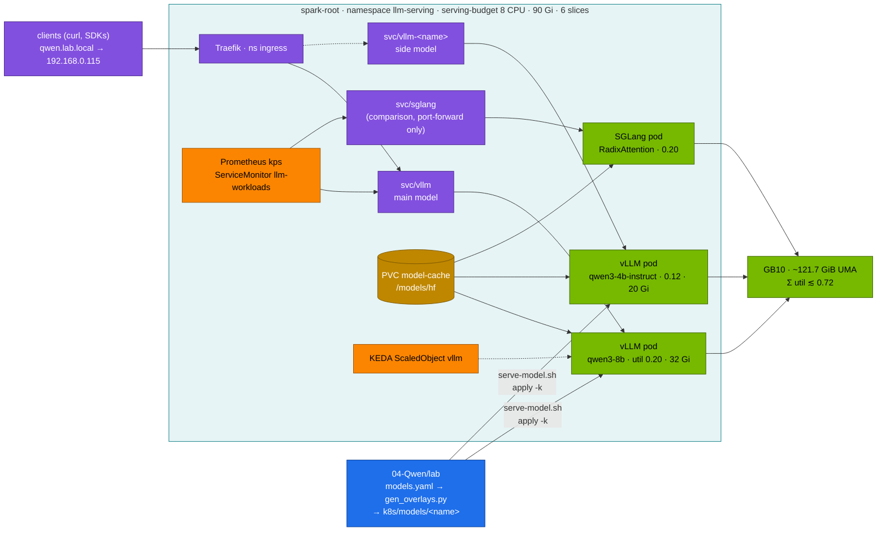
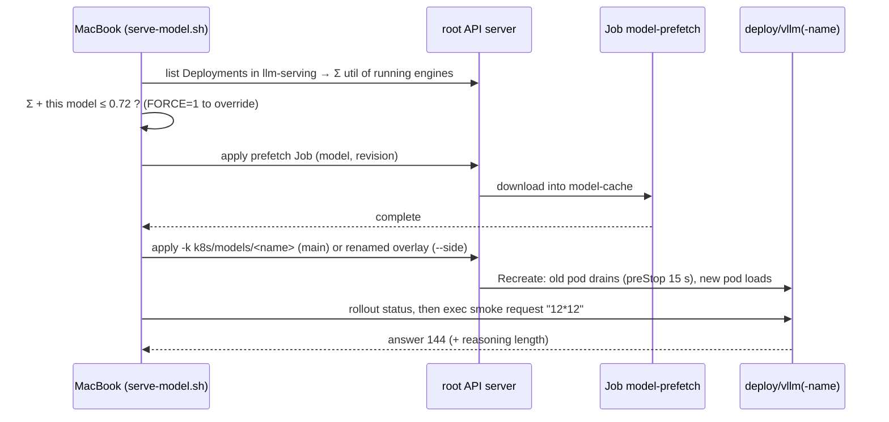

# Chapter 04 · Serving Qwen with vLLM & SGLang

> **04-Qwen · Part II — Serving · Chapter 04 of 14** · ← [Chapter 03 · Vision-language models](03-vision-language-models.md) · [All chapters](00-qwen-step-by-step-guide.md) · [Chapter 05 · Quantization & local engines](05-quantization-and-local-engines.md) →

| | |
|---|---|
| **You will build** | The Qwen catalog served on the root: one main model behind `svc/vllm` and side models next to it, each a generated overlay of the 02 vLLM base with the right reasoning and tool-call parsers; a Traefik route at `qwen.lab.local`; a long-context (YaRN) variant, FP8 KV cache and speculative decoding measured against the plain engine; the same Qwen model in SGLang with RadixAttention compared on prefix-heavy traffic; and a benchmark table for your GB10 |
| **Hardware** | dgx-spark-1 |
| **Time** | 120 min |
| **Risk** | Low–medium. Replaces the model behind `svc/vllm`; side models and SGLang draw on the same ~90 GiB LLM memory pool — the budget check in `serve-model.sh` and §3.6 keep the sum of util values ≲ 0.72 |
| **Clusters** | `spark-root` (`llm-serving`: engines, `serving-budget`; `ingress`: Traefik at 192.168.0.115; `keda`; `observability`) · `dev-llms` (Qwen3-0.6B in `llm-sandbox` to try a changed overlay first) |
| **Lab files** | [`lab/models.yaml`](lab/models.yaml), [`lab/scripts/serve-model.sh`](lab/scripts/serve-model.sh), [`lab/scripts/gen_overlays.py`](lab/scripts/gen_overlays.py), [`lab/k8s/models/`](lab/k8s/models/qwen3-8b/kustomization.yaml), [`lab/versions.env`](lab/versions.env), 02-Kubernetes [`vllm.yaml`](../02-Kubernetes/lab/manifests/root-llms/90-serving/vllm/vllm.yaml), [`sglang.yaml`](../02-Kubernetes/lab/manifests/root-llms/90-serving/sglang/sglang.yaml), [`vllm-bench.yaml`](../02-Kubernetes/lab/manifests/root-llms/90-serving/vllm/vllm-bench.yaml), [`autoscaling.yaml`](../02-Kubernetes/lab/manifests/root-llms/90-serving/autoscaling.yaml), [`ttft_probe.py`](../02-Kubernetes/lab/scripts/ttft_probe.py) |

---

## 1. Why this matters on a Spark

02-Kubernetes [Chapter 20](../02-Kubernetes/20-vllm-high-throughput-llm-serving.md) built one production-shaped vLLM Deployment for a 0.5B smoke model: probes, graceful drain, request = limit memory, KEDA, metrics. Serving the Qwen family on top of it adds four things the base doesn't know:

1. **Per-model engine flags.** A hybrid-thinking Qwen3 needs `--reasoning-parser qwen3`, a Thinking-2507 model `deepseek_r1`, Qwen3-Coder and Qwen3.6 the `qwen3_coder` tool parser, a VL model media limits, a long-context instance YaRN. Wrong or missing parsers don't fail at startup — they break clients later.
2. **Per-model memory.** Each model has its own util value and pod size, and several run at once from the same ~90 GiB pool. The catalog encodes both; the scripts check the sum.
3. **A newer engine.** The 02 base pins `nvcr.io/nvidia/vllm:25.09-py3` (vLLM 0.10.1). Qwen3-VL needs vLLM ≥ 0.11 and Qwen3.5/3.6 ≥ 0.17, so every 04 overlay replaces the image with `VLLM_IMAGE` from [`versions.env`](lab/versions.env).
4. **Workload shape.** Qwen traffic in this module is thinking-heavy (long outputs), agentic (long shared prefixes of tool definitions) and multimodal (large prefills). Each shape favours different engine settings, and sometimes a different engine.

---

## 2. Architecture — HLD



LiteLLM and Open WebUI (Chapter 12) reach the same Services inside the cluster, not through Traefik; SGLang has no route and is reached with `kubectl port-forward` in Task 6. Everything runs on the root under its real names: the main model is always `deploy/vllm` + `svc/vllm` (so the 02 KEDA ScaledObject, ServiceMonitor and every client keep working when you switch models), side models are `deploy/vllm-<name>` + `svc/vllm-<name>`, and SGLang reuses the 02 `sglang` Deployment. Weights come from the shared `model-cache` PVC (`local-nvme-retain`), filled by the 02 prefetch Job before each start. Try a changed overlay in the `dev-llms` sandbox first: `scripts/serve-model.sh qwen3-0.6b --sandbox` runs the smoke model in `llm-sandbox` at util 0.02.

---

## 3. LLD

### 3.1 Catalog → overlay → Deployment

[`models.yaml`](lab/models.yaml) is the single source of truth. For each entry, [`gen_overlays.py`](lab/scripts/gen_overlays.py) writes `k8s/models/<name>/kustomization.yaml`, a kustomize overlay of the 02 base that replaces the image, the engine arguments, the `MODEL`/`SERVED_NAME` environment, and the memory request and limit (equal). The base ships no `hf-token` Secret, so an apply never overwrites the token synced from Vault (`kv/spark-lab/hf`, Chapter 06). The model's `name` becomes vLLM's `--served-model-name`, which is what clients put in `"model"`.

| Catalog name | Hugging Face model | util | mem | max_len | Engine flags beyond the base |
|---|---|---|---|---|---|
| `qwen3-0.6b` | Qwen/Qwen3-0.6B | 0.05 | 10Gi | 8,192 | `--reasoning-parser=qwen3` · sandbox: util 0.02, 3 Gi |
| `qwen3-4b-instruct` | Qwen/Qwen3-4B-Instruct-2507 | 0.12 | 20Gi | 32,768 | `--enable-auto-tool-choice --tool-call-parser=hermes` |
| `qwen3-4b-thinking` | Qwen/Qwen3-4B-Thinking-2507 | 0.15 | 24Gi | 32,768 | `--reasoning-parser=deepseek_r1` |
| `qwen3-8b` | Qwen/Qwen3-8B | 0.20 | 32Gi | 32,768 | `--reasoning-parser=qwen3`, `hermes` tools |
| `qwen2.5-math-7b` | Qwen/Qwen2.5-Math-7B-Instruct | 0.15 | 24Gi | 4,096 | – |
| `qwen3-vl-8b` | Qwen/Qwen3-VL-8B-Instruct | 0.20 | 32Gi | 16,384 | `--limit-mm-per-prompt={"image":2,"video":0}` |
| `qwen3-coder-30b-fp8` | Qwen/Qwen3-Coder-30B-A3B-Instruct-FP8 | 0.40 | 56Gi | 65,536 | `qwen3_coder` tools, `--max-num-seqs=16` |
| `qwen3.6-35b-fp8` | Qwen/Qwen3.6-35B-A3B-FP8 | 0.45 | 64Gi | 65,536 | `--reasoning-parser=qwen3`, `qwen3_coder` tools, image limit, `--max-num-seqs=8` |

Every overlay also carries the base's `--enable-prefix-caching`, `--download-dir=/models/hf`, probes, `preStop` sleep and `strategy: Recreate`. QwQ-32B is not duplicated: 03-DeepSeek's catalog serves `qwq-32b-awq`.

`gen_overlays.py --check` enforces the rules from 02-Kubernetes Chapter 14 and fails CI when they break:

$$\text{mem} \;\ge\; \text{util} \times 121.7\ \text{GiB} + 3.5\ \text{GiB}, \qquad \sum_{\text{set}} \text{util} \le 0.72, \qquad \sum_{\text{set}} \text{mem} \le 90\ \text{Gi}$$

The 3.5 GiB covers what lives outside vLLM's util share in the pod's cgroup (Python, CUDA context, tokenizer, compile cache). A `set` is a combination meant to run together; `apps: true` adds the 03 application stack (BGE-M3, Open WebUI, LiteLLM and its database, Qdrant, mock LLM: util 0.06, 19 Gi).

| Set | Models | Σ util (+ apps) | Σ mem (+ apps) |
|---|---|---|---|
| `everyday` | qwen3-8b + qwen3-4b-instruct + apps | 0.38 | 71 Gi |
| `multimodal` | qwen3-8b + qwen3-vl-8b + qwen3-4b-instruct | 0.52 | 84 Gi |
| `coding` | qwen3-coder-30b-fp8 + apps | 0.46 | 75 Gi |
| `flagship` | qwen3.6-35b-fp8 + apps | 0.51 | 83 Gi |
| `reasoning-compare` | qwen3-8b + qwen3-4b-thinking + qwen2.5-math-7b | 0.50 | 80 Gi |

### 3.2 `serve-model.sh`



| Call | Effect |
|---|---|
| `scripts/serve-model.sh list` | catalog and sets |
| `scripts/serve-model.sh qwen3-8b` | the main model behind `svc/vllm` (replaces the current one) |
| `scripts/serve-model.sh qwen3-4b-instruct --side` | a second engine `deploy/svc vllm-qwen3-4b-instruct` next to it |
| `scripts/serve-model.sh qwen3-4b-instruct --side --render` | print the manifests, apply nothing |
| `scripts/serve-model.sh qwen3-0.6b --sandbox` | the sandbox overlay in `dev-llms` / `llm-sandbox` |
| `scripts/serve-model.sh --stop-side qwen3-4b-instruct` | remove a side engine |
| `DROP_CACHES=1 scripts/serve-model.sh …` | drop the Spark's page cache before loading (ssh `dgx-spark-1`) |

The budget check reads `--gpu-memory-utilization` from every running Deployment in `llm-serving` (BGE-M3 included), so it sees what is really there, not what the catalog intends. It cannot see a `docker run` on the host or a sandbox model in `dev-llms`; keep those small.

### 3.3 Engine flags per model class

| Model class | vLLM | SGLang |
|---|---|---|
| memory share | `--gpu-memory-utilization 0.20` | `--mem-fraction-static 0.20` |
| context | `--max-model-len 32768` | `--context-length 32768` |
| concurrency | `--max-num-seqs 32` | `--max-running-requests 32` |
| Qwen3 hybrid thinking, Qwen3.5/3.6 | `--reasoning-parser qwen3` | `--reasoning-parser qwen3` |
| QwQ-32B, Qwen3-*-Thinking-2507 | `--reasoning-parser deepseek_r1` | `--reasoning-parser deepseek-r1` |
| thinking off server-wide | `--default-chat-template-kwargs '{"enable_thinking": false}'` | `--chat-template` with a non-thinking template |
| tools: Qwen2.5, Qwen3, Qwen3-2507 (`<tool_call>` JSON) | `--enable-auto-tool-choice --tool-call-parser hermes` | `--tool-call-parser qwen25` (newer releases also accept `qwen`) |
| tools: Qwen3-Coder, Qwen3.5, Qwen3.6 (XML-style) | `--enable-auto-tool-choice --tool-call-parser qwen3_coder` | `--tool-call-parser qwen3_coder` |
| YaRN to 128K (Qwen2.5-7B+, Qwen3 dense/MoE) | `--hf-overrides '{"rope_parameters": {"rope_type": "yarn", "factor": 4.0, "original_max_position_embeddings": 32768, "rope_theta": 1000000}}' --max-model-len 131072` | `--json-model-override-args '{"rope_scaling": {"rope_type": "yarn", "factor": 4.0, "original_max_position_embeddings": 32768}}' --context-length 131072` |
| VL media limits | `--limit-mm-per-prompt '{"image": 2, "video": 0}'`, `--mm-processor-kwargs '{"max_pixels": …}'` | `--chat-template` per model card; limits per request |
| text-only use of a natively multimodal model | `--language-model-only` | check the release |
| FP8 KV cache | `--kv-cache-dtype fp8` | `--kv-cache-dtype fp8_e4m3` |
| metrics | always on `/metrics` (`vllm:*`) | `--enable-metrics` (`sglang:*`) |

The YaRN form above is the one the pinned image accepts (vLLM ≥ 0.12 renamed the key to `rope_parameters`; 0.11 and earlier used `--rope-scaling`). Qwen3-2507 and Qwen3.5+ models have 256K native context and need no YaRN below that. Engine flags change between releases; when you move `VLLM_IMAGE`, check them with `kubectl --context spark-root -n llm-serving exec deploy/vllm -- vllm serve --help=all`.

### 3.4 What the engine does with memory: paging, batching, chunked prefill

**PagedAttention.** The KV cache is split into fixed blocks of $B$ tokens (vLLM's default is 16) handed out on demand from one pool, like virtual-memory pages. A sequence of $n$ tokens wastes at most $B-1$ token slots in its last block:

$$\text{waste} \le \frac{B-1}{n}$$

against $1 - n/S_{\max}$ for an engine that reserves the maximum length $S_{\max}$ up front. For $n = 1{,}024$ and $B = 16$ that is under 1.5 % instead of 97 % at $S_{\max} = 32{,}768$. On a Spark this is the difference between a handful and dozens of concurrent sequences in the same util share.

**Continuous batching.** The scheduler re-forms the batch at every decode step: finished sequences leave, waiting ones join. Decode is bandwidth-bound (Chapter 01 §2.7), so adding sequences to a step is almost free until the batch's KV reads approach the weight reads — that is where throughput stops rising and TTFT starts climbing (the benchmark in Task 7 shows the knee).

**Chunked prefill.** A long prompt is processed in slices of at most `--max-num-batched-tokens` tokens, mixed with the decode steps of running sequences, so one 30K-token document or a large image (Chapter 03) doesn't freeze every stream for seconds. Chunked prefill is on by default in current vLLM; lower `--max-num-batched-tokens` for smoother streaming, raise it for faster prefill of single long prompts.

**Prefix caching and thinking models.** vLLM hashes full KV blocks; a new request reuses every leading block whose tokens match a cached one. Two Qwen-specific consequences: tool definitions and system prompts should be identical byte for byte and come first (agents get most of their speed-up here), and multi-turn conversations with a thinking model reuse less than you might expect — the Qwen3 template drops earlier turns' reasoning from the history, so the cached sequence (with `<think>…</think>`) and the next request's prompt (without it) diverge right after the previous user message.

### 3.5 Speculative decoding

A cheap proposer suggests $k$ tokens, the target model checks all of them in one forward pass, and each is accepted with probability $\min\!\left(1, p(x)/q(x)\right)$; a rejection resamples from the corrected distribution. The output distribution is exactly the target model's. If each draft token is accepted with probability $\alpha$, a step yields on average

$$E[\text{tokens/step}] = \frac{1-\alpha^{k+1}}{1-\alpha}$$

target-model tokens for one target pass plus $k$ cheap proposals. On a bandwidth-bound GB10 at low concurrency, that is close to a free speed-up; at high concurrency the GPU is already busy and the extra verification work can make things slower. Measure both.

| Proposer | vLLM flag | Fits |
|---|---|---|
| draft model (same tokenizer and vocabulary) | `--speculative-config '{"method": "draft_model", "model": "Qwen/Qwen3-0.6B", "num_speculative_tokens": 4}'` | Qwen3 targets (all share the 151,936-entry vocabulary); the draft's weights and KV come out of the target's util share |
| built-in MTP head | `--speculative-config '{"method": "mtp", "num_speculative_tokens": 1}'` | Qwen3-Next, Qwen3.5, Qwen3.6 (the head ships in the checkpoint) |
| n-gram lookup in the prompt | `--speculative-config '{"method": "ngram", "num_speculative_tokens": 4, "prompt_lookup_max": 4}'` | code edits, RAG answers that copy from the context; no extra memory |

### 3.6 Budgets for this chapter

| Running at once | Σ util | Σ mem in `serving-budget` | OK? |
|---|---|---|---|
| `qwen3-8b` (main) | 0.20 | 32 Gi | yes |
| + `qwen3-4b-instruct --side` + apps (`everyday`) | 0.38 | 71 Gi | yes |
| `qwen3-8b` + SGLang `qwen3-8b` (Task 6) | 0.40 | 64 Gi | yes — but park vLLM while you measure, so each engine has the GB10 alone |
| `qwen3-8b-128k` (Task 4, util 0.30, 41 Gi) + apps | 0.36 | 60 Gi | yes |
| `qwen3.6-35b-fp8` + `qwen3-8b` + apps | 0.71 | 115 Gi | **no** — memory quota; park one |
| `qwen3-coder-30b-fp8` + `qwen3.6-35b-fp8` | 0.85 | 120 Gi | **no** — util and quota |

Training (the `batch` namespace) draws on the same pool. During a training window (02-Kubernetes Chapter 14) serving shrinks to 10 Gi: park every model first.

### 3.7 Metrics to watch

| vLLM | SGLang | Meaning |
|---|---|---|
| `vllm:num_requests_running` / `_waiting` | `sglang:num_running_reqs` / `sglang:num_queue_reqs` | batch / queue — scale and alert on the queue |
| `vllm:kv_cache_usage_perc` | `sglang:token_usage` | KV fill; near 1.0 means preemption |
| `vllm:num_preemptions` | – | sequences evicted and recomputed |
| `vllm:prefix_cache_hits` / `vllm:prefix_cache_queries` | `sglang:cache_hit_rate` | prefix reuse |
| `vllm:time_to_first_token_seconds`, `vllm:inter_token_latency_seconds` | `sglang:time_to_first_token_seconds`, `sglang:inter_token_latency_seconds` | latency histograms |
| `vllm:spec_decode_num_accepted_tokens` / `_num_draft_tokens` | – | speculative acceptance rate |

Metric names move between releases; `curl -s localhost:8000/metrics | grep -E '^(vllm|sglang):' | cut -d'{' -f1 | sort -u` lists what your image exports.

---

## 4. Integrations

- **02 vLLM base** ([`vllm.yaml`](../02-Kubernetes/lab/manifests/root-llms/90-serving/vllm/vllm.yaml)): every overlay keeps its probes (startup 30 min for first downloads, readiness required by the `llm-serving` admission policy), `preStop` drain, `Recreate`, `spark-serving` priority, 8 Gi `/dev/shm` and the `model-cache` mount. Changes to probes or lifecycle belong in the base, not in the catalog.
- **Traefik** (root, namespace `ingress`, `192.168.0.115`): Task 3 adds an Ingress for `qwen.lab.local` that reuses 02's `llm-ratelimit` middleware (not `llm-body-limit`, which buffers streams: 02 Chapter 11 §5.5). 02's own `llm.lab.local` keeps pointing at `mock-llm`.
- **KEDA** ([`autoscaling.yaml`](../02-Kubernetes/lab/manifests/root-llms/90-serving/autoscaling.yaml)): the ScaledObject `vllm` owns the main Deployment's replica count. Park it with `kubectl --context spark-root -n llm-serving annotate scaledobject vllm autoscaling.keda.sh/paused-replicas=0 --overwrite`, bring it back by removing the annotation. Side engines have no ScaledObject.
- **Prometheus**: the root ServiceMonitor `llm-workloads` keeps Services matching `vllm(-.*)?|sglang|.*-predictor` (02's [`vcluster-workloads.yaml`](../02-Kubernetes/lab/manifests/root/95-observability/vcluster-workloads.yaml)), so the main model, side engines (`vllm-<name>`) and SGLang are scraped with `vcluster="root"`, `vnamespace="llm-serving"` and their own `vservice` (telemetry in Chapter 13).
- **Applications**: LiteLLM, Open WebUI and the RAG tools come from 03-DeepSeek's lab; they address models by served name (`qwen3-8b`) at `http://vllm.llm-serving:8000` or `http://vllm-<name>.llm-serving:8000` — Chapter 12 adds the LiteLLM aliases.
- **Weights and secrets** (Chapter 06): the prefetch Job and the Hugging Face token from Vault; pin `revision` in the catalog before you compare results across days.

---

## 5. Lab

#### What this lab does (preflight: `gen_overlays.py --check`, `serve-model.sh list`, quota and Deployment listing)

- **Read-only checks** before any task: the generated overlays still match `models.yaml`, the catalog obeys the memory rule and every `set` fits the budget.
- **Shows** the catalog, the `serving-budget` quota in `llm-serving` and which Deployments currently have replicas. Nothing is applied.

#### What to look for

1. **`gen_overlays.py --check`:** `9 overlays checked, 0 drifted, 0 catalog problems` (8 models plus the `qwen3-0.6b` sandbox overlay).
2. **`serve-model.sh list`:** eight models from `qwen3-0.6b` (util 0.05, 10Gi) to `qwen3.6-35b-fp8` (util 0.45, 64Gi), then the five sets.
3. **`serving-budget`:** hard limits `requests.cpu 8`, `requests.memory 90Gi`, `limits.memory 90Gi`, `requests.nvidia.com/gpu 6`; the used column shows what already runs.
4. **Deployments:** know which ones have `REPLICAS` above 0 before you start; the budget check counts them.

**If something's off:** `DRIFT k8s/models/…` → someone edited `models.yaml` without regenerating; run `python3 scripts/gen_overlays.py`. `error: context "spark-root" does not exist` → the `KUBECONFIG` export is missing.

#### Run it

All commands run from `04-Qwen/lab` with the lab kubeconfig:

```bash
# ▶ MacBook · 04-Qwen/lab
export KUBECONFIG="$PWD/../../01-Ansible/lab/.cache/kubeconfig-spark-lab.yaml"
python3 scripts/gen_overlays.py --check            # overlays match the catalog, memory rule, sets fit
scripts/serve-model.sh list
kubectl --context spark-root -n llm-serving describe resourcequota serving-budget | grep -E 'memory|requests.cpu|gpu'
kubectl --context spark-root -n llm-serving get deploy -o custom-columns=NAME:.metadata.name,REPLICAS:.spec.replicas
```

### Task 1 · Try the overlay in the sandbox, then serve the everyday model

#### What this lab does (script `lab/scripts/serve-model.sh`, `--sandbox` then main)

- **Sandbox first:** `qwen3-0.6b --sandbox` applies `k8s/models/qwen3-0.6b/sandbox` in the `dev-llms` vCluster, namespace `llm-sandbox`: util 0.02, 3 Gi, `--max-model-len=2048`, eager mode (no CUDA graphs), weights downloaded into an `emptyDir` (no `model-cache` in the vCluster).
- **Then the root:** `qwen3-8b` runs the budget check, prefetches ~16.4 GB into `model-cache`, replaces the main `deploy/vllm` on `spark-root` (util 0.20, 32 Gi, image `nvcr.io/nvidia/vllm:26.08-py3`) and smoke-tests it.
- **Long first run:** the new vLLM image pull and the first CUDA-graph compile take minutes; later starts are faster.

#### What to look for

1. **Sandbox:** `[PASS] sandbox vLLM ready with qwen3-0.6b`, `[PASS] answer: 144 …`, and one `vllm-…` pod `1/1 Running` in `llm-sandbox`.
2. **Root, `serve-model.sh qwen3-8b`:** `[PASS] budget: running … + qwen3-8b 0.2 ≤ 0.72`, `[PASS] weights cached`, `[PASS] vllm ready with qwen3-8b`, `[PASS] answer: 144  (reasoning chars: …)` with reasoning chars above 0 (the `qwen3` reasoning parser works), and `0 failed`.
3. **Startup log:**

   | Line | Healthy value |
   |---|---|
   | `GPU KV cache size` | about 45K tokens, close to your Chapter 01 Task 6 estimate |
   | `Maximum concurrency for 32,768 tokens per request` | a bit above 1× |
   | `Uvicorn running on` | present: the API server is up |

4. **Image and args:** image `nvcr.io/nvidia/vllm:26.08-py3`; args include `--served-model-name=$(SERVED_NAME)`, `--gpu-memory-utilization=0.2`, `--reasoning-parser=qwen3`, `--tool-call-parser=hermes`.

**If something's off:** a `[WARN] KEDA keeps deploy/vllm at 0` line → a training window left the pause annotation; remove it as the warning says. Sandbox pod Pending → the `llm-sandbox` quota is taken by another pod. More in §7.

#### Run it

```bash
# ▶ MacBook · 04-Qwen/lab
scripts/serve-model.sh qwen3-0.6b --sandbox
kubectl --context dev-llms -n llm-sandbox get pods
scripts/serve-model.sh qwen3-8b
kubectl --context spark-root -n llm-serving logs deploy/vllm | grep -E 'Model loading took|Available KV cache memory|GPU KV cache size|Maximum concurrency|Uvicorn'
kubectl --context spark-root -n llm-serving get deploy vllm -o jsonpath='{.spec.template.spec.containers[0].image}{"\n"}{.spec.template.spec.containers[0].args}{"\n"}'
```

Note the `GPU KV cache size`; later tasks compare against it.

### Task 2 · Parsers: reasoning and tool calls

#### What this lab does (two `curl` requests through a port-forward)

- **Port-forward:** `svc/vllm` to `localhost:8000`, in the background.
- **Request 1:** a short question with thinking on (the default); shows whether the reasoning parser splits `<think>` out of `content`.
- **Request 2:** thinking off plus one tool definition; shows whether the `hermes` tool parser turns the model's `<tool_call>` into OpenAI `tool_calls`.
- **Read-only:** nothing on the cluster changes.

#### What to look for

1. **Request 1:** `content` is `No` (221 = 13 × 17) with no `<think>` text in it; `reasoning_chars` a few hundred.
2. **Request 2:** `finish_reason: "tool_calls"` and one call to `get_gpu_util` whose `arguments` is the JSON string `{"node": "dgx-spark-1"}`.

**If something's off:** the tool call shows up as text in `content` → wrong or missing `--tool-call-parser` / `--enable-auto-tool-choice` (§3.3). `curl: (7)` → the port-forward died after a pod restart; start it again.

#### Run it

```bash
# ▶ MacBook · 04-Qwen/lab
kubectl --context spark-root -n llm-serving port-forward svc/vllm 8000 >/dev/null 2>&1 &
curl -s localhost:8000/v1/chat/completions -H 'Content-Type: application/json' -d '{
  "model": "qwen3-8b", "max_tokens": 1024, "temperature": 0.6, "top_p": 0.95, "top_k": 20,
  "messages": [{"role": "user", "content": "Is 221 prime? One word."}]}' \
  | jq '{content: .choices[0].message.content, reasoning_chars: ((.choices[0].message.reasoning // .choices[0].message.reasoning_content // "") | length), usage}'
curl -s localhost:8000/v1/chat/completions -H 'Content-Type: application/json' -d '{
  "model": "qwen3-8b", "max_tokens": 512, "chat_template_kwargs": {"enable_thinking": false},
  "tools": [{"type": "function", "function": {"name": "get_gpu_util", "description": "GPU utilisation of a node",
             "parameters": {"type": "object", "properties": {"node": {"type": "string"}}, "required": ["node"]}}}],
  "messages": [{"role": "user", "content": "How busy is the GPU on dgx-spark-1?"}]}' \
  | jq '.choices[0] | {finish_reason, tool_calls: .message.tool_calls}'
```

Chapter 10 tests tool calling systematically with `tools/fc_check.py`.

### Task 3 · A route through Traefik and a side model

#### What this lab does (Ingress `qwen` + `serve-model.sh qwen3-4b-instruct --side`)

- **Ingress:** creates `ingress/qwen` in `llm-serving` with two hosts on Traefik (192.168.0.115): `qwen.lab.local` → `svc/vllm`, `agent.qwen.lab.local` → `svc/vllm-qwen3-4b-instruct`. It reuses 02's `llm-ratelimit` middleware; `llm-body-limit` stays off because it buffers streams (02 Chapter 11 §5.5). 02's `llm.lab.local` route is not touched.
- **`/etc/hosts`:** adds one line on your MacBook (needs `sudo`).
- **Side model:** a second engine `deploy/svc vllm-qwen3-4b-instruct` next to the main one: Qwen3-4B-Instruct-2507, util 0.12, 20 Gi, `hermes` tool parser, ~8.1 GB download. It has no KEDA ScaledObject.

#### What to look for

1. **Budget line:** `[PASS] budget: running 0.20 + qwen3-4b-instruct 0.12 ≤ 0.72` (plus 0.06 if BGE-M3 runs).
2. **Streaming:** `data: {…}` lines arrive one by one through Traefik, not all at once at the end.
3. **Second host:** `/v1/models` on `agent.qwen.lab.local` lists `qwen3-4b-instruct`.
4. **Quota:** `describe resourcequota serving-budget` shows `requests.memory` used ≥ 52Gi (32 + 20) out of 90Gi.

**If something's off:** `404 page not found` from Traefik → the Host header doesn't match; check the `/etc/hosts` line. No side pod and a `FailedCreate … exceeded quota` event (`kubectl --context spark-root -n llm-serving get events`) → park something (§3.6). More in §7.

#### Run it

```bash
# ▶ MacBook · 04-Qwen/lab
kubectl --context spark-root apply -f - <<'EOF'
apiVersion: networking.k8s.io/v1
kind: Ingress
metadata:
  name: qwen
  namespace: llm-serving
  annotations:
    traefik.ingress.kubernetes.io/router.entrypoints: web
    traefik.ingress.kubernetes.io/router.middlewares: llm-serving-llm-ratelimit@kubernetescrd   # no llm-body-limit: it buffers streams (02 Ch11 §5.5)
spec:
  ingressClassName: traefik
  rules:
    - host: qwen.lab.local
      http:
        paths:
          - {path: /v1, pathType: Prefix, backend: {service: {name: vllm, port: {number: 8000}}}}
          - {path: /health, pathType: Exact, backend: {service: {name: vllm, port: {number: 8000}}}}
    - host: agent.qwen.lab.local
      http:
        paths:
          - {path: /v1, pathType: Prefix, backend: {service: {name: vllm-qwen3-4b-instruct, port: {number: 8000}}}}
EOF
```

Add the names to the MacBook's `/etc/hosts` once. Run this block **on its own**: `sudo` asks for your **MacBook login password** (not the Spark's), and lines pasted after it would be read as password attempts. The `grep` skips it if the names are already there.

```bash
# ▶ MacBook · any folder
grep -q ' qwen.lab.local' /etc/hosts || echo "192.168.0.115 qwen.lab.local agent.qwen.lab.local" | sudo tee -a /etc/hosts
```

```bash
# ▶ MacBook · 04-Qwen/lab
scripts/serve-model.sh qwen3-4b-instruct --side
curl -sN http://qwen.lab.local/v1/chat/completions -H 'Content-Type: application/json' \
  -d '{"model":"qwen3-8b","stream":true,"max_tokens":64,"chat_template_kwargs":{"enable_thinking":false},
       "messages":[{"role":"user","content":"Name the two vClusters in this lab."}]}' | head -5
curl -s http://agent.qwen.lab.local/v1/models | jq -r '.data[].id'
```

Check the quota now holds both engines: `kubectl --context spark-root -n llm-serving describe resourcequota serving-budget`.

### Task 4 · A long-context variant with YaRN

#### What this lab does (catalog entry `qwen3-8b-128k` + `serve-model.sh`)

- **Catalog:** you add `qwen3-8b-128k` to `models.yaml` (same weights as `qwen3-8b`, util 0.30, 41 Gi, `--max-model-len=131072`, YaRN factor 4 via `--hf-overrides`, `--max-num-seqs=4`) and generate its overlay `k8s/models/qwen3-8b-128k/`.
- **Serve:** stops the side model from Task 3, then replaces the main `deploy/vllm` with the YaRN variant. No new download: the weights are already in `model-cache`.
- **Needle test:** a Python client sends a ~100K-token prompt with one hidden sentence and asks for it.

#### What to look for

1. **`--check`:** `10 overlays checked, 0 drifted, 0 catalog problems`.
2. **`serve-model.sh`:** `[PASS] budget: running … + qwen3-8b-128k 0.3 ≤ 0.72` and `[PASS] vllm ready with qwen3-8b-128k`.
3. **Log:** the YaRN / `rope` settings and `max_model_len=131072` appear; `GPU KV cache size` is large enough for one 128K sequence.
4. **Needle client:** about 100,000 prompt tokens, a prefill of tens of seconds (note it), and an answer naming the blue fan tray.
5. **Plain `qwen3-8b`:** the same request returns 400 with `maximum context length is 32768`.

**If something's off:** `curl`/`urlopen` connection refused → restart the port-forward (it was bound to the old pod). `No available memory for the cache blocks` → util 0.30 is too small for your weights + one 128K sequence; see §7.

#### Run it

Add a catalog entry next to `qwen3-8b` (KV for one 128K sequence of Qwen3-8B is 18 GiB, so util rises to 0.30 and the memory rule asks for more than 40 GiB: 0.30 × 121.7 + 3.5 = 40.01, so `40Gi` fails `--check`):

```yaml
  - name: qwen3-8b-128k
    hf: Qwen/Qwen3-8B
    util: 0.30
    max_len: 131072
    mem: 41Gi
    weights: 16.4GB
    licence: Apache-2.0
    args: [--reasoning-parser=qwen3, --max-num-seqs=4,
           '--hf-overrides={"rope_parameters": {"rope_type": "yarn", "factor": 4.0, "original_max_position_embeddings": 32768, "rope_theta": 1000000}}']
    use: long documents only — static YaRN slightly changes short-prompt behaviour
```

```bash
# ▶ MacBook · 04-Qwen/lab
python3 scripts/gen_overlays.py && python3 scripts/gen_overlays.py --check
scripts/serve-model.sh --stop-side qwen3-4b-instruct
scripts/serve-model.sh qwen3-8b-128k
kubectl --context spark-root -n llm-serving logs deploy/vllm | grep -E 'rope|yarn|max_model_len|GPU KV cache size'
pkill -f 'port-forward svc/vllm 8000' || true          # the old one was bound to the replaced pod
kubectl --context spark-root -n llm-serving port-forward svc/vllm 8000 >/dev/null 2>&1 &
sleep 2
python3 - <<'PY'
import json, urllib.request
needle = "The rack key is under the blue fan tray."
filler = "The Spark lab runs Kubernetes on one GB10 with unified memory. " * 8000
doc = filler[: len(filler)//2] + needle + filler[len(filler)//2 :]
body = {"model": "qwen3-8b-128k", "max_tokens": 64, "temperature": 0, "chat_template_kwargs": {"enable_thinking": False},
        "messages": [{"role": "user", "content": doc + "\n\nWhere is the rack key? One sentence."}]}
req = urllib.request.Request("http://localhost:8000/v1/chat/completions", json.dumps(body).encode(), {"Content-Type": "application/json"})
r = json.load(urllib.request.urlopen(req, timeout=1200))
print(r["usage"]["prompt_tokens"], "prompt tokens ->", r["choices"][0]["message"]["content"])
PY
```

The block restarts the port-forward after the switch (the old one was bound to the replaced pod). Send the same request to plain `qwen3-8b` and read the 400 (`maximum context length is 32768`). Put `qwen3-8b` back as the main model when done and decide whether to keep the entry — a YaRN instance should serve only long-document traffic.

### Task 5 · FP8 KV cache and speculative decoding

#### What this lab does (two temporary catalog variants + `02-Kubernetes/lab/scripts/ttft_probe.py`)

- **Variants:** `qwen3-8b-fp8kv` (`--kv-cache-dtype=fp8`) and `qwen3-8b-spec` (Qwen3-0.6B as a draft model, 4 speculative tokens). Each is served as the main model in turn; the draft's weights must be prefetched first by serving `qwen3-0.6b` once.
- **Measure:** the KV size from the startup log, TTFT with the 02 probe at concurrency 1, and vLLM's speculative-decoding counters from `/metrics`.
- **Temporary:** remove the variants from `models.yaml` and regenerate when you're done.

#### What to look for

1. **FP8 KV:** `GPU KV cache size` roughly twice the plain engine's at the same util 0.20.
2. **Probe output** for each engine: `first request (cold)`, `shared prefix median TTFT`, `unique prefix median TTFT`, `speed-up from prefix cache: …x`. Record them next to the plain engine's.
3. **Speculative decoding:** `vllm:spec_decode_num_accepted_tokens` and `vllm:spec_decode_num_draft_tokens` both above 0; acceptance rate = accepted ÷ draft.
4. **Decision:** keep a variant only if it wins on your prompts (and for FP8 KV, only if answers on your evaluation set don't change).

**If something's off:** no `spec_decode` metrics → the speculative config didn't load; grep the log for `peculative`. Slower with speculation → expected at high concurrency (§3.5); measure at concurrency 1.

#### Run it

Create two temporary variants the same way (or edit `qwen3-8b`'s `args` and regenerate between runs):

| Variant | Extra args |
|---|---|
| `qwen3-8b-fp8kv` | `--kv-cache-dtype=fp8` |
| `qwen3-8b-spec` | `'--speculative-config={"method": "draft_model", "model": "Qwen/Qwen3-0.6B", "num_speculative_tokens": 4}'` (prefetch Qwen3-0.6B first: `scripts/serve-model.sh qwen3-0.6b` once, then switch back) |

For each, read the KV size from the log and run the streaming probe at concurrency 1:

```bash
# ▶ MacBook · 04-Qwen/lab
kubectl --context spark-root -n llm-serving logs deploy/vllm | grep -E 'GPU KV cache size|Maximum concurrency|[Ss]peculative'
python3 ../../02-Kubernetes/lab/scripts/ttft_probe.py --url http://localhost:8000 --model qwen3-8b -n 5 --max-tokens 256
curl -s localhost:8000/metrics | grep -E '^vllm:spec_decode_num_(accepted|draft)_tokens'
```

Speculative decoding changes the per-stream token rate, which the probe does not measure (it records TTFT only): compare TPOT at c = 1 with the Task 7 benchmark. For `qwen3.6-35b-fp8`, try `'--speculative-config={"method": "mtp", "num_speculative_tokens": 1}'` instead — no draft model needed.

### Task 6 · The same model in SGLang

#### What this lab does (02 manifests `root-llms/90-serving/sglang` + `ttft_probe.py`)

- **Park vLLM:** the KEDA pause annotation scales `deploy/vllm` to 0, so each engine has the GB10 alone.
- **SGLang:** applies the 02 `sglang` Deployment and Service (image `lmsysorg/sglang:spark`, port 30000, 32 Gi), patches its args to serve Qwen3-8B as `qwen3-8b` with `--mem-fraction-static=0.20`, the `qwen3` reasoning parser and the `qwen25` tool parser, and scales it to 1. It reads the same weights from `model-cache`; the first start pulls the SGLang image.
- **Compare:** the 02 TTFT probe against SGLang, then against vLLM after you swap back (SGLang to 0, vLLM un-paused).
- **CPU sketch:** a 40-line radix tree on the MacBook shows how SGLang reuses prefixes.

#### What to look for

1. **Rollout:** `deployment "sglang" successfully rolled out`; the log shows `max_total_num_tokens=…` (SGLang's KV capacity, comparable with vLLM's `GPU KV cache size`) and no `ERROR`.
2. **Probe, both engines:** `speed-up from prefix cache` clearly above 1× (prefix caching works in both). Record the medians per engine; on this GB10 the winner depends on the workload.
3. **Swap back:** `deployment "vllm" successfully rolled out` after the annotation is removed.
4. **Radix sketch:** `prefix tokens reused: …/… = 90%` or close to it.

**If something's off:** SGLang `401`/`403` from Hugging Face → the Secret `hf-token` holds an invalid token; sync it from Vault (Chapter 06 Task 5.1). CrashLoop with an unknown model or parser → the `spark` image predates it (§7).

#### Run it

Park vLLM so each engine has the GB10 alone, then point the 02 SGLang Deployment at Qwen3-8B:

```bash
# ▶ MacBook · 04-Qwen/lab
kubectl --context spark-root -n llm-serving annotate scaledobject vllm autoscaling.keda.sh/paused-replicas=0 --overwrite
kubectl --context spark-root apply -k ../../02-Kubernetes/lab/manifests/root-llms/90-serving/sglang
kubectl --context spark-root -n llm-serving patch deploy sglang --type=json -p '[
  {"op": "replace", "path": "/spec/template/spec/containers/0/args", "value": [
    "--model-path=Qwen/Qwen3-8B", "--served-model-name=qwen3-8b", "--host=0.0.0.0", "--port=30000",
    "--mem-fraction-static=0.20", "--context-length=32768", "--max-running-requests=32",
    "--reasoning-parser=qwen3", "--tool-call-parser=qwen25", "--enable-metrics"]},
  {"op": "replace", "path": "/spec/replicas", "value": 1}]'
kubectl --context spark-root -n llm-serving rollout status deploy/sglang --timeout=30m
kubectl --context spark-root -n llm-serving logs deploy/sglang | grep -E 'max_total_num_tokens|Load weight|ready|ERROR'
kubectl --context spark-root -n llm-serving port-forward svc/sglang 30000 >/dev/null 2>&1 &
python3 ../../02-Kubernetes/lab/scripts/ttft_probe.py --url http://localhost:30000 --model qwen3-8b -n 10
```

Then the same probe against vLLM (remove the pause annotation, scale SGLang to 0, wait for `deploy/vllm`, re-open the port-forward on 8000):

```bash
# ▶ MacBook · 04-Qwen/lab
kubectl --context spark-root -n llm-serving scale deploy sglang --replicas=0
kubectl --context spark-root -n llm-serving annotate scaledobject vllm autoscaling.keda.sh/paused-replicas-
kubectl --context spark-root -n llm-serving rollout status deploy/vllm --timeout=30m
kubectl --context spark-root -n llm-serving port-forward svc/vllm 8000 >/dev/null 2>&1 &
python3 ../../02-Kubernetes/lab/scripts/ttft_probe.py --url http://localhost:8000 --model qwen3-8b -n 10
```

Note which engine is faster on each; record it rather than assuming. `max_total_num_tokens` in the SGLang log is its KV capacity, comparable with vLLM's `GPU KV cache size`.

How RadixAttention differs from vLLM's block hashing: SGLang keeps every cached prefix in a radix tree whose edges are token sequences. Matching walks the tree token by token, a new branch splits an edge, running requests pin their path, and unreferenced leaves are evicted least-recently-used first. The data structure in 40 lines:

```bash
# ▶ MacBook · any folder
python3 - <<'PY'
class Node:
    def __init__(self, toks): self.toks, self.kids = toks, {}
class Radix:
    def __init__(self): self.root = Node([])
    def match(self, toks):
        n, i = self.root, 0
        while i < len(toks) and toks[i] in n.kids:
            c = n.kids[toks[i]]; k = 0
            while k < len(c.toks) and i + k < len(toks) and c.toks[k] == toks[i + k]: k += 1
            i += k
            if k < len(c.toks): break
            n = c
        return i
    def insert(self, toks):
        n, i = self.root, 0
        while i < len(toks):
            if toks[i] not in n.kids:
                n.kids[toks[i]] = Node(toks[i:]); return
            c = n.kids[toks[i]]; k = 0
            while k < len(c.toks) and i + k < len(toks) and c.toks[k] == toks[i + k]: k += 1
            if k < len(c.toks):                       # split the edge at the divergence
                mid = Node(c.toks[:k]); c.toks = c.toks[k:]; mid.kids[c.toks[0]] = c
                n.kids[toks[i]] = mid; c = mid
            n, i = c, i + k
tools, sysp = list(range(1000, 1600)), list(range(1, 200))          # 600 tool-schema tokens, 200 system tokens
t = Radix(); total = hit = 0
for turn in range(5):
    for user in (7000, 8000, 9000):                                  # three agents share the prefix
        req = sysp + tools + [user + turn] * 40
        h = t.match(req); hit += h; total += len(req); t.insert(req)
print(f"prefix tokens reused: {hit}/{total} = {hit/total:.0%}")
PY
```

About 90 % of prompt tokens are reused: the agent pattern (same system prompt and tool schemas, short new turns) that Chapter 10 builds on.

### Task 7 · Benchmark the catalog's main models

#### What this lab does (Job `vllm-bench` from `02-Kubernetes/lab/manifests/root-llms/90-serving/vllm/vllm-bench.yaml`)

- **Job in `llm-serving`:** runs `vllm bench serve` against `svc/vllm` with 128 random prompts (1,024 tokens in, 256 out) at concurrency 1, 8 and 32. `sed` swaps in the served model name and tokenizer.
- **Small footprint:** 500m CPU, 1–1.5 Gi memory, no GPU; it reads the tokenizer from `model-cache` read-only. Its image is the 02 base vLLM image (`25.09-py3`), which the node may need to pull.
- **You repeat it** for each model you serve as the main model.

#### What to look for

1. **Job log:** three `=== max-concurrency` blocks, each with `Successful requests: 128`, output token throughput, and TTFT / TPOT / ITL / E2EL percentiles.
2. **Shape:** output tok/s rises from c = 1 to c = 32; TTFT p99 rises with it.
3. **The table below filled** for at least two models. At c = 1 the 3B-active MoE models decode faster per stream than the dense 8B.

**If something's off:** `Successful requests` below 128 → the served name in `--model` doesn't match the overlay (`sed` expressions). The Job already exists → delete it first (the first command does).

#### Run it

Use 02's benchmark Job with the model swapped in (it runs vLLM's own `vllm bench serve` client against `svc/vllm`):

```bash
# ▶ MacBook · 04-Qwen/lab
kubectl --context spark-root -n llm-serving delete job vllm-bench --ignore-not-found
sed -e 's|--model qwen2.5-0.5b|--model qwen3-8b|' -e 's|value: Qwen/Qwen2.5-0.5B-Instruct|value: Qwen/Qwen3-8B|' \
  ../../02-Kubernetes/lab/manifests/root-llms/90-serving/vllm/vllm-bench.yaml | kubectl --context spark-root apply -f -
kubectl --context spark-root -n llm-serving logs -f job/vllm-bench
```

Repeat for `qwen3-coder-30b-fp8` and, if you can park everything else, `qwen3.6-35b-fp8` (change both `sed` expressions). Fill in:

| Model | c | Output tok/s | TTFT p50 / p99 | TPOT p50 / p99 |
|---|---|---|---|---|
| qwen3-8b (BF16, 8B active) | 1 / 8 / 32 | record | record | record |
| qwen3-coder-30b-fp8 (3B active) | 1 / 8 / 32 | record | record | record |
| qwen3.6-35b-fp8 (3B active, hybrid) | 1 / 8 / 32 | record | record | record |

Compare the c = 1 rows with the bandwidth ceilings from Chapter 01 §2.7: the MoE models should decode faster per stream than the dense 8B despite being four times larger.

---

## 6. Verify

| Check | Command | Expected |
|---|---|---|
| catalog consistent | `python3 scripts/gen_overlays.py --check` | no problems |
| main model up | `kubectl --context spark-root -n llm-serving get deploy vllm -o jsonpath='{.metadata.labels.model}'` | `qwen3-8b` |
| image overridden | same, `{.spec.template.spec.containers[0].image}` | `VLLM_IMAGE` from `versions.env` |
| smoke | `scripts/serve-model.sh qwen3-8b` | `[PASS] answer: 144` with reasoning chars > 0 |
| reasoning parser | Task 2 | `content` without `<think>`, reasoning in its own field |
| tool parser | Task 2 | `finish_reason: tool_calls`, arguments valid JSON |
| route | `curl -s http://qwen.lab.local/v1/models` | `qwen3-8b` |
| budget | `kubectl --context spark-root -n llm-serving describe resourcequota serving-budget` | used memory = Σ `mem` of running engines + apps |
| YaRN | Task 4 | ~100K-token prompt answered; plain model refuses it |
| SGLang | Task 6 | `/health` 200, `sglang:*` metrics, TTFT gap on shared prefixes |
| benchmark | Task 7 | table filled for at least two models |
| Prometheus | `curl -s 'localhost:9090/api/v1/query' --data-urlencode 'query=vllm:num_requests_running'` (port-forward `svc/kps-prometheus` in `observability`) | a series with `vcluster="root"`, `vservice="vllm"` |

---

## 7. Troubleshooting

| You see | Cause | Fix |
|---|---|---|
| `[FAIL] budget: running … > 0.72` | other engines (or BGE-M3) already hold the pool | `--stop-side`, park the main model (KEDA annotation), or choose a smaller set |
| No new pod, rollout waits; `kubectl get events` shows `FailedCreate … exceeded quota: serving-budget` | Σ `mem` of engines + apps > 90 Gi | park an engine; check §3.6 |
| Pod Pending, `Insufficient memory` | a batch job or training window holds the pool | `kubectl --context spark-root -n batch get pods`; wait or end the window |
| `ValueError: … architecture … not supported` / `Qwen3_5…` unknown | the pod runs the 02 base image | regenerate overlays (`gen_overlays.py`), check `.spec…image` = `VLLM_IMAGE` |
| `No available memory for the cache blocks` | weights + activations fill the util share | raise util in the catalog (and `mem` by the rule), lower `max_len`, or use the FP8 checkpoint |
| `<think>` text inside `content` | no or wrong `--reasoning-parser` | §3.3; Thinking-2507 needs `deepseek_r1` |
| Tool call returned as plain text | wrong `--tool-call-parser` (hermes vs qwen3_coder), or missing `--enable-auto-tool-choice` | §3.3 |
| `unrecognized arguments: --rope-scaling` | flag removed in newer vLLM | `--hf-overrides` with `rope_parameters` (§3.3) |
| Long-context answers fine, short ones slightly worse after Task 4 | static YaRN applies to every request | keep YaRN on a separate long-context instance |
| Speculative decoding slower than plain | high concurrency, or low acceptance | measure acceptance (Task 5); use it for latency-bound, low-concurrency traffic only |
| `kubectl --context spark-root -n llm-serving scale deploy vllm --replicas=0` reverts | KEDA owns the replica count | pause annotation (§4) |
| SGLang pod CrashLoop with an unknown parser or model | `lmsysorg/sglang:spark` predates the model | use Qwen3/Qwen3-VL in SGLang, or move the 02 image to a newer pinned tag |
| No metrics for `vllm-<name>` | an older checkout: the `llm-workloads` keep regex listed only `vllm` | `git pull`, re-apply `root/95-observability` (02) |
| `serve-model.sh` waits forever at prefetch | Hugging Face rate limit or no egress | `kubectl --context spark-root -n llm-serving logs job/model-prefetch`; sync `hf-token` from Vault (Chapter 06) |

---

## 8. Scale-out path

| Lab (one Spark) | Two Sparks | Datacenter |
|---|---|---|
| one main model + side models, Σ util ≲ 0.72 | the same catalog on each Spark; LiteLLM (Chapter 12) routes by model name and spreads replicas | a serving cluster per environment; models placed by an inference scheduler (Gateway API Inference Extension, llm-d) |
| models up to ~38 GB of weights (Qwen3.6-35B-A3B FP8) | larger models with `--tensor-parallel-size 2` over the CX-7 link with Ray (for example Qwen3.5-122B-A10B in FP8, ~122 GB) — measure the cross-node all-reduce cost; MoE models also allow expert parallelism | TP within NVLink domains, EP/PP across nodes, disaggregated prefill and decode (02-Kubernetes Chapter 23) |
| KEDA on queue depth, `maxReplicaCount: 1` | `maxReplicaCount: 2`, one replica per Spark, weights on both NVMe caches | SLO-driven autoscaling with admission control |
| vLLM and SGLang compared by hand | engine per workload (SGLang for prefix-heavy agents, vLLM for the rest) behind one gateway | the same, with per-tenant quotas |

---

## 9. Checklist

- [ ] I can add a Qwen model to `models.yaml`, regenerate the overlays, pass `--check`, and serve it as main, side or sandbox model.
- [ ] I know which reasoning and tool-call parser each Qwen generation needs in vLLM and in SGLang, and I verified both on a served model.
- [ ] I can tell from util and `mem` whether a set of models fits the pool and `serving-budget`, and park one without fighting KEDA.
- [ ] I served Qwen3-8B behind Traefik at `qwen.lab.local` with streaming intact.
- [ ] I ran a 128K YaRN variant and know why it should be a separate instance.
- [ ] I measured FP8 KV cache and speculative decoding against the plain engine and kept only what won.
- [ ] I compared SGLang and vLLM on shared-prefix traffic and can explain RadixAttention.
- [ ] I have a benchmark table (c = 1/8/32) for at least two catalog models on my GB10.
