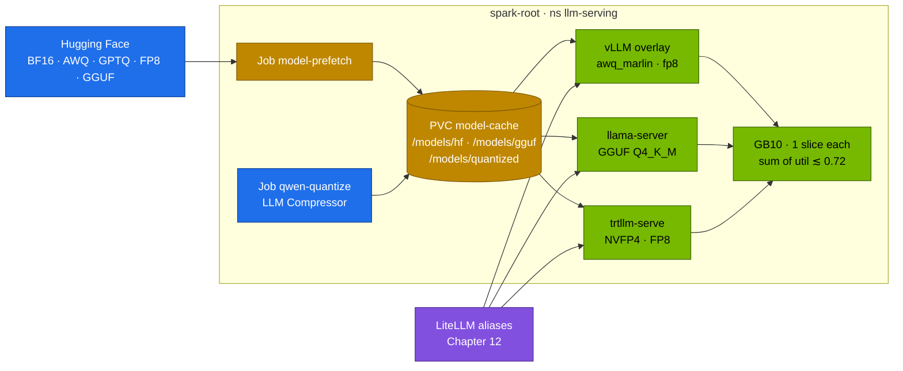

# Chapter 05 · Quantization (AWQ, GPTQ, FP8), TensorRT-LLM & GGUF/llama.cpp

> **04-Qwen · Part II — Serving · Chapter 05 of 14** · ← [Chapter 04 · Serving Qwen with vLLM & SGLang](04-serving-qwen-with-vllm-and-sglang.md) · [All chapters](00-qwen-step-by-step-guide.md) · [Chapter 06 · Kubernetes deployment & weight caching](06-kubernetes-deployment-and-weight-caching.md) →

| | |
|---|---|
| **You will build** | Qwen served in four formats on the root — BF16 and FP8 from the catalog, an AWQ checkpoint through 03's overlay, an FP8 copy you make yourself with LLM Compressor, a GGUF in llama.cpp — plus an optional TensorRT-LLM run with an NVFP4 checkpoint; a memory and bandwidth table for Qwen on GB10, and your own tokens/s for each format |
| **Hardware** | dgx-spark-1 |
| **Time** | 2–3 h (most of it downloads) |
| **Risk** | Low–medium. One chat model at a time in `llm-serving`; a TensorRT-LLM or 72B run needs every other engine parked |
| **Clusters** | `spark-root` (`llm-serving`: vLLM, llama-server, trtllm, the quantization Job) |
| **Lab files** | [`lab/models.yaml`](lab/models.yaml), [`lab/scripts/serve-model.sh`](lab/scripts/serve-model.sh), [`lab/k8s/models/`](lab/k8s/models/) (generated vLLM overlays), [`lab/versions.env`](lab/versions.env); reused from 03: [`k8s/models/qwen2.5-32b-awq/`](../03-DeepSeek/lab/k8s/models/qwen2.5-32b-awq/), [`k8s/llamacpp/`](../03-DeepSeek/lab/k8s/llamacpp/) (`Dockerfile`, `llama-server.yaml`), [`k8s/trtllm/trtllm-serve.yaml`](../03-DeepSeek/lab/k8s/trtllm/trtllm-serve.yaml); from 02: [`vllm-bench.yaml`](../02-Kubernetes/lab/manifests/root-llms/90-serving/vllm/vllm-bench.yaml) |

---

## 1. Why this matters on a Spark

Two numbers decide what a GB10 can serve: **~121.7 GiB** of unified memory, of which the LLM pool is about **90 GiB**, and **~273 GB/s** of memory bandwidth. Quantization moves both.

**Capacity.** Weights are the largest fixed cost. Qwen2.5-32B in BF16 is ~65 GB and only runs alone at util 0.70; the AWQ version is ~19 GB and runs at 0.30 next to the 4B side model and the whole application stack. Qwen3-Coder-30B-A3B in FP8 is ~32 GB and runs at 0.40 with the whole application stack. Qwen2.5-72B in BF16 (~145 GB) does not fit the box at all; in AWQ (~42 GB) it fits, alone.

**Speed.** At batch size 1, every generated token reads every active weight once, so decode speed has a hard ceiling:

```text
tokens/s (one stream)  ≤  memory bandwidth / bytes of active weights read per token
```

| Model and format | Weights read per token | Ceiling at 273 GB/s |
|---|---|---|
| Qwen3-4B-Instruct-2507, BF16 (catalog `qwen3-4b-instruct`) | ~8.1 GB | ~34 tok/s |
| Qwen3-8B, BF16 (catalog `qwen3-8b`) | ~16.4 GB | ~17 tok/s |
| Qwen3-8B, NVFP4 (`nvidia/Qwen3-8B-FP4`) | ~6 GB | ~45 tok/s |
| Qwen3-8B, GGUF Q4_K_M | ~5.0 GB | ~55 tok/s |
| Qwen2.5-32B-Instruct, BF16 | ~65.5 GB | ~4 tok/s |
| Qwen2.5-32B-Instruct, AWQ INT4 (03 catalog `qwen2.5-32b-awq`) | ~19.3 GB | ~14 tok/s |
| Qwen3-Coder-30B-A3B, FP8 (catalog `qwen3-coder-30b-fp8`, ~3.3B active) | ~3.5 GB active | ~75 tok/s |
| Qwen2.5-72B-Instruct, AWQ INT4 | ~41.6 GB | ~6.5 tok/s |

These are ceilings, not measurements: attention, KV-cache reads, kernel efficiency and the time-slice scheduler all take a share. You will measure your own in §5 and write them next to this table. The pattern holds anyway: on a bandwidth-bound box, **4-bit weights are roughly a 3× decode speed-up over BF16**, and an MoE model with few active parameters is faster than any dense model of the same total size. Batching changes the picture (many streams share one weight read), which is why §5 also runs the concurrency sweep.

What you give up is accuracy, and it differs by method and by task. Code and maths suffer first. The rule in this module: **measure on your own task** (Chapter 02's code/maths checks, Chapter 11's RAG questions) before you swap a BF16 model for a quantized one.

| Format | Weights | Activations | Made by | vLLM | Qwen publishes |
|---|---|---|---|---|---|
| BF16 | 16 bit | 16 bit | – | default | every model |
| FP8 (W8A8) | 8 bit E4M3, per-channel or 128×128 blocks | 8 bit, dynamic per token | Qwen, LLM Compressor, ModelOpt | auto-detected (`fp8` / `compressed-tensors`) | `Qwen3-*-FP8`, `Qwen3-Coder-30B-A3B-Instruct-FP8`, `Qwen3.6-35B-A3B-FP8` (block-wise) |
| AWQ (W4A16) | 4 bit int, group 128 | 16 bit | Qwen, LLM Compressor (AutoAWQ is deprecated) | `awq_marlin` | `Qwen2.5-*-Instruct-AWQ`, `Qwen3-*-AWQ` |
| GPTQ (W4A16 / W8A16) | 4 or 8 bit int, group 128 | 16 bit | Qwen, LLM Compressor, GPTQModel | `gptq_marlin` | `Qwen2.5-*-Instruct-GPTQ-Int4/Int8` |
| NVFP4 (W4A4) | 4 bit E2M1, 16-element blocks | 4 bit | NVIDIA ModelOpt | depends on the image — test | NVIDIA publishes `nvidia/Qwen3-*-FP4` |
| GGUF k-quants | 2–8 bit, 256-weight super-blocks | 16/32 bit | llama.cpp `llama-quantize` | experimental — use llama.cpp | `Qwen2.5-*-Instruct-GGUF`, `Qwen3-*-GGUF` |
| bitsandbytes NF4 | 4 bit NormalFloat | 16 bit | on load | possible, slow | – (QLoRA training, Chapter 08) |

Check the current release of each tool before you pin it; the lab pins its images in [`lab/versions.env`](lab/versions.env).

---

## 2. Architecture — HLD



All three engines are Deployments in `llm-serving` with memory request = limit, one GB10 time-slice each, the `model-cache` PVC (Chapter 06) and a readinessProbe. Only one chat engine of 7B+ runs at a time in this chapter; the comparison is sequential, so the numbers are not disturbed by a neighbour.

| Engine | Input format | Strength on a Spark | Weakness on a Spark |
|---|---|---|---|
| vLLM | safetensors: BF16, FP8, AWQ, GPTQ, compressed-tensors | the lab's default: continuous batching, prefix caching, tool parsers, the 02 base Deployment with the 04 image (`VLLM_IMAGE` in `versions.env`) | NVFP4 and block-FP8 kernel coverage for sm_121 depends on the image |
| TensorRT-LLM (`trtllm-serve`, PyTorch backend) | HF safetensors, ModelOpt FP8/NVFP4 | NVIDIA's reference path for NVFP4 on Blackwell; DGX Spark playbooks | bigger image, fewer model families, KV pool sized from *free* memory |
| llama.cpp (`llama-server`) | GGUF | small footprint, k-quants from 2 to 8 bit, mmap loading, same files as Ollama/LM Studio | weaker batching under many concurrent users |

---

## 3. LLD

### 3.1 Group quantization in one formula

Every integer weight format here stores, per group of `g` consecutive weights (usually `g = 128` along the input dimension):

```text
w ≈ s · (q − z)        q: 4-bit integer 0..15   s: FP16 scale   z: zero point (asymmetric) or 8 (symmetric)
bits per weight ≈ 4 + (16 + 4) / 128 ≈ 4.16      (AWQ: FP16 scale + 4-bit packed zero per group)
```

Embeddings and `lm_head` usually stay in BF16 — for Qwen's 152 K vocabulary that is ~1.1 GB per matrix for a 3584-wide 7B, which is why Qwen2.5-7B-Instruct-AWQ is ~5.6 GB: ~2.2 GB of BF16 embedding and output matrices plus ~3.4 GB for the 4-bit rest.

**Round-to-nearest (RTN)** picks `s = max|w| / 7` and rounds. It works at 8 bit, but at 4 bit it loses accuracy on large models because a few input channels carry activations 10–100× larger than the rest: errors on the weights that multiply those channels are amplified in the output. GPTQ and AWQ are two answers to the same problem.

### 3.2 GPTQ: compensate the rounding error

GPTQ quantizes a layer column by column and minimises the output error on a calibration set `X`:

$$\min_{\hat W} \lVert W X - \hat W X \rVert_2^2, \qquad H = 2 X X^\top$$

When column `q` is rounded, the remaining (not yet quantized) columns absorb the error, using the inverse Hessian (the Optimal Brain Surgeon update):

$$\delta_{>q} = -\frac{w_q - \hat w_q}{[H^{-1}]_{qq}} \, H^{-1}_{:,q}$$

Practical knobs: group size (128), `desc_act` / activation order (quantize the columns with the largest Hessian diagonal first — better accuracy, slightly slower kernels), damping (`dampening_frac`), and the calibration set (a few hundred samples of text like your traffic: code for Qwen2.5-Coder, maths for Qwen2.5-Math).

### 3.3 AWQ: protect the salient channels

AWQ observes that the weights that matter are the ones multiplied by large activations. It rescales input channel `i` of the weight by `s_i > 1` and the activation by `1/s_i`, which leaves the product unchanged but gives the important weights more of the 4-bit grid:

$$W X = \big(W \operatorname{diag}(s)\big)\big(\operatorname{diag}(s)^{-1} X\big), \qquad s = S_X^{\alpha},\; S_X = \mathbb{E}\lvert X \rvert$$

$$s^\* = \arg\min_{\alpha \in [0,1]} \big\lVert W X - Q\big(W \operatorname{diag}(s)\big) \operatorname{diag}(s)^{-1} X \big\rVert$$

The `1/s` is folded into the preceding operation (RMSNorm weight or the previous linear layer), so it costs nothing at runtime. The weights are still dequantized on the fly: the **Marlin** W4A16 kernels in vLLM read 4-bit weights from memory and expand them to BF16 in registers before the tensor-core multiply. That is where the speed-up comes from — fewer bytes over the memory bus — not from integer arithmetic.

AutoAWQ, the tool the old guides used, is deprecated (its last release was 0.2.9, May 2025); its AWQ implementation moved into vLLM's **LLM Compressor** (`AWQModifier`). Qwen's own `-AWQ` checkpoints remain the easiest start.

### 3.4 FP8: floating-point weights and activations

FP8 keeps an exponent, so it needs no zero point and handles outliers better than INT8. Blackwell's tensor cores (GB10, sm_121) run FP8 × FP8 natively.

| Format | Layout | Largest finite value | Used for |
|---|---|---|---|
| E4M3 (`float8_e4m3fn`) | 1 sign · 4 exponent (bias 7) · 3 mantissa | 448 | weights and activations at inference |
| E5M2 | 1 · 5 (bias 15) · 2 | 57 344 | gradients in FP8 training |

E4M3's maximum: the "fn" variant has no infinities and only one NaN pattern (`S.1111.111`), so the largest finite value is exponent 15, mantissa `110₂` → (1 + 0.5 + 0.25) × 2^(15−7) = 1.75 × 256 = **448**. E5M2 follows IEEE rules: (1.75) × 2^(30−15) = **57 344**.

How the scale is chosen decides the accuracy:

| Scaling | Where | Example |
|---|---|---|
| per-tensor, static | one scale per weight matrix, activation scale from calibration | older FP8 checkpoints |
| per-channel weights + dynamic per-token activations | no calibration data needed | LLM Compressor `FP8_DYNAMIC`, `RedHatAI/*-FP8-dynamic` |
| block-wise 128 × 128 weights + 1 × 128 activation tiles | an outlier only affects its own block | Qwen3-*-FP8, DeepSeek-V3 (03-DeepSeek Chapter 02) |

The block size is part of the recipe, not a hardware feature. Whether a given vLLM image uses a native FP8 kernel for block-wise checkpoints on sm_121 or falls back to a slower path is something you read in the startup log (§5.3).

### 3.5 FP4: NVFP4 and MXFP4

Blackwell adds 4-bit floating point (E2M1: values up to ±6) with *micro-scaling*: a small block of elements shares one scale.

| Format | Block | Block scale | Extra | Bits per weight |
|---|---|---|---|---|
| NVFP4 | 16 | FP8 E4M3 | one FP32 scale per tensor | 4 + 8/16 = 4.5 |
| MXFP4 (OCP) | 32 | E8M0 (a power of two) | – | 4 + 8/32 = 4.25 |

NVFP4 quantizes activations as well (W4A4), so prefill also gets cheaper. NVIDIA publishes NVFP4 checkpoints made with ModelOpt (for example `nvidia/Qwen3-8B-FP4`, `nvidia/Qwen3-32B-FP4`, `nvidia/Qwen3-30B-A3B-FP4`) and its DGX Spark TensorRT-LLM playbook lists them. vLLM support for NVFP4 on sm_121 depends on the image; test it before you plan around it.

### 3.6 GGUF and k-quants

A GGUF file is self-describing: a header, a key–value metadata block (`general.architecture = qwen2` or `qwen3`, context length, RoPE base, the full tokenizer and, in current files, the Jinja chat template), then 32-byte-aligned tensors. llama.cpp `mmap`s the file, so the page cache holds the weights and a second start is near-instant.

The k-quants group 256 weights into a **super-block** of 8 sub-blocks × 32 weights. Each sub-block has a 6-bit scale (and a 6-bit minimum for the "asymmetric" types); the super-block holds an FP16 scale for those scales. Q4_K is therefore 4 + (8 × 12 bits + 2 × 16 bits)/256 = **4.5 bits per weight**. The `_S/_M/_L` suffix is a *mix*: Q4_K_M keeps some tensors (half of `attn_v` and `ffn_down`) in Q6_K, so the whole file averages about 4.8–4.9 bits per weight.

| Type | ≈ bits per weight | Qwen3-8B file | Use |
|---|---|---|---|
| Q8_0 | 8.5 | ~8.7 GB | reference quality |
| Q6_K | 6.6 | ~6.7 GB | near-lossless |
| Q5_K_M | 5.7 | ~5.9 GB | good default when memory allows |
| Q4_K_M | 4.8–4.9 | ~5.0 GB | the usual default |
| Q3_K_M | 3.9 | ~4.1 GB | only when nothing else fits; measure quality |

### 3.7 What fits: Qwen on GB10

KV cache per token (BF16) is `2 × layers × kv_heads × head_dim × 2 bytes`; `--kv-cache-dtype fp8` halves it.

| Model | Layers · KV heads · head dim | KV / token (BF16) |
|---|---|---|
| Qwen3-4B | 36 · 8 · 128 | 144 KiB |
| Qwen2.5-7B | 28 · 4 · 128 | 56 KiB |
| Qwen3-8B | 36 · 8 · 128 | 144 KiB |
| Qwen3-30B-A3B / Qwen3-Coder-30B-A3B | 48 · 4 · 128 | 96 KiB |
| Qwen2.5-32B / Qwen3-32B | 64 · 8 · 128 | 256 KiB |
| Qwen2.5-72B | 80 · 8 · 128 | 320 KiB |

`--gpu-memory-utilization` is a fraction of ~121.7 GiB, the sum over engines running together must stay ≲ 0.72, and each pod's memory request = limit ≥ util × 121.7 GiB + ~3.5 GiB for the process (the rule `gen_overlays.py` checks). The catalog in [`lab/models.yaml`](lab/models.yaml) carries the values the overlays use; this table shows the reasoning behind them.

| Checkpoint | Weights | util | ≈ UMA | KV left (approx.) | Runs next to |
|---|---|---|---|---|---|
| `qwen3-8b` (BF16) | 16.4 GB | 0.20 | 24 GiB · pod 32 Gi | ~6 GiB ≈ 45 K tokens | the everyday set: `qwen3-4b-instruct` + apps |
| `qwen2.5-32b-awq` (03 catalog) | 19.3 GB | 0.30 | 37 GiB · pod 40 Gi | ~16 GiB ≈ 64 K tokens | `qwen3-4b-instruct` + the apps (0.48, 79 Gi) |
| `qwen3-coder-30b-fp8` | 32 GB | 0.40 | 49 GiB · pod 56 Gi | ~16 GiB ≈ 170 K tokens | BGE-M3 and the apps (set `coding`) |
| `qwen3.6-35b-fp8` | 38 GB | 0.45 | 55 GiB · pod 64 Gi | hybrid attention: only the full-attention layers hold KV — read the log | BGE-M3 and the apps (set `flagship`) |
| Qwen2.5-32B-Instruct (BF16) | 65.5 GB | 0.70 | 85 GiB · pod ~89 Gi | ~19 GiB ≈ 75 K tokens | nothing — runs alone |
| Qwen2.5-72B-Instruct-AWQ | 41.6 GB | 0.60 | 73 GiB · pod ~77 Gi | ~30 GiB ≈ 96 K tokens | nothing — runs alone, short contexts |
| Qwen2.5-72B-Instruct (BF16) | 145 GB | – | – | – | does not fit; two Sparks (§8) |

The last three rows are not in the catalog: they exist to show where the edge is. Note the MoE row — the same pool holds ~4× more KV tokens for the coder than for the dense 8B, because it has half the KV heads and the weights leave more room.

vLLM prints the real KV figure at start-up (`GPU KV cache size: … tokens`); copy yours into the last-but-one column.

---

## 4. Integrations

- **Serving (Chapter 04)**: every vLLM variant here is a generated overlay of the 02 base Deployment, switched with `scripts/serve-model.sh <name>`. Pre-quantized checkpoints need no flags beyond what the catalog sets; vLLM reads `quantization_config` from `config.json`.
- **Weights (Chapter 06)**: all formats land in the `model-cache` PVC — Hugging Face snapshots under `/models/hf`, GGUF under `/models/gguf`, your own quantized output under `/models/quantized`.
- **Fine-tuning (Chapters 07–08)**: train in BF16 (or QLoRA on NF4), merge the adapter, then quantize the merged model with the Job in §5.4. Do not train on top of AWQ/GPTQ weights and expect to merge.
- **Gateway (Chapter 12)**: each engine is one LiteLLM model alias (for example `qwen-32b-awq`, `qwen3-8b-gguf`, `qwen3-8b-nvfp4`); clients switch format by changing the model name, not the URL.
- **Telemetry (Chapter 13)**: vLLM and llama-server (`--metrics`) are scraped by the root Prometheus; TensorRT-LLM exposes `/metrics` in recent releases — check your image.
- **03-DeepSeek**: the llama.cpp and TensorRT-LLM manifests are 03's ([Chapter 07](../03-DeepSeek/07-alternative-engines-sglang-llamacpp-trtllm.md)); this chapter changes only the model.

---

## 5. Lab

#### What this lab does (preflight and parking)

- **Read-only status:** the catalog, the Deployments and pods in `llm-serving`, and how much of `serving-budget` (90 Gi) is used.
- **Parking:** the KEDA pause annotation on ScaledObject `vllm` scales the main engine to 0 and keeps it there until you remove the annotation. Side engines are removed with `--stop-side`.

#### What to look for

1. **Before each task:** at most one chat engine with replicas above 0, plus the always-on pods (mock LLM, Qdrant, the 03 apps).
2. **`serving-budget`:** used `requests.memory` leaves room for the next engine (for example 40 Gi for the AWQ 32B, 56 Gi for the FP8 coder).
3. **After the pause annotation:** `kubectl --context spark-root -n llm-serving get deploy vllm` shows `0/0`.

**If something's off:** `vllm` comes back after `kubectl scale` → KEDA owns it; use the annotation. More in §7.

#### Run it

```bash
# ▶ MacBook · 04-Qwen/lab
export KUBECONFIG="$PWD/../../01-Ansible/lab/.cache/kubeconfig-spark-lab.yaml"
source versions.env
scripts/serve-model.sh list                          # the Qwen catalog: name, util, weights, HF id
kubectl --context spark-root -n llm-serving get deploy,pods
kubectl --context spark-root -n llm-serving describe resourcequota serving-budget | grep -E 'memory|gpu'
```

Start with only the always-on pods (mock LLM, Qdrant, the 03 apps) and at most one chat engine: stop side engines with `scripts/serve-model.sh --stop-side <name>`. The main `vllm` Deployment is owned by the KEDA ScaledObject (`minReplicaCount: 1`), so `kubectl scale … --replicas=0` would be undone; park it with the pause annotation instead and remove the annotation when you are done:

```bash
# ▶ MacBook · 04-Qwen/lab
kubectl --context spark-root -n llm-serving annotate scaledobject vllm autoscaling.keda.sh/paused-replicas=0 --overwrite   # park
kubectl --context spark-root -n llm-serving annotate scaledobject vllm autoscaling.keda.sh/paused-replicas-                # unpark
```

### Task 5.1 — Compute your ceilings

#### What this lab does (inline Python)

- **Computes** the decode-speed ceiling per stream for six weight sizes: 273 GB/s ÷ bytes of weights read per token. MacBook CPU only.

#### What to look for

1. **Six lines** of `≤ … tok/s per stream`, from 14.1 for `qwen2.5-32b AWQ` and 16.6 for `qwen3-8b BF16` up to 78.0 for `coder-30b-a3b FP8 (active)`.
2. **Keep the output:** §6 divides your measured speeds by these numbers.

**If something's off:** nothing to break; a value far from these means an edited row.

#### Run it

```bash
# ▶ MacBook · any folder
python3 - <<'PY'
bw = 273e9
rows = [("qwen3-4b BF16", 8.1e9), ("qwen3-8b BF16", 16.4e9), ("qwen3-8b NVFP4", 6.0e9),
        ("qwen3-8b Q4_K_M", 5.0e9), ("qwen2.5-32b AWQ", 19.3e9), ("coder-30b-a3b FP8 (active)", 3.5e9)]
for name, b in rows:
    print(f"{name:28} ≤ {bw / b:5.1f} tok/s per stream")
PY
```

Keep the output; §6 compares it with what you measure.

### Task 5.2 — A BF16 baseline and a pre-quantized AWQ model

#### What this lab does (`serve-model.sh qwen3-8b`, Job `vllm-bench`, 03 overlay `qwen2.5-32b-awq`)

- **Baseline:** serves Qwen3-8B in BF16 as the main model, then runs the 02 benchmark Job (`vllm bench serve`, 128 prompts at concurrency 1, 8, 32) against `svc/vllm`.
- **AWQ:** applies 03's overlay `03-DeepSeek/lab/k8s/models/qwen2.5-32b-awq` as the main `deploy/vllm`: Qwen2.5-32B-Instruct-AWQ, util 0.30, 40 Gi, ~19 GB download, on the 02 base image (vLLM 0.10).
- **Side effect:** 03's overlay also applies 02's placeholder `hf-token` Secret (`replace-me`). Re-sync the real token from Vault afterwards (Chapter 06 Task 5.1).

#### What to look for

1. **Bench Job log:** three `=== max-concurrency` blocks with `Successful requests: 128`, throughput and TPOT. At c = 1, `1000 / TPOT(ms)` is below the Task 5.1 ceiling for `qwen3-8b BF16` (≤ 16.6 tok/s).
2. **AWQ rollout:** `deployment "vllm" successfully rolled out`.
3. **AWQ log:**

   | Line | Healthy value |
   |---|---|
   | quantization | the checkpoint is detected as AWQ and vLLM uses `awq_marlin` |
   | weight load | about 18 GiB |
   | `KV cache size` | a token count; record it |

**If something's off:** a fallback kernel instead of `awq_marlin` → decode will be slower; note the log line. Pod `OOMKilled` while loading → see §7.

#### Run it

First the BF16 baseline from the catalog, measured with the 02 benchmark Job pointed at it:

```bash
# ▶ MacBook · 04-Qwen/lab
scripts/serve-model.sh qwen3-8b
sed -e 's|--model qwen2.5-0.5b|--model qwen3-8b|' \
    -e 's|value: Qwen/Qwen2.5-0.5B-Instruct|value: Qwen/Qwen3-8B|' \
    ../../02-Kubernetes/lab/manifests/root-llms/90-serving/vllm/vllm-bench.yaml \
  | kubectl --context spark-root apply -f -
kubectl --context spark-root -n llm-serving logs -f job/vllm-bench
kubectl --context spark-root -n llm-serving delete job vllm-bench
```

Record output-token throughput and TPOT at concurrency 1, 8 and 32. At concurrency 1, `1000 / TPOT(ms)` is your measured tokens/s per stream — compare it with the ceiling from Task 5.1. The benchmark's random prompts are fine for throughput even though Qwen3-8B thinks by default.

The 04 catalog has no AWQ entry; 03's catalog serves Qwen2.5-32B-Instruct-AWQ with the same 02 base Deployment. Apply its overlay as the main model (it replaces `qwen3-8b` behind `svc/vllm`; its util 0.30 fits next to the apps):

```bash
# ▶ MacBook · 04-Qwen/lab
kubectl --context spark-root apply -k ../../03-DeepSeek/lab/k8s/models/qwen2.5-32b-awq
kubectl --context spark-root -n llm-serving rollout status deploy/vllm --timeout=45m
kubectl --context spark-root -n llm-serving logs deploy/vllm | grep -Ei 'quantiz|marlin|Loading weights|KV cache size'
```

03's overlay runs on the 02 base image (vLLM 0.10), which is enough for Qwen2.5. Run the benchmark again with `--model qwen2.5-32b-awq` and `value: Qwen/Qwen2.5-32B-Instruct-AWQ` in the two `sed` expressions.

### Task 5.3 — An FP8 MoE checkpoint, same benchmark

#### What this lab does (`serve-model.sh qwen3-coder-30b-fp8` + Job `vllm-bench`)

- **Serves** Qwen3-Coder-30B-A3B-Instruct-FP8 as the main model (util 0.40, 56 Gi, ~32 GB download on the first run), replacing the AWQ model.
- **Reads** the startup log for the FP8 and fused-MoE kernel paths, then runs the same benchmark Job.

#### What to look for

1. **`serve-model.sh`:** `[PASS] vllm ready with qwen3-coder-30b-fp8` and `[PASS] answer: 144`.
2. **Log:** which FP8 path (block-wise, CUTLASS or Triton) and which MoE kernel vLLM picked; record "native" or "fallback".
3. **Benchmark:** at c = 1 a single stream decodes faster than the dense BF16 8B from Task 5.2, still below the 78 tok/s ceiling; at c = 32 the gap narrows.

**If something's off:** FP8 slower than BF16 → a generic fallback kernel; see §7.

#### Run it

```bash
# ▶ MacBook · 04-Qwen/lab
scripts/serve-model.sh qwen3-coder-30b-fp8
kubectl --context spark-root -n llm-serving logs deploy/vllm | grep -Ei 'fp8|block|cutlass|triton|moe|KV cache size'
```

Read which FP8 path vLLM picked for the block-wise weights and which fused-MoE kernel it uses. Then run the benchmark with `--model qwen3-coder-30b-fp8` and `value: Qwen/Qwen3-Coder-30B-A3B-Instruct-FP8` in the two `sed` expressions. Only ~3.3B parameters are read per token. Under concurrency the gap narrows: different tokens in a batch route to different experts, so a batch reads more of the weights.

### Task 5.4 — Quantize a model yourself with LLM Compressor

#### What this lab does (ConfigMap `qwen-quantize` + Job `qwen-quantize`, then a side engine)

- **Parks** the main `vllm` (pause annotation): the Job needs 24 Gi of `serving-budget`.
- **Job in `llm-serving`:** on `nvcr.io/nvidia/pytorch:26.08-py3`, installs `llmcompressor==0.14.0`, loads Qwen3-4B-Instruct-2507 in BF16 from `model-cache` (downloads ~8.1 GB if missing), quantizes every Linear layer except `lm_head` to FP8-dynamic and writes `/models/quantized/qwen3-4b-fp8-dynamic` on the `model-cache` PVC. 2 CPU · 24 Gi · 1 slice, request = limit.
- **Serve:** renders the catalog's `qwen3-4b-instruct` side overlay with the model path and served name swapped, so `deploy/svc vllm-qwen3-4b-instruct` serves `qwen3-4b-fp8`. Then the BF16 original in the same slot, for a clean comparison.

#### What to look for

1. **Job log:** `pip` does not replace the image's `torch`, then `saved /models/quantized/qwen3-4b-fp8-dynamic`.
2. **The output's `config.json`** has `"quant_method": "compressed-tensors"`.
3. **Side engine:** `deployment "vllm-qwen3-4b-instruct" successfully rolled out`; the `curl` answer's `content` is `144`.
4. **Benchmarks:** FP8 and BF16 4B numbers side by side (TPOT at c = 1, throughput at c = 32).

**If something's off:** Job `OOMKilled` → raise memory (request = limit) or quantize a smaller model. `pip` pulled a new torch → pin the `llmcompressor` release that matches the image. More in §7.

#### Run it

You will produce an FP8-dynamic copy of Qwen3-4B-Instruct-2507 (no calibration data needed) and serve it from the model cache next to the catalog's BF16 `qwen3-4b-instruct`. The Job runs in `llm-serving` because its output belongs in `model-cache`; at 24 Gi request = limit it needs the main engine parked.

```bash
# ▶ MacBook · 04-Qwen/lab
kubectl --context spark-root -n llm-serving annotate scaledobject vllm autoscaling.keda.sh/paused-replicas=0 --overwrite
cat > /tmp/quantize.py <<'PY'
import os
from transformers import AutoModelForCausalLM, AutoTokenizer
from llmcompressor import oneshot
from llmcompressor.modifiers.quantization import QuantizationModifier

src = os.environ["SRC"]                      # e.g. Qwen/Qwen3-4B-Instruct-2507
out = os.environ["OUT"]                      # e.g. /models/quantized/qwen3-4b-fp8-dynamic
model = AutoModelForCausalLM.from_pretrained(src, torch_dtype="auto", cache_dir="/models/hf")
tok = AutoTokenizer.from_pretrained(src, cache_dir="/models/hf")
recipe = QuantizationModifier(targets="Linear", scheme="FP8_DYNAMIC", ignore=["lm_head"])
oneshot(model=model, recipe=recipe)          # FP8_DYNAMIC: weights per channel, activations per token at runtime
model.save_pretrained(out, save_compressed=True)
tok.save_pretrained(out)
print("saved", out)
PY
kubectl --context spark-root -n llm-serving create configmap qwen-quantize --from-file=/tmp/quantize.py \
  --dry-run=client -o yaml | kubectl --context spark-root apply -f -
kubectl --context spark-root apply -f - <<'YAML'
apiVersion: batch/v1
kind: Job
metadata: {name: qwen-quantize, namespace: llm-serving}
spec:
  backoffLimit: 0
  ttlSecondsAfterFinished: 3600
  template:
    spec:
      restartPolicy: Never
      containers:
        - name: quantize
          image: nvcr.io/nvidia/pytorch:26.08-py3          # PYTORCH_IMAGE in lab/versions.env
          command: ["bash", "-c", "pip install --quiet llmcompressor==0.14.0 && python3 /work/quantize.py"]
          env:
            - {name: SRC, value: Qwen/Qwen3-4B-Instruct-2507}
            - {name: OUT, value: /models/quantized/qwen3-4b-fp8-dynamic}
            - {name: HF_HOME, value: /models/hf}
          resources:
            requests: {cpu: "2", memory: 24Gi, nvidia.com/gpu: "1"}   # request = limit
            limits: {cpu: "2", memory: 24Gi, nvidia.com/gpu: "1"}
          volumeMounts:
            - {name: models, mountPath: /models}
            - {name: work, mountPath: /work}
      volumes:
        - {name: models, persistentVolumeClaim: {claimName: model-cache}}
        - {name: work, configMap: {name: qwen-quantize}}
YAML
kubectl --context spark-root -n llm-serving logs -f job/qwen-quantize
```

Pin `llmcompressor` to the release current with the PyTorch image you use, and check that `pip` does not replace the image's `torch` (the Job log shows what it installed). The output directory holds a `config.json` with `"quant_method": "compressed-tensors"` — vLLM detects it without a flag. Serve it as a side engine: render the catalog's `qwen3-4b-instruct` side overlay and swap the model path and served name:

```bash
# ▶ MacBook · 04-Qwen/lab
scripts/serve-model.sh qwen3-4b-instruct --side --render \
  | sed -e 's|value: Qwen/Qwen3-4B-Instruct-2507|value: /models/quantized/qwen3-4b-fp8-dynamic|' \
        -e 's|value: qwen3-4b-instruct|value: qwen3-4b-fp8|' \
  | kubectl --context spark-root apply -f -
kubectl --context spark-root -n llm-serving rollout status deploy/vllm-qwen3-4b-instruct --timeout=20m
kubectl --context spark-root -n llm-serving port-forward svc/vllm-qwen3-4b-instruct 8001:8000 >/dev/null &
sleep 2; curl -s localhost:8001/v1/chat/completions \
  -H 'Content-Type: application/json' \
  -d '{"model":"qwen3-4b-fp8","messages":[{"role":"user","content":"What is 12*12? Number only."}],"max_tokens":8}'
```

Benchmark it (`--base-url http://vllm-qwen3-4b-instruct:8000`, `--model qwen3-4b-fp8`, tokenizer `Qwen/Qwen3-4B-Instruct-2507`), then replace it with the BF16 original (`scripts/serve-model.sh --stop-side qwen3-4b-instruct`, then `scripts/serve-model.sh qwen3-4b-instruct --side`) and run the same benchmark. FP8 versus BF16 on the same 4B model is the cleanest comparison in this chapter.

**AWQ variant.** AWQ needs calibration data. Replace the recipe and the `oneshot` call with the lines below, and use a dataset that looks like your traffic (code for a Coder model):

```python
from llmcompressor.modifiers.awq import AWQModifier
recipe = [AWQModifier(targets=["Linear"], scheme="W4A16_ASYM", ignore=["lm_head"])]
oneshot(model=model, recipe=recipe, dataset="open_platypus", max_seq_length=2048, num_calibration_samples=256)
```

AWQ calibration keeps the BF16 model plus calibration activations in memory: for a 4B model raise the Job to 32 Gi, for an 8B to 48 Gi, with nothing but the always-on pods in `llm-serving`. For 32B and above, use published checkpoints.

### Task 5.5 — GGUF with llama.cpp

#### What this lab does (03 Dockerfile `k8s/llamacpp` + manifest `llama-server.yaml`)

- **On dgx-spark-1:** builds `spark-local/llama.cpp:server-sm121` (llama.cpp `b6500`, CUDA for sm_121) with Docker and imports it into the root's containerd (`k8s.io` namespace). One-time, takes a while.
- **On the cluster:** removes the side engine, parks `vllm`, and applies 03's `llama-server` Deployment and Service in `llm-serving` with `Qwen/Qwen3-8B-GGUF:Q4_K_M` (alias `qwen3-8b-q4`): port 8080, 4 CPU · 12 Gi · 1 slice, `-c 16384`, `--parallel 4`, `--jinja`. The GGUF lands in `/models/gguf` on `model-cache`.
- **Bench:** `llama-bench` inside the pod on the same file.

#### What to look for

1. **Rollout:** `deployment "llama-server" successfully rolled out`.
2. **Log:**

   | Line | Healthy value |
   |---|---|
   | `file type` | `Q4_K - Medium` |
   | `offloaded` | `37/37 layers to GPU` (36 blocks plus the output layer) |
   | CUDA device | the GB10 |

3. **`llama-bench`:** a `pp512` and a `tg128` row in tokens/s. `tg128` stays below the Task 5.1 ceiling for ~5 GB of weights (about 55 tok/s).

**If something's off:** `offloaded 0/37 layers` → the image was built without CUDA or for the wrong architecture. `ErrImageNeverPull` → the `ctr images import` step didn't run on dgx-spark-1. More in §7.

#### Run it

Build the llama.cpp server for sm_121 once on the Spark (03-DeepSeek Chapter 07 explains the Dockerfile) and import it into the node's containerd:

```bash
# ▶ dgx-spark-1 (ssh dgx-spark-1)
cd ~/technical-depth/03-DeepSeek/lab/k8s/llamacpp
docker build -t spark-local/llama.cpp:server-sm121 --build-arg LLAMACPP_REF=b6500 .
docker save spark-local/llama.cpp:server-sm121 | sudo ctr -n k8s.io images import -
```

Apply 03's `llama-server.yaml` with a Qwen GGUF instead of the DeepSeek one:

```bash
# ▶ MacBook · 04-Qwen/lab
scripts/serve-model.sh --stop-side qwen3-4b-instruct
kubectl --context spark-root -n llm-serving annotate scaledobject vllm autoscaling.keda.sh/paused-replicas=0 --overwrite
sed -e 's|unsloth/DeepSeek-R1-Distill-Qwen-7B-GGUF:Q4_K_M|Qwen/Qwen3-8B-GGUF:Q4_K_M|' \
    -e 's|"r1-7b-q4"|"qwen3-8b-q4"|' \
    ../../03-DeepSeek/lab/k8s/llamacpp/llama-server.yaml | kubectl --context spark-root apply -f -
kubectl --context spark-root -n llm-serving rollout status deploy/llama-server --timeout=20m
kubectl --context spark-root -n llm-serving logs deploy/llama-server | grep -Ei 'model type|file type|offloaded|CUDA|n_ctx'
```

The `--jinja` flag makes llama-server use the chat template stored in the GGUF, which includes Qwen3's tool-call and thinking markup.

Measure decode speed with llama.cpp's own benchmark, on the same file:

```bash
# ▶ MacBook · 04-Qwen/lab
kubectl --context spark-root -n llm-serving exec deploy/llama-server -- sh -c \
  'llama-bench -m "$(find /models/gguf -name "*Q4_K_M*.gguf" | head -1)" -ngl 999 -p 512 -n 128'
```

`tg128` is tokens/s for generation at batch size 1; `pp512` is prompt processing. Compare `tg128` with Task 5.1's ceiling for ~5 GB of weights.

**Ollama.** Ollama uses the same GGUF files and llama.cpp underneath. It is convenient on the MacBook; do not install it as a service on the Spark, because a model loaded outside Kubernetes takes memory from the LLM pool that no quota or scheduler sees. If you write a Modelfile for a GGUF without an embedded template, the Qwen (ChatML) template is:

```text
FROM ./qwen3-8b-q4_k_m.gguf
TEMPLATE """{{ if .System }}<|im_start|>system
{{ .System }}<|im_end|>
{{ end }}<|im_start|>user
{{ .Prompt }}<|im_end|>
<|im_start|>assistant
"""
PARAMETER stop "<|im_start|>"
PARAMETER stop "<|im_end|>"
PARAMETER num_ctx 32768
```

Current official Qwen GGUFs carry the template already; prefer them.

### Task 5.6 — Optional: NVFP4 with TensorRT-LLM

#### What this lab does (03 manifest `k8s/trtllm/trtllm-serve.yaml`)

- **Scales** `llama-server` to 0 (vllm stays parked).
- **Applies** 03's `trtllm` Deployment and Service in `llm-serving` with the model swapped to `nvidia/Qwen3-8B-FP4`: image `nvcr.io/nvidia/tensorrt-llm/release:1.1.0`, PyTorch backend, port 8000, 4 CPU · 58 Gi · 1 slice, KV pool `free_gpu_memory_fraction: 0.30`. Large image pull on the first run.
- **Cleans up:** scales `trtllm` to 0, removes the pause annotation and brings back the everyday set (`qwen3-8b` + `qwen3-4b-instruct --side`).

#### What to look for

1. **Rollout:** `deployment "trtllm" successfully rolled out` within 45 minutes.
2. **Log:** an NVFP4 / quantization line, the KV cache size, and `Uvicorn running`.
3. **Benchmark:** the 02 Job against `http://trtllm:8000` with the served name from `GET /v1/models`; record it in your table.
4. **Afterwards:** `serve-model.sh qwen3-8b` and `--side qwen3-4b-instruct` both end with `0 failed`.

**If something's off:** no pod and a `FailedCreate … exceeded quota` event (`kubectl --context spark-root -n llm-serving get events`) → 58 Gi doesn't fit next to what still runs; check that `llama-server` and `vllm` are at 0. The image tag may not support sm_121 yet; check NVIDIA's DGX Spark TensorRT-LLM playbook. More in §7.

#### Run it

TensorRT-LLM's PyTorch backend serves a Hugging Face or ModelOpt checkpoint directly — there is no separate `convert_checkpoint` / `trtllm-build` step any more for this path (the engine-build flow still exists for the older TensorRT backend). Use 03's manifest with an NVIDIA NVFP4 Qwen checkpoint:

```bash
# ▶ MacBook · 04-Qwen/lab
kubectl --context spark-root -n llm-serving scale deploy llama-server --replicas=0     # vllm stays parked (annotation)
sed -e 's|RedHatAI/DeepSeek-R1-Distill-Qwen-32B-FP8-dynamic|nvidia/Qwen3-8B-FP4|' \
    ../../03-DeepSeek/lab/k8s/trtllm/trtllm-serve.yaml | kubectl --context spark-root apply -f -
kubectl --context spark-root -n llm-serving scale deploy trtllm --replicas=1
kubectl --context spark-root -n llm-serving rollout status deploy/trtllm --timeout=45m
kubectl --context spark-root -n llm-serving logs deploy/trtllm | grep -Ei 'quant|nvfp4|kv cache|Uvicorn'
```

The manifest's image tag is the one 03 pins; NVIDIA's DGX Spark TensorRT-LLM playbook names the tag it currently supports for the Spark — check it before you rely on the numbers. The image is written in 03's manifest (03 records it as `TRTLLM_IMAGE` in `03-DeepSeek/lab/versions.env`); to use another tag, add a second expression to the `sed` above, `-e 's|tensorrt-llm/release:1.1.0|tensorrt-llm/release:<tag>|'`. `kv_cache_config.free_gpu_memory_fraction` is a share of the memory still free *after* loading, which on unified memory is most of the box; the manifest keeps it at 0.30 so the KV pool stays inside the 58 Gi pod. For an 8B model you can lower the pod to 32 Gi and the fraction to 0.15.

Benchmark it with the same 02 Job (`--base-url http://trtllm:8000`, `--model` set to the served name in `GET /v1/models`) and scale it back to 0 afterwards:

```bash
# ▶ MacBook · 04-Qwen/lab
kubectl --context spark-root -n llm-serving scale deploy trtllm --replicas=0
kubectl --context spark-root -n llm-serving annotate scaledobject vllm autoscaling.keda.sh/paused-replicas-
scripts/serve-model.sh qwen3-8b                                     # back to the everyday set
scripts/serve-model.sh qwen3-4b-instruct --side
```

---

## 6. Verify

| Check | Expected |
|---|---|
| Task 5.2 | BF16 `qwen3-8b` benchmarked; AWQ detected for `qwen2.5-32b-awq`, `awq_marlin` in use, KV size in tokens recorded |
| Task 5.3 | FP8 and MoE kernel paths named (native or fallback); single-stream speed above the dense 8B |
| Task 5.4 | `/models/quantized/qwen3-4b-fp8-dynamic/config.json` has `compressed-tensors`; `qwen3-4b-fp8` answers `144`; FP8 vs BF16 4B numbers recorded |
| Task 5.5 | `Q4_K - Medium`, all layers offloaded, `tg128` recorded |
| Your table | per format: weights (GiB), util/pod size, TPOT at c=1, throughput at c=32, measured ÷ ceiling |
| Budgets | `kubectl --context spark-root -n llm-serving describe resourcequota serving-budget` never above 90 Gi; only one 7B+ chat engine running at a time |

A healthy result: measured single-stream speed is a clear fraction of the ceiling (never above it — if it is, the "weights read per token" figure is wrong), 4-bit formats decode faster than FP8 at the same size, FP8 faster than BF16, and the MoE coder faster than any dense model in the table. Quality differences show up in Chapter 02's tasks, not in throughput.

---

## 7. Troubleshooting

| You see | Cause | Fix |
|---|---|---|
| `Quantization method awq_marlin is not supported for the current GPU` | the image's Marlin build doesn't cover sm_121 | use the image in `lab/versions.env` (NGC builds include sm_121); otherwise drop the flag and let vLLM choose |
| FP8 model loads but decode is slower than BF16 | block-FP8 fell back to a generic kernel on this image | try the `FP8-dynamic` variant (per-channel) or AWQ; record the log line |
| `ValueError: ... compressed-tensors ... scheme not supported` | NVFP4 / W4A4 checkpoint on an image without the kernels | serve it with TensorRT-LLM (Task 5.6) |
| Pod `OOMKilled` while loading an AWQ 32B | pod memory below util × 121.7 GiB + overhead | raise request = limit to the catalog's `mem`; never lower util instead of fixing the pod |
| No new pod; event `FailedCreate … exceeded quota: serving-budget` | another engine still holds its request | `serve-model.sh --stop-side <name>`, the KEDA pause annotation for `vllm`, `kubectl scale … --replicas=0` for llama-server / trtllm |
| `vllm` comes back after `kubectl scale --replicas=0` | the KEDA ScaledObject keeps `minReplicaCount: 1` | park it with `autoscaling.keda.sh/paused-replicas=0` |
| LLM Compressor Job `OOMKilled` | model loaded in BF16 + calibration activations | raise the Job's memory (request = limit) or quantize a smaller model; AWQ needs more than FP8_DYNAMIC |
| `pip` in the Job replaces torch | the `llmcompressor` release requires a newer torch than the NGC image | pin the release that matches the image; never let the Job upgrade torch |
| llama-server: `offloaded 0/37 layers` | image built without CUDA or for the wrong arch | rebuild with `-DGGML_CUDA=ON -DCMAKE_CUDA_ARCHITECTURES=121` |
| GGUF answers with raw `<|im_start|>` tokens | template missing or `--jinja` not set | use an official Qwen GGUF and keep `--jinja` |
| `trtllm-serve` takes all free memory | `free_gpu_memory_fraction` too high on unified memory | 0.15–0.30, pod request = limit sized to weights + that share |
| Quantized model gives worse code/maths | calibration data didn't match the task, or 4-bit is too aggressive for it | recalibrate on code/maths, use 8-bit (GPTQ-Int8, FP8), or keep BF16 for that model |

---

## 8. Scale-out path (2×)

With dgx-spark-2 joined (CX-7 fabric, 03-DeepSeek [Chapter 04](../03-DeepSeek/04-scaling-beyond-one-spark.md)), the memory ceiling doubles but the bandwidth per Spark doesn't change:

- **Qwen2.5-72B-Instruct in BF16** (~145 GB) needs tensor parallelism over two Sparks (`--tensor-parallel-size 2` over NCCL on the fabric). Each token then crosses the fabric twice per layer; measure whether it beats 72B AWQ on one Spark — on a bandwidth-bound pair it often doesn't.
- **Qwen3-235B-A22B** in NVFP4 is the model NVIDIA's playbook runs on two stacked Sparks with TensorRT-LLM. With ~22B active parameters per token it decodes faster than a dense 72B.
- **Quantization still decides the fit**: a quantized model that fits one Spark is almost always the better choice than splitting a BF16 model over two. Use the second Spark for a second replica or for training instead.

---

## 9. Checklist

- [ ] I can compute the decode ceiling from weights read per token and 273 GB/s, and explain why MoE beats dense
- [ ] I know which formats vLLM reads natively (BF16, FP8, AWQ, GPTQ, compressed-tensors) and which go to TensorRT-LLM (NVFP4) or llama.cpp (GGUF)
- [ ] I can explain GPTQ's error compensation, AWQ's channel scaling and why 4-bit speeds up decode
- [ ] I can derive E4M3's 448 and E5M2's 57 344, and describe per-channel, per-token and block-wise FP8 scaling
- [ ] I served a pre-quantized AWQ and an FP8 Qwen model and recorded weights, KV tokens, TPOT and throughput
- [ ] I made my own FP8-dynamic checkpoint with LLM Compressor and served it from `model-cache`
- [ ] I ran a Qwen GGUF in llama-server and recorded `llama-bench` numbers
- [ ] Every engine I ran had memory request = limit, and the util sum stayed ≲ 0.72
