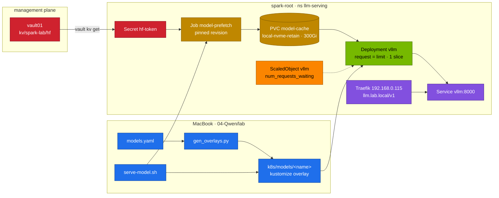

# Chapter 06 · Kubernetes Deployment & Weight Caching

> **04-Qwen · Part II — Serving · Chapter 06 of 14** · ← [Chapter 05 · Quantization & local engines](05-quantization-and-local-engines.md) · [All chapters](00-qwen-step-by-step-guide.md) · [Chapter 07 · ms-swift & supervised fine-tuning](07-ms-swift-and-sft.md) →

| | |
|---|---|
| **You will build** | The Qwen serving path on the root as a repeatable procedure: the Hugging Face token from vault01 synced into `llm-serving`, a catalog entry turned into a kustomize overlay of the 02 vLLM base, weights pinned to a revision and prefetched into the shared `model-cache` PVC, a model switch that drops the page cache first, the engine behind Traefik and KEDA — and measured cold, warm and cached start times |
| **Hardware** | dgx-spark-1 |
| **Time** | 90 min |
| **Risk** | Low. One chat model at a time; switching models restarts the `vllm` Deployment |
| **Clusters** | `spark-root` (`llm-serving`: Secret, PVC, prefetch Job, `vllm` Deployment, ScaledObject, Ingress) · optionally `dev-llms` (try an engine change with a 0.5B model in `llm-sandbox`) |
| **Lab files** | [`lab/models.yaml`](lab/models.yaml), [`lab/scripts/gen_overlays.py`](lab/scripts/gen_overlays.py), [`lab/scripts/serve-model.sh`](lab/scripts/serve-model.sh), [`lab/scripts/lib.sh`](lab/scripts/lib.sh), [`lab/k8s/models/`](lab/k8s/models/); from 02: [`vllm.yaml`](../02-Kubernetes/lab/manifests/root-llms/90-serving/vllm/vllm.yaml), [`pvcs.yaml`](../02-Kubernetes/lab/manifests/root-llms/60-storage/pvcs.yaml), [`model-prefetch-job.yaml`](../02-Kubernetes/lab/manifests/root-llms/60-storage/model-prefetch-job.yaml), [`autoscaling.yaml`](../02-Kubernetes/lab/manifests/root-llms/90-serving/autoscaling.yaml), [`ingress.yaml`](../02-Kubernetes/lab/manifests/root-llms/40-ingress/ingress.yaml) |

---

## 1. Why this matters on a Spark

The 02 module built one vLLM Deployment for a 0.5B model ([02-Kubernetes Chapter 20](../02-Kubernetes/20-vllm-high-throughput-llm-serving.md)). This module serves eight Qwen checkpoints — dense and MoE, BF16 and FP8, text, maths, code and vision — from that same Deployment. Copying the manifest per model would give you twelve files that drift; instead every model is a **row in `models.yaml`** and a **generated overlay** that changes only what differs: model id, served name, util, context length, engine flags, and the pod's memory.

Weights are the other half. A cold start has four serial parts:

```text
T_cold = T_download + T_disk→page cache + T_page cache→GPU allocation + T_warm-up (CUDA graphs, compile)
```

| Part | Qwen3-Coder-30B-A3B-FP8 (32 GB) | What removes it |
|---|---|---|
| download at ~50 MB/s | ~11 min | prefetch once into `model-cache` |
| download at ~1 GB/s (`hf_transfer`, fast uplink) | ~32 s | same |
| local NVMe read at a few GB/s | seconds | page cache already warm |
| copy into the engine's allocation | seconds | nothing — on GB10 it is a memory copy inside the same LPDDR5x |
| CUDA graph capture / `torch.compile` | tens of seconds | vLLM's compile cache on the PVC (version-specific) |

Measure your own disk and network; the numbers above are the arithmetic, not a benchmark.

Unified memory adds one rule a discrete-GPU guide never mentions: **the page cache and the GPU share the pool.** Loading a 32 GB checkpoint through the page cache can briefly hold the file in cache *and* in the engine's allocation — ~64 GB for a 32 GB model. The page cache is reclaimable, but no quota and no pod limit sees it, and a CUDA allocation that arrives while it is full can fail before the kernel reclaims. That is why `serve-model.sh` can drop the cache before a model switch (`DROP_CACHES=1`; [02-Kubernetes Chapter 13](../02-Kubernetes/13-storage-csi-and-high-performance-volumes.md) measures it with `uma-watch.sh`).

---

## 2. Architecture — HLD



Everything runs on the root under its real names: the pod is `vllm-…` in `llm-serving`, the PVC lands on dgx-spark-1 at `/data/k8s/retain/llm-serving/model-cache`, and the root's Prometheus, KEDA and Traefik see it directly. The admission rules for `llm-serving` apply to every overlay: pinned image tag, a readinessProbe, no `NVIDIA_VISIBLE_DEVICES` env, PSA baseline, priority `spark-serving`.

---

## 3. LLD

### 3.1 The base Deployment and what an overlay changes

The base is 02's [`vllm.yaml`](../02-Kubernetes/lab/manifests/root-llms/90-serving/vllm/vllm.yaml): `vllm serve $(MODEL)` with `--served-model-name=$(SERVED_NAME)`, `--gpu-memory-utilization=0.20`, `--max-model-len=8192`, `--enable-prefix-caching`, `--download-dir=/models/hf`; `HF_HOME=/models/hf`; 32 Gi request = limit, 1.5 CPU, one `nvidia.com/gpu` slice; startup/readiness/liveness probes on `/health`; `preStop: sleep 15`, `terminationGracePeriodSeconds: 120`, `strategy: Recreate`; an 8 Gi memory-backed `/dev/shm`.

An overlay leaves all of that alone and replaces exactly these fields (and removes one object, §3.5):

| Field | Path in the Deployment | Why per model |
|---|---|---|
| image | `containers[0].image` | the base pins `vllm:25.09-py3` (vLLM 0.10); Qwen3-VL and Qwen3.5/3.6 need newer, so every 04 overlay sets `VLLM_IMAGE` from [`lab/versions.env`](lab/versions.env) |
| engine arguments | `containers[0].args` | util, `--max-model-len`, quantization, parsers (`--reasoning-parser`, `--tool-call-parser`), multimodal limits |
| model id | `env[0]` (`MODEL`) | the Hugging Face repo, or a local path under `/models` |
| served name | `env[1]` (`SERVED_NAME`) | what clients and LiteLLM ask for |
| pod memory | `resources.requests.memory` and `limits.memory` | ≥ util × 121.7 GiB + ~3.5 GiB, request = limit |
| labels | `metadata.labels.model`, pod template label | dashboards and alerts group by model |

`strategy: Recreate` matters more here than in 02: with a 0.40 model, a rolling update would hold two copies (2 × 56 Gi) in `serving-budget` and in the pool.

### 3.2 The catalog

[`lab/models.yaml`](lab/models.yaml) has three parts: the `budget` (Σ util 0.72, `serving-budget` 90 Gi, and what the 03 application stack takes: util 0.06 for BGE-M3, 19 Gi in total), the `models`, and the `sets` that are meant to run together. A model row:

```yaml
- name: qwen3-8b                  # served name, overlay directory, LiteLLM alias target
  hf: Qwen/Qwen3-8B               # repo id
  util: 0.20                      # fraction of ~121.7 GiB
  max_len: 32768
  mem: 32Gi                       # pod request = limit
  weights: 16.4GB                 # prefetch planning
  licence: Apache-2.0
  args: [--reasoning-parser=qwen3, --enable-auto-tool-choice, --tool-call-parser=hermes, --max-num-seqs=32]
  use: everyday default — hybrid thinking (enable_thinking per request) plus tool calling
  # revision: <commit sha>        optional: pins weights and tokenizer (§3.4)
  # sandbox: {util: 0.02, mem: 3Gi, max_len: 2048}   optional: also a dev-llms overlay
```

`scripts/gen_overlays.py` reads the catalog and writes `k8s/models/<name>/kustomization.yaml` (and `k8s/models/<name>/sandbox/` for rows with `sandbox:`). The generated files carry a header with the budget arithmetic and a "do not edit" note: you change the catalog and regenerate, never the overlay. `python3 scripts/gen_overlays.py --check` is the CI form — it fails if an overlay is stale, a `mem` breaks the memory rule, or a set doesn't fit the budget.

`scripts/serve-model.sh` runs a switch:

| Command | Does |
|---|---|
| `serve-model.sh list` | catalog and sets |
| `serve-model.sh qwen3-8b` | main model behind `svc/vllm` (replaces the current one) |
| `serve-model.sh qwen3-4b-instruct --side` | a second engine next to it, as `deploy/svc vllm-qwen3-4b-instruct` |
| `serve-model.sh <name> [--side] --render` | print the manifests, apply nothing |
| `serve-model.sh qwen3-0.6b --sandbox` | the sandbox overlay in `dev-llms` / `llm-sandbox` |
| `serve-model.sh --stop-side <name>` | remove a side engine |

Each run checks the util budget against every running Deployment in `llm-serving` (refusing above 0.72 unless `FORCE=1`), prefetches the model (with the catalog's revision, if pinned) through 02's prefetch Job, optionally drops the page cache (`DROP_CACHES=1`, over `ssh dgx-spark-1`), applies, waits for the rollout and sends a smoke question (`12*12`). It warns when KEDA's pause annotation would keep `vllm` at zero — the training window (Chapter 07).

### 3.3 Sizing rules the generator enforces

- **util**: the sum over engines running at the same time ≲ 0.72 (util × ~121.7 GiB each).
- **mem**: request = limit, ≥ util × 121.7 GiB + ~3.5 GiB (Python, CUDA context, tokenizer, compile cache). Below that the pod is OOM-killed while loading; far above it the scheduler reserves memory that no engine uses. Everyday models stay ≤ 32 Gi so two of them fit `serving-budget` next to the apps.
- **serving-budget**: everyday 8 CPU · 90 Gi · 6 slices · 1 Ti storage in `llm-serving`, shared with the 03 apps (Open WebUI, LiteLLM and its DB, BGE-M3), Qdrant and the mock LLM — 19 Gi in the catalog's budget.
- **bigger models** run as the only chat model: pod memory raised to fit, everything else that holds GPU memory parked first.

The catalog's sets, as the generator checks them:

| Set | Models | Σ util (+ apps 0.06) | Σ memory (+ apps 19 Gi) |
|---|---|---|---|
| everyday | qwen3-8b + qwen3-4b-instruct | 0.20 + 0.12 + 0.06 = 0.38 | 32 + 20 + 19 = 71 Gi |
| multimodal (no apps) | qwen3-8b + qwen3-vl-8b + qwen3-4b-instruct | 0.52 | 84 Gi |
| coding | qwen3-coder-30b-fp8 | 0.40 + 0.06 = 0.46 | 56 + 19 = 75 Gi |
| flagship | qwen3.6-35b-fp8 | 0.45 + 0.06 = 0.51 | 64 + 19 = 83 Gi |
| reasoning-compare (no apps) | qwen3-8b + qwen3-4b-thinking + qwen2.5-math-7b | 0.50 | 80 Gi |

Memory, not util, is usually the binding limit: the flagship set uses 0.51 of the util budget but 83 of 90 Gi.

### 3.4 The Hugging Face cache on the PVC

```text
/models/hf/
  models--Qwen--Qwen3-8B/
    blobs/<sha256>                 # the bytes, once
    refs/main                      # the commit "main" pointed to when you downloaded
    snapshots/<commit>/            # symlinks into blobs: config.json, *.safetensors, tokenizer
/models/gguf/                      # llama.cpp downloads (LLAMA_CACHE, Chapter 05)
/models/quantized/                 # your own LLM Compressor output (Chapter 05)
```

Pinning `revision` to a commit means two things: the prefetch downloads exactly those files, and a later push to `main` on Hugging Face doesn't change your model behind your back. The generator passes it to vLLM as `--revision` and `--tokenizer-revision`; 03-DeepSeek's `tools/catalog_drift.py` finds the current SHAs ([03-DeepSeek Chapter 15](../03-DeepSeek/15-automation-secrets-and-day2.md)). Two revisions of the same repo share unchanged blobs, so a tokenizer-only update costs kilobytes.

Safetensors files are read with `mmap`, which is why the page cache matters (§1). Transparent huge pages and other kernel tuning are measurable on the Spark but second-order next to "prefetch once, drop the cache before a big load".

### 3.5 The token comes from Vault

The `hf-token` Secret in `llm-serving` is the only credential this chapter needs. Every catalog model is Apache-2.0 and not gated, so the overlays mark the token `optional` — but rate limits are kinder with a token, and community repos may be gated. It is stored once in vault01 at `kv/spark-lab/hf` (field `token`) and synced into the cluster; it is never written into a file in the repo.

One trap the generator removes: 02's `vllm.yaml` contains an `hf-token` Secret with the placeholder `replace-me`, so applying the 02 base directly (or a 03 overlay built on it) resets the token you synced. Every 04 overlay deletes that Secret from its output (a `$patch: delete`), so `serve-model.sh` never touches it. If you apply the 02 base or a 03 overlay, re-run the sync afterwards (Task 5.1), or let 03's Vault sync CronJob ([03-DeepSeek Chapter 15](../03-DeepSeek/15-automation-secrets-and-day2.md)) restore it.

---

## 4. Integrations

- **Serving engines (Chapters 04–05)**: SGLang, llama-server and trtllm read the same PVC and the same Secret, and their util counts in the same 0.72; park them before `serve-model.sh` starts a vLLM model.
- **Autoscaling**: the root's KEDA ScaledObject `vllm` (02 [`autoscaling.yaml`](../02-Kubernetes/lab/manifests/root-llms/90-serving/autoscaling.yaml)) scales on `vllm:num_requests_waiting`, `maxReplicaCount: 1` on one Spark. It is also the off switch for the training window: `autoscaling.keda.sh/paused-replicas=0` (Chapter 07).
- **Ingress**: Traefik on the root at 192.168.0.115 serves `llm.lab.local/v1`. The 02 Ingress points at `mock-llm`; Task 5.6 points it at `vllm`. Chapter 12 puts LiteLLM in front so clients use model aliases instead.
- **Telemetry (Chapter 13)**: the root ServiceMonitor `llm-workloads` scrapes the `vllm` Service; the `model` label from the overlay separates the series.
- **Scheduling**: priority `spark-serving`; the scheduler places the pod only where its full memory request is free on dgx-spark-1, so a model that doesn't fit waits Pending instead of squeezing a running one.

---

## 5. Lab

```bash
# ▶ MacBook · 04-Qwen/lab
export KUBECONFIG="$PWD/../../01-Ansible/lab/.cache/kubeconfig-spark-lab.yaml"
source versions.env
kubectl --context spark-root -n llm-serving get pvc model-cache
kubectl --context spark-root -n llm-serving get deploy,scaledobject,ingress
```

Expected: `model-cache` Bound (300Gi, `local-nvme-retain`), the always-on Deployments, the `vllm` ScaledObject, the `llm` Ingress. If the PVC is missing, apply 02's `root-llms` first (02-Kubernetes Chapter 13).

### Task 5.1 — Store the Hugging Face token in Vault and sync it

```bash
# ▶ vault01 (ssh vault01)
export VAULT_ADDR=https://192.168.0.211:8200 VAULT_CACERT=$HOME/vault-ca.crt
vault login                                       # your admin token or OIDC, as in 01-Ansible Chapter 17
read -rs HF && vault kv put kv/spark-lab/hf token="$HF"; unset HF
vault kv get -format=json kv/spark-lab/hf | jq '.data.metadata.version'
```

```bash
# ▶ MacBook · 04-Qwen/lab
export VAULT_ADDR=https://192.168.0.211:8200 VAULT_CACERT=$PWD/../../01-Ansible/lab/.cache/vault-ca.crt
vault login
vault kv get -field=token kv/spark-lab/hf \
  | kubectl --context spark-root -n llm-serving create secret generic hf-token --from-file=token=/dev/stdin \
      --dry-run=client -o yaml | kubectl --context spark-root apply -f -
kubectl --context spark-root -n llm-serving get secret hf-token -o jsonpath='{.data.token}' | base64 -d | cut -c1-5; echo
```

Expected: `hf_` and two more characters. The token never touched a file.

### Task 5.2 — From catalog row to overlay

```bash
# ▶ MacBook · 04-Qwen/lab
scripts/serve-model.sh list
python3 scripts/gen_overlays.py --check         # overlays match the catalog, memory rule, sets fit
head -3 k8s/models/qwen3-8b/kustomization.yaml
kubectl kustomize k8s/models/qwen3-8b | yq 'select(.kind=="Deployment") | .spec.template.spec.containers[0] | {"image": .image, "args": .args, "resources": .resources}'
diff <(kubectl kustomize ../../02-Kubernetes/lab/manifests/root-llms/90-serving/vllm) \
     <(kubectl kustomize k8s/models/qwen3-8b)
```

The diff is short: the image, the arguments, two env values, the optional token, memory, labels — and the placeholder Secret is gone. Everything else — probes, preStop, shm, priority, Recreate — comes from 02 unchanged. Validate it against the API server and its admission policies without starting anything:

```bash
# ▶ MacBook · 04-Qwen/lab
kubectl --context spark-root apply -k k8s/models/qwen3-8b --dry-run=server
scripts/serve-model.sh qwen3-4b-instruct --side --render | grep -E '^  name:|app:' | sort -u
```

The side rendering is the same overlay renamed to `vllm-qwen3-4b-instruct` (Deployment, Service and selectors), so it runs next to `svc/vllm` instead of replacing it.

A dry run proves the manifest is admissible, not that the model fits. To try an engine change live without touching the running models, use the `dev-llms` sandbox (`llm-sandbox`, 02-Kubernetes [Chapter 04](../02-Kubernetes/04-nested-clusters-with-vcluster.md)). The catalog generates a sandbox overlay for `qwen3-0.6b`: util 0.02, 3 Gi request = limit, eager mode, weights in an emptyDir (a vCluster pod cannot mount the root's `model-cache`):

```bash
# ▶ MacBook · 04-Qwen/lab
scripts/serve-model.sh qwen3-0.6b --sandbox
kubectl --context dev-llms -n llm-sandbox get pods
kubectl --context dev-llms -n llm-sandbox delete -k k8s/models/qwen3-0.6b/sandbox
```

### Task 5.3 — Pin a revision and prefetch

```bash
# ▶ MacBook · 04-Qwen/lab
curl -s https://huggingface.co/api/models/Qwen/Qwen3-8B | jq -r .sha
grep -A10 'name: qwen3-8b$' models.yaml | grep -E 'revision|^  - name' | head -2
```

If the row has no `revision:`, the model follows `main`. Add `revision: <sha>` under `hf:` and regenerate (`python3 scripts/gen_overlays.py`) before you rely on a result. `serve-model.sh` passes the revision to 02's prefetch Job; to run the prefetch alone:

```bash
# ▶ MacBook · 04-Qwen/lab
rev=$(curl -s https://huggingface.co/api/models/Qwen/Qwen3-8B | jq -r .sha)
kubectl --context spark-root -n llm-serving delete job model-prefetch --ignore-not-found
sed -e "s|value: Qwen/Qwen2.5-0.5B-Instruct|value: Qwen/Qwen3-8B|" \
    -e "s|{name: REVISION, value: main}|{name: REVISION, value: \"$rev\"}|" \
    ../../02-Kubernetes/lab/manifests/root-llms/60-storage/model-prefetch-job.yaml \
  | kubectl --context spark-root apply -f -
kubectl --context spark-root -n llm-serving logs -f job/model-prefetch | tail -3
```

Expected last line: `downloaded Qwen/Qwen3-8B@<sha> in <n>s`. Note `n` and the size from `du -sh`: that is your download bandwidth. Look at the layout on the Spark:

```bash
# ▶ dgx-spark-1 (ssh dgx-spark-1)
sudo du -sh /data/k8s/retain/llm-serving/model-cache/hf/models--Qwen--*
sudo ls -l /data/k8s/retain/llm-serving/model-cache/hf/models--Qwen--Qwen3-8B/snapshots/
```

### Task 5.4 — Switch models the safe way

```bash
# ▶ MacBook · 04-Qwen/lab
DROP_CACHES=1 scripts/serve-model.sh qwen3-8b
kubectl --context spark-root -n llm-serving get pods -l app=vllm -o wide
kubectl --context spark-root -n llm-serving describe resourcequota serving-budget | grep -E 'memory|gpu'
kubectl --context spark-root describe node dgx-spark-1 | grep -A9 'Allocated resources'
```

The script prints each stage: budget check, prefetch, page cache dropped, rollout, the smoke answer with the number of reasoning characters (Qwen3-8B thinks by default). `DROP_CACHES=1` runs `sudo -n` over `ssh dgx-spark-1`, so it needs passwordless sudo for that command; otherwise drop the cache on the Spark yourself, or run the 01-Ansible playbook `playbooks/29.2-uma-relief.yml` with `uma_drop_caches=true` from Semaphore:

**Semaphore UI:** Task Templates → *29.2 UMA relief* → Run, with the extra variable `uma_drop_caches: true` and the limit `dgx-spark-1`.

```bash
# ▶ dgx-spark-1 (ssh dgx-spark-1)
free -g | head -2
sudo sh -c 'sync; echo 3 > /proc/sys/vm/drop_caches'
free -g | head -2
```

### Task 5.5 — Measure cold, warm and cached starts

Three starts of the same model, timed from pod creation to Ready:

```bash
# ▶ MacBook · 04-Qwen/lab
t_ready() {
  kubectl --context spark-root -n llm-serving rollout restart deploy/vllm >/dev/null
  local t0=$(date +%s)
  kubectl --context spark-root -n llm-serving rollout status deploy/vllm --timeout=30m >/dev/null
  echo "$1: $(( $(date +%s) - t0 )) s"
}
ssh -t dgx-spark-1 "sudo sh -c 'sync; echo 3 > /proc/sys/vm/drop_caches'"; t_ready "cached on NVMe, cold page cache"
t_ready "warm page cache"
kubectl --context spark-root -n llm-serving logs deploy/vllm | grep -E 'Loading weights took|Model loading took|graph capturing|init engine'
```

For the "no prefetch" case, serve a model you have not downloaded yet and time the same way — the difference is your download time. Record the three numbers in your notes next to the model size. Typical shape: download dominates by far; NVMe and page cache differ by seconds; CUDA graph capture and compilation are a constant you only remove with a compile cache.

### Task 5.6 — Put it behind Traefik and check KEDA

```bash
# ▶ MacBook · 04-Qwen/lab
kubectl --context spark-root -n llm-serving patch ingress llm --type=json -p '[
  {"op":"replace","path":"/spec/rules/0/http/paths/0/backend/service/name","value":"vllm"},
  {"op":"replace","path":"/spec/rules/0/http/paths/1/backend/service/name","value":"vllm"}]'
curl -s -H 'Host: llm.lab.local' http://192.168.0.115/v1/models | jq -r '.data[].id'
curl -sN -H 'Host: llm.lab.local' http://192.168.0.115/v1/chat/completions -H 'Content-Type: application/json' -d '{
  "model":"qwen3-8b","stream":true,"max_tokens":64,"chat_template_kwargs":{"enable_thinking":false},
  "messages":[{"role":"user","content":"Name the three parts of a Kubernetes Deployment rollout in one line."}]}' \
  | sed -n 's/^data: //p' | grep -v DONE | jq -rj '.choices[0].delta.content // empty'; echo
kubectl --context spark-root -n llm-serving get scaledobject vllm -o jsonpath='{.status.conditions[?(@.type=="Ready")].status}'; echo
```

Expected: the served name, a streamed answer token by token through Traefik, `True` for the ScaledObject. Chapter 12 replaces this direct route with LiteLLM; put the Ingress back to `mock-llm` then, or leave it if you use it for tests.

### Task 5.7 — Clean old revisions

```bash
# ▶ MacBook · 04-Qwen/lab
kubectl --context spark-root -n llm-serving exec -i deploy/vllm -c vllm -- python3 - <<'PY'
from huggingface_hub import scan_cache_dir
info = scan_cache_dir("/models/hf")
for repo in sorted(info.repos, key=lambda r: -r.size_on_disk):
    revs = ", ".join(r.commit_hash[:8] for r in repo.revisions)
    print(f"{repo.size_on_disk/1e9:7.1f} GB  {repo.repo_id:45}  {revs}")
print(f"total {info.size_on_disk/1e9:.1f} GB")
PY
```

Compare the list with the catalog's revisions. A repo or revision not in the catalog is a candidate for deletion (`scan_cache_dir(...).delete_revisions(<hash>).execute()`), done from the same pod so the PVC's file ownership stays consistent.

---

## 6. Verify

| Check | Expected |
|---|---|
| `hf-token` | synced from `kv/spark-lab/hf`, starts with `hf_`, no token in any repo file |
| overlay diff | only args, `MODEL`, `SERVED_NAME`, memory and labels differ from 02's base |
| `--dry-run=server` | accepted by the root's admission policies |
| prefetch | completes with the pinned SHA; `snapshots/<sha>` exists on the PVC |
| `serving-budget` | the model's memory appears once, request = limit; total ≤ 90 Gi |
| start times | three numbers recorded: no prefetch, cold page cache, warm page cache |
| Traefik | `/v1/models` and a streamed answer through 192.168.0.115 |
| KEDA | ScaledObject `vllm` Ready, `maxReplicaCount: 1` |

---

## 7. Troubleshooting

| You see | Cause | Fix |
|---|---|---|
| `exceeded quota: serving-budget` on apply | another engine (or the training window's 10 Gi quota) still in force | park other engines; if a training window is open, end it (Chapter 07 §5) |
| Pod Pending, `Insufficient memory` | the node's free allocatable memory is below the request; a batch job holds the pool | `kubectl --context spark-root describe node dgx-spark-1`; wait for the job or stop it |
| `OOMKilled` during `Loading weights` | `mem` below util × 121.7 GiB + overhead | fix `mem` in the catalog, regenerate |
| CUDA OOM at start although the quota is fine | page cache still holds the previous model | drop caches (Task 5.4), lower util a step only if it repeats |
| Prefetch `401`/`403` | Secret reset to `replace-me` by applying the 02 base or a 03 overlay, or a gated repo | re-run the Vault sync (Task 5.1) |
| `budget: running … > 0.72 — park a model first` | the util of the running engines plus the new one exceeds the budget | `serve-model.sh --stop-side <name>` or park the engine; `FORCE=1` only if you have measured the headroom |
| `KEDA keeps deploy/vllm at 0` warning | the training window's pause annotation is still set | end the window (Chapter 07) or remove the annotation |
| Prefetch slow, single stream | `hf_transfer` not active | the Job sets `HF_HUB_ENABLE_HF_TRANSFER=1` and installs the extra; check the log for it |
| vLLM downloads again although the prefetch finished | `revision` differs between the prefetch and the engine, or `HF_HOME` mismatch | both use `/models/hf`; pin the same SHA in the catalog |
| Admission denial: `image tag latest` / `readinessProbe required` | an edited overlay or a hand-written Deployment | never edit generated overlays; use the base |
| Two `vllm` pods during a switch | `strategy` overridden to RollingUpdate | keep `Recreate` from the base |
| Traefik returns 404 | Host header missing or Ingress still on `mock-llm` | `-H 'Host: llm.lab.local'`, check Task 5.6's patch |

---

## 8. Scale-out path (2×)

- **The cache is node-local.** `local-nvme-retain` is a local-path volume on dgx-spark-1; a pod scheduled on dgx-spark-2 gets its own empty PVC there. Either prefetch on both nodes (one PVC per node, pinned with node affinity) or move the model store to NFS over RDMA on the CX-7 fabric (01-Ansible [Chapter 15](../01-Ansible/15-nfs-rdma-and-parallel-file-systems.md)), which keeps one copy and reads at fabric speed.
- **Replicas**: raise the ScaledObject's `maxReplicaCount` to 2 — each replica is a full copy of the model in its Spark's pool, and each Spark has its own ~0.72 util budget.
- **One big model over two Sparks** (tensor parallel over the fabric) needs the same revision on both nodes; the catalog's pinned SHA is what makes that safe.
- **Ingress** stays on the root's Traefik; the Service spreads requests over both replicas.

---

## 9. Checklist

- [ ] The HF token lives in `kv/spark-lab/hf` and reaches `hf-token` only through a Vault read
- [ ] I can read a catalog row and predict its overlay; I regenerate overlays instead of editing them
- [ ] Every overlay keeps request = limit and fits the util sum ≲ 0.72 with what else runs
- [ ] Models are pinned to a commit SHA and prefetched before the engine starts
- [ ] I drop the page cache before loading a large model, and I know why on unified memory
- [ ] I measured no-prefetch, cold and warm start times for one model
- [ ] The engine answers through Traefik at 192.168.0.115 and KEDA's ScaledObject is Ready
- [ ] I know how the cache and replicas change when dgx-spark-2 joins
