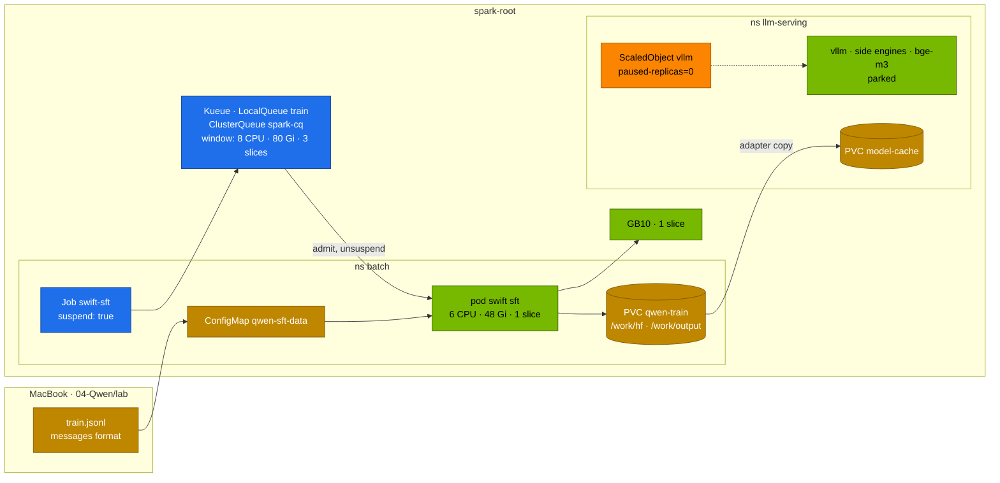
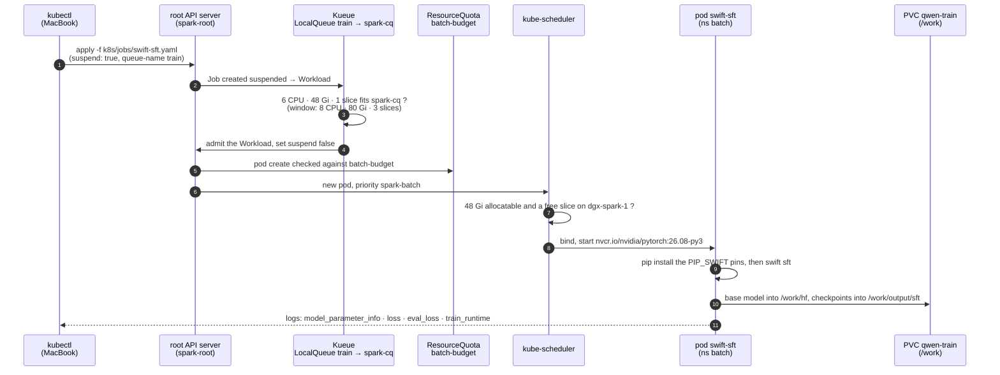

# Chapter 07 · ms-swift & Supervised Fine-Tuning

> **04-Qwen · Part III — Fine-tuning · Chapter 07 of 14** · ← [Chapter 06 · Kubernetes deployment & weight caching](06-kubernetes-deployment-and-weight-caching.md) · [All chapters](00-qwen-step-by-step-guide.md) · [Chapter 08 · PEFT & alignment](08-peft-and-alignment.md) →

| | |
|---|---|
| **You will build** | A LoRA SFT of Qwen3-4B-Instruct-2507 with ms-swift, run as a Kueue-admitted Job in `batch` during the training window; your own data in ms-swift's `messages` format; the adapter merged with `swift export`, served next to its base model through vLLM's LoRA support, and compared with the base — then the window closed and serving restored |
| **Hardware** | dgx-spark-1 |
| **Time** | 2–3 h (the training run itself: record yours) |
| **Risk** | Medium. The training window parks the model servers in `llm-serving`; chat is down until you close it |
| **Clusters** | `spark-root` (`batch`: Job, PVC `qwen-train`, Kueue; `llm-serving`: parked engines, the adapter served afterwards) |
| **Lab files** | [`lab/k8s/jobs/swift-sft.yaml`](lab/k8s/jobs/swift-sft.yaml), [`lab/versions.env`](lab/versions.env) (`PYTORCH_IMAGE`, `PIP_SWIFT`), [`lab/scripts/serve-model.sh`](lab/scripts/serve-model.sh); from 02: [`training-window/`](../02-Kubernetes/lab/manifests/root-llms/training-window/kustomization.yaml), [`kueue.yaml`](../02-Kubernetes/lab/manifests/root-llms/20-scheduling/kueue.yaml), [`quotas.yaml`](../02-Kubernetes/lab/manifests/root-llms/10-tenancy/quotas.yaml) |

---

## 1. Why this matters on a Spark

**ms-swift** (ModelScope's Scalable lightWeight Infrastructure for Fine-Tuning) is the training framework the Qwen team documents first. One CLI covers the whole path for every Qwen generation — pre-training, SFT, preference and RL training, inference, merging and quantization, evaluation — and it carries the chat templates (ChatML, Qwen3's thinking markup, the VL image tokens) so you don't rebuild them by hand. Under the hood it is PyTorch, Transformers, PEFT and TRL; the value is that the Qwen specifics are already right.

On a Spark the constraint is not the framework but the **memory pool**. There is one GPU and ~90 GiB of LLM memory shared between serving and training. Everyday, `batch` gets 2 CPU · 12 Gi — enough for a 0.6B experiment, not for a 4B. The **training window** lends the pool to `batch` (8 CPU · 80 Gi · 3 slices) while serving is parked. Every training job in this module is sized to fit it: ≤ 8 CPU, ≤ 80 Gi, 1 slice, request = limit.

What fits in that window, before activations (bytes per parameter):

| Model | Full fine-tune, AdamW (16 B/param) | LoRA, BF16 base (2 B/param + adapter) | QLoRA, NF4 base (~0.55 B/param + adapter, Chapter 08) |
|---|---|---|---|
| Qwen3-0.6B | ~10 GB | ~1.2 GB | – |
| Qwen3-1.7B | ~27 GB | ~3.4 GB | – |
| Qwen3-4B | ~64 GB — barely, short sequences | ~8 GB | ~2.5 GB |
| Qwen3-8B | ~131 GB — no | ~16.4 GB | ~5 GB |
| Qwen3-14B | no | ~30 GB | ~8.5 GB |
| Qwen3-32B | no | ~66 GB — no room for activations | ~19 GB |

The 16 bytes of a full fine-tune are BF16 weights (2) + BF16 gradients (2) + FP32 master weights (4) + AdamW's two FP32 moments (8). **CPU offload does not help here**: DeepSpeed's offload moves optimizer state from GPU memory to host memory, and on GB10 those are the same LPDDR5x. The levers on a Spark are LoRA/QLoRA, gradient checkpointing, sequence length and micro-batch size.

---

## 2. Architecture — HLD



The order matters, because quotas don't evict:

| Step | Command (§5) | Effect |
|---|---|---|
| 1. park serving | KEDA pause annotation, stop side engines, scale `bge-m3` to 0 | the LLM pool is free; `serve-model.sh` warns while the pause is set |
| 2. open the window | `apply -k …/training-window` | `serving-budget` 2 CPU · 10 Gi · 6 slices; `batch-budget` and `spark-cq` 8 CPU · 80 Gi · 3 slices |
| 3. submit | `apply -f k8s/jobs/swift-sft.yaml` | Job created suspended → Kueue Workload → admitted → pod starts |
| 4. train | `swift sft` | checkpoints and TensorBoard logs on `qwen-train` |
| 5. publish | merge or copy the adapter | into `model-cache`, where serving can read it |
| 6. close the window | re-apply `10-tenancy` and `20-scheduling`, remove the pause | everyday budgets, serving back |

A window quota set below what is already in use doesn't evict anything; it only refuses new pods. That is why serving is parked first, and why a pod in `llm-serving` that restarts during the window may be refused until you close it.

### 2.1 One SFT Job through Kueue, step by step



- **Step 3** fails while the window is closed (`spark-cq` 2 CPU · 12 Gi): the Workload stays `Pending` with `insufficient quota` (Task 5.4, §7).
- **Step 4** is `ADMITTED  True` in `kubectl -n batch get workloads`.
- **Step 5** refuses the pod with `exceeded quota: batch-budget` if another training Job still runs: one Job at a time.
- **Step 7** leaves the pod `Pending: Insufficient memory` when a model server still holds the pool; that is why Task 5.3 parks serving first.
- **Steps 9–11** are Task 5.4's log landmarks and the checkpoint path; the cgroup peak you read there belongs to this pod.

---

## 3. LLD

### 3.1 The ms-swift command line

| Command | Use in this module |
|---|---|
| `swift sft` | supervised fine-tuning, full or with a tuner (LoRA, QLoRA, DoRA …) — this chapter |
| `swift rlhf --rlhf_type dpo\|simpo\|orpo\|cpo\|kto\|grpo …` | preference and RL training — Chapter 08 |
| `swift pt` | continued pre-training on raw text |
| `swift infer` | batch or interactive inference with an adapter (`--adapters`), PyTorch or vLLM backend |
| `swift export` | merge LoRA (`--merge_lora true`), quantize, push to a hub |
| `swift deploy` | an OpenAI-compatible server — the lab serves with vLLM on Kubernetes instead |
| `swift eval` | benchmark evaluation (EvalScope) |
| `swift sample`, `swift rollout` | sampling for synthetic data (Chapter 09) and an external rollout server for GRPO |

The lab pins **ms-swift 4.5.3** on the NGC PyTorch 26.08 image, with `transformers`, `trl`, `peft`, `datasets` and `accelerate` pinned inside the ranges ms-swift declares (`PIP_SWIFT` in `versions.env`). The argument names changed between major versions; guides written for older releases use names that 4.x rejects:

| Older guides (2.x / 3.x) | ms-swift 4.x (the lab) |
|---|---|
| `--model_type qwen2_5-32b-instruct --model_id_or_path <path>` | `--model <hub id or path>` (the type is detected; `--model_type` only for local oddities) |
| `--sft_type lora` (2.x), `--train_type lora` (3.x) | `--tuner_type lora` |
| `--lora_target_modules ALL` | `--target_modules all-linear` |
| `--batch_size 1` | `--per_device_train_batch_size 1` |
| `--fp16 false --bf16 true` | `--torch_dtype bfloat16` |
| `--use_flash_attn true` | `--attn_impl flash_attn` (or `sdpa`) |

Check the release notes of the version you pin; the lab's Job is the reference for the current syntax.

### 3.2 The arguments in `swift-sft.yaml`

| Argument | Lab value | Why |
|---|---|---|
| `--model` | `Qwen/Qwen3-4B-Instruct-2507` (env `MODEL`) | the catalog's side model `qwen3-4b-instruct`, so the result can be served and compared with its base |
| `--use_hf true` | | download from Hugging Face, not ModelScope (the default hub) |
| `--tuner_type lora` | | trains ~33 M parameters instead of 4 B (§3.4) |
| `--dataset` | `vicgalle/alpaca-gpt4#2000` (env `DATASET`) | `#N` samples N rows; a local `.jsonl` path works the same way |
| `--split_dataset_ratio 0.02` | | 2 % held out for `eval_loss` |
| `--torch_dtype bfloat16` | | GB10 runs BF16 natively |
| `--per_device_train_batch_size 1` × `--gradient_accumulation_steps 16` | effective batch 16 | one sequence at a time keeps the logits small (§3.4) |
| `--learning_rate 1e-4`, `--warmup_ratio 0.05`, `--num_train_epochs 1` | | usual LoRA values; one epoch over 2,000 rows ≈ 120 optimizer steps |
| `--lora_rank 16`, `--lora_alpha 32` | α = 2r | the update is scaled by α/r = 2 |
| `--target_modules all-linear` | | q, k, v, o, gate, up, down in every layer |
| `--max_length 2048` | | longer rows are truncated; activations and logits grow linearly with it |
| `--eval_steps 50`, `--save_steps 50`, `--save_total_limit 2` | | checkpoints on the PVC, only the last two kept |
| `--report_to tensorboard`, `--logging_steps 5` | | loss curve under the output directory |
| `--output_dir /work/output/sft` | | each run creates `v<N>-<timestamp>/checkpoint-<step>` |

The pod requests 6 CPU · 48 Gi · 1 slice, request = limit, inside the window's 8 CPU · 80 Gi. The 4 Gi `/dev/shm` is memory-backed and counts against the 48 Gi. Gradient checkpointing is on by default in ms-swift.

### 3.3 Data: one format, the template does the rest

ms-swift's standard row is a chat in `messages` (one JSON object per line):

```json
{"messages": [
  {"role": "system", "content": "You answer questions about the DGX Spark lab."},
  {"role": "user", "content": "Which context runs the LLMs?"},
  {"role": "assistant", "content": "spark-root, the kubeadm root cluster, in the llm-serving namespace."}]}
```

It also accepts the common column layouts and converts them: Alpaca (`instruction`, `input`, `output` — what `vicgalle/alpaca-gpt4` uses), `query`/`response`, ShareGPT. For tool calling, rows carry a `tools` field and `tool_call` / `tool_response` turns (Chapter 10). For preference training a row adds `rejected_response` (Chapter 08).

The **template** turns the messages into tokens. For Qwen it is ChatML:

```text
<|im_start|>system
You answer questions about the DGX Spark lab.<|im_end|>
<|im_start|>user
Which context runs the LLMs?<|im_end|>
<|im_start|>assistant
spark-root, the kubeadm root cluster, in the llm-serving namespace.<|im_end|>
```

ms-swift picks the template from the model and computes the loss **only on assistant tokens** by default — the system and user text is context, not a target. Two Qwen3 details:

- **Hybrid models** (Qwen3-8B and the other original Qwen3 releases) render an assistant turn with a `<think>…</think>` block, empty in non-thinking mode. Train with the thinking mode you will use at inference; mixing traces with and without reasoning in one data set teaches the model to be inconsistent about it.
- **2507 releases are single-mode**: `Qwen3-4B-Instruct-2507` never thinks, `Qwen3-4B-Thinking-2507` always does. Data for the Instruct model must not contain `<think>` blocks.

A Kubernetes ConfigMap holds at most about 1 MiB. That is enough for a few thousand short rows (the lab's way in: ConfigMap `qwen-sft-data` → `/data/train.jsonl`); for larger sets, copy the file onto the `qwen-train` PVC and point `DATASET` at it.

### 3.4 Memory of a LoRA run, worked through for Qwen3-4B

Qwen3-4B: 36 layers, hidden size 2560, 32 query heads and 8 KV heads of 128 dimensions (q 4096, k/v 1024), MLP intermediate 9728, vocabulary 151 936.

**LoRA parameters.** A rank-r adapter on a `d_in × d_out` matrix adds `r · (d_in + d_out)` parameters:

| Matrix | Shape | r = 16 |
|---|---|---|
| q_proj, o_proj | 2560 × 4096 (and back) | 2 × 106 496 |
| k_proj, v_proj | 2560 × 1024 | 2 × 57 344 |
| gate_proj, up_proj, down_proj | 2560 × 9728 (and back) | 3 × 196 608 |
| per layer | | 917 504 |
| 36 layers | | **~33.0 M** (0.8 % of 4 B) |

With FP32 adapter weights, gradients and AdamW moments that is ~16 B × 33 M ≈ 0.5 GB — negligible next to the 8 GB frozen base.

**Activations.** With gradient checkpointing, each layer stores only its input, `S × B × h × 2` bytes, and one layer is recomputed at a time during the backward pass: 36 × 2048 × 1 × 2560 × 2 ≈ 0.38 GB for a 2048-token row.

**Logits** are the surprise with Qwen's large vocabulary: `S × V` values in FP32 for the loss, ~2048 × 151 936 × 4 ≈ 1.2 GB per sequence, plus their gradient. That is why the micro-batch is 1 and the effective batch comes from accumulation.

The estimate is ~12–16 GiB in total with CUDA context and allocator slack; the pod's 48 Gi leaves room for longer `--max_length` and for the 8B model (§8). Measure the real peak from the cgroup while the job runs (Task 5.4) — that number, not the estimate, is what you size the next job with.

### 3.5 Where ZeRO and FSDP fit

ZeRO and FSDP shard training state over *several* GPUs (per-GPU memory, N GPUs, Ψ parameters):

| Stage | Sharded | Memory per GPU (mixed-precision AdamW) |
|---|---|---|
| none (DDP) | nothing | 16Ψ |
| ZeRO-1 | optimizer states | 4Ψ + 12Ψ/N |
| ZeRO-2 | + gradients | 2Ψ + 14Ψ/N |
| ZeRO-3 / FSDP full shard | + parameters | 16Ψ/N |

With one GB10 per Spark, N = 1 and none of this saves memory; ZeRO-3 with CPU offload saves nothing either, because "CPU memory" is the same pool. It becomes relevant with two Sparks (§8), where 03-DeepSeek [Chapter 11](../03-DeepSeek/11-distributed-training-and-rl.md) runs FSDP over the CX-7 fabric.

---

## 4. Integrations

- **Weights**: `batch` cannot mount `model-cache` (a PVC belongs to one namespace), so the jobs keep their own Hugging Face cache on `qwen-train` (`HF_HOME=/work/hf`). The first run downloads the base model again; later runs and the DPO/GRPO jobs (Chapter 08) reuse it.
- **Data**: `tools/synth_data.py` (Chapter 09) writes `messages` JSONL; Chapter 10's tool-calling rows use the same format with `tools`.
- **Serving**: the adapter (or the merged model) is copied into `model-cache` and served with vLLM (Task 5.6); the catalog side model `qwen3-4b-instruct` is the base it plugs into.
- **Alignment (Chapter 08)**: DPO, SimPO and GRPO use the same PVC, the same window and the same image; DPO usually starts from an SFT checkpoint.
- **Telemetry**: the pod's memory and CPU are in the root Prometheus (kube-state-metrics, cAdvisor); `nvidia-smi` reports GPU memory as N/A on unified memory, so the cgroup is the source of truth.
- **Scheduling**: priority `spark-batch` never preempts serving; Kueue's `routine` workload priority orders jobs inside `spark-cq` (02-Kubernetes [Chapter 07](../02-Kubernetes/07-kube-scheduler-and-ai-batch-scheduling.md)).

---

## 5. Lab

#### What this lab does (preflight)

- **Read-only:** prints the pinned PyTorch image and ms-swift pins from `versions.env`, the Kueue LocalQueue `train` in `batch` and the everyday quota of ClusterQueue `spark-cq`.

#### What to look for

1. **Pins:** `nvcr.io/nvidia/pytorch:26.08-py3` and `ms-swift==4.5.3 transformers==5.16.1 trl==0.29.1 peft==0.20.0 datasets==4.8.4 accelerate==1.15.0`.
2. **Queues:** LocalQueue `train` exists; `spark-cq` resources show 2 CPU, 12Gi memory and 3 GPUs (the everyday numbers, window closed).

**If something's off:** `localqueues.kueue.x-k8s.io "train" not found` → 02's `root-llms/20-scheduling` isn't applied.

#### Run it

```bash
# ▶ MacBook · 04-Qwen/lab
export KUBECONFIG="$PWD/../../01-Ansible/lab/.cache/kubeconfig-spark-lab.yaml"
source versions.env
echo "$PYTORCH_IMAGE"; echo "$PIP_SWIFT"
kubectl --context spark-root -n batch get localqueue train
kubectl --context spark-root get clusterqueue spark-cq -o jsonpath='{.spec.resourceGroups[0].flavors[0].resources}'; echo
```

### Task 5.1 — Check the arithmetic on the CPU

#### What this lab does (inline Python)

- **Recomputes** §3.4 for Qwen3-4B: LoRA parameters at rank 16 on all linear layers, adapter + AdamW memory, the frozen BF16 base, and checkpointed activations and logits at 2K, 4K and 8K tokens. MacBook CPU only.

#### What to look for

1. **Values:**

   | Line | Healthy value |
   |---|---|
   | `LoRA params` | `33.0 M`, adapter + AdamW ≈ `0.49 GiB` |
   | `base BF16` | `7.5 GiB` |
   | `S= 2048` | activations `0.35 GiB`, logits `2.32 GiB` (logits + gradient) |
   | `S= 8192` | logits `9.27 GiB`: the vocabulary, not the model, dominates long rows |

2. **Keep the S = 2048 line** for Task 5.4.

**If something's off:** nothing on the cluster is involved; a different count means an edited shape.

#### Run it

```bash
# ▶ MacBook · any folder
python3 - <<'PY'
L, h, q, kv, ffn, V, r = 36, 2560, 4096, 1024, 9728, 151_936, 16
per_layer = r * ((h + q) * 2 + (h + kv) * 2 + (h + ffn) * 3)
lora = per_layer * L
print(f"LoRA params  {lora/1e6:6.1f} M   adapter + AdamW ≈ {lora*16/2**30:.2f} GiB")
print(f"base BF16    {4.02e9*2/2**30:6.1f} GiB")
for S in (2048, 4096, 8192):
    act = L * S * h * 2 / 2**30
    logits = S * V * 4 * 2 / 2**30          # FP32 logits + their gradient
    print(f"S={S:5}  checkpointed activations {act:5.2f} GiB   logits {logits:5.2f} GiB")
PY
```

Keep the S = 2048 line; Task 5.4 compares it with the measured peak.

### Task 5.2 — Prepare your own data (optional)

#### What this lab does (`out/sft.jsonl` → ConfigMap `qwen-sft-data`)

- **Writes** three `messages` rows (system, user, assistant) to `out/sft.jsonl` on the MacBook and checks that every row ends with an assistant turn.
- **Creates or updates** ConfigMap `qwen-sft-data` in `batch`; the SFT Job mounts it read-only at `/data/train.jsonl` (optional mount, so the Job also starts without it).

#### What to look for

1. **Check line:** `3 rows ok`.
2. **Apply:** `configmap/qwen-sft-data created` (or `configured`).

**If something's off:** `ConfigMap … too long` with a bigger file → above ~1 MiB; copy it onto `qwen-train` instead (§3.3).

#### Run it

The Job trains on 2,000 Alpaca-GPT4 rows by default. To train on your own rows instead, write `messages` JSONL, check every line parses and ends with an assistant turn, and load it as the ConfigMap the Job mounts:

```bash
# ▶ MacBook · 04-Qwen/lab
mkdir -p out
python3 - <<'PY' > out/sft.jsonl
import json
pairs = [
    ("Which Kubernetes context runs the LLMs?", "spark-root, in the llm-serving namespace."),
    ("Where do training jobs run?", "In the batch namespace, admitted by Kueue through the LocalQueue train."),
    ("What must every GPU container set?", "A memory request equal to its memory limit."),
]
for q, a in pairs:
    print(json.dumps({"messages": [
        {"role": "system", "content": "You answer questions about the DGX Spark lab."},
        {"role": "user", "content": q}, {"role": "assistant", "content": a}]}))
PY
python3 -c 'import json,sys; rows=[json.loads(l) for l in open("out/sft.jsonl")]; assert all(r["messages"][-1]["role"]=="assistant" for r in rows); print(len(rows), "rows ok")'
kubectl --context spark-root -n batch create configmap qwen-sft-data --from-file=train.jsonl=out/sft.jsonl \
  --dry-run=client -o yaml | kubectl --context spark-root apply -f -
```

Three rows teach nothing; generate a few hundred with `tools/synth_data.py` (Chapter 09) before you judge the result.

### Task 5.3 — Open the training window

#### What this lab does (KEDA pause + 02 overlay `root-llms/training-window`)

- **Parks serving:** pauses the `vllm` ScaledObject at 0 replicas, removes the side engine `vllm-qwen3-4b-instruct`, and scales `bge-m3` to 0. Open WebUI, LiteLLM and Qdrant keep running.
- **Moves the pool:** the training-window overlay sets `serving-budget` to 2 CPU · 10 Gi and `batch-budget` plus ClusterQueue `spark-cq` to 8 CPU · 80 Gi. GPU slices don't move.
- **Reversible:** Task 5.6 re-applies `10-tenancy` and `20-scheduling` to restore the everyday numbers.

#### What to look for

1. **`get deploy`:** every GPU Deployment in `llm-serving` (`vllm`, `vllm-*`, `bge-m3`, `sglang`, `llama-server`, `trtllm`) at `0/0` or absent.
2. **`batch-budget`:** hard `requests.cpu 8`, `requests.memory 80Gi`, `limits.memory 80Gi`.
3. **`spark-cq`:** nominal quotas `8` CPU and `80Gi` memory.

**If something's off:** the numbers snap back to 2 CPU · 12Gi within minutes → Argo CD self-heal on the tenancy apps; disable it first. More in §7.

#### Run it

Park everything in `llm-serving` that holds GPU memory, then lend the pool to `batch`:

```bash
# ▶ MacBook · 04-Qwen/lab
kubectl --context spark-root -n llm-serving annotate scaledobject vllm autoscaling.keda.sh/paused-replicas=0 --overwrite
scripts/serve-model.sh --stop-side qwen3-4b-instruct
kubectl --context spark-root -n llm-serving scale deploy bge-m3 --replicas=0
kubectl --context spark-root -n llm-serving get deploy                     # nothing with a GPU left at > 0
kubectl --context spark-root apply -k ../../02-Kubernetes/lab/manifests/root-llms/training-window
kubectl --context spark-root -n batch describe resourcequota batch-budget | grep -E 'cpu|memory|gpu'
kubectl --context spark-root get clusterqueue spark-cq -o jsonpath='{.spec.resourceGroups[0].flavors[0].resources}'; echo
```

If Argo CD manages the tenancy apps (02-Kubernetes Chapter 28), disable self-heal on them first, or it restores the everyday numbers within minutes.

### Task 5.4 — Run the SFT Job and watch it

#### What this lab does (manifest `lab/k8s/jobs/swift-sft.yaml`)

- **Creates** PVC `qwen-train` in `batch` (60Gi, `local-nvme-retain`; a no-op if it exists) and Job `swift-sft`, created suspended with `kueue.x-k8s.io/queue-name: train`.
- **Kueue admits** it into `spark-cq` and un-suspends it. The pod runs on `nvcr.io/nvidia/pytorch:26.08-py3` with 6 CPU · 48 Gi · 1 slice (request = limit), priority `spark-batch`.
- **Training:** `pip install` of the ms-swift pins, download of Qwen3-4B-Instruct-2507 (~8 GB) into `/work/hf` on `qwen-train`, then one epoch of LoRA SFT (rank 16, all linear layers) on 2,000 Alpaca-GPT4 rows (or your ConfigMap). Output in `/work/output/sft/`.
- **Long first run:** the image pull (~20 GB) and the model download come first.

#### What to look for

1. **Workload:** `ADMITTED  True` in `kubectl get workloads`; the pod goes `Pending` → `Running`.
2. **Log landmarks:**

   | Line | Healthy value |
   |---|---|
   | `model_parameter_info` | `… M Params (33.0… M Trainable [0.8…%])` |
   | `'loss'` (every 5 steps) | falls from its first value, then flattens |
   | `eval_loss` (every 50 steps) | recorded; does not climb steadily |
   | `train_runtime` and last checkpoint | `/work/output/sft/v0-<timestamp>/checkpoint-<step>`; note the path |

3. **Memory:** `peak … GiB of 48 GiB` from the cgroup; compare with Task 5.1's estimate (~12–16 GiB). `kubectl top` shows CPU near 6 cores during data loading.

**If something's off:** Workload `Pending` with `insufficient quota for memory` → the window isn't open (Task 5.3). Pod `Pending: Insufficient memory` → a model server still holds the pool. `OOMKilled` → lower `--max_length` or raise request = limit (≤ 80 Gi). More in §7.

#### Run it

```bash
# ▶ MacBook · 04-Qwen/lab
kubectl --context spark-root apply -f k8s/jobs/swift-sft.yaml
# with your own data instead:
# sed 's|value: "vicgalle/alpaca-gpt4#2000"|value: /data/train.jsonl|' k8s/jobs/swift-sft.yaml | kubectl --context spark-root apply -f -
kubectl --context spark-root -n batch get workloads
kubectl --context spark-root -n batch get pods -l job=swift-sft -w   # Ctrl-C to stop
```

The Workload shows `ADMITTED  True` once `spark-cq` has room; Kueue then un-suspends the Job and the pod starts. Follow the log — the first minutes are the `pip install` and the model download onto `qwen-train`:

```bash
# ▶ MacBook · 04-Qwen/lab
kubectl --context spark-root -n batch logs -f job/swift-sft | grep -E "model_parameter_info|'loss'|eval_loss|train_runtime|checkpoint"
```

While it runs, measure the real memory peak from the pod's cgroup and the training speed:

```bash
# ▶ MacBook · 04-Qwen/lab
kubectl --context spark-root -n batch exec job/swift-sft -- sh -c 'echo "peak $(( $(cat /sys/fs/cgroup/memory.peak) / 1073741824 )) GiB of $(( $(cat /sys/fs/cgroup/memory.max) / 1073741824 )) GiB"'
kubectl --context spark-root top pod -n batch -l job=swift-sft
```

Record: peak memory, seconds per step (from the log's progress bar), `train_runtime`, first and last loss, best `eval_loss`. Compare the peak with Task 5.1's estimate. Whether CUDA allocations are charged to the cgroup on GB10 is what 02-Kubernetes [Chapter 14](../02-Kubernetes/14-multi-tenancy-resource-quotas-and-cgroups.md) §5.5 measures; size the next job from the larger of the cgroup peak and the estimate.

### Task 5.5 — Merge the adapter

#### What this lab does (Job `swift-export`, inline)

- **Creates** a short Kueue-admitted Job in `batch` on the same image and PVC (2 CPU · 24 Gi · 1 slice, request = limit) that runs `swift export --merge_lora true` on your checkpoint.
- **Writes** a full BF16 copy of the model next to the checkpoint, as `checkpoint-NNN-merged`. The adapter itself is unchanged.
- **Still in the window:** it needs `spark-cq`'s window quota like the SFT Job.

#### What to look for

1. **`CKPT` set** to the exact path from the Task 5.4 log before you apply.
2. **Log tail:** the merged path ending in `-merged`; the Job completes.
3. **The merged directory** holds `config.json` and `*.safetensors` (about the size of the base model, ~8 GB).

**If something's off:** `FileNotFoundError` on the adapter → `CKPT` still holds the placeholder. Workload `Pending` → the SFT Job hasn't finished; one job at a time.

#### Run it

`swift export` merges the LoRA weights into a full BF16 copy of the model. Run it as a short Job on the same PVC, in the same window:

```bash
# ▶ MacBook · 04-Qwen/lab
source versions.env                                               # PYTORCH_IMAGE and PIP_SWIFT for the Job below
CKPT=/work/output/sft/v0-XXXXXXXX-XXXXXX/checkpoint-NNN          # the path from the Task 5.4 log
kubectl --context spark-root apply -f - <<YAML
apiVersion: batch/v1
kind: Job
metadata:
  name: swift-export
  namespace: batch
  labels: {kueue.x-k8s.io/queue-name: train, kueue.x-k8s.io/priority-class: routine, app: qwen-swift}
spec:
  suspend: true
  backoffLimit: 0
  ttlSecondsAfterFinished: 3600
  template:
    spec:
      restartPolicy: Never
      priorityClassName: spark-batch
      containers:
        - name: swift
          image: ${PYTORCH_IMAGE}
          command: ["bash", "-c", "pip install --quiet ${PIP_SWIFT} && swift export --adapters ${CKPT} --merge_lora true --use_hf true"]
          env:
            - {name: HF_HOME, value: /work/hf}
          resources:
            requests: {cpu: "2", memory: 24Gi, nvidia.com/gpu: "1"}   # request = limit
            limits: {cpu: "2", memory: 24Gi, nvidia.com/gpu: "1"}
          volumeMounts: [{name: work, mountPath: /work}]
      volumes:
        - {name: work, persistentVolumeClaim: {claimName: qwen-train}}
YAML
kubectl --context spark-root -n batch logs -f job/swift-export | tail -5
```

The merged model lands next to the checkpoint as `checkpoint-NNN-merged` (the log prints the path). It is a normal Hugging Face directory: vLLM, Chapter 05's quantization Job or llama.cpp's converter can read it.

### Task 5.6 — Close the window and serve the adapter next to its base

#### What this lab does (02 `10-tenancy` + `20-scheduling`, adapter copy, side engine with LoRA)

- **Closes the window:** re-applies the everyday quotas (`serving-budget` 8 CPU · 90 Gi, `batch-budget` and `spark-cq` 2 CPU · 12 Gi), removes the KEDA pause and scales `bge-m3` back to 1.
- **On dgx-spark-1:** copies the newest non-merged checkpoint from `qwen-train` to `/data/k8s/retain/llm-serving/model-cache/adapters/qwen3-4b-sft` (seen as `/models/adapters/qwen3-4b-sft` in the vLLM pod).
- **Serves** the catalog's `qwen3-4b-instruct` as a side engine with `--enable-lora`, `--max-lora-rank=16` and the adapter registered as `qwen3-4b-sft`. One engine answers both names.

#### What to look for

1. **Window closed:** `kubectl get jobs -n batch` shows nothing running; `deployment "vllm" successfully rolled out`.
2. **Adapter copy:** `adapter_config.json` and `adapter_model.safetensors` in the target folder.
3. **`/v1/models`:** `qwen3-4b-instruct` and `qwen3-4b-sft`.
4. **The comparison loop:** two answers. With Alpaca data the difference is style (length, lists); with your own data it is content.

**If something's off:** serving won't start → window quotas still in force or the pause still set; re-apply and remove the annotation. `LoRA rank … is greater than max_lora_rank` → raise `--max-lora-rank`. More in §7.

#### Run it

Close the window first — serving needs its budget back:

```bash
# ▶ MacBook · 04-Qwen/lab
kubectl --context spark-root -n batch get jobs                              # nothing running
kubectl --context spark-root apply -k ../../02-Kubernetes/lab/manifests/root-llms/10-tenancy
kubectl --context spark-root apply -k ../../02-Kubernetes/lab/manifests/root-llms/20-scheduling
kubectl --context spark-root -n llm-serving annotate scaledobject vllm autoscaling.keda.sh/paused-replicas-
kubectl --context spark-root -n llm-serving scale deploy bge-m3 --replicas=1
kubectl --context spark-root -n llm-serving rollout status deploy/vllm --timeout=30m
```

The two PVCs are local-path directories on the same NVMe, so the simplest way to publish the adapter is a copy on the Spark (`/data/k8s/retain/<namespace>/<pvc>`):

```bash
# ▶ dgx-spark-1 (ssh dgx-spark-1)
src=$(ls -d /data/k8s/retain/batch/qwen-train/output/sft/v*/checkpoint-* | grep -v merged | sort -V | tail -1)
sudo mkdir -p /data/k8s/retain/llm-serving/model-cache/adapters
sudo cp -r "$src" /data/k8s/retain/llm-serving/model-cache/adapters/qwen3-4b-sft
sudo ls /data/k8s/retain/llm-serving/model-cache/adapters/qwen3-4b-sft     # adapter_config.json, adapter_model.safetensors
```

vLLM serves LoRA adapters on top of a running base model, so one engine answers both names. Render the catalog's side engine for the base and add the LoRA flags:

```bash
# ▶ MacBook · 04-Qwen/lab
scripts/serve-model.sh qwen3-4b-instruct --side --render \
  | yq '(select(.kind == "Deployment") | .spec.template.spec.containers[0].args) += ["--enable-lora", "--max-lora-rank=16", "--lora-modules=qwen3-4b-sft=/models/adapters/qwen3-4b-sft"]' \
  | kubectl --context spark-root apply -f -
kubectl --context spark-root -n llm-serving rollout status deploy/vllm-qwen3-4b-instruct --timeout=30m
kubectl --context spark-root -n llm-serving port-forward svc/vllm-qwen3-4b-instruct 8001:8000 >/dev/null &
sleep 2; curl -s localhost:8001/v1/models | jq -r '.data[].id'
```

Ask both the same question from your data (or an Alpaca-style instruction) and compare:

```bash
# ▶ MacBook · 04-Qwen/lab
for m in qwen3-4b-instruct qwen3-4b-sft; do
  curl -s localhost:8001/v1/chat/completions \
    -H 'Content-Type: application/json' \
    -d "{\"model\":\"$m\",\"temperature\":0,\"max_tokens\":80,\"messages\":[{\"role\":\"system\",\"content\":\"You answer questions about the DGX Spark lab.\"},{\"role\":\"user\",\"content\":\"Where do training jobs run?\"}]}" \
    | jq -r --arg m "$m" '"\($m): \(.choices[0].message.content)"'
done
```

With the default Alpaca data the difference is style (length, list formatting); with your own data it is content. Neither is an evaluation — Chapter 08 and 03-DeepSeek's eval harness are where you measure it.

---

## 6. Verify

| Check | Expected |
|---|---|
| window open | `batch-budget` and `spark-cq` at 8 CPU · 80 Gi; no GPU Deployment in `llm-serving` above 0 replicas |
| admission | Workload `ADMITTED True`, pod Running with 6 CPU · 48 Gi request = limit · 1 slice |
| training | ~33 M trainable parameters; loss falls then flattens; `eval_loss` recorded; checkpoint path noted |
| memory | cgroup peak recorded and compared with the Task 5.1 estimate |
| merge | `checkpoint-NNN-merged` with `config.json` and safetensors |
| window closed | `serving-budget` back to 90 Gi, `spark-cq` back to 12 Gi, KEDA pause removed, `vllm` Ready |
| serving | `/v1/models` lists the base and `qwen3-4b-sft`; both answer |

---

## 7. Troubleshooting

| You see | Cause | Fix |
|---|---|---|
| Workload `Pending`, `couldn't assign flavors … insufficient quota for memory` | the window isn't open (spark-cq still 12 Gi) | Task 5.3; check `kubectl get clusterqueue spark-cq -o yaml` |
| Workload admitted, pod `Pending: Insufficient memory` | a model server still holds the pool | park it (Task 5.3) — training waits for serving, never the reverse |
| Pod refused: `exceeded quota: batch-budget` | another training job still running | `kubectl --context spark-root -n batch get jobs`; one job at a time in the window |
| `pip` resolver errors or a replaced `torch` | the pins don't match the image | keep `PIP_SWIFT` and `PYTORCH_IMAGE` together as `versions.env` sets them |
| `unrecognized arguments: --train_type` / `--lora_target_modules` | an older guide's syntax | 4.x names (§3.1) |
| `OOMKilled` | `--max_length` or micro-batch raised without raising the pod | lower them, or raise request = limit (≤ 80 Gi) |
| `CUDA out of memory` while the cgroup is far from its limit | the pool is full outside this pod (page cache, a parked model that didn't stop) | `free -g` on the Spark, drop caches, check `kubectl get pods -A -o wide` for GPU pods |
| loss stuck near its first value | learning rate too low, or every label masked (template mismatch) | check that rows end with an assistant turn; try `1e-4`–`2e-4` for LoRA |
| loss falls to ~0 quickly, `eval_loss` rises | overfitting a small data set | fewer epochs, more data, lower rank |
| answers contain `<think>` from a 2507 Instruct model | thinking traces in the training data | remove them for the Instruct model; train the Thinking model instead |
| `ConfigMap … too long` | data file above ~1 MiB | copy it onto `qwen-train` and point `DATASET` at the path |
| vLLM: `LoRA rank 32 is greater than max_lora_rank 16` | adapter trained with a higher rank | `--max-lora-rank` ≥ the adapter's rank |
| serving won't start after the window | window quotas still in force or the pause still set | re-apply `10-tenancy` and `20-scheduling`, remove the annotation |

---

## 8. Scale-out path (2×)

- **Bigger LoRA on one Spark**: Qwen3-8B fits the same Job (16.4 GB base) with the pod at 48–64 Gi; Qwen3-14B needs ~64 Gi and short sequences; 32B needs QLoRA (Chapter 08).
- **Full fine-tuning of 8B and up** needs more than one Spark's pool. With dgx-spark-2 joined, ms-swift runs under `torchrun` with DeepSpeed ZeRO-3 or FSDP across both nodes over the CX-7 fabric (NCCL over RoCE, 01-Ansible [Chapter 14](../01-Ansible/14-rocev2-qos-and-nccl.md)); each Spark then holds 16Ψ/2 plus activations. 03-DeepSeek [Chapter 11](../03-DeepSeek/11-distributed-training-and-rl.md) has the two-node FSDP Job and the Kueue gang admission it needs.
- **Two windows instead of one**: with two Sparks, one can keep serving while the other trains — the model memory rules apply per Spark.

---

## 9. Checklist

- [ ] I can say what fits in the 80 Gi window: full fine-tune vs LoRA vs QLoRA, and why CPU offload doesn't help on GB10
- [ ] I can translate an old ms-swift command into 4.x syntax
- [ ] My data is `messages` JSONL, ends with assistant turns, and matches the model's thinking mode
- [ ] I computed the LoRA parameter count and the logits cost for Qwen3-4B, and measured the real peak
- [ ] I opened the window in the right order (park, then quotas) and closed it (quotas, then unpause)
- [ ] The SFT Job ran through Kueue with request = limit inside 8 CPU · 80 Gi · 1 slice
- [ ] I merged the adapter with `swift export` and served the adapter next to its base with vLLM LoRA
